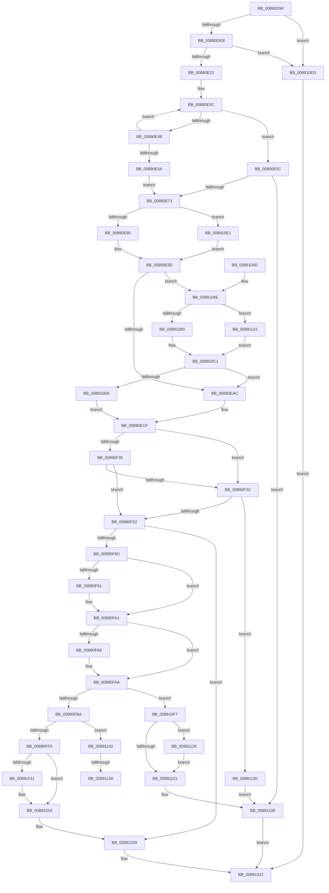

# AlpcpCreateSecurityContext

- RVA: `0x00890D94`–`0x0089115E` (길이 `970` bytes)
- VA: `0x0000000140890D94`
- 실행 섹션: `PAGE`
- PDB 이름 있음: `예`; PDB Function 태그: `예`
- unwind 정보 RVA: `0x0007D800`
- 디코드: `242`개 명령, `970/970` bytes 표시
- 미해석 바이트: `0` (있으면 어셈블리에 `.byte`로 보존)

> 이 문서는 커널 이미지의 기계어와 PDB 기호를 분석해 생성했습니다. 4번과 5번은 함수 원형과 자료형을 바이너리 사용 방식에서 추정한 C 해석이며 원본 소스 복구 결과는 아닙니다.

## 1. Dependencies

- 직접 호출 지점: **27**; 고유 호출 대상: **23**
- 직접 호출자로 확인된 함수: **4**
- RIP 상대 이미지 참조: **0**

### Outgoing calls
- `0x00890DC2` → [IoThreadToProcess](../../text/44/IoThreadToProcess_function_00448540.md) (function, `0x00448540`)
- `0x00890DDA` → [ExAllocatePool2](../../poolcode/B8/ExAllocatePool2_function_00B820F0.md) (function, `0x00B820F0`)
- `0x00890E2B` → [memset](../../text/6C/memset_function_006C6C40.md) (function, `0x006C6C40`)
- `0x00890E62` → [PsChargeProcessPagedPoolQuota](PsChargeProcessPagedPoolQuota_function_00891170.md) (function, `0x00891170`)
- `0x00890EB4` → [PsReferencePrimaryTokenWithTag](../../text/20/PsReferencePrimaryTokenWithTag_function_0020FF80.md) (function, `0x0020FF80`)
- `0x00890EE2` → [SepReconcileTrustSidWithProcessProtection](../../text/3E/SepReconcileTrustSidWithProcessProtection_function_003EDE50.md) (function, `0x003EDE50`)
- `0x00890F29` → [SepCreateClientSecurityEx](SepCreateClientSecurityEx_function_00891C90.md) (function, `0x00891C90`)
- `0x00890F44` → [ObfDereferenceObjectWithTag](../../text/2F/ObfDereferenceObjectWithTag_function_002F78E0.md) (function, `0x002F78E0`)
- `0x00890F5A` → [ObfReferenceObjectWithTag](../../text/21/ObfReferenceObjectWithTag_function_00210710.md) (function, `0x00210710`)
- `0x00890F7C` → [KeAbPreAcquire](../../text/21/KeAbPreAcquire_function_00210230.md) (function, `0x00210230`)
- `0x00890F9C` → [ExfAcquirePushLockSharedEx](../../text/21/ExfAcquirePushLockSharedEx_function_0021044C.md) (function, `0x0021044C`)
- `0x00890FBD` → [AlpcpStartInitialization](AlpcpStartInitialization_function_008920D8.md) (function, `0x008920D8`)
- `0x00890FC5` → [AlpcpReferenceBlob](AlpcpReferenceBlob_function_00890110.md) (function, `0x00890110`)
- `0x00890FDD` → [AlpcAddHandleTableEntry](AlpcAddHandleTableEntry_function_00892140.md) (function, `0x00892140`)
- `0x00890FF3` → [ObfReferenceObject](../../text/20/ObfReferenceObject_function_0020FA20.md) (function, `0x0020FA20`)
- `0x00891002` → [AlpcpInsertResourcePort](../88/AlpcpInsertResourcePort_function_008898DC.md) (function, `0x008898DC`)
- `0x00891014` → [ExfReleasePushLockShared](../../text/26/ExfReleasePushLockShared_function_00263440.md) (function, `0x00263440`)
- `0x0089101C` → [KeAbPostRelease](../../text/2E/KeAbPostRelease_function_002E1600.md) (function, `0x002E1600`)
- `0x00891024` → [AlpcpEndInitialization](../A2/AlpcpEndInitialization_function_00A20C78.md) (function, `0x00A20C78`)
- `0x0089106C` → [PspLockThreadSecurityShared](../../text/3C/PspLockThreadSecurityShared_function_003C4720.md) (function, `0x003C4720`)
- `0x00891093` → [ObfReferenceObjectWithTag](../../text/21/ObfReferenceObjectWithTag_function_00210710.md) (function, `0x00210710`)
- `0x008910C8` → [PspUnlockThreadSecurityShared](../../text/3C/PspUnlockThreadSecurityShared_function_003C2E40.md) (function, `0x003C2E40`)
- `0x00891104` → [KeAbPostRelease](../../text/2E/KeAbPostRelease_function_002E1600.md) (function, `0x002E1600`)
- `0x00891116` → [AlpcpDereferenceBlobEx](../88/AlpcpDereferenceBlobEx_function_0088AF00.md) (function, `0x0088AF00`)
- `0x00891129` → [ExfReleasePushLockShared](../../text/26/ExfReleasePushLockShared_function_00263440.md) (function, `0x00263440`)
- `0x00891138` → [AlpcpReleasePagedPoolQuota](../92/AlpcpReleasePagedPoolQuota_function_00922EE8.md) (function, `0x00922EE8`)
- `0x00891153` → [ExfReleasePushLockShared](../../text/26/ExfReleasePushLockShared_function_00263440.md) (function, `0x00263440`)

### Direct callers
- [AlpcpCaptureSecurityAttribute](AlpcpCaptureSecurityAttribute_function_00890540.md) at `0x00890763`
- [sub_008909EC](Unknown_function_008909EC.md) at `0x00890AA4`
- [NtAlpcCreateSecurityContext](NtAlpcCreateSecurityContext_function_00890B50.md) at `0x00890C8F`
- [AlpcCreateSecurityContext](../A7/AlpcCreateSecurityContext_function_00A70930.md) at `0x00A709B8`

### Static image references
- 디코드된 RIP-relative 메모리 참조가 없습니다.

## 2. Other-region calls and transfers

- 다른 실행 섹션으로 향하는 call: **18**
  - `0x00890DC2` → [IoThreadToProcess](../../text/44/IoThreadToProcess_function_00448540.md) (`PAGE` → `.text`)
  - `0x00890DDA` → [ExAllocatePool2](../../poolcode/B8/ExAllocatePool2_function_00B820F0.md) (`PAGE` → `POOLCODE`)
  - `0x00890E2B` → [memset](../../text/6C/memset_function_006C6C40.md) (`PAGE` → `.text`)
  - `0x00890EB4` → [PsReferencePrimaryTokenWithTag](../../text/20/PsReferencePrimaryTokenWithTag_function_0020FF80.md) (`PAGE` → `.text`)
  - `0x00890EE2` → [SepReconcileTrustSidWithProcessProtection](../../text/3E/SepReconcileTrustSidWithProcessProtection_function_003EDE50.md) (`PAGE` → `.text`)
  - `0x00890F44` → [ObfDereferenceObjectWithTag](../../text/2F/ObfDereferenceObjectWithTag_function_002F78E0.md) (`PAGE` → `.text`)
  - `0x00890F5A` → [ObfReferenceObjectWithTag](../../text/21/ObfReferenceObjectWithTag_function_00210710.md) (`PAGE` → `.text`)
  - `0x00890F7C` → [KeAbPreAcquire](../../text/21/KeAbPreAcquire_function_00210230.md) (`PAGE` → `.text`)
  - `0x00890F9C` → [ExfAcquirePushLockSharedEx](../../text/21/ExfAcquirePushLockSharedEx_function_0021044C.md) (`PAGE` → `.text`)
  - `0x00890FF3` → [ObfReferenceObject](../../text/20/ObfReferenceObject_function_0020FA20.md) (`PAGE` → `.text`)
  - `0x00891014` → [ExfReleasePushLockShared](../../text/26/ExfReleasePushLockShared_function_00263440.md) (`PAGE` → `.text`)
  - `0x0089101C` → [KeAbPostRelease](../../text/2E/KeAbPostRelease_function_002E1600.md) (`PAGE` → `.text`)
  - `0x0089106C` → [PspLockThreadSecurityShared](../../text/3C/PspLockThreadSecurityShared_function_003C4720.md) (`PAGE` → `.text`)
  - `0x00891093` → [ObfReferenceObjectWithTag](../../text/21/ObfReferenceObjectWithTag_function_00210710.md) (`PAGE` → `.text`)
  - `0x008910C8` → [PspUnlockThreadSecurityShared](../../text/3C/PspUnlockThreadSecurityShared_function_003C2E40.md) (`PAGE` → `.text`)
  - `0x00891104` → [KeAbPostRelease](../../text/2E/KeAbPostRelease_function_002E1600.md) (`PAGE` → `.text`)
  - `0x00891129` → [ExfReleasePushLockShared](../../text/26/ExfReleasePushLockShared_function_00263440.md) (`PAGE` → `.text`)
  - `0x00891153` → [ExfReleasePushLockShared](../../text/26/ExfReleasePushLockShared_function_00263440.md) (`PAGE` → `.text`)
- call이 아닌 외부 분기/꼬리 이동: **2**
  - `0x0089114A` → [sub_00B19414](../B1/Unknown_function_00B19414.md) (`tail-transfer`)
  - `0x00891159` → [sub_00B19414](../B1/Unknown_function_00B19414.md) (`tail-transfer`)

## 3. Assembly (complete function range)

```asm
00890D94  48 8B C4                        mov rax, rsp
00890D97  48 89 58 08                     mov qword ptr [rax + 8], rbx
00890D9B  4C 89 48 20                     mov qword ptr [rax + 0x20], r9
00890D9F  44 88 40 18                     mov byte ptr [rax + 0x18], r8b
00890DA3  55                              push rbp
00890DA4  56                              push rsi
00890DA5  57                              push rdi
00890DA6  41 54                           push r12
00890DA8  41 55                           push r13
00890DAA  41 56                           push r14
00890DAC  41 57                           push r15
00890DAE  48 8D 68 A9                     lea rbp, [rax - 0x57]
00890DB2  48 81 EC 90 00 00 00            sub rsp, 0x90
00890DB9  4C 8B F9                        mov r15, rcx
00890DBC  4C 8B F2                        mov r14, rdx
00890DBF  48 8B CA                        mov rcx, rdx
00890DC2  E8 79 77 BB FF                  call 0x140448540
00890DC7  BE A0 00 00 00                  mov esi, 0xa0
00890DCC  41 B8 41 6C 53 65               mov r8d, 0x65536c41
00890DD2  8B D6                           mov edx, esi
00890DD4  48 8B D8                        mov rbx, rax
00890DD7  8D 4E 60                        lea ecx, [rsi + 0x60]
00890DDA  E8 11 13 2F 00                  call 0x140b820f0
00890DDF  45 33 ED                        xor r13d, r13d
00890DE2  48 85 C0                        test rax, rax
00890DE5  0F 84 02 03 00 00               je 0x1408910ed
00890DEB  66 C7 40 10 00 03               mov word ptr [rax + 0x10], 0x300
00890DF1  48 8D 78 30                     lea rdi, [rax + 0x30]
00890DF5  44 89 68 12                     mov dword ptr [rax + 0x12], r13d
00890DF9  66 44 89 68 16                  mov word ptr [rax + 0x16], r13w
00890DFE  4C 89 68 28                     mov qword ptr [rax + 0x28], r13
00890E02  4C 89 68 20                     mov qword ptr [rax + 0x20], r13
00890E06  48 89 40 08                     mov qword ptr [rax + 8], rax
00890E0A  48 89 00                        mov qword ptr [rax], rax
00890E0D  80 60 10 FD                     and byte ptr [rax + 0x10], 0xfd
00890E11  48 C7 40 18 01 00 00 00         mov qword ptr [rax + 0x18], 1
00890E19  48 85 FF                        test rdi, rdi
00890E1C  0F 84 CB 02 00 00               je 0x1408910ed
00890E22  33 D2                           xor edx, edx
00890E24  44 8D 46 D0                     lea r8d, [rsi - 0x30]
00890E28  48 8B CF                        mov rcx, rdi
00890E2B  E8 10 5E E3 FF                  call 0x1406c6c40
00890E30  48 83 4F 08 FF                  or qword ptr [rdi + 8], 0xffffffffffffffff
00890E35  0F 0D 8B 98 05 00 00            prefetchw byte ptr [rbx + 0x598]
00890E3C  48 8B 83 98 05 00 00            mov rax, qword ptr [rbx + 0x598]
00890E43  48 3B C6                        cmp rax, rsi
00890E46  72 14                           jb 0x140890e5c
00890E48  48 8D 88 60 FF FF FF            lea rcx, [rax - 0xa0]
00890E4F  F0 48 0F B1 8B 98 05 00 00      lock cmpxchg qword ptr [rbx + 0x598], rcx
00890E58  75 E2                           jne 0x140890e3c
00890E5A  EB 15                           jmp 0x140890e71
00890E5C  48 8B D6                        mov rdx, rsi
00890E5F  48 8B CB                        mov rcx, rbx
00890E62  E8 09 03 00 00                  call 0x140891170
00890E67  8B F0                           mov esi, eax
00890E69  85 C0                           test eax, eax
00890E6B  0F 88 9D 02 00 00               js 0x14089110e
00890E71  65 48 8B 04 25 88 01 00 00      mov rax, qword ptr gs:[0x188]
00890E7A  45 8A E5                        mov r12b, r13b
00890E7D  44 89 6D F3                     mov dword ptr [rbp - 0xd], r13d
00890E81  44 88 6D EF                     mov byte ptr [rbp - 0x11], r13b
00890E85  44 88 6D F0                     mov byte ptr [rbp - 0x10], r13b
00890E89  4C 89 6D F7                     mov qword ptr [rbp - 9], r13
00890E8D  4C 3B F0                        cmp r14, rax
00890E90  0F 85 4B 02 00 00               jne 0x1408910e1
00890E96  4C 8B A8 B8 00 00 00            mov r13, qword ptr [rax + 0xb8]
00890E9D  41 8B 86 A0 05 00 00            mov eax, dword ptr [r14 + 0x5a0]
00890EA4  A8 08                           test al, 8
00890EA6  0F 85 A2 01 00 00               jne 0x14089104e
00890EAC  BA 53 65 43 63                  mov edx, 0x63436553
00890EB1  49 8B CD                        mov rcx, r13
00890EB4  E8 C7 F0 97 FF                  call 0x14020ff80
00890EB9  41 8A 8D FA 05 00 00            mov cl, byte ptr [r13 + 0x5fa]
00890EC0  48 8B F0                        mov rsi, rax
00890EC3  88 4D EF                        mov byte ptr [rbp - 0x11], cl
00890EC6  41 BE 01 00 00 00               mov r14d, 1
00890ECC  45 32 E4                        xor r12b, r12b
00890ECF  48 8B 8E 50 04 00 00            mov rcx, qword ptr [rsi + 0x450]
00890ED6  4C 8D 4D F7                     lea r9, [rbp - 9]
00890EDA  4C 8D 45 F0                     lea r8, [rbp - 0x10]
00890EDE  48 8D 55 EF                     lea rdx, [rbp - 0x11]
00890EE2  E8 69 CF B5 FF                  call 0x1403ede50
00890EE7  8A 45 F0                        mov al, byte ptr [rbp - 0x10]
00890EEA  4C 8D 47 20                     lea r8, [rdi + 0x20]
00890EEE  48 8B 4D F7                     mov rcx, qword ptr [rbp - 9]
00890EF2  45 33 ED                        xor r13d, r13d
00890EF5  4C 89 44 24 50                  mov qword ptr [rsp + 0x50], r8
00890EFA  45 8B CE                        mov r9d, r14d
00890EFD  48 89 4C 24 48                  mov qword ptr [rsp + 0x48], rcx
00890F02  45 33 C0                        xor r8d, r8d
00890F05  88 44 24 40                     mov byte ptr [rsp + 0x40], al
00890F09  48 8B CE                        mov rcx, rsi
00890F0C  8B 45 F3                        mov eax, dword ptr [rbp - 0xd]
00890F0F  4C 89 6C 24 38                  mov qword ptr [rsp + 0x38], r13
00890F14  44 88 6C 24 30                  mov byte ptr [rsp + 0x30], r13b
00890F19  89 44 24 28                     mov dword ptr [rsp + 0x28], eax
00890F1D  44 88 64 24 20                  mov byte ptr [rsp + 0x20], r12b
00890F22  4C 8B 65 77                     mov r12, qword ptr [rbp + 0x77]
00890F26  49 8B D4                        mov rdx, r12
00890F29  E8 62 0D 00 00                  call 0x140891c90
00890F2E  44 8B F0                        mov r14d, eax
00890F31  85 C0                           test eax, eax
00890F33  78 07                           js 0x140890f3c
00890F35  45 38 6C 24 08                  cmp byte ptr [r12 + 8], r13b
00890F3A  75 16                           jne 0x140890f52
00890F3C  BA 53 65 43 63                  mov edx, 0x63436553
00890F41  48 8B CE                        mov rcx, rsi
00890F44  E8 97 69 A6 FF                  call 0x1402f78e0
00890F49  45 85 F6                        test r14d, r14d
00890F4C  0F 88 DE 01 00 00               js 0x140891130
00890F52  BA 41 6C 70 63                  mov edx, 0x63706c41
00890F57  48 8B CB                        mov rcx, rbx
00890F5A  E8 B1 F7 97 FF                  call 0x140210710
00890F5F  48 89 5F 10                     mov qword ptr [rdi + 0x10], rbx
00890F63  44 38 6D 6F                     cmp byte ptr [rbp + 0x6f], r13b
00890F67  0F 84 BC 00 00 00               je 0x140891029
00890F6D  49 8D 9F 60 01 00 00            lea rbx, [r15 + 0x160]
00890F74  45 33 C0                        xor r8d, r8d
00890F77  48 8B CB                        mov rcx, rbx
00890F7A  33 D2                           xor edx, edx
00890F7C  E8 AF F2 97 FF                  call 0x140210230
00890F81  48 8B F0                        mov rsi, rax
00890F84  33 C0                           xor eax, eax
00890F86  44 8D 70 11                     lea r14d, [rax + 0x11]
00890F8A  F0 4C 0F B1 33                  lock cmpxchg qword ptr [rbx], r14
00890F8F  74 10                           je 0x140890fa1
00890F91  4C 8B CB                        mov r9, rbx
00890F94  4C 8B C6                        mov r8, rsi
00890F97  33 D2                           xor edx, edx
00890F99  48 8B CB                        mov rcx, rbx
00890F9C  E8 AB F4 97 FF                  call 0x14021044c
00890FA1  48 85 F6                        test rsi, rsi
00890FA4  74 04                           je 0x140890faa
00890FA6  C6 46 0A 01                     mov byte ptr [rsi + 0xa], 1
00890FAA  41 8B 8F A0 01 00 00            mov ecx, dword ptr [r15 + 0x1a0]
00890FB1  F6 C1 20                        test cl, 0x20
00890FB4  0F 85 3D 01 00 00               jne 0x1408910f7
00890FBA  48 8B CF                        mov rcx, rdi
00890FBD  E8 16 11 00 00                  call 0x1408920d8
00890FC2  48 8B CF                        mov rcx, rdi
00890FC5  E8 46 F1 FF FF                  call 0x140890110
00890FCA  49 8B 4F 10                     mov rcx, qword ptr [r15 + 0x10]
00890FCE  48 8D 55 0F                     lea rdx, [rbp + 0xf]
00890FD2  48 83 C1 28                     add rcx, 0x28
00890FD6  48 89 7D 0F                     mov qword ptr [rbp + 0xf], rdi
00890FDA  48 89 0F                        mov qword ptr [rdi], rcx
00890FDD  E8 5E 11 00 00                  call 0x140892140
00890FE2  48 89 47 08                     mov qword ptr [rdi + 8], rax
00890FE6  48 83 F8 FF                     cmp rax, -1
00890FEA  0F 84 52 01 00 00               je 0x140891142
00890FF0  49 8B CF                        mov rcx, r15
00890FF3  E8 28 EA 97 FF                  call 0x14020fa20
00890FF8  48 8B D7                        mov rdx, rdi
00890FFB  4C 89 7F 18                     mov qword ptr [rdi + 0x18], r15
00890FFF  49 8B CF                        mov rcx, r15
00891002  E8 D5 88 FF FF                  call 0x1408898dc
00891007  49 8B C6                        mov rax, r14
0089100A  F0 4C 0F B1 2B                  lock cmpxchg qword ptr [rbx], r13
0089100F  74 08                           je 0x140891019
00891011  48 8B CB                        mov rcx, rbx
00891014  E8 27 24 9D FF                  call 0x140263440
00891019  48 8B CB                        mov rcx, rbx
0089101C  E8 DF 05 A5 FF                  call 0x1402e1600
00891021  48 8B CF                        mov rcx, rdi
00891024  E8 4F FC 18 00                  call 0x140a20c78
00891029  48 8B 45 7F                     mov rax, qword ptr [rbp + 0x7f]
0089102D  48 89 38                        mov qword ptr [rax], rdi
00891030  33 C0                           xor eax, eax
00891032  48 8B 9C 24 D0 00 00 00         mov rbx, qword ptr [rsp + 0xd0]
0089103A  48 81 C4 90 00 00 00            add rsp, 0x90
00891041  41 5F                           pop r15
00891043  41 5E                           pop r14
00891045  41 5D                           pop r13
00891047  41 5C                           pop r12
00891049  5F                              pop rdi
0089104A  5E                              pop rsi
0089104B  5D                              pop rbp
0089104C  C3                              ret
0089104D  CC                              int3
0089104E  49 8B 86 20 02 00 00            mov rax, qword ptr [r14 + 0x220]
00891055  49 8B CE                        mov rcx, r14
00891058  48 89 45 FF                     mov qword ptr [rbp - 1], rax
0089105C  65 48 8B 04 25 88 01 00 00      mov rax, qword ptr gs:[0x188]
00891065  48 8B D0                        mov rdx, rax
00891068  48 89 45 07                     mov qword ptr [rbp + 7], rax
0089106C  E8 AF 36 B3 FF                  call 0x1403c4720
00891071  41 8B 86 A0 05 00 00            mov eax, dword ptr [r14 + 0x5a0]
00891078  A8 08                           test al, 8
0089107A  0F 84 A2 00 00 00               je 0x140891122
00891080  49 8B B6 38 05 00 00            mov rsi, qword ptr [r14 + 0x538]
00891087  BA 53 65 43 63                  mov edx, 0x63436553
0089108C  48 83 E6 F8                     and rsi, 0xfffffffffffffff8
00891090  48 8B CE                        mov rcx, rsi
00891093  E8 78 F6 97 FF                  call 0x140210710
00891098  41 8B 86 38 05 00 00            mov eax, dword ptr [r14 + 0x538]
0089109F  45 8A A6 38 05 00 00            mov r12b, byte ptr [r14 + 0x538]
008910A6  83 E0 03                        and eax, 3
008910A9  89 45 F3                        mov dword ptr [rbp - 0xd], eax
008910AC  48 8B 45 FF                     mov rax, qword ptr [rbp - 1]
008910B0  41 C0 EC 02                     shr r12b, 2
008910B4  41 80 E4 01                     and r12b, 1
008910B8  8A 80 FA 05 00 00               mov al, byte ptr [rax + 0x5fa]
008910BE  88 45 EF                        mov byte ptr [rbp - 0x11], al
008910C1  48 8B 55 07                     mov rdx, qword ptr [rbp + 7]
008910C5  49 8B CE                        mov rcx, r14
008910C8  E8 73 1D B3 FF                  call 0x1403c2e40
008910CD  48 85 F6                        test rsi, rsi
008910D0  0F 84 D6 FD FF FF               je 0x140890eac
008910D6  41 BE 02 00 00 00               mov r14d, 2
008910DC  E9 EE FD FF FF                  jmp 0x140890ecf
008910E1  4D 8B AE 20 02 00 00            mov r13, qword ptr [r14 + 0x220]
008910E8  E9 B0 FD FF FF                  jmp 0x140890e9d
008910ED  B8 9A 00 00 C0                  mov eax, 0xc000009a
008910F2  E9 3B FF FF FF                  jmp 0x140891032
008910F7  49 8B C6                        mov rax, r14
008910FA  F0 4C 0F B1 2B                  lock cmpxchg qword ptr [rbx], r13
008910FF  75 25                           jne 0x140891126
00891101  48 8B CB                        mov rcx, rbx
00891104  E8 F7 04 A5 FF                  call 0x1402e1600
00891109  BE 9A 00 00 C0                  mov esi, 0xc000009a
0089110E  BA 01 00 00 00                  mov edx, 1
00891113  48 8B CF                        mov rcx, rdi
00891116  E8 E5 9D FF FF                  call 0x14088af00
0089111B  8B C6                           mov eax, esi
0089111D  E9 10 FF FF FF                  jmp 0x140891032
00891122  33 F6                           xor esi, esi
00891124  EB 9B                           jmp 0x1408910c1
00891126  48 8B CB                        mov rcx, rbx
00891129  E8 12 23 9D FF                  call 0x140263440
0089112E  EB D1                           jmp 0x140891101
00891130  BA A0 00 00 00                  mov edx, 0xa0
00891135  48 8B CB                        mov rcx, rbx
00891138  E8 AB 1D 09 00                  call 0x140922ee8
0089113D  41 8B F6                        mov esi, r14d
00891140  EB CC                           jmp 0x14089110e
00891142  49 8B C6                        mov rax, r14
00891145  F0 4C 0F B1 2B                  lock cmpxchg qword ptr [rbx], r13
0089114A  0F 84 C4 82 28 00               je 0x140b19414
00891150  48 8B CB                        mov rcx, rbx
00891153  E8 E8 22 9D FF                  call 0x140263440
00891158  90                              nop
00891159  E9 B6 82 28 00                  jmp 0x140b19414
```

## 4. C-style interpretation (structured pseudocode)

```c
__int64 __fastcall AlpcpCreateSecurityContext(__int64 a1, __int64 a2, unsigned __int8 a3, __int64 a4)
{
    __int64 result;
    __int64 v_r12;
    __int64 v_r13;
    __int64 v_rsi;
    __int64 v_rsp;
    unsigned __int64 v_stack_m78;
    unsigned __int64 v_stack_m80;
    unsigned __int8 v_stack_m88;
    unsigned __int64 v_stack_m90;
    unsigned __int8 v_stack_m98;
    unsigned int v_stack_mA0;
    unsigned __int8 v_stack_mA8;
    unsigned __int64 v_stack_p8;

    *(unsigned __int64 *)(v_rsp + 8) = v_rbx;
    *(unsigned __int64 *)(v_rsp + 32) = a4;
    *(unsigned __int8 *)(v_rsp + 24) = a3;
    v_rsp = (v_rsp) - (144);
    result = IoThreadToProcess(a2, a2, a3, a4);
    result = ExAllocatePool2(160 + 96, 160, (unsigned int)(0x65536C41ULL), a4);
    v_r13 = 0;
    if (result == 0) goto loc_008910ED;
    *(unsigned __int16 *)(result + 16) = 768;
    *(unsigned int *)(result + 18) = 0;
    *(unsigned __int16 *)(result + 22) = 0;
    *(unsigned __int64 *)(result + 40) = 0;
    *(unsigned __int64 *)(result + 32) = 0;
    *(unsigned __int64 *)(result + 8) = result;
    *(unsigned __int64 *)(result) = result;
    *(unsigned __int64 *)(result + 24) = 1;
    if (result + 48 == 0) goto loc_008910ED;
    a2 = 0;
    result = memset(result + 48, a2, 160 - 48, a4);
loc_00890E3C:
    if ((*(unsigned __int64 *)(result + 1432)) < 160) goto loc_00890E5C;
    if ((*(unsigned __int64 *)(result + 1432)) != 160) goto loc_00890E3C;
    goto loc_00890E71;
loc_00890E5C:
    result = PsChargeProcessPagedPoolQuota(result, 160, 160 - 48, a4);
    if (sign_flag) goto loc_0089110E;
loc_00890E71:
    *(unsigned int *)(v_rsp - 87 - 13) = 0;
    *(unsigned __int8 *)(v_rsp - 87 - 17) = 0;
    *(unsigned __int8 *)(v_rsp - 87 - 16) = 0;
    *(unsigned __int64 *)(v_rsp - 87 - 9) = 0;
    if (0 != (*(unsigned __int64 *)(gs_base + (0 + 392)))) goto loc_008910E1;
loc_00890E9D:
    if ((((unsigned __int8)((unsigned int)(*(unsigned int *)(a2 + 1440)))) & (8)) != 0) goto loc_0089104E;
loc_00890EAC:
    result = PsReferencePrimaryTokenWithTag(*(unsigned __int64 *)(*(unsigned __int64 *)(gs_base + (0 + 392)) + 184), (unsigned int)(0x63436553ULL), 160 - 48, a4);
    *(unsigned __int8 *)(v_rsp - 87 - 17) = (unsigned __int8)(*(unsigned __int8 *)(*(unsigned __int64 *)(*(unsigned __int64 *)(gs_base + (0 + 392)) + 184) + 1530));
    v_r12 = 0;
loc_00890ECF:
    result = SepReconcileTrustSidWithProcessProtection(*(unsigned __int64 *)(result + 1104), v_rsp - 87 - 17, v_rsp - 87 - 16, v_rsp - 87 - 9);
    v_r13 = 0;
    v_stack_m78 = result + 48 + 32;
    v_stack_m80 = *(unsigned __int64 *)(v_rsp - 87 - 9);
    a3 = 0;
    v_stack_m88 = (unsigned __int8)(*(unsigned __int8 *)(v_rsp - 87 - 16));
    v_stack_m90 = 0;
    v_stack_m98 = 0;
    v_stack_mA0 = (unsigned int)((unsigned int)(*(unsigned int *)(v_rsp - 87 - 13)));
    v_stack_mA8 = 0;
    result = SepCreateClientSecurityEx(result, *(unsigned __int64 *)(v_rsp - 87 + 119), a3, 1);
    if (sign_flag) goto loc_00890F3C;
    if ((*(unsigned __int8 *)(*(unsigned __int64 *)(v_rsp - 87 + 119) + 8)) != 0) goto loc_00890F52;
loc_00890F3C:
    result = ObfDereferenceObjectWithTag(result, (unsigned int)(0x63436553ULL), a3, 1);
    if (sign_flag) goto loc_00891130;
loc_00890F52:
    result = ObfReferenceObjectWithTag(result, (unsigned int)(0x63706C41ULL), a3, 1);
    *(unsigned __int64 *)(result + 48 + 16) = result;
    if ((*(unsigned __int8 *)(v_rsp - 87 + 111)) == 0) goto loc_00891029;
    a3 = 0;
    a2 = 0;
    result = KeAbPreAcquire(a1 + 352, a2, a3, 1);
    result = 0;
    if (!(condition_is_equal)) {
        a4 = a1 + 352;
        a3 = 0;
        a2 = 0;
        a1 = a1 + 352;
        result = ExfAcquirePushLockSharedEx(a1, a2, a3, a4);
    }
    if (result != 0) {
        *(unsigned __int8 *)(result + 10) = 1;
    }
    if ((((unsigned __int8)((unsigned int)(*(unsigned int *)(a1 + 416)))) & (32)) != 0) goto loc_008910F7;
    result = AlpcpStartInitialization(result + 48, a2, a3, a4);
    result = AlpcpReferenceBlob(result + 48, a2, a3, a4);
    a1 = (*(unsigned __int64 *)(a1 + 16)) + (40);
    *(unsigned __int64 *)(v_rsp - 87 + 15) = result + 48;
    *(unsigned __int64 *)(result + 48) = a1;
    result = AlpcAddHandleTableEntry(a1, v_rsp - 87 + 15, a3, a4);
    *(unsigned __int64 *)(result + 48 + 8) = result;
    if (result == -1) goto loc_00891142;
    result = ObfReferenceObject(a1, v_rsp - 87 + 15, a3, a4);
    *(unsigned __int64 *)(result + 48 + 24) = a1;
    result = AlpcpInsertResourcePort(a1, result + 48, a3, a4);
    result = result + 17;
    if (result != -1) {
        a1 = a1 + 352;
        result = ExfReleasePushLockShared(a1, result + 48, a3, a4);
    }
    result = KeAbPostRelease(a1 + 352, result + 48, a3, a4);
    result = AlpcpEndInitialization(result + 48, result + 48, a3, a4);
loc_00891029:
    *(unsigned __int64 *)(*(unsigned __int64 *)(v_rsp - 87 + 127)) = result + 48;
    result = 0;
loc_00891032:
    v_rsp = (v_rsp) + (144);
    return result;
loc_0089104E:
    *(unsigned __int64 *)(v_rsp - 87 - 1) = *(unsigned __int64 *)(result + 17 + 544);
    *(unsigned __int64 *)(v_rsp - 87 + 7) = *(unsigned __int64 *)(gs_base + (0 + 392));
    result = PspLockThreadSecurityShared(result + 17, *(unsigned __int64 *)(gs_base + (0 + 392)), a3, a4);
    if ((((unsigned __int8)((unsigned int)(*(unsigned int *)(result + 17 + 1440)))) & (8)) == 0) goto loc_00891122;
    v_rsi = (*(unsigned __int64 *)(result + 17 + 1336)) & (-8);
    result = ObfReferenceObjectWithTag(v_rsi, (unsigned int)(0x63436553ULL), a3, a4);
    result = (unsigned int)(((unsigned int)(*(unsigned int *)(result + 17 + 1336))) & (3));
    *(unsigned int *)(v_rsp - 87 - 13) = (unsigned int)(result);
    v_r12 = (unsigned __int8)((*(unsigned __int8 *)(result + 17 + 1336)) >> (2));
    v_r12 = (unsigned __int8)((v_r12) & (1));
    *(unsigned __int8 *)(v_rsp - 87 - 17) = (unsigned __int8)(*(unsigned __int8 *)(*(unsigned __int64 *)(v_rsp - 87 - 1) + 1530));
loc_008910C1:
    result = PspUnlockThreadSecurityShared(result + 17, *(unsigned __int64 *)(v_rsp - 87 + 7), a3, a4);
    if (v_rsi == 0) goto loc_00890EAC;
    goto loc_00890ECF;
loc_008910E1:
    goto loc_00890E9D;
loc_008910ED:
    goto loc_00891032;
loc_008910F7:
    if (v_rsi != 0) goto loc_00891126;
loc_00891101:
    result = KeAbPostRelease(v_stack_p8, *(unsigned __int64 *)(v_rsp - 87 + 7), a3, a4);
loc_0089110E:
    result = AlpcpDereferenceBlobEx(result + 48, 1, a3, a4);
    goto loc_00891032;
loc_00891122:
    v_rsi = 0;
    goto loc_008910C1;
loc_00891126:
    result = ExfReleasePushLockShared(v_stack_p8, 1, a3, a4);
    goto loc_00891101;
loc_00891130:
    result = AlpcpReleasePagedPoolQuota(v_stack_p8, 160, a3, a4);
    goto loc_0089110E;
loc_00891142:
    result = ExfReleasePushLockShared(v_stack_p8, 160, a3, a4);
}
```

## 5. (Beta) C Style

```c
int64_t AlpcpCreateSecurityContext(void *Arg1, int64_t Arg2, uint8_t Arg3, int64_t Arg4)
{
    uint8_t *arg1 = (uint8_t *)Arg1;

    int64_t result;
    int64_t local_r12;
    int64_t local_r13;
    int64_t local_rsi;
    int64_t local_rsp;
    uint64_t v_stack_m78;
    uint64_t v_stack_m80;
    uint8_t v_stack_m88;
    uint64_t v_stack_m90;
    uint8_t v_stack_m98;
    uint32_t v_stack_mA0;
    uint8_t v_stack_mA8;
    uint64_t v_stack_p8;

    *(uint64_t *)(local_rsp + 0x8) = local_rbx;
    *(uint64_t *)(local_rsp + 0x20) = Arg4;
    *(uint8_t *)(local_rsp + 0x18) = Arg3;
    local_rsp = (local_rsp) - (144);
    result = IoThreadToProcess(Arg2, Arg2, Arg3, Arg4);
    result = ExAllocatePool2(160 + 96, 160, (uint32_t)(0x65536C41ULL), Arg4);
    local_r13 = 0;
    if (result == 0) goto loc_008910ED;
    *(uint16_t *)(result + 0x10) = 768;
    *(uint32_t *)(result + 0x12) = 0;
    *(uint16_t *)(result + 0x16) = 0;
    *(uint64_t *)(result + 0x28) = 0;
    *(uint64_t *)(result + 0x20) = 0;
    *(uint64_t *)(result + 0x8) = result;
    *(uint64_t *)(result) = result;
    *(uint64_t *)(result + 0x18) = 1;
    if (result + 48 == 0) goto loc_008910ED;
    Arg2 = 0;
    result = memset(result + 48, Arg2, 160 - 48, Arg4);
loc_00890E3C:
    if ((*(uint64_t *)(result + 0x598)) < 160) goto loc_00890E5C;
    if ((*(uint64_t *)(result + 0x598)) != 160) goto loc_00890E3C;
    goto loc_00890E71;
loc_00890E5C:
    result = PsChargeProcessPagedPoolQuota(result, 160, 160 - 48, Arg4);
    if (sign_flag) goto loc_0089110E;
loc_00890E71:
    *(uint32_t *)(local_rsp - 0x57 - 0xD) = 0;
    *(uint8_t *)(local_rsp - 0x57 - 0x11) = 0;
    *(uint8_t *)(local_rsp - 0x57 - 0x10) = 0;
    *(uint64_t *)(local_rsp - 0x57 - 0x9) = 0;
    if (0 != (*(uint64_t *)(gs_base + (0 + 0x188)))) goto loc_008910E1;
loc_00890E9D:
    if ((((uint8_t)((uint32_t)(*(uint32_t *)(Arg2 + 0x5A0)))) & (8)) != 0) goto loc_0089104E;
loc_00890EAC:
    result = PsReferencePrimaryTokenWithTag(*(uint64_t *)(*(uint64_t *)(gs_base + (0 + 0x188)) + 0xB8), (uint32_t)(0x63436553ULL), 160 - 48, Arg4);
    *(uint8_t *)(local_rsp - 0x57 - 0x11) = (uint8_t)(*(uint8_t *)(*(uint64_t *)(*(uint64_t *)(gs_base + (0 + 0x188)) + 0xB8) + 0x5FA));
    local_r12 = 0;
loc_00890ECF:
    result = SepReconcileTrustSidWithProcessProtection(*(uint64_t *)(result + 0x450), local_rsp - 87 - 17, local_rsp - 87 - 16, local_rsp - 87 - 9);
    local_r13 = 0;
    v_stack_m78 = result + 48 + 32;
    v_stack_m80 = *(uint64_t *)(local_rsp - 0x57 - 0x9);
    Arg3 = 0;
    v_stack_m88 = (uint8_t)(*(uint8_t *)(local_rsp - 0x57 - 0x10));
    v_stack_m90 = 0;
    v_stack_m98 = 0;
    v_stack_mA0 = (uint32_t)((uint32_t)(*(uint32_t *)(local_rsp - 0x57 - 0xD)));
    v_stack_mA8 = 0;
    result = SepCreateClientSecurityEx(result, *(uint64_t *)(local_rsp - 0x57 + 0x77), Arg3, 1);
    if (sign_flag) goto loc_00890F3C;
    if ((*(uint8_t *)(*(uint64_t *)(local_rsp - 0x57 + 0x77) + 0x8)) != 0) goto loc_00890F52;
loc_00890F3C:
    result = ObfDereferenceObjectWithTag(result, (uint32_t)(0x63436553ULL), Arg3, 1);
    if (sign_flag) goto loc_00891130;
loc_00890F52:
    result = ObfReferenceObjectWithTag(result, (uint32_t)(0x63706C41ULL), Arg3, 1);
    *(uint64_t *)(result + 0x30 + 0x10) = result;
    if ((*(uint8_t *)(local_rsp - 0x57 + 0x6F)) == 0) goto loc_00891029;
    Arg3 = 0;
    Arg2 = 0;
    result = KeAbPreAcquire(Arg1 + 352, Arg2, Arg3, 1);
    result = 0;
    if (!(condition_is_equal)) {
        Arg4 = Arg1 + 352;
        Arg3 = 0;
        Arg2 = 0;
        Arg1 = Arg1 + 352;
        result = ExfAcquirePushLockSharedEx(Arg1, Arg2, Arg3, Arg4);
    }
    if (result != 0) {
        *(uint8_t *)(result + 0xA) = 1;
    }
    if ((((uint8_t)((uint32_t)(*(uint32_t *)(arg1 + 0x1A0)))) & (32)) != 0) goto loc_008910F7;
    result = AlpcpStartInitialization(result + 48, Arg2, Arg3, Arg4);
    result = AlpcpReferenceBlob(result + 48, Arg2, Arg3, Arg4);
    Arg1 = (*(uint64_t *)(arg1 + 0x10)) + (40);
    *(uint64_t *)(local_rsp - 0x57 + 0xF) = result + 48;
    *(void **)(result + 0x30) = Arg1;
    result = AlpcAddHandleTableEntry(Arg1, local_rsp - 87 + 15, Arg3, Arg4);
    *(uint64_t *)(result + 0x30 + 0x8) = result;
    if (result == -1) goto loc_00891142;
    result = ObfReferenceObject(Arg1, local_rsp - 87 + 15, Arg3, Arg4);
    *(void **)(result + 0x30 + 0x18) = Arg1;
    result = AlpcpInsertResourcePort(Arg1, result + 48, Arg3, Arg4);
    result = result + 17;
    if (result != -1) {
        Arg1 = Arg1 + 352;
        result = ExfReleasePushLockShared(Arg1, result + 48, Arg3, Arg4);
    }
    result = KeAbPostRelease(Arg1 + 352, result + 48, Arg3, Arg4);
    result = AlpcpEndInitialization(result + 48, result + 48, Arg3, Arg4);
loc_00891029:
    *(uint64_t *)(*(uint64_t *)(local_rsp - 0x57 + 0x7F)) = result + 48;
    result = 0;
loc_00891032:
    local_rsp = (local_rsp) + (144);
    return result;
loc_0089104E:
    *(uint64_t *)(local_rsp - 0x57 - 0x1) = *(uint64_t *)(result + 0x11 + 0x220);
    *(uint64_t *)(local_rsp - 0x57 + 0x7) = *(uint64_t *)(gs_base + (0 + 0x188));
    result = PspLockThreadSecurityShared(result + 17, *(uint64_t *)(gs_base + (0 + 0x188)), Arg3, Arg4);
    if ((((uint8_t)((uint32_t)(*(uint32_t *)(result + 0x11 + 0x5A0)))) & (8)) == 0) goto loc_00891122;
    local_rsi = (*(uint64_t *)(result + 0x11 + 0x538)) & (-8);
    result = ObfReferenceObjectWithTag(local_rsi, (uint32_t)(0x63436553ULL), Arg3, Arg4);
    result = (uint32_t)(((uint32_t)(*(uint32_t *)(result + 0x11 + 0x538))) & (3));
    *(uint32_t *)(local_rsp - 0x57 - 0xD) = (uint32_t)(result);
    local_r12 = (uint8_t)((*(uint8_t *)(result + 0x11 + 0x538)) >> (2));
    local_r12 = (uint8_t)((local_r12) & (1));
    *(uint8_t *)(local_rsp - 0x57 - 0x11) = (uint8_t)(*(uint8_t *)(*(uint64_t *)(local_rsp - 0x57 - 0x1) + 0x5FA));
loc_008910C1:
    result = PspUnlockThreadSecurityShared(result + 17, *(uint64_t *)(local_rsp - 0x57 + 0x7), Arg3, Arg4);
    if (local_rsi == 0) goto loc_00890EAC;
    goto loc_00890ECF;
loc_008910E1:
    goto loc_00890E9D;
loc_008910ED:
    goto loc_00891032;
loc_008910F7:
    if (local_rsi != 0) goto loc_00891126;
loc_00891101:
    result = KeAbPostRelease(v_stack_p8, *(uint64_t *)(local_rsp - 0x57 + 0x7), Arg3, Arg4);
loc_0089110E:
    result = AlpcpDereferenceBlobEx(result + 48, 1, Arg3, Arg4);
    goto loc_00891032;
loc_00891122:
    local_rsi = 0;
    goto loc_008910C1;
loc_00891126:
    result = ExfReleasePushLockShared(v_stack_p8, 1, Arg3, Arg4);
    goto loc_00891101;
loc_00891130:
    result = AlpcpReleasePagedPoolQuota(v_stack_p8, 160, Arg3, Arg4);
    goto loc_0089110E;
loc_00891142:
    result = ExfReleasePushLockShared(v_stack_p8, 160, Arg3, Arg4);
}
```

### 관측된 메모리 오프셋

구조체 형식이 확인되지 않은 접근은 인자 기준의 오프셋으로만 기록했습니다.

| 기준 인자 | 오프셋 표현 | 폭 (bit) | 접근 |
|---|---:|---:|---|
| `Arg1` | `+ 0x0` | `64` | `R` |
| `Arg1` | `+ 0x10` | `64` | `R` |
| `Arg1` | `+ 0x160` | `64` | `R` |
| `Arg1` | `+ 0x1A0` | `32` | `R` |

## 6. Execution-region graph

[열기: 2D/3D 그래프와 함수 탐색 컨트롤 패널](../../../control-panel.html?section=page&rva=0x00890D94&view=graph)

- 2D 그래프는 위에서 아래로 흐르고, 3D 그래프는 빈 공간을 드래그해 회전합니다. Shift+드래그는 이동, 휠은 확대·축소, 함수 노드 선택은 대상 보고서 이동입니다.

### Static fallback


