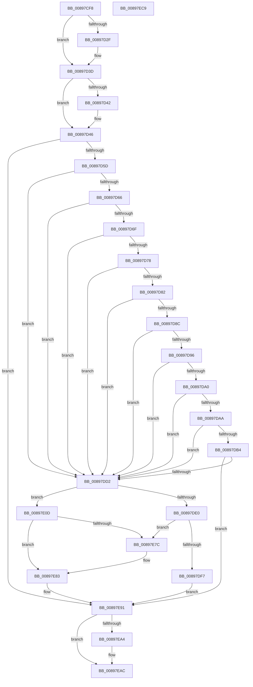

# AlpcpEnterStateChangeEventMessageLog

- RVA: `0x00897CF8`–`0x00897ECA` (길이 `466` bytes)
- VA: `0x0000000140897CF8`
- 실행 섹션: `PAGE`
- PDB 이름 있음: `예`; PDB Function 태그: `아니요`
- unwind 정보 RVA: `0x0005C954`
- 디코드: `120`개 명령, `466/466` bytes 표시
- 미해석 바이트: `0` (있으면 어셈블리에 `.byte`로 보존)

> 이 문서는 커널 이미지의 기계어와 PDB 기호를 분석해 생성했습니다. 4번과 5번은 함수 원형과 자료형을 바이너리 사용 방식에서 추정한 C 해석이며 원본 소스 복구 결과는 아닙니다.

## 1. Dependencies

- 직접 호출 지점: **7**; 고유 호출 대상: **7**
- 직접 호출자로 확인된 함수: **1**
- RIP 상대 이미지 참조: **5**

### Outgoing calls
- `0x00897D1E` → [KeAbPreAcquire](../../text/21/KeAbPreAcquire_function_00210230.md) (function, `0x00210230`)
- `0x00897D38` → [ExfAcquirePushLockExclusiveEx](../../text/20/ExfAcquirePushLockExclusiveEx_function_0020FC90.md) (function, `0x0020FC90`)
- `0x00897D4C` → [AlpcpLocateMessageLog](../AC/AlpcpLocateMessageLog_function_00ACCC54.md) (function, `0x00ACCC54`)
- `0x00897DC5` → [memcmp](../../text/6C/memcmp_function_006C6B10.md) (function, `0x006C6B10`)
- `0x00897DD2` → [AlpcpAllocateSnapshotMessageLog](../74/AlpcpAllocateSnapshotMessageLog_function_0074D400.md) (function, `0x0074D400`)
- `0x00897EA7` → [ExfTryToWakePushLock](../../text/26/ExfTryToWakePushLock_function_00265DD0.md) (function, `0x00265DD0`)
- `0x00897EAF` → [KeAbPostRelease](../../text/2E/KeAbPostRelease_function_002E1600.md) (function, `0x002E1600`)

### Direct callers
- [AlpcpUnlockMessage](AlpcpUnlockMessage_function_00897AE0.md) at `0x00897AF2`

### Static image references
- `0x00897D0F` → RVA `0x00F10080` (`.data`; read)
- `0x00897DE0` → RVA `0x00F10098` (`.data`; read)
- `0x00897DE7` → RVA `0x00F10090` (`.data`; read)
- `0x00897E01` → RVA `0x00F10098` (`.data`; write)
- `0x00897E95` → RVA `0x00F10080` (`.data`; read/write)

## 2. Other-region calls and transfers

- 다른 실행 섹션으로 향하는 call: **5**
  - `0x00897D1E` → [KeAbPreAcquire](../../text/21/KeAbPreAcquire_function_00210230.md) (`PAGE` → `.text`)
  - `0x00897D38` → [ExfAcquirePushLockExclusiveEx](../../text/20/ExfAcquirePushLockExclusiveEx_function_0020FC90.md) (`PAGE` → `.text`)
  - `0x00897DC5` → [memcmp](../../text/6C/memcmp_function_006C6B10.md) (`PAGE` → `.text`)
  - `0x00897EA7` → [ExfTryToWakePushLock](../../text/26/ExfTryToWakePushLock_function_00265DD0.md) (`PAGE` → `.text`)
  - `0x00897EAF` → [KeAbPostRelease](../../text/2E/KeAbPostRelease_function_002E1600.md) (`PAGE` → `.text`)
- 별도 외부 분기/꼬리 이동을 확인하지 못했습니다.

## 3. Assembly (complete function range)

```asm
00897CF8  48 89 5C 24 08                  mov qword ptr [rsp + 8], rbx
00897CFD  48 89 6C 24 10                  mov qword ptr [rsp + 0x10], rbp
00897D02  48 89 74 24 18                  mov qword ptr [rsp + 0x18], rsi
00897D07  57                              push rdi
00897D08  48 83 EC 20                     sub rsp, 0x20
00897D0C  48 8B D9                        mov rbx, rcx
00897D0F  48 8D 2D 6A 83 67 00            lea rbp, [rip + 0x67836a]
00897D16  48 8B CD                        mov rcx, rbp
00897D19  45 33 C0                        xor r8d, r8d
00897D1C  33 D2                           xor edx, edx
00897D1E  E8 0D 85 97 FF                  call 0x140210230
00897D23  F0 48 0F BA 6D 00 00            lock bts qword ptr [rbp], 0
00897D2A  48 8B F8                        mov rdi, rax
00897D2D  73 0E                           jae 0x140897d3d
00897D2F  4C 8B C5                        mov r8, rbp
00897D32  48 8B D0                        mov rdx, rax
00897D35  48 8B CD                        mov rcx, rbp
00897D38  E8 53 7F 97 FF                  call 0x14020fc90
00897D3D  48 85 FF                        test rdi, rdi
00897D40  74 04                           je 0x140897d46
00897D42  C6 47 0A 01                     mov byte ptr [rdi + 0xa], 1
00897D46  8B 8B 08 01 00 00               mov ecx, dword ptr [rbx + 0x108]
00897D4C  E8 03 4F 23 00                  call 0x140accc54
00897D51  48 8B F0                        mov rsi, rax
00897D54  48 85 C0                        test rax, rax
00897D57  0F 84 34 01 00 00               je 0x140897e91
00897D5D  48 8D 78 30                     lea rdi, [rax + 0x30]
00897D61  48 39 3F                        cmp qword ptr [rdi], rdi
00897D64  74 6C                           je 0x140897dd2
00897D66  4C 8B 40 38                     mov r8, qword ptr [rax + 0x38]
00897D6A  4D 85 C0                        test r8, r8
00897D6D  74 63                           je 0x140897dd2
00897D6F  8B 4B 28                        mov ecx, dword ptr [rbx + 0x28]
00897D72  41 39 48 10                     cmp dword ptr [r8 + 0x10], ecx
00897D76  75 5A                           jne 0x140897dd2
00897D78  48 8B 43 18                     mov rax, qword ptr [rbx + 0x18]
00897D7C  49 39 40 18                     cmp qword ptr [r8 + 0x18], rax
00897D80  75 50                           jne 0x140897dd2
00897D82  48 8B 43 10                     mov rax, qword ptr [rbx + 0x10]
00897D86  49 39 40 20                     cmp qword ptr [r8 + 0x20], rax
00897D8A  75 46                           jne 0x140897dd2
00897D8C  48 8B 43 20                     mov rax, qword ptr [rbx + 0x20]
00897D90  49 39 40 30                     cmp qword ptr [r8 + 0x30], rax
00897D94  75 3C                           jne 0x140897dd2
00897D96  48 8B 43 40                     mov rax, qword ptr [rbx + 0x40]
00897D9A  49 39 40 28                     cmp qword ptr [r8 + 0x28], rax
00897D9E  75 32                           jne 0x140897dd2
00897DA0  48 8B 43 68                     mov rax, qword ptr [rbx + 0x68]
00897DA4  49 39 40 38                     cmp qword ptr [r8 + 0x38], rax
00897DA8  75 28                           jne 0x140897dd2
00897DAA  48 8B 43 70                     mov rax, qword ptr [rbx + 0x70]
00897DAE  49 39 40 40                     cmp qword ptr [r8 + 0x40], rax
00897DB2  75 1E                           jne 0x140897dd2
00897DB4  49 8D 48 50                     lea rcx, [r8 + 0x50]
00897DB8  41 B8 28 00 00 00               mov r8d, 0x28
00897DBE  48 8D 93 F0 00 00 00            lea rdx, [rbx + 0xf0]
00897DC5  E8 46 ED E2 FF                  call 0x1406c6b10
00897DCA  85 C0                           test eax, eax
00897DCC  0F 84 BF 00 00 00               je 0x140897e91
00897DD2  E8 29 56 EB FF                  call 0x14074d400
00897DD7  83 7E 2C 00                     cmp dword ptr [rsi + 0x2c], 0
00897DDB  48 8B C8                        mov rcx, rax
00897DDE  75 2D                           jne 0x140897e0d
00897DE0  48 8B 05 B1 82 67 00            mov rax, qword ptr [rip + 0x6782b1]
00897DE7  48 8D 15 A2 82 67 00            lea rdx, [rip + 0x6782a2]
00897DEE  48 39 10                        cmp qword ptr [rax], rdx
00897DF1  0F 85 85 00 00 00               jne 0x140897e7c
00897DF7  48 89 11                        mov qword ptr [rcx], rdx
00897DFA  48 89 41 08                     mov qword ptr [rcx + 8], rax
00897DFE  48 89 08                        mov qword ptr [rax], rcx
00897E01  48 89 0D 90 82 67 00            mov qword ptr [rip + 0x678290], rcx
00897E08  E9 84 00 00 00                  jmp 0x140897e91
00897E0D  8B 43 28                        mov eax, dword ptr [rbx + 0x28]
00897E10  89 41 10                        mov dword ptr [rcx + 0x10], eax
00897E13  48 8B 43 18                     mov rax, qword ptr [rbx + 0x18]
00897E17  48 89 41 18                     mov qword ptr [rcx + 0x18], rax
00897E1B  48 8B 43 10                     mov rax, qword ptr [rbx + 0x10]
00897E1F  48 89 41 20                     mov qword ptr [rcx + 0x20], rax
00897E23  48 8B 43 40                     mov rax, qword ptr [rbx + 0x40]
00897E27  48 89 41 28                     mov qword ptr [rcx + 0x28], rax
00897E2B  48 8B 43 20                     mov rax, qword ptr [rbx + 0x20]
00897E2F  48 89 41 30                     mov qword ptr [rcx + 0x30], rax
00897E33  48 8B 43 68                     mov rax, qword ptr [rbx + 0x68]
00897E37  48 89 41 38                     mov qword ptr [rcx + 0x38], rax
00897E3B  48 8B 43 70                     mov rax, qword ptr [rbx + 0x70]
00897E3F  83 61 14 00                     and dword ptr [rcx + 0x14], 0
00897E43  48 89 41 40                     mov qword ptr [rcx + 0x40], rax
00897E47  48 8B 44 24 28                  mov rax, qword ptr [rsp + 0x28]
00897E4C  48 89 41 48                     mov qword ptr [rcx + 0x48], rax
00897E50  0F 10 83 F0 00 00 00            movups xmm0, xmmword ptr [rbx + 0xf0]
00897E57  0F 11 41 50                     movups xmmword ptr [rcx + 0x50], xmm0
00897E5B  0F 10 8B 00 01 00 00            movups xmm1, xmmword ptr [rbx + 0x100]
00897E62  0F 11 49 60                     movups xmmword ptr [rcx + 0x60], xmm1
00897E66  F2 0F 10 83 10 01 00 00         movsd xmm0, qword ptr [rbx + 0x110]
00897E6E  F2 0F 11 41 70                  movsd qword ptr [rcx + 0x70], xmm0
00897E73  48 8B 47 08                     mov rax, qword ptr [rdi + 8]
00897E77  48 39 38                        cmp qword ptr [rax], rdi
00897E7A  74 07                           je 0x140897e83
00897E7C  B9 03 00 00 00                  mov ecx, 3
00897E81  CD 29                           int 0x29
00897E83  48 89 39                        mov qword ptr [rcx], rdi
00897E86  48 89 41 08                     mov qword ptr [rcx + 8], rax
00897E8A  48 89 08                        mov qword ptr [rax], rcx
00897E8D  48 89 4F 08                     mov qword ptr [rdi + 8], rcx
00897E91  48 83 C8 FF                     or rax, 0xffffffffffffffff
00897E95  F0 48 0F C1 05 E2 81 67 00      lock xadd qword ptr [rip + 0x6781e2], rax
00897E9E  24 06                           and al, 6
00897EA0  3C 02                           cmp al, 2
00897EA2  75 08                           jne 0x140897eac
00897EA4  48 8B CD                        mov rcx, rbp
00897EA7  E8 24 DF 9C FF                  call 0x140265dd0
00897EAC  48 8B CD                        mov rcx, rbp
00897EAF  E8 4C 97 A4 FF                  call 0x1402e1600
00897EB4  48 8B 5C 24 30                  mov rbx, qword ptr [rsp + 0x30]
00897EB9  48 8B 6C 24 38                  mov rbp, qword ptr [rsp + 0x38]
00897EBE  48 8B 74 24 40                  mov rsi, qword ptr [rsp + 0x40]
00897EC3  48 83 C4 20                     add rsp, 0x20
00897EC7  5F                              pop rdi
00897EC8  C3                              ret
00897EC9  CC                              int3
```

## 4. C-style interpretation (structured pseudocode)

```c
__int64 __fastcall AlpcpEnterStateChangeEventMessageLog(__int64 a1, int a2, int a3)
{
    __int64 result;
    __int64 v_rsp;
    unsigned __int64 v_stack_p0;
    unsigned __int64 v_stack_p10;
    unsigned __int64 v_stack_p18;
    unsigned __int64 v_stack_p8;

    v_stack_p8 = v_rbx;
    v_stack_p10 = v_rbp;
    v_stack_p18 = v_rsi;
    v_rsp = (v_rsp) - (32);
    a3 = 0;
    a2 = 0;
    result = KeAbPreAcquire(v_rip + 6783850, a2, a3, a4);
    if (!(condition_is_above_or_equal)) {
        a3 = v_rip + 6783850;
        a2 = result;
        a1 = v_rip + 6783850;
        result = ExfAcquirePushLockExclusiveEx(a1, a2, a3, a4);
    }
    if (result != 0) {
        *(unsigned __int8 *)(result + 10) = 1;
    }
    result = AlpcpLocateMessageLog((unsigned int)(*(unsigned int *)(a1 + 264)), a2, a3, a4);
    if (result == 0) goto loc_00897E91;
    if ((*(unsigned __int64 *)(result + 48)) == (result + 48)) goto loc_00897DD2;
    if (*(unsigned __int64 *)(result + 56) == 0) goto loc_00897DD2;
    if ((*(unsigned int *)(*(unsigned __int64 *)(result + 56) + 16)) != ((unsigned int)((unsigned int)(*(unsigned int *)(a1 + 40))))) goto loc_00897DD2;
    if ((*(unsigned __int64 *)(*(unsigned __int64 *)(result + 56) + 24)) != (*(unsigned __int64 *)(a1 + 24))) goto loc_00897DD2;
    if ((*(unsigned __int64 *)(*(unsigned __int64 *)(result + 56) + 32)) != (*(unsigned __int64 *)(a1 + 16))) goto loc_00897DD2;
    if ((*(unsigned __int64 *)(*(unsigned __int64 *)(result + 56) + 48)) != (*(unsigned __int64 *)(a1 + 32))) goto loc_00897DD2;
    if ((*(unsigned __int64 *)(*(unsigned __int64 *)(result + 56) + 40)) != (*(unsigned __int64 *)(a1 + 64))) goto loc_00897DD2;
    if ((*(unsigned __int64 *)(*(unsigned __int64 *)(result + 56) + 56)) != (*(unsigned __int64 *)(a1 + 104))) goto loc_00897DD2;
    if ((*(unsigned __int64 *)(*(unsigned __int64 *)(result + 56) + 64)) != (*(unsigned __int64 *)(a1 + 112))) goto loc_00897DD2;
    result = memcmp(*(unsigned __int64 *)(result + 56) + 80, a1 + 240, 40, a4);
    if ((unsigned int)(result) == 0) goto loc_00897E91;
loc_00897DD2:
    result = AlpcpAllocateSnapshotMessageLog(*(unsigned __int64 *)(result + 56) + 80, a1 + 240, 40, a4);
    if ((*(unsigned int *)(result + 44)) != 0) goto loc_00897E0D;
    if ((*(unsigned __int64 *)(*(unsigned __int64 *)(v_rip + 6783665))) != (v_rip + 6783650)) goto loc_00897E7C;
    *(unsigned __int64 *)(result) = v_rip + 6783650;
    *(unsigned __int64 *)(result + 8) = *(unsigned __int64 *)(v_rip + 6783665);
    *(unsigned __int64 *)(*(unsigned __int64 *)(v_rip + 6783665)) = result;
    *(unsigned __int64 *)(v_rip + 6783632) = result;
    goto loc_00897E91;
loc_00897E0D:
    *(unsigned int *)(result + 16) = (unsigned int)((unsigned int)(*(unsigned int *)(a1 + 40)));
    *(unsigned __int64 *)(result + 24) = *(unsigned __int64 *)(a1 + 24);
    *(unsigned __int64 *)(result + 32) = *(unsigned __int64 *)(a1 + 16);
    *(unsigned __int64 *)(result + 40) = *(unsigned __int64 *)(a1 + 64);
    *(unsigned __int64 *)(result + 48) = *(unsigned __int64 *)(a1 + 32);
    *(unsigned __int64 *)(result + 56) = *(unsigned __int64 *)(a1 + 104);
    *(unsigned __int64 *)(result + 64) = *(unsigned __int64 *)(a1 + 112);
    *(unsigned __int64 *)(result + 72) = v_stack_p0;
    *(unsigned __int64 *)(result + 80) = v_xmm0;
    *(unsigned __int64 *)(result + 96) = v_xmm1;
    *(unsigned __int64 *)(result + 112) = v_xmm0;
    if ((*(unsigned __int64 *)(*(unsigned __int64 *)(result + 48 + 8))) != (result + 48)) {
        a1 = 3;
    }
    *(unsigned __int64 *)(a1) = result + 48;
    *(unsigned __int64 *)(a1 + 8) = *(unsigned __int64 *)(result + 48 + 8);
    *(unsigned __int64 *)(*(unsigned __int64 *)(result + 48 + 8)) = a1;
    *(unsigned __int64 *)(result + 48 + 8) = a1;
loc_00897E91:
    result = (*(unsigned __int64 *)(result + 48 + 8)) | (-1);
    result = (unsigned __int8)((result) & (6));
    if (((unsigned __int8)(result)) == 2) {
        a1 = v_rip + 6783850;
        result = ExfTryToWakePushLock(a1, v_rip + 6783650, 40, a4);
    }
    result = KeAbPostRelease(v_rip + 6783850, v_rip + 6783650, 40, a4);
    v_rsp = (v_rsp) + (32);
    return result;
}
```

## 5. (Beta) C Style

```c
int64_t AlpcpEnterStateChangeEventMessageLog(void *Arg1, int32_t Arg2, int32_t Arg3)
{
    uint8_t *arg1 = (uint8_t *)Arg1;

    int64_t result;
    int64_t local_rsp;
    uint64_t v_stack_p0;
    uint64_t v_stack_p10;
    uint64_t v_stack_p18;
    uint64_t v_stack_p8;

    v_stack_p8 = local_rbx;
    v_stack_p10 = local_rbp;
    v_stack_p18 = local_rsi;
    local_rsp = (local_rsp) - (32);
    Arg3 = 0;
    Arg2 = 0;
    result = KeAbPreAcquire(v_rip + 6783850, Arg2, Arg3, a4);
    if (!(condition_is_above_or_equal)) {
        Arg3 = v_rip + 6783850;
        Arg2 = result;
        Arg1 = v_rip + 6783850;
        result = ExfAcquirePushLockExclusiveEx(Arg1, Arg2, Arg3, a4);
    }
    if (result != 0) {
        *(uint8_t *)(result + 0xA) = 1;
    }
    result = AlpcpLocateMessageLog((uint32_t)(*(uint32_t *)(arg1 + 0x108)), Arg2, Arg3, a4);
    if (result == 0) goto loc_00897E91;
    if ((*(uint64_t *)(result + 0x30)) == (result + 48)) goto loc_00897DD2;
    if (*(uint64_t *)(result + 0x38) == 0) goto loc_00897DD2;
    if ((*(uint32_t *)(*(uint64_t *)(result + 0x38) + 0x10)) != ((uint32_t)((uint32_t)(*(uint32_t *)(arg1 + 0x28))))) goto loc_00897DD2;
    if ((*(uint64_t *)(*(uint64_t *)(result + 0x38) + 0x18)) != (*(uint64_t *)(arg1 + 0x18))) goto loc_00897DD2;
    if ((*(uint64_t *)(*(uint64_t *)(result + 0x38) + 0x20)) != (*(uint64_t *)(arg1 + 0x10))) goto loc_00897DD2;
    if ((*(uint64_t *)(*(uint64_t *)(result + 0x38) + 0x30)) != (*(uint64_t *)(arg1 + 0x20))) goto loc_00897DD2;
    if ((*(uint64_t *)(*(uint64_t *)(result + 0x38) + 0x28)) != (*(uint64_t *)(arg1 + 0x40))) goto loc_00897DD2;
    if ((*(uint64_t *)(*(uint64_t *)(result + 0x38) + 0x38)) != (*(uint64_t *)(arg1 + 0x68))) goto loc_00897DD2;
    if ((*(uint64_t *)(*(uint64_t *)(result + 0x38) + 0x40)) != (*(uint64_t *)(arg1 + 0x70))) goto loc_00897DD2;
    result = memcmp(*(uint64_t *)(result + 0x38) + 80, Arg1 + 240, 40, a4);
    if ((uint32_t)(result) == 0) goto loc_00897E91;
loc_00897DD2:
    result = AlpcpAllocateSnapshotMessageLog(*(uint64_t *)(result + 0x38) + 80, Arg1 + 240, 40, a4);
    if ((*(uint32_t *)(result + 0x2C)) != 0) goto loc_00897E0D;
    if ((*(uint64_t *)(*(uint64_t *)(v_rip + 0x6782B1))) != (v_rip + 6783650)) goto loc_00897E7C;
    *(uint64_t *)(result) = v_rip + 6783650;
    *(uint64_t *)(result + 0x8) = *(uint64_t *)(v_rip + 0x6782B1);
    *(uint64_t *)(*(uint64_t *)(v_rip + 0x6782B1)) = result;
    *(uint64_t *)(v_rip + 0x678290) = result;
    goto loc_00897E91;
loc_00897E0D:
    *(uint32_t *)(result + 0x10) = (uint32_t)((uint32_t)(*(uint32_t *)(arg1 + 0x28)));
    *(uint64_t *)(result + 0x18) = *(uint64_t *)(arg1 + 0x18);
    *(uint64_t *)(result + 0x20) = *(uint64_t *)(arg1 + 0x10);
    *(uint64_t *)(result + 0x28) = *(uint64_t *)(arg1 + 0x40);
    *(uint64_t *)(result + 0x30) = *(uint64_t *)(arg1 + 0x20);
    *(uint64_t *)(result + 0x38) = *(uint64_t *)(arg1 + 0x68);
    *(uint64_t *)(result + 0x40) = *(uint64_t *)(arg1 + 0x70);
    *(uint64_t *)(result + 0x48) = v_stack_p0;
    *(uint64_t *)(result + 0x50) = v_xmm0;
    *(uint64_t *)(result + 0x60) = v_xmm1;
    *(uint64_t *)(result + 0x70) = v_xmm0;
    if ((*(uint64_t *)(*(uint64_t *)(result + 0x30 + 0x8))) != (result + 48)) {
        Arg1 = 3;
    }
    *(uint64_t *)(arg1) = result + 48;
    *(uint64_t *)(arg1 + 0x8) = *(uint64_t *)(result + 0x30 + 0x8);
    *(void **)(*(uint64_t *)(result + 0x30 + 0x8)) = Arg1;
    *(void **)(result + 0x30 + 0x8) = Arg1;
loc_00897E91:
    result = (*(uint64_t *)(result + 0x30 + 0x8)) | (-1);
    result = (uint8_t)((result) & (6));
    if (((uint8_t)(result)) == 2) {
        Arg1 = v_rip + 6783850;
        result = ExfTryToWakePushLock(Arg1, v_rip + 6783650, 40, a4);
    }
    result = KeAbPostRelease(v_rip + 6783850, v_rip + 6783650, 40, a4);
    local_rsp = (local_rsp) + (32);
    return result;
}
```

### 관측된 메모리 오프셋

구조체 형식이 확인되지 않은 접근은 인자 기준의 오프셋으로만 기록했습니다.

| 기준 인자 | 오프셋 표현 | 폭 (bit) | 접근 |
|---|---:|---:|---|
| `Arg1` | `+ 0x10` | `64` | `R` |
| `Arg1` | `+ 0x18` | `64` | `R` |
| `Arg1` | `+ 0x20` | `64` | `R` |
| `Arg1` | `+ 0x28` | `32` | `R` |
| `Arg1` | `+ 0x40` | `64` | `R` |
| `Arg1` | `+ 0x68` | `64` | `R` |
| `Arg1` | `+ 0x70` | `64` | `R` |
| `Arg1` | `+ 0xF0` | `64` | `R` |
| `Arg1` | `+ 0xF0` | `128` | `R` |
| `Arg1` | `+ 0x100` | `128` | `R` |
| `Arg1` | `+ 0x108` | `32` | `R` |
| `Arg1` | `+ 0x110` | `64` | `R` |

## 6. Execution-region graph

[열기: 2D/3D 그래프와 함수 탐색 컨트롤 패널](../../../control-panel.html?section=page&rva=0x00897CF8&view=graph)

- 2D 그래프는 위에서 아래로 흐르고, 3D 그래프는 빈 공간을 드래그해 회전합니다. Shift+드래그는 이동, 휠은 확대·축소, 함수 노드 선택은 대상 보고서 이동입니다.

### Static fallback


