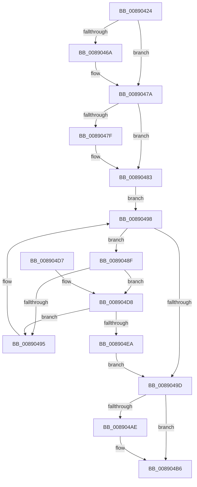

# AlpcpEnumerateResourcesPort

- RVA: `0x00890424`–`0x008904EC` (길이 `200` bytes)
- VA: `0x0000000140890424`
- 실행 섹션: `PAGE`
- PDB 이름 있음: `예`; PDB Function 태그: `아니요`
- unwind 정보 RVA: `0x0007D6C8`
- 디코드: `64`개 명령, `200/200` bytes 표시
- 미해석 바이트: `0` (있으면 어셈블리에 `.byte`로 보존)

> 이 문서는 커널 이미지의 기계어와 PDB 기호를 분석해 생성했습니다. 4번과 5번은 함수 원형과 자료형을 바이너리 사용 방식에서 추정한 C 해석이며 원본 소스 복구 결과는 아닙니다.

## 1. Dependencies

- 직접 호출 지점: **5**; 고유 호출 대상: **5**
- 직접 호출자로 확인된 함수: **1**
- RIP 상대 이미지 참조: **0**

### Outgoing calls
- `0x00890455` → [KeAbPreAcquire](../../text/21/KeAbPreAcquire_function_00210230.md) (function, `0x00210230`)
- `0x00890475` → [ExfAcquirePushLockSharedEx](../../text/21/ExfAcquirePushLockSharedEx_function_0021044C.md) (function, `0x0021044C`)
- `0x008904B1` → [ExfReleasePushLockShared](../../text/26/ExfReleasePushLockShared_function_00263440.md) (function, `0x00263440`)
- `0x008904B9` → [KeAbPostRelease](../../text/2E/KeAbPostRelease_function_002E1600.md) (function, `0x002E1600`)
- `0x008904DF` → [AlpcpViewSearchCallbackFunction](AlpcpViewSearchCallbackFunction_function_008904F4.md) (function, `0x008904F4`)

### Direct callers
- [NtAlpcDeleteSectionView](../A2/NtAlpcDeleteSectionView_function_00A2F240.md) at `0x00A2F30A`

### Static image references
- 디코드된 RIP-relative 메모리 참조가 없습니다.

## 2. Other-region calls and transfers

- 다른 실행 섹션으로 향하는 call: **4**
  - `0x00890455` → [KeAbPreAcquire](../../text/21/KeAbPreAcquire_function_00210230.md) (`PAGE` → `.text`)
  - `0x00890475` → [ExfAcquirePushLockSharedEx](../../text/21/ExfAcquirePushLockSharedEx_function_0021044C.md) (`PAGE` → `.text`)
  - `0x008904B1` → [ExfReleasePushLockShared](../../text/26/ExfReleasePushLockShared_function_00263440.md) (`PAGE` → `.text`)
  - `0x008904B9` → [KeAbPostRelease](../../text/2E/KeAbPostRelease_function_002E1600.md) (`PAGE` → `.text`)
- 별도 외부 분기/꼬리 이동을 확인하지 못했습니다.

## 3. Assembly (complete function range)

```asm
00890424  48 89 5C 24 08                  mov qword ptr [rsp + 8], rbx
00890429  48 89 6C 24 10                  mov qword ptr [rsp + 0x10], rbp
0089042E  56                              push rsi
0089042F  57                              push rdi
00890430  41 54                           push r12
00890432  41 56                           push r14
00890434  41 57                           push r15
00890436  48 83 EC 20                     sub rsp, 0x20
0089043A  48 8D B9 48 01 00 00            lea rdi, [rcx + 0x148]
00890441  48 8B E9                        mov rbp, rcx
00890444  45 33 FF                        xor r15d, r15d
00890447  48 8B CF                        mov rcx, rdi
0089044A  45 33 C0                        xor r8d, r8d
0089044D  33 D2                           xor edx, edx
0089044F  4D 8B F1                        mov r14, r9
00890452  41 8B F7                        mov esi, r15d
00890455  E8 D6 FD 97 FF                  call 0x140210230
0089045A  48 8B D8                        mov rbx, rax
0089045D  45 8D 67 11                     lea r12d, [r15 + 0x11]
00890461  33 C0                           xor eax, eax
00890463  F0 4C 0F B1 27                  lock cmpxchg qword ptr [rdi], r12
00890468  74 10                           je 0x14089047a
0089046A  4C 8B CF                        mov r9, rdi
0089046D  4C 8B C3                        mov r8, rbx
00890470  33 D2                           xor edx, edx
00890472  48 8B CF                        mov rcx, rdi
00890475  E8 D2 FF 97 FF                  call 0x14021044c
0089047A  48 85 DB                        test rbx, rbx
0089047D  74 04                           je 0x140890483
0089047F  C6 43 0A 01                     mov byte ptr [rbx + 0xa], 1
00890483  48 8D BD 50 01 00 00            lea rdi, [rbp + 0x150]
0089048A  48 8B 1F                        mov rbx, qword ptr [rdi]
0089048D  EB 09                           jmp 0x140890498
0089048F  80 7B 11 06                     cmp byte ptr [rbx + 0x11], 6
00890493  74 43                           je 0x1408904d8
00890495  48 8B 1B                        mov rbx, qword ptr [rbx]
00890498  48 3B DF                        cmp rbx, rdi
0089049B  75 F2                           jne 0x14089048f
0089049D  48 8D 9D 48 01 00 00            lea rbx, [rbp + 0x148]
008904A4  49 8B C4                        mov rax, r12
008904A7  F0 4C 0F B1 3B                  lock cmpxchg qword ptr [rbx], r15
008904AC  74 08                           je 0x1408904b6
008904AE  48 8B CB                        mov rcx, rbx
008904B1  E8 8A 2F 9D FF                  call 0x140263440
008904B6  48 8B CB                        mov rcx, rbx
008904B9  E8 42 11 A5 FF                  call 0x1402e1600
008904BE  48 8B 5C 24 50                  mov rbx, qword ptr [rsp + 0x50]
008904C3  8B C6                           mov eax, esi
008904C5  48 8B 6C 24 58                  mov rbp, qword ptr [rsp + 0x58]
008904CA  48 83 C4 20                     add rsp, 0x20
008904CE  41 5F                           pop r15
008904D0  41 5E                           pop r14
008904D2  41 5C                           pop r12
008904D4  5F                              pop rdi
008904D5  5E                              pop rsi
008904D6  C3                              ret
008904D7  CC                              int3
008904D8  48 8D 4B 30                     lea rcx, [rbx + 0x30]
008904DC  49 8B D6                        mov rdx, r14
008904DF  E8 10 00 00 00                  call 0x1408904f4
008904E4  8B F0                           mov esi, eax
008904E6  85 C0                           test eax, eax
008904E8  79 AB                           jns 0x140890495
008904EA  EB B1                           jmp 0x14089049d
```

## 4. C-style interpretation (structured pseudocode)

```c
__int64 __fastcall AlpcpEnumerateResourcesPort(__int64 a1, int a2, int a3, __int64 a4)
{
    __int64 result;
    __int64 v_r15;
    __int64 v_rsp;
    unsigned __int64 v_stack_p10;
    unsigned __int64 v_stack_p8;

    v_stack_p8 = v_rbx;
    v_stack_p10 = v_rbp;
    v_rsp = (v_rsp) - (32);
    v_r15 = 0;
    a3 = 0;
    a2 = 0;
    result = KeAbPreAcquire(a1 + 328, a2, a3, a4);
    result = 0;
    if (!(condition_is_equal)) {
        a4 = a1 + 328;
        a3 = 0;
        a2 = 0;
        a1 = a1 + 328;
        result = ExfAcquirePushLockSharedEx(a1, a2, a3, a4);
    }
    if (result != 0) {
        *(unsigned __int8 *)(result + 10) = 1;
    }
    goto loc_00890498;
loc_0089048F:
    if ((*(unsigned __int8 *)(*(unsigned __int64 *)(a1 + 336) + 17)) == 6) goto loc_008904D8;
loc_00890495:
loc_00890498:
    if ((*(unsigned __int64 *)(*(unsigned __int64 *)(a1 + 336))) != (a1 + 336)) goto loc_0089048F;
loc_0089049D:
    result = v_r15 + 17;
    if ((*(unsigned __int64 *)(*(unsigned __int64 *)(a1 + 336))) != (a1 + 336)) {
        a1 = a1 + 328;
        result = ExfReleasePushLockShared(a1, a2, a3, a4);
    }
    result = KeAbPostRelease(a1 + 328, a2, a3, a4);
    v_rsp = (v_rsp) + (32);
    return 0;
loc_008904D8:
    result = AlpcpViewSearchCallbackFunction(v_stack_p8 + 48, a4, a3, a4);
    if (!sign_flag) goto loc_00890495;
    goto loc_0089049D;
}
```

## 5. (Beta) C Style

```c
int64_t AlpcpEnumerateResourcesPort(void *Arg1, int32_t Arg2, int32_t Arg3, int64_t Arg4)
{
    uint8_t *arg1 = (uint8_t *)Arg1;

    int64_t result;
    int64_t local_r15;
    int64_t local_rsp;
    uint64_t v_stack_p10;
    uint64_t v_stack_p8;

    v_stack_p8 = local_rbx;
    v_stack_p10 = local_rbp;
    local_rsp = (local_rsp) - (32);
    local_r15 = 0;
    Arg3 = 0;
    Arg2 = 0;
    result = KeAbPreAcquire(Arg1 + 328, Arg2, Arg3, Arg4);
    result = 0;
    if (!(condition_is_equal)) {
        Arg4 = Arg1 + 328;
        Arg3 = 0;
        Arg2 = 0;
        Arg1 = Arg1 + 328;
        result = ExfAcquirePushLockSharedEx(Arg1, Arg2, Arg3, Arg4);
    }
    if (result != 0) {
        *(uint8_t *)(result + 0xA) = 1;
    }
    goto loc_00890498;
loc_0089048F:
    if ((*(uint8_t *)(*(uint64_t *)(arg1 + 0x150) + 0x11)) == 6) goto loc_008904D8;
loc_00890495:
loc_00890498:
    if ((*(uint64_t *)(*(uint64_t *)(arg1 + 0x150))) != (Arg1 + 336)) goto loc_0089048F;
loc_0089049D:
    result = local_r15 + 17;
    if ((*(uint64_t *)(*(uint64_t *)(arg1 + 0x150))) != (Arg1 + 336)) {
        Arg1 = Arg1 + 328;
        result = ExfReleasePushLockShared(Arg1, Arg2, Arg3, Arg4);
    }
    result = KeAbPostRelease(Arg1 + 328, Arg2, Arg3, Arg4);
    local_rsp = (local_rsp) + (32);
    return 0;
loc_008904D8:
    result = AlpcpViewSearchCallbackFunction(v_stack_p8 + 48, Arg4, Arg3, Arg4);
    if (!sign_flag) goto loc_00890495;
    goto loc_0089049D;
}
```

### 관측된 메모리 오프셋

구조체 형식이 확인되지 않은 접근은 인자 기준의 오프셋으로만 기록했습니다.

| 기준 인자 | 오프셋 표현 | 폭 (bit) | 접근 |
|---|---:|---:|---|
| `Arg1` | `+ 0x0` | `64` | `R` |
| `Arg1` | `+ 0x148` | `64` | `R` |
| `Arg1` | `+ 0x150` | `64` | `R` |

## 6. Execution-region graph

[열기: 2D/3D 그래프와 함수 탐색 컨트롤 패널](../../../control-panel.html?section=page&rva=0x00890424&view=graph)

- 2D 그래프는 위에서 아래로 흐르고, 3D 그래프는 빈 공간을 드래그해 회전합니다. Shift+드래그는 이동, 휠은 확대·축소, 함수 노드 선택은 대상 보고서 이동입니다.

### Static fallback


