# AlpcpExposeAttributes

- RVA: `0x00897630`–`0x00897AD1` (길이 `1,185` bytes)
- VA: `0x0000000140897630`
- 실행 섹션: `PAGE`
- PDB 이름 있음: `예`; PDB Function 태그: `아니요`
- unwind 정보 RVA: `0x0007E2C0`
- 디코드: `321`개 명령, `1,185/1,185` bytes 표시
- 미해석 바이트: `0` (있으면 어셈블리에 `.byte`로 보존)

> 이 문서는 커널 이미지의 기계어와 PDB 기호를 분석해 생성했습니다. 4번과 5번은 함수 원형과 자료형을 바이너리 사용 방식에서 추정한 C 해석이며 원본 소스 복구 결과는 아닙니다.

## 1. Dependencies

- 직접 호출 지점: **11**; 고유 호출 대상: **6**
- 직접 호출자로 확인된 함수: **4**
- RIP 상대 이미지 참조: **0**

### Outgoing calls
- `0x00897656` → [Feature_2366787898__private_IsEnabledDeviceUsageNoInline](../../text/5C/Feature_2366787898__private_IsEnabledDeviceUsageNoInline_function_005CD8C0.md) (function, `0x005CD8C0`)
- `0x008976E4` → [AlpcpExposeViewAttribute](../88/AlpcpExposeViewAttribute_function_00889BA0.md) (function, `0x00889BA0`)
- `0x00897784` → [Feature_2366787898__private_IsEnabledDeviceUsageNoInline](../../text/5C/Feature_2366787898__private_IsEnabledDeviceUsageNoInline_function_005CD8C0.md) (function, `0x005CD8C0`)
- `0x008977F5` → [AlpcpExposeHandleAttribute](../9C/AlpcpExposeHandleAttribute_function_009CAE60.md) (function, `0x009CAE60`)
- `0x0089787F` → [AlpcpExposeTokenAttribute](AlpcpExposeTokenAttribute_function_00891390.md) (function, `0x00891390`)
- `0x0089791E` → [AlpcpExposeViewAttribute](../88/AlpcpExposeViewAttribute_function_00889BA0.md) (function, `0x00889BA0`)
- `0x00897968` → [AlpcpExposeContextAttribute](../A2/AlpcpExposeContextAttribute_function_00A2F180.md) (function, `0x00A2F180`)
- `0x008979C5` → [AlpcpExposeHandleAttribute](../9C/AlpcpExposeHandleAttribute_function_009CAE60.md) (function, `0x009CAE60`)
- `0x00897A46` → [AlpcpExposeTokenAttribute](AlpcpExposeTokenAttribute_function_00891390.md) (function, `0x00891390`)
- `0x00897AA3` → [AlpcpExposeWorkOnBehalfAttribute](../9D/AlpcpExposeWorkOnBehalfAttribute_function_009D82F0.md) (function, `0x009D82F0`)
- `0x00897AA8` → [Feature_2366787898__private_IsEnabledDeviceUsageNoInline](../../text/5C/Feature_2366787898__private_IsEnabledDeviceUsageNoInline_function_005CD8C0.md) (function, `0x005CD8C0`)

### Direct callers
- [sub_0088E1DC](../88/Unknown_function_0088E1DC.md) at `0x0088E9F9`
- [AlpcpReceiveMessage](AlpcpReceiveMessage_function_00897ED0.md) at `0x008982D2`
- [AlpcpProcessSynchronousRequest](../92/AlpcpProcessSynchronousRequest_function_00921FCC.md) at `0x00922205`
- [AlpcpProcessConnectionRequest](../92/AlpcpProcessConnectionRequest_function_00925FD4.md) at `0x0092625F`

### Static image references
- 디코드된 RIP-relative 메모리 참조가 없습니다.

## 2. Other-region calls and transfers

- 다른 실행 섹션으로 향하는 call: **3**
  - `0x00897656` → [Feature_2366787898__private_IsEnabledDeviceUsageNoInline](../../text/5C/Feature_2366787898__private_IsEnabledDeviceUsageNoInline_function_005CD8C0.md) (`PAGE` → `.text`)
  - `0x00897784` → [Feature_2366787898__private_IsEnabledDeviceUsageNoInline](../../text/5C/Feature_2366787898__private_IsEnabledDeviceUsageNoInline_function_005CD8C0.md) (`PAGE` → `.text`)
  - `0x00897AA8` → [Feature_2366787898__private_IsEnabledDeviceUsageNoInline](../../text/5C/Feature_2366787898__private_IsEnabledDeviceUsageNoInline_function_005CD8C0.md) (`PAGE` → `.text`)
- 별도 외부 분기/꼬리 이동을 확인하지 못했습니다.

## 3. Assembly (complete function range)

```asm
00897630  48 89 4C 24 08                  mov qword ptr [rsp + 8], rcx
00897635  53                              push rbx
00897636  55                              push rbp
00897637  56                              push rsi
00897638  57                              push rdi
00897639  41 55                           push r13
0089763B  41 56                           push r14
0089763D  41 57                           push r15
0089763F  48 83 EC 50                     sub rsp, 0x50
00897643  45 33 FF                        xor r15d, r15d
00897646  49 63 D9                        movsxd rbx, r9d
00897649  44 89 7C 24 20                  mov dword ptr [rsp + 0x20], r15d
0089764E  49 8B F8                        mov rdi, r8
00897651  8B EA                           mov ebp, edx
00897653  4C 8B E9                        mov r13, rcx
00897656  E8 65 62 D3 FF                  call 0x1405cd8c0
0089765B  4C 8B B4 24 B0 00 00 00         mov r14, qword ptr [rsp + 0xb0]
00897663  85 C0                           test eax, eax
00897665  74 07                           je 0x14089766e
00897667  48 8D 74 24 20                  lea rsi, [rsp + 0x20]
0089766C  EB 07                           jmp 0x140897675
0089766E  49 8D 76 04                     lea rsi, [r14 + 4]
00897672  44 89 3E                        mov dword ptr [rsi], r15d
00897675  4C 89 A4 24 A0 00 00 00         mov qword ptr [rsp + 0xa0], r12
0089767D  85 ED                           test ebp, ebp
0089767F  0F 89 4C 02 00 00               jns 0x1408978d1
00897685  85 DB                           test ebx, ebx
00897687  79 21                           jns 0x1408976aa
00897689  4C 39 BF 88 00 00 00            cmp qword ptr [rdi + 0x88], r15
00897690  74 18                           je 0x1408976aa
00897692  45 89 7E 08                     mov dword ptr [r14 + 8], r15d
00897696  48 8B 87 88 00 00 00            mov rax, qword ptr [rdi + 0x88]
0089769D  8B 48 08                        mov ecx, dword ptr [rax + 8]
008976A0  41 89 4E 10                     mov dword ptr [r14 + 0x10], ecx
008976A4  81 0E 00 00 00 80               or dword ptr [rsi], 0x80000000
008976AA  8B EB                           mov ebp, ebx
008976AC  81 E5 00 00 00 40               and ebp, 0x40000000
008976B2  74 5C                           je 0x140897710
008976B4  33 C0                           xor eax, eax
008976B6  4C 8D 44 24 30                  lea r8, [rsp + 0x30]
008976BB  0F 57 C0                        xorps xmm0, xmm0
008976BE  48 89 44 24 40                  mov qword ptr [rsp + 0x40], rax
008976C3  4C 8B FB                        mov r15, rbx
008976C6  89 44 24 48                     mov dword ptr [rsp + 0x48], eax
008976CA  49 C1 FF 3F                     sar r15, 0x3f
008976CE  4C 8B CE                        mov r9, rsi
008976D1  41 83 E7 0C                     and r15d, 0xc
008976D5  48 8B D7                        mov rdx, rdi
008976D8  49 83 C7 08                     add r15, 8
008976DC  4D 03 FE                        add r15, r14
008976DF  0F 11 44 24 30                  movups xmmword ptr [rsp + 0x30], xmm0
008976E4  E8 B7 24 FF FF                  call 0x140889ba0
008976E9  F7 06 00 00 00 40               test dword ptr [rsi], 0x40000000
008976EF  74 1F                           je 0x140897710
008976F1  8B 44 24 30                     mov eax, dword ptr [rsp + 0x30]
008976F5  41 89 07                        mov dword ptr [r15], eax
008976F8  8B 44 24 38                     mov eax, dword ptr [rsp + 0x38]
008976FC  41 89 47 04                     mov dword ptr [r15 + 4], eax
00897700  8B 44 24 40                     mov eax, dword ptr [rsp + 0x40]
00897704  41 89 47 08                     mov dword ptr [r15 + 8], eax
00897708  8B 44 24 48                     mov eax, dword ptr [rsp + 0x48]
0089770C  41 89 47 0C                     mov dword ptr [r15 + 0xc], eax
00897710  0F BA E3 1D                     bt ebx, 0x1d
00897714  0F 83 89 00 00 00               jae 0x1408977a3
0089771A  48 8B CB                        mov rcx, rbx
0089771D  48 8D 47 40                     lea rax, [rdi + 0x40]
00897721  48 C1 F9 3F                     sar rcx, 0x3f
00897725  83 E1 0C                        and ecx, 0xc
00897728  48 83 C1 08                     add rcx, 8
0089772C  85 ED                           test ebp, ebp
0089772E  4C 8D 79 10                     lea r15, [rcx + 0x10]
00897732  4C 0F 44 F9                     cmove r15, rcx
00897736  4D 03 FE                        add r15, r14
00897739  4C 39 6F 38                     cmp qword ptr [rdi + 0x38], r13
0089773D  74 0B                           je 0x14089774a
0089773F  4C 39 28                        cmp qword ptr [rax], r13
00897742  74 06                           je 0x14089774a
00897744  48 8B 6F 78                     mov rbp, qword ptr [rdi + 0x78]
00897748  EB 07                           jmp 0x140897751
0089774A  48 8B AF 80 00 00 00            mov rbp, qword ptr [rdi + 0x80]
00897751  41 89 2F                        mov dword ptr [r15], ebp
00897754  4C 39 6F 38                     cmp qword ptr [rdi + 0x38], r13
00897758  74 0A                           je 0x140897764
0089775A  4C 39 28                        cmp qword ptr [rax], r13
0089775D  74 05                           je 0x140897764
0089775F  8B 47 2C                        mov eax, dword ptr [rdi + 0x2c]
00897762  EB 03                           jmp 0x140897767
00897764  8B 47 48                        mov eax, dword ptr [rdi + 0x48]
00897767  41 89 47 08                     mov dword ptr [r15 + 8], eax
0089776B  41 8B 85 A0 01 00 00            mov eax, dword ptr [r13 + 0x1a0]
00897772  24 06                           and al, 6
00897774  3C 04                           cmp al, 4
00897776  75 05                           jne 0x14089777d
00897778  8B 47 68                        mov eax, dword ptr [rdi + 0x68]
0089777B  EB 03                           jmp 0x140897780
0089777D  8B 47 70                        mov eax, dword ptr [rdi + 0x70]
00897780  41 89 47 04                     mov dword ptr [r15 + 4], eax
00897784  E8 37 61 D3 FF                  call 0x1405cd8c0
00897789  85 C0                           test eax, eax
0089778B  74 05                           je 0x140897792
0089778D  48 85 ED                        test rbp, rbp
00897790  EB 04                           jmp 0x140897796
00897792  41 83 3F 00                     cmp dword ptr [r15], 0
00897796  0F 95 C0                        setne al
00897799  84 C0                           test al, al
0089779B  74 06                           je 0x1408977a3
0089779D  81 0E 00 00 00 20               or dword ptr [rsi], 0x20000000
008977A3  8B EB                           mov ebp, ebx
008977A5  81 E5 00 00 00 10               and ebp, 0x10000000
008977AB  44 8B FD                        mov r15d, ebp
008977AE  74 7F                           je 0x14089782f
008977B0  0F 57 C0                        xorps xmm0, xmm0
008977B3  4C 8D 44 24 30                  lea r8, [rsp + 0x30]
008977B8  48 8B C3                        mov rax, rbx
008977BB  4C 8B CE                        mov r9, rsi
008977BE  48 C1 F8 3F                     sar rax, 0x3f
008977C2  48 8B D7                        mov rdx, rdi
008977C5  83 E0 0C                        and eax, 0xc
008977C8  48 83 C0 08                     add rax, 8
008977CC  0F BA E3 1E                     bt ebx, 0x1e
008977D0  0F 11 44 24 30                  movups xmmword ptr [rsp + 0x30], xmm0
008977D5  48 8D 48 10                     lea rcx, [rax + 0x10]
008977D9  48 0F 43 C8                     cmovae rcx, rax
008977DD  0F BA E3 1D                     bt ebx, 0x1d
008977E1  4C 8D 61 14                     lea r12, [rcx + 0x14]
008977E5  4C 0F 43 E1                     cmovae r12, rcx
008977E9  33 C0                           xor eax, eax
008977EB  49 8B CD                        mov rcx, r13
008977EE  89 44 24 40                     mov dword ptr [rsp + 0x40], eax
008977F2  4D 03 E6                        add r12, r14
008977F5  E8 66 36 13 00                  call 0x1409cae60
008977FA  F7 06 00 00 00 10               test dword ptr [rsi], 0x10000000
00897800  74 2D                           je 0x14089782f
00897802  8B 44 24 30                     mov eax, dword ptr [rsp + 0x30]
00897806  44 8B FB                        mov r15d, ebx
00897809  41 89 04 24                     mov dword ptr [r12], eax
0089780D  41 81 E7 00 00 00 10            and r15d, 0x10000000
00897814  8B 44 24 38                     mov eax, dword ptr [rsp + 0x38]
00897818  41 89 44 24 04                  mov dword ptr [r12 + 4], eax
0089781D  8B 44 24 40                     mov eax, dword ptr [rsp + 0x40]
00897821  41 89 44 24 08                  mov dword ptr [r12 + 8], eax
00897826  8B 44 24 44                     mov eax, dword ptr [rsp + 0x44]
0089782A  41 89 44 24 0C                  mov dword ptr [r12 + 0xc], eax
0089782F  8B D3                           mov edx, ebx
00897831  4C 8B E3                        mov r12, rbx
00897834  81 E2 00 00 00 08               and edx, 0x8000000
0089783A  89 94 24 98 00 00 00            mov dword ptr [rsp + 0x98], edx
00897841  74 4A                           je 0x14089788d
00897843  48 8B CB                        mov rcx, rbx
00897846  4C 8B CE                        mov r9, rsi
00897849  48 C1 F9 3F                     sar rcx, 0x3f
0089784D  48 8B D7                        mov rdx, rdi
00897850  83 E1 0C                        and ecx, 0xc
00897853  48 83 C1 08                     add rcx, 8
00897857  0F BA E3 1E                     bt ebx, 0x1e
0089785B  48 8D 41 10                     lea rax, [rcx + 0x10]
0089785F  48 0F 43 C1                     cmovae rax, rcx
00897863  0F BA E3 1D                     bt ebx, 0x1d
00897867  48 8D 48 14                     lea rcx, [rax + 0x14]
0089786B  48 0F 43 C8                     cmovae rcx, rax
0089786F  85 ED                           test ebp, ebp
00897871  4C 8D 41 10                     lea r8, [rcx + 0x10]
00897875  4C 0F 44 C1                     cmove r8, rcx
00897879  49 8B CD                        mov rcx, r13
0089787C  4D 03 C6                        add r8, r14
0089787F  E8 0C 9B FF FF                  call 0x140891390
00897884  8B 94 24 98 00 00 00            mov edx, dword ptr [rsp + 0x98]
0089788B  EB 03                           jmp 0x140897890
0089788D  44 8B FD                        mov r15d, ebp
00897890  0F BA E3 19                     bt ebx, 0x19
00897894  0F 83 0E 02 00 00               jae 0x140897aa8
0089789A  49 C1 FC 3F                     sar r12, 0x3f
0089789E  41 83 E4 0C                     and r12d, 0xc
008978A2  49 83 C4 08                     add r12, 8
008978A6  0F BA E3 1E                     bt ebx, 0x1e
008978AA  49 8D 44 24 10                  lea rax, [r12 + 0x10]
008978AF  49 0F 43 C4                     cmovae rax, r12
008978B3  0F BA E3 1D                     bt ebx, 0x1d
008978B7  48 8D 48 14                     lea rcx, [rax + 0x14]
008978BB  48 0F 43 C8                     cmovae rcx, rax
008978BF  45 85 FF                        test r15d, r15d
008978C2  48 8D 41 10                     lea rax, [rcx + 0x10]
008978C6  48 0F 44 C1                     cmove rax, rcx
008978CA  85 D2                           test edx, edx
008978CC  E9 BE 01 00 00                  jmp 0x140897a8f
008978D1  85 DB                           test ebx, ebx
008978D3  79 22                           jns 0x1408978f7
008978D5  4C 39 BF 88 00 00 00            cmp qword ptr [rdi + 0x88], r15
008978DC  74 19                           je 0x1408978f7
008978DE  45 89 7E 08                     mov dword ptr [r14 + 8], r15d
008978E2  48 8B 87 88 00 00 00            mov rax, qword ptr [rdi + 0x88]
008978E9  48 8B 48 08                     mov rcx, qword ptr [rax + 8]
008978ED  49 89 4E 18                     mov qword ptr [r14 + 0x18], rcx
008978F1  81 0E 00 00 00 80               or dword ptr [rsi], 0x80000000
008978F7  44 8B E3                        mov r12d, ebx
008978FA  48 8B EB                        mov rbp, rbx
008978FD  41 81 E4 00 00 00 40            and r12d, 0x40000000
00897904  74 29                           je 0x14089792f
00897906  4C 8B C3                        mov r8, rbx
00897909  4C 8B CE                        mov r9, rsi
0089790C  49 C1 F8 3F                     sar r8, 0x3f
00897910  48 8B D7                        mov rdx, rdi
00897913  41 83 E0 18                     and r8d, 0x18
00897917  49 83 C0 08                     add r8, 8
0089791B  4D 03 C6                        add r8, r14
0089791E  E8 7D 22 FF FF                  call 0x140889ba0
00897923  44 8B FB                        mov r15d, ebx
00897926  41 81 E7 00 00 00 40            and r15d, 0x40000000
0089792D  EB 03                           jmp 0x140897932
0089792F  45 8B FC                        mov r15d, r12d
00897932  44 8B EB                        mov r13d, ebx
00897935  48 C1 FD 3F                     sar rbp, 0x3f
00897939  41 81 E5 00 00 00 20            and r13d, 0x20000000
00897940  74 3B                           je 0x14089797d
00897942  48 8B CD                        mov rcx, rbp
00897945  4C 8B CE                        mov r9, rsi
00897948  83 E1 18                        and ecx, 0x18
0089794B  48 8B D7                        mov rdx, rdi
0089794E  48 83 C1 08                     add rcx, 8
00897952  45 85 E4                        test r12d, r12d
00897955  4C 8D 41 20                     lea r8, [rcx + 0x20]
00897959  4C 0F 44 C1                     cmove r8, rcx
0089795D  48 8B 8C 24 90 00 00 00         mov rcx, qword ptr [rsp + 0x90]
00897965  4D 03 C6                        add r8, r14
00897968  E8 13 78 19 00                  call 0x140a2f180
0089796D  8B C3                           mov eax, ebx
0089796F  25 00 00 00 20                  and eax, 0x20000000
00897974  89 84 24 98 00 00 00            mov dword ptr [rsp + 0x98], eax
0089797B  EB 0B                           jmp 0x140897988
0089797D  45 8B FC                        mov r15d, r12d
00897980  44 89 AC 24 98 00 00 00         mov dword ptr [rsp + 0x98], r13d
00897988  44 8B E3                        mov r12d, ebx
0089798B  83 E5 18                        and ebp, 0x18
0089798E  41 81 E4 00 00 00 10            and r12d, 0x10000000
00897995  74 52                           je 0x1408979e9
00897997  48 8D 45 08                     lea rax, [rbp + 8]
0089799B  45 85 FF                        test r15d, r15d
0089799E  48 8D 48 20                     lea rcx, [rax + 0x20]
008979A2  4C 8B CE                        mov r9, rsi
008979A5  48 0F 44 C8                     cmove rcx, rax
008979A9  48 8B D7                        mov rdx, rdi
008979AC  45 85 ED                        test r13d, r13d
008979AF  4C 8B AC 24 90 00 00 00         mov r13, qword ptr [rsp + 0x90]
008979B7  4C 8D 41 20                     lea r8, [rcx + 0x20]
008979BB  4C 0F 44 C1                     cmove r8, rcx
008979BF  49 8B CD                        mov rcx, r13
008979C2  4D 03 C6                        add r8, r14
008979C5  E8 96 34 13 00                  call 0x1409cae60
008979CA  8B 94 24 98 00 00 00            mov edx, dword ptr [rsp + 0x98]
008979D1  8B C3                           mov eax, ebx
008979D3  25 00 00 00 40                  and eax, 0x40000000
008979D8  89 44 24 24                     mov dword ptr [rsp + 0x24], eax
008979DC  8B C3                           mov eax, ebx
008979DE  25 00 00 00 10                  and eax, 0x10000000
008979E3  89 44 24 28                     mov dword ptr [rsp + 0x28], eax
008979E7  EB 1C                           jmp 0x140897a05
008979E9  41 8B D5                        mov edx, r13d
008979EC  44 89 7C 24 24                  mov dword ptr [rsp + 0x24], r15d
008979F1  4C 8B AC 24 90 00 00 00         mov r13, qword ptr [rsp + 0x90]
008979F9  89 94 24 98 00 00 00            mov dword ptr [rsp + 0x98], edx
00897A00  44 89 64 24 28                  mov dword ptr [rsp + 0x28], r12d
00897A05  44 8B CB                        mov r9d, ebx
00897A08  48 8D 6D 08                     lea rbp, [rbp + 8]
00897A0C  41 81 E1 00 00 00 08            and r9d, 0x8000000
00897A13  44 89 4C 24 2C                  mov dword ptr [rsp + 0x2c], r9d
00897A18  74 41                           je 0x140897a5b
00897A1A  45 85 FF                        test r15d, r15d
00897A1D  48 8D 45 20                     lea rax, [rbp + 0x20]
00897A21  4C 8B CE                        mov r9, rsi
00897A24  48 0F 44 C5                     cmove rax, rbp
00897A28  85 D2                           test edx, edx
00897A2A  48 8B D7                        mov rdx, rdi
00897A2D  48 8D 48 20                     lea rcx, [rax + 0x20]
00897A31  48 0F 44 C8                     cmove rcx, rax
00897A35  45 85 E4                        test r12d, r12d
00897A38  4C 8D 41 18                     lea r8, [rcx + 0x18]
00897A3C  4C 0F 44 C1                     cmove r8, rcx
00897A40  49 8B CD                        mov rcx, r13
00897A43  4D 03 C6                        add r8, r14
00897A46  E8 45 99 FF FF                  call 0x140891390
00897A4B  8B 4C 24 24                     mov ecx, dword ptr [rsp + 0x24]
00897A4F  44 8B 44 24 28                  mov r8d, dword ptr [rsp + 0x28]
00897A54  44 8B 4C 24 2C                  mov r9d, dword ptr [rsp + 0x2c]
00897A59  EB 06                           jmp 0x140897a61
00897A5B  41 8B CF                        mov ecx, r15d
00897A5E  45 8B C4                        mov r8d, r12d
00897A61  0F BA E3 19                     bt ebx, 0x19
00897A65  73 41                           jae 0x140897aa8
00897A67  85 C9                           test ecx, ecx
00897A69  48 8D 45 20                     lea rax, [rbp + 0x20]
00897A6D  48 0F 44 C5                     cmove rax, rbp
00897A71  83 BC 24 98 00 00 00 00         cmp dword ptr [rsp + 0x98], 0
00897A79  48 8D 48 20                     lea rcx, [rax + 0x20]
00897A7D  48 0F 44 C8                     cmove rcx, rax
00897A81  45 85 C0                        test r8d, r8d
00897A84  48 8D 41 18                     lea rax, [rcx + 0x18]
00897A88  48 0F 44 C1                     cmove rax, rcx
00897A8C  45 85 C9                        test r9d, r9d
00897A8F  4C 8D 40 18                     lea r8, [rax + 0x18]
00897A93  4C 8B CE                        mov r9, rsi
00897A96  4C 0F 44 C0                     cmove r8, rax
00897A9A  48 8B D7                        mov rdx, rdi
00897A9D  4D 03 C6                        add r8, r14
00897AA0  49 8B CD                        mov rcx, r13
00897AA3  E8 48 08 14 00                  call 0x1409d82f0
00897AA8  E8 13 5E D3 FF                  call 0x1405cd8c0
00897AAD  85 C0                           test eax, eax
00897AAF  74 08                           je 0x140897ab9
00897AB1  8B 44 24 20                     mov eax, dword ptr [rsp + 0x20]
00897AB5  41 89 46 04                     mov dword ptr [r14 + 4], eax
00897AB9  4C 8B A4 24 A0 00 00 00         mov r12, qword ptr [rsp + 0xa0]
00897AC1  48 83 C4 50                     add rsp, 0x50
00897AC5  41 5F                           pop r15
00897AC7  41 5E                           pop r14
00897AC9  41 5D                           pop r13
00897ACB  5F                              pop rdi
00897ACC  5E                              pop rsi
00897ACD  5D                              pop rbp
00897ACE  5B                              pop rbx
00897ACF  C3                              ret
00897AD0  CC                              int3
```

## 4. C-style interpretation (structured pseudocode)

```c
__int64 __fastcall AlpcpExposeAttributes(__int64 a1, int a2, __int64 a3, int a4, __int64 a5)
{
    __int64 result;
    __int64 v_r12;
    __int64 v_r13;
    __int64 v_r15;
    __int64 v_rbp;
    __int64 v_rsp;
    unsigned int v_stack_m40;
    unsigned int v_stack_m44;
    unsigned __int64 v_stack_m48;
    unsigned int v_stack_m50;
    unsigned __int64 v_stack_m58;
    unsigned int v_stack_m5C;
    unsigned int v_stack_m60;
    unsigned int v_stack_m64;
    unsigned int v_stack_m68;
    unsigned int v_stack_p10;
    unsigned __int64 v_stack_p18;
    unsigned __int64 v_stack_p8;

    v_stack_p8 = a1;
    v_rsp = (v_rsp) - (80);
    v_r15 = 0;
    v_stack_m68 = 0;
    result = Feature_2366787898__private_IsEnabledDeviceUsageNoInline(a1, a2, a3, a4);
    if ((unsigned int)(result) == 0) goto loc_0089766E;
    goto loc_00897675;
loc_0089766E:
    *(unsigned int *)(a5 + 4) = 0;
loc_00897675:
    v_stack_p18 = v_r12;
    if (!sign_flag) goto loc_008978D1;
    if (!sign_flag) goto loc_008976AA;
    if ((*(unsigned __int64 *)(a3 + 136)) != 0) {
        *(unsigned int *)(a5 + 8) = 0;
        result = *(unsigned __int64 *)(a3 + 136);
        a1 = *(unsigned int *)(result + 8);
        *(unsigned int *)(a5 + 16) = (unsigned int)(a1);
    }
    v_rbp = (unsigned int)(((unsigned int)((unsigned int)((int)(a4)))) & (0x40000000ULL));
    if (condition_is_equal) goto loc_00897710;
    result = 0;
    v_stack_m48 = 0;
    v_stack_m40 = 0;
    v_r15 = ((int)(a4)) >> (63);
    v_r15 = (unsigned int)((v_r15) & (12));
    v_r15 = (v_r15) + (8);
    v_r15 = (v_r15) + (a5);
    v_stack_m58 = v_xmm0;
    result = AlpcpExposeViewAttribute(a1, a3, v_stack_m58, a5 + 4);
    if (((*(unsigned int *)(a5 + 4)) & (0x40000000ULL)) != 0) {
        result = v_stack_m58;
        *(unsigned int *)(v_r15) = (unsigned int)(result);
        result = v_stack_m50;
        *(unsigned int *)(v_r15 + 4) = (unsigned int)(result);
        result = v_stack_m48;
        *(unsigned int *)(v_r15 + 8) = (unsigned int)(result);
        result = v_stack_m40;
        *(unsigned int *)(v_r15 + 12) = (unsigned int)(result);
    }
    if (condition_is_above_or_equal) goto loc_008977A3;
    a1 = ((int)(a4)) >> (63);
    a1 = (unsigned int)((a1) & (12));
    a1 = (a1) + (8);
    v_r15 = a1 + 16;
    if ((unsigned int)(v_rbp) == 0) { v_r15 = a1; }
    v_r15 = (v_r15) + (a5);
    if ((*(unsigned __int64 *)(a3 + 56)) == a1) goto loc_0089774A;
    if ((*(unsigned __int64 *)(a3 + 64)) == a1) goto loc_0089774A;
    goto loc_00897751;
loc_0089774A:
loc_00897751:
    *(unsigned int *)(v_r15) = (unsigned int)(*(unsigned __int64 *)(a3 + 128));
    if ((*(unsigned __int64 *)(a3 + 56)) == a1) goto loc_00897764;
    if ((*(unsigned __int64 *)(a3 + 64)) == a1) goto loc_00897764;
    goto loc_00897767;
loc_00897764:
loc_00897767:
    *(unsigned int *)(v_r15 + 8) = (unsigned int)((unsigned int)(*(unsigned int *)(a3 + 72)));
    result = (unsigned __int8)(((unsigned int)(*(unsigned int *)(a1 + 416))) & (6));
    if (((unsigned __int8)(result)) != 4) goto loc_0089777D;
    goto loc_00897780;
loc_0089777D:
loc_00897780:
    *(unsigned int *)(v_r15 + 4) = (unsigned int)((unsigned int)(*(unsigned int *)(a3 + 112)));
    result = Feature_2366787898__private_IsEnabledDeviceUsageNoInline(a1, a3, v_stack_m58, a5 + 4);
    if ((unsigned int)(result) == 0) goto loc_00897792;
    goto loc_00897796;
loc_00897792:
loc_00897796:
    result = ((*(unsigned int *)(v_r15)) != 0) ? 1 : 0;
    if ((unsigned __int8)(result) != 0) {
    }
    v_rbp = (unsigned int)(((unsigned int)((unsigned int)((int)(a4)))) & (0x10000000ULL));
    if (condition_is_equal) goto loc_0089782F;
    result = ((int)(a4)) >> (63);
    result = (unsigned int)((result) & (12));
    result = (result) + (8);
    v_stack_m58 = v_xmm0;
    a1 = result + 16;
    if (condition_is_above_or_equal) { a1 = result; }
    v_r12 = a1 + 20;
    if (condition_is_above_or_equal) { v_r12 = a1; }
    result = 0;
    v_stack_m48 = 0;
    v_r12 = (v_r12) + (a5);
    result = AlpcpExposeHandleAttribute(a1, a3, v_stack_m58, a5 + 4);
    v_r15 = (unsigned int)((unsigned int)(v_rbp));
    if (((*(unsigned int *)(a5 + 4)) & (0x10000000ULL)) != 0) {
        result = v_stack_m58;
        v_r15 = (unsigned int)((int)(a4));
        *(unsigned int *)(v_r12) = (unsigned int)(result);
        v_r15 = (unsigned int)((v_r15) & (0x10000000ULL));
        result = v_stack_m50;
        *(unsigned int *)(v_r12 + 4) = (unsigned int)(result);
        result = v_stack_m48;
        *(unsigned int *)(v_r12 + 8) = (unsigned int)(result);
        result = v_stack_m44;
        *(unsigned int *)(v_r12 + 12) = (unsigned int)(result);
    }
    a2 = (unsigned int)(((unsigned int)((unsigned int)((int)(a4)))) & (0x8000000ULL));
    v_stack_p10 = a2;
    if (condition_is_equal) goto loc_0089788D;
    a1 = ((int)(a4)) >> (63);
    a1 = (unsigned int)((a1) & (12));
    a1 = (a1) + (8);
    result = a1 + 16;
    if (condition_is_above_or_equal) { result = a1; }
    a1 = result + 20;
    if (condition_is_above_or_equal) { a1 = result; }
    a3 = a1 + 16;
    if ((unsigned int)(v_rbp) == 0) { a3 = a1; }
    a3 = (a3) + (a5);
    result = AlpcpExposeTokenAttribute(a1, a3, a3, a5 + 4);
    goto loc_00897890;
loc_0089788D:
loc_00897890:
    if (condition_is_above_or_equal) goto loc_00897AA8;
    v_r12 = ((int)(a4)) >> (63);
    v_r12 = (unsigned int)((v_r12) & (12));
    v_r12 = (v_r12) + (8);
    result = v_r12 + 16;
    if (condition_is_above_or_equal) { result = v_r12; }
    a1 = result + 20;
    if (condition_is_above_or_equal) { a1 = result; }
    result = a1 + 16;
    if ((unsigned int)((unsigned int)((unsigned int)(v_rbp))) == 0) { result = a1; }
    goto loc_00897A8F;
loc_008978D1:
    if (!sign_flag) goto loc_008978F7;
    if ((*(unsigned __int64 *)(a3 + 136)) != ((unsigned int)((unsigned int)(v_rbp)))) {
        *(unsigned int *)(a5 + 8) = (unsigned int)((unsigned int)((unsigned int)(v_rbp)));
        result = *(unsigned __int64 *)(a3 + 136);
        a1 = *(unsigned __int64 *)(result + 8);
        *(unsigned __int64 *)(a5 + 24) = a1;
    }
    v_r12 = (unsigned int)(((unsigned int)((unsigned int)((int)(a4)))) & (0x40000000ULL));
    if (condition_is_equal) goto loc_0089792F;
    a3 = ((int)(a4)) >> (63);
    a3 = (unsigned int)((a3) & (24));
    a3 = (a3) + (8);
    a3 = (a3) + (a5);
    result = AlpcpExposeViewAttribute(a1, a3, a3, a5 + 4);
    v_r15 = (unsigned int)(((unsigned int)((unsigned int)((int)(a4)))) & (0x40000000ULL));
    goto loc_00897932;
loc_0089792F:
loc_00897932:
    v_rbp = ((int)(a4)) >> (63);
    v_r13 = (unsigned int)(((unsigned int)((unsigned int)((int)(a4)))) & (0x20000000ULL));
    if (condition_is_equal) goto loc_0089797D;
    a1 = (unsigned int)((v_rbp) & (24));
    a1 = (a1) + (8);
    a3 = a1 + 32;
    if ((unsigned int)(v_r12) == 0) { a3 = a1; }
    a3 = (a3) + (a5);
    result = AlpcpExposeContextAttribute(v_stack_p8, a3, a3, a5 + 4);
    result = (unsigned int)(((unsigned int)((unsigned int)((int)(a4)))) & (0x20000000ULL));
    v_stack_p10 = (unsigned int)(result);
    goto loc_00897988;
loc_0089797D:
    v_stack_p10 = (unsigned int)(v_r13);
loc_00897988:
    v_rbp = (unsigned int)((v_rbp) & (24));
    v_r12 = (unsigned int)(((unsigned int)((unsigned int)((int)(a4)))) & (0x10000000ULL));
    if (condition_is_equal) goto loc_008979E9;
    a1 = v_rbp + 8 + 32;
    if ((unsigned int)((unsigned int)((unsigned int)(v_r12))) == 0) { a1 = v_rbp + 8; }
    a3 = a1 + 32;
    if ((unsigned int)(v_r13) == 0) { a3 = a1; }
    a3 = (a3) + (a5);
    result = AlpcpExposeHandleAttribute(v_stack_p8, a3, a3, a5 + 4);
    result = (unsigned int)(((unsigned int)((unsigned int)((int)(a4)))) & (0x40000000ULL));
    v_stack_m64 = (unsigned int)(result);
    result = (unsigned int)(((unsigned int)((unsigned int)((int)(a4)))) & (0x10000000ULL));
    v_stack_m60 = (unsigned int)(result);
    goto loc_00897A05;
loc_008979E9:
    v_stack_m64 = (unsigned int)((unsigned int)((unsigned int)(v_r12)));
    v_stack_p10 = (unsigned int)((unsigned int)((unsigned int)(v_stack_p8)));
    v_stack_m60 = (unsigned int)(v_r12);
loc_00897A05:
    a4 = (unsigned int)(((unsigned int)((unsigned int)((int)(a4)))) & (0x8000000ULL));
    v_stack_m5C = a4;
    if (condition_is_equal) goto loc_00897A5B;
    result = v_rbp + 8 + 32;
    if ((unsigned int)((unsigned int)((unsigned int)(v_r12))) == 0) { result = v_rbp + 8; }
    a1 = result + 32;
    if ((unsigned int)((unsigned int)((unsigned int)(v_stack_p8))) == 0) { a1 = result; }
    a3 = a1 + 24;
    if ((unsigned int)(v_r12) == 0) { a3 = a1; }
    a3 = (a3) + (a5);
    result = AlpcpExposeTokenAttribute(v_stack_p8, a3, a3, a5 + 4);
    goto loc_00897A61;
loc_00897A5B:
loc_00897A61:
    if (condition_is_above_or_equal) goto loc_00897AA8;
    result = v_rbp + 8 + 32;
    if ((unsigned int)((unsigned int)((unsigned int)((unsigned int)((unsigned int)(v_r12))))) == 0) { result = v_rbp + 8; }
    a1 = result + 32;
    if (v_stack_p10 == 0) { a1 = result; }
    result = a1 + 24;
    if ((unsigned int)((unsigned int)((unsigned int)(v_r12))) == 0) { result = a1; }
loc_00897A8F:
    a3 = result + 24;
    if ((unsigned int)((unsigned int)(v_stack_m5C)) == 0) { a3 = result; }
    a3 = (a3) + (a5);
    result = AlpcpExposeWorkOnBehalfAttribute(v_stack_p8, a3, a3, a5 + 4);
loc_00897AA8:
    result = Feature_2366787898__private_IsEnabledDeviceUsageNoInline(v_stack_p8, a3, a3, a5 + 4);
    if ((unsigned int)(result) != 0) {
        result = v_stack_m68;
        *(unsigned int *)(a5 + 4) = (unsigned int)(result);
    }
    v_rsp = (v_rsp) + (80);
    return result;
}
```

## 5. (Beta) C Style

```c
int64_t AlpcpExposeAttributes(void *Arg1, int32_t Arg2, void *Arg3, int32_t Arg4, void *Arg5)
{
    uint8_t *arg1 = (uint8_t *)Arg1;
    uint8_t *arg3 = (uint8_t *)Arg3;
    uint8_t *arg5 = (uint8_t *)Arg5;

    int64_t result;
    int64_t local_r12;
    int64_t local_r13;
    int64_t local_r15;
    int64_t local_rbp;
    int64_t local_rsp;
    uint32_t v_stack_m40;
    uint32_t v_stack_m44;
    uint64_t v_stack_m48;
    uint32_t v_stack_m50;
    uint64_t v_stack_m58;
    uint32_t v_stack_m5C;
    uint32_t v_stack_m60;
    uint32_t v_stack_m64;
    uint32_t v_stack_m68;
    uint32_t v_stack_p10;
    uint64_t v_stack_p18;
    uint64_t v_stack_p8;

    v_stack_p8 = Arg1;
    local_rsp = (local_rsp) - (80);
    local_r15 = 0;
    v_stack_m68 = 0;
    result = Feature_2366787898__private_IsEnabledDeviceUsageNoInline(Arg1, Arg2, Arg3, Arg4);
    if ((uint32_t)(result) == 0) goto loc_0089766E;
    goto loc_00897675;
loc_0089766E:
    *(uint32_t *)(arg5 + 0x4) = 0;
loc_00897675:
    v_stack_p18 = local_r12;
    if (!sign_flag) goto loc_008978D1;
    if (!sign_flag) goto loc_008976AA;
    if ((*(uint64_t *)(arg3 + 0x88)) != 0) {
        *(uint32_t *)(arg5 + 0x8) = 0;
        result = *(uint64_t *)(arg3 + 0x88);
        Arg1 = *(uint32_t *)(result + 0x8);
        *(uint32_t *)(arg5 + 0x10) = (uint32_t)(Arg1);
    }
    local_rbp = (uint32_t)(((uint32_t)((uint32_t)((int32_t)(Arg4)))) & (0x40000000ULL));
    if (condition_is_equal) goto loc_00897710;
    result = 0;
    v_stack_m48 = 0;
    v_stack_m40 = 0;
    local_r15 = ((int32_t)(Arg4)) >> (63);
    local_r15 = (uint32_t)((local_r15) & (12));
    local_r15 = (local_r15) + (8);
    local_r15 = (local_r15) + (Arg5);
    v_stack_m58 = v_xmm0;
    result = AlpcpExposeViewAttribute(Arg1, Arg3, v_stack_m58, Arg5 + 4);
    if (((*(uint32_t *)(arg5 + 0x4)) & (0x40000000ULL)) != 0) {
        result = v_stack_m58;
        *(uint32_t *)(local_r15) = (uint32_t)(result);
        result = v_stack_m50;
        *(uint32_t *)(local_r15 + 0x4) = (uint32_t)(result);
        result = v_stack_m48;
        *(uint32_t *)(local_r15 + 0x8) = (uint32_t)(result);
        result = v_stack_m40;
        *(uint32_t *)(local_r15 + 0xC) = (uint32_t)(result);
    }
    if (condition_is_above_or_equal) goto loc_008977A3;
    Arg1 = ((int32_t)(Arg4)) >> (63);
    Arg1 = (uint32_t)((Arg1) & (12));
    Arg1 = (Arg1) + (8);
    local_r15 = Arg1 + 16;
    if ((uint32_t)(local_rbp) == 0) { local_r15 = Arg1; }
    local_r15 = (local_r15) + (Arg5);
    if ((*(uint64_t *)(arg3 + 0x38)) == Arg1) goto loc_0089774A;
    if ((*(uint64_t *)(arg3 + 0x40)) == Arg1) goto loc_0089774A;
    goto loc_00897751;
loc_0089774A:
loc_00897751:
    *(uint32_t *)(local_r15) = (uint32_t)(*(uint64_t *)(arg3 + 0x80));
    if ((*(uint64_t *)(arg3 + 0x38)) == Arg1) goto loc_00897764;
    if ((*(uint64_t *)(arg3 + 0x40)) == Arg1) goto loc_00897764;
    goto loc_00897767;
loc_00897764:
loc_00897767:
    *(uint32_t *)(local_r15 + 0x8) = (uint32_t)((uint32_t)(*(uint32_t *)(arg3 + 0x48)));
    result = (uint8_t)(((uint32_t)(*(uint32_t *)(arg1 + 0x1A0))) & (6));
    if (((uint8_t)(result)) != 4) goto loc_0089777D;
    goto loc_00897780;
loc_0089777D:
loc_00897780:
    *(uint32_t *)(local_r15 + 0x4) = (uint32_t)((uint32_t)(*(uint32_t *)(arg3 + 0x70)));
    result = Feature_2366787898__private_IsEnabledDeviceUsageNoInline(Arg1, Arg3, v_stack_m58, Arg5 + 4);
    if ((uint32_t)(result) == 0) goto loc_00897792;
    goto loc_00897796;
loc_00897792:
loc_00897796:
    result = ((*(uint32_t *)(local_r15)) != 0) ? 1 : 0;
    if ((uint8_t)(result) != 0) {
    }
    local_rbp = (uint32_t)(((uint32_t)((uint32_t)((int32_t)(Arg4)))) & (0x10000000ULL));
    if (condition_is_equal) goto loc_0089782F;
    result = ((int32_t)(Arg4)) >> (63);
    result = (uint32_t)((result) & (12));
    result = (result) + (8);
    v_stack_m58 = v_xmm0;
    Arg1 = result + 16;
    if (condition_is_above_or_equal) { Arg1 = result; }
    local_r12 = Arg1 + 20;
    if (condition_is_above_or_equal) { local_r12 = Arg1; }
    result = 0;
    v_stack_m48 = 0;
    local_r12 = (local_r12) + (Arg5);
    result = AlpcpExposeHandleAttribute(Arg1, Arg3, v_stack_m58, Arg5 + 4);
    local_r15 = (uint32_t)((uint32_t)(local_rbp));
    if (((*(uint32_t *)(arg5 + 0x4)) & (0x10000000ULL)) != 0) {
        result = v_stack_m58;
        local_r15 = (uint32_t)((int32_t)(Arg4));
        *(uint32_t *)(local_r12) = (uint32_t)(result);
        local_r15 = (uint32_t)((local_r15) & (0x10000000ULL));
        result = v_stack_m50;
        *(uint32_t *)(local_r12 + 0x4) = (uint32_t)(result);
        result = v_stack_m48;
        *(uint32_t *)(local_r12 + 0x8) = (uint32_t)(result);
        result = v_stack_m44;
        *(uint32_t *)(local_r12 + 0xC) = (uint32_t)(result);
    }
    Arg2 = (uint32_t)(((uint32_t)((uint32_t)((int32_t)(Arg4)))) & (0x8000000ULL));
    v_stack_p10 = Arg2;
    if (condition_is_equal) goto loc_0089788D;
    Arg1 = ((int32_t)(Arg4)) >> (63);
    Arg1 = (uint32_t)((Arg1) & (12));
    Arg1 = (Arg1) + (8);
    result = Arg1 + 16;
    if (condition_is_above_or_equal) { result = Arg1; }
    Arg1 = result + 20;
    if (condition_is_above_or_equal) { Arg1 = result; }
    Arg3 = Arg1 + 16;
    if ((uint32_t)(local_rbp) == 0) { Arg3 = Arg1; }
    Arg3 = (Arg3) + (Arg5);
    result = AlpcpExposeTokenAttribute(Arg1, Arg3, Arg3, Arg5 + 4);
    goto loc_00897890;
loc_0089788D:
loc_00897890:
    if (condition_is_above_or_equal) goto loc_00897AA8;
    local_r12 = ((int32_t)(Arg4)) >> (63);
    local_r12 = (uint32_t)((local_r12) & (12));
    local_r12 = (local_r12) + (8);
    result = local_r12 + 16;
    if (condition_is_above_or_equal) { result = local_r12; }
    Arg1 = result + 20;
    if (condition_is_above_or_equal) { Arg1 = result; }
    result = Arg1 + 16;
    if ((uint32_t)((uint32_t)((uint32_t)(local_rbp))) == 0) { result = Arg1; }
    goto loc_00897A8F;
loc_008978D1:
    if (!sign_flag) goto loc_008978F7;
    if ((*(uint64_t *)(arg3 + 0x88)) != ((uint32_t)((uint32_t)(local_rbp)))) {
        *(uint32_t *)(arg5 + 0x8) = (uint32_t)((uint32_t)((uint32_t)(local_rbp)));
        result = *(uint64_t *)(arg3 + 0x88);
        Arg1 = *(uint64_t *)(result + 0x8);
        *(void **)(arg5 + 0x18) = Arg1;
    }
    local_r12 = (uint32_t)(((uint32_t)((uint32_t)((int32_t)(Arg4)))) & (0x40000000ULL));
    if (condition_is_equal) goto loc_0089792F;
    Arg3 = ((int32_t)(Arg4)) >> (63);
    Arg3 = (uint32_t)((Arg3) & (24));
    Arg3 = (Arg3) + (8);
    Arg3 = (Arg3) + (Arg5);
    result = AlpcpExposeViewAttribute(Arg1, Arg3, Arg3, Arg5 + 4);
    local_r15 = (uint32_t)(((uint32_t)((uint32_t)((int32_t)(Arg4)))) & (0x40000000ULL));
    goto loc_00897932;
loc_0089792F:
loc_00897932:
    local_rbp = ((int32_t)(Arg4)) >> (63);
    local_r13 = (uint32_t)(((uint32_t)((uint32_t)((int32_t)(Arg4)))) & (0x20000000ULL));
    if (condition_is_equal) goto loc_0089797D;
    Arg1 = (uint32_t)((local_rbp) & (24));
    Arg1 = (Arg1) + (8);
    Arg3 = Arg1 + 32;
    if ((uint32_t)(local_r12) == 0) { Arg3 = Arg1; }
    Arg3 = (Arg3) + (Arg5);
    result = AlpcpExposeContextAttribute(v_stack_p8, Arg3, Arg3, Arg5 + 4);
    result = (uint32_t)(((uint32_t)((uint32_t)((int32_t)(Arg4)))) & (0x20000000ULL));
    v_stack_p10 = (uint32_t)(result);
    goto loc_00897988;
loc_0089797D:
    v_stack_p10 = (uint32_t)(local_r13);
loc_00897988:
    local_rbp = (uint32_t)((local_rbp) & (24));
    local_r12 = (uint32_t)(((uint32_t)((uint32_t)((int32_t)(Arg4)))) & (0x10000000ULL));
    if (condition_is_equal) goto loc_008979E9;
    Arg1 = local_rbp + 8 + 32;
    if ((uint32_t)((uint32_t)((uint32_t)(local_r12))) == 0) { Arg1 = local_rbp + 8; }
    Arg3 = Arg1 + 32;
    if ((uint32_t)(local_r13) == 0) { Arg3 = Arg1; }
    Arg3 = (Arg3) + (Arg5);
    result = AlpcpExposeHandleAttribute(v_stack_p8, Arg3, Arg3, Arg5 + 4);
    result = (uint32_t)(((uint32_t)((uint32_t)((int32_t)(Arg4)))) & (0x40000000ULL));
    v_stack_m64 = (uint32_t)(result);
    result = (uint32_t)(((uint32_t)((uint32_t)((int32_t)(Arg4)))) & (0x10000000ULL));
    v_stack_m60 = (uint32_t)(result);
    goto loc_00897A05;
loc_008979E9:
    v_stack_m64 = (uint32_t)((uint32_t)((uint32_t)(local_r12)));
    v_stack_p10 = (uint32_t)((uint32_t)((uint32_t)(v_stack_p8)));
    v_stack_m60 = (uint32_t)(local_r12);
loc_00897A05:
    Arg4 = (uint32_t)(((uint32_t)((uint32_t)((int32_t)(Arg4)))) & (0x8000000ULL));
    v_stack_m5C = Arg4;
    if (condition_is_equal) goto loc_00897A5B;
    result = local_rbp + 8 + 32;
    if ((uint32_t)((uint32_t)((uint32_t)(local_r12))) == 0) { result = local_rbp + 8; }
    Arg1 = result + 32;
    if ((uint32_t)((uint32_t)((uint32_t)(v_stack_p8))) == 0) { Arg1 = result; }
    Arg3 = Arg1 + 24;
    if ((uint32_t)(local_r12) == 0) { Arg3 = Arg1; }
    Arg3 = (Arg3) + (Arg5);
    result = AlpcpExposeTokenAttribute(v_stack_p8, Arg3, Arg3, Arg5 + 4);
    goto loc_00897A61;
loc_00897A5B:
loc_00897A61:
    if (condition_is_above_or_equal) goto loc_00897AA8;
    result = local_rbp + 8 + 32;
    if ((uint32_t)((uint32_t)((uint32_t)((uint32_t)((uint32_t)(local_r12))))) == 0) { result = local_rbp + 8; }
    Arg1 = result + 32;
    if (v_stack_p10 == 0) { Arg1 = result; }
    result = Arg1 + 24;
    if ((uint32_t)((uint32_t)((uint32_t)(local_r12))) == 0) { result = Arg1; }
loc_00897A8F:
    Arg3 = result + 24;
    if ((uint32_t)((uint32_t)(v_stack_m5C)) == 0) { Arg3 = result; }
    Arg3 = (Arg3) + (Arg5);
    result = AlpcpExposeWorkOnBehalfAttribute(v_stack_p8, Arg3, Arg3, Arg5 + 4);
loc_00897AA8:
    result = Feature_2366787898__private_IsEnabledDeviceUsageNoInline(v_stack_p8, Arg3, Arg3, Arg5 + 4);
    if ((uint32_t)(result) != 0) {
        result = v_stack_m68;
        *(uint32_t *)(arg5 + 0x4) = (uint32_t)(result);
    }
    local_rsp = (local_rsp) + (80);
    return result;
}
```

### 관측된 메모리 오프셋

구조체 형식이 확인되지 않은 접근은 인자 기준의 오프셋으로만 기록했습니다.

| 기준 인자 | 오프셋 표현 | 폭 (bit) | 접근 |
|---|---:|---:|---|
| `Arg1` | `+ 0x1A0` | `32` | `R` |
| `Arg3` | `+ 0x0` | `64` | `R` |
| `Arg3` | `+ 0x2C` | `32` | `R` |
| `Arg3` | `+ 0x38` | `64` | `R` |
| `Arg3` | `+ 0x40` | `64` | `R` |
| `Arg3` | `+ 0x48` | `32` | `R` |
| `Arg3` | `+ 0x68` | `32` | `R` |
| `Arg3` | `+ 0x70` | `32` | `R` |
| `Arg3` | `+ 0x78` | `64` | `R` |
| `Arg3` | `+ 0x80` | `64` | `R` |
| `Arg3` | `+ 0x88` | `64` | `R` |
| `Arg5` | `+ 0x0` | `32` | `W` |
| `Arg5` | `+ 0x4` | `32` | `W` |
| `Arg5` | `+ 0x4` | `64` | `R` |
| `Arg5` | `+ 0x8` | `32` | `W` |
| `Arg5` | `+ 0x10` | `32` | `W` |
| `Arg5` | `+ 0x18` | `64` | `W` |

## 6. Execution-region graph

[열기: 2D/3D 그래프와 함수 탐색 컨트롤 패널](../../../control-panel.html?section=page&rva=0x00897630&view=graph)

- 2D 그래프는 위에서 아래로 흐르고, 3D 그래프는 빈 공간을 드래그해 회전합니다. Shift+드래그는 이동, 휠은 확대·축소, 함수 노드 선택은 대상 보고서 이동입니다.

### Static fallback

```mermaid
flowchart TD
  bb_00897630[BB_00897630]
  bb_00897667[BB_00897667]
  bb_0089766E[BB_0089766E]
  bb_00897675[BB_00897675]
  bb_00897685[BB_00897685]
  bb_00897689[BB_00897689]
  bb_00897692[BB_00897692]
  bb_008976AA[BB_008976AA]
  bb_008976B4[BB_008976B4]
  bb_008976F1[BB_008976F1]
  bb_00897710[BB_00897710]
  bb_0089771A[BB_0089771A]
  bb_0089773F[BB_0089773F]
  bb_00897744[BB_00897744]
  bb_0089774A[BB_0089774A]
  bb_00897751[BB_00897751]
  bb_0089775A[BB_0089775A]
  bb_0089775F[BB_0089775F]
  bb_00897764[BB_00897764]
  bb_00897767[BB_00897767]
  bb_00897778[BB_00897778]
  bb_0089777D[BB_0089777D]
  bb_00897780[BB_00897780]
  bb_0089778D[BB_0089778D]
  bb_00897792[BB_00897792]
  bb_00897796[BB_00897796]
  bb_0089779D[BB_0089779D]
  bb_008977A3[BB_008977A3]
  bb_008977B0[BB_008977B0]
  bb_00897802[BB_00897802]
  bb_0089782F[BB_0089782F]
  bb_00897843[BB_00897843]
  bb_0089788D[BB_0089788D]
  bb_00897890[BB_00897890]
  bb_0089789A[BB_0089789A]
  bb_008978D1[BB_008978D1]
  bb_008978D5[BB_008978D5]
  bb_008978DE[BB_008978DE]
  bb_008978F7[BB_008978F7]
  bb_00897906[BB_00897906]
  bb_0089792F[BB_0089792F]
  bb_00897932[BB_00897932]
  bb_00897942[BB_00897942]
  bb_0089797D[BB_0089797D]
  bb_00897988[BB_00897988]
  bb_00897997[BB_00897997]
  bb_008979E9[BB_008979E9]
  bb_00897A05[BB_00897A05]
  bb_00897A1A[BB_00897A1A]
  bb_00897A5B[BB_00897A5B]
  bb_00897A61[BB_00897A61]
  bb_00897A67[BB_00897A67]
  bb_00897A8F[BB_00897A8F]
  bb_00897AA8[BB_00897AA8]
  bb_00897AB1[BB_00897AB1]
  bb_00897AB9[BB_00897AB9]
  bb_00897AD0[BB_00897AD0]
  bb_00897630 -->|branch| bb_0089766E
  bb_00897630 -->|fallthrough| bb_00897667
  bb_00897667 -->|branch| bb_00897675
  bb_0089766E -->|flow| bb_00897675
  bb_00897675 -->|branch| bb_008978D1
  bb_00897675 -->|fallthrough| bb_00897685
  bb_00897685 -->|branch| bb_008976AA
  bb_00897685 -->|fallthrough| bb_00897689
  bb_00897689 -->|branch| bb_008976AA
  bb_00897689 -->|fallthrough| bb_00897692
  bb_00897692 -->|flow| bb_008976AA
  bb_008976AA -->|branch| bb_00897710
  bb_008976AA -->|fallthrough| bb_008976B4
  bb_008976B4 -->|branch| bb_00897710
  bb_008976B4 -->|fallthrough| bb_008976F1
  bb_008976F1 -->|flow| bb_00897710
  bb_00897710 -->|branch| bb_008977A3
  bb_00897710 -->|fallthrough| bb_0089771A
  bb_0089771A -->|branch| bb_0089774A
  bb_0089771A -->|fallthrough| bb_0089773F
  bb_0089773F -->|branch| bb_0089774A
  bb_0089773F -->|fallthrough| bb_00897744
  bb_00897744 -->|branch| bb_00897751
  bb_0089774A -->|flow| bb_00897751
  bb_00897751 -->|branch| bb_00897764
  bb_00897751 -->|fallthrough| bb_0089775A
  bb_0089775A -->|branch| bb_00897764
  bb_0089775A -->|fallthrough| bb_0089775F
  bb_0089775F -->|branch| bb_00897767
  bb_00897764 -->|flow| bb_00897767
  bb_00897767 -->|branch| bb_0089777D
  bb_00897767 -->|fallthrough| bb_00897778
  bb_00897778 -->|branch| bb_00897780
  bb_0089777D -->|flow| bb_00897780
  bb_00897780 -->|branch| bb_00897792
  bb_00897780 -->|fallthrough| bb_0089778D
  bb_0089778D -->|branch| bb_00897796
  bb_00897792 -->|flow| bb_00897796
  bb_00897796 -->|branch| bb_008977A3
  bb_00897796 -->|fallthrough| bb_0089779D
  bb_0089779D -->|flow| bb_008977A3
  bb_008977A3 -->|branch| bb_0089782F
  bb_008977A3 -->|fallthrough| bb_008977B0
  bb_008977B0 -->|branch| bb_0089782F
  bb_008977B0 -->|fallthrough| bb_00897802
  bb_00897802 -->|flow| bb_0089782F
  bb_0089782F -->|branch| bb_0089788D
  bb_0089782F -->|fallthrough| bb_00897843
  bb_00897843 -->|branch| bb_00897890
  bb_0089788D -->|flow| bb_00897890
  bb_00897890 -->|branch| bb_00897AA8
  bb_00897890 -->|fallthrough| bb_0089789A
  bb_0089789A -->|branch| bb_00897A8F
  bb_008978D1 -->|branch| bb_008978F7
  bb_008978D1 -->|fallthrough| bb_008978D5
  bb_008978D5 -->|branch| bb_008978F7
  bb_008978D5 -->|fallthrough| bb_008978DE
  bb_008978DE -->|flow| bb_008978F7
  bb_008978F7 -->|branch| bb_0089792F
  bb_008978F7 -->|fallthrough| bb_00897906
  bb_00897906 -->|branch| bb_00897932
  bb_0089792F -->|flow| bb_00897932
  bb_00897932 -->|branch| bb_0089797D
  bb_00897932 -->|fallthrough| bb_00897942
  bb_00897942 -->|branch| bb_00897988
  bb_0089797D -->|flow| bb_00897988
  bb_00897988 -->|branch| bb_008979E9
  bb_00897988 -->|fallthrough| bb_00897997
  bb_00897997 -->|branch| bb_00897A05
  bb_008979E9 -->|flow| bb_00897A05
  bb_00897A05 -->|branch| bb_00897A5B
  bb_00897A05 -->|fallthrough| bb_00897A1A
  bb_00897A1A -->|branch| bb_00897A61
  bb_00897A5B -->|flow| bb_00897A61
  bb_00897A61 -->|branch| bb_00897AA8
  bb_00897A61 -->|fallthrough| bb_00897A67
  bb_00897A67 -->|flow| bb_00897A8F
  bb_00897A8F -->|flow| bb_00897AA8
  bb_00897AA8 -->|branch| bb_00897AB9
  bb_00897AA8 -->|fallthrough| bb_00897AB1
  bb_00897AB1 -->|flow| bb_00897AB9
```


