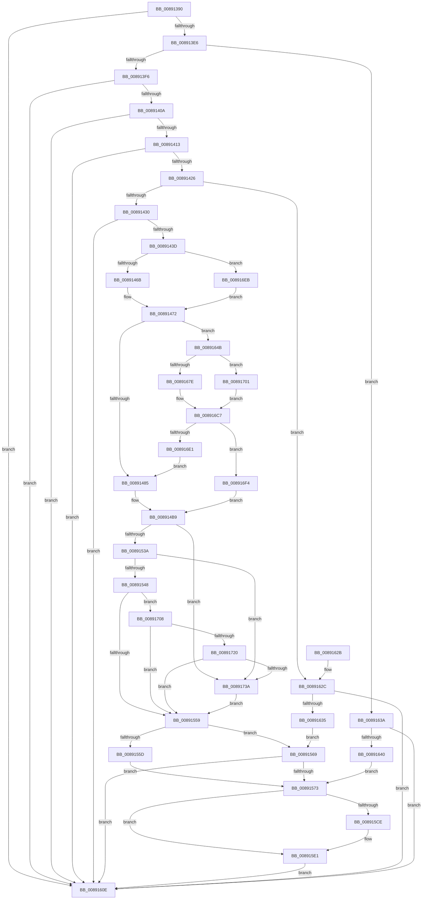

# AlpcpExposeTokenAttribute

- RVA: `0x00891390`–`0x0089174C` (길이 `956` bytes)
- VA: `0x0000000140891390`
- 실행 섹션: `PAGE`
- PDB 이름 있음: `예`; PDB Function 태그: `아니요`
- unwind 정보 RVA: `0x0007D850`
- 디코드: `208`개 명령, `956/956` bytes 표시
- 미해석 바이트: `0` (있으면 어셈블리에 `.byte`로 보존)

> 이 문서는 커널 이미지의 기계어와 PDB 기호를 분석해 생성했습니다. 4번과 5번은 함수 원형과 자료형을 바이너리 사용 방식에서 추정한 C 해석이며 원본 소스 복구 결과는 아닙니다.

## 1. Dependencies

- 직접 호출 지점: **14**; 고유 호출 대상: **13**
- 직접 호출자로 확인된 함수: **1**
- RIP 상대 이미지 참조: **1**

### Outgoing calls
- `0x0089148A` → [PsReferencePrimaryTokenWithTag](../../text/20/PsReferencePrimaryTokenWithTag_function_0020FF80.md) (function, `0x0020FF80`)
- `0x008914D5` → [SepReconcileTrustSidWithProcessProtection](../../text/3E/SepReconcileTrustSidWithProcessProtection_function_003EDE50.md) (function, `0x003EDE50`)
- `0x0089152B` → [SepCreateClientSecurityEx](SepCreateClientSecurityEx_function_00891C90.md) (function, `0x00891C90`)
- `0x008915A2` → [ExAcquireResourceSharedLite](../../text/21/ExAcquireResourceSharedLite_function_00211BC0.md) (function, `0x00211BC0`)
- `0x008915B7` → [ExReleaseResourceLite](../../text/25/ExReleaseResourceLite_function_0025FA10.md) (function, `0x0025FA10`)
- `0x008915C5` → [KeLeaveCriticalRegionThread](../../text/25/KeLeaveCriticalRegionThread_function_0025EFF0.md) (function, `0x0025EFF0`)
- `0x008915DB` → [ObfDereferenceObjectWithTag](../../text/2F/ObfDereferenceObjectWithTag_function_002F78E0.md) (function, `0x002F78E0`)
- `0x0089166B` → [PspLockThreadSecurityShared](../../text/3C/PspLockThreadSecurityShared_function_003C4720.md) (function, `0x003C4720`)
- `0x00891696` → [ObfReferenceObjectWithTag](../../text/21/ObfReferenceObjectWithTag_function_00210710.md) (function, `0x00210710`)
- `0x008916D2` → [PspUnlockThreadSecurityShared](../../text/3C/PspUnlockThreadSecurityShared_function_003C2E40.md) (function, `0x003C2E40`)
- `0x00891708` → [PsGetCurrentServerSilo](../../text/22/PsGetCurrentServerSilo_function_00225710.md) (function, `0x00225710`)
- `0x00891713` → [PsIsHostSilo](../../text/44/PsIsHostSilo_function_00443B30.md) (function, `0x00443B30`)
- `0x0089172B` → [SepUpdateSiloInClientSecurity](../AD/SepUpdateSiloInClientSecurity_function_00AD4E10.md) (function, `0x00AD4E10`)
- `0x00891742` → [ObfDereferenceObjectWithTag](../../text/2F/ObfDereferenceObjectWithTag_function_002F78E0.md) (function, `0x002F78E0`)

### Direct callers
- [AlpcpExposeAttributes](AlpcpExposeAttributes_function_00897630.md) at `0x0089787F`
- [AlpcpExposeAttributes](AlpcpExposeAttributes_function_00897630.md) at `0x00897A46`

### Static image references
- `0x00891548` → RVA `0x00FC6AB0` (`ALMOSTRO`; read)

## 2. Other-region calls and transfers

- 다른 실행 섹션으로 향하는 call: **12**
  - `0x0089148A` → [PsReferencePrimaryTokenWithTag](../../text/20/PsReferencePrimaryTokenWithTag_function_0020FF80.md) (`PAGE` → `.text`)
  - `0x008914D5` → [SepReconcileTrustSidWithProcessProtection](../../text/3E/SepReconcileTrustSidWithProcessProtection_function_003EDE50.md) (`PAGE` → `.text`)
  - `0x008915A2` → [ExAcquireResourceSharedLite](../../text/21/ExAcquireResourceSharedLite_function_00211BC0.md) (`PAGE` → `.text`)
  - `0x008915B7` → [ExReleaseResourceLite](../../text/25/ExReleaseResourceLite_function_0025FA10.md) (`PAGE` → `.text`)
  - `0x008915C5` → [KeLeaveCriticalRegionThread](../../text/25/KeLeaveCriticalRegionThread_function_0025EFF0.md) (`PAGE` → `.text`)
  - `0x008915DB` → [ObfDereferenceObjectWithTag](../../text/2F/ObfDereferenceObjectWithTag_function_002F78E0.md) (`PAGE` → `.text`)
  - `0x0089166B` → [PspLockThreadSecurityShared](../../text/3C/PspLockThreadSecurityShared_function_003C4720.md) (`PAGE` → `.text`)
  - `0x00891696` → [ObfReferenceObjectWithTag](../../text/21/ObfReferenceObjectWithTag_function_00210710.md) (`PAGE` → `.text`)
  - `0x008916D2` → [PspUnlockThreadSecurityShared](../../text/3C/PspUnlockThreadSecurityShared_function_003C2E40.md) (`PAGE` → `.text`)
  - `0x00891708` → [PsGetCurrentServerSilo](../../text/22/PsGetCurrentServerSilo_function_00225710.md) (`PAGE` → `.text`)
  - `0x00891713` → [PsIsHostSilo](../../text/44/PsIsHostSilo_function_00443B30.md) (`PAGE` → `.text`)
  - `0x00891742` → [ObfDereferenceObjectWithTag](../../text/2F/ObfDereferenceObjectWithTag_function_002F78E0.md) (`PAGE` → `.text`)
- 별도 외부 분기/꼬리 이동을 확인하지 못했습니다.

## 3. Assembly (complete function range)

```asm
00891390  4C 8B DC                        mov r11, rsp
00891393  49 89 5B 08                     mov qword ptr [r11 + 8], rbx
00891397  49 89 73 18                     mov qword ptr [r11 + 0x18], rsi
0089139B  57                              push rdi
0089139C  41 54                           push r12
0089139E  41 55                           push r13
008913A0  41 56                           push r14
008913A2  41 57                           push r15
008913A4  48 81 EC 10 01 00 00            sub rsp, 0x110
008913AB  4D 8B E1                        mov r12, r9
008913AE  4D 8B F8                        mov r15, r8
008913B1  33 C0                           xor eax, eax
008913B3  0F 57 C0                        xorps xmm0, xmm0
008913B6  0F 11 84 24 90 00 00 00         movups xmmword ptr [rsp + 0x90], xmm0
008913BE  0F 11 84 24 A0 00 00 00         movups xmmword ptr [rsp + 0xa0], xmm0
008913C6  0F 11 84 24 B0 00 00 00         movups xmmword ptr [rsp + 0xb0], xmm0
008913CE  41 0F 11 43 88                  movups xmmword ptr [r11 - 0x78], xmm0
008913D3  41 89 43 98                     mov dword ptr [r11 - 0x68], eax
008913D7  33 FF                           xor edi, edi
008913D9  8B F7                           mov esi, edi
008913DB  8B 42 28                        mov eax, dword ptr [rdx + 0x28]
008913DE  84 C0                           test al, al
008913E0  0F 88 28 02 00 00               js 0x14089160e
008913E6  48 8B 82 88 00 00 00            mov rax, qword ptr [rdx + 0x88]
008913ED  48 85 C0                        test rax, rax
008913F0  0F 85 44 02 00 00               jne 0x14089163a
008913F6  4C 8B 72 18                     mov r14, qword ptr [rdx + 0x18]
008913FA  8B 81 A0 01 00 00               mov eax, dword ptr [rcx + 0x1a0]
00891400  24 06                           and al, 6
00891402  3C 02                           cmp al, 2
00891404  0F 85 04 02 00 00               jne 0x14089160e
0089140A  4D 85 F6                        test r14, r14
0089140D  0F 84 FB 01 00 00               je 0x14089160e
00891413  41 8B 8E A0 01 00 00            mov ecx, dword ptr [r14 + 0x1a0]
0089141A  8B C1                           mov eax, ecx
0089141C  24 06                           and al, 6
0089141E  3C 04                           cmp al, 4
00891420  0F 85 E8 01 00 00               jne 0x14089160e
00891426  0F BA E1 0A                     bt ecx, 0xa
0089142A  0F 83 FC 01 00 00               jae 0x14089162c
00891430  48 8B 5A 20                     mov rbx, qword ptr [rdx + 0x20]
00891434  48 85 DB                        test rbx, rbx
00891437  0F 84 D1 01 00 00               je 0x14089160e
0089143D  40 88 74 24 60                  mov byte ptr [rsp + 0x60], sil
00891442  41 88 73 10                     mov byte ptr [r11 + 0x10], sil
00891446  40 88 74 24 61                  mov byte ptr [rsp + 0x61], sil
0089144B  49 89 BB 48 FF FF FF            mov qword ptr [r11 - 0xb8], rdi
00891452  65 48 8B 04 25 88 01 00 00      mov rax, qword ptr gs:[0x188]
0089145B  4C 8D AB 20 02 00 00            lea r13, [rbx + 0x220]
00891462  48 3B D8                        cmp rbx, rax
00891465  0F 85 80 02 00 00               jne 0x1408916eb
0089146B  48 8B 88 B8 00 00 00            mov rcx, qword ptr [rax + 0xb8]
00891472  48 89 4C 24 78                  mov qword ptr [rsp + 0x78], rcx
00891477  8B 83 A0 05 00 00               mov eax, dword ptr [rbx + 0x5a0]
0089147D  A8 08                           test al, 8
0089147F  0F 85 C6 01 00 00               jne 0x14089164b
00891485  BA 53 65 43 63                  mov edx, 0x63436553
0089148A  E8 F1 EA 97 FF                  call 0x14020ff80
0089148F  48 89 44 24 68                  mov qword ptr [rsp + 0x68], rax
00891494  C7 44 24 70 01 00 00 00         mov dword ptr [rsp + 0x70], 1
0089149C  40 88 74 24 60                  mov byte ptr [rsp + 0x60], sil
008914A1  48 8B 44 24 78                  mov rax, qword ptr [rsp + 0x78]
008914A6  0F B6 80 FA 05 00 00            movzx eax, byte ptr [rax + 0x5fa]
008914AD  88 84 24 48 01 00 00            mov byte ptr [rsp + 0x148], al
008914B4  48 8B 4C 24 68                  mov rcx, qword ptr [rsp + 0x68]
008914B9  4C 8D 8C 24 80 00 00 00         lea r9, [rsp + 0x80]
008914C1  4C 8D 44 24 61                  lea r8, [rsp + 0x61]
008914C6  48 8D 94 24 48 01 00 00         lea rdx, [rsp + 0x148]
008914CE  48 8B 89 50 04 00 00            mov rcx, qword ptr [rcx + 0x450]
008914D5  E8 76 C9 B5 FF                  call 0x1403ede50
008914DA  49 8D 96 04 01 00 00            lea rdx, [r14 + 0x104]
008914E1  48 8D 84 24 90 00 00 00         lea rax, [rsp + 0x90]
008914E9  48 89 44 24 50                  mov qword ptr [rsp + 0x50], rax
008914EE  48 8B 84 24 80 00 00 00         mov rax, qword ptr [rsp + 0x80]
008914F6  48 89 44 24 48                  mov qword ptr [rsp + 0x48], rax
008914FB  0F B6 44 24 61                  movzx eax, byte ptr [rsp + 0x61]
00891500  88 44 24 40                     mov byte ptr [rsp + 0x40], al
00891504  48 89 5C 24 38                  mov qword ptr [rsp + 0x38], rbx
00891509  C6 44 24 30 01                  mov byte ptr [rsp + 0x30], 1
0089150E  89 7C 24 28                     mov dword ptr [rsp + 0x28], edi
00891512  0F B6 44 24 60                  movzx eax, byte ptr [rsp + 0x60]
00891517  88 44 24 20                     mov byte ptr [rsp + 0x20], al
0089151B  44 8B 4C 24 70                  mov r9d, dword ptr [rsp + 0x70]
00891520  45 33 C0                        xor r8d, r8d
00891523  48 8B 5C 24 68                  mov rbx, qword ptr [rsp + 0x68]
00891528  48 8B CB                        mov rcx, rbx
0089152B  E8 60 07 00 00                  call 0x140891c90
00891530  8B F8                           mov edi, eax
00891532  85 C0                           test eax, eax
00891534  0F 88 00 02 00 00               js 0x14089173a
0089153A  40 38 B4 24 98 00 00 00         cmp byte ptr [rsp + 0x98], sil
00891542  0F 84 F2 01 00 00               je 0x14089173a
00891548  48 8B 0D 61 55 73 00            mov rcx, qword ptr [rip + 0x735561]
0089154F  49 39 4D 00                     cmp qword ptr [r13], rcx
00891553  0F 84 AF 01 00 00               je 0x140891708
00891559  85 FF                           test edi, edi
0089155B  78 0C                           js 0x140891569
0089155D  48 8B B4 24 A0 00 00 00         mov rsi, qword ptr [rsp + 0xa0]
00891565  B3 01                           mov bl, 1
00891567  EB 0A                           jmp 0x140891573
00891569  32 DB                           xor bl, bl
0089156B  85 FF                           test edi, edi
0089156D  0F 88 9B 00 00 00               js 0x14089160e
00891573  48 8B 46 18                     mov rax, qword ptr [rsi + 0x18]
00891577  48 89 84 24 E8 00 00 00         mov qword ptr [rsp + 0xe8], rax
0089157F  48 8B 46 10                     mov rax, qword ptr [rsi + 0x10]
00891583  48 89 84 24 E0 00 00 00         mov qword ptr [rsp + 0xe0], rax
0089158B  65 48 8B 04 25 88 01 00 00      mov rax, qword ptr gs:[0x188]
00891594  66 FF 88 E4 01 00 00            dec word ptr [rax + 0x1e4]
0089159B  90                              nop
0089159C  B2 01                           mov dl, 1
0089159E  48 8B 4E 30                     mov rcx, qword ptr [rsi + 0x30]
008915A2  E8 19 06 98 FF                  call 0x140211bc0
008915A7  48 8B 46 38                     mov rax, qword ptr [rsi + 0x38]
008915AB  48 89 84 24 F0 00 00 00         mov qword ptr [rsp + 0xf0], rax
008915B3  48 8B 4E 30                     mov rcx, qword ptr [rsi + 0x30]
008915B7  E8 54 E4 9C FF                  call 0x14025fa10
008915BC  65 48 8B 0C 25 88 01 00 00      mov rcx, qword ptr gs:[0x188]
008915C5  E8 26 DA 9C FF                  call 0x14025eff0
008915CA  84 DB                           test bl, bl
008915CC  74 13                           je 0x1408915e1
008915CE  48 8B 8C 24 A0 00 00 00         mov rcx, qword ptr [rsp + 0xa0]
008915D6  BA 53 65 43 63                  mov edx, 0x63436553
008915DB  E8 00 63 A6 FF                  call 0x1402f78e0
008915E0  90                              nop
008915E1  48 8B 84 24 E0 00 00 00         mov rax, qword ptr [rsp + 0xe0]
008915E9  49 89 07                        mov qword ptr [r15], rax
008915EC  48 8B 84 24 E8 00 00 00         mov rax, qword ptr [rsp + 0xe8]
008915F4  49 89 47 08                     mov qword ptr [r15 + 8], rax
008915F8  48 8B 84 24 F0 00 00 00         mov rax, qword ptr [rsp + 0xf0]
00891600  49 89 47 10                     mov qword ptr [r15 + 0x10], rax
00891604  41 81 0C 24 00 00 00 08         or dword ptr [r12], 0x8000000
0089160C  EB 00                           jmp 0x14089160e
0089160E  4C 8D 9C 24 10 01 00 00         lea r11, [rsp + 0x110]
00891616  49 8B 5B 30                     mov rbx, qword ptr [r11 + 0x30]
0089161A  49 8B 73 40                     mov rsi, qword ptr [r11 + 0x40]
0089161E  49 8B E3                        mov rsp, r11
00891621  41 5F                           pop r15
00891623  41 5E                           pop r14
00891625  41 5D                           pop r13
00891627  41 5C                           pop r12
00891629  5F                              pop rdi
0089162A  C3                              ret
0089162B  CC                              int3
0089162C  49 8B 76 50                     mov rsi, qword ptr [r14 + 0x50]
00891630  48 85 F6                        test rsi, rsi
00891633  74 D9                           je 0x14089160e
00891635  E9 2F FF FF FF                  jmp 0x140891569
0089163A  83 78 24 01                     cmp dword ptr [rax + 0x24], 1
0089163E  7C CE                           jl 0x14089160e
00891640  48 8B 70 30                     mov rsi, qword ptr [rax + 0x30]
00891644  32 DB                           xor bl, bl
00891646  E9 28 FF FF FF                  jmp 0x140891573
0089164B  49 8B 45 00                     mov rax, qword ptr [r13]
0089164F  48 89 44 24 70                  mov qword ptr [rsp + 0x70], rax
00891654  65 48 8B 04 25 88 01 00 00      mov rax, qword ptr gs:[0x188]
0089165D  48 89 84 24 88 00 00 00         mov qword ptr [rsp + 0x88], rax
00891665  48 8B D0                        mov rdx, rax
00891668  48 8B CB                        mov rcx, rbx
0089166B  E8 B0 30 B3 FF                  call 0x1403c4720
00891670  8B 83 A0 05 00 00               mov eax, dword ptr [rbx + 0x5a0]
00891676  A8 08                           test al, 8
00891678  0F 84 83 00 00 00               je 0x140891701
0089167E  48 8B 83 38 05 00 00            mov rax, qword ptr [rbx + 0x538]
00891685  48 83 E0 F8                     and rax, 0xfffffffffffffff8
00891689  48 89 44 24 68                  mov qword ptr [rsp + 0x68], rax
0089168E  BA 53 65 43 63                  mov edx, 0x63436553
00891693  48 8B C8                        mov rcx, rax
00891696  E8 75 F0 97 FF                  call 0x140210710
0089169B  8B BB 38 05 00 00               mov edi, dword ptr [rbx + 0x538]
008916A1  83 E7 03                        and edi, 3
008916A4  48 8B 44 24 70                  mov rax, qword ptr [rsp + 0x70]
008916A9  0F B6 80 FA 05 00 00            movzx eax, byte ptr [rax + 0x5fa]
008916B0  88 84 24 48 01 00 00            mov byte ptr [rsp + 0x148], al
008916B7  0F B6 83 38 05 00 00            movzx eax, byte ptr [rbx + 0x538]
008916BE  C0 E8 02                        shr al, 2
008916C1  24 01                           and al, 1
008916C3  88 44 24 60                     mov byte ptr [rsp + 0x60], al
008916C7  48 8B 94 24 88 00 00 00         mov rdx, qword ptr [rsp + 0x88]
008916CF  48 8B CB                        mov rcx, rbx
008916D2  E8 69 17 B3 FF                  call 0x1403c2e40
008916D7  48 8B 4C 24 68                  mov rcx, qword ptr [rsp + 0x68]
008916DC  48 85 C9                        test rcx, rcx
008916DF  75 13                           jne 0x1408916f4
008916E1  48 8B 4C 24 78                  mov rcx, qword ptr [rsp + 0x78]
008916E6  E9 9A FD FF FF                  jmp 0x140891485
008916EB  49 8B 4D 00                     mov rcx, qword ptr [r13]
008916EF  E9 7E FD FF FF                  jmp 0x140891472
008916F4  C7 44 24 70 02 00 00 00         mov dword ptr [rsp + 0x70], 2
008916FC  E9 B8 FD FF FF                  jmp 0x1408914b9
00891701  48 89 7C 24 68                  mov qword ptr [rsp + 0x68], rdi
00891706  EB BF                           jmp 0x1408916c7
00891708  E8 03 40 99 FF                  call 0x140225710
0089170D  4C 8B F0                        mov r14, rax
00891710  48 8B C8                        mov rcx, rax
00891713  E8 18 24 BB FF                  call 0x140443b30
00891718  84 C0                           test al, al
0089171A  0F 85 39 FE FF FF               jne 0x140891559
00891720  49 8B D6                        mov rdx, r14
00891723  48 8D 8C 24 90 00 00 00         lea rcx, [rsp + 0x90]
0089172B  E8 E0 36 24 00                  call 0x140ad4e10
00891730  8B F8                           mov edi, eax
00891732  85 C0                           test eax, eax
00891734  0F 89 1F FE FF FF               jns 0x140891559
0089173A  BA 53 65 43 63                  mov edx, 0x63436553
0089173F  48 8B CB                        mov rcx, rbx
00891742  E8 99 61 A6 FF                  call 0x1402f78e0
00891747  E9 0D FE FF FF                  jmp 0x140891559
```

## 4. C-style interpretation (structured pseudocode)

```c
__int64 __fastcall AlpcpExposeTokenAttribute(__int64 a1, __int64 a2, __int64 a3, __int64 a4)
{
    __int64 result;
    __int64 v_rbx;
    __int64 v_rdi;
    __int64 v_rsp;
    unsigned __int64 v_stack_m100;
    unsigned __int8 v_stack_m108;
    unsigned int v_stack_m110;
    unsigned __int8 v_stack_m118;
    unsigned __int64 v_stack_m28;
    unsigned __int64 v_stack_m48;
    unsigned __int64 v_stack_m50;
    unsigned __int64 v_stack_m58;
    unsigned __int64 v_stack_m80;
    unsigned __int64 v_stack_m88;
    unsigned __int64 v_stack_m98;
    unsigned __int8 v_stack_mA0;
    unsigned __int64 v_stack_mA8;
    unsigned __int8 v_stack_mB0;
    unsigned __int64 v_stack_mB8;
    unsigned __int64 v_stack_mC0;
    unsigned int v_stack_mC8;
    unsigned __int64 v_stack_mD0;
    unsigned __int8 v_stack_mD7;
    unsigned __int8 v_stack_mD8;
    unsigned __int64 v_stack_mE8;
    unsigned __int64 v_stack_mF0;
    unsigned __int8 v_stack_mF8;
    unsigned __int8 v_stack_p10;
    unsigned __int8 v_stack_p38;

    *(unsigned __int64 *)(v_rsp + 8) = v_rbx;
    *(unsigned __int64 *)(v_rsp + 24) = v_rsi;
    v_rsp = (v_rsp) - (272);
    result = 0;
    v_stack_mA8 = v_xmm0;
    v_stack_m98 = v_xmm0;
    v_stack_m88 = v_xmm0;
    *(unsigned __int64 *)(v_rsp - 120) = v_xmm0;
    *(unsigned int *)(v_rsp - 104) = 0;
    v_rdi = 0;
    if (sign_flag) goto loc_0089160E;
    if (*(unsigned __int64 *)(a2 + 136) != 0) goto loc_0089163A;
    result = (unsigned __int8)(((unsigned int)(*(unsigned int *)(a1 + 416))) & (6));
    if (((unsigned __int8)(result)) != 2) goto loc_0089160E;
    if (*(unsigned __int64 *)(a2 + 24) == 0) goto loc_0089160E;
    result = (unsigned __int8)(((unsigned int)((unsigned int)((unsigned int)(*(unsigned int *)(*(unsigned __int64 *)(a2 + 24) + 416))))) & (6));
    if (((unsigned __int8)(result)) != 4) goto loc_0089160E;
    if (((unsigned __int8)(result)) >= 4) goto loc_0089162C;
    if (*(unsigned __int64 *)(a2 + 32) == 0) goto loc_0089160E;
    v_stack_mD8 = 0;
    *(unsigned __int8 *)(v_rsp + 16) = 0;
    v_stack_mD7 = 0;
    *(unsigned __int64 *)(v_rsp - 184) = 0;
    if ((*(unsigned __int64 *)(a2 + 32)) != (*(unsigned __int64 *)(gs_base + (0 + 392)))) goto loc_008916EB;
loc_00891472:
    v_stack_mC0 = *(unsigned __int64 *)(*(unsigned __int64 *)(gs_base + (0 + 392)) + 184);
    if ((((unsigned __int8)((unsigned int)(*(unsigned int *)(*(unsigned __int64 *)(a2 + 32) + 1440)))) & (8)) != 0) goto loc_0089164B;
loc_00891485:
    result = PsReferencePrimaryTokenWithTag(*(unsigned __int64 *)(*(unsigned __int64 *)(gs_base + (0 + 392)) + 184), (unsigned int)(0x63436553ULL), a3, a4);
    v_stack_mD0 = result;
    v_stack_mC8 = 1;
    v_stack_mD8 = 0;
    v_stack_p10 = (unsigned __int8)(*(unsigned __int8 *)(v_stack_mC0 + 1530));
loc_008914B9:
    result = SepReconcileTrustSidWithProcessProtection(*(unsigned __int64 *)(v_stack_mD0 + 1104), v_stack_p10, v_stack_mD7, v_stack_mB8);
    v_stack_mE8 = v_stack_mA8;
    v_stack_mF0 = v_stack_mB8;
    v_stack_mF8 = (unsigned __int8)(v_stack_mD7);
    v_stack_m100 = *(unsigned __int64 *)(a2 + 32);
    v_stack_m108 = 1;
    v_stack_m110 = 0;
    v_stack_m118 = (unsigned __int8)(v_stack_mD8);
    a3 = 0;
    result = SepCreateClientSecurityEx(v_stack_mD0, *(unsigned __int64 *)(a2 + 24) + 260, a3, (unsigned int)(v_stack_mC8));
    if (sign_flag) goto loc_0089173A;
    if (v_stack_mA0 == 0) goto loc_0089173A;
    if ((*(unsigned __int64 *)(*(unsigned __int64 *)(a2 + 32) + 544)) == (*(unsigned __int64 *)(v_rip + 7558497))) goto loc_00891708;
loc_00891559:
    if (sign_flag) goto loc_00891569;
    goto loc_00891573;
loc_00891569:
    v_rbx = 0;
    if (sign_flag) goto loc_0089160E;
loc_00891573:
    v_stack_m50 = *(unsigned __int64 *)(v_stack_m98 + 24);
    v_stack_m58 = *(unsigned __int64 *)(v_stack_m98 + 16);
    result = ExAcquireResourceSharedLite(*(unsigned __int64 *)(v_stack_m98 + 48), 1, a3, (unsigned int)(v_stack_mC8));
    v_stack_m48 = *(unsigned __int64 *)(v_stack_m98 + 56);
    result = ExReleaseResourceLite(*(unsigned __int64 *)(v_stack_m98 + 48), 1, a3, (unsigned int)(v_stack_mC8));
    result = KeLeaveCriticalRegionThread(*(unsigned __int64 *)(gs_base + (0 + 392)), 1, a3, (unsigned int)(v_stack_mC8));
    if (0 != 0) {
        a1 = v_stack_m98;
        a2 = 0x63436553ULL;
        result = ObfDereferenceObjectWithTag(a1, a2, a3, (unsigned int)(v_stack_mC8));
    }
    *(unsigned __int64 *)(a3) = v_stack_m58;
    *(unsigned __int64 *)(a3 + 8) = v_stack_m50;
    *(unsigned __int64 *)(a3 + 16) = v_stack_m48;
    goto loc_0089160E;
loc_0089160E:
    return v_stack_m48;
loc_0089162C:
    if (*(unsigned __int64 *)(*(unsigned __int64 *)(a2 + 24) + 80) == 0) goto loc_0089160E;
    goto loc_00891569;
loc_0089163A:
    if ((*(unsigned int *)(v_stack_m48 + 36)) < 1) goto loc_0089160E;
    v_rbx = 0;
    goto loc_00891573;
loc_0089164B:
    v_stack_mA0 = *(unsigned __int64 *)(*(unsigned __int64 *)(a2 + 32) + 544);
    v_stack_m88 = *(unsigned __int64 *)(gs_base + (0 + 392));
    result = PspLockThreadSecurityShared(0, *(unsigned __int64 *)(gs_base + (0 + 392)), a3, (unsigned int)(v_stack_mC8));
    if ((((unsigned __int8)((unsigned int)(*(unsigned int *)(v_rbx + 1440)))) & (8)) == 0) goto loc_00891701;
    result = (*(unsigned __int64 *)(v_rbx + 1336)) & (-8);
    v_stack_mA8 = result;
    result = ObfReferenceObjectWithTag(result, (unsigned int)(0x63436553ULL), a3, (unsigned int)(v_stack_mC8));
    v_rdi = (unsigned int)(((unsigned int)(*(unsigned int *)(v_rbx + 1336))) & (3));
    v_stack_p38 = (unsigned __int8)(*(unsigned __int8 *)(v_stack_mA0 + 1530));
    result = (unsigned __int8)((*(unsigned __int8 *)(v_rbx + 1336)) >> (2));
    result = (unsigned __int8)((result) & (1));
    v_stack_mB0 = (unsigned __int8)(result);
loc_008916C7:
    result = PspUnlockThreadSecurityShared(0, v_stack_m88, a3, (unsigned int)(v_stack_mC8));
    if (v_stack_mA8 != 0) goto loc_008916F4;
    goto loc_00891485;
loc_008916EB:
    goto loc_00891472;
loc_008916F4:
    v_stack_mA0 = 2;
    goto loc_008914B9;
loc_00891701:
    v_stack_mA8 = v_rdi;
    goto loc_008916C7;
loc_00891708:
    result = PsGetCurrentServerSilo(*(unsigned __int64 *)(*(unsigned __int64 *)(a2 + 32) + 544), v_stack_m88, a3, (unsigned int)(v_stack_mC8));
    result = PsIsHostSilo(result, v_stack_m88, a3, (unsigned int)(v_stack_mC8));
    if ((unsigned __int8)(result) != 0) goto loc_00891559;
    result = SepUpdateSiloInClientSecurity(v_stack_m80, result, a3, (unsigned int)(v_stack_mC8));
    if (!sign_flag) goto loc_00891559;
loc_0089173A:
    result = ObfDereferenceObjectWithTag(0, (unsigned int)(0x63436553ULL), a3, (unsigned int)(v_stack_mC8));
    goto loc_00891559;
}
```

## 5. (Beta) C Style

```c
int64_t AlpcpExposeTokenAttribute(void *Arg1, void *Arg2, void *Arg3, void *Arg4)
{
    uint8_t *arg1 = (uint8_t *)Arg1;
    uint8_t *arg2 = (uint8_t *)Arg2;
    uint8_t *arg3 = (uint8_t *)Arg3;
    uint8_t *arg4 = (uint8_t *)Arg4;

    int64_t result;
    int64_t local_rbx;
    int64_t local_rdi;
    int64_t local_rsp;
    uint64_t v_stack_m100;
    uint8_t v_stack_m108;
    uint32_t v_stack_m110;
    uint8_t v_stack_m118;
    uint64_t v_stack_m28;
    uint64_t v_stack_m48;
    uint64_t v_stack_m50;
    uint64_t v_stack_m58;
    uint64_t v_stack_m80;
    uint64_t v_stack_m88;
    uint64_t v_stack_m98;
    uint8_t v_stack_mA0;
    uint64_t v_stack_mA8;
    uint8_t v_stack_mB0;
    uint64_t v_stack_mB8;
    uint64_t v_stack_mC0;
    uint32_t v_stack_mC8;
    uint64_t v_stack_mD0;
    uint8_t v_stack_mD7;
    uint8_t v_stack_mD8;
    uint64_t v_stack_mE8;
    uint64_t v_stack_mF0;
    uint8_t v_stack_mF8;
    uint8_t v_stack_p10;
    uint8_t v_stack_p38;

    *(uint64_t *)(local_rsp + 0x8) = local_rbx;
    *(uint64_t *)(local_rsp + 0x18) = local_rsi;
    local_rsp = (local_rsp) - (272);
    result = 0;
    v_stack_mA8 = v_xmm0;
    v_stack_m98 = v_xmm0;
    v_stack_m88 = v_xmm0;
    *(uint64_t *)(local_rsp - 0x78) = v_xmm0;
    *(uint32_t *)(local_rsp - 0x68) = 0;
    local_rdi = 0;
    if (sign_flag) goto loc_0089160E;
    if (*(uint64_t *)(arg2 + 0x88) != 0) goto loc_0089163A;
    result = (uint8_t)(((uint32_t)(*(uint32_t *)(arg1 + 0x1A0))) & (6));
    if (((uint8_t)(result)) != 2) goto loc_0089160E;
    if (*(uint64_t *)(arg2 + 0x18) == 0) goto loc_0089160E;
    result = (uint8_t)(((uint32_t)((uint32_t)((uint32_t)(*(uint32_t *)(*(uint64_t *)(arg2 + 0x18) + 0x1A0))))) & (6));
    if (((uint8_t)(result)) != 4) goto loc_0089160E;
    if (((uint8_t)(result)) >= 4) goto loc_0089162C;
    if (*(uint64_t *)(arg2 + 0x20) == 0) goto loc_0089160E;
    v_stack_mD8 = 0;
    *(uint8_t *)(local_rsp + 0x10) = 0;
    v_stack_mD7 = 0;
    *(uint64_t *)(local_rsp - 0xB8) = 0;
    if ((*(uint64_t *)(arg2 + 0x20)) != (*(uint64_t *)(gs_base + (0 + 0x188)))) goto loc_008916EB;
loc_00891472:
    v_stack_mC0 = *(uint64_t *)(*(uint64_t *)(gs_base + (0 + 0x188)) + 0xB8);
    if ((((uint8_t)((uint32_t)(*(uint32_t *)(*(uint64_t *)(arg2 + 0x20) + 0x5A0)))) & (8)) != 0) goto loc_0089164B;
loc_00891485:
    result = PsReferencePrimaryTokenWithTag(*(uint64_t *)(*(uint64_t *)(gs_base + (0 + 0x188)) + 0xB8), (uint32_t)(0x63436553ULL), Arg3, Arg4);
    v_stack_mD0 = result;
    v_stack_mC8 = 1;
    v_stack_mD8 = 0;
    v_stack_p10 = (uint8_t)(*(uint8_t *)(v_stack_mC0 + 0x5FA));
loc_008914B9:
    result = SepReconcileTrustSidWithProcessProtection(*(uint64_t *)(v_stack_mD0 + 0x450), v_stack_p10, v_stack_mD7, v_stack_mB8);
    v_stack_mE8 = v_stack_mA8;
    v_stack_mF0 = v_stack_mB8;
    v_stack_mF8 = (uint8_t)(v_stack_mD7);
    v_stack_m100 = *(uint64_t *)(arg2 + 0x20);
    v_stack_m108 = 1;
    v_stack_m110 = 0;
    v_stack_m118 = (uint8_t)(v_stack_mD8);
    Arg3 = 0;
    result = SepCreateClientSecurityEx(v_stack_mD0, *(uint64_t *)(arg2 + 0x18) + 260, Arg3, (uint32_t)(v_stack_mC8));
    if (sign_flag) goto loc_0089173A;
    if (v_stack_mA0 == 0) goto loc_0089173A;
    if ((*(uint64_t *)(*(uint64_t *)(arg2 + 0x20) + 0x220)) == (*(uint64_t *)(v_rip + 0x735561))) goto loc_00891708;
loc_00891559:
    if (sign_flag) goto loc_00891569;
    goto loc_00891573;
loc_00891569:
    local_rbx = 0;
    if (sign_flag) goto loc_0089160E;
loc_00891573:
    v_stack_m50 = *(uint64_t *)(v_stack_m98 + 0x18);
    v_stack_m58 = *(uint64_t *)(v_stack_m98 + 0x10);
    result = ExAcquireResourceSharedLite(*(uint64_t *)(v_stack_m98 + 0x30), 1, Arg3, (uint32_t)(v_stack_mC8));
    v_stack_m48 = *(uint64_t *)(v_stack_m98 + 0x38);
    result = ExReleaseResourceLite(*(uint64_t *)(v_stack_m98 + 0x30), 1, Arg3, (uint32_t)(v_stack_mC8));
    result = KeLeaveCriticalRegionThread(*(uint64_t *)(gs_base + (0 + 0x188)), 1, Arg3, (uint32_t)(v_stack_mC8));
    if (0 != 0) {
        Arg1 = v_stack_m98;
        Arg2 = 0x63436553ULL;
        result = ObfDereferenceObjectWithTag(Arg1, Arg2, Arg3, (uint32_t)(v_stack_mC8));
    }
    *(uint64_t *)(arg3) = v_stack_m58;
    *(uint64_t *)(arg3 + 0x8) = v_stack_m50;
    *(uint64_t *)(arg3 + 0x10) = v_stack_m48;
    goto loc_0089160E;
loc_0089160E:
    return v_stack_m48;
loc_0089162C:
    if (*(uint64_t *)(*(uint64_t *)(arg2 + 0x18) + 0x50) == 0) goto loc_0089160E;
    goto loc_00891569;
loc_0089163A:
    if ((*(uint32_t *)(v_stack_m48 + 0x24)) < 1) goto loc_0089160E;
    local_rbx = 0;
    goto loc_00891573;
loc_0089164B:
    v_stack_mA0 = *(uint64_t *)(*(uint64_t *)(arg2 + 0x20) + 0x220);
    v_stack_m88 = *(uint64_t *)(gs_base + (0 + 0x188));
    result = PspLockThreadSecurityShared(0, *(uint64_t *)(gs_base + (0 + 0x188)), Arg3, (uint32_t)(v_stack_mC8));
    if ((((uint8_t)((uint32_t)(*(uint32_t *)(local_rbx + 0x5A0)))) & (8)) == 0) goto loc_00891701;
    result = (*(uint64_t *)(local_rbx + 0x538)) & (-8);
    v_stack_mA8 = result;
    result = ObfReferenceObjectWithTag(result, (uint32_t)(0x63436553ULL), Arg3, (uint32_t)(v_stack_mC8));
    local_rdi = (uint32_t)(((uint32_t)(*(uint32_t *)(local_rbx + 0x538))) & (3));
    v_stack_p38 = (uint8_t)(*(uint8_t *)(v_stack_mA0 + 0x5FA));
    result = (uint8_t)((*(uint8_t *)(local_rbx + 0x538)) >> (2));
    result = (uint8_t)((result) & (1));
    v_stack_mB0 = (uint8_t)(result);
loc_008916C7:
    result = PspUnlockThreadSecurityShared(0, v_stack_m88, Arg3, (uint32_t)(v_stack_mC8));
    if (v_stack_mA8 != 0) goto loc_008916F4;
    goto loc_00891485;
loc_008916EB:
    goto loc_00891472;
loc_008916F4:
    v_stack_mA0 = 2;
    goto loc_008914B9;
loc_00891701:
    v_stack_mA8 = local_rdi;
    goto loc_008916C7;
loc_00891708:
    result = PsGetCurrentServerSilo(*(uint64_t *)(*(uint64_t *)(arg2 + 0x20) + 0x220), v_stack_m88, Arg3, (uint32_t)(v_stack_mC8));
    result = PsIsHostSilo(result, v_stack_m88, Arg3, (uint32_t)(v_stack_mC8));
    if ((uint8_t)(result) != 0) goto loc_00891559;
    result = SepUpdateSiloInClientSecurity(v_stack_m80, result, Arg3, (uint32_t)(v_stack_mC8));
    if (!sign_flag) goto loc_00891559;
loc_0089173A:
    result = ObfDereferenceObjectWithTag(0, (uint32_t)(0x63436553ULL), Arg3, (uint32_t)(v_stack_mC8));
    goto loc_00891559;
}
```

### 관측된 메모리 오프셋

구조체 형식이 확인되지 않은 접근은 인자 기준의 오프셋으로만 기록했습니다.

| 기준 인자 | 오프셋 표현 | 폭 (bit) | 접근 |
|---|---:|---:|---|
| `Arg1` | `+ 0x1A0` | `32` | `R` |
| `Arg2` | `+ 0x18` | `64` | `R` |
| `Arg2` | `+ 0x20` | `64` | `R` |
| `Arg2` | `+ 0x28` | `32` | `R` |
| `Arg2` | `+ 0x88` | `64` | `R` |
| `Arg3` | `+ 0x0` | `64` | `W` |
| `Arg3` | `+ 0x8` | `64` | `W` |
| `Arg3` | `+ 0x10` | `64` | `W` |
| `Arg4` | `+ 0x0` | `32` | `R/W` |

## 6. Execution-region graph

[열기: 2D/3D 그래프와 함수 탐색 컨트롤 패널](../../../control-panel.html?section=page&rva=0x00891390&view=graph)

- 2D 그래프는 위에서 아래로 흐르고, 3D 그래프는 빈 공간을 드래그해 회전합니다. Shift+드래그는 이동, 휠은 확대·축소, 함수 노드 선택은 대상 보고서 이동입니다.

### Static fallback


