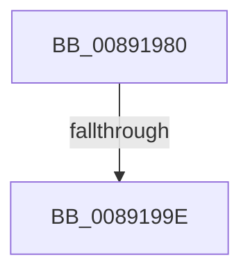

# AlpcpGetEffectiveTokenMessage

- RVA: `0x00891980`–`0x008919A5` (길이 `37` bytes)
- VA: `0x0000000140891980`
- 실행 섹션: `PAGE`
- PDB 이름 있음: `예`; PDB Function 태그: `아니요`
- unwind 정보 RVA: `0x0007D92C`
- 디코드: `10`개 명령, `37/37` bytes 표시
- 미해석 바이트: `0` (있으면 어셈블리에 `.byte`로 보존)

> 이 문서는 커널 이미지의 기계어와 PDB 기호를 분석해 생성했습니다. 4번과 5번은 함수 원형과 자료형을 바이너리 사용 방식에서 추정한 C 해석이며 원본 소스 복구 결과는 아닙니다.

## 1. Dependencies

- 직접 호출 지점: **0**; 고유 호출 대상: **0**
- 직접 호출자로 확인된 함수: **2**
- RIP 상대 이미지 참조: **0**

### Outgoing calls
- 직접 디코드된 call 명령이 없습니다.

### Direct callers
- [AlpcpQueryTokenModifiedIdMessage](../74/AlpcpQueryTokenModifiedIdMessage_function_0074C0C0.md) at `0x0074C138`
- [AlpcpQuerySidMessage](../A2/AlpcpQuerySidMessage_function_00A20F28.md) at `0x00A20F85`

### Static image references
- 디코드된 RIP-relative 메모리 참조가 없습니다.

## 2. Other-region calls and transfers

- 다른 실행 섹션으로 향하는 call: **0**
- call이 아닌 외부 분기/꼬리 이동: **1**
  - `0x00891998` → [sub_00891C7A](Unknown_function_00891C7A.md) (`tail-transfer`)

## 3. Assembly (complete function range)

```asm
00891980  4C 8B DC                        mov r11, rsp
00891983  56                              push rsi
00891984  41 57                           push r15
00891986  48 81 EC 98 00 00 00            sub rsp, 0x98
0089198D  8B 42 28                        mov eax, dword ptr [rdx + 0x28]
00891990  49 8B F1                        mov rsi, r9
00891993  4D 8B F8                        mov r15, r8
00891996  84 C0                           test al, al
00891998  0F 88 DC 02 00 00               js 0x140891c7a
0089199E  48 8B 82 88 00 00 00            mov rax, qword ptr [rdx + 0x88]
```

## 4. C-style interpretation (structured pseudocode)

```c
__int64 __fastcall AlpcpGetEffectiveTokenMessage(__int64 a1, __int64 a2, __int64 a3, __int64 a4)
{
    __int64 v_rsp;

    v_rsp = (v_rsp) - (152);
    return *(unsigned __int64 *)(a2 + 136);
}
```

## 5. (Beta) C Style

```c
int64_t AlpcpGetEffectiveTokenMessage(int64_t Arg1, void *Arg2, int64_t Arg3, int64_t Arg4)
{
    uint8_t *arg2 = (uint8_t *)Arg2;

    int64_t local_rsp;

    local_rsp = (local_rsp) - (152);
    return *(uint64_t *)(arg2 + 0x88);
}
```

### 관측된 메모리 오프셋

구조체 형식이 확인되지 않은 접근은 인자 기준의 오프셋으로만 기록했습니다.

| 기준 인자 | 오프셋 표현 | 폭 (bit) | 접근 |
|---|---:|---:|---|
| `Arg2` | `+ 0x28` | `32` | `R` |
| `Arg2` | `+ 0x88` | `64` | `R` |

## 6. Execution-region graph

[열기: 2D/3D 그래프와 함수 탐색 컨트롤 패널](../../../control-panel.html?section=page&rva=0x00891980&view=graph)

- 2D 그래프는 위에서 아래로 흐르고, 3D 그래프는 빈 공간을 드래그해 회전합니다. Shift+드래그는 이동, 휠은 확대·축소, 함수 노드 선택은 대상 보고서 이동입니다.

### Static fallback


