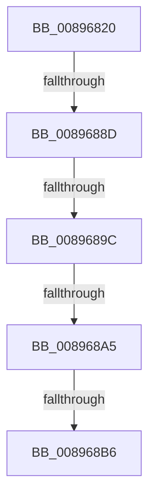

# AlpcpImpersonateMessage

- RVA: `0x00896820`–`0x008968C3` (길이 `163` bytes)
- VA: `0x0000000140896820`
- 실행 섹션: `PAGE`
- PDB 이름 있음: `예`; PDB Function 태그: `아니요`
- unwind 정보 RVA: `0x0007E1F0`
- 디코드: `41`개 명령, `163/163` bytes 표시
- 미해석 바이트: `0` (있으면 어셈블리에 `.byte`로 보존)

> 이 문서는 커널 이미지의 기계어와 PDB 기호를 분석해 생성했습니다. 4번과 5번은 함수 원형과 자료형을 바이너리 사용 방식에서 추정한 C 해석이며 원본 소스 복구 결과는 아닙니다.

## 1. Dependencies

- 직접 호출 지점: **0**; 고유 호출 대상: **0**
- 직접 호출자로 확인된 함수: **1**
- RIP 상대 이미지 참조: **1**

### Outgoing calls
- 직접 디코드된 call 명령이 없습니다.

### Direct callers
- [NtAlpcImpersonateClientOfPort](NtAlpcImpersonateClientOfPort_function_008961A0.md) at `0x008964F7`

### Static image references
- `0x00896833` → RVA `0x00E0A740` (`.data`; read)

## 2. Other-region calls and transfers

- 다른 실행 섹션으로 향하는 call: **0**
- call이 아닌 외부 분기/꼬리 이동: **5**
  - `0x00896887` → [sub_00896B21](Unknown_function_00896B21.md) (`tail-transfer`)
  - `0x00896896` → [sub_00896B21](Unknown_function_00896B21.md) (`tail-transfer`)
  - `0x008968A3` → [sub_008968C3](Unknown_function_008968C3.md) (`tail-transfer`)
  - `0x008968B0` → [sub_00896B21](Unknown_function_00896B21.md) (`tail-transfer`)
  - `0x008968BD` → [sub_00896B21](Unknown_function_00896B21.md) (`tail-transfer`)

## 3. Assembly (complete function range)

```asm
00896820  4C 8B DC                        mov r11, rsp
00896823  53                              push rbx
00896824  56                              push rsi
00896825  57                              push rdi
00896826  41 54                           push r12
00896828  41 55                           push r13
0089682A  41 57                           push r15
0089682C  48 81 EC F8 00 00 00            sub rsp, 0xf8
00896833  48 8B 05 06 3F 57 00            mov rax, qword ptr [rip + 0x573f06]
0089683A  48 33 C4                        xor rax, rsp
0089683D  48 89 84 24 E0 00 00 00         mov qword ptr [rsp + 0xe0], rax
00896845  0F 57 C0                        xorps xmm0, xmm0
00896848  44 89 4C 24 30                  mov dword ptr [rsp + 0x30], r9d
0089684D  33 C0                           xor eax, eax
0089684F  45 33 E4                        xor r12d, r12d
00896852  0F 11 84 24 90 00 00 00         movups xmmword ptr [rsp + 0x90], xmm0
0089685A  45 8B F8                        mov r15d, r8d
0089685D  48 8B DA                        mov rbx, rdx
00896860  0F 11 84 24 A0 00 00 00         movups xmmword ptr [rsp + 0xa0], xmm0
00896868  41 89 43 A8                     mov dword ptr [r11 - 0x58], eax
0089686C  45 8B EC                        mov r13d, r12d
0089686F  8B 42 28                        mov eax, dword ptr [rdx + 0x28]
00896872  41 8B F4                        mov esi, r12d
00896875  83 E0 07                        and eax, 7
00896878  41 8B FC                        mov edi, r12d
0089687B  41 0F 11 43 88                  movups xmmword ptr [r11 - 0x78], xmm0
00896880  41 0F 11 43 98                  movups xmmword ptr [r11 - 0x68], xmm0
00896885  3C 03                           cmp al, 3
00896887  0F 85 94 02 00 00               jne 0x140896b21
0089688D  66 0F BA A2 F4 00 00 00 0E      bt word ptr [rdx + 0xf4], 0xe
00896896  0F 82 85 02 00 00               jb 0x140896b21
0089689C  48 8B 52 10                     mov rdx, qword ptr [rdx + 0x10]
008968A0  48 3B D1                        cmp rdx, rcx
008968A3  74 1E                           je 0x1408968c3
008968A5  8B 81 A0 01 00 00               mov eax, dword ptr [rcx + 0x1a0]
008968AB  83 E0 06                        and eax, 6
008968AE  3C 06                           cmp al, 6
008968B0  0F 85 6B 02 00 00               jne 0x140896b21
008968B6  48 8B 41 10                     mov rax, qword ptr [rcx + 0x10]
008968BA  48 3B 10                        cmp rdx, qword ptr [rax]
008968BD  0F 85 5E 02 00 00               jne 0x140896b21
```

## 4. C-style interpretation (structured pseudocode)

```c
__int64 __fastcall AlpcpImpersonateMessage(__int64 a1, __int64 a2, int a3, int a4)
{
    __int64 result;
    __int64 v_r12;
    __int64 v_rsp;
    unsigned __int64 v_stack_m48;
    unsigned __int64 v_stack_m88;
    unsigned __int64 v_stack_m98;
    unsigned int v_stack_mF8;

    v_rsp = (v_rsp) - (248);
    result = (*(unsigned __int64 *)(v_rip + 5717766)) ^ (v_rsp);
    v_stack_m48 = result;
    v_stack_mF8 = a4;
    result = 0;
    v_r12 = 0;
    v_stack_m98 = v_xmm0;
    v_stack_m88 = v_xmm0;
    *(unsigned int *)(v_rsp - 88) = 0;
    result = (unsigned int)(((unsigned int)(*(unsigned int *)(a2 + 40))) & (7));
    *(unsigned __int64 *)(v_rsp - 120) = v_xmm0;
    *(unsigned __int64 *)(v_rsp - 104) = v_xmm0;
    result = (unsigned int)(((unsigned int)(*(unsigned int *)(a1 + 416))) & (6));
}
```

## 5. (Beta) C Style

```c
int64_t AlpcpImpersonateMessage(void *Arg1, void *Arg2, int32_t Arg3, int32_t Arg4)
{
    uint8_t *arg1 = (uint8_t *)Arg1;
    uint8_t *arg2 = (uint8_t *)Arg2;

    int64_t result;
    int64_t local_r12;
    int64_t local_rsp;
    uint64_t v_stack_m48;
    uint64_t v_stack_m88;
    uint64_t v_stack_m98;
    uint32_t v_stack_mF8;

    local_rsp = (local_rsp) - (248);
    result = (*(uint64_t *)(v_rip + 0x573F06)) ^ (local_rsp);
    v_stack_m48 = result;
    v_stack_mF8 = Arg4;
    result = 0;
    local_r12 = 0;
    v_stack_m98 = v_xmm0;
    v_stack_m88 = v_xmm0;
    *(uint32_t *)(local_rsp - 0x58) = 0;
    result = (uint32_t)(((uint32_t)(*(uint32_t *)(arg2 + 0x28))) & (7));
    *(uint64_t *)(local_rsp - 0x78) = v_xmm0;
    *(uint64_t *)(local_rsp - 0x68) = v_xmm0;
    result = (uint32_t)(((uint32_t)(*(uint32_t *)(arg1 + 0x1A0))) & (6));
}
```

### 관측된 메모리 오프셋

구조체 형식이 확인되지 않은 접근은 인자 기준의 오프셋으로만 기록했습니다.

| 기준 인자 | 오프셋 표현 | 폭 (bit) | 접근 |
|---|---:|---:|---|
| `Arg1` | `+ 0x10` | `64` | `R` |
| `Arg1` | `+ 0x1A0` | `32` | `R` |
| `Arg2` | `+ 0x10` | `64` | `R` |
| `Arg2` | `+ 0x28` | `32` | `R` |
| `Arg2` | `+ 0xF4` | `16` | `R` |

## 6. Execution-region graph

[열기: 2D/3D 그래프와 함수 탐색 컨트롤 패널](../../../control-panel.html?section=page&rva=0x00896820&view=graph)

- 2D 그래프는 위에서 아래로 흐르고, 3D 그래프는 빈 공간을 드래그해 회전합니다. Shift+드래그는 이동, 휠은 확대·축소, 함수 노드 선택은 대상 보고서 이동입니다.

### Static fallback


