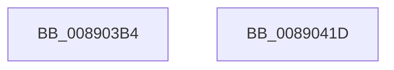

# AlpcpLogSendMessage

- RVA: `0x008903B4`–`0x0089041E` (길이 `106` bytes)
- VA: `0x00000001408903B4`
- 실행 섹션: `PAGE`
- PDB 이름 있음: `예`; PDB Function 태그: `아니요`
- unwind 정보 RVA: `0x00060904`
- 디코드: `22`개 명령, `106/106` bytes 표시
- 미해석 바이트: `0` (있으면 어셈블리에 `.byte`로 보존)

> 이 문서는 커널 이미지의 기계어와 PDB 기호를 분석해 생성했습니다. 4번과 5번은 함수 원형과 자료형을 바이너리 사용 방식에서 추정한 C 해석이며 원본 소스 복구 결과는 아닙니다.

## 1. Dependencies

- 직접 호출 지점: **2**; 고유 호출 대상: **2**
- 직접 호출자로 확인된 함수: **4**
- RIP 상대 이미지 참조: **1**

### Outgoing calls
- `0x00890406` → [AlpcpInvokeLogCallbacks](../AC/AlpcpInvokeLogCallbacks_function_00AC40D0.md) (function, `0x00AC40D0`)
- `0x00890413` → [_security_check_cookie](../../text/6A/_security_check_cookie_function_006AC640.md) (function, `0x006AC640`)

### Direct callers
- [sub_0088DCA0](../88/Unknown_function_0088DCA0.md) at `0x0088DCA3`
- [sub_0088E1DC](../88/Unknown_function_0088E1DC.md) at `0x0088E3F1`
- [sub_0088EC77](../88/Unknown_function_0088EC77.md) at `0x0088F38D`
- [AlpcpSendLegacySynchronousRequest](../92/AlpcpSendLegacySynchronousRequest_function_0092376C.md) at `0x00923E43`

### Static image references
- `0x008903B8` → RVA `0x00E0A740` (`.data`; read)

## 2. Other-region calls and transfers

- 다른 실행 섹션으로 향하는 call: **1**
  - `0x00890413` → [_security_check_cookie](../../text/6A/_security_check_cookie_function_006AC640.md) (`PAGE` → `.text`)
- 별도 외부 분기/꼬리 이동을 확인하지 못했습니다.

## 3. Assembly (complete function range)

```asm
008903B4  48 83 EC 58                     sub rsp, 0x58
008903B8  48 8B 05 81 A3 57 00            mov rax, qword ptr [rip + 0x57a381]
008903BF  48 33 C4                        xor rax, rsp
008903C2  48 89 44 24 40                  mov qword ptr [rsp + 0x40], rax
008903C7  0F 57 C0                        xorps xmm0, xmm0
008903CA  BA 1C 00 00 00                  mov edx, 0x1c
008903CF  0F 11 44 24 30                  movups xmmword ptr [rsp + 0x30], xmm0
008903D4  0F 11 44 24 20                  movups xmmword ptr [rsp + 0x20], xmm0
008903D9  65 48 8B 04 25 88 01 00 00      mov rax, qword ptr gs:[0x188]
008903E2  0F 10 80 08 05 00 00            movups xmm0, xmmword ptr [rax + 0x508]
008903E9  8B 81 08 01 00 00               mov eax, dword ptr [rcx + 0x108]
008903EF  48 8D 4C 24 20                  lea rcx, [rsp + 0x20]
008903F4  C7 44 24 30 01 00 00 00         mov dword ptr [rsp + 0x30], 1
008903FC  F3 0F 7F 44 24 20               movdqu xmmword ptr [rsp + 0x20], xmm0
00890402  89 44 24 38                     mov dword ptr [rsp + 0x38], eax
00890406  E8 C5 3C 23 00                  call 0x140ac40d0
0089040B  48 8B 4C 24 40                  mov rcx, qword ptr [rsp + 0x40]
00890410  48 33 CC                        xor rcx, rsp
00890413  E8 28 C2 E1 FF                  call 0x1406ac640
00890418  48 83 C4 58                     add rsp, 0x58
0089041C  C3                              ret
0089041D  CC                              int3
```

## 4. C-style interpretation (structured pseudocode)

```c
__int64 __fastcall AlpcpLogSendMessage(__int64 a1)
{
    __int64 result;
    __int64 v_rsp;
    unsigned __int64 v_stack_m18;
    unsigned int v_stack_m20;
    unsigned __int64 v_stack_m28;
    unsigned __int64 v_stack_m38;

    v_rsp = (v_rsp) - (88);
    result = (*(unsigned __int64 *)(v_rip + 5743489)) ^ (v_rsp);
    v_stack_m18 = result;
    v_stack_m28 = v_xmm0;
    v_stack_m38 = v_xmm0;
    v_stack_m28 = 1;
    v_stack_m38 = v_xmm0;
    v_stack_m20 = (unsigned int)((unsigned int)(*(unsigned int *)(a1 + 264)));
    result = AlpcpInvokeLogCallbacks(v_stack_m38, 28, a3, a4);
    a1 = (v_stack_m18) ^ (v_rsp);
    result = _security_check_cookie(a1, 28, a3, a4);
    v_rsp = (v_rsp) + (88);
    return result;
}
```

## 5. (Beta) C Style

```c
int64_t AlpcpLogSendMessage(void *Arg1)
{
    uint8_t *arg1 = (uint8_t *)Arg1;

    int64_t result;
    int64_t local_rsp;
    uint64_t v_stack_m18;
    uint32_t v_stack_m20;
    uint64_t v_stack_m28;
    uint64_t v_stack_m38;

    local_rsp = (local_rsp) - (88);
    result = (*(uint64_t *)(v_rip + 0x57A381)) ^ (local_rsp);
    v_stack_m18 = result;
    v_stack_m28 = v_xmm0;
    v_stack_m38 = v_xmm0;
    v_stack_m28 = 1;
    v_stack_m38 = v_xmm0;
    v_stack_m20 = (uint32_t)((uint32_t)(*(uint32_t *)(arg1 + 0x108)));
    result = AlpcpInvokeLogCallbacks(v_stack_m38, 28, a3, a4);
    Arg1 = (v_stack_m18) ^ (local_rsp);
    result = _security_check_cookie(Arg1, 28, a3, a4);
    local_rsp = (local_rsp) + (88);
    return result;
}
```

### 관측된 메모리 오프셋

구조체 형식이 확인되지 않은 접근은 인자 기준의 오프셋으로만 기록했습니다.

| 기준 인자 | 오프셋 표현 | 폭 (bit) | 접근 |
|---|---:|---:|---|
| `Arg1` | `+ 0x108` | `32` | `R` |

## 6. Execution-region graph

[열기: 2D/3D 그래프와 함수 탐색 컨트롤 패널](../../../control-panel.html?section=page&rva=0x008903B4&view=graph)

- 2D 그래프는 위에서 아래로 흐르고, 3D 그래프는 빈 공간을 드래그해 회전합니다. Shift+드래그는 이동, 휠은 확대·축소, 함수 노드 선택은 대상 보고서 이동입니다.

### Static fallback


