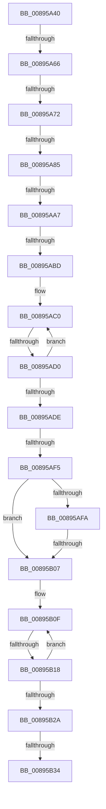

# AlpcpLookupMessage

- RVA: `0x00895A40`–`0x00895B37` (길이 `247` bytes)
- VA: `0x0000000140895A40`
- 실행 섹션: `PAGE`
- PDB 이름 있음: `예`; PDB Function 태그: `아니요`
- unwind 정보 RVA: `0x0007E114`
- 디코드: `60`개 명령, `247/247` bytes 표시
- 미해석 바이트: `0` (있으면 어셈블리에 `.byte`로 보존)

> 이 문서는 커널 이미지의 기계어와 PDB 기호를 분석해 생성했습니다. 4번과 5번은 함수 원형과 자료형을 바이너리 사용 방식에서 추정한 C 해석이며 원본 소스 복구 결과는 아닙니다.

## 1. Dependencies

- 직접 호출 지점: **2**; 고유 호출 대상: **2**
- 직접 호출자로 확인된 함수: **8**
- RIP 상대 이미지 참조: **1**

### Outgoing calls
- `0x00895AAC` → [ExpLookupHandleTableEntry](../86/ExpLookupHandleTableEntry_function_00869DB0.md) (function, `0x00869DB0`)
- `0x00895AE1` → [ExGetHandlePointer](../../text/43/ExGetHandlePointer_function_00430C90.md) (function, `0x00430C90`)

### Direct callers
- [NtAlpcImpersonateClientContainerOfPort](../74/NtAlpcImpersonateClientContainerOfPort_function_0074C1B0.md) at `0x0074C2B5`
- [NtAlpcQueryInformationMessage](NtAlpcQueryInformationMessage_function_00894700.md) at `0x008948CC`
- [AlpcpReceiveDirectMessagePort](AlpcpReceiveDirectMessagePort_function_008950B4.md) at `0x008950F0`
- [NtAlpcOpenSenderProcess](NtAlpcOpenSenderProcess_function_008953B0.md) at `0x0089558C`
- [NtAlpcOpenSenderThread](../9C/NtAlpcOpenSenderThread_function_009C5920.md) at `0x009C5A4F`
- [AlpcpReplyLegacySynchronousRequest](../9F/AlpcpReplyLegacySynchronousRequest_function_009F5CF0.md) at `0x009F5E5E`
- [AlpcpAcceptConnectPort](../A3/AlpcpAcceptConnectPort_function_00A34290.md) at `0x00A3463D`
- [NtAlpcCancelMessage](../A3/NtAlpcCancelMessage_function_00A3A860.md) at `0x00A3A90D`

### Static image references
- `0x00895A72` → RVA `0x00FC6F68` (`ALMOSTRO`; read)

## 2. Other-region calls and transfers

- 다른 실행 섹션으로 향하는 call: **1**
  - `0x00895AE1` → [ExGetHandlePointer](../../text/43/ExGetHandlePointer_function_00430C90.md) (`PAGE` → `.text`)
- call이 아닌 외부 분기/꼬리 이동: **10**
  - `0x00895A60` → [sub_00895B6D + 0x12E](Unknown_function_00895B6D.md) (`tail-transfer`)
  - `0x00895A6C` → [sub_00895B6D + 0x22A](Unknown_function_00895B6D.md) (`tail-transfer`)
  - `0x00895A7F` → [sub_00895B6D + 0xE1](Unknown_function_00895B6D.md) (`tail-transfer`)
  - `0x00895AA1` → [sub_00895B6D + 0xE8](Unknown_function_00895B6D.md) (`tail-transfer`)
  - `0x00895AB7` → [sub_00895B6D + 0xE8](Unknown_function_00895B6D.md) (`tail-transfer`)
  - `0x00895ACA` → [sub_00895B6D + 0xB2](Unknown_function_00895B6D.md) (`tail-transfer`)
  - `0x00895AEF` → [sub_00895B6D + 0xC7](Unknown_function_00895B6D.md) (`tail-transfer`)
  - `0x00895B01` → [sub_00895B6D + 0xC7](Unknown_function_00895B6D.md) (`tail-transfer`)
  - `0x00895B12` → [sub_00895B6D + 0x24B](Unknown_function_00895B6D.md) (`tail-transfer`)
  - `0x00895B2E` → [sub_00895B6D + 0x1B9](Unknown_function_00895B6D.md) (`tail-transfer`)

## 3. Assembly (complete function range)

```asm
00895A40  48 89 5C 24 10                  mov qword ptr [rsp + 0x10], rbx
00895A45  48 89 6C 24 18                  mov qword ptr [rsp + 0x18], rbp
00895A4A  56                              push rsi
00895A4B  57                              push rdi
00895A4C  41 54                           push r12
00895A4E  41 55                           push r13
00895A50  41 56                           push r14
00895A52  48 83 EC 30                     sub rsp, 0x30
00895A56  8B F2                           mov esi, edx
00895A58  45 8B F0                        mov r14d, r8d
00895A5B  4C 8B E1                        mov r12, rcx
00895A5E  85 D2                           test edx, edx
00895A60  0F 88 35 02 00 00               js 0x140895c9b
00895A66  F7 C6 00 00 00 FC               test esi, 0xfc000000
00895A6C  0F 85 25 03 00 00               jne 0x140895d97
00895A72  4C 8B 2D EF 14 73 00            mov r13, qword ptr [rip + 0x7314ef]
00895A79  48 8B DE                        mov rbx, rsi
00895A7C  4D 85 ED                        test r13, r13
00895A7F  0F 84 C9 01 00 00               je 0x140895c4e
00895A85  65 48 8B 04 25 88 01 00 00      mov rax, qword ptr gs:[0x188]
00895A8E  81 E3 FF FF FF 03               and ebx, 0x3ffffff
00895A94  0F B6 A8 32 02 00 00            movzx ebp, byte ptr [rax + 0x232]
00895A9B  F7 C3 FC 03 00 00               test ebx, 0x3fc
00895AA1  0F 84 AE 01 00 00               je 0x140895c55
00895AA7  8B D3                           mov edx, ebx
00895AA9  49 8B CD                        mov rcx, r13
00895AAC  E8 FF 42 FD FF                  call 0x140869db0
00895AB1  48 8B F8                        mov rdi, rax
00895AB4  48 85 C0                        test rax, rax
00895AB7  0F 84 98 01 00 00               je 0x140895c55
00895ABD  0F 1F 00                        nop dword ptr [rax]
00895AC0  0F 0D 0F                        prefetchw byte ptr [rdi]
00895AC3  4C 8B 07                        mov r8, qword ptr [rdi]
00895AC6  41 F6 C0 01                     test r8b, 1
00895ACA  0F 84 4F 01 00 00               je 0x140895c1f
00895AD0  49 8D 48 FF                     lea rcx, [r8 - 1]
00895AD4  49 8B C0                        mov rax, r8
00895AD7  F0 48 0F B1 0F                  lock cmpxchg qword ptr [rdi], rcx
00895ADC  75 E2                           jne 0x140895ac0
00895ADE  48 8B CF                        mov rcx, rdi
00895AE1  E8 AA B1 B9 FF                  call 0x140430c90
00895AE6  48 8B D8                        mov rbx, rax
00895AE9  39 B0 08 01 00 00               cmp dword ptr [rax + 0x108], esi
00895AEF  0F 85 3F 01 00 00               jne 0x140895c34
00895AF5  45 85 F6                        test r14d, r14d
00895AF8  74 0D                           je 0x140895b07
00895AFA  44 39 B0 10 01 00 00            cmp dword ptr [rax + 0x110], r14d
00895B01  0F 85 2D 01 00 00               jne 0x140895c34
00895B07  0F 0D 48 E8                     prefetchw byte ptr [rax - 0x18]
00895B0B  48 8B 40 E8                     mov rax, qword ptr [rax - 0x18]
00895B0F  48 85 C0                        test rax, rax
00895B12  0F 8E A0 02 00 00               jle 0x140895db8
00895B18  48 8B D0                        mov rdx, rax
00895B1B  48 8D 48 01                     lea rcx, [rax + 1]
00895B1F  F0 48 0F B1 4B E8               lock cmpxchg qword ptr [rbx - 0x18], rcx
00895B25  48 3B C2                        cmp rax, rdx
00895B28  75 E5                           jne 0x140895b0f
00895B2A  48 83 C0 01                     add rax, 1
00895B2E  0F 84 F2 01 00 00               je 0x140895d26
00895B34  45 33 C0                        xor r8d, r8d
```

## 4. C-style interpretation (structured pseudocode)

```c
__int64 __fastcall AlpcpLookupMessage(__int64 a1, int a2, int a3)
{
    __int64 result;
    __int64 v_rbx;
    __int64 v_rsp;
    unsigned __int64 v_stack_p10;
    unsigned __int64 v_stack_p18;

    v_stack_p10 = v_rbx;
    v_stack_p18 = v_rbp;
    v_rsp = (v_rsp) - (48);
    v_rbx = (unsigned int)(((unsigned int)(a2)) & (0x3FFFFFFULL));
    result = ExpLookupHandleTableEntry(*(unsigned __int64 *)(v_rip + 7541999), (unsigned int)((unsigned int)(v_rbx)), a3, a4);
loc_00895AC0:
    if ((((unsigned __int8)(*(unsigned __int64 *)(result))) & (1)) != 0) goto loc_00895AC0;
    result = ExGetHandlePointer(result, (unsigned int)((unsigned int)(v_rbx)), *(unsigned __int64 *)(result), a4);
    if ((unsigned int)((unsigned int)(a3)) == 0) goto loc_00895B07;
loc_00895B07:
loc_00895B0F:
    if ((*(unsigned __int64 *)(result - 24)) != (*(unsigned __int64 *)(result - 24))) goto loc_00895B0F;
    result = (*(unsigned __int64 *)(result - 24)) + (1);
    a3 = 0;
    return result;
}
```

## 5. (Beta) C Style

```c
int64_t AlpcpLookupMessage(int64_t Arg1, int32_t Arg2, int32_t Arg3)
{
    int64_t result;
    int64_t local_rbx;
    int64_t local_rsp;
    uint64_t v_stack_p10;
    uint64_t v_stack_p18;

    v_stack_p10 = local_rbx;
    v_stack_p18 = local_rbp;
    local_rsp = (local_rsp) - (48);
    local_rbx = (uint32_t)(((uint32_t)(Arg2)) & (0x3FFFFFFULL));
    result = ExpLookupHandleTableEntry(*(uint64_t *)(v_rip + 0x7314EF), (uint32_t)((uint32_t)(local_rbx)), Arg3, a4);
loc_00895AC0:
    if ((((uint8_t)(*(uint64_t *)(result))) & (1)) != 0) goto loc_00895AC0;
    result = ExGetHandlePointer(result, (uint32_t)((uint32_t)(local_rbx)), *(uint64_t *)(result), a4);
    if ((uint32_t)((uint32_t)(Arg3)) == 0) goto loc_00895B07;
loc_00895B07:
loc_00895B0F:
    if ((*(uint64_t *)(result - 0x18)) != (*(uint64_t *)(result - 0x18))) goto loc_00895B0F;
    result = (*(uint64_t *)(result - 0x18)) + (1);
    Arg3 = 0;
    return result;
}
```

## 6. Execution-region graph

[열기: 2D/3D 그래프와 함수 탐색 컨트롤 패널](../../../control-panel.html?section=page&rva=0x00895A40&view=graph)

- 2D 그래프는 위에서 아래로 흐르고, 3D 그래프는 빈 공간을 드래그해 회전합니다. Shift+드래그는 이동, 휠은 확대·축소, 함수 노드 선택은 대상 보고서 이동입니다.

### Static fallback


