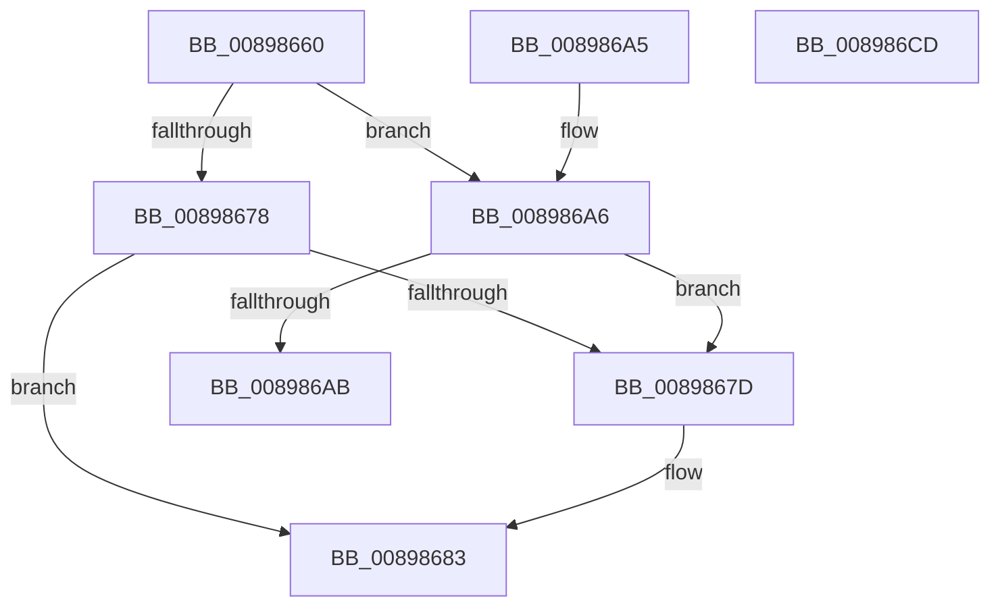

# AlpcpProbeForWriteMessageHeader

- RVA: `0x00898660`–`0x008986CE` (길이 `110` bytes)
- VA: `0x0000000140898660`
- 실행 섹션: `PAGE`
- PDB 이름 있음: `예`; PDB Function 태그: `아니요`
- unwind 정보 RVA: `0x0007E45C`
- 디코드: `32`개 명령, `110/110` bytes 표시
- 미해석 바이트: `0` (있으면 어셈블리에 `.byte`로 보존)

> 이 문서는 커널 이미지의 기계어와 PDB 기호를 분석해 생성했습니다. 4번과 5번은 함수 원형과 자료형을 바이너리 사용 방식에서 추정한 C 해석이며 원본 소스 복구 결과는 아닙니다.

## 1. Dependencies

- 직접 호출 지점: **1**; 고유 호출 대상: **1**
- 직접 호출자로 확인된 함수: **4**
- RIP 상대 이미지 참조: **0**

### Outgoing calls
- `0x0089867D` → [ExRaiseDatatypeMisalignment](ExRaiseDatatypeMisalignment_function_00899FD0.md) (function, `0x00899FD0`)

### Direct callers
- [NtReplyWaitReplyPort](../74/NtReplyWaitReplyPort_function_0074BFB0.md) at `0x0074C035`
- [NtRequestWaitReplyPort](../92/NtRequestWaitReplyPort_function_00921E40.md) at `0x00921F2E`
- [AlpcpProcessSynchronousRequest](../92/AlpcpProcessSynchronousRequest_function_00921FCC.md) at `0x00922367`
- [AlpcpProcessConnectionRequest](../92/AlpcpProcessConnectionRequest_function_00925FD4.md) at `0x00926069`

### Static image references
- 디코드된 RIP-relative 메모리 참조가 없습니다.

## 2. Other-region calls and transfers

- 다른 실행 섹션으로 향하는 call: **0**
- 별도 외부 분기/꼬리 이동을 확인하지 못했습니다.

## 3. Assembly (complete function range)

```asm
00898660  48 83 EC 28                     sub rsp, 0x28
00898664  48 8B C1                        mov rax, rcx
00898667  81 E2 00 00 00 C0               and edx, 0xc0000000
0089866D  83 E0 03                        and eax, 3
00898670  81 FA 00 00 00 80               cmp edx, 0x80000000
00898676  74 2E                           je 0x1408986a6
00898678  48 85 C0                        test rax, rax
0089867B  74 06                           je 0x140898683
0089867D  E8 4E 19 00 00                  call 0x140899fd0
00898682  CC                              int3
00898683  48 BA 00 00 FF FF FF 7F 00 00   movabs rdx, 0x7fffffff0000
0089868D  48 3B CA                        cmp rcx, rdx
00898690  48 0F 42 D1                     cmovb rdx, rcx
00898694  0F B6 02                        movzx eax, byte ptr [rdx]
00898697  88 02                           mov byte ptr [rdx], al
00898699  0F B6 42 27                     movzx eax, byte ptr [rdx + 0x27]
0089869D  88 42 27                        mov byte ptr [rdx + 0x27], al
008986A0  48 83 C4 28                     add rsp, 0x28
008986A4  C3                              ret
008986A5  CC                              int3
008986A6  48 85 C0                        test rax, rax
008986A9  75 D2                           jne 0x14089867d
008986AB  48 BA 00 00 FF FF FF 7F 00 00   movabs rdx, 0x7fffffff0000
008986B5  48 3B CA                        cmp rcx, rdx
008986B8  48 0F 42 D1                     cmovb rdx, rcx
008986BC  0F B6 02                        movzx eax, byte ptr [rdx]
008986BF  88 02                           mov byte ptr [rdx], al
008986C1  0F B6 42 17                     movzx eax, byte ptr [rdx + 0x17]
008986C5  88 42 17                        mov byte ptr [rdx + 0x17], al
008986C8  48 83 C4 28                     add rsp, 0x28
008986CC  C3                              ret
008986CD  CC                              int3
```

## 4. C-style interpretation (structured pseudocode)

```c
__int64 __fastcall AlpcpProbeForWriteMessageHeader(__int64 a1, int a2)
{
    __int64 result;
    __int64 v_rsp;

    v_rsp = (v_rsp) - (40);
    a2 = (unsigned int)((a2) & (0xC0000000ULL));
    result = (unsigned int)((a1) & (3));
    if (a2 == 0x80000000ULL) goto loc_008986A6;
    if (result != 0) {
        result = ExRaiseDatatypeMisalignment(a1, a2, a3, a4);
    }
    if (a1 < a2) { a2 = a1; }
    *(unsigned __int8 *)(a2) = (unsigned __int8)(*(unsigned __int8 *)(a2));
    *(unsigned __int8 *)(a2 + 39) = (unsigned __int8)(*(unsigned __int8 *)(a2 + 39));
    v_rsp = (v_rsp) + (40);
    return *(unsigned __int8 *)(a2 + 39);
loc_008986A6:
    if (*(unsigned __int8 *)(a2 + 39) != 0) goto loc_0089867D;
    if (a1 < a2) { a2 = a1; }
    *(unsigned __int8 *)(a2) = (unsigned __int8)(*(unsigned __int8 *)(a2));
    *(unsigned __int8 *)(a2 + 23) = (unsigned __int8)(*(unsigned __int8 *)(a2 + 23));
    v_rsp = (v_rsp) + (40);
    return *(unsigned __int8 *)(a2 + 23);
}
```

## 5. (Beta) C Style

```c
int64_t AlpcpProbeForWriteMessageHeader(int64_t Arg1, int32_t Arg2)
{
    int64_t result;
    int64_t local_rsp;

    local_rsp = (local_rsp) - (40);
    Arg2 = (uint32_t)((Arg2) & (0xC0000000ULL));
    result = (uint32_t)((Arg1) & (3));
    if (Arg2 == 0x80000000ULL) goto loc_008986A6;
    if (result != 0) {
        result = ExRaiseDatatypeMisalignment(Arg1, Arg2, a3, a4);
    }
    if (Arg1 < Arg2) { Arg2 = Arg1; }
    *(uint8_t *)(Arg2) = (uint8_t)(*(uint8_t *)(Arg2));
    *(uint8_t *)(Arg2 + 0x27) = (uint8_t)(*(uint8_t *)(Arg2 + 0x27));
    local_rsp = (local_rsp) + (40);
    return *(uint8_t *)(Arg2 + 0x27);
loc_008986A6:
    if (*(uint8_t *)(Arg2 + 0x27) != 0) goto loc_0089867D;
    if (Arg1 < Arg2) { Arg2 = Arg1; }
    *(uint8_t *)(Arg2) = (uint8_t)(*(uint8_t *)(Arg2));
    *(uint8_t *)(Arg2 + 0x17) = (uint8_t)(*(uint8_t *)(Arg2 + 0x17));
    local_rsp = (local_rsp) + (40);
    return *(uint8_t *)(Arg2 + 0x17);
}
```

## 6. Execution-region graph

[열기: 2D/3D 그래프와 함수 탐색 컨트롤 패널](../../../control-panel.html?section=page&rva=0x00898660&view=graph)

- 2D 그래프는 위에서 아래로 흐르고, 3D 그래프는 빈 공간을 드래그해 회전합니다. Shift+드래그는 이동, 휠은 확대·축소, 함수 노드 선택은 대상 보고서 이동입니다.

### Static fallback


