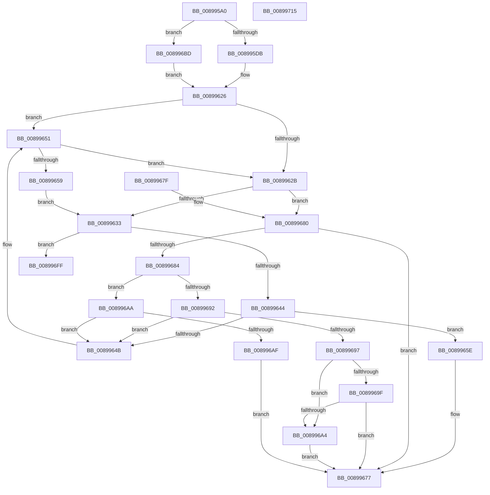

# AlpcpProbeMessageAttributes

- RVA: `0x008995A0`–`0x00899716` (길이 `374` bytes)
- VA: `0x00000001408995A0`
- 실행 섹션: `PAGE`
- PDB 이름 있음: `예`; PDB Function 태그: `아니요`
- unwind 정보 RVA: `0x0007E518`
- 디코드: `114`개 명령, `374/374` bytes 표시
- 미해석 바이트: `0` (있으면 어셈블리에 `.byte`로 보존)

> 이 문서는 커널 이미지의 기계어와 PDB 기호를 분석해 생성했습니다. 4번과 5번은 함수 원형과 자료형을 바이너리 사용 방식에서 추정한 C 해석이며 원본 소스 복구 결과는 아닙니다.

## 1. Dependencies

- 직접 호출 지점: **2**; 고유 호출 대상: **2**
- 직접 호출자로 확인된 함수: **2**
- RIP 상대 이미지 참조: **0**

### Outgoing calls
- `0x0089964B` → [ExRaiseDatatypeMisalignment](ExRaiseDatatypeMisalignment_function_00899FD0.md) (function, `0x00899FD0`)
- `0x00899708` → [ProbeForWrite](../8E/ProbeForWrite_function_008E91C0.md) (function, `0x008E91C0`)

### Direct callers
- [AlpcpProcessSynchronousRequest](../92/AlpcpProcessSynchronousRequest_function_00921FCC.md) at `0x009223AC`
- [AlpcpProcessConnectionRequest](../92/AlpcpProcessConnectionRequest_function_00925FD4.md) at `0x009260C5`

### Static image references
- 디코드된 RIP-relative 메모리 참조가 없습니다.

## 2. Other-region calls and transfers

- 다른 실행 섹션으로 향하는 call: **0**
- 별도 외부 분기/꼬리 이동을 확인하지 못했습니다.

## 3. Assembly (complete function range)

```asm
008995A0  40 53                           push rbx
008995A2  48 83 EC 20                     sub rsp, 0x20
008995A6  48 8B C2                        mov rax, rdx
008995A9  49 BA 00 00 FF FF FF 7F 00 00   movabs r10, 0x7fffffff0000
008995B3  49 3B C2                        cmp rax, r10
008995B6  49 8B D2                        mov rdx, r10
008995B9  90                              nop
008995BA  45 0F B6 C8                     movzx r9d, r8b
008995BE  48 0F 42 D0                     cmovb rdx, rax
008995C2  81 E1 00 00 00 C0               and ecx, 0xc0000000
008995C8  8B 1A                           mov ebx, dword ptr [rdx]
008995CA  8B D3                           mov edx, ebx
008995CC  C1 FA 1F                        sar edx, 0x1f
008995CF  81 F9 00 00 00 80               cmp ecx, 0x80000000
008995D5  0F 84 E2 00 00 00               je 0x1408996bd
008995DB  83 E2 18                        and edx, 0x18
008995DE  83 C2 08                        add edx, 8
008995E1  0F BA E3 1E                     bt ebx, 0x1e
008995E5  8D 4A 20                        lea ecx, [rdx + 0x20]
008995E8  0F 43 CA                        cmovae ecx, edx
008995EB  0F BA E3 1D                     bt ebx, 0x1d
008995EF  8D 51 20                        lea edx, [rcx + 0x20]
008995F2  0F 43 D1                        cmovae edx, ecx
008995F5  0F BA E3 1C                     bt ebx, 0x1c
008995F9  44 8D 42 18                     lea r8d, [rdx + 0x18]
008995FD  44 0F 43 C2                     cmovae r8d, edx
00899601  0F BA E3 1B                     bt ebx, 0x1b
00899605  41 8D 48 18                     lea ecx, [r8 + 0x18]
00899609  41 0F 43 C8                     cmovae ecx, r8d
0089960D  0F BA E3 1A                     bt ebx, 0x1a
00899611  8D 51 08                        lea edx, [rcx + 8]
00899614  0F 43 D1                        cmovae edx, ecx
00899617  0F BA E3 19                     bt ebx, 0x19
0089961B  8D 4A 08                        lea ecx, [rdx + 8]
0089961E  0F 43 CA                        cmovae ecx, edx
00899621  BA 08 00 00 00                  mov edx, 8
00899626  45 84 C9                        test r9b, r9b
00899629  74 26                           je 0x140899651
0089962B  44 8B D9                        mov r11d, ecx
0089962E  45 84 C9                        test r9b, r9b
00899631  74 4D                           je 0x140899680
00899633  49 8D 4B FF                     lea rcx, [r11 - 1]
00899637  48 81 F9 FE 0F 00 00            cmp rcx, 0xffe
0089963E  0F 87 BB 00 00 00               ja 0x1408996ff
00899644  FF CA                           dec edx
00899646  48 85 D0                        test rax, rdx
00899649  74 13                           je 0x14089965e
0089964B  E8 80 09 00 00                  call 0x140899fd0
00899650  CC                              int3
00899651  F7 C3 00 00 00 A0               test ebx, 0xa0000000
00899657  74 D2                           je 0x14089962b
00899659  44 8B D9                        mov r11d, ecx
0089965C  EB D5                           jmp 0x140899633
0089965E  49 3B C2                        cmp rax, r10
00899661  4C 0F 42 D0                     cmovb r10, rax
00899665  41 0F B6 02                     movzx eax, byte ptr [r10]
00899669  41 88 02                        mov byte ptr [r10], al
0089966C  43 0F B6 44 1A FF               movzx eax, byte ptr [r10 + r11 - 1]
00899672  43 88 44 1A FF                  mov byte ptr [r10 + r11 - 1], al
00899677  8B C3                           mov eax, ebx
00899679  48 83 C4 20                     add rsp, 0x20
0089967D  5B                              pop rbx
0089967E  C3                              ret
0089967F  CC                              int3
00899680  85 C9                           test ecx, ecx
00899682  74 F3                           je 0x140899677
00899684  FF CA                           dec edx
00899686  48 23 D0                        and rdx, rax
00899689  49 81 FB 00 00 01 00            cmp r11, 0x10000
00899690  72 18                           jb 0x1408996aa
00899692  48 85 D2                        test rdx, rdx
00899695  75 B4                           jne 0x14089964b
00899697  48 03 C8                        add rcx, rax
0089969A  49 3B CA                        cmp rcx, r10
0089969D  77 05                           ja 0x1408996a4
0089969F  48 3B C8                        cmp rcx, rax
008996A2  73 D3                           jae 0x140899677
008996A4  41 0F B6 0A                     movzx ecx, byte ptr [r10]
008996A8  EB CD                           jmp 0x140899677
008996AA  48 85 D2                        test rdx, rdx
008996AD  75 9C                           jne 0x14089964b
008996AF  49 3B C2                        cmp rax, r10
008996B2  90                              nop
008996B3  4C 0F 42 D0                     cmovb r10, rax
008996B7  41 0F B6 02                     movzx eax, byte ptr [r10]
008996BB  EB BA                           jmp 0x140899677
008996BD  83 E2 0C                        and edx, 0xc
008996C0  83 C2 08                        add edx, 8
008996C3  0F BA E3 1E                     bt ebx, 0x1e
008996C7  8D 4A 10                        lea ecx, [rdx + 0x10]
008996CA  0F 43 CA                        cmovae ecx, edx
008996CD  0F BA E3 1D                     bt ebx, 0x1d
008996D1  8D 51 14                        lea edx, [rcx + 0x14]
008996D4  0F 43 D1                        cmovae edx, ecx
008996D7  0F BA E3 1C                     bt ebx, 0x1c
008996DB  8D 4A 10                        lea ecx, [rdx + 0x10]
008996DE  0F 43 CA                        cmovae ecx, edx
008996E1  0F BA E3 1B                     bt ebx, 0x1b
008996E5  8D 51 18                        lea edx, [rcx + 0x18]
008996E8  0F 43 D1                        cmovae edx, ecx
008996EB  0F BA E3 19                     bt ebx, 0x19
008996EF  8D 4A 08                        lea ecx, [rdx + 8]
008996F2  0F 43 CA                        cmovae ecx, edx
008996F5  BA 04 00 00 00                  mov edx, 4
008996FA  E9 27 FF FF FF                  jmp 0x140899626
008996FF  44 8B C2                        mov r8d, edx
00899702  48 8B C8                        mov rcx, rax
00899705  49 8B D3                        mov rdx, r11
00899708  E8 B3 FA 04 00                  call 0x1408e91c0
0089970D  8B C3                           mov eax, ebx
0089970F  48 83 C4 20                     add rsp, 0x20
00899713  5B                              pop rbx
00899714  C3                              ret
00899715  CC                              int3
```

## 4. C-style interpretation (structured pseudocode)

```c
__int64 __fastcall AlpcpProbeMessageAttributes(int a1, __int64 a2, unsigned __int8 a3)
{
    __int64 result;
    __int64 v_r10;
    __int64 v_rsp;

    v_rsp = (v_rsp) - (32);
    a2 = v_r10;
    if (a2 < v_r10) { a2 = a2; }
    a1 = (unsigned int)((a1) & (0xC0000000ULL));
    a2 = (unsigned int)(((unsigned int)((unsigned int)((unsigned int)(*(unsigned int *)(a2))))) >> (31));
    if (a1 == 0x80000000ULL) goto loc_008996BD;
    a2 = (unsigned int)((a2) & (24));
    a2 = (unsigned int)((a2) + (8));
    a1 = a2 + 32;
    if (condition_is_above_or_equal) { a1 = (unsigned int)(a2); }
    a2 = a1 + 32;
    if (condition_is_above_or_equal) { a2 = a1; }
    a3 = a2 + 24;
    if (condition_is_above_or_equal) { a3 = (unsigned int)(a2); }
    a1 = a3 + 24;
    if (condition_is_above_or_equal) { a1 = a3; }
    a2 = a1 + 8;
    if (condition_is_above_or_equal) { a2 = a1; }
    a1 = a2 + 8;
    if (condition_is_above_or_equal) { a1 = (unsigned int)(a2); }
loc_00899626:
    if (a3 == 0) goto loc_00899651;
loc_0089962B:
    if (a3 == 0) goto loc_00899680;
loc_00899633:
    if (((unsigned int)(a1) - 1) > 0xFFEULL) goto loc_008996FF;
    a2 = (unsigned int)((8) - 1);
    if (a2 == 0) goto loc_0089965E;
loc_0089964B:
    result = ExRaiseDatatypeMisalignment((unsigned int)(a1) - 1, a2, a3, a3);
loc_00899651:
    if ((((unsigned int)((unsigned int)(*(unsigned int *)(a2)))) & (0xA0000000ULL)) == 0) goto loc_0089962B;
    goto loc_00899633;
loc_0089965E:
    if (result < v_r10) { v_r10 = result; }
    *(unsigned __int8 *)(v_r10) = (unsigned __int8)(*(unsigned __int8 *)(v_r10));
    *(unsigned __int8 *)(v_r10 + (unsigned int)((unsigned int)((unsigned int)(a1) - 1)) * 1 - 1) = (unsigned __int8)(*(unsigned __int8 *)(v_r10 + (unsigned int)((unsigned int)((unsigned int)(a1) - 1)) * 1 - 1));
loc_00899677:
    v_rsp = (v_rsp) + (32);
    return (unsigned int)((unsigned int)((unsigned int)(*(unsigned int *)(a2))));
loc_00899680:
    if ((unsigned int)((unsigned int)(a1) - 1) == 0) goto loc_00899677;
    a2 = (unsigned int)((a2) - 1);
    a2 = (a2) & ((unsigned int)((unsigned int)((unsigned int)(*(unsigned int *)(a2)))));
    if (((unsigned int)((unsigned int)((unsigned int)(a1) - 1))) < 0x10000ULL) goto loc_008996AA;
    if (a2 != 0) goto loc_0089964B;
    a1 = ((unsigned int)(a1) - 1) + ((unsigned int)((unsigned int)((unsigned int)(*(unsigned int *)(a2)))));
    if (a1 > v_r10) goto loc_008996A4;
    if (a1 >= ((unsigned int)((unsigned int)((unsigned int)(*(unsigned int *)(a2)))))) goto loc_00899677;
loc_008996A4:
    goto loc_00899677;
loc_008996AA:
    if (a2 != 0) goto loc_0089964B;
    if (((unsigned int)((unsigned int)((unsigned int)(*(unsigned int *)(a2))))) < v_r10) { v_r10 = (unsigned int)((unsigned int)((unsigned int)(*(unsigned int *)(a2)))); }
    goto loc_00899677;
loc_008996BD:
    a2 = (unsigned int)((a2) & (12));
    a2 = (unsigned int)((a2) + (8));
    a1 = a2 + 16;
    if (condition_is_above_or_equal) { a1 = (unsigned int)(a2); }
    a2 = a1 + 20;
    if (condition_is_above_or_equal) { a2 = a1; }
    a1 = a2 + 16;
    if (condition_is_above_or_equal) { a1 = (unsigned int)(a2); }
    a2 = a1 + 24;
    if (condition_is_above_or_equal) { a2 = a1; }
    a1 = a2 + 8;
    if (condition_is_above_or_equal) { a1 = (unsigned int)(a2); }
    goto loc_00899626;
loc_008996FF:
    result = ProbeForWrite(*(unsigned __int8 *)(v_r10), (unsigned int)((unsigned int)((unsigned int)(a1) - 1)), 4, a3);
    v_rsp = (v_rsp) + (32);
    return (unsigned int)((unsigned int)((unsigned int)(*(unsigned int *)(a2))));
}
```

## 5. (Beta) C Style

```c
int64_t AlpcpProbeMessageAttributes(int32_t Arg1, int64_t Arg2, uint8_t Arg3)
{
    int64_t result;
    int64_t local_r10;
    int64_t local_rsp;

    local_rsp = (local_rsp) - (32);
    Arg2 = local_r10;
    if (Arg2 < local_r10) { Arg2 = Arg2; }
    Arg1 = (uint32_t)((Arg1) & (0xC0000000ULL));
    Arg2 = (uint32_t)(((uint32_t)((uint32_t)((uint32_t)(*(uint32_t *)(Arg2))))) >> (31));
    if (Arg1 == 0x80000000ULL) goto loc_008996BD;
    Arg2 = (uint32_t)((Arg2) & (24));
    Arg2 = (uint32_t)((Arg2) + (8));
    Arg1 = Arg2 + 32;
    if (condition_is_above_or_equal) { Arg1 = (uint32_t)(Arg2); }
    Arg2 = Arg1 + 32;
    if (condition_is_above_or_equal) { Arg2 = Arg1; }
    Arg3 = Arg2 + 24;
    if (condition_is_above_or_equal) { Arg3 = (uint32_t)(Arg2); }
    Arg1 = Arg3 + 24;
    if (condition_is_above_or_equal) { Arg1 = Arg3; }
    Arg2 = Arg1 + 8;
    if (condition_is_above_or_equal) { Arg2 = Arg1; }
    Arg1 = Arg2 + 8;
    if (condition_is_above_or_equal) { Arg1 = (uint32_t)(Arg2); }
loc_00899626:
    if (Arg3 == 0) goto loc_00899651;
loc_0089962B:
    if (Arg3 == 0) goto loc_00899680;
loc_00899633:
    if (((uint32_t)(Arg1) - 1) > 0xFFEULL) goto loc_008996FF;
    Arg2 = (uint32_t)((8) - 1);
    if (Arg2 == 0) goto loc_0089965E;
loc_0089964B:
    result = ExRaiseDatatypeMisalignment((uint32_t)(Arg1) - 1, Arg2, Arg3, Arg3);
loc_00899651:
    if ((((uint32_t)((uint32_t)(*(uint32_t *)(Arg2)))) & (0xA0000000ULL)) == 0) goto loc_0089962B;
    goto loc_00899633;
loc_0089965E:
    if (result < local_r10) { local_r10 = result; }
    *(uint8_t *)(local_r10) = (uint8_t)(*(uint8_t *)(local_r10));
    *(uint8_t *)(local_r10 + (uint32_t)((uint32_t)((uint32_t)(Arg1) - 0x1)) * 1 - 0x1) = (uint8_t)(*(uint8_t *)(local_r10 + (uint32_t)((uint32_t)((uint32_t)(Arg1) - 0x1)) * 1 - 0x1));
loc_00899677:
    local_rsp = (local_rsp) + (32);
    return (uint32_t)((uint32_t)((uint32_t)(*(uint32_t *)(Arg2))));
loc_00899680:
    if ((uint32_t)((uint32_t)(Arg1) - 1) == 0) goto loc_00899677;
    Arg2 = (uint32_t)((Arg2) - 1);
    Arg2 = (Arg2) & ((uint32_t)((uint32_t)((uint32_t)(*(uint32_t *)(Arg2)))));
    if (((uint32_t)((uint32_t)((uint32_t)(Arg1) - 1))) < 0x10000ULL) goto loc_008996AA;
    if (Arg2 != 0) goto loc_0089964B;
    Arg1 = ((uint32_t)(Arg1) - 1) + ((uint32_t)((uint32_t)((uint32_t)(*(uint32_t *)(Arg2)))));
    if (Arg1 > local_r10) goto loc_008996A4;
    if (Arg1 >= ((uint32_t)((uint32_t)((uint32_t)(*(uint32_t *)(Arg2)))))) goto loc_00899677;
loc_008996A4:
    goto loc_00899677;
loc_008996AA:
    if (Arg2 != 0) goto loc_0089964B;
    if (((uint32_t)((uint32_t)((uint32_t)(*(uint32_t *)(Arg2))))) < local_r10) { local_r10 = (uint32_t)((uint32_t)((uint32_t)(*(uint32_t *)(Arg2)))); }
    goto loc_00899677;
loc_008996BD:
    Arg2 = (uint32_t)((Arg2) & (12));
    Arg2 = (uint32_t)((Arg2) + (8));
    Arg1 = Arg2 + 16;
    if (condition_is_above_or_equal) { Arg1 = (uint32_t)(Arg2); }
    Arg2 = Arg1 + 20;
    if (condition_is_above_or_equal) { Arg2 = Arg1; }
    Arg1 = Arg2 + 16;
    if (condition_is_above_or_equal) { Arg1 = (uint32_t)(Arg2); }
    Arg2 = Arg1 + 24;
    if (condition_is_above_or_equal) { Arg2 = Arg1; }
    Arg1 = Arg2 + 8;
    if (condition_is_above_or_equal) { Arg1 = (uint32_t)(Arg2); }
    goto loc_00899626;
loc_008996FF:
    result = ProbeForWrite(*(uint8_t *)(local_r10), (uint32_t)((uint32_t)((uint32_t)(Arg1) - 1)), 4, Arg3);
    local_rsp = (local_rsp) + (32);
    return (uint32_t)((uint32_t)((uint32_t)(*(uint32_t *)(Arg2))));
}
```

## 6. Execution-region graph

[열기: 2D/3D 그래프와 함수 탐색 컨트롤 패널](../../../control-panel.html?section=page&rva=0x008995A0&view=graph)

- 2D 그래프는 위에서 아래로 흐르고, 3D 그래프는 빈 공간을 드래그해 회전합니다. Shift+드래그는 이동, 휠은 확대·축소, 함수 노드 선택은 대상 보고서 이동입니다.

### Static fallback


