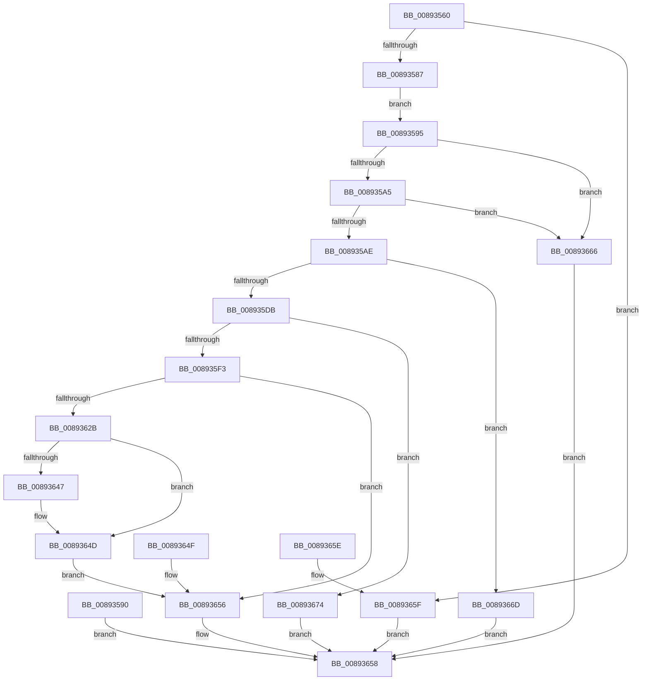

# AlpcpQueryHandleInformationMessage

- RVA: `0x00893560`–`0x0089367B` (길이 `283` bytes)
- VA: `0x0000000140893560`
- 실행 섹션: `PAGE`
- PDB 이름 있음: `예`; PDB Function 태그: `아니요`
- unwind 정보 RVA: `0x0007DE74`
- 디코드: `69`개 명령, `283/283` bytes 표시
- 미해석 바이트: `0` (있으면 어셈블리에 `.byte`로 보존)

> 이 문서는 커널 이미지의 기계어와 PDB 기호를 분석해 생성했습니다. 4번과 5번은 함수 원형과 자료형을 바이너리 사용 방식에서 추정한 C 해석이며 원본 소스 복구 결과는 아닙니다.

## 1. Dependencies

- 직접 호출 지점: **1**; 고유 호출 대상: **1**
- 직접 호출자로 확인된 함수: **1**
- RIP 상대 이미지 참조: **0**

### Outgoing calls
- `0x00893611` → [ObCompleteObjectDuplication](ObCompleteObjectDuplication_function_0089387C.md) (function, `0x0089387C`)

### Direct callers
- [NtAlpcQueryInformationMessage](NtAlpcQueryInformationMessage_function_00894700.md) at `0x00894922`

### Static image references
- 디코드된 RIP-relative 메모리 참조가 없습니다.

## 2. Other-region calls and transfers

- 다른 실행 섹션으로 향하는 call: **0**
- 별도 외부 분기/꼬리 이동을 확인하지 못했습니다.

## 3. Assembly (complete function range)

```asm
00893560  40 53                           push rbx
00893562  48 83 EC 70                     sub rsp, 0x70
00893566  49 8B D8                        mov rbx, r8
00893569  4C 8B D1                        mov r10, rcx
0089356C  48 83 64 24 38 00               and qword ptr [rsp + 0x38], 0
00893572  48 83 64 24 50 00               and qword ptr [rsp + 0x50], 0
00893578  83 64 24 60 00                  and dword ptr [rsp + 0x60], 0
0089357D  41 83 F9 14                     cmp r9d, 0x14
00893581  0F 85 D8 00 00 00               jne 0x14089365f
00893587  41 8B 00                        mov eax, dword ptr [r8]
0089358A  89 44 24 50                     mov dword ptr [rsp + 0x50], eax
0089358E  EB 05                           jmp 0x140893595
00893590  E9 C3 00 00 00                  jmp 0x140893658
00893595  48 8B 8A 98 00 00 00            mov rcx, qword ptr [rdx + 0x98]
0089359C  48 85 C9                        test rcx, rcx
0089359F  0F 84 C1 00 00 00               je 0x140893666
008935A5  3B 41 04                        cmp eax, dword ptr [rcx + 4]
008935A8  0F 83 B8 00 00 00               jae 0x140893666
008935AE  65 48 8B 04 25 88 01 00 00      mov rax, qword ptr gs:[0x188]
008935B7  44 8A 98 32 02 00 00            mov r11b, byte ptr [rax + 0x232]
008935BE  8B 44 24 50                     mov eax, dword ptr [rsp + 0x50]
008935C2  4C 8D 04 40                     lea r8, [rax + rax*2]
008935C6  49 C1 E0 04                     shl r8, 4
008935CA  45 8B 0C 08                     mov r9d, dword ptr [r8 + rcx]
008935CE  45 85 8A 40 01 00 00            test dword ptr [r10 + 0x140], r9d
008935D5  0F 84 92 00 00 00               je 0x14089366d
008935DB  49 8B 42 18                     mov rax, qword ptr [r10 + 0x18]
008935DF  A8 01                           test al, 1
008935E1  BA 00 00 00 00                  mov edx, 0
008935E6  48 0F 44 D0                     cmove rdx, rax
008935EA  48 85 D2                        test rdx, rdx
008935ED  0F 84 81 00 00 00               je 0x140893674
008935F3  44 89 4C 24 5C                  mov dword ptr [rsp + 0x5c], r9d
008935F8  48 83 C1 08                     add rcx, 8
008935FC  49 03 C8                        add rcx, r8
008935FF  48 8D 44 24 60                  lea rax, [rsp + 0x60]
00893604  48 89 44 24 20                  mov qword ptr [rsp + 0x20], rax
00893609  4C 8D 4C 24 38                  lea r9, [rsp + 0x38]
0089360E  45 8A C3                        mov r8b, r11b
00893611  E8 66 02 00 00                  call 0x14089387c
00893616  8B D0                           mov edx, eax
00893618  89 84 24 98 00 00 00            mov dword ptr [rsp + 0x98], eax
0089361F  8B 4C 24 38                     mov ecx, dword ptr [rsp + 0x38]
00893623  89 4C 24 58                     mov dword ptr [rsp + 0x58], ecx
00893627  85 C0                           test eax, eax
00893629  78 2B                           js 0x140893656
0089362B  0F 10 44 24 50                  movups xmm0, xmmword ptr [rsp + 0x50]
00893630  0F 11 03                        movups xmmword ptr [rbx], xmm0
00893633  8B 44 24 60                     mov eax, dword ptr [rsp + 0x60]
00893637  89 43 10                        mov dword ptr [rbx + 0x10], eax
0089363A  48 8B 84 24 A0 00 00 00         mov rax, qword ptr [rsp + 0xa0]
00893642  48 85 C0                        test rax, rax
00893645  74 06                           je 0x14089364d
00893647  C7 00 14 00 00 00               mov dword ptr [rax], 0x14
0089364D  EB 07                           jmp 0x140893656
0089364F  8B 94 24 98 00 00 00            mov edx, dword ptr [rsp + 0x98]
00893656  8B C2                           mov eax, edx
00893658  48 83 C4 70                     add rsp, 0x70
0089365C  5B                              pop rbx
0089365D  C3                              ret
0089365E  CC                              int3
0089365F  B8 04 00 00 C0                  mov eax, 0xc0000004
00893664  EB F2                           jmp 0x140893658
00893666  B8 08 00 00 C0                  mov eax, 0xc0000008
0089366B  EB EB                           jmp 0x140893658
0089366D  B8 24 00 00 C0                  mov eax, 0xc0000024
00893672  EB E4                           jmp 0x140893658
00893674  B8 22 00 00 C0                  mov eax, 0xc0000022
00893679  EB DD                           jmp 0x140893658
```

## 4. C-style interpretation (structured pseudocode)

```c
__int64 __fastcall AlpcpQueryHandleInformationMessage(__int64 a1, __int64 a2, __int64 a3, int a4, __int64 a5)
{
    __int64 result;
    __int64 v_rsp;
    unsigned int v_stack_m18;
    unsigned int v_stack_m1C;
    unsigned int v_stack_m20;
    unsigned __int64 v_stack_m28;
    unsigned __int64 v_stack_m40;
    unsigned __int64 v_stack_m58;
    unsigned int v_stack_p20;

    v_rsp = (v_rsp) - (112);
    if (a4 != 20) goto loc_0089365F;
    v_stack_m28 = (unsigned int)((unsigned int)(*(unsigned int *)(a3)));
    goto loc_00893595;
loc_00893595:
    if (*(unsigned __int64 *)(a2 + 152) == 0) goto loc_00893666;
    if (((unsigned int)((unsigned int)(*(unsigned int *)(a3)))) >= (*(unsigned int *)(*(unsigned __int64 *)(a2 + 152) + 4))) goto loc_00893666;
    a3 = ((unsigned int)(v_stack_m28) + (unsigned int)(v_stack_m28) * 2) << (4);
    if (((*(unsigned int *)(a1 + 320)) & ((unsigned int)((unsigned int)(*(unsigned int *)(a3 + *(unsigned __int64 *)(a2 + 152) * 1))))) == 0) goto loc_0089366D;
    a2 = 0;
    if ((((unsigned __int8)(*(unsigned __int64 *)(a1 + 24))) & (1)) == 0) { a2 = *(unsigned __int64 *)(a1 + 24); }
    if (a2 == 0) goto loc_00893674;
    v_stack_m1C = (unsigned int)((unsigned int)(*(unsigned int *)(a3 + *(unsigned __int64 *)(a2 + 152) * 1)));
    a1 = (*(unsigned __int64 *)(a2 + 152)) + (8);
    a1 = (a1) + (a3);
    v_stack_m58 = v_stack_m18;
    result = ObCompleteObjectDuplication(a1, a2, (unsigned __int8)(*(unsigned __int8 *)(*(unsigned __int64 *)(gs_base + (0 + 392)) + 562)), v_stack_m40);
    v_stack_p20 = (unsigned int)(result);
    v_stack_m20 = (unsigned int)((unsigned int)(v_stack_m40));
    if (sign_flag) goto loc_00893656;
    *(unsigned __int64 *)(a3) = v_xmm0;
    *(unsigned int *)(a3 + 16) = (unsigned int)((unsigned int)(v_stack_m18));
    if (a5 != 0) {
        *(unsigned int *)(a5) = 20;
    }
    goto loc_00893656;
loc_00893656:
loc_00893658:
    v_rsp = (v_rsp) + (112);
    return (unsigned int)((unsigned int)((unsigned int)((unsigned int)(result))));
loc_0089365F:
    goto loc_00893658;
loc_00893666:
    goto loc_00893658;
loc_0089366D:
    goto loc_00893658;
loc_00893674:
    goto loc_00893658;
}
```

## 5. (Beta) C Style

```c
int64_t AlpcpQueryHandleInformationMessage(void *Arg1, void *Arg2, void *Arg3, int32_t Arg4, int64_t Arg5)
{
    uint8_t *arg1 = (uint8_t *)Arg1;
    uint8_t *arg2 = (uint8_t *)Arg2;
    uint8_t *arg3 = (uint8_t *)Arg3;

    int64_t result;
    int64_t local_rsp;
    uint32_t v_stack_m18;
    uint32_t v_stack_m1C;
    uint32_t v_stack_m20;
    uint64_t v_stack_m28;
    uint64_t v_stack_m40;
    uint64_t v_stack_m58;
    uint32_t v_stack_p20;

    local_rsp = (local_rsp) - (112);
    if (Arg4 != 20) goto loc_0089365F;
    v_stack_m28 = (uint32_t)((uint32_t)(*(uint32_t *)(arg3)));
    goto loc_00893595;
loc_00893595:
    if (*(uint64_t *)(arg2 + 0x98) == 0) goto loc_00893666;
    if (((uint32_t)((uint32_t)(*(uint32_t *)(arg3)))) >= (*(uint32_t *)(*(uint64_t *)(arg2 + 0x98) + 0x4))) goto loc_00893666;
    Arg3 = ((uint32_t)(v_stack_m28) + (uint32_t)(v_stack_m28) * 2) << (4);
    if (((*(uint32_t *)(arg1 + 0x140)) & ((uint32_t)((uint32_t)(*(uint32_t *)(arg3 + *(uint64_t *)(arg2 + 0x98) * 1))))) == 0) goto loc_0089366D;
    Arg2 = 0;
    if ((((uint8_t)(*(uint64_t *)(arg1 + 0x18))) & (1)) == 0) { Arg2 = *(uint64_t *)(arg1 + 0x18); }
    if (Arg2 == NULL) goto loc_00893674;
    v_stack_m1C = (uint32_t)((uint32_t)(*(uint32_t *)(arg3 + *(uint64_t *)(arg2 + 0x98) * 1)));
    Arg1 = (*(uint64_t *)(arg2 + 0x98)) + (8);
    Arg1 = (Arg1) + (Arg3);
    v_stack_m58 = v_stack_m18;
    result = ObCompleteObjectDuplication(Arg1, Arg2, (uint8_t)(*(uint8_t *)(*(uint64_t *)(gs_base + (0 + 0x188)) + 0x232)), v_stack_m40);
    v_stack_p20 = (uint32_t)(result);
    v_stack_m20 = (uint32_t)((uint32_t)(v_stack_m40));
    if (sign_flag) goto loc_00893656;
    *(uint64_t *)(arg3) = v_xmm0;
    *(uint32_t *)(arg3 + 0x10) = (uint32_t)((uint32_t)(v_stack_m18));
    if (Arg5 != 0) {
        *(uint32_t *)(Arg5) = 20;
    }
    goto loc_00893656;
loc_00893656:
loc_00893658:
    local_rsp = (local_rsp) + (112);
    return (uint32_t)((uint32_t)((uint32_t)((uint32_t)(result))));
loc_0089365F:
    goto loc_00893658;
loc_00893666:
    goto loc_00893658;
loc_0089366D:
    goto loc_00893658;
loc_00893674:
    goto loc_00893658;
}
```

### 관측된 메모리 오프셋

구조체 형식이 확인되지 않은 접근은 인자 기준의 오프셋으로만 기록했습니다.

| 기준 인자 | 오프셋 표현 | 폭 (bit) | 접근 |
|---|---:|---:|---|
| `Arg1` | `+ 0x18` | `64` | `R` |
| `Arg1` | `+ 0x140` | `32` | `R` |
| `Arg2` | `+ 0x98` | `64` | `R` |
| `Arg3` | `+ 0x0` | `32` | `R` |
| `Arg3` | `+ 0x0` | `128` | `R` |
| `Arg3` | `+ 0x10` | `32` | `W` |

## 6. Execution-region graph

[열기: 2D/3D 그래프와 함수 탐색 컨트롤 패널](../../../control-panel.html?section=page&rva=0x00893560&view=graph)

- 2D 그래프는 위에서 아래로 흐르고, 3D 그래프는 빈 공간을 드래그해 회전합니다. Shift+드래그는 이동, 휠은 확대·축소, 함수 노드 선택은 대상 보고서 이동입니다.

### Static fallback


