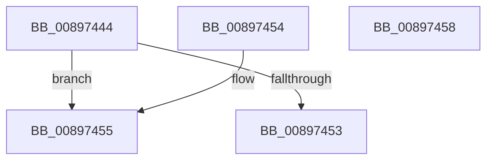

# AlpcpQueryHeadMainQueue

- RVA: `0x00897444`–`0x00897459` (길이 `21` bytes)
- VA: `0x0000000140897444`
- 실행 섹션: `PAGE`
- PDB 이름 있음: `예`; PDB Function 태그: `아니요`
- unwind 정보 RVA: `0x000DB714`
- 디코드: `9`개 명령, `21/21` bytes 표시
- 미해석 바이트: `0` (있으면 어셈블리에 `.byte`로 보존)

> 이 문서는 커널 이미지의 기계어와 PDB 기호를 분석해 생성했습니다. 4번과 5번은 함수 원형과 자료형을 바이너리 사용 방식에서 추정한 C 해석이며 원본 소스 복구 결과는 아닙니다.

## 1. Dependencies

- 직접 호출 지점: **0**; 고유 호출 대상: **0**
- 직접 호출자로 확인된 함수: **1**
- RIP 상대 이미지 참조: **0**

### Outgoing calls
- 직접 디코드된 call 명령이 없습니다.

### Direct callers
- [AlpcpReceiveMessagePort](AlpcpReceiveMessagePort_function_00896B40.md) at `0x00896C28`

### Static image references
- 디코드된 RIP-relative 메모리 참조가 없습니다.

## 2. Other-region calls and transfers

- 다른 실행 섹션으로 향하는 call: **0**
- 별도 외부 분기/꼬리 이동을 확인하지 못했습니다.

## 3. Assembly (complete function range)

```asm
00897444  48 81 C1 90 00 00 00            add rcx, 0x90
0089744B  48 8B 01                        mov rax, qword ptr [rcx]
0089744E  48 3B C1                        cmp rax, rcx
00897451  74 02                           je 0x140897455
00897453  C3                              ret
00897454  CC                              int3
00897455  33 C0                           xor eax, eax
00897457  C3                              ret
00897458  CC                              int3
```

## 4. C-style interpretation (structured pseudocode)

```c
__int64 __fastcall AlpcpQueryHeadMainQueue(__int64 a1)
{
    __int64 result;

    a1 = (a1) + (144);
    if ((*(unsigned __int64 *)(a1)) == a1) goto loc_00897455;
    return *(unsigned __int64 *)(a1);
loc_00897455:
    result = 0;
    return result;
}
```

## 5. (Beta) C Style

```c
int64_t AlpcpQueryHeadMainQueue(void *Arg1)
{
    uint8_t *arg1 = (uint8_t *)Arg1;

    int64_t result;

    Arg1 = (Arg1) + (144);
    if ((*(uint64_t *)(arg1)) == Arg1) goto loc_00897455;
    return *(uint64_t *)(arg1);
loc_00897455:
    result = 0;
    return result;
}
```

### 관측된 메모리 오프셋

구조체 형식이 확인되지 않은 접근은 인자 기준의 오프셋으로만 기록했습니다.

| 기준 인자 | 오프셋 표현 | 폭 (bit) | 접근 |
|---|---:|---:|---|
| `Arg1` | `+ 0x0` | `64` | `R` |

## 6. Execution-region graph

[열기: 2D/3D 그래프와 함수 탐색 컨트롤 패널](../../../control-panel.html?section=page&rva=0x00897444&view=graph)

- 2D 그래프는 위에서 아래로 흐르고, 3D 그래프는 빈 공간을 드래그해 회전합니다. Shift+드래그는 이동, 휠은 확대·축소, 함수 노드 선택은 대상 보고서 이동입니다.

### Static fallback


