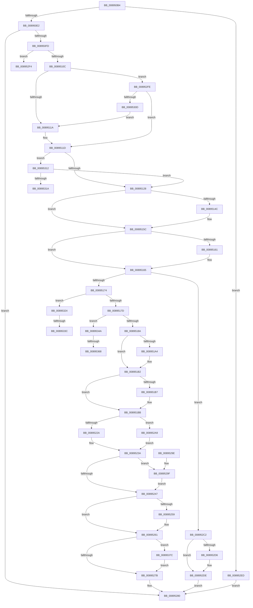

# AlpcpReceiveDirectMessagePort

- RVA: `0x008950B4`–`0x00895389` (길이 `725` bytes)
- VA: `0x00000001408950B4`
- 실행 섹션: `PAGE`
- PDB 이름 있음: `예`; PDB Function 태그: `예`
- unwind 정보 RVA: `0x0007E068`
- 디코드: `185`개 명령, `725/725` bytes 표시
- 미해석 바이트: `0` (있으면 어셈블리에 `.byte`로 보존)

> 이 문서는 커널 이미지의 기계어와 PDB 기호를 분석해 생성했습니다. 4번과 5번은 함수 원형과 자료형을 바이너리 사용 방식에서 추정한 C 해석이며 원본 소스 복구 결과는 아닙니다.

## 1. Dependencies

- 직접 호출 지점: **18**; 고유 호출 대상: **10**
- 직접 호출자로 확인된 함수: **1**
- RIP 상대 이미지 참조: **1**

### Outgoing calls
- `0x008950F0` → [AlpcpLookupMessage](AlpcpLookupMessage_function_00895A40.md) (function, `0x00895A40`)
- `0x00895137` → [KeAbPreAcquire](../../text/21/KeAbPreAcquire_function_00210230.md) (function, `0x00210230`)
- `0x00895157` → [ExfAcquirePushLockSharedEx](../../text/21/ExfAcquirePushLockSharedEx_function_0021044C.md) (function, `0x0021044C`)
- `0x00895194` → [KeAbPreAcquire](../../text/21/KeAbPreAcquire_function_00210230.md) (function, `0x00210230`)
- `0x008951AD` → [ExfAcquirePushLockExclusiveEx](../../text/20/ExfAcquirePushLockExclusiveEx_function_0020FC90.md) (function, `0x0020FC90`)
- `0x0089524A` → [KeAbPostRelease](../../text/2E/KeAbPostRelease_function_002E1600.md) (function, `0x002E1600`)
- `0x0089525C` → [ExfReleasePushLockShared](../../text/26/ExfReleasePushLockShared_function_00263440.md) (function, `0x00263440`)
- `0x00895264` → [KeAbPostRelease](../../text/2E/KeAbPostRelease_function_002E1600.md) (function, `0x002E1600`)
- `0x008952A2` → [ExfTryToWakePushLock](../../text/26/ExfTryToWakePushLock_function_00265DD0.md) (function, `0x00265DD0`)
- `0x008952B8` → [AlpcpInsertMessagePendingQueue](../92/AlpcpInsertMessagePendingQueue_function_00922830.md) (function, `0x00922830`)
- `0x008952C7` → [AlpcpUnlockMessage](AlpcpUnlockMessage_function_00897AE0.md) (function, `0x00897AE0`)
- `0x008952D9` → [ExfReleasePushLockShared](../../text/26/ExfReleasePushLockShared_function_00263440.md) (function, `0x00263440`)
- `0x008952E1` → [KeAbPostRelease](../../text/2E/KeAbPostRelease_function_002E1600.md) (function, `0x002E1600`)
- `0x00895329` → [AlpcpUnlockMessage](AlpcpUnlockMessage_function_00897AE0.md) (function, `0x00897AE0`)
- `0x0089533F` → [ExfReleasePushLockShared](../../text/26/ExfReleasePushLockShared_function_00263440.md) (function, `0x00263440`)
- `0x00895354` → [KeAbPreAcquire](../../text/21/KeAbPreAcquire_function_00210230.md) (function, `0x00210230`)
- `0x00895371` → [ExfAcquirePushLockExclusiveEx](../../text/20/ExfAcquirePushLockExclusiveEx_function_0020FC90.md) (function, `0x0020FC90`)
- `0x0089537F` → [AlpcpLogReceiveMessage](../88/AlpcpLogReceiveMessage_function_0088F80C.md) (function, `0x0088F80C`)

### Direct callers
- [AlpcpReceiveMessage](AlpcpReceiveMessage_function_00897ED0.md) at `0x00898500`

### Static image references
- `0x00895269` → RVA `0x00E66D00` (`.data`; read)

## 2. Other-region calls and transfers

- 다른 실행 섹션으로 향하는 call: **13**
  - `0x00895137` → [KeAbPreAcquire](../../text/21/KeAbPreAcquire_function_00210230.md) (`PAGE` → `.text`)
  - `0x00895157` → [ExfAcquirePushLockSharedEx](../../text/21/ExfAcquirePushLockSharedEx_function_0021044C.md) (`PAGE` → `.text`)
  - `0x00895194` → [KeAbPreAcquire](../../text/21/KeAbPreAcquire_function_00210230.md) (`PAGE` → `.text`)
  - `0x008951AD` → [ExfAcquirePushLockExclusiveEx](../../text/20/ExfAcquirePushLockExclusiveEx_function_0020FC90.md) (`PAGE` → `.text`)
  - `0x0089524A` → [KeAbPostRelease](../../text/2E/KeAbPostRelease_function_002E1600.md) (`PAGE` → `.text`)
  - `0x0089525C` → [ExfReleasePushLockShared](../../text/26/ExfReleasePushLockShared_function_00263440.md) (`PAGE` → `.text`)
  - `0x00895264` → [KeAbPostRelease](../../text/2E/KeAbPostRelease_function_002E1600.md) (`PAGE` → `.text`)
  - `0x008952A2` → [ExfTryToWakePushLock](../../text/26/ExfTryToWakePushLock_function_00265DD0.md) (`PAGE` → `.text`)
  - `0x008952D9` → [ExfReleasePushLockShared](../../text/26/ExfReleasePushLockShared_function_00263440.md) (`PAGE` → `.text`)
  - `0x008952E1` → [KeAbPostRelease](../../text/2E/KeAbPostRelease_function_002E1600.md) (`PAGE` → `.text`)
  - `0x0089533F` → [ExfReleasePushLockShared](../../text/26/ExfReleasePushLockShared_function_00263440.md) (`PAGE` → `.text`)
  - `0x00895354` → [KeAbPreAcquire](../../text/21/KeAbPreAcquire_function_00210230.md) (`PAGE` → `.text`)
  - `0x00895371` → [ExfAcquirePushLockExclusiveEx](../../text/20/ExfAcquirePushLockExclusiveEx_function_0020FC90.md) (`PAGE` → `.text`)
- call이 아닌 외부 분기/꼬리 이동: **6**
  - `0x008952F9` → [sub_00B1973E](../B1/Unknown_function_00B1973E.md) (`tail-transfer`)
  - `0x0089531F` → [sub_00B1973E](../B1/Unknown_function_00B1973E.md) (`tail-transfer`)
  - `0x00895336` → [sub_00B1973E + 0xF](../B1/Unknown_function_00B1973E.md) (`tail-transfer`)
  - `0x00895345` → [sub_00B1973E + 0xF](../B1/Unknown_function_00B1973E.md) (`tail-transfer`)
  - `0x00895362` → [sub_00B1973E + 0x21](../B1/Unknown_function_00B1973E.md) (`tail-transfer`)
  - `0x00895377` → [sub_00B1973E + 0x21](../B1/Unknown_function_00B1973E.md) (`tail-transfer`)

## 3. Assembly (complete function range)

```asm
008950B4  4C 8B DC                        mov r11, rsp
008950B7  49 89 5B 08                     mov qword ptr [r11 + 8], rbx
008950BB  49 89 6B 10                     mov qword ptr [r11 + 0x10], rbp
008950BF  49 89 73 18                     mov qword ptr [r11 + 0x18], rsi
008950C3  57                              push rdi
008950C4  41 54                           push r12
008950C6  41 55                           push r13
008950C8  41 56                           push r14
008950CA  41 57                           push r15
008950CC  48 83 EC 40                     sub rsp, 0x40
008950D0  45 33 E4                        xor r12d, r12d
008950D3  4D 8B F9                        mov r15, r9
008950D6  4D 89 63 C8                     mov qword ptr [r11 - 0x38], r12
008950DA  85 D2                           test edx, edx
008950DC  0F 84 0B 02 00 00               je 0x1408952ed
008950E2  48 8B 29                        mov rbp, qword ptr [rcx]
008950E5  49 8D 43 C8                     lea rax, [r11 - 0x38]
008950E9  48 8B CD                        mov rcx, rbp
008950EC  49 89 43 B8                     mov qword ptr [r11 - 0x48], rax
008950F0  E8 4B 09 00 00                  call 0x140895a40
008950F5  85 C0                           test eax, eax
008950F7  0F 88 83 01 00 00               js 0x140895280
008950FD  4C 8B 74 24 30                  mov r14, qword ptr [rsp + 0x30]
00895102  49 3B 6E 10                     cmp rbp, qword ptr [r14 + 0x10]
00895106  0F 85 E8 01 00 00               jne 0x1408952f4
0089510C  41 8B 46 28                     mov eax, dword ptr [r14 + 0x28]
00895110  0F BA E0 11                     bt eax, 0x11
00895114  0F 82 E4 01 00 00               jb 0x1408952fe
0089511A  41 8B DC                        mov ebx, r12d
0089511D  83 E0 07                        and eax, 7
00895120  3C 04                           cmp al, 4
00895122  0F 85 EA 01 00 00               jne 0x140895312
00895128  48 8D BD 60 01 00 00            lea rdi, [rbp + 0x160]
0089512F  45 33 C0                        xor r8d, r8d
00895132  48 8B CF                        mov rcx, rdi
00895135  33 D2                           xor edx, edx
00895137  E8 F4 B0 97 FF                  call 0x140210230
0089513C  48 8B F0                        mov rsi, rax
0089513F  33 C0                           xor eax, eax
00895141  44 8D 68 11                     lea r13d, [rax + 0x11]
00895145  F0 4C 0F B1 2F                  lock cmpxchg qword ptr [rdi], r13
0089514A  74 10                           je 0x14089515c
0089514C  4C 8B CF                        mov r9, rdi
0089514F  4C 8B C6                        mov r8, rsi
00895152  33 D2                           xor edx, edx
00895154  48 8B CF                        mov rcx, rdi
00895157  E8 F0 B2 97 FF                  call 0x14021044c
0089515C  48 85 F6                        test rsi, rsi
0089515F  74 04                           je 0x140895165
00895161  C6 46 0A 01                     mov byte ptr [rsi + 0xa], 1
00895165  8B 8D A0 01 00 00               mov ecx, dword ptr [rbp + 0x1a0]
0089516B  F6 C1 40                        test cl, 0x40
0089516E  0F 85 4E 01 00 00               jne 0x1408952c2
00895174  F6 C1 10                        test cl, 0x10
00895177  0F 85 A7 01 00 00               jne 0x140895324
0089517D  45 33 C0                        xor r8d, r8d
00895180  33 D2                           xor edx, edx
00895182  85 DB                           test ebx, ebx
00895184  0F 85 C0 01 00 00               jne 0x14089534a
0089518A  48 8D B5 C8 00 00 00            lea rsi, [rbp + 0xc8]
00895191  48 8B CE                        mov rcx, rsi
00895194  E8 97 B0 97 FF                  call 0x140210230
00895199  F0 48 0F BA 2E 00               lock bts qword ptr [rsi], 0
0089519F  48 8B D8                        mov rbx, rax
008951A2  73 0E                           jae 0x1408951b2
008951A4  4C 8B C6                        mov r8, rsi
008951A7  48 8B D0                        mov rdx, rax
008951AA  48 8B CE                        mov rcx, rsi
008951AD  E8 DE AA 97 FF                  call 0x14020fc90
008951B2  48 85 DB                        test rbx, rbx
008951B5  74 04                           je 0x1408951bb
008951B7  C6 43 0A 01                     mov byte ptr [rbx + 0xa], 1
008951BB  FF 8D CC 01 00 00               dec dword ptr [rbp + 0x1cc]
008951C1  41 83 66 28 F8                  and dword ptr [r14 + 0x28], 0xfffffff8
008951C6  48 8B 54 24 30                  mov rdx, qword ptr [rsp + 0x30]
008951CB  4D 89 66 10                     mov qword ptr [r14 + 0x10], r12
008951CF  48 8B 4A 08                     mov rcx, qword ptr [rdx + 8]
008951D3  48 8B 02                        mov rax, qword ptr [rdx]
008951D6  48 89 01                        mov qword ptr [rcx], rax
008951D9  48 8B 0A                        mov rcx, qword ptr [rdx]
008951DC  48 8B 42 08                     mov rax, qword ptr [rdx + 8]
008951E0  48 89 41 08                     mov qword ptr [rcx + 8], rax
008951E4  48 8B 82 88 00 00 00            mov rax, qword ptr [rdx + 0x88]
008951EB  48 F7 D8                        neg rax
008951EE  1B C9                           sbb ecx, ecx
008951F0  81 E1 00 00 00 80               and ecx, 0x80000000
008951F6  44 8B C9                        mov r9d, ecx
008951F9  41 0F BA E9 1E                  bts r9d, 0x1e
008951FE  4C 39 A2 90 00 00 00            cmp qword ptr [rdx + 0x90], r12
00895205  44 0F 44 C9                     cmove r9d, ecx
00895209  45 8B C1                        mov r8d, r9d
0089520C  41 0F BA E8 1C                  bts r8d, 0x1c
00895211  4C 39 A2 98 00 00 00            cmp qword ptr [rdx + 0x98], r12
00895218  45 0F 44 C1                     cmove r8d, r9d
0089521C  48 83 CB FF                     or rbx, 0xffffffffffffffff
00895220  44 85 84 24 90 00 00 00         test dword ptr [rsp + 0x90], r8d
00895228  75 7F                           jne 0x1408952a9
0089522A  B8 FF DF FF FF                  mov eax, 0xffffdfff
0089522F  66 21 82 F4 00 00 00            and word ptr [rdx + 0xf4], ax
00895236  66 01 5A E2                     add word ptr [rdx - 0x1e], bx
0089523A  F0 48 0F C1 1E                  lock xadd qword ptr [rsi], rbx
0089523F  80 E3 06                        and bl, 6
00895242  80 FB 02                        cmp bl, 2
00895245  74 58                           je 0x14089529f
00895247  48 8B CE                        mov rcx, rsi
0089524A  E8 B1 C3 A4 FF                  call 0x1402e1600
0089524F  49 8B C5                        mov rax, r13
00895252  F0 4C 0F B1 27                  lock cmpxchg qword ptr [rdi], r12
00895257  74 08                           je 0x140895261
00895259  48 8B CF                        mov rcx, rdi
0089525C  E8 DF E1 9C FF                  call 0x140263440
00895261  48 8B CF                        mov rcx, rdi
00895264  E8 97 C3 A4 FF                  call 0x1402e1600
00895269  44 38 25 90 1A 5D 00            cmp byte ptr [rip + 0x5d1a90], r12b
00895270  48 8B 5C 24 30                  mov rbx, qword ptr [rsp + 0x30]
00895275  0F 85 01 01 00 00               jne 0x14089537c
0089527B  49 89 1F                        mov qword ptr [r15], rbx
0089527E  33 C0                           xor eax, eax
00895280  4C 8D 5C 24 40                  lea r11, [rsp + 0x40]
00895285  49 8B 5B 30                     mov rbx, qword ptr [r11 + 0x30]
00895289  49 8B 6B 38                     mov rbp, qword ptr [r11 + 0x38]
0089528D  49 8B 73 40                     mov rsi, qword ptr [r11 + 0x40]
00895291  49 8B E3                        mov rsp, r11
00895294  41 5F                           pop r15
00895296  41 5E                           pop r14
00895298  41 5D                           pop r13
0089529A  41 5C                           pop r12
0089529C  5F                              pop rdi
0089529D  C3                              ret
0089529E  CC                              int3
0089529F  48 8B CE                        mov rcx, rsi
008952A2  E8 29 0B 9D FF                  call 0x140265dd0
008952A7  EB 9E                           jmp 0x140895247
008952A9  B8 00 20 00 00                  mov eax, 0x2000
008952AE  48 8B CD                        mov rcx, rbp
008952B1  66 09 82 F4 00 00 00            or word ptr [rdx + 0xf4], ax
008952B8  E8 73 D5 08 00                  call 0x140922830
008952BD  E9 78 FF FF FF                  jmp 0x14089523a
008952C2  48 8B 4C 24 30                  mov rcx, qword ptr [rsp + 0x30]
008952C7  E8 14 28 00 00                  call 0x140897ae0
008952CC  49 8B C5                        mov rax, r13
008952CF  F0 4C 0F B1 27                  lock cmpxchg qword ptr [rdi], r12
008952D4  74 08                           je 0x1408952de
008952D6  48 8B CF                        mov rcx, rdi
008952D9  E8 62 E1 9C FF                  call 0x140263440
008952DE  48 8B CF                        mov rcx, rdi
008952E1  E8 1A C3 A4 FF                  call 0x1402e1600
008952E6  B8 00 07 00 C0                  mov eax, 0xc0000700
008952EB  EB 93                           jmp 0x140895280
008952ED  B8 0D 00 00 C0                  mov eax, 0xc000000d
008952F2  EB 8C                           jmp 0x140895280
008952F4  BB 02 07 00 C0                  mov ebx, 0xc0000702
008952F9  E9 40 44 28 00                  jmp 0x140b1973e
008952FE  BB 01 00 00 00                  mov ebx, 1
00895303  49 3B 6E 40                     cmp rbp, qword ptr [r14 + 0x40]
00895307  0F 84 10 FE FF FF               je 0x14089511d
0089530D  E9 08 FE FF FF                  jmp 0x14089511a
00895312  85 DB                           test ebx, ebx
00895314  0F 85 0E FE FF FF               jne 0x140895128
0089531A  BB 0D 00 00 C0                  mov ebx, 0xc000000d
0089531F  E9 1A 44 28 00                  jmp 0x140b1973e
00895324  48 8B 4C 24 30                  mov rcx, qword ptr [rsp + 0x30]
00895329  E8 B2 27 00 00                  call 0x140897ae0
0089532E  49 8B C5                        mov rax, r13
00895331  F0 4C 0F B1 27                  lock cmpxchg qword ptr [rdi], r12
00895336  0F 84 11 44 28 00               je 0x140b1974d
0089533C  48 8B CF                        mov rcx, rdi
0089533F  E8 FC E0 9C FF                  call 0x140263440
00895344  90                              nop
00895345  E9 03 44 28 00                  jmp 0x140b1974d
0089534A  48 8D B5 88 00 00 00            lea rsi, [rbp + 0x88]
00895351  48 8B CE                        mov rcx, rsi
00895354  E8 D7 AE 97 FF                  call 0x140210230
00895359  F0 48 0F BA 2E 00               lock bts qword ptr [rsi], 0
0089535F  48 8B D8                        mov rbx, rax
00895362  0F 83 F7 43 28 00               jae 0x140b1975f
00895368  4C 8B C6                        mov r8, rsi
0089536B  48 8B D0                        mov rdx, rax
0089536E  48 8B CE                        mov rcx, rsi
00895371  E8 1A A9 97 FF                  call 0x14020fc90
00895376  90                              nop
00895377  E9 E3 43 28 00                  jmp 0x140b1975f
0089537C  48 8B CB                        mov rcx, rbx
0089537F  E8 88 A4 FF FF                  call 0x14088f80c
00895384  E9 F2 FE FF FF                  jmp 0x14089527b
```

## 4. C-style interpretation (structured pseudocode)

```c
__int64 __fastcall AlpcpReceiveDirectMessagePort(__int64 a1, int a2, int a3, __int64 a4)
{
    __int64 result;
    __int64 v_r12;
    __int64 v_rbx;
    __int64 v_rsp;
    unsigned __int64 v_stack_m10;
    unsigned __int64 v_stack_m28;
    unsigned __int64 v_stack_m38;
    unsigned int v_stack_p28;

    *(unsigned __int64 *)(v_rsp + 8) = v_rbx;
    *(unsigned __int64 *)(v_rsp + 16) = v_rbp;
    *(unsigned __int64 *)(v_rsp + 24) = v_rsi;
    v_rsp = (v_rsp) - (64);
    v_r12 = 0;
    *(unsigned __int64 *)(v_rsp - 56) = 0;
    if (a2 == 0) goto loc_008952ED;
    *(unsigned __int64 *)(v_rsp - 72) = v_rsp - 56;
    result = AlpcpLookupMessage(*(unsigned __int64 *)(a1), a2, a3, a4);
    if (sign_flag) goto loc_00895280;
    if ((*(unsigned __int64 *)(a1)) != (*(unsigned __int64 *)(v_stack_m38 + 16))) goto loc_008952F4;
    if ((*(unsigned __int64 *)(a1)) < (*(unsigned __int64 *)(v_stack_m38 + 16))) goto loc_008952FE;
loc_0089511A:
loc_0089511D:
    result = (unsigned int)(((unsigned int)(*(unsigned int *)(v_stack_m38 + 40))) & (7));
    if (((unsigned __int8)(result)) != 4) goto loc_00895312;
loc_00895128:
    a3 = 0;
    a2 = 0;
    result = KeAbPreAcquire(*(unsigned __int64 *)(a1) + 352, a2, a3, a4);
    result = 0;
    if (!(condition_is_equal)) {
        a4 = *(unsigned __int64 *)(a1) + 352;
        a3 = 0;
        a2 = 0;
        a1 = *(unsigned __int64 *)(a1) + 352;
        result = ExfAcquirePushLockSharedEx(a1, a2, a3, a4);
    }
    if (result != 0) {
        *(unsigned __int8 *)(result + 10) = 1;
    }
    if ((((unsigned __int8)((unsigned int)(*(unsigned int *)(*(unsigned __int64 *)(a1) + 416)))) & (64)) != 0) goto loc_008952C2;
    if ((((unsigned __int8)((unsigned int)(*(unsigned int *)(*(unsigned __int64 *)(a1) + 416)))) & (16)) != 0) goto loc_00895324;
    a3 = 0;
    a2 = 0;
    if (0 != 0) goto loc_0089534A;
    result = KeAbPreAcquire(*(unsigned __int64 *)(a1) + 200, a2, a3, a4);
    if (!(condition_is_above_or_equal)) {
        a3 = *(unsigned __int64 *)(a1) + 200;
        a2 = result;
        a1 = *(unsigned __int64 *)(a1) + 200;
        result = ExfAcquirePushLockExclusiveEx(a1, a2, a3, a4);
    }
    if (result != 0) {
        *(unsigned __int8 *)(result + 10) = 1;
    }
    *(unsigned __int64 *)(v_stack_m38 + 16) = 0;
    *(unsigned __int64 *)(*(unsigned __int64 *)(v_stack_m38 + 8)) = *(unsigned __int64 *)(v_stack_m38);
    *(unsigned __int64 *)(*(unsigned __int64 *)(v_stack_m38) + 8) = *(unsigned __int64 *)(v_stack_m38 + 8);
    result = -(*(unsigned __int64 *)(v_stack_m38 + 136));
    a1 = (unsigned int)((*(unsigned __int64 *)(v_stack_m38)) & (0x80000000ULL));
    a4 = (unsigned int)((unsigned int)(a1));
    if ((*(unsigned __int64 *)(v_stack_m38 + 144)) == 0) { a4 = (unsigned int)(a1); }
    a3 = (unsigned int)((unsigned int)(a4));
    if ((*(unsigned __int64 *)(v_stack_m38 + 152)) == 0) { a3 = (unsigned int)(a4); }
    v_rbx = (result) | (-1);
    if (((v_stack_p28) & (a3)) != 0) goto loc_008952A9;
loc_0089523A:
    v_rbx = (unsigned __int8)((v_rbx) & (6));
    if (((unsigned __int8)(v_rbx)) == 2) goto loc_0089529F;
loc_00895247:
    result = KeAbPostRelease(*(unsigned __int64 *)(a1) + 200, v_stack_m38, a3, a4);
    result = result + 17;
    if (((unsigned __int8)(v_rbx)) != 2) {
        a1 = *(unsigned __int64 *)(a1) + 352;
        result = ExfReleasePushLockShared(a1, v_stack_m38, a3, a4);
    }
    result = KeAbPostRelease(*(unsigned __int64 *)(a1) + 352, v_stack_m38, a3, a4);
    if ((*(unsigned __int8 *)(v_rip + 6101648)) != 0) goto loc_0089537C;
loc_0089527B:
    *(unsigned __int64 *)(a4) = v_stack_m38;
    result = 0;
loc_00895280:
    return result;
loc_0089529F:
    result = ExfTryToWakePushLock(*(unsigned __int64 *)(v_stack_m28 + 64), v_stack_m38, a3, a4);
    goto loc_00895247;
loc_008952A9:
    result = AlpcpInsertMessagePendingQueue(*(unsigned __int64 *)(v_stack_m28 + 56), v_stack_m38, a3, a4);
    goto loc_0089523A;
loc_008952C2:
    result = AlpcpUnlockMessage(v_stack_m10, v_stack_m38, a3, a4);
    result = result + 17;
    if (!(condition_is_equal)) {
        a1 = *(unsigned __int64 *)(a1) + 352;
        result = ExfReleasePushLockShared(a1, v_stack_m38, a3, a4);
    }
    result = KeAbPostRelease(*(unsigned __int64 *)(a1) + 352, v_stack_m38, a3, a4);
    goto loc_00895280;
loc_008952ED:
    goto loc_00895280;
loc_008952F4:
loc_008952FE:
    if ((*(unsigned __int64 *)(v_stack_m28 + 56)) == (*(unsigned __int64 *)(v_stack_m38 + 64))) goto loc_0089511D;
    goto loc_0089511A;
loc_00895312:
    if (1 != 0) goto loc_00895128;
loc_00895324:
    result = AlpcpUnlockMessage(v_stack_m10, v_stack_m38, a3, a4);
    result = ExfReleasePushLockShared(*(unsigned __int64 *)(a1) + 352, v_stack_m38, a3, a4);
loc_0089534A:
    result = KeAbPreAcquire(*(unsigned __int64 *)(v_stack_m28 + 56) + 136, v_stack_m38, a3, a4);
    result = ExfAcquirePushLockExclusiveEx(*(unsigned __int64 *)(v_stack_m28 + 56) + 136, result, *(unsigned __int64 *)(v_stack_m28 + 56) + 136, a4);
loc_0089537C:
    result = AlpcpLogReceiveMessage(result, result, *(unsigned __int64 *)(v_stack_m28 + 56) + 136, a4);
    goto loc_0089527B;
}
```

## 5. (Beta) C Style

```c
int64_t AlpcpReceiveDirectMessagePort(void *Arg1, int32_t Arg2, int32_t Arg3, void *Arg4)
{
    uint8_t *arg1 = (uint8_t *)Arg1;
    uint8_t *arg4 = (uint8_t *)Arg4;

    int64_t result;
    int64_t local_r12;
    int64_t local_rbx;
    int64_t local_rsp;
    uint64_t v_stack_m10;
    uint64_t v_stack_m28;
    uint64_t v_stack_m38;
    uint32_t v_stack_p28;

    *(uint64_t *)(local_rsp + 0x8) = local_rbx;
    *(uint64_t *)(local_rsp + 0x10) = local_rbp;
    *(uint64_t *)(local_rsp + 0x18) = local_rsi;
    local_rsp = (local_rsp) - (64);
    local_r12 = 0;
    *(uint64_t *)(local_rsp - 0x38) = 0;
    if (Arg2 == 0) goto loc_008952ED;
    *(uint64_t *)(local_rsp - 0x48) = local_rsp - 56;
    result = AlpcpLookupMessage(*(uint64_t *)(arg1), Arg2, Arg3, Arg4);
    if (sign_flag) goto loc_00895280;
    if ((*(uint64_t *)(arg1)) != (*(uint64_t *)(v_stack_m38 + 0x10))) goto loc_008952F4;
    if ((*(uint64_t *)(arg1)) < (*(uint64_t *)(v_stack_m38 + 0x10))) goto loc_008952FE;
loc_0089511A:
loc_0089511D:
    result = (uint32_t)(((uint32_t)(*(uint32_t *)(v_stack_m38 + 0x28))) & (7));
    if (((uint8_t)(result)) != 4) goto loc_00895312;
loc_00895128:
    Arg3 = 0;
    Arg2 = 0;
    result = KeAbPreAcquire(*(uint64_t *)(arg1) + 352, Arg2, Arg3, Arg4);
    result = 0;
    if (!(condition_is_equal)) {
        Arg4 = *(uint64_t *)(arg1) + 352;
        Arg3 = 0;
        Arg2 = 0;
        Arg1 = *(uint64_t *)(arg1) + 352;
        result = ExfAcquirePushLockSharedEx(Arg1, Arg2, Arg3, Arg4);
    }
    if (result != 0) {
        *(uint8_t *)(result + 0xA) = 1;
    }
    if ((((uint8_t)((uint32_t)(*(uint32_t *)(*(uint64_t *)(arg1) + 0x1A0)))) & (64)) != 0) goto loc_008952C2;
    if ((((uint8_t)((uint32_t)(*(uint32_t *)(*(uint64_t *)(arg1) + 0x1A0)))) & (16)) != 0) goto loc_00895324;
    Arg3 = 0;
    Arg2 = 0;
    if (0 != 0) goto loc_0089534A;
    result = KeAbPreAcquire(*(uint64_t *)(arg1) + 200, Arg2, Arg3, Arg4);
    if (!(condition_is_above_or_equal)) {
        Arg3 = *(uint64_t *)(arg1) + 200;
        Arg2 = result;
        Arg1 = *(uint64_t *)(arg1) + 200;
        result = ExfAcquirePushLockExclusiveEx(Arg1, Arg2, Arg3, Arg4);
    }
    if (result != 0) {
        *(uint8_t *)(result + 0xA) = 1;
    }
    *(uint64_t *)(v_stack_m38 + 0x10) = 0;
    *(uint64_t *)(*(uint64_t *)(v_stack_m38 + 0x8)) = *(uint64_t *)(v_stack_m38);
    *(uint64_t *)(*(uint64_t *)(v_stack_m38) + 0x8) = *(uint64_t *)(v_stack_m38 + 0x8);
    result = -(*(uint64_t *)(v_stack_m38 + 0x88));
    Arg1 = (uint32_t)((*(uint64_t *)(v_stack_m38)) & (0x80000000ULL));
    Arg4 = (uint32_t)((uint32_t)(Arg1));
    if ((*(uint64_t *)(v_stack_m38 + 0x90)) == 0) { Arg4 = (uint32_t)(Arg1); }
    Arg3 = (uint32_t)((uint32_t)(Arg4));
    if ((*(uint64_t *)(v_stack_m38 + 0x98)) == 0) { Arg3 = (uint32_t)(Arg4); }
    local_rbx = (result) | (-1);
    if (((v_stack_p28) & (Arg3)) != 0) goto loc_008952A9;
loc_0089523A:
    local_rbx = (uint8_t)((local_rbx) & (6));
    if (((uint8_t)(local_rbx)) == 2) goto loc_0089529F;
loc_00895247:
    result = KeAbPostRelease(*(uint64_t *)(arg1) + 200, v_stack_m38, Arg3, Arg4);
    result = result + 17;
    if (((uint8_t)(local_rbx)) != 2) {
        Arg1 = *(uint64_t *)(arg1) + 352;
        result = ExfReleasePushLockShared(Arg1, v_stack_m38, Arg3, Arg4);
    }
    result = KeAbPostRelease(*(uint64_t *)(arg1) + 352, v_stack_m38, Arg3, Arg4);
    if ((*(uint8_t *)(v_rip + 0x5D1A90)) != 0) goto loc_0089537C;
loc_0089527B:
    *(uint64_t *)(arg4) = v_stack_m38;
    result = 0;
loc_00895280:
    return result;
loc_0089529F:
    result = ExfTryToWakePushLock(*(uint64_t *)(v_stack_m28 + 0x40), v_stack_m38, Arg3, Arg4);
    goto loc_00895247;
loc_008952A9:
    result = AlpcpInsertMessagePendingQueue(*(uint64_t *)(v_stack_m28 + 0x38), v_stack_m38, Arg3, Arg4);
    goto loc_0089523A;
loc_008952C2:
    result = AlpcpUnlockMessage(v_stack_m10, v_stack_m38, Arg3, Arg4);
    result = result + 17;
    if (!(condition_is_equal)) {
        Arg1 = *(uint64_t *)(arg1) + 352;
        result = ExfReleasePushLockShared(Arg1, v_stack_m38, Arg3, Arg4);
    }
    result = KeAbPostRelease(*(uint64_t *)(arg1) + 352, v_stack_m38, Arg3, Arg4);
    goto loc_00895280;
loc_008952ED:
    goto loc_00895280;
loc_008952F4:
loc_008952FE:
    if ((*(uint64_t *)(v_stack_m28 + 0x38)) == (*(uint64_t *)(v_stack_m38 + 0x40))) goto loc_0089511D;
    goto loc_0089511A;
loc_00895312:
    if (1 != 0) goto loc_00895128;
loc_00895324:
    result = AlpcpUnlockMessage(v_stack_m10, v_stack_m38, Arg3, Arg4);
    result = ExfReleasePushLockShared(*(uint64_t *)(arg1) + 352, v_stack_m38, Arg3, Arg4);
loc_0089534A:
    result = KeAbPreAcquire(*(uint64_t *)(v_stack_m28 + 0x38) + 136, v_stack_m38, Arg3, Arg4);
    result = ExfAcquirePushLockExclusiveEx(*(uint64_t *)(v_stack_m28 + 0x38) + 136, result, *(uint64_t *)(v_stack_m28 + 0x38) + 136, Arg4);
loc_0089537C:
    result = AlpcpLogReceiveMessage(result, result, *(uint64_t *)(v_stack_m28 + 0x38) + 136, Arg4);
    goto loc_0089527B;
}
```

### 관측된 메모리 오프셋

구조체 형식이 확인되지 않은 접근은 인자 기준의 오프셋으로만 기록했습니다.

| 기준 인자 | 오프셋 표현 | 폭 (bit) | 접근 |
|---|---:|---:|---|
| `Arg1` | `+ 0x0` | `64` | `R` |
| `Arg4` | `+ 0x0` | `64` | `W` |

## 6. Execution-region graph

[열기: 2D/3D 그래프와 함수 탐색 컨트롤 패널](../../../control-panel.html?section=page&rva=0x008950B4&view=graph)

- 2D 그래프는 위에서 아래로 흐르고, 3D 그래프는 빈 공간을 드래그해 회전합니다. Shift+드래그는 이동, 휠은 확대·축소, 함수 노드 선택은 대상 보고서 이동입니다.

### Static fallback


