# AlpcpReceiveLegacyMessage

- RVA: `0x00895DE0`–`0x00896195` (길이 `949` bytes)
- VA: `0x0000000140895DE0`
- 실행 섹션: `PAGE`
- PDB 이름 있음: `예`; PDB Function 태그: `예`
- unwind 정보 RVA: `0x0007E154`
- 디코드: `244`개 명령, `949/949` bytes 표시
- 미해석 바이트: `0` (있으면 어셈블리에 `.byte`로 보존)

> 이 문서는 커널 이미지의 기계어와 PDB 기호를 분석해 생성했습니다. 4번과 5번은 함수 원형과 자료형을 바이너리 사용 방식에서 추정한 C 해석이며 원본 소스 복구 결과는 아닙니다.

## 1. Dependencies

- 직접 호출 지점: **16**; 고유 호출 대상: **13**
- 직접 호출자로 확인된 함수: **1**
- RIP 상대 이미지 참조: **0**

### Outgoing calls
- `0x00895E83` → [ExRaiseDatatypeMisalignment](ExRaiseDatatypeMisalignment_function_00899FD0.md) (function, `0x00899FD0`)
- `0x00895EFA` → [AlpcpReceiveMessagePort](AlpcpReceiveMessagePort_function_00896B40.md) (function, `0x00896B40`)
- `0x00895FA0` → [AlpcpAvailableBufferSize](AlpcpAvailableBufferSize_function_00895390.md) (function, `0x00895390`)
- `0x00895FCC` → [memcpy](../../text/6C/memcpy_function_006C6840.md) (function, `0x006C6840`)
- `0x00895FE6` → [memcpy](../../text/6C/memcpy_function_006C6840.md) (function, `0x006C6840`)
- `0x0089600F` → [AlpcpGetDataFromUserVaSafe](../92/AlpcpGetDataFromUserVaSafe_function_00922908.md) (function, `0x00922908`)
- `0x0089604C` → [AlpcpUnlockMessage](AlpcpUnlockMessage_function_00897AE0.md) (function, `0x00897AE0`)
- `0x00896064` → [AlpcpCancelMessage](AlpcpCancelMessage_function_00894120.md) (function, `0x00894120`)
- `0x00896071` → [ObfDereferenceObject](../../text/2F/ObfDereferenceObject_function_002F9350.md) (function, `0x002F9350`)
- `0x0089609A` → [KeAbPreAcquire](../../text/21/KeAbPreAcquire_function_00210230.md) (function, `0x00210230`)
- `0x008960BB` → [ExfAcquirePushLockSharedEx](../../text/21/ExfAcquirePushLockSharedEx_function_0021044C.md) (function, `0x0021044C`)
- `0x008960E5` → [ExfReleasePushLockShared](../../text/26/ExfReleasePushLockShared_function_00263440.md) (function, `0x00263440`)
- `0x008960ED` → [KeAbPostRelease](../../text/2E/KeAbPostRelease_function_002E1600.md) (function, `0x002E1600`)
- `0x00896131` → [ObReferenceObjectSafe](../../text/41/ObReferenceObjectSafe_function_0041DAE0.md) (function, `0x0041DAE0`)
- `0x00896149` → [ExfReleasePushLockShared](../../text/26/ExfReleasePushLockShared_function_00263440.md) (function, `0x00263440`)
- `0x00896151` → [KeAbPostRelease](../../text/2E/KeAbPostRelease_function_002E1600.md) (function, `0x002E1600`)

### Direct callers
- [NtReplyWaitReceivePortEx](NtReplyWaitReceivePortEx_function_00895850.md) at `0x00895938`

### Static image references
- 디코드된 RIP-relative 메모리 참조가 없습니다.

## 2. Other-region calls and transfers

- 다른 실행 섹션으로 향하는 call: **10**
  - `0x00895FCC` → [memcpy](../../text/6C/memcpy_function_006C6840.md) (`PAGE` → `.text`)
  - `0x00895FE6` → [memcpy](../../text/6C/memcpy_function_006C6840.md) (`PAGE` → `.text`)
  - `0x00896071` → [ObfDereferenceObject](../../text/2F/ObfDereferenceObject_function_002F9350.md) (`PAGE` → `.text`)
  - `0x0089609A` → [KeAbPreAcquire](../../text/21/KeAbPreAcquire_function_00210230.md) (`PAGE` → `.text`)
  - `0x008960BB` → [ExfAcquirePushLockSharedEx](../../text/21/ExfAcquirePushLockSharedEx_function_0021044C.md) (`PAGE` → `.text`)
  - `0x008960E5` → [ExfReleasePushLockShared](../../text/26/ExfReleasePushLockShared_function_00263440.md) (`PAGE` → `.text`)
  - `0x008960ED` → [KeAbPostRelease](../../text/2E/KeAbPostRelease_function_002E1600.md) (`PAGE` → `.text`)
  - `0x00896131` → [ObReferenceObjectSafe](../../text/41/ObReferenceObjectSafe_function_0041DAE0.md) (`PAGE` → `.text`)
  - `0x00896149` → [ExfReleasePushLockShared](../../text/26/ExfReleasePushLockShared_function_00263440.md) (`PAGE` → `.text`)
  - `0x00896151` → [KeAbPostRelease](../../text/2E/KeAbPostRelease_function_002E1600.md) (`PAGE` → `.text`)
- call이 아닌 외부 분기/꼬리 이동: **2**
  - `0x00896182` → [sub_00B1979A](../B1/Unknown_function_00B1979A.md) (`tail-transfer`)
  - `0x00896190` → [sub_00B1979A](../B1/Unknown_function_00B1979A.md) (`tail-transfer`)

## 3. Assembly (complete function range)

```asm
00895DE0  4C 8B DC                        mov r11, rsp
00895DE3  4D 89 43 18                     mov qword ptr [r11 + 0x18], r8
00895DE7  49 89 53 10                     mov qword ptr [r11 + 0x10], rdx
00895DEB  49 89 4B 08                     mov qword ptr [r11 + 8], rcx
00895DEF  53                              push rbx
00895DF0  56                              push rsi
00895DF1  57                              push rdi
00895DF2  41 54                           push r12
00895DF4  41 55                           push r13
00895DF6  41 56                           push r14
00895DF8  41 57                           push r15
00895DFA  48 83 EC 70                     sub rsp, 0x70
00895DFE  4D 8B F9                        mov r15, r9
00895E01  48 8B DA                        mov rbx, rdx
00895E04  4C 8B E1                        mov r12, rcx
00895E07  45 33 ED                        xor r13d, r13d
00895E0A  4D 89 6B 98                     mov qword ptr [r11 - 0x68], r13
00895E0E  65 48 8B 14 25 88 01 00 00      mov rdx, qword ptr gs:[0x188]
00895E17  48 89 54 24 60                  mov qword ptr [rsp + 0x60], rdx
00895E1C  65 48 8B 04 25 88 01 00 00      mov rax, qword ptr gs:[0x188]
00895E25  44 0F B6 90 32 02 00 00         movzx r10d, byte ptr [rax + 0x232]
00895E2D  44 89 54 24 30                  mov dword ptr [rsp + 0x30], r10d
00895E32  4D 89 6B A0                     mov qword ptr [r11 - 0x60], r13
00895E36  48 8B 09                        mov rcx, qword ptr [rcx]
00895E39  48 89 4C 24 38                  mov qword ptr [rsp + 0x38], rcx
00895E3E  48 89 4C 24 58                  mov qword ptr [rsp + 0x58], rcx
00895E43  45 84 D2                        test r10b, r10b
00895E46  0F 84 BC 02 00 00               je 0x140896108
00895E4C  49 8B 73 18                     mov rsi, qword ptr [r11 + 0x18]
00895E50  48 BA 00 00 FF FF FF 7F 00 00   movabs rdx, 0x7fffffff0000
00895E5A  48 85 F6                        test rsi, rsi
00895E5D  74 1A                           je 0x140895e79
00895E5F  48 8B C2                        mov rax, rdx
00895E62  48 3B F2                        cmp rsi, rdx
00895E65  48 0F 42 C6                     cmovb rax, rsi
00895E69  90                              nop
00895E6A  48 8B 00                        mov rax, qword ptr [rax]
00895E6D  49 89 43 A0                     mov qword ptr [r11 - 0x60], rax
00895E71  49 8D 73 A0                     lea rsi, [r11 - 0x60]
00895E75  49 89 73 18                     mov qword ptr [r11 + 0x18], rsi
00895E79  48 85 DB                        test rbx, rbx
00895E7C  74 2E                           je 0x140895eac
00895E7E  F6 C3 03                        test bl, 3
00895E81  74 06                           je 0x140895e89
00895E83  E8 48 41 00 00                  call 0x140899fd0
00895E88  CC                              int3
00895E89  48 8B CA                        mov rcx, rdx
00895E8C  48 3B DA                        cmp rbx, rdx
00895E8F  48 0F 42 CB                     cmovb rcx, rbx
00895E93  0F B6 01                        movzx eax, byte ptr [rcx]
00895E96  88 01                           mov byte ptr [rcx], al
00895E98  0F B6 41 27                     movzx eax, byte ptr [rcx + 0x27]
00895E9C  88 41 27                        mov byte ptr [rcx + 0x27], al
00895E9F  48 8B B4 24 C0 00 00 00         mov rsi, qword ptr [rsp + 0xc0]
00895EA7  48 8B 4C 24 38                  mov rcx, qword ptr [rsp + 0x38]
00895EAC  4D 85 FF                        test r15, r15
00895EAF  74 15                           je 0x140895ec6
00895EB1  4C 3B FA                        cmp r15, rdx
00895EB4  49 0F 42 D7                     cmovb rdx, r15
00895EB8  48 8B 02                        mov rax, qword ptr [rdx]
00895EBB  48 89 02                        mov qword ptr [rdx], rax
00895EBE  48 8B B4 24 C0 00 00 00         mov rsi, qword ptr [rsp + 0xc0]
00895EC6  EB 05                           jmp 0x140895ecd
00895EC8  E9 AC 01 00 00                  jmp 0x140896079
00895ECD  4D 8B F5                        mov r14, r13
00895ED0  4C 89 6C 24 50                  mov qword ptr [rsp + 0x50], r13
00895ED5  8B 81 A0 01 00 00               mov eax, dword ptr [rcx + 0x1a0]
00895EDB  83 E0 06                        and eax, 6
00895EDE  3C 06                           cmp al, 6
00895EE0  0F 84 A4 01 00 00               je 0x14089608a
00895EE6  44 89 6C 24 20                  mov dword ptr [rsp + 0x20], r13d
00895EEB  4C 8D 4C 24 40                  lea r9, [rsp + 0x40]
00895EF0  4C 8B C6                        mov r8, rsi
00895EF3  41 0F B6 D2                     movzx edx, r10b
00895EF7  49 8B CC                        mov rcx, r12
00895EFA  E8 41 0C 00 00                  call 0x140896b40
00895EFF  44 8B E0                        mov r12d, eax
00895F02  85 C0                           test eax, eax
00895F04  0F 85 5F 01 00 00               jne 0x140896069
00895F0A  48 8B 7C 24 40                  mov rdi, qword ptr [rsp + 0x40]
00895F0F  8B 4F 28                        mov ecx, dword ptr [rdi + 0x28]
00895F12  84 C9                           test cl, cl
00895F14  0F 88 5F 02 00 00               js 0x140896179
00895F1A  48 8D B7 C8 00 00 00            lea rsi, [rdi + 0xc8]
00895F21  48 89 74 24 30                  mov qword ptr [rsp + 0x30], rsi
00895F26  48 8B 44 24 60                  mov rax, qword ptr [rsp + 0x60]
00895F2B  48 89 06                        mov qword ptr [rsi], rax
00895F2E  48 85 DB                        test rbx, rbx
00895F31  0F 84 9A 00 00 00               je 0x140895fd1
00895F37  44 89 AC 24 B0 00 00 00         mov dword ptr [rsp + 0xb0], r13d
00895F3F  0F 10 87 F0 00 00 00            movups xmm0, xmmword ptr [rdi + 0xf0]
00895F46  0F 11 03                        movups xmmword ptr [rbx], xmm0
00895F49  0F 10 8F 00 01 00 00            movups xmm1, xmmword ptr [rdi + 0x100]
00895F50  0F 11 4B 10                     movups xmmword ptr [rbx + 0x10], xmm1
00895F54  F2 0F 10 87 10 01 00 00         movsd xmm0, qword ptr [rdi + 0x110]
00895F5C  F2 0F 11 43 20                  movsd qword ptr [rbx + 0x20], xmm0
00895F61  48 8B 44 24 38                  mov rax, qword ptr [rsp + 0x38]
00895F66  F7 80 00 01 00 00 00 10 00 00   test dword ptr [rax + 0x100], 0x1000
00895F70  74 13                           je 0x140895f85
00895F72  0F B7 87 F4 00 00 00            movzx eax, word ptr [rdi + 0xf4]
00895F79  B9 0F C0 FF FF                  mov ecx, 0xffffc00f
00895F7E  66 23 C1                        and ax, cx
00895F81  66 89 43 04                     mov word ptr [rbx + 4], ax
00895F85  0F B7 87 F2 00 00 00            movzx eax, word ptr [rdi + 0xf2]
00895F8C  89 84 24 B0 00 00 00            mov dword ptr [rsp + 0xb0], eax
00895F93  48 8B CF                        mov rcx, rdi
00895F96  48 83 BF B0 00 00 00 00         cmp qword ptr [rdi + 0xb0], 0
00895F9E  75 6B                           jne 0x14089600b
00895FA0  E8 EB F3 FF FF                  call 0x140895390
00895FA5  48 89 44 24 60                  mov qword ptr [rsp + 0x60], rax
00895FAA  0F B7 8F F0 00 00 00            movzx ecx, word ptr [rdi + 0xf0]
00895FB1  48 89 8C 24 B0 00 00 00         mov qword ptr [rsp + 0xb0], rcx
00895FB9  48 8D 97 18 01 00 00            lea rdx, [rdi + 0x118]
00895FC0  48 3B C8                        cmp rcx, rax
00895FC3  77 1A                           ja 0x140895fdf
00895FC5  44 8B C1                        mov r8d, ecx
00895FC8  48 8D 4B 28                     lea rcx, [rbx + 0x28]
00895FCC  E8 6F 08 E3 FF                  call 0x1406c6840
00895FD1  4D 85 FF                        test r15, r15
00895FD4  74 40                           je 0x140896016
00895FD6  48 8B 47 78                     mov rax, qword ptr [rdi + 0x78]
00895FDA  49 89 07                        mov qword ptr [r15], rax
00895FDD  EB 37                           jmp 0x140896016
00895FDF  4C 8B C0                        mov r8, rax
00895FE2  48 8D 4B 28                     lea rcx, [rbx + 0x28]
00895FE6  E8 55 08 E3 FF                  call 0x1406c6840
00895FEB  4C 8B 84 24 B0 00 00 00         mov r8, qword ptr [rsp + 0xb0]
00895FF3  48 8B 44 24 60                  mov rax, qword ptr [rsp + 0x60]
00895FF8  4C 2B C0                        sub r8, rax
00895FFB  48 8D 48 28                     lea rcx, [rax + 0x28]
00895FFF  48 03 CB                        add rcx, rbx
00896002  48 8B 97 E0 00 00 00            mov rdx, qword ptr [rdi + 0xe0]
00896009  EB C1                           jmp 0x140895fcc
0089600B  48 8D 53 28                     lea rdx, [rbx + 0x28]
0089600F  E8 F4 C8 08 00                  call 0x140922908
00896014  EB BB                           jmp 0x140895fd1
00896016  EB 27                           jmp 0x14089603f
00896018  44 8B E0                        mov r12d, eax
0089601B  45 33 ED                        xor r13d, r13d
0089601E  48 8B 9C 24 B8 00 00 00         mov rbx, qword ptr [rsp + 0xb8]
00896026  4C 8B 74 24 50                  mov r14, qword ptr [rsp + 0x50]
0089602B  48 8B 7C 24 40                  mov rdi, qword ptr [rsp + 0x40]
00896030  48 8B 44 24 58                  mov rax, qword ptr [rsp + 0x58]
00896035  48 89 44 24 38                  mov qword ptr [rsp + 0x38], rax
0089603A  48 8B 74 24 30                  mov rsi, qword ptr [rsp + 0x30]
0089603F  48 85 DB                        test rbx, rbx
00896042  74 0F                           je 0x140896053
00896044  45 85 E4                        test r12d, r12d
00896047  78 0A                           js 0x140896053
00896049  48 8B CF                        mov rcx, rdi
0089604C  E8 8F 1A 00 00                  call 0x140897ae0
00896051  EB 16                           jmp 0x140896069
00896053  4C 89 2E                        mov qword ptr [rsi], r13
00896056  41 B8 00 00 01 00               mov r8d, 0x10000
0089605C  48 8B D7                        mov rdx, rdi
0089605F  48 8B 4C 24 38                  mov rcx, qword ptr [rsp + 0x38]
00896064  E8 B7 E0 FF FF                  call 0x140894120
00896069  4D 85 F6                        test r14, r14
0089606C  74 08                           je 0x140896076
0089606E  49 8B CE                        mov rcx, r14
00896071  E8 DA 32 A6 FF                  call 0x1402f9350
00896076  41 8B C4                        mov eax, r12d
00896079  48 83 C4 70                     add rsp, 0x70
0089607D  41 5F                           pop r15
0089607F  41 5E                           pop r14
00896081  41 5D                           pop r13
00896083  41 5C                           pop r12
00896085  5F                              pop rdi
00896086  5E                              pop rsi
00896087  5B                              pop rbx
00896088  C3                              ret
00896089  CC                              int3
0089608A  4C 8B 71 10                     mov r14, qword ptr [rcx + 0x10]
0089608E  49 8D 76 F0                     lea rsi, [r14 - 0x10]
00896092  45 33 C0                        xor r8d, r8d
00896095  33 D2                           xor edx, edx
00896097  48 8B CE                        mov rcx, rsi
0089609A  E8 91 A1 97 FF                  call 0x140210230
0089609F  48 8B F8                        mov rdi, rax
008960A2  B9 11 00 00 00                  mov ecx, 0x11
008960A7  33 C0                           xor eax, eax
008960A9  F0 48 0F B1 0E                  lock cmpxchg qword ptr [rsi], rcx
008960AE  74 10                           je 0x1408960c0
008960B0  4C 8B CE                        mov r9, rsi
008960B3  4C 8B C7                        mov r8, rdi
008960B6  33 D2                           xor edx, edx
008960B8  48 8B CE                        mov rcx, rsi
008960BB  E8 8C A3 97 FF                  call 0x14021044c
008960C0  48 85 FF                        test rdi, rdi
008960C3  74 04                           je 0x1408960c9
008960C5  C6 47 0A 01                     mov byte ptr [rdi + 0xa], 1
008960C9  4D 8B 36                        mov r14, qword ptr [r14]
008960CC  4C 89 74 24 50                  mov qword ptr [rsp + 0x50], r14
008960D1  4D 85 F6                        test r14, r14
008960D4  75 58                           jne 0x14089612e
008960D6  B8 11 00 00 00                  mov eax, 0x11
008960DB  F0 4C 0F B1 2E                  lock cmpxchg qword ptr [rsi], r13
008960E0  74 08                           je 0x1408960ea
008960E2  48 8B CE                        mov rcx, rsi
008960E5  E8 56 D3 9C FF                  call 0x140263440
008960EA  48 8B CE                        mov rcx, rsi
008960ED  E8 0E B5 A4 FF                  call 0x1402e1600
008960F2  B8 37 00 00 C0                  mov eax, 0xc0000037
008960F7  48 83 C4 70                     add rsp, 0x70
008960FB  41 5F                           pop r15
008960FD  41 5E                           pop r14
008960FF  41 5D                           pop r13
00896101  41 5C                           pop r12
00896103  5F                              pop rdi
00896104  5E                              pop rsi
00896105  5B                              pop rbx
00896106  C3                              ret
00896107  CC                              int3
00896108  F7 42 74 00 04 00 00            test dword ptr [rdx + 0x74], 0x400
0089610F  45 0F B6 D2                     movzx r10d, r10b
00896113  B8 01 00 00 00                  mov eax, 1
00896118  44 0F 45 D0                     cmovne r10d, eax
0089611C  44 89 54 24 30                  mov dword ptr [rsp + 0x30], r10d
00896121  48 8B B4 24 C0 00 00 00         mov rsi, qword ptr [rsp + 0xc0]
00896129  E9 9F FD FF FF                  jmp 0x140895ecd
0089612E  49 8B CE                        mov rcx, r14
00896131  E8 AA 79 B8 FF                  call 0x14041dae0
00896136  84 C0                           test al, al
00896138  74 9C                           je 0x1408960d6
0089613A  B8 11 00 00 00                  mov eax, 0x11
0089613F  F0 4C 0F B1 2E                  lock cmpxchg qword ptr [rsi], r13
00896144  74 08                           je 0x14089614e
00896146  48 8B CE                        mov rcx, rsi
00896149  E8 F2 D2 9C FF                  call 0x140263440
0089614E  48 8B CE                        mov rcx, rsi
00896151  E8 AA B4 A4 FF                  call 0x1402e1600
00896156  49 8B C6                        mov rax, r14
00896159  48 89 44 24 38                  mov qword ptr [rsp + 0x38], rax
0089615E  48 89 44 24 58                  mov qword ptr [rsp + 0x58], rax
00896163  4D 89 34 24                     mov qword ptr [r12], r14
00896167  48 8B B4 24 C0 00 00 00         mov rsi, qword ptr [rsp + 0xc0]
0089616F  44 8B 54 24 30                  mov r10d, dword ptr [rsp + 0x30]
00896174  E9 6D FD FF FF                  jmp 0x140895ee6
00896179  48 8B 44 24 38                  mov rax, qword ptr [rsp + 0x38]
0089617E  48 39 47 40                     cmp qword ptr [rdi + 0x40], rax
00896182  0F 85 12 36 28 00               jne 0x140b1979a
00896188  4C 89 6F 40                     mov qword ptr [rdi + 0x40], r13
0089618C  4C 89 6F 38                     mov qword ptr [rdi + 0x38], r13
00896190  E9 05 36 28 00                  jmp 0x140b1979a
```

## 4. C-style interpretation (structured pseudocode)

```c
__int64 __fastcall AlpcpReceiveLegacyMessage(__int64 a1, __int64 a2, __int64 a3, __int64 a4)
{
    __int64 result;
    __int64 v_r10;
    __int64 v_r13;
    __int64 v_rsi;
    __int64 v_rsp;
    unsigned __int64 v_stack_m48;
    unsigned __int64 v_stack_m50;
    unsigned __int64 v_stack_m58;
    unsigned __int64 v_stack_m68;
    unsigned __int64 v_stack_m70;
    unsigned int v_stack_m78;
    unsigned int v_stack_m88;
    unsigned __int64 v_stack_p10;
    unsigned __int64 v_stack_p100;
    unsigned __int64 v_stack_p168;
    unsigned __int64 v_stack_p18;
    unsigned __int64 v_stack_p50;
    unsigned int v_stack_p8;
    unsigned int v_stack_pD8;
    unsigned __int64 v_stack_pE0;

    *(unsigned __int64 *)(v_rsp + 24) = a3;
    *(unsigned __int64 *)(v_rsp + 16) = a2;
    *(unsigned __int64 *)(v_rsp + 8) = a1;
    v_rsp = (v_rsp) - (112);
    v_r13 = 0;
    *(unsigned __int64 *)(v_rsp - 104) = 0;
    v_stack_m48 = *(unsigned __int64 *)(gs_base + (0 + 392));
    v_stack_m78 = (unsigned int)(*(unsigned __int8 *)(*(unsigned __int64 *)(gs_base + (0 + 392)) + 562));
    *(unsigned __int64 *)(v_rsp - 96) = 0;
    v_stack_m70 = *(unsigned __int64 *)(a1);
    v_stack_m50 = *(unsigned __int64 *)(a1);
    if ((unsigned __int8)(*(unsigned __int8 *)(*(unsigned __int64 *)(gs_base + (0 + 392)) + 562)) == 0) goto loc_00896108;
    result = *(unsigned __int64 *)(gs_base + (0 + 392));
    v_rsi = *(unsigned __int64 *)(v_rsp + 24);
    if (*(unsigned __int64 *)(v_rsp + 24) != 0) {
        result = *(unsigned __int64 *)(gs_base + (0 + 392));
        if ((*(unsigned __int64 *)(v_rsp + 24)) < (*(unsigned __int64 *)(gs_base + (0 + 392)))) { result = *(unsigned __int64 *)(v_rsp + 24); }
        result = *(unsigned __int64 *)(result);
        *(unsigned __int64 *)(v_rsp - 96) = result;
        v_rsi = v_rsp - 96;
        *(unsigned __int64 *)(v_rsp + 24) = v_rsi;
    }
    if (a2 == 0) goto loc_00895EAC;
    if ((((unsigned __int8)(a2)) & (3)) != 0) {
        result = ExRaiseDatatypeMisalignment(*(unsigned __int64 *)(a1), *(unsigned __int64 *)(gs_base + (0 + 392)), a3, a4);
    }
    a1 = *(unsigned __int64 *)(gs_base + (0 + 392));
    if (a2 < (*(unsigned __int64 *)(gs_base + (0 + 392)))) { a1 = a2; }
    *(unsigned __int8 *)(a1) = (unsigned __int8)(*(unsigned __int8 *)(a1));
    *(unsigned __int8 *)(a1 + 39) = (unsigned __int8)(*(unsigned __int8 *)(a1 + 39));
loc_00895EAC:
    result = *(unsigned __int8 *)(a1 + 39);
    v_rsi = v_stack_p18;
    if (a4 != 0) {
        a2 = *(unsigned __int64 *)(gs_base + (0 + 392));
        if (a4 < (*(unsigned __int64 *)(gs_base + (0 + 392)))) { a2 = a4; }
        result = *(unsigned __int64 *)(a2);
        *(unsigned __int64 *)(a2) = result;
        v_rsi = v_stack_p18;
    }
    goto loc_00895ECD;
loc_00895ECD:
    v_stack_m58 = 0;
    result = (unsigned int)(((unsigned int)(*(unsigned int *)(v_stack_m70 + 416))) & (6));
    if (((unsigned __int8)(result)) == 6) goto loc_0089608A;
loc_00895EE6:
    v_stack_m88 = 0;
    result = AlpcpReceiveMessagePort(a1, (unsigned __int8)(*(unsigned __int8 *)(*(unsigned __int64 *)(gs_base + (0 + 392)) + 562)), v_rsi, v_stack_m68);
    if ((unsigned int)(result) != 0) goto loc_00896069;
    if (sign_flag) goto loc_00896179;
    v_stack_m78 = v_stack_m68 + 200;
    *(unsigned __int64 *)(v_stack_m68 + 200) = v_stack_m48;
    if (a2 == 0) goto loc_00895FD1;
    v_stack_p8 = 0;
    *(unsigned __int64 *)(a2) = v_xmm0;
    *(unsigned __int64 *)(a2 + 16) = v_xmm1;
    *(unsigned __int64 *)(a2 + 32) = v_xmm0;
    result = v_stack_m70;
    if (((*(unsigned int *)(v_stack_m70 + 256)) & (0x1000ULL)) != 0) {
        result = *(unsigned __int16 *)(v_stack_m68 + 244);
        a1 = 0xFFFFC00FULL;
        result = (unsigned __int16)((result) & ((unsigned __int16)(a1)));
        *(unsigned __int16 *)(a2 + 4) = (unsigned __int16)(result);
    }
    v_stack_p8 = (unsigned int)(*(unsigned __int16 *)(v_stack_m68 + 242));
    if ((*(unsigned __int64 *)(v_stack_m68 + 176)) != 0) goto loc_0089600B;
    result = AlpcpAvailableBufferSize(v_stack_m68, (unsigned __int8)(*(unsigned __int8 *)(*(unsigned __int64 *)(gs_base + (0 + 392)) + 562)), v_rsi, v_stack_m68);
    v_stack_m48 = result;
    v_stack_p8 = *(unsigned __int16 *)(v_stack_m68 + 240);
    if ((*(unsigned __int16 *)(v_stack_m68 + 240)) > result) goto loc_00895FDF;
loc_00895FCC:
    result = memcpy(a2 + 40, v_stack_m68 + 280, (unsigned int)((unsigned int)(*(unsigned __int16 *)(v_stack_m68 + 240))), v_stack_m68);
loc_00895FD1:
    if (a4 == 0) goto loc_00896016;
    *(unsigned __int64 *)(a4) = *(unsigned __int64 *)(v_stack_m68 + 120);
    goto loc_00896016;
loc_00895FDF:
    result = memcpy(a2 + 40, v_stack_m68 + 280, *(unsigned __int64 *)(v_stack_m68 + 120), v_stack_m68);
    a3 = (v_stack_p8) - (v_stack_m48);
    a1 = (v_stack_m48 + 40) + (a2);
    goto loc_00895FCC;
loc_0089600B:
    result = AlpcpGetDataFromUserVaSafe(a1, a2 + 40, a3, v_stack_m68);
    goto loc_00895FD1;
loc_00896016:
    goto loc_0089603F;
loc_0089603F:
    if (a2 == 0) goto loc_00896053;
    if (sign_flag) goto loc_00896053;
    result = AlpcpUnlockMessage(v_stack_m68, a2 + 40, a3, v_stack_m68);
    goto loc_00896069;
loc_00896053:
    *(unsigned __int64 *)(v_stack_m68 + 200) = 0;
    result = AlpcpCancelMessage(v_stack_m70, v_stack_m68, (unsigned int)(0x10000ULL), v_stack_m68);
loc_00896069:
    if (0 != 0) {
        a1 = 0;
        result = ObfDereferenceObject(a1, v_stack_m68, (unsigned int)(0x10000ULL), v_stack_m68);
    }
loc_00896079:
    v_rsp = (v_rsp) + (112);
    return (unsigned int)((unsigned int)((unsigned int)((unsigned int)(result))));
loc_0089608A:
    a3 = 0;
    a2 = 0;
    result = KeAbPreAcquire(*(unsigned __int64 *)(a1 + 16) - 16, a2, a3, v_stack_m68);
    result = 0;
    if (!(condition_is_equal)) {
        a4 = *(unsigned __int64 *)(a1 + 16) - 16;
        a3 = 0;
        a2 = 0;
        a1 = *(unsigned __int64 *)(a1 + 16) - 16;
        result = ExfAcquirePushLockSharedEx(a1, a2, a3, a4);
    }
    if (result != 0) {
        *(unsigned __int8 *)(result + 10) = 1;
    }
    v_stack_p50 = *(unsigned __int64 *)(*(unsigned __int64 *)(a1 + 16));
    if (*(unsigned __int64 *)(*(unsigned __int64 *)(a1 + 16)) != 0) goto loc_0089612E;
loc_008960D6:
    result = 17;
    if (*(unsigned __int64 *)(*(unsigned __int64 *)(a1 + 16)) != 0) {
        a1 = *(unsigned __int64 *)(a1 + 16) - 16;
        result = ExfReleasePushLockShared(a1, a2, a3, a4);
    }
    result = KeAbPostRelease(*(unsigned __int64 *)(a1 + 16) - 16, a2, a3, a4);
    v_rsp = (v_rsp) + (112);
    return (unsigned int)(0xC0000037ULL);
loc_00896108:
    v_r10 = (unsigned __int8)(*(unsigned __int8 *)(*(unsigned __int64 *)(gs_base + (0 + 392)) + 562));
    if (((*(unsigned int *)(a2 + 116)) & (0x400ULL)) != 0) { v_r10 = 1; }
    v_stack_pD8 = (unsigned int)(v_r10);
    goto loc_00895ECD;
loc_0089612E:
    result = ObReferenceObjectSafe(*(unsigned __int64 *)(*(unsigned __int64 *)(a1 + 16)), a2, a3, a4);
    if ((unsigned __int8)(result) == 0) goto loc_008960D6;
    result = 17;
    if ((unsigned __int8)(result) != 0) {
        a1 = v_stack_p168;
        result = ExfReleasePushLockShared(a1, a2, a3, a4);
    }
    result = KeAbPostRelease(v_stack_p168, a2, a3, a4);
    v_stack_pE0 = *(unsigned __int64 *)(*(unsigned __int64 *)(a1 + 16));
    v_stack_p100 = *(unsigned __int64 *)(*(unsigned __int64 *)(a1 + 16));
    *(unsigned __int64 *)((unsigned int)((unsigned int)(result))) = *(unsigned __int64 *)(*(unsigned __int64 *)(a1 + 16));
    goto loc_00895EE6;
loc_00896179:
    *(unsigned __int64 *)(result + 64) = 0;
    *(unsigned __int64 *)(result + 56) = 0;
}
```

## 5. (Beta) C Style

```c
int64_t AlpcpReceiveLegacyMessage(void *Arg1, int64_t Arg2, int64_t Arg3, int64_t Arg4)
{
    uint8_t *arg1 = (uint8_t *)Arg1;

    int64_t result;
    int64_t local_r10;
    int64_t local_r13;
    int64_t local_rsi;
    int64_t local_rsp;
    uint64_t v_stack_m48;
    uint64_t v_stack_m50;
    uint64_t v_stack_m58;
    uint64_t v_stack_m68;
    uint64_t v_stack_m70;
    uint32_t v_stack_m78;
    uint32_t v_stack_m88;
    uint64_t v_stack_p10;
    uint64_t v_stack_p100;
    uint64_t v_stack_p168;
    uint64_t v_stack_p18;
    uint64_t v_stack_p50;
    uint32_t v_stack_p8;
    uint32_t v_stack_pD8;
    uint64_t v_stack_pE0;

    *(uint64_t *)(local_rsp + 0x18) = Arg3;
    *(uint64_t *)(local_rsp + 0x10) = Arg2;
    *(void **)(local_rsp + 0x8) = Arg1;
    local_rsp = (local_rsp) - (112);
    local_r13 = 0;
    *(uint64_t *)(local_rsp - 0x68) = 0;
    v_stack_m48 = *(uint64_t *)(gs_base + (0 + 0x188));
    v_stack_m78 = (uint32_t)(*(uint8_t *)(*(uint64_t *)(gs_base + (0 + 0x188)) + 0x232));
    *(uint64_t *)(local_rsp - 0x60) = 0;
    v_stack_m70 = *(uint64_t *)(arg1);
    v_stack_m50 = *(uint64_t *)(arg1);
    if ((uint8_t)(*(uint8_t *)(*(uint64_t *)(gs_base + (0 + 0x188)) + 0x232)) == 0) goto loc_00896108;
    result = *(uint64_t *)(gs_base + (0 + 0x188));
    local_rsi = *(uint64_t *)(local_rsp + 0x18);
    if (*(uint64_t *)(local_rsp + 0x18) != 0) {
        result = *(uint64_t *)(gs_base + (0 + 0x188));
        if ((*(uint64_t *)(local_rsp + 0x18)) < (*(uint64_t *)(gs_base + (0 + 0x188)))) { result = *(uint64_t *)(local_rsp + 0x18); }
        result = *(uint64_t *)(result);
        *(uint64_t *)(local_rsp - 0x60) = result;
        local_rsi = local_rsp - 96;
        *(uint64_t *)(local_rsp + 0x18) = local_rsi;
    }
    if (Arg2 == 0) goto loc_00895EAC;
    if ((((uint8_t)(Arg2)) & (3)) != 0) {
        result = ExRaiseDatatypeMisalignment(*(uint64_t *)(arg1), *(uint64_t *)(gs_base + (0 + 0x188)), Arg3, Arg4);
    }
    Arg1 = *(uint64_t *)(gs_base + (0 + 0x188));
    if (Arg2 < (*(uint64_t *)(gs_base + (0 + 0x188)))) { Arg1 = Arg2; }
    *(uint8_t *)(arg1) = (uint8_t)(*(uint8_t *)(arg1));
    *(uint8_t *)(arg1 + 0x27) = (uint8_t)(*(uint8_t *)(arg1 + 0x27));
loc_00895EAC:
    result = *(uint8_t *)(arg1 + 0x27);
    local_rsi = v_stack_p18;
    if (Arg4 != 0) {
        Arg2 = *(uint64_t *)(gs_base + (0 + 0x188));
        if (Arg4 < (*(uint64_t *)(gs_base + (0 + 0x188)))) { Arg2 = Arg4; }
        result = *(uint64_t *)(Arg2);
        *(uint64_t *)(Arg2) = result;
        local_rsi = v_stack_p18;
    }
    goto loc_00895ECD;
loc_00895ECD:
    v_stack_m58 = 0;
    result = (uint32_t)(((uint32_t)(*(uint32_t *)(v_stack_m70 + 0x1A0))) & (6));
    if (((uint8_t)(result)) == 6) goto loc_0089608A;
loc_00895EE6:
    v_stack_m88 = 0;
    result = AlpcpReceiveMessagePort(Arg1, (uint8_t)(*(uint8_t *)(*(uint64_t *)(gs_base + (0 + 0x188)) + 0x232)), local_rsi, v_stack_m68);
    if ((uint32_t)(result) != 0) goto loc_00896069;
    if (sign_flag) goto loc_00896179;
    v_stack_m78 = v_stack_m68 + 200;
    *(uint64_t *)(v_stack_m68 + 0xC8) = v_stack_m48;
    if (Arg2 == 0) goto loc_00895FD1;
    v_stack_p8 = 0;
    *(uint64_t *)(Arg2) = v_xmm0;
    *(uint64_t *)(Arg2 + 0x10) = v_xmm1;
    *(uint64_t *)(Arg2 + 0x20) = v_xmm0;
    result = v_stack_m70;
    if (((*(uint32_t *)(v_stack_m70 + 0x100)) & (0x1000ULL)) != 0) {
        result = *(uint16_t *)(v_stack_m68 + 0xF4);
        Arg1 = 0xFFFFC00FULL;
        result = (uint16_t)((result) & ((uint16_t)(Arg1)));
        *(uint16_t *)(Arg2 + 0x4) = (uint16_t)(result);
    }
    v_stack_p8 = (uint32_t)(*(uint16_t *)(v_stack_m68 + 0xF2));
    if ((*(uint64_t *)(v_stack_m68 + 0xB0)) != 0) goto loc_0089600B;
    result = AlpcpAvailableBufferSize(v_stack_m68, (uint8_t)(*(uint8_t *)(*(uint64_t *)(gs_base + (0 + 0x188)) + 0x232)), local_rsi, v_stack_m68);
    v_stack_m48 = result;
    v_stack_p8 = *(uint16_t *)(v_stack_m68 + 0xF0);
    if ((*(uint16_t *)(v_stack_m68 + 0xF0)) > result) goto loc_00895FDF;
loc_00895FCC:
    result = memcpy(Arg2 + 40, v_stack_m68 + 280, (uint32_t)((uint32_t)(*(uint16_t *)(v_stack_m68 + 0xF0))), v_stack_m68);
loc_00895FD1:
    if (Arg4 == 0) goto loc_00896016;
    *(uint64_t *)(Arg4) = *(uint64_t *)(v_stack_m68 + 0x78);
    goto loc_00896016;
loc_00895FDF:
    result = memcpy(Arg2 + 40, v_stack_m68 + 280, *(uint64_t *)(v_stack_m68 + 0x78), v_stack_m68);
    Arg3 = (v_stack_p8) - (v_stack_m48);
    Arg1 = (v_stack_m48 + 40) + (Arg2);
    goto loc_00895FCC;
loc_0089600B:
    result = AlpcpGetDataFromUserVaSafe(Arg1, Arg2 + 40, Arg3, v_stack_m68);
    goto loc_00895FD1;
loc_00896016:
    goto loc_0089603F;
loc_0089603F:
    if (Arg2 == 0) goto loc_00896053;
    if (sign_flag) goto loc_00896053;
    result = AlpcpUnlockMessage(v_stack_m68, Arg2 + 40, Arg3, v_stack_m68);
    goto loc_00896069;
loc_00896053:
    *(uint64_t *)(v_stack_m68 + 0xC8) = 0;
    result = AlpcpCancelMessage(v_stack_m70, v_stack_m68, (uint32_t)(0x10000ULL), v_stack_m68);
loc_00896069:
    if (0 != 0) {
        Arg1 = 0;
        result = ObfDereferenceObject(Arg1, v_stack_m68, (uint32_t)(0x10000ULL), v_stack_m68);
    }
loc_00896079:
    local_rsp = (local_rsp) + (112);
    return (uint32_t)((uint32_t)((uint32_t)((uint32_t)(result))));
loc_0089608A:
    Arg3 = 0;
    Arg2 = 0;
    result = KeAbPreAcquire(*(uint64_t *)(arg1 + 0x10) - 16, Arg2, Arg3, v_stack_m68);
    result = 0;
    if (!(condition_is_equal)) {
        Arg4 = *(uint64_t *)(arg1 + 0x10) - 16;
        Arg3 = 0;
        Arg2 = 0;
        Arg1 = *(uint64_t *)(arg1 + 0x10) - 16;
        result = ExfAcquirePushLockSharedEx(Arg1, Arg2, Arg3, Arg4);
    }
    if (result != 0) {
        *(uint8_t *)(result + 0xA) = 1;
    }
    v_stack_p50 = *(uint64_t *)(*(uint64_t *)(arg1 + 0x10));
    if (*(uint64_t *)(*(uint64_t *)(arg1 + 0x10)) != 0) goto loc_0089612E;
loc_008960D6:
    result = 17;
    if (*(uint64_t *)(*(uint64_t *)(arg1 + 0x10)) != 0) {
        Arg1 = *(uint64_t *)(arg1 + 0x10) - 16;
        result = ExfReleasePushLockShared(Arg1, Arg2, Arg3, Arg4);
    }
    result = KeAbPostRelease(*(uint64_t *)(arg1 + 0x10) - 16, Arg2, Arg3, Arg4);
    local_rsp = (local_rsp) + (112);
    return (uint32_t)(0xC0000037ULL);
loc_00896108:
    local_r10 = (uint8_t)(*(uint8_t *)(*(uint64_t *)(gs_base + (0 + 0x188)) + 0x232));
    if (((*(uint32_t *)(Arg2 + 0x74)) & (0x400ULL)) != 0) { local_r10 = 1; }
    v_stack_pD8 = (uint32_t)(local_r10);
    goto loc_00895ECD;
loc_0089612E:
    result = ObReferenceObjectSafe(*(uint64_t *)(*(uint64_t *)(arg1 + 0x10)), Arg2, Arg3, Arg4);
    if ((uint8_t)(result) == 0) goto loc_008960D6;
    result = 17;
    if ((uint8_t)(result) != 0) {
        Arg1 = v_stack_p168;
        result = ExfReleasePushLockShared(Arg1, Arg2, Arg3, Arg4);
    }
    result = KeAbPostRelease(v_stack_p168, Arg2, Arg3, Arg4);
    v_stack_pE0 = *(uint64_t *)(*(uint64_t *)(arg1 + 0x10));
    v_stack_p100 = *(uint64_t *)(*(uint64_t *)(arg1 + 0x10));
    *(uint64_t *)((uint32_t)((uint32_t)(result))) = *(uint64_t *)(*(uint64_t *)(arg1 + 0x10));
    goto loc_00895EE6;
loc_00896179:
    *(uint64_t *)(result + 0x40) = 0;
    *(uint64_t *)(result + 0x38) = 0;
}
```

### 관측된 메모리 오프셋

구조체 형식이 확인되지 않은 접근은 인자 기준의 오프셋으로만 기록했습니다.

| 기준 인자 | 오프셋 표현 | 폭 (bit) | 접근 |
|---|---:|---:|---|
| `Arg1` | `+ 0x0` | `64` | `R` |
| `Arg1` | `+ 0x0` | `64` | `W` |

## 6. Execution-region graph

[열기: 2D/3D 그래프와 함수 탐색 컨트롤 패널](../../../control-panel.html?section=page&rva=0x00895DE0&view=graph)

- 2D 그래프는 위에서 아래로 흐르고, 3D 그래프는 빈 공간을 드래그해 회전합니다. Shift+드래그는 이동, 휠은 확대·축소, 함수 노드 선택은 대상 보고서 이동입니다.

### Static fallback

```mermaid
flowchart TD
  bb_00895DE0[BB_00895DE0]
  bb_00895E4C[BB_00895E4C]
  bb_00895E5F[BB_00895E5F]
  bb_00895E79[BB_00895E79]
  bb_00895E7E[BB_00895E7E]
  bb_00895E83[BB_00895E83]
  bb_00895E89[BB_00895E89]
  bb_00895EAC[BB_00895EAC]
  bb_00895EB1[BB_00895EB1]
  bb_00895EC6[BB_00895EC6]
  bb_00895EC8[BB_00895EC8]
  bb_00895ECD[BB_00895ECD]
  bb_00895EE6[BB_00895EE6]
  bb_00895F0A[BB_00895F0A]
  bb_00895F1A[BB_00895F1A]
  bb_00895F37[BB_00895F37]
  bb_00895F72[BB_00895F72]
  bb_00895F85[BB_00895F85]
  bb_00895FA0[BB_00895FA0]
  bb_00895FC5[BB_00895FC5]
  bb_00895FCC[BB_00895FCC]
  bb_00895FD1[BB_00895FD1]
  bb_00895FD6[BB_00895FD6]
  bb_00895FDF[BB_00895FDF]
  bb_0089600B[BB_0089600B]
  bb_00896016[BB_00896016]
  bb_00896018[BB_00896018]
  bb_0089603F[BB_0089603F]
  bb_00896044[BB_00896044]
  bb_00896049[BB_00896049]
  bb_00896053[BB_00896053]
  bb_00896069[BB_00896069]
  bb_0089606E[BB_0089606E]
  bb_00896076[BB_00896076]
  bb_00896079[BB_00896079]
  bb_00896089[BB_00896089]
  bb_0089608A[BB_0089608A]
  bb_008960B0[BB_008960B0]
  bb_008960C0[BB_008960C0]
  bb_008960C5[BB_008960C5]
  bb_008960C9[BB_008960C9]
  bb_008960D6[BB_008960D6]
  bb_008960E2[BB_008960E2]
  bb_008960EA[BB_008960EA]
  bb_00896107[BB_00896107]
  bb_00896108[BB_00896108]
  bb_0089612E[BB_0089612E]
  bb_0089613A[BB_0089613A]
  bb_00896146[BB_00896146]
  bb_0089614E[BB_0089614E]
  bb_00896179[BB_00896179]
  bb_00896188[BB_00896188]
  bb_00895DE0 -->|branch| bb_00896108
  bb_00895DE0 -->|fallthrough| bb_00895E4C
  bb_00895E4C -->|branch| bb_00895E79
  bb_00895E4C -->|fallthrough| bb_00895E5F
  bb_00895E5F -->|flow| bb_00895E79
  bb_00895E79 -->|branch| bb_00895EAC
  bb_00895E79 -->|fallthrough| bb_00895E7E
  bb_00895E7E -->|branch| bb_00895E89
  bb_00895E7E -->|fallthrough| bb_00895E83
  bb_00895E83 -->|flow| bb_00895E89
  bb_00895E89 -->|flow| bb_00895EAC
  bb_00895EAC -->|branch| bb_00895EC6
  bb_00895EAC -->|fallthrough| bb_00895EB1
  bb_00895EB1 -->|flow| bb_00895EC6
  bb_00895EC6 -->|branch| bb_00895ECD
  bb_00895EC8 -->|branch| bb_00896079
  bb_00895ECD -->|branch| bb_0089608A
  bb_00895ECD -->|fallthrough| bb_00895EE6
  bb_00895EE6 -->|branch| bb_00896069
  bb_00895EE6 -->|fallthrough| bb_00895F0A
  bb_00895F0A -->|branch| bb_00896179
  bb_00895F0A -->|fallthrough| bb_00895F1A
  bb_00895F1A -->|branch| bb_00895FD1
  bb_00895F1A -->|fallthrough| bb_00895F37
  bb_00895F37 -->|branch| bb_00895F85
  bb_00895F37 -->|fallthrough| bb_00895F72
  bb_00895F72 -->|flow| bb_00895F85
  bb_00895F85 -->|branch| bb_0089600B
  bb_00895F85 -->|fallthrough| bb_00895FA0
  bb_00895FA0 -->|branch| bb_00895FDF
  bb_00895FA0 -->|fallthrough| bb_00895FC5
  bb_00895FC5 -->|flow| bb_00895FCC
  bb_00895FCC -->|flow| bb_00895FD1
  bb_00895FD1 -->|branch| bb_00896016
  bb_00895FD1 -->|fallthrough| bb_00895FD6
  bb_00895FD6 -->|branch| bb_00896016
  bb_00895FDF -->|branch| bb_00895FCC
  bb_0089600B -->|branch| bb_00895FD1
  bb_00896016 -->|branch| bb_0089603F
  bb_00896018 -->|flow| bb_0089603F
  bb_0089603F -->|branch| bb_00896053
  bb_0089603F -->|fallthrough| bb_00896044
  bb_00896044 -->|branch| bb_00896053
  bb_00896044 -->|fallthrough| bb_00896049
  bb_00896049 -->|branch| bb_00896069
  bb_00896053 -->|flow| bb_00896069
  bb_00896069 -->|branch| bb_00896076
  bb_00896069 -->|fallthrough| bb_0089606E
  bb_0089606E -->|flow| bb_00896076
  bb_00896076 -->|flow| bb_00896079
  bb_00896089 -->|flow| bb_0089608A
  bb_0089608A -->|branch| bb_008960C0
  bb_0089608A -->|fallthrough| bb_008960B0
  bb_008960B0 -->|flow| bb_008960C0
  bb_008960C0 -->|branch| bb_008960C9
  bb_008960C0 -->|fallthrough| bb_008960C5
  bb_008960C5 -->|flow| bb_008960C9
  bb_008960C9 -->|branch| bb_0089612E
  bb_008960C9 -->|fallthrough| bb_008960D6
  bb_008960D6 -->|branch| bb_008960EA
  bb_008960D6 -->|fallthrough| bb_008960E2
  bb_008960E2 -->|flow| bb_008960EA
  bb_00896107 -->|flow| bb_00896108
  bb_00896108 -->|branch| bb_00895ECD
  bb_0089612E -->|branch| bb_008960D6
  bb_0089612E -->|fallthrough| bb_0089613A
  bb_0089613A -->|branch| bb_0089614E
  bb_0089613A -->|fallthrough| bb_00896146
  bb_00896146 -->|flow| bb_0089614E
  bb_0089614E -->|branch| bb_00895EE6
  bb_00896179 -->|fallthrough| bb_00896188
```


