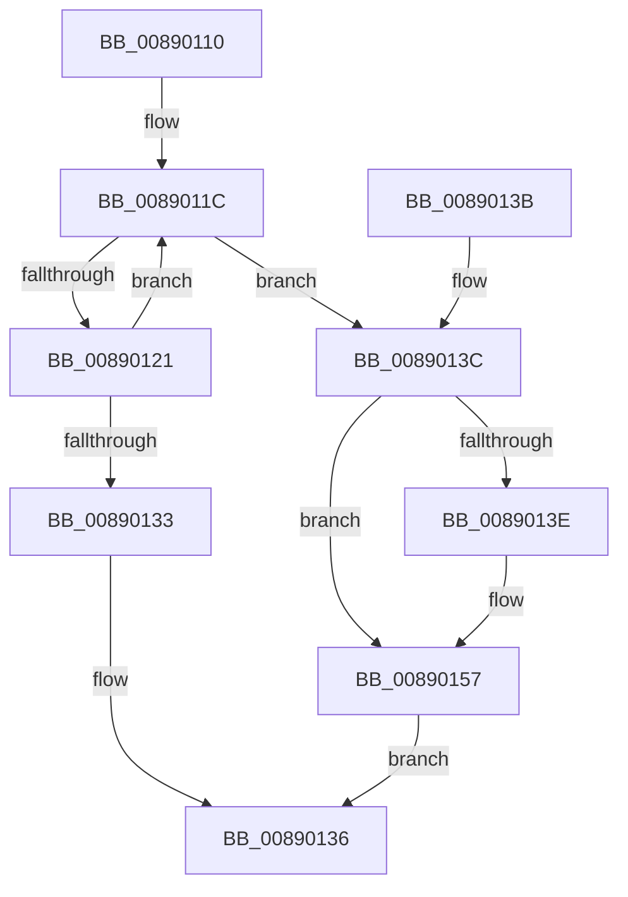

# AlpcpReferenceBlob

- RVA: `0x00890110`–`0x0089015B` (길이 `75` bytes)
- VA: `0x0000000140890110`
- 실행 섹션: `PAGE`
- PDB 이름 있음: `예`; PDB Function 태그: `아니요`
- unwind 정보 RVA: `0x0007D698`
- 디코드: `24`개 명령, `75/75` bytes 표시
- 미해석 바이트: `0` (있으면 어셈블리에 `.byte`로 보존)

> 이 문서는 커널 이미지의 기계어와 PDB 기호를 분석해 생성했습니다. 4번과 5번은 함수 원형과 자료형을 바이너리 사용 방식에서 추정한 C 해석이며 원본 소스 복구 결과는 아닙니다.

## 1. Dependencies

- 직접 호출 지점: **1**; 고유 호출 대상: **1**
- 직접 호출자로 확인된 함수: **21**
- RIP 상대 이미지 참조: **0**

### Outgoing calls
- `0x00890151` → [KeBugCheckEx](../../text/4F/KeBugCheckEx_function_004FD660.md) (function, `0x004FD660`)

### Direct callers
- [AlpcpLocateSectionView](../88/AlpcpLocateSectionView_function_00889754.md) at `0x00889896`
- [sub_00889BDC](../88/Unknown_function_00889BDC.md) at `0x00889BE6`
- [AlpcpCreateView](../88/AlpcpCreateView_function_0088A9B8.md) at `0x0088ABD7`
- [AlpcpCreateView](../88/AlpcpCreateView_function_0088A9B8.md) at `0x0088AC24`
- [AlpcpExposeViewAttributeInSenderContext](../88/AlpcpExposeViewAttributeInSenderContext_function_0088F600.md) at `0x0088F6BD`
- [AlpcpViewSearchCallbackFunction](AlpcpViewSearchCallbackFunction_function_008904F4.md) at `0x0089051B`
- [AlpcpCreateSecurityContext](AlpcpCreateSecurityContext_function_00890D94.md) at `0x00890FC5`
- [AlpcpCreateReserve](AlpcpCreateReserve_function_00892318.md) at `0x0089242D`
- [AlpcpCreateReserve](AlpcpCreateReserve_function_00892318.md) at `0x008924B8`
- [AlpcpCreateSection](AlpcpCreateSection_function_0089307C.md) at `0x008931F6`
- [AlpcpCreateRegion](AlpcpCreateRegion_function_008933B0.md) at `0x008934B5`
- [sub_008968C3](Unknown_function_008968C3.md) at `0x00896931`
- [AlpcpFormatConnectionRequest](../92/AlpcpFormatConnectionRequest_function_00922A40.md) at `0x00922C0C`
- [AlpcpCancelMessagesByRequestor](../92/AlpcpCancelMessagesByRequestor_function_00924170.md) at `0x0092429B`
- [AlpcpFlushResourcesPort](../92/AlpcpFlushResourcesPort_function_009253F4.md) at `0x009254AC`
- [AlpcpFlushMessagesPort](../92/AlpcpFlushMessagesPort_function_00925554.md) at `0x009257F4`
- [AlpcpFlushMessagesPort](../92/AlpcpFlushMessagesPort_function_00925554.md) at `0x00925877`
- [AlpcpFlushMessagesPort](../92/AlpcpFlushMessagesPort_function_00925554.md) at `0x009258C7`
- [AlpcpFlushMessagesPort](../92/AlpcpFlushMessagesPort_function_00925554.md) at `0x00925917`
- [AlpcpFlushMessagesPort](../92/AlpcpFlushMessagesPort_function_00925554.md) at `0x00925BF1`
- [AlpcpFlushMessagesPort](../92/AlpcpFlushMessagesPort_function_00925554.md) at `0x00925C3F`
- [AlpcpFlushMessagesPort](../92/AlpcpFlushMessagesPort_function_00925554.md) at `0x00925C89`
- [AlpcpAcceptConnectPort](../A3/AlpcpAcceptConnectPort_function_00A34290.md) at `0x00A349AE`
- [AlpcpFlushMessagesByRequestor](../A3/AlpcpFlushMessagesByRequestor_function_00A352F0.md) at `0x00A35412`
- [AlpcpReferenceMessageByWaitingThreadPortQueue](../A4/AlpcpReferenceMessageByWaitingThreadPortQueue_function_00A481B0.md) at `0x00A481EE`
- [sub_00B191AC](../B1/Unknown_function_00B191AC.md) at `0x00B191D8`
- [sub_00B19294](../B1/Unknown_function_00B19294.md) at `0x00B192A2`
- [sub_00B19294](../B1/Unknown_function_00B19294.md) at `0x00B19370`
- [sub_00B197CC](../B1/Unknown_function_00B197CC.md) at `0x00B19835`
- [sub_00B20EEE](../B2/Unknown_function_00B20EEE.md) at `0x00B20F23`

### Static image references
- 디코드된 RIP-relative 메모리 참조가 없습니다.

## 2. Other-region calls and transfers

- 다른 실행 섹션으로 향하는 call: **1**
  - `0x00890151` → [KeBugCheckEx](../../text/4F/KeBugCheckEx_function_004FD660.md) (`PAGE` → `.text`)
- 별도 외부 분기/꼬리 이동을 확인하지 못했습니다.

## 3. Assembly (complete function range)

```asm
00890110  48 83 EC 38                     sub rsp, 0x38
00890114  0F 0D 49 E8                     prefetchw byte ptr [rcx - 0x18]
00890118  48 8B 41 E8                     mov rax, qword ptr [rcx - 0x18]
0089011C  48 85 C0                        test rax, rax
0089011F  7E 1B                           jle 0x14089013c
00890121  4C 8B C0                        mov r8, rax
00890124  48 8D 50 01                     lea rdx, [rax + 1]
00890128  F0 48 0F B1 51 E8               lock cmpxchg qword ptr [rcx - 0x18], rdx
0089012E  49 3B C0                        cmp rax, r8
00890131  75 E9                           jne 0x14089011c
00890133  48 FF C0                        inc rax
00890136  48 83 C4 38                     add rsp, 0x38
0089013A  C3                              ret
0089013B  CC                              int3
0089013C  74 19                           je 0x140890157
0089013E  33 D2                           xor edx, edx
00890140  48 89 44 24 20                  mov qword ptr [rsp + 0x20], rax
00890145  4C 8B C1                        mov r8, rcx
00890148  41 B9 20 00 00 00               mov r9d, 0x20
0089014E  8D 4A 18                        lea ecx, [rdx + 0x18]
00890151  E8 0A D5 C6 FF                  call 0x1404fd660
00890156  CC                              int3
00890157  33 C0                           xor eax, eax
00890159  EB DB                           jmp 0x140890136
```

## 4. C-style interpretation (structured pseudocode)

```c
__int64 __fastcall AlpcpReferenceBlob(__int64 a1)
{
    __int64 result;
    __int64 v_rsp;
    unsigned __int64 v_stack_p20;

    v_rsp = (v_rsp) - (56);
loc_0089011C:
    if (condition_is_less_or_equal) goto loc_0089013C;
    if ((*(unsigned __int64 *)(a1 - 24)) != (*(unsigned __int64 *)(a1 - 24))) goto loc_0089011C;
    result = (*(unsigned __int64 *)(a1 - 24)) + 1;
loc_00890136:
    v_rsp = (v_rsp) + (56);
    return result;
loc_0089013C:
    if (!(condition_is_equal)) {
        a2 = 0;
        v_stack_p20 = result;
        a3 = a1;
        a4 = 32;
        a1 = a2 + 24;
        result = KeBugCheckEx(a1, a2, a3, a4);
    }
    result = 0;
    goto loc_00890136;
}
```

## 5. (Beta) C Style

```c
int64_t AlpcpReferenceBlob(void *Arg1)
{
    uint8_t *arg1 = (uint8_t *)Arg1;

    int64_t result;
    int64_t local_rsp;
    uint64_t v_stack_p20;

    local_rsp = (local_rsp) - (56);
loc_0089011C:
    if (condition_is_less_or_equal) goto loc_0089013C;
    if ((*(uint64_t *)(arg1 - 0x18)) != (*(uint64_t *)(arg1 - 0x18))) goto loc_0089011C;
    result = (*(uint64_t *)(arg1 - 0x18)) + 1;
loc_00890136:
    local_rsp = (local_rsp) + (56);
    return result;
loc_0089013C:
    if (!(condition_is_equal)) {
        a2 = 0;
        v_stack_p20 = result;
        a3 = Arg1;
        a4 = 32;
        Arg1 = a2 + 24;
        result = KeBugCheckEx(Arg1, a2, a3, a4);
    }
    result = 0;
    goto loc_00890136;
}
```

### 관측된 메모리 오프셋

구조체 형식이 확인되지 않은 접근은 인자 기준의 오프셋으로만 기록했습니다.

| 기준 인자 | 오프셋 표현 | 폭 (bit) | 접근 |
|---|---:|---:|---|
| `Arg1` | `- 0x18` | `8` | `R` |
| `Arg1` | `- 0x18` | `64` | `R` |

## 6. Execution-region graph

[열기: 2D/3D 그래프와 함수 탐색 컨트롤 패널](../../../control-panel.html?section=page&rva=0x00890110&view=graph)

- 2D 그래프는 위에서 아래로 흐르고, 3D 그래프는 빈 공간을 드래그해 회전합니다. Shift+드래그는 이동, 휠은 확대·축소, 함수 노드 선택은 대상 보고서 이동입니다.

### Static fallback


