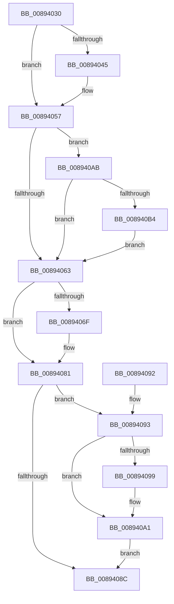

# AlpcpReleaseMessageAttributesOnCancel

- RVA: `0x00894030`–`0x008940C9` (길이 `153` bytes)
- VA: `0x0000000140894030`
- 실행 섹션: `PAGE`
- PDB 이름 있음: `예`; PDB Function 태그: `아니요`
- unwind 정보 RVA: `0x0007DF88`
- 디코드: `39`개 명령, `153/153` bytes 표시
- 미해석 바이트: `0` (있으면 어셈블리에 `.byte`로 보존)

> 이 문서는 커널 이미지의 기계어와 PDB 기호를 분석해 생성했습니다. 4번과 5번은 함수 원형과 자료형을 바이너리 사용 방식에서 추정한 C 해석이며 원본 소스 복구 결과는 아닙니다.

## 1. Dependencies

- 직접 호출 지점: **4**; 고유 호출 대상: **3**
- 직접 호출자로 확인된 함수: **2**
- RIP 상대 이미지 참조: **0**

### Outgoing calls
- `0x0089404A` → [AlpcpDereferenceBlobEx](../88/AlpcpDereferenceBlobEx_function_0088AF00.md) (function, `0x0088AF00`)
- `0x00894074` → [AlpcpDereferenceBlobEx](../88/AlpcpDereferenceBlobEx_function_0088AF00.md) (function, `0x0088AF00`)
- `0x0089409C` → [AlpcpReleaseDirectAttribute](../../text/47/AlpcpReleaseDirectAttribute_function_00474804.md) (function, `0x00474804`)
- `0x008940BA` → [AlpcpReleaseViewAttribute](../A6/AlpcpReleaseViewAttribute_function_00A63A80.md) (function, `0x00A63A80`)

### Direct callers
- [AlpcpCancelMessage](AlpcpCancelMessage_function_00894120.md) at `0x00894352`
- [sub_00B22892](../B2/Unknown_function_00B22892.md) at `0x00B22AEB`

### Static image references
- 디코드된 RIP-relative 메모리 참조가 없습니다.

## 2. Other-region calls and transfers

- 다른 실행 섹션으로 향하는 call: **1**
  - `0x0089409C` → [AlpcpReleaseDirectAttribute](../../text/47/AlpcpReleaseDirectAttribute_function_00474804.md) (`PAGE` → `.text`)
- 별도 외부 분기/꼬리 이동을 확인하지 못했습니다.

## 3. Assembly (complete function range)

```asm
00894030  40 53                           push rbx
00894032  48 83 EC 20                     sub rsp, 0x20
00894036  48 8B D9                        mov rbx, rcx
00894039  48 8B 89 88 00 00 00            mov rcx, qword ptr [rcx + 0x88]
00894040  48 85 C9                        test rcx, rcx
00894043  74 12                           je 0x140894057
00894045  BA 01 00 00 00                  mov edx, 1
0089404A  E8 B1 6E FF FF                  call 0x14088af00
0089404F  48 83 A3 88 00 00 00 00         and qword ptr [rbx + 0x88], 0
00894057  48 8B 8B 90 00 00 00            mov rcx, qword ptr [rbx + 0x90]
0089405E  48 85 C9                        test rcx, rcx
00894061  75 48                           jne 0x1408940ab
00894063  48 8B 8B 98 00 00 00            mov rcx, qword ptr [rbx + 0x98]
0089406A  48 85 C9                        test rcx, rcx
0089406D  74 12                           je 0x140894081
0089406F  BA 01 00 00 00                  mov edx, 1
00894074  E8 87 6E FF FF                  call 0x14088af00
00894079  48 83 A3 98 00 00 00 00         and qword ptr [rbx + 0x98], 0
00894081  48 8B 83 A0 00 00 00            mov rax, qword ptr [rbx + 0xa0]
00894088  A8 01                           test al, 1
0089408A  75 07                           jne 0x140894093
0089408C  48 83 C4 20                     add rsp, 0x20
00894090  5B                              pop rbx
00894091  C3                              ret
00894092  CC                              int3
00894093  48 83 F8 04                     cmp rax, 4
00894097  72 08                           jb 0x1408940a1
00894099  48 8B C8                        mov rcx, rax
0089409C  E8 63 07 BE FF                  call 0x140474804
008940A1  48 83 A3 A0 00 00 00 00         and qword ptr [rbx + 0xa0], 0
008940A9  EB E1                           jmp 0x14089408c
008940AB  8B 53 28                        mov edx, dword ptr [rbx + 0x28]
008940AE  0F BA E2 0E                     bt edx, 0xe
008940B2  72 AF                           jb 0x140894063
008940B4  C1 EA 0F                        shr edx, 0xf
008940B7  83 E2 01                        and edx, 1
008940BA  E8 C1 F9 1C 00                  call 0x140a63a80
008940BF  48 83 A3 90 00 00 00 00         and qword ptr [rbx + 0x90], 0
008940C7  EB 9A                           jmp 0x140894063
```

## 4. C-style interpretation (structured pseudocode)

```c
__int64 __fastcall AlpcpReleaseMessageAttributesOnCancel(__int64 a1)
{
    __int64 result;
    __int64 v_rsp;

    v_rsp = (v_rsp) - (32);
    if (*(unsigned __int64 *)(a1 + 136) != 0) {
        a2 = 1;
        result = AlpcpDereferenceBlobEx(*(unsigned __int64 *)(a1 + 136), a2, a3, a4);
    }
    if (*(unsigned __int64 *)(a1 + 144) != 0) goto loc_008940AB;
loc_00894063:
    if (*(unsigned __int64 *)(a1 + 152) != 0) {
        a2 = 1;
        result = AlpcpDereferenceBlobEx(*(unsigned __int64 *)(a1 + 152), a2, a3, a4);
    }
    if ((((unsigned __int8)(*(unsigned __int64 *)(a1 + 160))) & (1)) != 0) goto loc_00894093;
loc_0089408C:
    v_rsp = (v_rsp) + (32);
    return *(unsigned __int64 *)(a1 + 160);
loc_00894093:
    result = *(unsigned __int64 *)(a1 + 160);
    if ((*(unsigned __int64 *)(a1 + 160)) >= 4) {
        a1 = *(unsigned __int64 *)(a1 + 160);
        result = AlpcpReleaseDirectAttribute(a1, a2, a3, a4);
    }
    goto loc_0089408C;
loc_008940AB:
    if ((*(unsigned __int64 *)(a1 + 160)) < 4) goto loc_00894063;
    a2 = (unsigned int)(((unsigned int)(*(unsigned int *)(a1 + 40))) >> (15));
    a2 = (unsigned int)((a2) & (1));
    result = AlpcpReleaseViewAttribute(a1, a2, a3, a4);
    goto loc_00894063;
}
```

## 5. (Beta) C Style

```c
int64_t AlpcpReleaseMessageAttributesOnCancel(void *Arg1)
{
    uint8_t *arg1 = (uint8_t *)Arg1;

    int64_t result;
    int64_t local_rsp;

    local_rsp = (local_rsp) - (32);
    if (*(uint64_t *)(arg1 + 0x88) != 0) {
        a2 = 1;
        result = AlpcpDereferenceBlobEx(*(uint64_t *)(arg1 + 0x88), a2, a3, a4);
    }
    if (*(uint64_t *)(arg1 + 0x90) != 0) goto loc_008940AB;
loc_00894063:
    if (*(uint64_t *)(arg1 + 0x98) != 0) {
        a2 = 1;
        result = AlpcpDereferenceBlobEx(*(uint64_t *)(arg1 + 0x98), a2, a3, a4);
    }
    if ((((uint8_t)(*(uint64_t *)(arg1 + 0xA0))) & (1)) != 0) goto loc_00894093;
loc_0089408C:
    local_rsp = (local_rsp) + (32);
    return *(uint64_t *)(arg1 + 0xA0);
loc_00894093:
    result = *(uint64_t *)(arg1 + 0xA0);
    if ((*(uint64_t *)(arg1 + 0xA0)) >= 4) {
        Arg1 = *(uint64_t *)(arg1 + 0xA0);
        result = AlpcpReleaseDirectAttribute(Arg1, a2, a3, a4);
    }
    goto loc_0089408C;
loc_008940AB:
    if ((*(uint64_t *)(arg1 + 0xA0)) < 4) goto loc_00894063;
    a2 = (uint32_t)(((uint32_t)(*(uint32_t *)(arg1 + 0x28))) >> (15));
    a2 = (uint32_t)((a2) & (1));
    result = AlpcpReleaseViewAttribute(Arg1, a2, a3, a4);
    goto loc_00894063;
}
```

### 관측된 메모리 오프셋

구조체 형식이 확인되지 않은 접근은 인자 기준의 오프셋으로만 기록했습니다.

| 기준 인자 | 오프셋 표현 | 폭 (bit) | 접근 |
|---|---:|---:|---|
| `Arg1` | `+ 0x28` | `32` | `R` |
| `Arg1` | `+ 0x88` | `64` | `R` |
| `Arg1` | `+ 0x88` | `64` | `R/W` |
| `Arg1` | `+ 0x90` | `64` | `R` |
| `Arg1` | `+ 0x90` | `64` | `R/W` |
| `Arg1` | `+ 0x98` | `64` | `R` |
| `Arg1` | `+ 0x98` | `64` | `R/W` |
| `Arg1` | `+ 0xA0` | `64` | `R` |
| `Arg1` | `+ 0xA0` | `64` | `R/W` |

## 6. Execution-region graph

[열기: 2D/3D 그래프와 함수 탐색 컨트롤 패널](../../../control-panel.html?section=page&rva=0x00894030&view=graph)

- 2D 그래프는 위에서 아래로 흐르고, 3D 그래프는 빈 공간을 드래그해 회전합니다. Shift+드래그는 이동, 휠은 확대·축소, 함수 노드 선택은 대상 보고서 이동입니다.

### Static fallback


