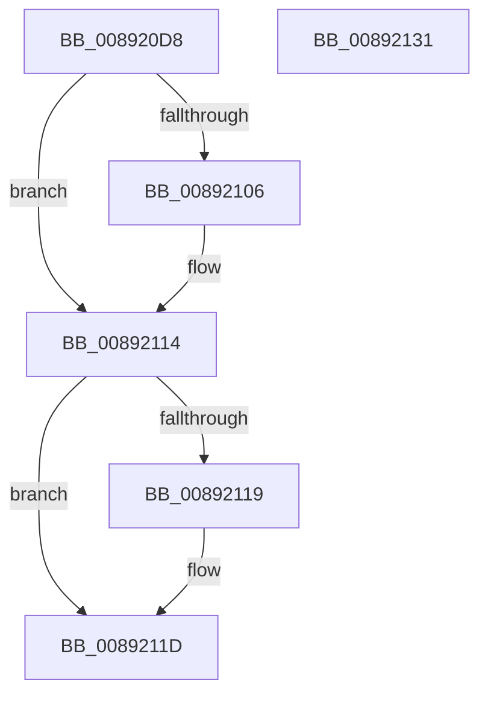

# AlpcpStartInitialization

- RVA: `0x008920D8`–`0x00892132` (길이 `90` bytes)
- VA: `0x00000001408920D8`
- 실행 섹션: `PAGE`
- PDB 이름 있음: `예`; PDB Function 태그: `아니요`
- unwind 정보 RVA: `0x00060BC4`
- 디코드: `27`개 명령, `90/90` bytes 표시
- 미해석 바이트: `0` (있으면 어셈블리에 `.byte`로 보존)

> 이 문서는 커널 이미지의 기계어와 PDB 기호를 분석해 생성했습니다. 4번과 5번은 함수 원형과 자료형을 바이너리 사용 방식에서 추정한 C 해석이며 원본 소스 복구 결과는 아닙니다.

## 1. Dependencies

- 직접 호출 지점: **2**; 고유 호출 대상: **2**
- 직접 호출자로 확인된 함수: **3**
- RIP 상대 이미지 참조: **0**

### Outgoing calls
- `0x008920F6` → [KeAbPreAcquire](../../text/21/KeAbPreAcquire_function_00210230.md) (function, `0x00210230`)
- `0x0089210F` → [ExfAcquirePushLockExclusiveEx](../../text/20/ExfAcquirePushLockExclusiveEx_function_0020FC90.md) (function, `0x0020FC90`)

### Direct callers
- [AlpcpCreateSecurityContext](AlpcpCreateSecurityContext_function_00890D94.md) at `0x00890FBD`
- [AlpcpCreateReserve](AlpcpCreateReserve_function_00892318.md) at `0x008924C0`
- [AlpcpCreateSection](AlpcpCreateSection_function_0089307C.md) at `0x008931EE`

### Static image references
- 디코드된 RIP-relative 메모리 참조가 없습니다.

## 2. Other-region calls and transfers

- 다른 실행 섹션으로 향하는 call: **2**
  - `0x008920F6` → [KeAbPreAcquire](../../text/21/KeAbPreAcquire_function_00210230.md) (`PAGE` → `.text`)
  - `0x0089210F` → [ExfAcquirePushLockExclusiveEx](../../text/20/ExfAcquirePushLockExclusiveEx_function_0020FC90.md) (`PAGE` → `.text`)
- 별도 외부 분기/꼬리 이동을 확인하지 못했습니다.

## 3. Assembly (complete function range)

```asm
008920D8  48 89 5C 24 08                  mov qword ptr [rsp + 8], rbx
008920DD  48 89 74 24 10                  mov qword ptr [rsp + 0x10], rsi
008920E2  57                              push rdi
008920E3  48 83 EC 20                     sub rsp, 0x20
008920E7  48 8D 79 F0                     lea rdi, [rcx - 0x10]
008920EB  48 8B F1                        mov rsi, rcx
008920EE  48 8B CF                        mov rcx, rdi
008920F1  45 33 C0                        xor r8d, r8d
008920F4  33 D2                           xor edx, edx
008920F6  E8 35 E1 97 FF                  call 0x140210230
008920FB  F0 48 0F BA 2F 00               lock bts qword ptr [rdi], 0
00892101  48 8B D8                        mov rbx, rax
00892104  73 0E                           jae 0x140892114
00892106  4C 8B C7                        mov r8, rdi
00892109  48 8B D0                        mov rdx, rax
0089210C  48 8B CF                        mov rcx, rdi
0089210F  E8 7C DB 97 FF                  call 0x14020fc90
00892114  48 85 DB                        test rbx, rbx
00892117  74 04                           je 0x14089211d
00892119  C6 43 0A 01                     mov byte ptr [rbx + 0xa], 1
0089211D  80 4E E0 04                     or byte ptr [rsi - 0x20], 4
00892121  48 8B 74 24 38                  mov rsi, qword ptr [rsp + 0x38]
00892126  48 8B 5C 24 30                  mov rbx, qword ptr [rsp + 0x30]
0089212B  48 83 C4 20                     add rsp, 0x20
0089212F  5F                              pop rdi
00892130  C3                              ret
00892131  CC                              int3
```

## 4. C-style interpretation (structured pseudocode)

```c
__int64 __fastcall AlpcpStartInitialization(__int64 a1, int a2, int a3)
{
    __int64 result;
    __int64 v_rsp;
    unsigned __int64 v_stack_p10;
    unsigned __int64 v_stack_p8;

    v_stack_p8 = v_rbx;
    v_stack_p10 = v_rsi;
    v_rsp = (v_rsp) - (32);
    a3 = 0;
    a2 = 0;
    result = KeAbPreAcquire(a1 - 16, a2, a3, a4);
    if (!(condition_is_above_or_equal)) {
        a3 = a1 - 16;
        a2 = result;
        a1 = a1 - 16;
        result = ExfAcquirePushLockExclusiveEx(a1, a2, a3, a4);
    }
    if (result != 0) {
        *(unsigned __int8 *)(result + 10) = 1;
    }
    v_rsp = (v_rsp) + (32);
    return result;
}
```

## 5. (Beta) C Style

```c
int64_t AlpcpStartInitialization(void *Arg1, int32_t Arg2, int32_t Arg3)
{
    uint8_t *arg1 = (uint8_t *)Arg1;

    int64_t result;
    int64_t local_rsp;
    uint64_t v_stack_p10;
    uint64_t v_stack_p8;

    v_stack_p8 = local_rbx;
    v_stack_p10 = local_rsi;
    local_rsp = (local_rsp) - (32);
    Arg3 = 0;
    Arg2 = 0;
    result = KeAbPreAcquire(Arg1 - 16, Arg2, Arg3, a4);
    if (!(condition_is_above_or_equal)) {
        Arg3 = Arg1 - 16;
        Arg2 = result;
        Arg1 = Arg1 - 16;
        result = ExfAcquirePushLockExclusiveEx(Arg1, Arg2, Arg3, a4);
    }
    if (result != 0) {
        *(uint8_t *)(result + 0xA) = 1;
    }
    local_rsp = (local_rsp) + (32);
    return result;
}
```

### 관측된 메모리 오프셋

구조체 형식이 확인되지 않은 접근은 인자 기준의 오프셋으로만 기록했습니다.

| 기준 인자 | 오프셋 표현 | 폭 (bit) | 접근 |
|---|---:|---:|---|
| `Arg1` | `- 0x20` | `8` | `R/W` |
| `Arg1` | `- 0x10` | `64` | `R` |
| `Arg1` | `+ 0x0` | `64` | `R/W` |

## 6. Execution-region graph

[열기: 2D/3D 그래프와 함수 탐색 컨트롤 패널](../../../control-panel.html?section=page&rva=0x008920D8&view=graph)

- 2D 그래프는 위에서 아래로 흐르고, 3D 그래프는 빈 공간을 드래그해 회전합니다. Shift+드래그는 이동, 휠은 확대·축소, 함수 노드 선택은 대상 보고서 이동입니다.

### Static fallback


