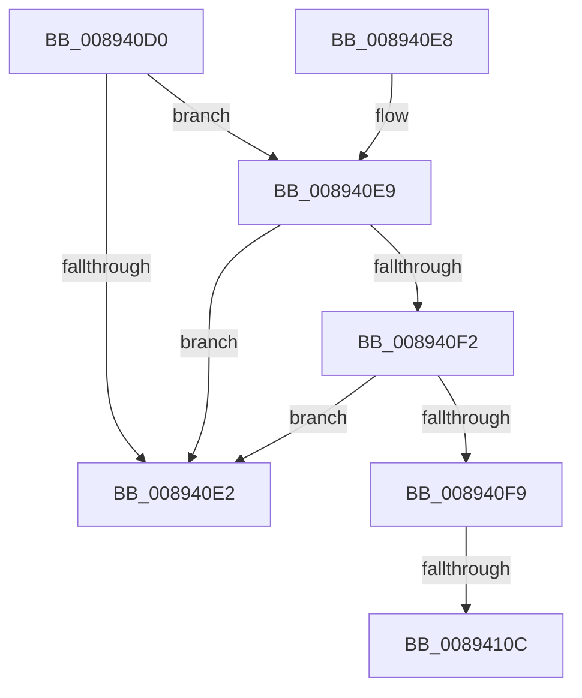

# AlpcpTransferQuotaMessage

- RVA: `0x008940D0`–`0x00894118` (길이 `72` bytes)
- VA: `0x00000001408940D0`
- 실행 섹션: `PAGE`
- PDB 이름 있음: `예`; PDB Function 태그: `예`
- unwind 정보 RVA: `0x0007DF94`
- 디코드: `19`개 명령, `72/72` bytes 표시
- 미해석 바이트: `0` (있으면 어셈블리에 `.byte`로 보존)

> 이 문서는 커널 이미지의 기계어와 PDB 기호를 분석해 생성했습니다. 4번과 5번은 함수 원형과 자료형을 바이너리 사용 방식에서 추정한 C 해석이며 원본 소스 복구 결과는 아닙니다.

## 1. Dependencies

- 직접 호출 지점: **0**; 고유 호출 대상: **0**
- 직접 호출자로 확인된 함수: **2**
- RIP 상대 이미지 참조: **0**

### Outgoing calls
- 직접 디코드된 call 명령이 없습니다.

### Direct callers
- [AlpcpCancelMessage](AlpcpCancelMessage_function_00894120.md) at `0x00894379`
- [sub_00B22892](../B2/Unknown_function_00B22892.md) at `0x00B22B0C`

### Static image references
- 디코드된 RIP-relative 메모리 참조가 없습니다.

## 2. Other-region calls and transfers

- 다른 실행 섹션으로 향하는 call: **0**
- call이 아닌 외부 분기/꼬리 이동: **2**
  - `0x00894106` → [sub_00B19664](../B1/Unknown_function_00B19664.md) (`tail-transfer`)
  - `0x00894113` → [sub_00B19664](../B1/Unknown_function_00B19664.md) (`tail-transfer`)

## 3. Assembly (complete function range)

```asm
008940D0  40 53                           push rbx
008940D2  48 83 EC 20                     sub rsp, 0x20
008940D6  48 8B D9                        mov rbx, rcx
008940D9  48 8B 49 30                     mov rcx, qword ptr [rcx + 0x30]
008940DD  48 85 C9                        test rcx, rcx
008940E0  75 07                           jne 0x1408940e9
008940E2  48 83 C4 20                     add rsp, 0x20
008940E6  5B                              pop rbx
008940E7  C3                              ret
008940E8  CC                              int3
008940E9  F7 43 28 00 04 00 00            test dword ptr [rbx + 0x28], 0x400
008940F0  75 F0                           jne 0x1408940e2
008940F2  48 83 7B 60 00                  cmp qword ptr [rbx + 0x60], 0
008940F7  75 E9                           jne 0x1408940e2
008940F9  48 83 BB E0 00 00 00 00         cmp qword ptr [rbx + 0xe0], 0
00894101  BA 18 03 00 00                  mov edx, 0x318
00894106  0F 84 58 55 28 00               je 0x140b19664
0089410C  48 03 93 E8 00 00 00            add rdx, qword ptr [rbx + 0xe8]
00894113  E9 4C 55 28 00                  jmp 0x140b19664
```

## 4. C-style interpretation (structured pseudocode)

```c
void __fastcall AlpcpTransferQuotaMessage(__int64 a1)
{
    __int64 v_rsp;

    v_rsp = (v_rsp) - (32);
    if (*(unsigned __int64 *)(a1 + 48) != 0) goto loc_008940E9;
loc_008940E2:
    v_rsp = (v_rsp) + (32);
    return;
loc_008940E9:
    if (((*(unsigned int *)(a1 + 40)) & (0x400ULL)) != 0) goto loc_008940E2;
    if ((*(unsigned __int64 *)(a1 + 96)) != 0) goto loc_008940E2;
    a2 = (792) + (*(unsigned __int64 *)(a1 + 232));
}
```

## 5. (Beta) C Style

```c
void AlpcpTransferQuotaMessage(void *Arg1)
{
    uint8_t *arg1 = (uint8_t *)Arg1;

    int64_t local_rsp;

    local_rsp = (local_rsp) - (32);
    if (*(uint64_t *)(arg1 + 0x30) != 0) goto loc_008940E9;
loc_008940E2:
    local_rsp = (local_rsp) + (32);
    return;
loc_008940E9:
    if (((*(uint32_t *)(arg1 + 0x28)) & (0x400ULL)) != 0) goto loc_008940E2;
    if ((*(uint64_t *)(arg1 + 0x60)) != 0) goto loc_008940E2;
    a2 = (792) + (*(uint64_t *)(arg1 + 0xE8));
}
```

### 관측된 메모리 오프셋

구조체 형식이 확인되지 않은 접근은 인자 기준의 오프셋으로만 기록했습니다.

| 기준 인자 | 오프셋 표현 | 폭 (bit) | 접근 |
|---|---:|---:|---|
| `Arg1` | `+ 0x28` | `32` | `R` |
| `Arg1` | `+ 0x30` | `64` | `R` |
| `Arg1` | `+ 0x60` | `64` | `R` |
| `Arg1` | `+ 0xE0` | `64` | `R` |
| `Arg1` | `+ 0xE8` | `64` | `R` |

## 6. Execution-region graph

[열기: 2D/3D 그래프와 함수 탐색 컨트롤 패널](../../../control-panel.html?section=page&rva=0x008940D0&view=graph)

- 2D 그래프는 위에서 아래로 흐르고, 3D 그래프는 빈 공간을 드래그해 회전합니다. Shift+드래그는 이동, 휠은 확대·축소, 함수 노드 선택은 대상 보고서 이동입니다.

### Static fallback


