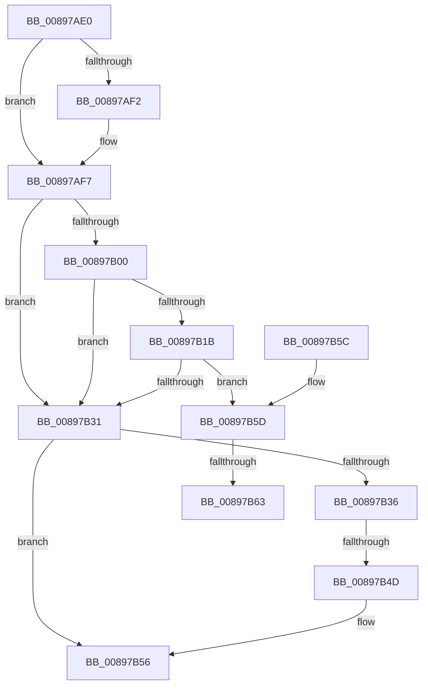

# AlpcpUnlockMessage

- RVA: `0x00897AE0`–`0x00897B6E` (길이 `142` bytes)
- VA: `0x0000000140897AE0`
- 실행 섹션: `PAGE`
- PDB 이름 있음: `예`; PDB Function 태그: `아니요`
- unwind 정보 RVA: `0x0007E2DC`
- 디코드: `41`개 명령, `142/142` bytes 표시
- 미해석 바이트: `0` (있으면 어셈블리에 `.byte`로 보존)

> 이 문서는 커널 이미지의 기계어와 PDB 기호를 분석해 생성했습니다. 4번과 5번은 함수 원형과 자료형을 바이너리 사용 방식에서 추정한 C 해석이며 원본 소스 복구 결과는 아닙니다.

## 1. Dependencies

- 직접 호출 지점: **2**; 고유 호출 대상: **2**
- 직접 호출자로 확인된 함수: **42**
- RIP 상대 이미지 참조: **2**

### Outgoing calls
- `0x00897AF2` → [AlpcpEnterStateChangeEventMessageLog](AlpcpEnterStateChangeEventMessageLog_function_00897CF8.md) (function, `0x00897CF8`)
- `0x00897B51` → [KeAbPostRelease](../../text/2E/KeAbPostRelease_function_002E1600.md) (function, `0x002E1600`)

### Direct callers
- [NtAlpcImpersonateClientContainerOfPort](../74/NtAlpcImpersonateClientContainerOfPort_function_0074C1B0.md) at `0x0074C2D7`
- [NtAlpcImpersonateClientContainerOfPort](../74/NtAlpcImpersonateClientContainerOfPort_function_0074C1B0.md) at `0x0074C3B0`
- [AlpcpPortQueryServerInfo](../74/AlpcpPortQueryServerInfo_function_0074C784.md) at `0x0074C905`
- [AlpcpPortQueryServerInfo](../74/AlpcpPortQueryServerInfo_function_0074C784.md) at `0x0074CAB5`
- [AlpcReserveDestroyProcedure](../88/AlpcReserveDestroyProcedure_function_00888230.md) at `0x0088825B`
- [AlpcpSendMessage](../88/AlpcpSendMessage_function_0088BD40.md) at `0x0088C272`
- [AlpcpSendMessage](../88/AlpcpSendMessage_function_0088BD40.md) at `0x0088C84B`
- [AlpcpSendMessage](../88/AlpcpSendMessage_function_0088BD40.md) at `0x0088CAF2`
- [AlpcpSendMessage](../88/AlpcpSendMessage_function_0088BD40.md) at `0x0088CB05`
- [AlpcpSendMessage](../88/AlpcpSendMessage_function_0088BD40.md) at `0x0088CBF0`
- [AlpcpSendMessage](../88/AlpcpSendMessage_function_0088BD40.md) at `0x0088CCF0`
- [sub_0088DAFD](../88/Unknown_function_0088DAFD.md) at `0x0088DB13`
- [sub_0088DAFD](../88/Unknown_function_0088DAFD.md) at `0x0088DB55`
- [sub_0088DAFD](../88/Unknown_function_0088DAFD.md) at `0x0088DBC0`
- [AlpcpDispatchNewMessage](../88/AlpcpDispatchNewMessage_function_0088DD20.md) at `0x0088E08B`
- [AlpcpDispatchNewMessage](../88/AlpcpDispatchNewMessage_function_0088DD20.md) at `0x0088E0AB`
- [AlpcpDispatchNewMessage](../88/AlpcpDispatchNewMessage_function_0088DD20.md) at `0x0088E0E8`
- [AlpcpDispatchNewMessage](../88/AlpcpDispatchNewMessage_function_0088DD20.md) at `0x0088E118`
- [sub_0088E1DC](../88/Unknown_function_0088E1DC.md) at `0x0088E4FD`
- [sub_0088E1DC](../88/Unknown_function_0088E1DC.md) at `0x0088E6DB`
- [sub_0088EC77](../88/Unknown_function_0088EC77.md) at `0x0088EEDB`
- [AlpcpDispatchReplyToPort](../88/AlpcpDispatchReplyToPort_function_0088F880.md) at `0x0088FC84`
- [AlpcpCreateReserve](AlpcpCreateReserve_function_00892318.md) at `0x00892435`
- [AlpcpCancelMessage](AlpcpCancelMessage_function_00894120.md) at `0x0089440D`
- [NtAlpcQueryInformationMessage](NtAlpcQueryInformationMessage_function_00894700.md) at `0x0089492C`
- [AlpcpReceiveDirectMessagePort](AlpcpReceiveDirectMessagePort_function_008950B4.md) at `0x008952C7`
- [AlpcpReceiveDirectMessagePort](AlpcpReceiveDirectMessagePort_function_008950B4.md) at `0x00895329`
- [NtAlpcOpenSenderProcess](NtAlpcOpenSenderProcess_function_008953B0.md) at `0x008955F2`
- [NtAlpcOpenSenderProcess](NtAlpcOpenSenderProcess_function_008953B0.md) at `0x00895773`
- [NtAlpcOpenSenderProcess](NtAlpcOpenSenderProcess_function_008953B0.md) at `0x008957A1`
- [NtAlpcOpenSenderProcess](NtAlpcOpenSenderProcess_function_008953B0.md) at `0x008957D9`
- [NtAlpcOpenSenderProcess](NtAlpcOpenSenderProcess_function_008953B0.md) at `0x008957FF`
- [NtAlpcOpenSenderProcess](NtAlpcOpenSenderProcess_function_008953B0.md) at `0x0089580C`
- [sub_00895B6D](Unknown_function_00895B6D.md) at `0x00895C8C`
- [sub_00895B6D](Unknown_function_00895B6D.md) at `0x00895D49`
- [sub_00895B6D](Unknown_function_00895B6D.md) at `0x00895D7E`
- [AlpcpReceiveLegacyMessage](AlpcpReceiveLegacyMessage_function_00895DE0.md) at `0x0089604C`
- [NtAlpcImpersonateClientOfPort](NtAlpcImpersonateClientOfPort_function_008961A0.md) at `0x00896501`
- [NtAlpcImpersonateClientOfPort](NtAlpcImpersonateClientOfPort_function_008961A0.md) at `0x008965CA`
- [NtAlpcImpersonateClientOfPort](NtAlpcImpersonateClientOfPort_function_008961A0.md) at `0x0089668D`
- [NtAlpcImpersonateClientOfPort](NtAlpcImpersonateClientOfPort_function_008961A0.md) at `0x008966F4`
- [AlpcpReceiveMessage](AlpcpReceiveMessage_function_00897ED0.md) at `0x00898460`
- [AlpcpReceiveLegacyConnectionReply](../92/AlpcpReceiveLegacyConnectionReply_function_00921CA0.md) at `0x00921E09`
- [AlpcpProcessSynchronousRequest](../92/AlpcpProcessSynchronousRequest_function_00921FCC.md) at `0x009222D9`
- [AlpcpReceiveSynchronousReply](../92/AlpcpReceiveSynchronousReply_function_009224F0.md) at `0x00922676`
- [AlpcpReceiveSynchronousReply](../92/AlpcpReceiveSynchronousReply_function_009224F0.md) at `0x009227AC`
- [AlpcpFormatConnectionRequest](../92/AlpcpFormatConnectionRequest_function_00922A40.md) at `0x00922BB2`
- [NtSecureConnectPort](../92/NtSecureConnectPort_function_00922F20.md) at `0x009234B2`
- [AlpcpSendLegacySynchronousRequest](../92/AlpcpSendLegacySynchronousRequest_function_0092376C.md) at `0x00923CE4`
- [AlpcpSendLegacySynchronousRequest](../92/AlpcpSendLegacySynchronousRequest_function_0092376C.md) at `0x00923DBF`
- [AlpcpCancelMessagesByRequestor](../92/AlpcpCancelMessagesByRequestor_function_00924170.md) at `0x009242BB`
- [AlpcpDisconnectPort](../92/AlpcpDisconnectPort_function_00924A68.md) at `0x00924D51`
- [AlpcpSendCloseMessage](../92/AlpcpSendCloseMessage_function_0092524C.md) at `0x00925353`
- [AlpcpFlushMessagesPort](../92/AlpcpFlushMessagesPort_function_00925554.md) at `0x00925B62`
- [AlpcpFlushMessagesPort](../92/AlpcpFlushMessagesPort_function_00925554.md) at `0x00925B6F`
- [AlpcpFlushMessagesPort](../92/AlpcpFlushMessagesPort_function_00925554.md) at `0x00925B7C`
- [AlpcpFlushMessagesPort](../92/AlpcpFlushMessagesPort_function_00925554.md) at `0x00925B89`
- [AlpcpFlushMessagesPort](../92/AlpcpFlushMessagesPort_function_00925554.md) at `0x00925CCF`
- [AlpcpFlushMessagesPort](../92/AlpcpFlushMessagesPort_function_00925554.md) at `0x00925CDC`
- [AlpcpFlushMessagesPort](../92/AlpcpFlushMessagesPort_function_00925554.md) at `0x00925CE9`
- [AlpcpProcessConnectionRequest](../92/AlpcpProcessConnectionRequest_function_00925FD4.md) at `0x0092638F`
- [AlpcpProcessConnectionRequest](../92/AlpcpProcessConnectionRequest_function_00925FD4.md) at `0x00926429`
- [AlpcpCreateClientPort](../92/AlpcpCreateClientPort_function_009270AC.md) at `0x0092740B`
- [NtAlpcOpenSenderThread](../9C/NtAlpcOpenSenderThread_function_009C5920.md) at `0x009C5AA9`
- [NtAlpcOpenSenderThread](../9C/NtAlpcOpenSenderThread_function_009C5920.md) at `0x009C5B28`
- [NtAlpcOpenSenderThread](../9C/NtAlpcOpenSenderThread_function_009C5920.md) at `0x009C5B88`
- [AlpcpReplyLegacySynchronousRequest](../9F/AlpcpReplyLegacySynchronousRequest_function_009F5CF0.md) at `0x009F602B`
- [AlpcpReplyLegacySynchronousRequest](../9F/AlpcpReplyLegacySynchronousRequest_function_009F5CF0.md) at `0x009F616A`
- [AlpcpReplyLegacySynchronousRequest](../9F/AlpcpReplyLegacySynchronousRequest_function_009F5CF0.md) at `0x009F61A3`
- [AlpcpAcceptConnectPort](../A3/AlpcpAcceptConnectPort_function_00A34290.md) at `0x00A34D14`
- [AlpcpFlushMessagesByRequestor](../A3/AlpcpFlushMessagesByRequestor_function_00A352F0.md) at `0x00A354CA`
- [NtAlpcCancelMessage](../A3/NtAlpcCancelMessage_function_00A3A860.md) at `0x00A3A9F4`
- [sub_00B19216](../B1/Unknown_function_00B19216.md) at `0x00B1926C`
- [sub_00B1973E](../B1/Unknown_function_00B1973E.md) at `0x00B19741`
- [sub_00B197CC](../B1/Unknown_function_00B197CC.md) at `0x00B199A2`
- [sub_00B197CC](../B1/Unknown_function_00B197CC.md) at `0x00B199D7`
- [sub_00B226A4](../B2/Unknown_function_00B226A4.md) at `0x00B226F5`
- [sub_00B22892](../B2/Unknown_function_00B22892.md) at `0x00B229E2`
- [sub_00B22892](../B2/Unknown_function_00B22892.md) at `0x00B22A3B`
- [sub_00B22892](../B2/Unknown_function_00B22892.md) at `0x00B22B5F`
- [sub_00B22BEA](../B2/Unknown_function_00B22BEA.md) at `0x00B22BED`
- [sub_00B3A304](../B3/Unknown_function_00B3A304.md) at `0x00B3A316`

### Static image references
- `0x00897AE6` → RVA `0x00F100D0` (`.data`; read)
- `0x00897B67` → RVA `0x0088BBA0` (`AlpcMessageCleanupProcedure`; read)

## 2. Other-region calls and transfers

- 다른 실행 섹션으로 향하는 call: **1**
  - `0x00897B51` → [KeAbPostRelease](../../text/2E/KeAbPostRelease_function_002E1600.md) (`PAGE` → `.text`)
- call이 아닌 외부 분기/꼬리 이동: **2**
  - `0x00897B47` → [sub_00897C92](Unknown_function_00897C92.md) (`tail-transfer`)
  - `0x00897B5D` → [sub_00897CD6](Unknown_function_00897CD6.md) (`tail-transfer`)

## 3. Assembly (complete function range)

```asm
00897AE0  40 53                           push rbx
00897AE2  48 83 EC 30                     sub rsp, 0x30
00897AE6  83 3D E3 85 67 00 00            cmp dword ptr [rip + 0x6785e3], 0
00897AED  48 8B D9                        mov rbx, rcx
00897AF0  74 05                           je 0x140897af7
00897AF2  E8 01 02 00 00                  call 0x140897cf8
00897AF7  0F B6 4B E0                     movzx ecx, byte ptr [rbx - 0x20]
00897AFB  F6 C1 01                        test cl, 1
00897AFE  74 31                           je 0x140897b31
00897B00  0F BF 43 E2                     movsx eax, word ptr [rbx - 0x1e]
00897B04  80 E1 FE                        and cl, 0xfe
00897B07  BA 00 00 01 00                  mov edx, 0x10000
00897B0C  88 4B E0                        mov byte ptr [rbx - 0x20], cl
00897B0F  2B D0                           sub edx, eax
00897B11  33 C0                           xor eax, eax
00897B13  66 89 43 E2                     mov word ptr [rbx - 0x1e], ax
00897B17  85 D2                           test edx, edx
00897B19  7E 16                           jle 0x140897b31
00897B1B  F7 DA                           neg edx
00897B1D  48 63 C2                        movsxd rax, edx
00897B20  48 8B C8                        mov rcx, rax
00897B23  F0 48 0F C1 4B E8               lock xadd qword ptr [rbx - 0x18], rcx
00897B29  48 03 C8                        add rcx, rax
00897B2C  48 85 C9                        test rcx, rcx
00897B2F  7E 2C                           jle 0x140897b5d
00897B31  48 85 DB                        test rbx, rbx
00897B34  74 20                           je 0x140897b56
00897B36  48 C7 C0 FF FF FF FF            mov rax, 0xffffffffffffffff
00897B3D  F0 48 0F C1 43 F0               lock xadd qword ptr [rbx - 0x10], rax
00897B43  24 06                           and al, 6
00897B45  3C 02                           cmp al, 2
00897B47  0F 84 45 01 00 00               je 0x140897c92
00897B4D  48 8D 4B F0                     lea rcx, [rbx - 0x10]
00897B51  E8 AA 9A A4 FF                  call 0x1402e1600
00897B56  48 83 C4 30                     add rsp, 0x30
00897B5A  5B                              pop rbx
00897B5B  C3                              ret
00897B5C  CC                              int3
00897B5D  0F 85 73 01 00 00               jne 0x140897cd6
00897B63  0F B6 43 E1                     movzx eax, byte ptr [rbx - 0x1f]
00897B67  48 8D 0D 32 40 FF FF            lea rcx, [rip - 0xbfce]
```

## 4. C-style interpretation (structured pseudocode)

```c
__int64 __fastcall AlpcpUnlockMessage(__int64 a1)
{
    __int64 result;
    __int64 v_rsp;

    v_rsp = (v_rsp) - (48);
    if ((*(unsigned int *)(v_rip + 6784483)) != 0) {
        result = AlpcpEnterStateChangeEventMessageLog(a1, a2, a3, a4);
    }
    if ((((unsigned __int8)(*(unsigned __int8 *)(a1 - 32))) & (1)) == 0) goto loc_00897B31;
    a1 = (unsigned __int8)((*(unsigned __int8 *)(a1 - 32)) & (254));
    *(unsigned __int8 *)(a1 - 32) = (unsigned __int8)(a1);
    a2 = (unsigned int)(((unsigned int)(0x10000ULL)) - ((unsigned int)((__int16)(*(unsigned __int16 *)(a1 - 30)))));
    result = 0;
    *(unsigned __int16 *)(a1 - 30) = 0;
    if (condition_is_less_or_equal) goto loc_00897B31;
    a2 = (unsigned int)(-(a2));
    a1 = ((int)((unsigned int)(a2))) + ((int)((unsigned int)(a2)));
    if (condition_is_less_or_equal) goto loc_00897B5D;
loc_00897B31:
    if (a1 == 0) goto loc_00897B56;
    result = (unsigned __int8)((-1) & (6));
    result = KeAbPostRelease(a1 - 16, a2, a3, a4);
loc_00897B56:
    v_rsp = (v_rsp) + (48);
    return result;
loc_00897B5D:
    return *(unsigned __int8 *)(a1 - 31);
}
```

## 5. (Beta) C Style

```c
int64_t AlpcpUnlockMessage(void *Arg1)
{
    uint8_t *arg1 = (uint8_t *)Arg1;

    int64_t result;
    int64_t local_rsp;

    local_rsp = (local_rsp) - (48);
    if ((*(uint32_t *)(v_rip + 0x6785E3)) != 0) {
        result = AlpcpEnterStateChangeEventMessageLog(Arg1, a2, a3, a4);
    }
    if ((((uint8_t)(*(uint8_t *)(arg1 - 0x20))) & (1)) == 0) goto loc_00897B31;
    Arg1 = (uint8_t)((*(uint8_t *)(arg1 - 0x20)) & (254));
    *(uint8_t *)(arg1 - 0x20) = (uint8_t)(Arg1);
    a2 = (uint32_t)(((uint32_t)(0x10000ULL)) - ((uint32_t)((int16_t)(*(uint16_t *)(arg1 - 0x1E)))));
    result = 0;
    *(uint16_t *)(arg1 - 0x1E) = 0;
    if (condition_is_less_or_equal) goto loc_00897B31;
    a2 = (uint32_t)(-(a2));
    Arg1 = ((int32_t)((uint32_t)(a2))) + ((int32_t)((uint32_t)(a2)));
    if (condition_is_less_or_equal) goto loc_00897B5D;
loc_00897B31:
    if (Arg1 == NULL) goto loc_00897B56;
    result = (uint8_t)((-1) & (6));
    result = KeAbPostRelease(Arg1 - 16, a2, a3, a4);
loc_00897B56:
    local_rsp = (local_rsp) + (48);
    return result;
loc_00897B5D:
    return *(uint8_t *)(arg1 - 0x1F);
}
```

### 관측된 메모리 오프셋

구조체 형식이 확인되지 않은 접근은 인자 기준의 오프셋으로만 기록했습니다.

| 기준 인자 | 오프셋 표현 | 폭 (bit) | 접근 |
|---|---:|---:|---|
| `Arg1` | `- 0x20` | `8` | `R` |
| `Arg1` | `- 0x20` | `8` | `W` |
| `Arg1` | `- 0x1F` | `8` | `R` |
| `Arg1` | `- 0x1E` | `16` | `R` |
| `Arg1` | `- 0x1E` | `16` | `W` |
| `Arg1` | `- 0x18` | `64` | `R/W` |

## 6. Execution-region graph

[열기: 2D/3D 그래프와 함수 탐색 컨트롤 패널](../../../control-panel.html?section=page&rva=0x00897AE0&view=graph)

- 2D 그래프는 위에서 아래로 흐르고, 3D 그래프는 빈 공간을 드래그해 회전합니다. Shift+드래그는 이동, 휠은 확대·축소, 함수 노드 선택은 대상 보고서 이동입니다.

### Static fallback


