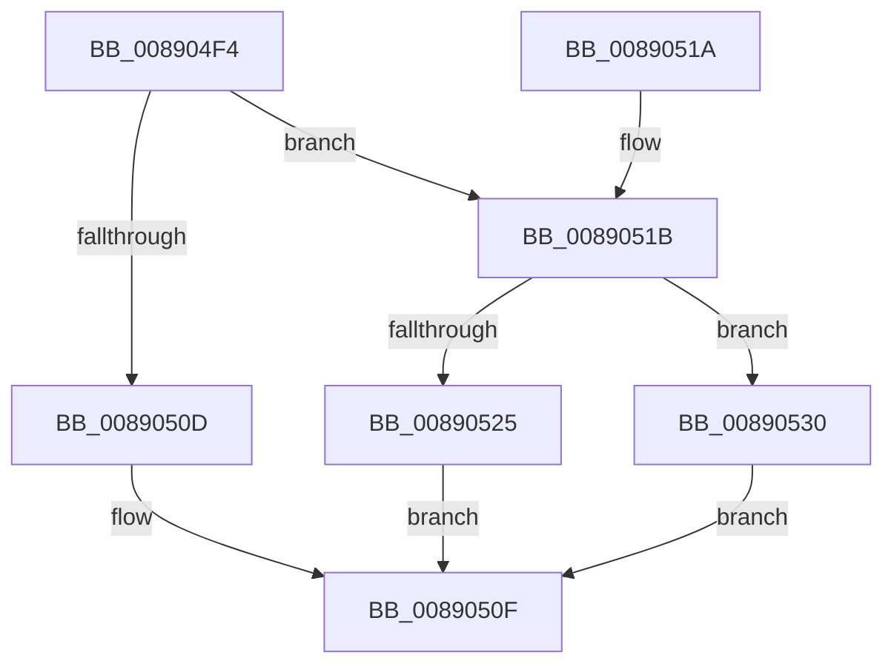

# AlpcpViewSearchCallbackFunction

- RVA: `0x008904F4`–`0x00890537` (길이 `67` bytes)
- VA: `0x00000001408904F4`
- 실행 섹션: `PAGE`
- PDB 이름 있음: `예`; PDB Function 태그: `아니요`
- unwind 정보 RVA: `0x0005D394`
- 디코드: `22`개 명령, `67/67` bytes 표시
- 미해석 바이트: `0` (있으면 어셈블리에 `.byte`로 보존)

> 이 문서는 커널 이미지의 기계어와 PDB 기호를 분석해 생성했습니다. 4번과 5번은 함수 원형과 자료형을 바이너리 사용 방식에서 추정한 C 해석이며 원본 소스 복구 결과는 아닙니다.

## 1. Dependencies

- 직접 호출 지점: **1**; 고유 호출 대상: **1**
- 직접 호출자로 확인된 함수: **1**
- RIP 상대 이미지 참조: **0**

### Outgoing calls
- `0x0089051B` → [AlpcpReferenceBlob](AlpcpReferenceBlob_function_00890110.md) (function, `0x00890110`)

### Direct callers
- [AlpcpEnumerateResourcesPort](AlpcpEnumerateResourcesPort_function_00890424.md) at `0x008904DF`

### Static image references
- 디코드된 RIP-relative 메모리 참조가 없습니다.

## 2. Other-region calls and transfers

- 다른 실행 섹션으로 향하는 call: **0**
- 별도 외부 분기/꼬리 이동을 확인하지 못했습니다.

## 3. Assembly (complete function range)

```asm
008904F4  48 89 5C 24 08                  mov qword ptr [rsp + 8], rbx
008904F9  57                              push rdi
008904FA  48 83 EC 20                     sub rsp, 0x20
008904FE  48 8B 02                        mov rax, qword ptr [rdx]
00890501  48 8B FA                        mov rdi, rdx
00890504  48 8B D9                        mov rbx, rcx
00890507  48 39 41 28                     cmp qword ptr [rcx + 0x28], rax
0089050B  74 0E                           je 0x14089051b
0089050D  33 C0                           xor eax, eax
0089050F  48 8B 5C 24 30                  mov rbx, qword ptr [rsp + 0x30]
00890514  48 83 C4 20                     add rsp, 0x20
00890518  5F                              pop rdi
00890519  C3                              ret
0089051A  CC                              int3
0089051B  E8 F0 FB FF FF                  call 0x140890110
00890520  48 85 C0                        test rax, rax
00890523  74 0B                           je 0x140890530
00890525  48 89 5F 08                     mov qword ptr [rdi + 8], rbx
00890529  B8 01 00 00 C0                  mov eax, 0xc0000001
0089052E  EB DF                           jmp 0x14089050f
00890530  B8 2D 02 00 C0                  mov eax, 0xc000022d
00890535  EB D8                           jmp 0x14089050f
```

## 4. C-style interpretation (structured pseudocode)

```c
__int64 __fastcall AlpcpViewSearchCallbackFunction(__int64 a1, __int64 a2)
{
    __int64 result;
    __int64 v_rsp;
    unsigned __int64 v_stack_p8;

    v_stack_p8 = v_rbx;
    v_rsp = (v_rsp) - (32);
    if ((*(unsigned __int64 *)(a1 + 40)) == (*(unsigned __int64 *)(a2))) goto loc_0089051B;
    result = 0;
loc_0089050F:
    v_rsp = (v_rsp) + (32);
    return result;
loc_0089051B:
    result = AlpcpReferenceBlob(a1, a2, a3, a4);
    if (result == 0) goto loc_00890530;
    *(unsigned __int64 *)(a2 + 8) = v_stack_p8;
    goto loc_0089050F;
loc_00890530:
    goto loc_0089050F;
}
```

## 5. (Beta) C Style

```c
int64_t AlpcpViewSearchCallbackFunction(void *Arg1, void *Arg2)
{
    uint8_t *arg1 = (uint8_t *)Arg1;
    uint8_t *arg2 = (uint8_t *)Arg2;

    int64_t result;
    int64_t local_rsp;
    uint64_t v_stack_p8;

    v_stack_p8 = local_rbx;
    local_rsp = (local_rsp) - (32);
    if ((*(uint64_t *)(arg1 + 0x28)) == (*(uint64_t *)(arg2))) goto loc_0089051B;
    result = 0;
loc_0089050F:
    local_rsp = (local_rsp) + (32);
    return result;
loc_0089051B:
    result = AlpcpReferenceBlob(Arg1, Arg2, a3, a4);
    if (result == 0) goto loc_00890530;
    *(uint64_t *)(arg2 + 0x8) = v_stack_p8;
    goto loc_0089050F;
loc_00890530:
    goto loc_0089050F;
}
```

### 관측된 메모리 오프셋

구조체 형식이 확인되지 않은 접근은 인자 기준의 오프셋으로만 기록했습니다.

| 기준 인자 | 오프셋 표현 | 폭 (bit) | 접근 |
|---|---:|---:|---|
| `Arg1` | `+ 0x28` | `64` | `R` |
| `Arg2` | `+ 0x0` | `64` | `R` |
| `Arg2` | `+ 0x8` | `64` | `W` |

## 6. Execution-region graph

[열기: 2D/3D 그래프와 함수 탐색 컨트롤 패널](../../../control-panel.html?section=page&rva=0x008904F4&view=graph)

- 2D 그래프는 위에서 아래로 흐르고, 3D 그래프는 빈 공간을 드래그해 회전합니다. Shift+드래그는 이동, 휠은 확대·축소, 함수 노드 선택은 대상 보고서 이동입니다.

### Static fallback


