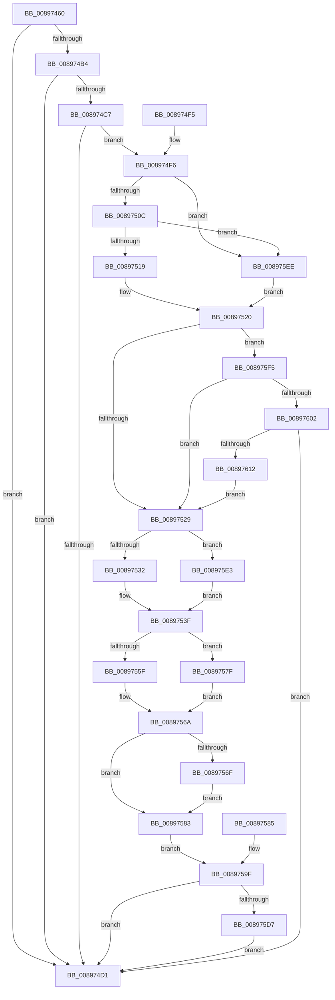

# DbgkMapViewOfSection

- RVA: `0x00897460`–`0x00897620` (길이 `448` bytes)
- VA: `0x0000000140897460`
- 실행 섹션: `PAGE`
- PDB 이름 있음: `예`; PDB Function 태그: `아니요`
- unwind 정보 RVA: `0x0007E28C`
- 디코드: `99`개 명령, `448/448` bytes 표시
- 미해석 바이트: `0` (있으면 어셈블리에 `.byte`로 보존)

> 이 문서는 커널 이미지의 기계어와 PDB 기호를 분석해 생성했습니다. 4번과 5번은 함수 원형과 자료형을 바이너리 사용 방식에서 추정한 C 해석이며 원본 소스 복구 결과는 아닙니다.

## 1. Dependencies

- 직접 호출 지점: **7**; 고유 호출 대상: **7**
- 직접 호출자로 확인된 함수: **4**
- RIP 상대 이미지 참조: **1**

### Outgoing calls
- `0x0089749D` → [memset](../../text/6C/memset_function_006C6C40.md) (function, `0x006C6C40`)
- `0x008974DC` → [_security_check_cookie](../../text/6A/_security_check_cookie_function_006AC640.md) (function, `0x006AC640`)
- `0x00897535` → [DbgkpSectionToFileHandle](../A9/DbgkpSectionToFileHandle_function_00A9AE08.md) (function, `0x00A9AE08`)
- `0x00897562` → [RtlImageNtHeader](../../text/44/RtlImageNtHeader_function_00443B60.md) (function, `0x00443B60`)
- `0x008975C4` → [DbgkpSendApiMessage](../A7/DbgkpSendApiMessage_function_00A79458.md) (function, `0x00A79458`)
- `0x008975D9` → [ObCloseHandle](../8A/ObCloseHandle_function_008A1870.md) (function, `0x008A1870`)
- `0x00897605` → [DbgkpSuppressDbgMsg](../AC/DbgkpSuppressDbgMsg_function_00AC2700.md) (function, `0x00AC2700`)

### Direct callers
- [sub_006F88AE](../../text/6F/Unknown_function_006F88AE.md) at `0x006F8CC8`
- [NtMapViewOfSection](NtMapViewOfSection_function_008986E0.md) at `0x008989BC`
- [MiMapViewOfSectionExCommon](../9A/MiMapViewOfSectionExCommon_function_009A1C60.md) at `0x009A1E5D`
- [NtLoadEnclaveData](../AF/NtLoadEnclaveData_function_00AF8DF0.md) at `0x00AF9330`

### Static image references
- `0x00897470` → RVA `0x00E0A740` (`.data`; read)

## 2. Other-region calls and transfers

- 다른 실행 섹션으로 향하는 call: **3**
  - `0x0089749D` → [memset](../../text/6C/memset_function_006C6C40.md) (`PAGE` → `.text`)
  - `0x008974DC` → [_security_check_cookie](../../text/6A/_security_check_cookie_function_006AC640.md) (`PAGE` → `.text`)
  - `0x00897562` → [RtlImageNtHeader](../../text/44/RtlImageNtHeader_function_00443B60.md) (`PAGE` → `.text`)
- 별도 외부 분기/꼬리 이동을 확인하지 못했습니다.

## 3. Assembly (complete function range)

```asm
00897460  48 89 5C 24 20                  mov qword ptr [rsp + 0x20], rbx
00897465  56                              push rsi
00897466  57                              push rdi
00897467  41 56                           push r14
00897469  48 81 EC 50 01 00 00            sub rsp, 0x150
00897470  48 8B 05 C9 32 57 00            mov rax, qword ptr [rip + 0x5732c9]
00897477  48 33 C4                        xor rax, rsp
0089747A  48 89 84 24 40 01 00 00         mov qword ptr [rsp + 0x140], rax
00897482  49 8B F0                        mov rsi, r8
00897485  4C 8B F2                        mov r14, rdx
00897488  48 8B F9                        mov rdi, rcx
0089748B  48 89 4C 24 20                  mov qword ptr [rsp + 0x20], rcx
00897490  33 D2                           xor edx, edx
00897492  41 B8 10 01 00 00               mov r8d, 0x110
00897498  48 8D 4C 24 30                  lea rcx, [rsp + 0x30]
0089749D  E8 9E F7 E2 FF                  call 0x1406c6c40
008974A2  65 48 8B 04 25 88 01 00 00      mov rax, qword ptr gs:[0x188]
008974AB  80 B8 32 02 00 00 00            cmp byte ptr [rax + 0x232], 0
008974B2  74 1D                           je 0x1408974d1
008974B4  65 48 8B 0C 25 88 01 00 00      mov rcx, qword ptr gs:[0x188]
008974BD  8B 81 A0 05 00 00               mov eax, dword ptr [rcx + 0x5a0]
008974C3  A8 04                           test al, 4
008974C5  75 0A                           jne 0x1408974d1
008974C7  48 83 BF 08 03 00 00 00         cmp qword ptr [rdi + 0x308], 0
008974CF  75 25                           jne 0x1408974f6
008974D1  48 8B 8C 24 40 01 00 00         mov rcx, qword ptr [rsp + 0x140]
008974D9  48 33 CC                        xor rcx, rsp
008974DC  E8 5F 51 E1 FF                  call 0x1406ac640
008974E1  48 8B 9C 24 88 01 00 00         mov rbx, qword ptr [rsp + 0x188]
008974E9  48 81 C4 50 01 00 00            add rsp, 0x150
008974F0  41 5E                           pop r14
008974F2  5F                              pop rdi
008974F3  5E                              pop rsi
008974F4  C3                              ret
008974F5  CC                              int3
008974F6  65 48 8B 1C 25 88 01 00 00      mov rbx, qword ptr gs:[0x188]
008974FF  F7 43 74 00 04 00 00            test dword ptr [rbx + 0x74], 0x400
00897506  0F 85 E2 00 00 00               jne 0x1408975ee
0089750C  80 BB 4A 02 00 00 01            cmp byte ptr [rbx + 0x24a], 1
00897513  0F 84 D5 00 00 00               je 0x1408975ee
00897519  48 8B 9B F0 00 00 00            mov rbx, qword ptr [rbx + 0xf0]
00897520  48 85 DB                        test rbx, rbx
00897523  0F 85 CC 00 00 00               jne 0x1408975f5
00897529  4D 85 F6                        test r14, r14
0089752C  0F 84 B1 00 00 00               je 0x1408975e3
00897532  49 8B CE                        mov rcx, r14
00897535  E8 CE 38 20 00                  call 0x140a9ae08
0089753A  48 89 44 24 60                  mov qword ptr [rsp + 0x60], rax
0089753F  48 89 74 24 68                  mov qword ptr [rsp + 0x68], rsi
00897544  8B 84 24 98 01 00 00            mov eax, dword ptr [rsp + 0x198]
0089754B  89 44 24 70                     mov dword ptr [rsp + 0x70], eax
0089754F  8B 84 24 A0 01 00 00            mov eax, dword ptr [rsp + 0x1a0]
00897556  89 44 24 74                     mov dword ptr [rsp + 0x74], eax
0089755A  48 85 F6                        test rsi, rsi
0089755D  74 20                           je 0x14089757f
0089755F  48 8B CE                        mov rcx, rsi
00897562  E8 F9 C5 BA FF                  call 0x140443b60
00897567  48 8B C8                        mov rcx, rax
0089756A  48 85 C9                        test rcx, rcx
0089756D  74 14                           je 0x140897583
0089756F  8B 41 0C                        mov eax, dword ptr [rcx + 0xc]
00897572  89 44 24 70                     mov dword ptr [rsp + 0x70], eax
00897576  8B 41 10                        mov eax, dword ptr [rcx + 0x10]
00897579  89 44 24 74                     mov dword ptr [rsp + 0x74], eax
0089757D  EB 04                           jmp 0x140897583
0089757F  33 C9                           xor ecx, ecx
00897581  EB E7                           jmp 0x14089756a
00897583  EB 1A                           jmp 0x14089759f
00897585  8B 84 24 98 01 00 00            mov eax, dword ptr [rsp + 0x198]
0089758C  89 44 24 70                     mov dword ptr [rsp + 0x70], eax
00897590  89 44 24 74                     mov dword ptr [rsp + 0x74], eax
00897594  48 83 64 24 78 00               and qword ptr [rsp + 0x78], 0
0089759A  48 8B 7C 24 20                  mov rdi, qword ptr [rsp + 0x20]
0089759F  C7 44 24 30 28 00 50 00         mov dword ptr [rsp + 0x30], 0x500028
008975A7  C7 44 24 34 08 00 00 00         mov dword ptr [rsp + 0x34], 8
008975AF  C7 44 24 58 05 00 00 00         mov dword ptr [rsp + 0x58], 5
008975B7  4C 8D 44 24 30                  lea r8, [rsp + 0x30]
008975BC  BA 01 00 00 00                  mov edx, 1
008975C1  48 8B CF                        mov rcx, rdi
008975C4  E8 8F 1E 1E 00                  call 0x140a79458
008975C9  48 8B 4C 24 60                  mov rcx, qword ptr [rsp + 0x60]
008975CE  48 85 C9                        test rcx, rcx
008975D1  0F 84 FA FE FF FF               je 0x1408974d1
008975D7  33 D2                           xor edx, edx
008975D9  E8 92 A2 00 00                  call 0x1408a1870
008975DE  E9 EE FE FF FF                  jmp 0x1408974d1
008975E3  48 83 64 24 60 00               and qword ptr [rsp + 0x60], 0
008975E9  E9 51 FF FF FF                  jmp 0x14089753f
008975EE  33 DB                           xor ebx, ebx
008975F0  E9 2B FF FF FF                  jmp 0x140897520
008975F5  48 3B B9 20 02 00 00            cmp rdi, qword ptr [rcx + 0x220]
008975FC  0F 85 27 FF FF FF               jne 0x140897529
00897602  48 8B CB                        mov rcx, rbx
00897605  E8 F6 B0 22 00                  call 0x140ac2700
0089760A  85 C0                           test eax, eax
0089760C  0F 85 BF FE FF FF               jne 0x1408974d1
00897612  48 8D 43 28                     lea rax, [rbx + 0x28]
00897616  48 89 44 24 78                  mov qword ptr [rsp + 0x78], rax
0089761B  E9 09 FF FF FF                  jmp 0x140897529
```

## 4. C-style interpretation (structured pseudocode)

```c
__int64 __fastcall DbgkMapViewOfSection(__int64 a1, __int64 a2, __int64 a3, __int64 a4, __int64 a5, unsigned int a6, unsigned int a7)
{
    __int64 result;
    __int64 v_rbx;
    __int64 v_rsp;
    unsigned __int64 v_stack_m138;
    unsigned __int64 v_stack_m148;
    unsigned __int64 v_stack_m28;
    unsigned int v_stack_p198;
    unsigned __int64 v_stack_p20;
    unsigned int v_stack_p30;
    unsigned int v_stack_p34;
    unsigned int v_stack_p58;
    unsigned __int64 v_stack_p60;
    unsigned __int64 v_stack_p68;
    unsigned int v_stack_p70;
    unsigned int v_stack_p74;
    unsigned __int64 v_stack_p78;

    v_stack_p20 = v_rbx;
    v_rsp = (v_rsp) - (336);
    result = (*(unsigned __int64 *)(v_rip + 5714633)) ^ (v_rsp);
    v_stack_m28 = result;
    v_stack_m148 = a1;
    a2 = 0;
    result = memset(v_stack_m138, a2, 272, a4);
    if ((*(unsigned __int8 *)(*(unsigned __int64 *)(gs_base + (0 + 392)) + 562)) == 0) goto loc_008974D1;
    if ((((unsigned __int8)((unsigned int)(*(unsigned int *)(*(unsigned __int64 *)(gs_base + (0 + 392)) + 1440)))) & (4)) != 0) goto loc_008974D1;
    if ((*(unsigned __int64 *)(a1 + 776)) != 0) goto loc_008974F6;
loc_008974D1:
    a1 = (v_stack_m28) ^ (v_rsp);
    result = _security_check_cookie(a1, a2, 272, a4);
    v_rsp = (v_rsp) + (336);
    return result;
loc_008974F6:
    if (((*(unsigned int *)(*(unsigned __int64 *)(gs_base + (0 + 392)) + 116)) & (0x400ULL)) != 0) goto loc_008975EE;
    if ((*(unsigned __int8 *)(*(unsigned __int64 *)(gs_base + (0 + 392)) + 586)) == 1) goto loc_008975EE;
loc_00897520:
    if (*(unsigned __int64 *)(*(unsigned __int64 *)(gs_base + (0 + 392)) + 240) != 0) goto loc_008975F5;
loc_00897529:
    if (0 == 0) goto loc_008975E3;
    result = DbgkpSectionToFileHandle(0, a2, 272, a4);
    v_stack_p60 = result;
loc_0089753F:
    v_stack_p68 = a3;
    v_stack_p70 = (unsigned int)((unsigned int)(a6));
    v_stack_p74 = (unsigned int)((unsigned int)(a7));
    if (a3 == 0) goto loc_0089757F;
    result = RtlImageNtHeader(a3, a2, 272, a4);
loc_0089756A:
    if (result == 0) goto loc_00897583;
    v_stack_p70 = (unsigned int)((unsigned int)(*(unsigned int *)(result + 12)));
    v_stack_p74 = (unsigned int)((unsigned int)(*(unsigned int *)(result + 16)));
    goto loc_00897583;
loc_0089757F:
    a1 = 0;
    goto loc_0089756A;
loc_00897583:
    goto loc_0089759F;
loc_0089759F:
    v_stack_p30 = 0x500028ULL;
    v_stack_p34 = 8;
    v_stack_p58 = 5;
    result = DbgkpSendApiMessage(0, 1, v_stack_p30, a4);
    if (v_stack_p60 == 0) goto loc_008974D1;
    a2 = 0;
    result = ObCloseHandle(v_stack_p60, a2, v_stack_p30, a4);
    goto loc_008974D1;
loc_008975E3:
    goto loc_0089753F;
loc_008975EE:
    v_rbx = 0;
    goto loc_00897520;
loc_008975F5:
    if (0 != (*(unsigned __int64 *)(v_stack_p60 + 544))) goto loc_00897529;
    result = DbgkpSuppressDbgMsg(0, a2, v_stack_p30, a4);
    if ((unsigned int)(result) != 0) goto loc_008974D1;
    v_stack_p78 = v_rbx + 40;
    goto loc_00897529;
}
```

## 5. (Beta) C Style

```c
int64_t DbgkMapViewOfSection(void *Arg1, int64_t Arg2, int64_t Arg3, int64_t Arg4, uint64_t Arg5, uint32_t Arg6, uint32_t Arg7)
{
    uint8_t *arg1 = (uint8_t *)Arg1;

    int64_t result;
    int64_t local_rbx;
    int64_t local_rsp;
    uint64_t v_stack_m138;
    uint64_t v_stack_m148;
    uint64_t v_stack_m28;
    uint32_t v_stack_p198;
    uint64_t v_stack_p20;
    uint32_t v_stack_p30;
    uint32_t v_stack_p34;
    uint32_t v_stack_p58;
    uint64_t v_stack_p60;
    uint64_t v_stack_p68;
    uint32_t v_stack_p70;
    uint32_t v_stack_p74;
    uint64_t v_stack_p78;

    v_stack_p20 = local_rbx;
    local_rsp = (local_rsp) - (336);
    result = (*(uint64_t *)(v_rip + 0x5732C9)) ^ (local_rsp);
    v_stack_m28 = result;
    v_stack_m148 = Arg1;
    Arg2 = 0;
    result = memset(v_stack_m138, Arg2, 272, Arg4);
    if ((*(uint8_t *)(*(uint64_t *)(gs_base + (0 + 0x188)) + 0x232)) == 0) goto loc_008974D1;
    if ((((uint8_t)((uint32_t)(*(uint32_t *)(*(uint64_t *)(gs_base + (0 + 0x188)) + 0x5A0)))) & (4)) != 0) goto loc_008974D1;
    if ((*(uint64_t *)(arg1 + 0x308)) != 0) goto loc_008974F6;
loc_008974D1:
    Arg1 = (v_stack_m28) ^ (local_rsp);
    result = _security_check_cookie(Arg1, Arg2, 272, Arg4);
    local_rsp = (local_rsp) + (336);
    return result;
loc_008974F6:
    if (((*(uint32_t *)(*(uint64_t *)(gs_base + (0 + 0x188)) + 0x74)) & (0x400ULL)) != 0) goto loc_008975EE;
    if ((*(uint8_t *)(*(uint64_t *)(gs_base + (0 + 0x188)) + 0x24A)) == 1) goto loc_008975EE;
loc_00897520:
    if (*(uint64_t *)(*(uint64_t *)(gs_base + (0 + 0x188)) + 0xF0) != 0) goto loc_008975F5;
loc_00897529:
    if (0 == 0) goto loc_008975E3;
    result = DbgkpSectionToFileHandle(0, Arg2, 272, Arg4);
    v_stack_p60 = result;
loc_0089753F:
    v_stack_p68 = Arg3;
    v_stack_p70 = (uint32_t)((uint32_t)(Arg6));
    v_stack_p74 = (uint32_t)((uint32_t)(Arg7));
    if (Arg3 == 0) goto loc_0089757F;
    result = RtlImageNtHeader(Arg3, Arg2, 272, Arg4);
loc_0089756A:
    if (result == 0) goto loc_00897583;
    v_stack_p70 = (uint32_t)((uint32_t)(*(uint32_t *)(result + 0xC)));
    v_stack_p74 = (uint32_t)((uint32_t)(*(uint32_t *)(result + 0x10)));
    goto loc_00897583;
loc_0089757F:
    Arg1 = 0;
    goto loc_0089756A;
loc_00897583:
    goto loc_0089759F;
loc_0089759F:
    v_stack_p30 = 0x500028ULL;
    v_stack_p34 = 8;
    v_stack_p58 = 5;
    result = DbgkpSendApiMessage(0, 1, v_stack_p30, Arg4);
    if (v_stack_p60 == 0) goto loc_008974D1;
    Arg2 = 0;
    result = ObCloseHandle(v_stack_p60, Arg2, v_stack_p30, Arg4);
    goto loc_008974D1;
loc_008975E3:
    goto loc_0089753F;
loc_008975EE:
    local_rbx = 0;
    goto loc_00897520;
loc_008975F5:
    if (0 != (*(uint64_t *)(v_stack_p60 + 0x220))) goto loc_00897529;
    result = DbgkpSuppressDbgMsg(0, Arg2, v_stack_p30, Arg4);
    if ((uint32_t)(result) != 0) goto loc_008974D1;
    v_stack_p78 = local_rbx + 40;
    goto loc_00897529;
}
```

### 관측된 메모리 오프셋

구조체 형식이 확인되지 않은 접근은 인자 기준의 오프셋으로만 기록했습니다.

| 기준 인자 | 오프셋 표현 | 폭 (bit) | 접근 |
|---|---:|---:|---|
| `Arg1` | `+ 0x308` | `64` | `R` |

## 6. Execution-region graph

[열기: 2D/3D 그래프와 함수 탐색 컨트롤 패널](../../../control-panel.html?section=page&rva=0x00897460&view=graph)

- 2D 그래프는 위에서 아래로 흐르고, 3D 그래프는 빈 공간을 드래그해 회전합니다. Shift+드래그는 이동, 휠은 확대·축소, 함수 노드 선택은 대상 보고서 이동입니다.

### Static fallback


