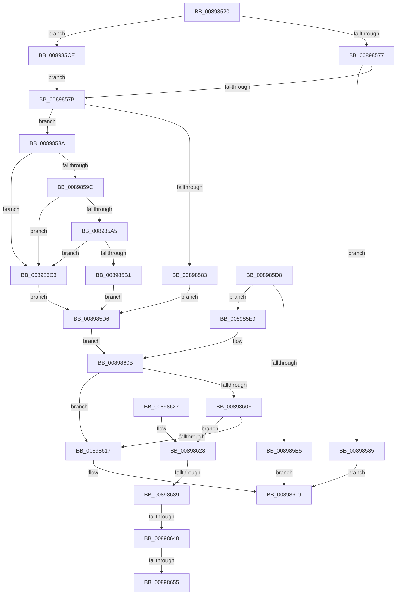

# IopRetrieveTransactionParameters

- RVA: `0x00898520`–`0x0089865A` (길이 `314` bytes)
- VA: `0x0000000140898520`
- 실행 섹션: `PAGE`
- PDB 이름 있음: `예`; PDB Function 태그: `예`
- unwind 정보 RVA: `0x0007E41C`
- 디코드: `87`개 명령, `314/314` bytes 표시
- 미해석 바이트: `0` (있으면 어셈블리에 `.byte`로 보존)

> 이 문서는 커널 이미지의 기계어와 PDB 기호를 분석해 생성했습니다. 4번과 5번은 함수 원형과 자료형을 바이너리 사용 방식에서 추정한 C 해석이며 원본 소스 복구 결과는 아닙니다.

## 1. Dependencies

- 직접 호출 지점: **2**; 고유 호출 대상: **2**
- 직접 호출자로 확인된 함수: **2**
- RIP 상대 이미지 참조: **1**

### Outgoing calls
- `0x0089855E` → `ext-ms-win-ntos-tm-l1-1-0.dll!TmCurrentTransaction` (import, 간접 대상; import `ext-ms-win-ntos-tm-l1-1-0.dll!TmCurrentTransaction`)
- `0x0089862B` → [IopCheckStackForTransactionSupport](../../text/4B/IopCheckStackForTransactionSupport_function_004BD59C.md) (function, `0x004BD59C`)

### Direct callers
- [IopAllocRealFileObject](IopAllocRealFileObject_function_00899720.md) at `0x008999B3`
- [IopParseDevice](IopParseDevice_function_0089E510.md) at `0x0089F6DA`

### Static image references
- `0x0089855E` → RVA `0x001513C0` (`ext-ms-win-ntos-tm-l1-1-0.dll!TmCurrentTransaction (IAT)`; read)

## 2. Other-region calls and transfers

- 다른 실행 섹션으로 향하는 call: **1**
  - `0x0089862B` → [IopCheckStackForTransactionSupport](../../text/4B/IopCheckStackForTransactionSupport_function_004BD59C.md) (`PAGE` → `.text`)
- call이 아닌 외부 분기/꼬리 이동: **4**
  - `0x00898633` → [sub_00B19ABC + 0x13](../B1/Unknown_function_00B19ABC.md) (`tail-transfer`)
  - `0x00898642` → [sub_00B19ABC](../B1/Unknown_function_00B19ABC.md) (`tail-transfer`)
  - `0x0089864F` → [sub_00B19ABC](../B1/Unknown_function_00B19ABC.md) (`tail-transfer`)
  - `0x00898655` → [sub_00B19ABC + 0x13](../B1/Unknown_function_00B19ABC.md) (`tail-transfer`)

## 3. Assembly (complete function range)

```asm
00898520  48 8B C4                        mov rax, rsp
00898523  4C 89 48 20                     mov qword ptr [rax + 0x20], r9
00898527  44 89 40 18                     mov dword ptr [rax + 0x18], r8d
0089852B  48 89 50 10                     mov qword ptr [rax + 0x10], rdx
0089852F  48 89 48 08                     mov qword ptr [rax + 8], rcx
00898533  53                              push rbx
00898534  56                              push rsi
00898535  57                              push rdi
00898536  41 54                           push r12
00898538  41 56                           push r14
0089853A  41 57                           push r15
0089853C  48 83 EC 58                     sub rsp, 0x58
00898540  4D 8B E1                        mov r12, r9
00898543  45 8B F0                        mov r14d, r8d
00898546  48 8B F2                        mov rsi, rdx
00898549  4C 8B F9                        mov r15, rcx
0089854C  33 DB                           xor ebx, ebx
0089854E  48 89 58 C0                     mov qword ptr [rax - 0x40], rbx
00898552  48 89 58 B0                     mov qword ptr [rax - 0x50], rbx
00898556  66 89 58 A8                     mov word ptr [rax - 0x58], bx
0089855A  48 8D 48 B0                     lea rcx, [rax - 0x50]
0089855E  48 FF 15 5B 8E 8B FF            call qword ptr [rip - 0x7471a5]
00898565  0F 1F 44 00 00                  nop dword ptr [rax + rax]
0089856A  8B F8                           mov edi, eax
0089856C  89 44 24 34                     mov dword ptr [rsp + 0x34], eax
00898570  3D BB 00 00 C0                  cmp eax, 0xc00000bb
00898575  74 57                           je 0x1408985ce
00898577  85 C0                           test eax, eax
00898579  78 0A                           js 0x140898585
0089857B  48 83 7C 24 38 00               cmp qword ptr [rsp + 0x38], 0
00898581  75 07                           jne 0x14089858a
00898583  EB 51                           jmp 0x1408985d6
00898585  E9 8F 00 00 00                  jmp 0x140898619
0089858A  65 48 8B 0C 25 88 01 00 00      mov rcx, qword ptr gs:[0x188]
00898593  F7 41 74 00 04 00 00            test dword ptr [rcx + 0x74], 0x400
0089859A  75 27                           jne 0x1408985c3
0089859C  80 B9 4A 02 00 00 01            cmp byte ptr [rcx + 0x24a], 1
008985A3  74 1E                           je 0x1408985c3
008985A5  48 8B 81 F0 00 00 00            mov rax, qword ptr [rcx + 0xf0]
008985AC  48 85 C0                        test rax, rax
008985AF  74 12                           je 0x1408985c3
008985B1  0F B7 80 E8 02 00 00            movzx eax, word ptr [rax + 0x2e8]
008985B8  66 89 44 24 30                  mov word ptr [rsp + 0x30], ax
008985BD  8B 7C 24 34                     mov edi, dword ptr [rsp + 0x34]
008985C1  EB 13                           jmp 0x1408985d6
008985C3  BF 18 00 19 C0                  mov edi, 0xc0190018
008985C8  89 7C 24 34                     mov dword ptr [rsp + 0x34], edi
008985CC  EB 08                           jmp 0x1408985d6
008985CE  8B FB                           mov edi, ebx
008985D0  89 5C 24 34                     mov dword ptr [rsp + 0x34], ebx
008985D4  EB A5                           jmp 0x14089857b
008985D6  EB 33                           jmp 0x14089860b
008985D8  8B F8                           mov edi, eax
008985DA  89 44 24 34                     mov dword ptr [rsp + 0x34], eax
008985DE  3D 01 00 00 C0                  cmp eax, 0xc0000001
008985E3  75 04                           jne 0x1408985e9
008985E5  33 C0                           xor eax, eax
008985E7  EB 30                           jmp 0x140898619
008985E9  33 DB                           xor ebx, ebx
008985EB  4C 8B A4 24 A8 00 00 00         mov r12, qword ptr [rsp + 0xa8]
008985F3  44 8B B4 24 A0 00 00 00         mov r14d, dword ptr [rsp + 0xa0]
008985FB  48 8B B4 24 98 00 00 00         mov rsi, qword ptr [rsp + 0x98]
00898603  4C 8B BC 24 90 00 00 00         mov r15, qword ptr [rsp + 0x90]
0089860B  85 FF                           test edi, edi
0089860D  78 08                           js 0x140898617
0089860F  48 83 7C 24 38 00               cmp qword ptr [rsp + 0x38], 0
00898615  75 11                           jne 0x140898628
00898617  8B C7                           mov eax, edi
00898619  48 83 C4 58                     add rsp, 0x58
0089861D  41 5F                           pop r15
0089861F  41 5E                           pop r14
00898621  41 5C                           pop r12
00898623  5F                              pop rdi
00898624  5E                              pop rsi
00898625  5B                              pop rbx
00898626  C3                              ret
00898627  CC                              int3
00898628  49 8B CF                        mov rcx, r15
0089862B  E8 6C 4F C2 FF                  call 0x1404bd59c
00898630  48 85 C0                        test rax, rax
00898633  0F 85 96 14 28 00               jne 0x140b19acf
00898639  66 83 66 46 01                  and word ptr [rsi + 0x46], 1
0089863E  83 7E 58 01                     cmp dword ptr [rsi + 0x58], 1
00898642  0F 85 74 14 28 00               jne 0x140b19abc
00898648  41 F7 C6 56 FF ED FE            test r14d, 0xfeedff56
0089864F  0F 85 67 14 28 00               jne 0x140b19abc
00898655  E9 75 14 28 00                  jmp 0x140b19acf
```

## 4. C-style interpretation (structured pseudocode)

```c
__int64 __fastcall IopRetrieveTransactionParameters(__int64 a1, __int64 a2, int a3, __int64 a4)
{
    __int64 result;
    __int64 v_rbx;
    __int64 v_rsp;
    unsigned __int64 v_stack_m50;
    unsigned int v_stack_m54;
    unsigned __int16 v_stack_m58;
    unsigned __int64 v_stack_p10;
    unsigned int v_stack_p18;
    unsigned __int64 v_stack_p20;
    unsigned __int64 v_stack_p8;

    *(unsigned __int64 *)(v_rsp + 32) = a4;
    *(unsigned int *)(v_rsp + 24) = a3;
    *(unsigned __int64 *)(v_rsp + 16) = a2;
    *(unsigned __int64 *)(v_rsp + 8) = a1;
    v_rsp = (v_rsp) - (88);
    v_rbx = 0;
    *(unsigned __int64 *)(v_rsp - 64) = 0;
    *(unsigned __int64 *)(v_rsp - 80) = 0;
    *(unsigned __int16 *)(v_rsp - 88) = 0;
    result = ext_ms_win_ntos_tm_l1_1_0_dll_TmCurrentTransaction(v_rsp - 80, a2, a3, a4);
    v_stack_m54 = (unsigned int)(result);
    if (((unsigned int)(result)) == 0xC00000BBULL) goto loc_008985CE;
    if (sign_flag) goto loc_00898585;
loc_0089857B:
    if (v_stack_m50 != 0) goto loc_0089858A;
    goto loc_008985D6;
loc_00898585:
    goto loc_00898619;
loc_0089858A:
    if (((*(unsigned int *)(*(unsigned __int64 *)(gs_base + (0 + 392)) + 116)) & (0x400ULL)) != 0) goto loc_008985C3;
    if ((*(unsigned __int8 *)(*(unsigned __int64 *)(gs_base + (0 + 392)) + 586)) == 1) goto loc_008985C3;
    if (*(unsigned __int64 *)(*(unsigned __int64 *)(gs_base + (0 + 392)) + 240) == 0) goto loc_008985C3;
    v_stack_m58 = (unsigned __int16)(*(unsigned __int16 *)(*(unsigned __int64 *)(*(unsigned __int64 *)(gs_base + (0 + 392)) + 240) + 744));
    goto loc_008985D6;
loc_008985C3:
    v_stack_m54 = (unsigned int)((unsigned int)(0xC0190018ULL));
    goto loc_008985D6;
loc_008985CE:
    v_stack_m54 = 0;
    goto loc_0089857B;
loc_008985D6:
    goto loc_0089860B;
loc_0089860B:
    if (sign_flag) goto loc_00898617;
    if (v_stack_m50 != 0) goto loc_00898628;
loc_00898617:
loc_00898619:
    v_rsp = (v_rsp) + (88);
    return 0;
loc_00898628:
    result = IopCheckStackForTransactionSupport(a1, a2, a3, a4);
}
```

## 5. (Beta) C Style

```c
int64_t IopRetrieveTransactionParameters(int64_t Arg1, void *Arg2, int32_t Arg3, int64_t Arg4)
{
    uint8_t *arg2 = (uint8_t *)Arg2;

    int64_t result;
    int64_t local_rbx;
    int64_t local_rsp;
    uint64_t v_stack_m50;
    uint32_t v_stack_m54;
    uint16_t v_stack_m58;
    uint64_t v_stack_p10;
    uint32_t v_stack_p18;
    uint64_t v_stack_p20;
    uint64_t v_stack_p8;

    *(uint64_t *)(local_rsp + 0x20) = Arg4;
    *(uint32_t *)(local_rsp + 0x18) = Arg3;
    *(void **)(local_rsp + 0x10) = Arg2;
    *(uint64_t *)(local_rsp + 0x8) = Arg1;
    local_rsp = (local_rsp) - (88);
    local_rbx = 0;
    *(uint64_t *)(local_rsp - 0x40) = 0;
    *(uint64_t *)(local_rsp - 0x50) = 0;
    *(uint16_t *)(local_rsp - 0x58) = 0;
    result = kernel_indirect_call(local_rsp - 80, Arg2, Arg3, Arg4);
    v_stack_m54 = (uint32_t)(result);
    if (((uint32_t)(result)) == 0xC00000BBULL) goto loc_008985CE;
    if (sign_flag) goto loc_00898585;
loc_0089857B:
    if (v_stack_m50 != 0) goto loc_0089858A;
    goto loc_008985D6;
loc_00898585:
    goto loc_00898619;
loc_0089858A:
    if (((*(uint32_t *)(*(uint64_t *)(gs_base + (0 + 0x188)) + 0x74)) & (0x400ULL)) != 0) goto loc_008985C3;
    if ((*(uint8_t *)(*(uint64_t *)(gs_base + (0 + 0x188)) + 0x24A)) == 1) goto loc_008985C3;
    if (*(uint64_t *)(*(uint64_t *)(gs_base + (0 + 0x188)) + 0xF0) == 0) goto loc_008985C3;
    v_stack_m58 = (uint16_t)(*(uint16_t *)(*(uint64_t *)(*(uint64_t *)(gs_base + (0 + 0x188)) + 0xF0) + 0x2E8));
    goto loc_008985D6;
loc_008985C3:
    v_stack_m54 = (uint32_t)((uint32_t)(0xC0190018ULL));
    goto loc_008985D6;
loc_008985CE:
    v_stack_m54 = 0;
    goto loc_0089857B;
loc_008985D6:
    goto loc_0089860B;
loc_0089860B:
    if (sign_flag) goto loc_00898617;
    if (v_stack_m50 != 0) goto loc_00898628;
loc_00898617:
loc_00898619:
    local_rsp = (local_rsp) + (88);
    return 0;
loc_00898628:
    result = IopCheckStackForTransactionSupport(Arg1, Arg2, Arg3, Arg4);
}
```

### 관측된 메모리 오프셋

구조체 형식이 확인되지 않은 접근은 인자 기준의 오프셋으로만 기록했습니다.

| 기준 인자 | 오프셋 표현 | 폭 (bit) | 접근 |
|---|---:|---:|---|
| `Arg2` | `+ 0x46` | `16` | `R/W` |
| `Arg2` | `+ 0x58` | `32` | `R` |

## 6. Execution-region graph

[열기: 2D/3D 그래프와 함수 탐색 컨트롤 패널](../../../control-panel.html?section=page&rva=0x00898520&view=graph)

- 2D 그래프는 위에서 아래로 흐르고, 3D 그래프는 빈 공간을 드래그해 회전합니다. Shift+드래그는 이동, 휠은 확대·축소, 함수 노드 선택은 대상 보고서 이동입니다.

### Static fallback


