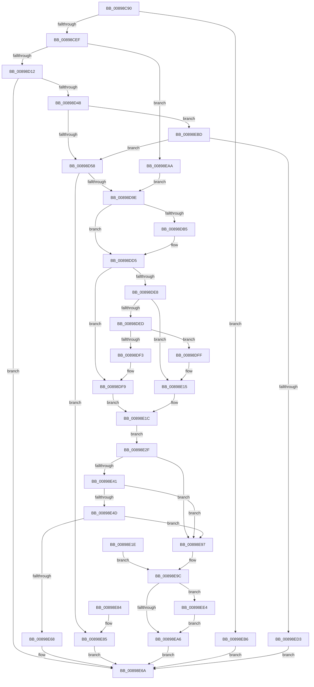

# MiMapViewOfSectionCommon

- RVA: `0x00898C90`–`0x00898F01` (길이 `625` bytes)
- VA: `0x0000000140898C90`
- 실행 섹션: `PAGE`
- PDB 이름 있음: `예`; PDB Function 태그: `아니요`
- unwind 정보 RVA: `0x0007E4A4`
- 디코드: `158`개 명령, `625/625` bytes 표시
- 미해석 바이트: `0` (있으면 어셈블리에 `.byte`로 보존)

> 이 문서는 커널 이미지의 기계어와 PDB 기호를 분석해 생성했습니다. 4번과 5번은 함수 원형과 자료형을 바이너리 사용 방식에서 추정한 C 해석이며 원본 소스 복구 결과는 아닙니다.

## 1. Dependencies

- 직접 호출 지점: **8**; 고유 호출 대상: **4**
- 직접 호출자로 확인된 함수: **2**
- RIP 상대 이미지 참조: **3**

### Outgoing calls
- `0x00898CDE` → [MiMakeProtectionMask](../../text/32/MiMakeProtectionMask_function_00329480.md) (function, `0x00329480`)
- `0x00898D3B` → [ObpReferenceObjectByHandleWithTag](../86/ObpReferenceObjectByHandleWithTag_function_00869650.md) (function, `0x00869650`)
- `0x00898D8E` → [ObpReferenceObjectByHandleWithTag](../86/ObpReferenceObjectByHandleWithTag_function_00869650.md) (function, `0x00869650`)
- `0x00898DF3` → [ExRaiseDatatypeMisalignment](ExRaiseDatatypeMisalignment_function_00899FD0.md) (function, `0x00899FD0`)
- `0x00898E8D` → [ObfDereferenceObjectWithTag](../../text/2F/ObfDereferenceObjectWithTag_function_002F78E0.md) (function, `0x002F78E0`)
- `0x00898ED8` → [ObfDereferenceObjectWithTag](../../text/2F/ObfDereferenceObjectWithTag_function_002F78E0.md) (function, `0x002F78E0`)
- `0x00898EED` → [ObfDereferenceObjectWithTag](../../text/2F/ObfDereferenceObjectWithTag_function_002F78E0.md) (function, `0x002F78E0`)
- `0x00898EFA` → [ObfDereferenceObjectWithTag](../../text/2F/ObfDereferenceObjectWithTag_function_002F78E0.md) (function, `0x002F78E0`)

### Direct callers
- [NtMapViewOfSection](NtMapViewOfSection_function_008986E0.md) at `0x00898784`
- [MiMapViewOfSectionExCommon](../9A/MiMapViewOfSectionExCommon_function_009A1C60.md) at `0x009A1D16`

### Static image references
- `0x00898D12` → RVA `0x00FC6A98` (`ALMOSTRO`; read)
- `0x00898D58` → RVA `0x00FC6BD8` (`ALMOSTRO`; read)
- `0x00898D62` → RVA `0x00011140` (`.rdata`; read)

## 2. Other-region calls and transfers

- 다른 실행 섹션으로 향하는 call: **5**
  - `0x00898CDE` → [MiMakeProtectionMask](../../text/32/MiMakeProtectionMask_function_00329480.md) (`PAGE` → `.text`)
  - `0x00898E8D` → [ObfDereferenceObjectWithTag](../../text/2F/ObfDereferenceObjectWithTag_function_002F78E0.md) (`PAGE` → `.text`)
  - `0x00898ED8` → [ObfDereferenceObjectWithTag](../../text/2F/ObfDereferenceObjectWithTag_function_002F78E0.md) (`PAGE` → `.text`)
  - `0x00898EED` → [ObfDereferenceObjectWithTag](../../text/2F/ObfDereferenceObjectWithTag_function_002F78E0.md) (`PAGE` → `.text`)
  - `0x00898EFA` → [ObfDereferenceObjectWithTag](../../text/2F/ObfDereferenceObjectWithTag_function_002F78E0.md) (`PAGE` → `.text`)
- 별도 외부 분기/꼬리 이동을 확인하지 못했습니다.

## 3. Assembly (complete function range)

```asm
00898C90  48 89 5C 24 08                  mov qword ptr [rsp + 8], rbx
00898C95  48 89 74 24 10                  mov qword ptr [rsp + 0x10], rsi
00898C9A  44 89 44 24 18                  mov dword ptr [rsp + 0x18], r8d
00898C9F  57                              push rdi
00898CA0  41 54                           push r12
00898CA2  41 55                           push r13
00898CA4  41 56                           push r14
00898CA6  41 57                           push r15
00898CA8  48 83 EC 60                     sub rsp, 0x60
00898CAC  4D 8B E1                        mov r12, r9
00898CAF  4C 8B EA                        mov r13, rdx
00898CB2  4C 8B D1                        mov r10, rcx
00898CB5  4C 8B B4 24 B8 00 00 00         mov r14, qword ptr [rsp + 0xb8]
00898CBD  0F 57 C0                        xorps xmm0, xmm0
00898CC0  48 8B 9C 24 D8 00 00 00         mov rbx, qword ptr [rsp + 0xd8]
00898CC8  0F 11 03                        movups xmmword ptr [rbx], xmm0
00898CCB  0F 11 43 10                     movups xmmword ptr [rbx + 0x10], xmm0
00898CCF  0F 11 43 20                     movups xmmword ptr [rbx + 0x20], xmm0
00898CD3  8B 8C 24 C0 00 00 00            mov ecx, dword ptr [rsp + 0xc0]
00898CDA  0F BA F1 1E                     btr ecx, 0x1e
00898CDE  E8 9D 07 A9 FF                  call 0x140329480
00898CE3  89 43 18                        mov dword ptr [rbx + 0x18], eax
00898CE6  83 F8 FF                        cmp eax, -1
00898CE9  0F 84 C7 01 00 00               je 0x140898eb6
00898CEF  83 E0 07                        and eax, 7
00898CF2  89 43 18                        mov dword ptr [rbx + 0x18], eax
00898CF5  48 8D 73 28                     lea rsi, [rbx + 0x28]
00898CF9  48 89 74 24 50                  mov qword ptr [rsp + 0x50], rsi
00898CFE  45 33 FF                        xor r15d, r15d
00898D01  0F B6 BC 24 D0 00 00 00         movzx edi, byte ptr [rsp + 0xd0]
00898D09  45 85 C0                        test r8d, r8d
00898D0C  0F 85 98 01 00 00               jne 0x140898eaa
00898D12  4C 8B 05 7F DD 72 00            mov r8, qword ptr [rip + 0x72dd7f]
00898D19  4C 89 7C 24 38                  mov qword ptr [rsp + 0x38], r15
00898D1E  4C 89 7C 24 30                  mov qword ptr [rsp + 0x30], r15
00898D23  48 89 74 24 28                  mov qword ptr [rsp + 0x28], rsi
00898D28  C7 44 24 20 4D 6D 56 77         mov dword ptr [rsp + 0x20], 0x77566d4d
00898D30  44 0F B6 CF                     movzx r9d, dil
00898D34  41 8D 57 08                     lea edx, [r15 + 8]
00898D38  49 8B CA                        mov rcx, r10
00898D3B  E8 10 09 FD FF                  call 0x140869650
00898D40  85 C0                           test eax, eax
00898D42  0F 88 22 01 00 00               js 0x140898e6a
00898D48  48 8B 0E                        mov rcx, qword ptr [rsi]
00898D4B  F6 81 70 01 00 00 01            test byte ptr [rcx + 0x170], 1
00898D52  0F 85 65 01 00 00               jne 0x140898ebd
00898D58  4C 8B 05 79 DE 72 00            mov r8, qword ptr [rip + 0x72de79]
00898D5F  8B 43 18                        mov eax, dword ptr [rbx + 0x18]
00898D62  48 8D 15 D7 83 77 FF            lea rdx, [rip - 0x887c29]
00898D69  8B 14 82                        mov edx, dword ptr [rdx + rax*4]
00898D6C  48 8D 43 20                     lea rax, [rbx + 0x20]
00898D70  4C 89 7C 24 38                  mov qword ptr [rsp + 0x38], r15
00898D75  4C 89 7C 24 30                  mov qword ptr [rsp + 0x30], r15
00898D7A  48 89 44 24 28                  mov qword ptr [rsp + 0x28], rax
00898D7F  C7 44 24 20 4D 6D 56 77         mov dword ptr [rsp + 0x20], 0x77566d4d
00898D87  44 0F B6 CF                     movzx r9d, dil
00898D8B  49 8B CD                        mov rcx, r13
00898D8E  E8 BD 08 FD FF                  call 0x140869650
00898D93  44 8B E8                        mov r13d, eax
00898D96  85 C0                           test eax, eax
00898D98  0F 88 E7 00 00 00               js 0x140898e85
00898D9E  48 BA 00 00 FF FF FF 7F 00 00   movabs rdx, 0x7fffffff0000
00898DA8  4C 8B 84 24 B0 00 00 00         mov r8, qword ptr [rsp + 0xb0]
00898DB0  40 84 FF                        test dil, dil
00898DB3  74 20                           je 0x140898dd5
00898DB5  48 8B CA                        mov rcx, rdx
00898DB8  4C 3B E2                        cmp r12, rdx
00898DBB  49 0F 42 CC                     cmovb rcx, r12
00898DBF  48 8B 01                        mov rax, qword ptr [rcx]
00898DC2  48 89 01                        mov qword ptr [rcx], rax
00898DC5  48 8B CA                        mov rcx, rdx
00898DC8  4C 3B C2                        cmp r8, rdx
00898DCB  49 0F 42 C8                     cmovb rcx, r8
00898DCF  48 8B 01                        mov rax, qword ptr [rcx]
00898DD2  48 89 01                        mov qword ptr [rcx], rax
00898DD5  49 8B 04 24                     mov rax, qword ptr [r12]
00898DD9  48 89 03                        mov qword ptr [rbx], rax
00898DDC  49 8B 00                        mov rax, qword ptr [r8]
00898DDF  48 89 43 08                     mov qword ptr [rbx + 8], rax
00898DE3  4D 85 F6                        test r14, r14
00898DE6  74 11                           je 0x140898df9
00898DE8  40 84 FF                        test dil, dil
00898DEB  74 28                           je 0x140898e15
00898DED  41 F6 C6 03                     test r14b, 3
00898DF1  74 0C                           je 0x140898dff
00898DF3  E8 D8 11 00 00                  call 0x140899fd0
00898DF8  CC                              int3
00898DF9  4C 89 7B 10                     mov qword ptr [rbx + 0x10], r15
00898DFD  EB 1D                           jmp 0x140898e1c
00898DFF  48 8B CA                        mov rcx, rdx
00898E02  4C 3B F2                        cmp r14, rdx
00898E05  49 0F 42 CE                     cmovb rcx, r14
00898E09  0F B6 01                        movzx eax, byte ptr [rcx]
00898E0C  88 01                           mov byte ptr [rcx], al
00898E0E  0F B6 41 07                     movzx eax, byte ptr [rcx + 7]
00898E12  88 41 07                        mov byte ptr [rcx + 7], al
00898E15  49 8B 06                        mov rax, qword ptr [r14]
00898E18  48 89 43 10                     mov qword ptr [rbx + 0x10], rax
00898E1C  EB 11                           jmp 0x140898e2f
00898E1E  8B F8                           mov edi, eax
00898E20  48 8B 9C 24 D8 00 00 00         mov rbx, qword ptr [rsp + 0xd8]
00898E28  48 8B 74 24 50                  mov rsi, qword ptr [rsp + 0x50]
00898E2D  EB 6D                           jmp 0x140898e9c
00898E2F  48 8B 03                        mov rax, qword ptr [rbx]
00898E32  48 B9 FF FF FE FF FF 7F 00 00   movabs rcx, 0x7ffffffeffff
00898E3C  48 3B C1                        cmp rax, rcx
00898E3F  77 56                           ja 0x140898e97
00898E41  48 8B 4B 08                     mov rcx, qword ptr [rbx + 8]
00898E45  48 2B D0                        sub rdx, rax
00898E48  48 3B CA                        cmp rcx, rdx
00898E4B  77 4A                           ja 0x140898e97
00898E4D  48 8D 14 01                     lea rdx, [rcx + rax]
00898E51  48 C7 C0 FF FF FF FF            mov rax, 0xffffffffffffffff
00898E58  48 8B 8C 24 C8 00 00 00         mov rcx, qword ptr [rsp + 0xc8]
00898E60  48 D3 E8                        shr rax, cl
00898E63  48 3B D0                        cmp rdx, rax
00898E66  77 2F                           ja 0x140898e97
00898E68  33 C0                           xor eax, eax
00898E6A  4C 8D 5C 24 60                  lea r11, [rsp + 0x60]
00898E6F  49 8B 5B 30                     mov rbx, qword ptr [r11 + 0x30]
00898E73  49 8B 73 38                     mov rsi, qword ptr [r11 + 0x38]
00898E77  49 8B E3                        mov rsp, r11
00898E7A  41 5F                           pop r15
00898E7C  41 5E                           pop r14
00898E7E  41 5D                           pop r13
00898E80  41 5C                           pop r12
00898E82  5F                              pop rdi
00898E83  C3                              ret
00898E84  CC                              int3
00898E85  BA 4D 6D 56 77                  mov edx, 0x77566d4d
00898E8A  48 8B 0E                        mov rcx, qword ptr [rsi]
00898E8D  E8 4E EA A5 FF                  call 0x1402f78e0
00898E92  41 8B C5                        mov eax, r13d
00898E95  EB D3                           jmp 0x140898e6a
00898E97  BF 0D 00 00 C0                  mov edi, 0xc000000d
00898E9C  83 BC 24 A0 00 00 00 00         cmp dword ptr [rsp + 0xa0], 0
00898EA4  74 3E                           je 0x140898ee4
00898EA6  8B C7                           mov eax, edi
00898EA8  EB C0                           jmp 0x140898e6a
00898EAA  4C 89 16                        mov qword ptr [rsi], r10
00898EAD  4C 89 6B 20                     mov qword ptr [rbx + 0x20], r13
00898EB1  E9 E8 FE FF FF                  jmp 0x140898d9e
00898EB6  B8 45 00 00 C0                  mov eax, 0xc0000045
00898EBB  EB AD                           jmp 0x140898e6a
00898EBD  65 48 8B 04 25 88 01 00 00      mov rax, qword ptr gs:[0x188]
00898EC6  48 39 88 B8 00 00 00            cmp qword ptr [rax + 0xb8], rcx
00898ECD  0F 84 85 FE FF FF               je 0x140898d58
00898ED3  BA 4D 6D 56 77                  mov edx, 0x77566d4d
00898ED8  E8 03 EA A5 FF                  call 0x1402f78e0
00898EDD  B8 22 00 00 C0                  mov eax, 0xc0000022
00898EE2  EB 86                           jmp 0x140898e6a
00898EE4  BA 4D 6D 56 77                  mov edx, 0x77566d4d
00898EE9  48 8B 4B 20                     mov rcx, qword ptr [rbx + 0x20]
00898EED  E8 EE E9 A5 FF                  call 0x1402f78e0
00898EF2  BA 4D 6D 56 77                  mov edx, 0x77566d4d
00898EF7  48 8B 0E                        mov rcx, qword ptr [rsi]
00898EFA  E8 E1 E9 A5 FF                  call 0x1402f78e0
00898EFF  EB A5                           jmp 0x140898ea6
```

## 4. C-style interpretation (structured pseudocode)

```c
__int64 __fastcall MiMapViewOfSectionCommon(__int64 a1, __int64 a2, int a3, __int64 a4, __int64 a5, __int64 a6, unsigned int a7, __int64 a8, unsigned __int8 a9, __int64 a10)
{
    __int64 result;
    __int64 v_r15;
    __int64 v_rsp;
    unsigned __int64 v_stack_m28;
    unsigned __int64 v_stack_m38;
    unsigned __int64 v_stack_m50;
    unsigned __int64 v_stack_m58;
    unsigned __int64 v_stack_m60;
    unsigned int v_stack_m68;
    unsigned __int64 v_stack_p10;
    unsigned int v_stack_p18;
    unsigned int v_stack_p40;
    unsigned __int64 v_stack_p50;
    unsigned __int64 v_stack_p8;

    v_stack_p8 = v_rbx;
    v_stack_p10 = v_rsi;
    v_stack_p18 = a3;
    v_rsp = (v_rsp) - (96);
    *(unsigned __int64 *)(a10) = v_xmm0;
    *(unsigned __int64 *)(a10 + 16) = v_xmm0;
    *(unsigned __int64 *)(a10 + 32) = v_xmm0;
    result = MiMakeProtectionMask((unsigned int)(a7), a2, a3, a4);
    *(unsigned int *)(a10 + 24) = (unsigned int)(result);
    if (((unsigned int)(result)) == -1) goto loc_00898EB6;
    result = (unsigned int)((result) & (7));
    *(unsigned int *)(a10 + 24) = (unsigned int)(result);
    v_stack_m38 = a10 + 40;
    v_r15 = 0;
    if (a3 != 0) goto loc_00898EAA;
    v_stack_m50 = 0;
    v_stack_m58 = 0;
    v_stack_m60 = a10 + 40;
    v_stack_m68 = 0x77566D4DULL;
    result = ObpReferenceObjectByHandleWithTag(a1, v_r15 + 8, *(unsigned __int64 *)(v_rip + 7527807), a9);
    if (sign_flag) goto loc_00898E6A;
    if (((*(unsigned __int8 *)(*(unsigned __int64 *)(a10 + 40) + 368)) & (1)) != 0) goto loc_00898EBD;
loc_00898D58:
    v_stack_m50 = 0;
    v_stack_m58 = 0;
    v_stack_m60 = a10 + 32;
    v_stack_m68 = 0x77566D4DULL;
    result = ObpReferenceObjectByHandleWithTag(a2, (unsigned int)(*(unsigned int *)(v_rip - 8944681 + (unsigned int)(*(unsigned int *)(a10 + 24)) * 4)), *(unsigned __int64 *)(v_rip + 7528057), a9);
    if (sign_flag) goto loc_00898E85;
loc_00898D9E:
    if (a9 != 0) {
        a1 = (unsigned int)(*(unsigned int *)(v_rip - 8944681 + (unsigned int)(*(unsigned int *)(a10 + 24)) * 4));
        if (a4 < ((unsigned int)(*(unsigned int *)(v_rip - 8944681 + (unsigned int)(*(unsigned int *)(a10 + 24)) * 4)))) { a1 = a4; }
        result = *(unsigned __int64 *)(a1);
        *(unsigned __int64 *)(a1) = result;
        a1 = (unsigned int)(*(unsigned int *)(v_rip - 8944681 + (unsigned int)(*(unsigned int *)(a10 + 24)) * 4));
        if (a5 < ((unsigned int)(*(unsigned int *)(v_rip - 8944681 + (unsigned int)(*(unsigned int *)(a10 + 24)) * 4)))) { a1 = a5; }
        result = *(unsigned __int64 *)(a1);
        *(unsigned __int64 *)(a1) = result;
    }
    *(unsigned __int64 *)(a10) = *(unsigned __int64 *)(a4);
    *(unsigned __int64 *)(a10 + 8) = *(unsigned __int64 *)(a5);
    if (a6 == 0) goto loc_00898DF9;
    if (a9 == 0) goto loc_00898E15;
    if ((((unsigned __int8)(a6)) & (3)) == 0) goto loc_00898DFF;
    result = ExRaiseDatatypeMisalignment(a1, (unsigned int)(*(unsigned int *)(v_rip - 8944681 + (unsigned int)(*(unsigned int *)(a10 + 24)) * 4)), a5, a9);
loc_00898DF9:
    *(unsigned __int64 *)(a10 + 16) = 0;
    goto loc_00898E1C;
loc_00898DFF:
    a1 = (unsigned int)(*(unsigned int *)(v_rip - 8944681 + (unsigned int)(*(unsigned int *)(a10 + 24)) * 4));
    if (a6 < ((unsigned int)(*(unsigned int *)(v_rip - 8944681 + (unsigned int)(*(unsigned int *)(a10 + 24)) * 4)))) { a1 = a6; }
    *(unsigned __int8 *)(a1) = (unsigned __int8)(*(unsigned __int8 *)(a1));
    *(unsigned __int8 *)(a1 + 7) = (unsigned __int8)(*(unsigned __int8 *)(a1 + 7));
loc_00898E15:
    *(unsigned __int64 *)(a10 + 16) = *(unsigned __int64 *)(a6);
loc_00898E1C:
    goto loc_00898E2F;
loc_00898E2F:
    if ((*(unsigned __int64 *)(a10)) > a1) goto loc_00898E97;
    a2 = ((unsigned int)(*(unsigned int *)(v_rip - 8944681 + (unsigned int)(*(unsigned int *)(a10 + 24)) * 4))) - (*(unsigned __int64 *)(a10));
    if ((*(unsigned __int64 *)(a10 + 8)) > a2) goto loc_00898E97;
    result = (-1) >> ((unsigned __int8)(a8));
    if ((*(unsigned __int64 *)(a10 + 8) + *(unsigned __int64 *)(a10) * 1) > result) goto loc_00898E97;
    result = 0;
loc_00898E6A:
    return result;
loc_00898E85:
    result = ObfDereferenceObjectWithTag(*(unsigned __int64 *)(*(unsigned __int64 *)(v_stack_m28 + 56)), (unsigned int)(0x77566D4DULL), a5, a9);
    goto loc_00898E6A;
loc_00898E97:
loc_00898E9C:
    if (v_stack_p40 == 0) goto loc_00898EE4;
loc_00898EA6:
    goto loc_00898E6A;
loc_00898EAA:
    *(unsigned __int64 *)(*(unsigned __int64 *)(v_stack_m28 + 56)) = a1;
    *(unsigned __int64 *)(*(unsigned __int64 *)(v_stack_m28 + 48) + 32) = (unsigned int)((unsigned int)(result));
    goto loc_00898D9E;
loc_00898EB6:
    goto loc_00898E6A;
loc_00898EBD:
    if ((*(unsigned __int64 *)(*(unsigned __int64 *)(gs_base + (0 + 392)) + 184)) == (*(unsigned __int64 *)(*(unsigned __int64 *)(v_stack_m28 + 56)))) goto loc_00898D58;
    result = ObfDereferenceObjectWithTag(*(unsigned __int64 *)(*(unsigned __int64 *)(v_stack_m28 + 56)), (unsigned int)(0x77566D4DULL), a5, a9);
    goto loc_00898E6A;
loc_00898EE4:
    result = ObfDereferenceObjectWithTag(*(unsigned __int64 *)(*(unsigned __int64 *)(v_stack_m28 + 48) + 32), (unsigned int)(0x77566D4DULL), a5, a9);
    result = ObfDereferenceObjectWithTag(*(unsigned __int64 *)(*(unsigned __int64 *)(v_stack_m28 + 56)), (unsigned int)(0x77566D4DULL), a5, a9);
    goto loc_00898EA6;
}
```

## 5. (Beta) C Style

```c
int64_t MiMapViewOfSectionCommon(int64_t Arg1, int64_t Arg2, int32_t Arg3, int64_t Arg4, int64_t Arg5, int64_t Arg6, uint32_t Arg7, int64_t Arg8, uint8_t Arg9, void *Arg10)
{
    uint8_t *arg10 = (uint8_t *)Arg10;

    int64_t result;
    int64_t local_r15;
    int64_t local_rsp;
    uint64_t v_stack_m28;
    uint64_t v_stack_m38;
    uint64_t v_stack_m50;
    uint64_t v_stack_m58;
    uint64_t v_stack_m60;
    uint32_t v_stack_m68;
    uint64_t v_stack_p10;
    uint32_t v_stack_p18;
    uint32_t v_stack_p40;
    uint64_t v_stack_p50;
    uint64_t v_stack_p8;

    v_stack_p8 = local_rbx;
    v_stack_p10 = local_rsi;
    v_stack_p18 = Arg3;
    local_rsp = (local_rsp) - (96);
    *(uint64_t *)(arg10) = v_xmm0;
    *(uint64_t *)(arg10 + 0x10) = v_xmm0;
    *(uint64_t *)(arg10 + 0x20) = v_xmm0;
    result = MiMakeProtectionMask((uint32_t)(Arg7), Arg2, Arg3, Arg4);
    *(uint32_t *)(arg10 + 0x18) = (uint32_t)(result);
    if (((uint32_t)(result)) == -1) goto loc_00898EB6;
    result = (uint32_t)((result) & (7));
    *(uint32_t *)(arg10 + 0x18) = (uint32_t)(result);
    v_stack_m38 = Arg10 + 40;
    local_r15 = 0;
    if (Arg3 != 0) goto loc_00898EAA;
    v_stack_m50 = 0;
    v_stack_m58 = 0;
    v_stack_m60 = Arg10 + 40;
    v_stack_m68 = 0x77566D4DULL;
    result = ObpReferenceObjectByHandleWithTag(Arg1, local_r15 + 8, *(uint64_t *)(v_rip + 0x72DD7F), Arg9);
    if (sign_flag) goto loc_00898E6A;
    if (((*(uint8_t *)(*(uint64_t *)(arg10 + 0x28) + 0x170)) & (1)) != 0) goto loc_00898EBD;
loc_00898D58:
    v_stack_m50 = 0;
    v_stack_m58 = 0;
    v_stack_m60 = Arg10 + 32;
    v_stack_m68 = 0x77566D4DULL;
    result = ObpReferenceObjectByHandleWithTag(Arg2, (uint32_t)(*(uint32_t *)(v_rip - 0x887C29 + (uint32_t)(*(uint32_t *)(arg10 + 0x18)) * 4)), *(uint64_t *)(v_rip + 0x72DE79), Arg9);
    if (sign_flag) goto loc_00898E85;
loc_00898D9E:
    if (Arg9 != 0) {
        Arg1 = (uint32_t)(*(uint32_t *)(v_rip - 0x887C29 + (uint32_t)(*(uint32_t *)(arg10 + 0x18)) * 4));
        if (Arg4 < ((uint32_t)(*(uint32_t *)(v_rip - 0x887C29 + (uint32_t)(*(uint32_t *)(arg10 + 0x18)) * 4)))) { Arg1 = Arg4; }
        result = *(uint64_t *)(Arg1);
        *(uint64_t *)(Arg1) = result;
        Arg1 = (uint32_t)(*(uint32_t *)(v_rip - 0x887C29 + (uint32_t)(*(uint32_t *)(arg10 + 0x18)) * 4));
        if (Arg5 < ((uint32_t)(*(uint32_t *)(v_rip - 0x887C29 + (uint32_t)(*(uint32_t *)(arg10 + 0x18)) * 4)))) { Arg1 = Arg5; }
        result = *(uint64_t *)(Arg1);
        *(uint64_t *)(Arg1) = result;
    }
    *(uint64_t *)(arg10) = *(uint64_t *)(Arg4);
    *(uint64_t *)(arg10 + 0x8) = *(uint64_t *)(Arg5);
    if (Arg6 == 0) goto loc_00898DF9;
    if (Arg9 == 0) goto loc_00898E15;
    if ((((uint8_t)(Arg6)) & (3)) == 0) goto loc_00898DFF;
    result = ExRaiseDatatypeMisalignment(Arg1, (uint32_t)(*(uint32_t *)(v_rip - 0x887C29 + (uint32_t)(*(uint32_t *)(arg10 + 0x18)) * 4)), Arg5, Arg9);
loc_00898DF9:
    *(uint64_t *)(arg10 + 0x10) = 0;
    goto loc_00898E1C;
loc_00898DFF:
    Arg1 = (uint32_t)(*(uint32_t *)(v_rip - 0x887C29 + (uint32_t)(*(uint32_t *)(arg10 + 0x18)) * 4));
    if (Arg6 < ((uint32_t)(*(uint32_t *)(v_rip - 0x887C29 + (uint32_t)(*(uint32_t *)(arg10 + 0x18)) * 4)))) { Arg1 = Arg6; }
    *(uint8_t *)(Arg1) = (uint8_t)(*(uint8_t *)(Arg1));
    *(uint8_t *)(Arg1 + 0x7) = (uint8_t)(*(uint8_t *)(Arg1 + 0x7));
loc_00898E15:
    *(uint64_t *)(arg10 + 0x10) = *(uint64_t *)(Arg6);
loc_00898E1C:
    goto loc_00898E2F;
loc_00898E2F:
    if ((*(uint64_t *)(arg10)) > Arg1) goto loc_00898E97;
    Arg2 = ((uint32_t)(*(uint32_t *)(v_rip - 0x887C29 + (uint32_t)(*(uint32_t *)(arg10 + 0x18)) * 4))) - (*(uint64_t *)(arg10));
    if ((*(uint64_t *)(arg10 + 0x8)) > Arg2) goto loc_00898E97;
    result = (-1) >> ((uint8_t)(Arg8));
    if ((*(uint64_t *)(arg10 + 0x8) + *(uint64_t *)(arg10) * 1) > result) goto loc_00898E97;
    result = 0;
loc_00898E6A:
    return result;
loc_00898E85:
    result = ObfDereferenceObjectWithTag(*(uint64_t *)(*(uint64_t *)(v_stack_m28 + 0x38)), (uint32_t)(0x77566D4DULL), Arg5, Arg9);
    goto loc_00898E6A;
loc_00898E97:
loc_00898E9C:
    if (v_stack_p40 == 0) goto loc_00898EE4;
loc_00898EA6:
    goto loc_00898E6A;
loc_00898EAA:
    *(uint64_t *)(*(uint64_t *)(v_stack_m28 + 0x38)) = Arg1;
    *(uint64_t *)(*(uint64_t *)(v_stack_m28 + 0x30) + 0x20) = (uint32_t)((uint32_t)(result));
    goto loc_00898D9E;
loc_00898EB6:
    goto loc_00898E6A;
loc_00898EBD:
    if ((*(uint64_t *)(*(uint64_t *)(gs_base + (0 + 0x188)) + 0xB8)) == (*(uint64_t *)(*(uint64_t *)(v_stack_m28 + 0x38)))) goto loc_00898D58;
    result = ObfDereferenceObjectWithTag(*(uint64_t *)(*(uint64_t *)(v_stack_m28 + 0x38)), (uint32_t)(0x77566D4DULL), Arg5, Arg9);
    goto loc_00898E6A;
loc_00898EE4:
    result = ObfDereferenceObjectWithTag(*(uint64_t *)(*(uint64_t *)(v_stack_m28 + 0x30) + 0x20), (uint32_t)(0x77566D4DULL), Arg5, Arg9);
    result = ObfDereferenceObjectWithTag(*(uint64_t *)(*(uint64_t *)(v_stack_m28 + 0x38)), (uint32_t)(0x77566D4DULL), Arg5, Arg9);
    goto loc_00898EA6;
}
```

### 관측된 메모리 오프셋

구조체 형식이 확인되지 않은 접근은 인자 기준의 오프셋으로만 기록했습니다.

| 기준 인자 | 오프셋 표현 | 폭 (bit) | 접근 |
|---|---:|---:|---|
| `Arg10` | `+ 0x0` | `64` | `R` |
| `Arg10` | `+ 0x0` | `64` | `W` |
| `Arg10` | `+ 0x0` | `128` | `R` |
| `Arg10` | `+ 0x8` | `64` | `R` |
| `Arg10` | `+ 0x8` | `64` | `W` |
| `Arg10` | `+ 0x10` | `64` | `W` |
| `Arg10` | `+ 0x10` | `128` | `R` |
| `Arg10` | `+ 0x18` | `32` | `R` |
| `Arg10` | `+ 0x18` | `32` | `W` |
| `Arg10` | `+ 0x20` | `64` | `R` |
| `Arg10` | `+ 0x20` | `64` | `W` |
| `Arg10` | `+ 0x20` | `128` | `R` |
| `Arg10` | `+ 0x28` | `64` | `R` |

## 6. Execution-region graph

[열기: 2D/3D 그래프와 함수 탐색 컨트롤 패널](../../../control-panel.html?section=page&rva=0x00898C90&view=graph)

- 2D 그래프는 위에서 아래로 흐르고, 3D 그래프는 빈 공간을 드래그해 회전합니다. Shift+드래그는 이동, 휠은 확대·축소, 함수 노드 선택은 대상 보고서 이동입니다.

### Static fallback


