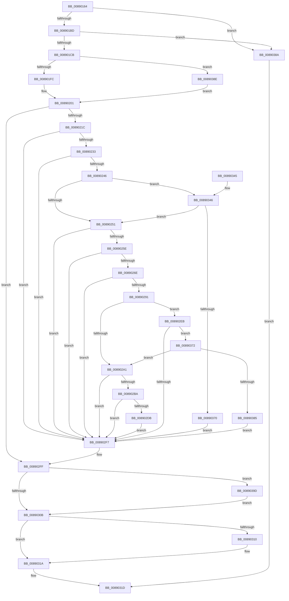

# MmSecureVirtualMemoryAgainstWrites

- RVA: `0x00890164`–`0x008903AE` (길이 `586` bytes)
- VA: `0x0000000140890164`
- 실행 섹션: `PAGE`
- PDB 이름 있음: `예`; PDB Function 태그: `아니요`
- unwind 정보 RVA: `0x0007D6A4`
- 디코드: `157`개 명령, `586/586` bytes 표시
- 미해석 바이트: `0` (있으면 어셈블리에 `.byte`로 보존)

> 이 문서는 커널 이미지의 기계어와 PDB 기호를 분석해 생성했습니다. 4번과 5번은 함수 원형과 자료형을 바이너리 사용 방식에서 추정한 C 해석이며 원본 소스 복구 결과는 아닙니다.

## 1. Dependencies

- 직접 호출 지점: **13**; 고유 호출 대상: **13**
- 직접 호출자로 확인된 함수: **3**
- RIP 상대 이미지 참조: **3**

### Outgoing calls
- `0x0089020B` → [MiObtainReferencedVadEx](../../text/31/MiObtainReferencedVadEx_function_00316690.md) (function, `0x00316690`)
- `0x00890236` → [MiVadSupportsPrivateCommit](../../text/31/MiVadSupportsPrivateCommit_function_00316FD0.md) (function, `0x00316FD0`)
- `0x00890261` → [MiReadVadFlags2](../../text/45/MiReadVadFlags2_function_00452C1C.md) (function, `0x00452C1C`)
- `0x008902AD` → [MiSetReadOnlyOnSectionView](../../text/29/MiSetReadOnlyOnSectionView_function_00294538.md) (function, `0x00294538`)
- `0x008902CE` → [MiAddSecureEntry](../98/MiAddSecureEntry_function_00980250.md) (function, `0x00980250`)
- `0x008902E4` → [MiUnsecureVirtualMemoryAgainstWrites](../A2/MiUnsecureVirtualMemoryAgainstWrites_function_00A2601C.md) (function, `0x00A2601C`)
- `0x008902EE` → [MiVadMapsLargeImage](../../text/2A/MiVadMapsLargeImage_function_002A70F0.md) (function, `0x002A70F0`)
- `0x008902FA` → [MiUnlockAndDereferenceVad](../../text/31/MiUnlockAndDereferenceVad_function_00316E60.md) (function, `0x00316E60`)
- `0x00890325` → [_security_check_cookie](../../text/6A/_security_check_cookie_function_006AC640.md) (function, `0x006AC640`)
- `0x0089035F` → [MiCheckSecuredVad](../88/MiCheckSecuredVad_function_00881FB4.md) (function, `0x00881FB4`)
- `0x00890378` → [MiIsRangeFullyCommitted](../88/MiIsRangeFullyCommitted_function_00881E24.md) (function, `0x00881E24`)
- `0x00890393` → [KeStackAttachProcess](../../text/21/KeStackAttachProcess_function_00216800.md) (function, `0x00216800`)
- `0x008903A4` → [KiUnstackDetachProcess](../../text/21/KiUnstackDetachProcess_function_00217D30.md) (function, `0x00217D30`)

### Direct callers
- [AlpcpExposeViewAttributeInSenderContext](../88/AlpcpExposeViewAttributeInSenderContext_function_0088F600.md) at `0x0088F6A4`
- [sub_00B191AC](../B1/Unknown_function_00B191AC.md) at `0x00B191BF`
- [sub_00B19294](../B1/Unknown_function_00B19294.md) at `0x00B1930E`

### Static image references
- `0x0089017B` → RVA `0x00E0A740` (`.data`; read)
- `0x00890271` → RVA `0x00014710` (`.rdata`; read)
- `0x00890310` → RVA `0x00E2DB80` (`.data`; read)

## 2. Other-region calls and transfers

- 다른 실행 섹션으로 향하는 call: **9**
  - `0x0089020B` → [MiObtainReferencedVadEx](../../text/31/MiObtainReferencedVadEx_function_00316690.md) (`PAGE` → `.text`)
  - `0x00890236` → [MiVadSupportsPrivateCommit](../../text/31/MiVadSupportsPrivateCommit_function_00316FD0.md) (`PAGE` → `.text`)
  - `0x00890261` → [MiReadVadFlags2](../../text/45/MiReadVadFlags2_function_00452C1C.md) (`PAGE` → `.text`)
  - `0x008902AD` → [MiSetReadOnlyOnSectionView](../../text/29/MiSetReadOnlyOnSectionView_function_00294538.md) (`PAGE` → `.text`)
  - `0x008902EE` → [MiVadMapsLargeImage](../../text/2A/MiVadMapsLargeImage_function_002A70F0.md) (`PAGE` → `.text`)
  - `0x008902FA` → [MiUnlockAndDereferenceVad](../../text/31/MiUnlockAndDereferenceVad_function_00316E60.md) (`PAGE` → `.text`)
  - `0x00890325` → [_security_check_cookie](../../text/6A/_security_check_cookie_function_006AC640.md) (`PAGE` → `.text`)
  - `0x00890393` → [KeStackAttachProcess](../../text/21/KeStackAttachProcess_function_00216800.md) (`PAGE` → `.text`)
  - `0x008903A4` → [KiUnstackDetachProcess](../../text/21/KiUnstackDetachProcess_function_00217D30.md) (`PAGE` → `.text`)
- 별도 외부 분기/꼬리 이동을 확인하지 못했습니다.

## 3. Assembly (complete function range)

```asm
00890164  48 89 5C 24 20                  mov qword ptr [rsp + 0x20], rbx
00890169  55                              push rbp
0089016A  56                              push rsi
0089016B  57                              push rdi
0089016C  41 54                           push r12
0089016E  41 55                           push r13
00890170  41 56                           push r14
00890172  41 57                           push r15
00890174  48 81 EC 80 00 00 00            sub rsp, 0x80
0089017B  48 8B 05 BE A5 57 00            mov rax, qword ptr [rip + 0x57a5be]
00890182  48 33 C4                        xor rax, rsp
00890185  48 89 44 24 70                  mov qword ptr [rsp + 0x70], rax
0089018A  83 64 24 30 00                  and dword ptr [rsp + 0x30], 0
0089018F  0F 57 C0                        xorps xmm0, xmm0
00890192  48 8B EA                        mov rbp, rdx
00890195  4D 8B E8                        mov r13, r8
00890198  48 81 E5 00 F0 FF FF            and rbp, 0xfffffffffffff000
0089019F  4C 8B E2                        mov r12, rdx
008901A2  48 8B F1                        mov rsi, rcx
008901A5  0F 11 44 24 40                  movups xmmword ptr [rsp + 0x40], xmm0
008901AA  0F 11 44 24 50                  movups xmmword ptr [rsp + 0x50], xmm0
008901AF  0F 11 44 24 60                  movups xmmword ptr [rsp + 0x60], xmm0
008901B4  48 3B EA                        cmp rbp, rdx
008901B7  0F 85 CD 01 00 00               jne 0x14089038a
008901BD  B8 FF 0F 00 00                  mov eax, 0xfff
008901C2  44 85 E8                        test eax, r13d
008901C5  0F 85 BF 01 00 00               jne 0x14089038a
008901CB  4D 8D 70 FF                     lea r14, [r8 - 1]
008901CF  33 FF                           xor edi, edi
008901D1  4C 03 F2                        add r14, rdx
008901D4  4C 0B F0                        or r14, rax
008901D7  65 48 8B 04 25 88 01 00 00      mov rax, qword ptr gs:[0x188]
008901E0  4D 8B FE                        mov r15, r14
008901E3  49 C1 EF 0C                     shr r15, 0xc
008901E7  48 8B 80 B8 00 00 00            mov rax, qword ptr [rax + 0xb8]
008901EE  48 89 44 24 38                  mov qword ptr [rsp + 0x38], rax
008901F3  48 3B C1                        cmp rax, rcx
008901F6  0F 85 92 01 00 00               jne 0x14089038e
008901FC  48 21 7C 24 38                  and qword ptr [rsp + 0x38], rdi
00890201  4C 8D 44 24 30                  lea r8, [rsp + 0x30]
00890206  33 D2                           xor edx, edx
00890208  48 8B CD                        mov rcx, rbp
0089020B  E8 80 64 A8 FF                  call 0x140316690
00890210  48 8B D8                        mov rbx, rax
00890213  48 85 C0                        test rax, rax
00890216  0F 84 E3 00 00 00               je 0x1408902ff
0089021C  0F B6 48 21                     movzx ecx, byte ptr [rax + 0x21]
00890220  8B 40 1C                        mov eax, dword ptr [rax + 0x1c]
00890223  48 C1 E1 20                     shl rcx, 0x20
00890227  48 0B C8                        or rcx, rax
0089022A  4C 3B F9                        cmp r15, rcx
0089022D  0F 87 C4 00 00 00               ja 0x1408902f7
00890233  48 8B CB                        mov rcx, rbx
00890236  E8 95 6D A8 FF                  call 0x140316fd0
0089023B  45 33 FF                        xor r15d, r15d
0089023E  85 C0                           test eax, eax
00890240  0F 84 B1 00 00 00               je 0x1408902f7
00890246  8B 43 30                        mov eax, dword ptr [rbx + 0x30]
00890249  A8 08                           test al, 8
0089024B  0F 85 F5 00 00 00               jne 0x140890346
00890251  F7 43 30 00 00 20 00            test dword ptr [rbx + 0x30], 0x200000
00890258  0F 85 99 00 00 00               jne 0x1408902f7
0089025E  48 8B CB                        mov rcx, rbx
00890261  E8 B6 29 BC FF                  call 0x140452c1c
00890266  A8 04                           test al, 4
00890268  0F 85 89 00 00 00               jne 0x1408902f7
0089026E  8B 43 30                        mov eax, dword ptr [rbx + 0x30]
00890271  48 8D 0D 98 44 78 FF            lea rcx, [rip - 0x87bb68]
00890278  48 C1 E8 07                     shr rax, 7
0089027C  83 E0 07                        and eax, 7
0089027F  8B 0C 81                        mov ecx, dword ptr [rcx + rax*4]
00890282  81 C9 00 07 00 00               or ecx, 0x700
00890288  8B C1                           mov eax, ecx
0089028A  83 C8 02                        or eax, 2
0089028D  3B C1                           cmp eax, ecx
0089028F  75 66                           jne 0x1408902f7
00890291  48 8B 43 48                     mov rax, qword ptr [rbx + 0x48]
00890295  48 8B 08                        mov rcx, qword ptr [rax]
00890298  8B 41 38                        mov eax, dword ptr [rcx + 0x38]
0089029B  24 A0                           and al, 0xa0
0089029D  3C 80                           cmp al, 0x80
0089029F  75 4A                           jne 0x1408902eb
008902A1  4D 8B CE                        mov r9, r14
008902A4  4C 8B C5                        mov r8, rbp
008902A7  48 8B D3                        mov rdx, rbx
008902AA  48 8B CE                        mov rcx, rsi
008902AD  E8 86 42 A0 FF                  call 0x140294538
008902B2  89 44 24 30                     mov dword ptr [rsp + 0x30], eax
008902B6  85 C0                           test eax, eax
008902B8  78 3D                           js 0x1408902f7
008902BA  41 B9 01 00 00 C0               mov r9d, 0xc0000001
008902C0  44 89 7C 24 20                  mov dword ptr [rsp + 0x20], r15d
008902C5  4D 8B C6                        mov r8, r14
008902C8  48 8B D5                        mov rdx, rbp
008902CB  48 8B CB                        mov rcx, rbx
008902CE  E8 7D FF 0E 00                  call 0x140980250
008902D3  48 8B F8                        mov rdi, rax
008902D6  48 85 C0                        test rax, rax
008902D9  75 1C                           jne 0x1408902f7
008902DB  4D 8B C6                        mov r8, r14
008902DE  48 8B D5                        mov rdx, rbp
008902E1  48 8B CB                        mov rcx, rbx
008902E4  E8 33 5D 19 00                  call 0x140a2601c
008902E9  EB 0C                           jmp 0x1408902f7
008902EB  48 8B CB                        mov rcx, rbx
008902EE  E8 FD 6D A1 FF                  call 0x1402a70f0
008902F3  85 C0                           test eax, eax
008902F5  74 7B                           je 0x140890372
008902F7  48 8B CB                        mov rcx, rbx
008902FA  E8 61 6B A8 FF                  call 0x140316e60
008902FF  48 83 7C 24 38 00               cmp qword ptr [rsp + 0x38], 0
00890305  0F 85 92 00 00 00               jne 0x14089039d
0089030B  48 85 FF                        test rdi, rdi
0089030E  74 0A                           je 0x14089031a
00890310  48 33 35 69 D8 59 00            xor rsi, qword ptr [rip + 0x59d869]
00890317  48 33 FE                        xor rdi, rsi
0089031A  48 8B C7                        mov rax, rdi
0089031D  48 8B 4C 24 70                  mov rcx, qword ptr [rsp + 0x70]
00890322  48 33 CC                        xor rcx, rsp
00890325  E8 16 C3 E1 FF                  call 0x1406ac640
0089032A  48 8B 9C 24 D8 00 00 00         mov rbx, qword ptr [rsp + 0xd8]
00890332  48 81 C4 80 00 00 00            add rsp, 0x80
00890339  41 5F                           pop r15
0089033B  41 5E                           pop r14
0089033D  41 5D                           pop r13
0089033F  41 5C                           pop r12
00890341  5F                              pop rdi
00890342  5E                              pop rsi
00890343  5D                              pop rbp
00890344  C3                              ret
00890345  CC                              int3
00890346  4C 89 7C 24 28                  mov qword ptr [rsp + 0x28], r15
0089034B  41 B9 01 00 00 00               mov r9d, 1
00890351  4D 8B C5                        mov r8, r13
00890354  44 88 7C 24 20                  mov byte ptr [rsp + 0x20], r15b
00890359  49 8B D4                        mov rdx, r12
0089035C  48 8B CB                        mov rcx, rbx
0089035F  E8 50 1C FF FF                  call 0x140881fb4
00890364  89 44 24 30                     mov dword ptr [rsp + 0x30], eax
00890368  85 C0                           test eax, eax
0089036A  0F 89 E1 FE FF FF               jns 0x140890251
00890370  EB 85                           jmp 0x1408902f7
00890372  4D 8B C6                        mov r8, r14
00890375  48 8B D5                        mov rdx, rbp
00890378  E8 A7 1A FF FF                  call 0x140881e24
0089037D  85 C0                           test eax, eax
0089037F  0F 85 1C FF FF FF               jne 0x1408902a1
00890385  E9 6D FF FF FF                  jmp 0x1408902f7
0089038A  33 C0                           xor eax, eax
0089038C  EB 8F                           jmp 0x14089031d
0089038E  48 8D 54 24 40                  lea rdx, [rsp + 0x40]
00890393  E8 68 64 98 FF                  call 0x140216800
00890398  E9 64 FE FF FF                  jmp 0x140890201
0089039D  33 D2                           xor edx, edx
0089039F  48 8D 4C 24 40                  lea rcx, [rsp + 0x40]
008903A4  E8 87 79 98 FF                  call 0x140217d30
008903A9  E9 5D FF FF FF                  jmp 0x14089030b
```

## 4. C-style interpretation (structured pseudocode)

```c
__int64 __fastcall MmSecureVirtualMemoryAgainstWrites(__int64 a1, __int64 a2, __int64 a3)
{
    __int64 result;
    __int64 v_r14;
    __int64 v_r15;
    __int64 v_rbp;
    __int64 v_rdi;
    __int64 v_rsi;
    __int64 v_rsp;
    unsigned __int64 v_stack_m48;
    unsigned __int64 v_stack_m58;
    unsigned __int64 v_stack_m68;
    unsigned __int64 v_stack_m78;
    unsigned __int64 v_stack_m80;
    unsigned int v_stack_m88;
    unsigned int v_stack_m98;
    unsigned __int64 v_stack_p20;
    unsigned __int64 v_stack_p28;
    unsigned int v_stack_p30;
    unsigned __int64 v_stack_p40;

    v_stack_p20 = v_rbx;
    v_rsp = (v_rsp) - (128);
    result = (*(unsigned __int64 *)(v_rip + 5744062)) ^ (v_rsp);
    v_stack_m48 = result;
    v_rbp = (a2) & (0xFFFFFFFFFFFFF000ULL);
    v_stack_m78 = v_xmm0;
    v_stack_m68 = v_xmm0;
    v_stack_m58 = v_xmm0;
    if (v_rbp != a2) goto loc_0089038A;
    if ((((unsigned int)((unsigned int)(0xFFFULL))) & ((unsigned int)(a3))) != 0) goto loc_0089038A;
    v_rdi = 0;
    v_r14 = (a3 - 1) + (a2);
    v_r14 = (v_r14) | ((unsigned int)(0xFFFULL));
    v_r15 = (v_r14) >> (12);
    v_stack_m80 = *(unsigned __int64 *)(*(unsigned __int64 *)(gs_base + (0 + 392)) + 184);
    if ((*(unsigned __int64 *)(*(unsigned __int64 *)(gs_base + (0 + 392)) + 184)) != a1) goto loc_0089038E;
loc_00890201:
    a2 = 0;
    result = MiObtainReferencedVadEx(v_rbp, a2, v_stack_m88, a4);
    if (result == 0) goto loc_008902FF;
    a1 = (*(unsigned __int8 *)(result + 33)) << (32);
    a1 = (a1) | ((unsigned int)(*(unsigned int *)(result + 28)));
    if (v_r15 > a1) goto loc_008902F7;
    result = MiVadSupportsPrivateCommit(result, a2, v_stack_m88, a4);
    v_r15 = 0;
    if ((unsigned int)(result) == 0) goto loc_008902F7;
    if ((((unsigned __int8)((unsigned int)(*(unsigned int *)(result + 48)))) & (8)) != 0) goto loc_00890346;
loc_00890251:
    if (((*(unsigned int *)(result + 48)) & (0x200000ULL)) != 0) goto loc_008902F7;
    result = MiReadVadFlags2(result, a2, v_stack_m88, a4);
    if ((((unsigned __int8)(result)) & (4)) != 0) goto loc_008902F7;
    result = ((unsigned int)(*(unsigned int *)(result + 48))) >> (7);
    result = (unsigned int)((result) & (7));
    a1 = (unsigned int)(((unsigned int)(*(unsigned int *)(v_rip - 8895336 + result * 4))) | (0x700ULL));
    result = (unsigned int)(((unsigned int)((unsigned int)(a1))) | (2));
    if (((unsigned int)(result)) != ((unsigned int)(a1))) goto loc_008902F7;
    result = (unsigned __int8)(((unsigned int)(*(unsigned int *)(*(unsigned __int64 *)(*(unsigned __int64 *)(result + 72)) + 56))) & (160));
    if (((unsigned __int8)(result)) != 128) goto loc_008902EB;
loc_008902A1:
    result = MiSetReadOnlyOnSectionView(a1, result, v_rbp, v_r14);
    v_stack_m88 = (unsigned int)(result);
    if (sign_flag) goto loc_008902F7;
    v_stack_m98 = 0;
    result = MiAddSecureEntry(result, v_rbp, v_r14, (unsigned int)(0xC0000001ULL));
    if (result != 0) goto loc_008902F7;
    result = MiUnsecureVirtualMemoryAgainstWrites(result, v_rbp, v_r14, (unsigned int)(0xC0000001ULL));
    goto loc_008902F7;
loc_008902EB:
    result = MiVadMapsLargeImage(result, v_rbp, v_r14, (unsigned int)(0xC0000001ULL));
    if ((unsigned int)(result) == 0) goto loc_00890372;
loc_008902F7:
    result = MiUnlockAndDereferenceVad(result, v_rbp, v_r14, (unsigned int)(0xC0000001ULL));
loc_008902FF:
    if (v_stack_m80 != 0) goto loc_0089039D;
loc_0089030B:
    v_rsi = a1;
    v_rdi = result;
    if (result != 0) {
        v_rsi = (a1) ^ (*(unsigned __int64 *)(v_rip + 5888105));
        v_rdi = (result) ^ (v_rsi);
    }
loc_0089031D:
    a1 = (v_stack_m48) ^ (v_rsp);
    result = _security_check_cookie(a1, v_rbp, v_r14, (unsigned int)(0xC0000001ULL));
    v_rsp = (v_rsp) + (128);
    return result;
loc_00890346:
    v_stack_p28 = 0;
    v_stack_p20 = 0;
    result = MiCheckSecuredVad(v_stack_p20, 0, a3, 1);
    v_stack_p30 = (unsigned int)(result);
    if (!sign_flag) goto loc_00890251;
    goto loc_008902F7;
loc_00890372:
    result = MiIsRangeFullyCommitted(v_stack_p20, v_rbp, v_r14, 1);
    if ((unsigned int)(result) != 0) goto loc_008902A1;
    goto loc_008902F7;
loc_0089038A:
    result = 0;
    goto loc_0089031D;
loc_0089038E:
    result = KeStackAttachProcess(v_stack_p20, v_stack_p40, v_r14, 1);
    goto loc_00890201;
loc_0089039D:
    a2 = 0;
    result = KiUnstackDetachProcess(v_stack_p40, a2, v_r14, 1);
    goto loc_0089030B;
}
```

## 5. (Beta) C Style

```c
int64_t MmSecureVirtualMemoryAgainstWrites(int64_t Arg1, int64_t Arg2, void *Arg3)
{
    uint8_t *arg3 = (uint8_t *)Arg3;

    int64_t result;
    int64_t local_r14;
    int64_t local_r15;
    int64_t local_rbp;
    int64_t local_rdi;
    int64_t local_rsi;
    int64_t local_rsp;
    uint64_t v_stack_m48;
    uint64_t v_stack_m58;
    uint64_t v_stack_m68;
    uint64_t v_stack_m78;
    uint64_t v_stack_m80;
    uint32_t v_stack_m88;
    uint32_t v_stack_m98;
    uint64_t v_stack_p20;
    uint64_t v_stack_p28;
    uint32_t v_stack_p30;
    uint64_t v_stack_p40;

    v_stack_p20 = local_rbx;
    local_rsp = (local_rsp) - (128);
    result = (*(uint64_t *)(v_rip + 0x57A5BE)) ^ (local_rsp);
    v_stack_m48 = result;
    local_rbp = (Arg2) & (0xFFFFFFFFFFFFF000ULL);
    v_stack_m78 = v_xmm0;
    v_stack_m68 = v_xmm0;
    v_stack_m58 = v_xmm0;
    if (local_rbp != Arg2) goto loc_0089038A;
    if ((((uint32_t)((uint32_t)(0xFFFULL))) & ((uint32_t)(Arg3))) != 0) goto loc_0089038A;
    local_rdi = 0;
    local_r14 = (Arg3 - 1) + (Arg2);
    local_r14 = (local_r14) | ((uint32_t)(0xFFFULL));
    local_r15 = (local_r14) >> (12);
    v_stack_m80 = *(uint64_t *)(*(uint64_t *)(gs_base + (0 + 0x188)) + 0xB8);
    if ((*(uint64_t *)(*(uint64_t *)(gs_base + (0 + 0x188)) + 0xB8)) != Arg1) goto loc_0089038E;
loc_00890201:
    Arg2 = 0;
    result = MiObtainReferencedVadEx(local_rbp, Arg2, v_stack_m88, a4);
    if (result == 0) goto loc_008902FF;
    Arg1 = (*(uint8_t *)(result + 0x21)) << (32);
    Arg1 = (Arg1) | ((uint32_t)(*(uint32_t *)(result + 0x1C)));
    if (local_r15 > Arg1) goto loc_008902F7;
    result = MiVadSupportsPrivateCommit(result, Arg2, v_stack_m88, a4);
    local_r15 = 0;
    if ((uint32_t)(result) == 0) goto loc_008902F7;
    if ((((uint8_t)((uint32_t)(*(uint32_t *)(result + 0x30)))) & (8)) != 0) goto loc_00890346;
loc_00890251:
    if (((*(uint32_t *)(result + 0x30)) & (0x200000ULL)) != 0) goto loc_008902F7;
    result = MiReadVadFlags2(result, Arg2, v_stack_m88, a4);
    if ((((uint8_t)(result)) & (4)) != 0) goto loc_008902F7;
    result = ((uint32_t)(*(uint32_t *)(result + 0x30))) >> (7);
    result = (uint32_t)((result) & (7));
    Arg1 = (uint32_t)(((uint32_t)(*(uint32_t *)(v_rip - 0x87BB68 + result * 4))) | (0x700ULL));
    result = (uint32_t)(((uint32_t)((uint32_t)(Arg1))) | (2));
    if (((uint32_t)(result)) != ((uint32_t)(Arg1))) goto loc_008902F7;
    result = (uint8_t)(((uint32_t)(*(uint32_t *)(*(uint64_t *)(*(uint64_t *)(result + 0x48)) + 0x38))) & (160));
    if (((uint8_t)(result)) != 128) goto loc_008902EB;
loc_008902A1:
    result = MiSetReadOnlyOnSectionView(Arg1, result, local_rbp, local_r14);
    v_stack_m88 = (uint32_t)(result);
    if (sign_flag) goto loc_008902F7;
    v_stack_m98 = 0;
    result = MiAddSecureEntry(result, local_rbp, local_r14, (uint32_t)(0xC0000001ULL));
    if (result != 0) goto loc_008902F7;
    result = MiUnsecureVirtualMemoryAgainstWrites(result, local_rbp, local_r14, (uint32_t)(0xC0000001ULL));
    goto loc_008902F7;
loc_008902EB:
    result = MiVadMapsLargeImage(result, local_rbp, local_r14, (uint32_t)(0xC0000001ULL));
    if ((uint32_t)(result) == 0) goto loc_00890372;
loc_008902F7:
    result = MiUnlockAndDereferenceVad(result, local_rbp, local_r14, (uint32_t)(0xC0000001ULL));
loc_008902FF:
    if (v_stack_m80 != 0) goto loc_0089039D;
loc_0089030B:
    local_rsi = Arg1;
    local_rdi = result;
    if (result != 0) {
        local_rsi = (Arg1) ^ (*(uint64_t *)(v_rip + 0x59D869));
        local_rdi = (result) ^ (local_rsi);
    }
loc_0089031D:
    Arg1 = (v_stack_m48) ^ (local_rsp);
    result = _security_check_cookie(Arg1, local_rbp, local_r14, (uint32_t)(0xC0000001ULL));
    local_rsp = (local_rsp) + (128);
    return result;
loc_00890346:
    v_stack_p28 = 0;
    v_stack_p20 = 0;
    result = MiCheckSecuredVad(v_stack_p20, 0, Arg3, 1);
    v_stack_p30 = (uint32_t)(result);
    if (!sign_flag) goto loc_00890251;
    goto loc_008902F7;
loc_00890372:
    result = MiIsRangeFullyCommitted(v_stack_p20, local_rbp, local_r14, 1);
    if ((uint32_t)(result) != 0) goto loc_008902A1;
    goto loc_008902F7;
loc_0089038A:
    result = 0;
    goto loc_0089031D;
loc_0089038E:
    result = KeStackAttachProcess(v_stack_p20, v_stack_p40, local_r14, 1);
    goto loc_00890201;
loc_0089039D:
    Arg2 = 0;
    result = KiUnstackDetachProcess(v_stack_p40, Arg2, local_r14, 1);
    goto loc_0089030B;
}
```

### 관측된 메모리 오프셋

구조체 형식이 확인되지 않은 접근은 인자 기준의 오프셋으로만 기록했습니다.

| 기준 인자 | 오프셋 표현 | 폭 (bit) | 접근 |
|---|---:|---:|---|
| `Arg3` | `- 0x1` | `64` | `R` |

## 6. Execution-region graph

[열기: 2D/3D 그래프와 함수 탐색 컨트롤 패널](../../../control-panel.html?section=page&rva=0x00890164&view=graph)

- 2D 그래프는 위에서 아래로 흐르고, 3D 그래프는 빈 공간을 드래그해 회전합니다. Shift+드래그는 이동, 휠은 확대·축소, 함수 노드 선택은 대상 보고서 이동입니다.

### Static fallback


