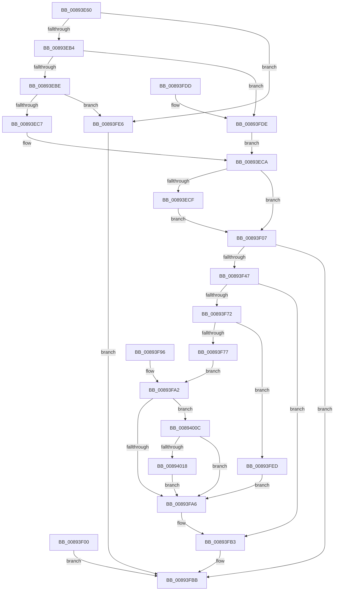

# NtAlpcCreatePortSection

- RVA: `0x00893E60`–`0x0089402A` (길이 `458` bytes)
- VA: `0x0000000140893E60`
- 실행 섹션: `PAGE`
- PDB 이름 있음: `예`; PDB Function 태그: `아니요`
- unwind 정보 RVA: `0x0007DF44`
- 디코드: `113`개 명령, `458/458` bytes 표시
- 미해석 바이트: `0` (있으면 어셈블리에 `.byte`로 보존)

> 이 문서는 커널 이미지의 기계어와 PDB 기호를 분석해 생성했습니다. 4번과 5번은 함수 원형과 자료형을 바이너리 사용 방식에서 추정한 C 해석이며 원본 소스 복구 결과는 아닙니다.

## 1. Dependencies

- 직접 호출 지점: **7**; 고유 호출 대상: **6**
- 직접 호출자로 확인된 함수: **0**
- RIP 상대 이미지 참조: **1**

### Outgoing calls
- `0x00893F3C` → [ObReferenceObjectByHandle](../86/ObReferenceObjectByHandle_function_00868DB0.md) (function, `0x00868DB0`)
- `0x00893F67` → [AlpcpCreateSection](AlpcpCreateSection_function_0089307C.md) (function, `0x0089307C`)
- `0x00893FAE` → [AlpcpDereferenceBlobEx](../88/AlpcpDereferenceBlobEx_function_0088AF00.md) (function, `0x0088AF00`)
- `0x00893FB6` → [ObfDereferenceObject](../../text/2F/ObfDereferenceObject_function_002F9350.md) (function, `0x002F9350`)
- `0x00893FBB` → [KeLeaveCriticalRegion](../../text/25/KeLeaveCriticalRegion_function_0025D8B0.md) (function, `0x0025D8B0`)
- `0x0089400F` → [AlpcpDeleteBlob](../88/AlpcpDeleteBlob_function_0088A11C.md) (function, `0x0088A11C`)
- `0x00894020` → [AlpcpDereferenceBlobEx](../88/AlpcpDereferenceBlobEx_function_0088AF00.md) (function, `0x0088AF00`)

### Direct callers
- 이 함수 시작 RVA로 연결되는 직접 call은 확인되지 않았습니다. 간접 호출은 완전히 역산할 수 없습니다.

### Static image references
- `0x00893F17` → RVA `0x00FC6C18` (`ALMOSTRO`; read)

## 2. Other-region calls and transfers

- 다른 실행 섹션으로 향하는 call: **2**
  - `0x00893FB6` → [ObfDereferenceObject](../../text/2F/ObfDereferenceObject_function_002F9350.md) (`PAGE` → `.text`)
  - `0x00893FBB` → [KeLeaveCriticalRegion](../../text/25/KeLeaveCriticalRegion_function_0025D8B0.md) (`PAGE` → `.text`)
- 별도 외부 분기/꼬리 이동을 확인하지 못했습니다.

## 3. Assembly (complete function range)

```asm
00893E60  48 8B C4                        mov rax, rsp
00893E63  48 89 58 08                     mov qword ptr [rax + 8], rbx
00893E67  48 89 70 10                     mov qword ptr [rax + 0x10], rsi
00893E6B  48 89 78 18                     mov qword ptr [rax + 0x18], rdi
00893E6F  4C 89 70 20                     mov qword ptr [rax + 0x20], r14
00893E73  41 57                           push r15
00893E75  48 83 EC 40                     sub rsp, 0x40
00893E79  4D 8B F9                        mov r15, r9
00893E7C  49 8B F0                        mov rsi, r8
00893E7F  4C 8B D1                        mov r10, rcx
00893E82  48 83 60 E8 00                  and qword ptr [rax - 0x18], 0
00893E87  65 48 8B 04 25 88 01 00 00      mov rax, qword ptr gs:[0x188]
00893E90  66 FF 88 E4 01 00 00            dec word ptr [rax + 0x1e4]
00893E97  90                              nop
00893E98  65 48 8B 04 25 88 01 00 00      mov rax, qword ptr gs:[0x188]
00893EA1  44 8A B0 32 02 00 00            mov r14b, byte ptr [rax + 0x232]
00893EA8  F7 C2 FF FF FB FF               test edx, 0xfffbffff
00893EAE  0F 85 32 01 00 00               jne 0x140893fe6
00893EB4  0F BA E2 12                     bt edx, 0x12
00893EB8  0F 83 20 01 00 00               jae 0x140893fde
00893EBE  4D 85 C0                        test r8, r8
00893EC1  0F 85 1F 01 00 00               jne 0x140893fe6
00893EC7  40 B7 01                        mov dil, 1
00893ECA  45 84 F6                        test r14b, r14b
00893ECD  74 38                           je 0x140893f07
00893ECF  48 BA 00 00 FF FF FF 7F 00 00   movabs rdx, 0x7fffffff0000
00893ED9  48 8B CA                        mov rcx, rdx
00893EDC  48 39 54 24 70                  cmp qword ptr [rsp + 0x70], rdx
00893EE1  48 0F 42 4C 24 70               cmovb rcx, qword ptr [rsp + 0x70]
00893EE7  48 8B 01                        mov rax, qword ptr [rcx]
00893EEA  48 89 01                        mov qword ptr [rcx], rax
00893EED  48 39 54 24 78                  cmp qword ptr [rsp + 0x78], rdx
00893EF2  48 0F 42 54 24 78               cmovb rdx, qword ptr [rsp + 0x78]
00893EF8  48 8B 02                        mov rax, qword ptr [rdx]
00893EFB  48 89 02                        mov qword ptr [rdx], rax
00893EFE  EB 07                           jmp 0x140893f07
00893F00  8B D8                           mov ebx, eax
00893F02  E9 B4 00 00 00                  jmp 0x140893fbb
00893F07  65 48 8B 04 25 88 01 00 00      mov rax, qword ptr gs:[0x188]
00893F10  44 8A 88 32 02 00 00            mov r9b, byte ptr [rax + 0x232]
00893F17  4C 8B 05 FA 2C 73 00            mov r8, qword ptr [rip + 0x732cfa]
00893F1E  48 83 64 24 38 00               and qword ptr [rsp + 0x38], 0
00893F24  48 83 64 24 28 00               and qword ptr [rsp + 0x28], 0
00893F2A  48 8D 44 24 38                  lea rax, [rsp + 0x38]
00893F2F  48 89 44 24 20                  mov qword ptr [rsp + 0x20], rax
00893F34  BA 01 00 00 00                  mov edx, 1
00893F39  49 8B CA                        mov rcx, r10
00893F3C  E8 6F 4E FD FF                  call 0x140868db0
00893F41  8B D8                           mov ebx, eax
00893F43  85 C0                           test eax, eax
00893F45  78 74                           js 0x140893fbb
00893F47  48 8D 44 24 30                  lea rax, [rsp + 0x30]
00893F4C  48 89 44 24 28                  mov qword ptr [rsp + 0x28], rax
00893F51  4C 89 7C 24 20                  mov qword ptr [rsp + 0x20], r15
00893F56  4C 8B CE                        mov r9, rsi
00893F59  41 B0 01                        mov r8b, 1
00893F5C  40 8A D7                        mov dl, dil
00893F5F  48 8B 74 24 38                  mov rsi, qword ptr [rsp + 0x38]
00893F64  48 8B CE                        mov rcx, rsi
00893F67  E8 10 F1 FF FF                  call 0x14089307c
00893F6C  8B D8                           mov ebx, eax
00893F6E  85 C0                           test eax, eax
00893F70  78 41                           js 0x140893fb3
00893F72  45 84 F6                        test r14b, r14b
00893F75  74 76                           je 0x140893fed
00893F77  48 8B 7C 24 30                  mov rdi, qword ptr [rsp + 0x30]
00893F7C  48 8B 57 18                     mov rdx, qword ptr [rdi + 0x18]
00893F80  48 8B 4C 24 70                  mov rcx, qword ptr [rsp + 0x70]
00893F85  48 89 11                        mov qword ptr [rcx], rdx
00893F88  48 8B 4F 08                     mov rcx, qword ptr [rdi + 8]
00893F8C  48 8B 44 24 78                  mov rax, qword ptr [rsp + 0x78]
00893F91  48 89 08                        mov qword ptr [rax], rcx
00893F94  EB 0C                           jmp 0x140893fa2
00893F96  8B D8                           mov ebx, eax
00893F98  48 8B 7C 24 30                  mov rdi, qword ptr [rsp + 0x30]
00893F9D  48 8B 74 24 38                  mov rsi, qword ptr [rsp + 0x38]
00893FA2  85 DB                           test ebx, ebx
00893FA4  78 66                           js 0x14089400c
00893FA6  BA 01 00 00 00                  mov edx, 1
00893FAB  48 8B CF                        mov rcx, rdi
00893FAE  E8 4D 6F FF FF                  call 0x14088af00
00893FB3  48 8B CE                        mov rcx, rsi
00893FB6  E8 95 53 A6 FF                  call 0x1402f9350
00893FBB  E8 F0 98 9C FF                  call 0x14025d8b0
00893FC0  8B C3                           mov eax, ebx
00893FC2  48 8B 5C 24 50                  mov rbx, qword ptr [rsp + 0x50]
00893FC7  48 8B 74 24 58                  mov rsi, qword ptr [rsp + 0x58]
00893FCC  48 8B 7C 24 60                  mov rdi, qword ptr [rsp + 0x60]
00893FD1  4C 8B 74 24 68                  mov r14, qword ptr [rsp + 0x68]
00893FD6  48 83 C4 40                     add rsp, 0x40
00893FDA  41 5F                           pop r15
00893FDC  C3                              ret
00893FDD  CC                              int3
00893FDE  40 32 FF                        xor dil, dil
00893FE1  E9 E4 FE FF FF                  jmp 0x140893eca
00893FE6  BB 0D 00 00 C0                  mov ebx, 0xc000000d
00893FEB  EB CE                           jmp 0x140893fbb
00893FED  48 8B 7C 24 30                  mov rdi, qword ptr [rsp + 0x30]
00893FF2  4C 8B 47 18                     mov r8, qword ptr [rdi + 0x18]
00893FF6  48 8B 44 24 70                  mov rax, qword ptr [rsp + 0x70]
00893FFB  4C 89 00                        mov qword ptr [rax], r8
00893FFE  4C 8B 47 08                     mov r8, qword ptr [rdi + 8]
00894002  48 8B 44 24 78                  mov rax, qword ptr [rsp + 0x78]
00894007  4C 89 00                        mov qword ptr [rax], r8
0089400A  EB 9A                           jmp 0x140893fa6
0089400C  48 8B CF                        mov rcx, rdi
0089400F  E8 08 61 FF FF                  call 0x14088a11c
00894014  84 C0                           test al, al
00894016  74 8E                           je 0x140893fa6
00894018  BA 01 00 00 00                  mov edx, 1
0089401D  48 8B CF                        mov rcx, rdi
00894020  E8 DB 6E FF FF                  call 0x14088af00
00894025  E9 7C FF FF FF                  jmp 0x140893fa6
```

## 4. C-style interpretation (structured pseudocode)

```c
__int64 __fastcall NtAlpcCreatePortSection(__int64 a1, int a2, __int64 a3, __int64 a4, __int64 a5, __int64 a6)
{
    __int64 result;
    __int64 v_rdi;
    __int64 v_rsp;
    unsigned __int64 v_stack_m10;
    unsigned __int64 v_stack_m18;
    unsigned __int64 v_stack_m20;
    unsigned __int64 v_stack_m28;
    unsigned __int64 v_stack_p10;
    unsigned __int64 v_stack_p18;
    unsigned __int64 v_stack_p20;
    unsigned __int64 v_stack_p30;
    unsigned __int64 v_stack_p8;

    *(unsigned __int64 *)(v_rsp + 8) = v_rbx;
    *(unsigned __int64 *)(v_rsp + 16) = v_rsi;
    *(unsigned __int64 *)(v_rsp + 24) = v_rdi;
    *(unsigned __int64 *)(v_rsp + 32) = v_r14;
    v_rsp = (v_rsp) - (64);
    if (((a2) & (0xFFFBFFFFULL)) != 0) goto loc_00893FE6;
    if (condition_is_above_or_equal) goto loc_00893FDE;
    if (a3 != 0) goto loc_00893FE6;
loc_00893ECA:
    if ((unsigned __int8)(*(unsigned __int8 *)(*(unsigned __int64 *)(gs_base + (0 + 392)) + 562)) == 0) goto loc_00893F07;
    if (a5 < a2) { a2 = a5; }
    *(unsigned __int64 *)(a2) = *(unsigned __int64 *)(a2);
    if (a6 < a2) { a2 = a6; }
    *(unsigned __int64 *)(a2) = *(unsigned __int64 *)(a2);
    goto loc_00893F07;
loc_00893F07:
    v_stack_m28 = v_stack_m10;
    result = ObReferenceObjectByHandle(a1, 1, *(unsigned __int64 *)(v_rip + 7548154), *(unsigned __int8 *)(*(unsigned __int64 *)(gs_base + (0 + 392)) + 562));
    if (sign_flag) goto loc_00893FBB;
    v_stack_m20 = v_stack_m18;
    v_stack_m28 = a4;
    result = AlpcpCreateSection(v_stack_m10, 1, 1, a3);
    if (sign_flag) goto loc_00893FB3;
    if ((unsigned __int8)(*(unsigned __int8 *)(*(unsigned __int64 *)(gs_base + (0 + 392)) + 562)) == 0) goto loc_00893FED;
    *(unsigned __int64 *)(a5) = *(unsigned __int64 *)(v_stack_m18 + 24);
    *(unsigned __int64 *)(a6) = *(unsigned __int64 *)(v_stack_m18 + 8);
    goto loc_00893FA2;
loc_00893FA2:
    if (sign_flag) goto loc_0089400C;
loc_00893FA6:
    result = AlpcpDereferenceBlobEx(v_stack_m18, 1, 1, a3);
loc_00893FB3:
    result = ObfDereferenceObject(v_stack_m10, 1, 1, a3);
loc_00893FBB:
    result = KeLeaveCriticalRegion(v_stack_m10, 1, 1, a3);
    v_rsp = (v_rsp) + (64);
    return (unsigned int)((unsigned int)((unsigned int)((unsigned int)(result))));
loc_00893FDE:
    v_rdi = 0;
    goto loc_00893ECA;
loc_00893FE6:
    goto loc_00893FBB;
loc_00893FED:
    *(unsigned __int64 *)(a5) = *(unsigned __int64 *)(v_stack_p30 + 24);
    *(unsigned __int64 *)(a6) = *(unsigned __int64 *)(v_stack_p30 + 8);
    goto loc_00893FA6;
loc_0089400C:
    result = AlpcpDeleteBlob(v_stack_p30, 1, *(unsigned __int64 *)(v_stack_p30 + 8), a3);
    if ((unsigned __int8)(result) == 0) goto loc_00893FA6;
    result = AlpcpDereferenceBlobEx(v_stack_p30, 1, *(unsigned __int64 *)(v_stack_p30 + 8), a3);
    goto loc_00893FA6;
}
```

## 5. (Beta) C Style

```c
int64_t NtAlpcCreatePortSection(int64_t Arg1, int32_t Arg2, int64_t Arg3, int64_t Arg4, void *Arg5, void *Arg6)
{
    uint8_t *arg5 = (uint8_t *)Arg5;
    uint8_t *arg6 = (uint8_t *)Arg6;

    int64_t result;
    int64_t local_rdi;
    int64_t local_rsp;
    uint64_t v_stack_m10;
    uint64_t v_stack_m18;
    uint64_t v_stack_m20;
    uint64_t v_stack_m28;
    uint64_t v_stack_p10;
    uint64_t v_stack_p18;
    uint64_t v_stack_p20;
    uint64_t v_stack_p30;
    uint64_t v_stack_p8;

    *(uint64_t *)(local_rsp + 0x8) = local_rbx;
    *(uint64_t *)(local_rsp + 0x10) = local_rsi;
    *(uint64_t *)(local_rsp + 0x18) = local_rdi;
    *(uint64_t *)(local_rsp + 0x20) = local_r14;
    local_rsp = (local_rsp) - (64);
    if (((Arg2) & (0xFFFBFFFFULL)) != 0) goto loc_00893FE6;
    if (condition_is_above_or_equal) goto loc_00893FDE;
    if (Arg3 != 0) goto loc_00893FE6;
loc_00893ECA:
    if ((uint8_t)(*(uint8_t *)(*(uint64_t *)(gs_base + (0 + 0x188)) + 0x232)) == 0) goto loc_00893F07;
    if (Arg5 < Arg2) { Arg2 = Arg5; }
    *(uint64_t *)(Arg2) = *(uint64_t *)(Arg2);
    if (Arg6 < Arg2) { Arg2 = Arg6; }
    *(uint64_t *)(Arg2) = *(uint64_t *)(Arg2);
    goto loc_00893F07;
loc_00893F07:
    v_stack_m28 = v_stack_m10;
    result = ObReferenceObjectByHandle(Arg1, 1, *(uint64_t *)(v_rip + 0x732CFA), *(uint8_t *)(*(uint64_t *)(gs_base + (0 + 0x188)) + 0x232));
    if (sign_flag) goto loc_00893FBB;
    v_stack_m20 = v_stack_m18;
    v_stack_m28 = Arg4;
    result = AlpcpCreateSection(v_stack_m10, 1, 1, Arg3);
    if (sign_flag) goto loc_00893FB3;
    if ((uint8_t)(*(uint8_t *)(*(uint64_t *)(gs_base + (0 + 0x188)) + 0x232)) == 0) goto loc_00893FED;
    *(uint64_t *)(arg5) = *(uint64_t *)(v_stack_m18 + 0x18);
    *(uint64_t *)(arg6) = *(uint64_t *)(v_stack_m18 + 0x8);
    goto loc_00893FA2;
loc_00893FA2:
    if (sign_flag) goto loc_0089400C;
loc_00893FA6:
    result = AlpcpDereferenceBlobEx(v_stack_m18, 1, 1, Arg3);
loc_00893FB3:
    result = ObfDereferenceObject(v_stack_m10, 1, 1, Arg3);
loc_00893FBB:
    result = KeLeaveCriticalRegion(v_stack_m10, 1, 1, Arg3);
    local_rsp = (local_rsp) + (64);
    return (uint32_t)((uint32_t)((uint32_t)((uint32_t)(result))));
loc_00893FDE:
    local_rdi = 0;
    goto loc_00893ECA;
loc_00893FE6:
    goto loc_00893FBB;
loc_00893FED:
    *(uint64_t *)(arg5) = *(uint64_t *)(v_stack_p30 + 0x18);
    *(uint64_t *)(arg6) = *(uint64_t *)(v_stack_p30 + 0x8);
    goto loc_00893FA6;
loc_0089400C:
    result = AlpcpDeleteBlob(v_stack_p30, 1, *(uint64_t *)(v_stack_p30 + 0x8), Arg3);
    if ((uint8_t)(result) == 0) goto loc_00893FA6;
    result = AlpcpDereferenceBlobEx(v_stack_p30, 1, *(uint64_t *)(v_stack_p30 + 0x8), Arg3);
    goto loc_00893FA6;
}
```

### 관측된 메모리 오프셋

구조체 형식이 확인되지 않은 접근은 인자 기준의 오프셋으로만 기록했습니다.

| 기준 인자 | 오프셋 표현 | 폭 (bit) | 접근 |
|---|---:|---:|---|
| `Arg5` | `+ 0x0` | `64` | `W` |
| `Arg6` | `+ 0x0` | `64` | `W` |

## 6. Execution-region graph

[열기: 2D/3D 그래프와 함수 탐색 컨트롤 패널](../../../control-panel.html?section=page&rva=0x00893E60&view=graph)

- 2D 그래프는 위에서 아래로 흐르고, 3D 그래프는 빈 공간을 드래그해 회전합니다. Shift+드래그는 이동, 휠은 확대·축소, 함수 노드 선택은 대상 보고서 이동입니다.

### Static fallback


