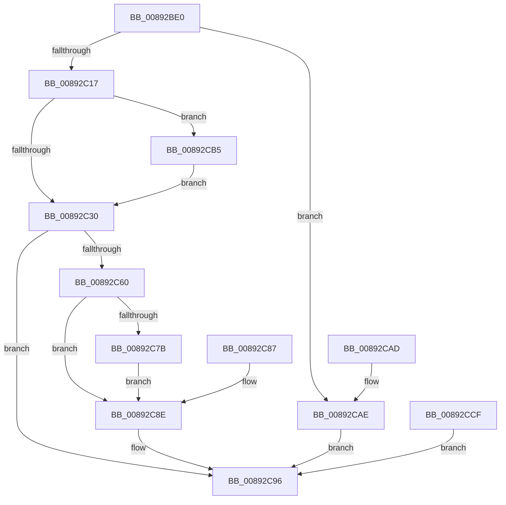

# NtAlpcCreateResourceReserve

- RVA: `0x00892BE0`–`0x00892CD3` (길이 `243` bytes)
- VA: `0x0000000140892BE0`
- 실행 섹션: `PAGE`
- PDB 이름 있음: `예`; PDB Function 태그: `아니요`
- unwind 정보 RVA: `0x0007DD5C`
- 디코드: `62`개 명령, `243/243` bytes 표시
- 미해석 바이트: `0` (있으면 어셈블리에 `.byte`로 보존)

> 이 문서는 커널 이미지의 기계어와 PDB 기호를 분석해 생성했습니다. 4번과 5번은 함수 원형과 자료형을 바이너리 사용 방식에서 추정한 C 해석이며 원본 소스 복구 결과는 아닙니다.

## 1. Dependencies

- 직접 호출 지점: **4**; 고유 호출 대상: **4**
- 직접 호출자로 확인된 함수: **0**
- RIP 상대 이미지 참조: **1**

### Outgoing calls
- `0x00892C55` → [ObReferenceObjectByHandle](../86/ObReferenceObjectByHandle_function_00868DB0.md) (function, `0x00868DB0`)
- `0x00892C70` → [AlpcpCreateReserve](AlpcpCreateReserve_function_00892318.md) (function, `0x00892318`)
- `0x00892C91` → [ObfDereferenceObject](../../text/2F/ObfDereferenceObject_function_002F9350.md) (function, `0x002F9350`)
- `0x00892C96` → [KeLeaveCriticalRegion](../../text/25/KeLeaveCriticalRegion_function_0025D8B0.md) (function, `0x0025D8B0`)

### Direct callers
- 이 함수 시작 RVA로 연결되는 직접 call은 확인되지 않았습니다. 간접 호출은 완전히 역산할 수 없습니다.

### Static image references
- `0x00892C30` → RVA `0x00FC6C18` (`ALMOSTRO`; read)

## 2. Other-region calls and transfers

- 다른 실행 섹션으로 향하는 call: **2**
  - `0x00892C91` → [ObfDereferenceObject](../../text/2F/ObfDereferenceObject_function_002F9350.md) (`PAGE` → `.text`)
  - `0x00892C96` → [KeLeaveCriticalRegion](../../text/25/KeLeaveCriticalRegion_function_0025D8B0.md) (`PAGE` → `.text`)
- 별도 외부 분기/꼬리 이동을 확인하지 못했습니다.

## 3. Assembly (complete function range)

```asm
00892BE0  48 89 5C 24 08                  mov qword ptr [rsp + 8], rbx
00892BE5  48 89 74 24 10                  mov qword ptr [rsp + 0x10], rsi
00892BEA  57                              push rdi
00892BEB  48 83 EC 40                     sub rsp, 0x40
00892BEF  49 8B F1                        mov rsi, r9
00892BF2  49 8B F8                        mov rdi, r8
00892BF5  4C 8B D1                        mov r10, rcx
00892BF8  48 83 64 24 38 00               and qword ptr [rsp + 0x38], 0
00892BFE  65 48 8B 04 25 88 01 00 00      mov rax, qword ptr gs:[0x188]
00892C07  66 FF 88 E4 01 00 00            dec word ptr [rax + 0x1e4]
00892C0E  90                              nop
00892C0F  85 D2                           test edx, edx
00892C11  0F 85 97 00 00 00               jne 0x140892cae
00892C17  65 48 8B 04 25 88 01 00 00      mov rax, qword ptr gs:[0x188]
00892C20  44 8A 88 32 02 00 00            mov r9b, byte ptr [rax + 0x232]
00892C27  45 84 C9                        test r9b, r9b
00892C2A  0F 85 85 00 00 00               jne 0x140892cb5
00892C30  4C 8B 05 E1 3F 73 00            mov r8, qword ptr [rip + 0x733fe1]
00892C37  48 83 64 24 30 00               and qword ptr [rsp + 0x30], 0
00892C3D  48 83 64 24 28 00               and qword ptr [rsp + 0x28], 0
00892C43  48 8D 44 24 30                  lea rax, [rsp + 0x30]
00892C48  48 89 44 24 20                  mov qword ptr [rsp + 0x20], rax
00892C4D  BA 01 00 00 00                  mov edx, 1
00892C52  49 8B CA                        mov rcx, r10
00892C55  E8 56 61 FD FF                  call 0x140868db0
00892C5A  8B D8                           mov ebx, eax
00892C5C  85 C0                           test eax, eax
00892C5E  78 36                           js 0x140892c96
00892C60  4C 8D 44 24 38                  lea r8, [rsp + 0x38]
00892C65  48 8B D7                        mov rdx, rdi
00892C68  48 8B 7C 24 30                  mov rdi, qword ptr [rsp + 0x30]
00892C6D  48 8B CF                        mov rcx, rdi
00892C70  E8 A3 F6 FF FF                  call 0x140892318
00892C75  8B D8                           mov ebx, eax
00892C77  85 C0                           test eax, eax
00892C79  78 13                           js 0x140892c8e
00892C7B  8B 4C 24 38                     mov ecx, dword ptr [rsp + 0x38]
00892C7F  0F BA E9 1F                     bts ecx, 0x1f
00892C83  89 0E                           mov dword ptr [rsi], ecx
00892C85  EB 07                           jmp 0x140892c8e
00892C87  8B D8                           mov ebx, eax
00892C89  48 8B 7C 24 30                  mov rdi, qword ptr [rsp + 0x30]
00892C8E  48 8B CF                        mov rcx, rdi
00892C91  E8 BA 66 A6 FF                  call 0x1402f9350
00892C96  E8 15 AC 9C FF                  call 0x14025d8b0
00892C9B  8B C3                           mov eax, ebx
00892C9D  48 8B 5C 24 50                  mov rbx, qword ptr [rsp + 0x50]
00892CA2  48 8B 74 24 58                  mov rsi, qword ptr [rsp + 0x58]
00892CA7  48 83 C4 40                     add rsp, 0x40
00892CAB  5F                              pop rdi
00892CAC  C3                              ret
00892CAD  CC                              int3
00892CAE  BB 0D 00 00 C0                  mov ebx, 0xc000000d
00892CB3  EB E1                           jmp 0x140892c96
00892CB5  48 B9 00 00 FF FF FF 7F 00 00   movabs rcx, 0x7fffffff0000
00892CBF  48 3B F1                        cmp rsi, rcx
00892CC2  48 0F 42 CE                     cmovb rcx, rsi
00892CC6  8B 01                           mov eax, dword ptr [rcx]
00892CC8  89 01                           mov dword ptr [rcx], eax
00892CCA  E9 61 FF FF FF                  jmp 0x140892c30
00892CCF  8B D8                           mov ebx, eax
00892CD1  EB C3                           jmp 0x140892c96
```

## 4. C-style interpretation (structured pseudocode)

```c
__int64 __fastcall NtAlpcCreateResourceReserve(__int64 a1, int a2, __int64 a3, __int64 a4)
{
    __int64 result;
    __int64 v_rsp;
    unsigned __int64 v_stack_m10;
    unsigned __int64 v_stack_m18;
    unsigned __int64 v_stack_m20;
    unsigned __int64 v_stack_m28;
    unsigned __int64 v_stack_p10;
    unsigned __int64 v_stack_p8;

    v_stack_p8 = v_rbx;
    v_stack_p10 = v_rsi;
    v_rsp = (v_rsp) - (64);
    if (a2 != 0) goto loc_00892CAE;
    if ((unsigned __int8)(*(unsigned __int8 *)(*(unsigned __int64 *)(gs_base + (0 + 392)) + 562)) != 0) goto loc_00892CB5;
loc_00892C30:
    v_stack_m28 = v_stack_m18;
    result = ObReferenceObjectByHandle(a1, 1, *(unsigned __int64 *)(v_rip + 7552993), *(unsigned __int8 *)(*(unsigned __int64 *)(gs_base + (0 + 392)) + 562));
    if (sign_flag) goto loc_00892C96;
    result = AlpcpCreateReserve(v_stack_m18, a3, v_stack_m10, *(unsigned __int8 *)(*(unsigned __int64 *)(gs_base + (0 + 392)) + 562));
    if (sign_flag) goto loc_00892C8E;
    *(unsigned int *)(a4) = (unsigned int)((unsigned int)(v_stack_m10));
    goto loc_00892C8E;
loc_00892C8E:
    result = ObfDereferenceObject(v_stack_m18, a3, v_stack_m10, *(unsigned __int8 *)(*(unsigned __int64 *)(gs_base + (0 + 392)) + 562));
loc_00892C96:
    result = KeLeaveCriticalRegion(v_stack_m18, a3, v_stack_m10, *(unsigned __int8 *)(*(unsigned __int64 *)(gs_base + (0 + 392)) + 562));
    v_rsp = (v_rsp) + (64);
    return (unsigned int)((unsigned int)((unsigned int)((unsigned int)(result))));
loc_00892CAE:
    goto loc_00892C96;
loc_00892CB5:
    a1 = v_stack_m18;
    if (v_stack_p10 < v_stack_m18) { a1 = v_stack_p10; }
    *(unsigned int *)(a1) = (unsigned int)((unsigned int)(*(unsigned int *)(a1)));
    goto loc_00892C30;
}
```

## 5. (Beta) C Style

```c
int64_t NtAlpcCreateResourceReserve(int64_t Arg1, int32_t Arg2, int64_t Arg3, int64_t Arg4)
{
    int64_t result;
    int64_t local_rsp;
    uint64_t v_stack_m10;
    uint64_t v_stack_m18;
    uint64_t v_stack_m20;
    uint64_t v_stack_m28;
    uint64_t v_stack_p10;
    uint64_t v_stack_p8;

    v_stack_p8 = local_rbx;
    v_stack_p10 = local_rsi;
    local_rsp = (local_rsp) - (64);
    if (Arg2 != 0) goto loc_00892CAE;
    if ((uint8_t)(*(uint8_t *)(*(uint64_t *)(gs_base + (0 + 0x188)) + 0x232)) != 0) goto loc_00892CB5;
loc_00892C30:
    v_stack_m28 = v_stack_m18;
    result = ObReferenceObjectByHandle(Arg1, 1, *(uint64_t *)(v_rip + 0x733FE1), *(uint8_t *)(*(uint64_t *)(gs_base + (0 + 0x188)) + 0x232));
    if (sign_flag) goto loc_00892C96;
    result = AlpcpCreateReserve(v_stack_m18, Arg3, v_stack_m10, *(uint8_t *)(*(uint64_t *)(gs_base + (0 + 0x188)) + 0x232));
    if (sign_flag) goto loc_00892C8E;
    *(uint32_t *)(Arg4) = (uint32_t)((uint32_t)(v_stack_m10));
    goto loc_00892C8E;
loc_00892C8E:
    result = ObfDereferenceObject(v_stack_m18, Arg3, v_stack_m10, *(uint8_t *)(*(uint64_t *)(gs_base + (0 + 0x188)) + 0x232));
loc_00892C96:
    result = KeLeaveCriticalRegion(v_stack_m18, Arg3, v_stack_m10, *(uint8_t *)(*(uint64_t *)(gs_base + (0 + 0x188)) + 0x232));
    local_rsp = (local_rsp) + (64);
    return (uint32_t)((uint32_t)((uint32_t)((uint32_t)(result))));
loc_00892CAE:
    goto loc_00892C96;
loc_00892CB5:
    Arg1 = v_stack_m18;
    if (v_stack_p10 < v_stack_m18) { Arg1 = v_stack_p10; }
    *(uint32_t *)(Arg1) = (uint32_t)((uint32_t)(*(uint32_t *)(Arg1)));
    goto loc_00892C30;
}
```

## 6. Execution-region graph

[열기: 2D/3D 그래프와 함수 탐색 컨트롤 패널](../../../control-panel.html?section=page&rva=0x00892BE0&view=graph)

- 2D 그래프는 위에서 아래로 흐르고, 3D 그래프는 빈 공간을 드래그해 회전합니다. Shift+드래그는 이동, 휠은 확대·축소, 함수 노드 선택은 대상 보고서 이동입니다.

### Static fallback


