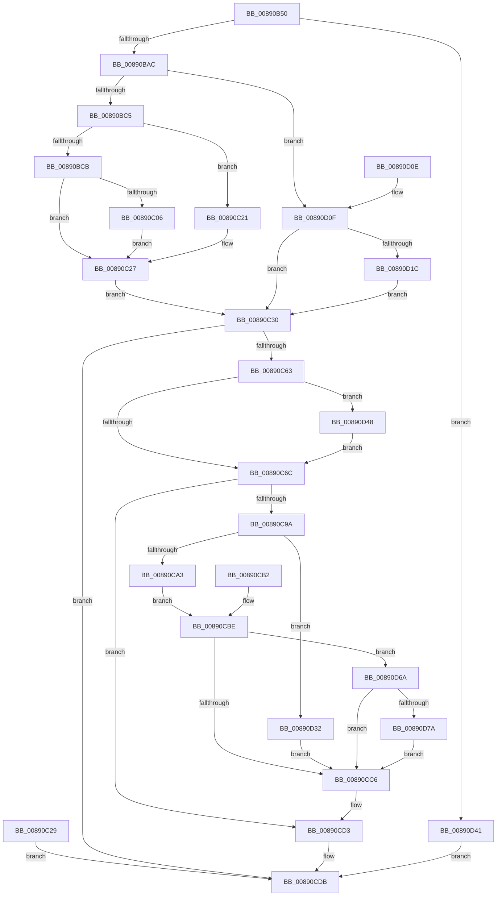

# NtAlpcCreateSecurityContext

- RVA: `0x00890B50`–`0x00890D8C` (길이 `572` bytes)
- VA: `0x0000000140890B50`
- 실행 섹션: `PAGE`
- PDB 이름 있음: `예`; PDB Function 태그: `아니요`
- unwind 정보 RVA: `0x0007D7BC`
- 디코드: `141`개 명령, `572/572` bytes 표시
- 미해석 바이트: `0` (있으면 어셈블리에 `.byte`로 보존)

> 이 문서는 커널 이미지의 기계어와 PDB 기호를 분석해 생성했습니다. 4번과 5번은 함수 원형과 자료형을 바이너리 사용 방식에서 추정한 C 해석이며 원본 소스 복구 결과는 아닙니다.

## 1. Dependencies

- 직접 호출 지점: **10**; 고유 호출 대상: **9**
- 직접 호출자로 확인된 함수: **0**
- RIP 상대 이미지 참조: **2**

### Outgoing calls
- `0x00890C1A` → [RtlCopyVolatileMemory](../../text/6B/RtlCopyVolatileMemory_function_006BC9D0.md) (function, `0x006BC9D0`)
- `0x00890C21` → [ExRaiseDatatypeMisalignment](ExRaiseDatatypeMisalignment_function_00899FD0.md) (function, `0x00899FD0`)
- `0x00890C58` → [ObReferenceObjectByHandle](../86/ObReferenceObjectByHandle_function_00868DB0.md) (function, `0x00868DB0`)
- `0x00890C8F` → [AlpcpCreateSecurityContext](AlpcpCreateSecurityContext_function_00890D94.md) (function, `0x00890D94`)
- `0x00890CCE` → [AlpcpDereferenceBlobEx](../88/AlpcpDereferenceBlobEx_function_0088AF00.md) (function, `0x0088AF00`)
- `0x00890CD6` → [ObfDereferenceObject](../../text/2F/ObfDereferenceObject_function_002F9350.md) (function, `0x002F9350`)
- `0x00890CE4` → [KeLeaveCriticalRegionThread](../../text/25/KeLeaveCriticalRegionThread_function_0025EFF0.md) (function, `0x0025EFF0`)
- `0x00890CF3` → [_security_check_cookie](../../text/6A/_security_check_cookie_function_006AC640.md) (function, `0x006AC640`)
- `0x00890D6D` → [AlpcpDeleteBlob](../88/AlpcpDeleteBlob_function_0088A11C.md) (function, `0x0088A11C`)
- `0x00890D82` → [AlpcpDereferenceBlobEx](../88/AlpcpDereferenceBlobEx_function_0088AF00.md) (function, `0x0088AF00`)

### Direct callers
- 이 함수 시작 RVA로 연결되는 직접 call은 확인되지 않았습니다. 간접 호출은 완전히 역산할 수 없습니다.

### Static image references
- `0x00890B64` → RVA `0x00E0A740` (`.data`; read)
- `0x00890C30` → RVA `0x00FC6C18` (`ALMOSTRO`; read)

## 2. Other-region calls and transfers

- 다른 실행 섹션으로 향하는 call: **4**
  - `0x00890C1A` → [RtlCopyVolatileMemory](../../text/6B/RtlCopyVolatileMemory_function_006BC9D0.md) (`PAGE` → `.text`)
  - `0x00890CD6` → [ObfDereferenceObject](../../text/2F/ObfDereferenceObject_function_002F9350.md) (`PAGE` → `.text`)
  - `0x00890CE4` → [KeLeaveCriticalRegionThread](../../text/25/KeLeaveCriticalRegionThread_function_0025EFF0.md) (`PAGE` → `.text`)
  - `0x00890CF3` → [_security_check_cookie](../../text/6A/_security_check_cookie_function_006AC640.md) (`PAGE` → `.text`)
- 별도 외부 분기/꼬리 이동을 확인하지 못했습니다.

## 3. Assembly (complete function range)

```asm
00890B50  4C 8B DC                        mov r11, rsp
00890B53  49 89 5B 10                     mov qword ptr [r11 + 0x10], rbx
00890B57  49 89 73 20                     mov qword ptr [r11 + 0x20], rsi
00890B5B  57                              push rdi
00890B5C  41 56                           push r14
00890B5E  41 57                           push r15
00890B60  48 83 EC 70                     sub rsp, 0x70
00890B64  48 8B 05 D5 9B 57 00            mov rax, qword ptr [rip + 0x579bd5]
00890B6B  48 33 C4                        xor rax, rsp
00890B6E  48 89 44 24 68                  mov qword ptr [rsp + 0x68], rax
00890B73  49 8B F0                        mov rsi, r8
00890B76  48 8B F9                        mov rdi, rcx
00890B79  33 C0                           xor eax, eax
00890B7B  0F 57 C0                        xorps xmm0, xmm0
00890B7E  0F 11 44 24 40                  movups xmmword ptr [rsp + 0x40], xmm0
00890B83  89 44 24 50                     mov dword ptr [rsp + 0x50], eax
00890B87  49 89 43 D0                     mov qword ptr [r11 - 0x30], rax
00890B8B  89 44 24 60                     mov dword ptr [rsp + 0x60], eax
00890B8F  49 21 43 B0                     and qword ptr [r11 - 0x50], rax
00890B93  65 48 8B 04 25 88 01 00 00      mov rax, qword ptr gs:[0x188]
00890B9C  66 FF 88 E4 01 00 00            dec word ptr [rax + 0x1e4]
00890BA3  90                              nop
00890BA4  85 D2                           test edx, edx
00890BA6  0F 85 95 01 00 00               jne 0x140890d41
00890BAC  65 48 8B 04 25 88 01 00 00      mov rax, qword ptr gs:[0x188]
00890BB5  44 8A B8 32 02 00 00            mov r15b, byte ptr [rax + 0x232]
00890BBC  45 84 FF                        test r15b, r15b
00890BBF  0F 84 4A 01 00 00               je 0x140890d0f
00890BC5  40 F6 C6 07                     test sil, 7
00890BC9  75 56                           jne 0x140890c21
00890BCB  49 B8 00 00 FF FF FF 7F 00 00   movabs r8, 0x7fffffff0000
00890BD5  49 8B C8                        mov rcx, r8
00890BD8  49 3B F0                        cmp rsi, r8
00890BDB  48 0F 42 CE                     cmovb rcx, rsi
00890BDF  8A 01                           mov al, byte ptr [rcx]
00890BE1  88 01                           mov byte ptr [rcx], al
00890BE3  8A 41 17                        mov al, byte ptr [rcx + 0x17]
00890BE6  88 41 17                        mov byte ptr [rcx + 0x17], al
00890BE9  0F 10 0E                        movups xmm1, xmmword ptr [rsi]
00890BEC  F2 0F 10 46 10                  movsd xmm0, qword ptr [rsi + 0x10]
00890BF1  F2 0F 11 44 24 50               movsd qword ptr [rsp + 0x50], xmm0
00890BF7  66 0F 73 D9 08                  psrldq xmm1, 8
00890BFC  66 48 0F 7E CB                  movq rbx, xmm1
00890C01  48 85 DB                        test rbx, rbx
00890C04  74 21                           je 0x140890c27
00890C06  48 8B D3                        mov rdx, rbx
00890C09  49 3B D8                        cmp rbx, r8
00890C0C  49 0F 43 D0                     cmovae rdx, r8
00890C10  41 B8 0C 00 00 00               mov r8d, 0xc
00890C16  49 8D 4B D0                     lea rcx, [r11 - 0x30]
00890C1A  E8 B1 BD E2 FF                  call 0x1406bc9d0
00890C1F  EB 06                           jmp 0x140890c27
00890C21  E8 AA 93 00 00                  call 0x140899fd0
00890C26  CC                              int3
00890C27  EB 07                           jmp 0x140890c30
00890C29  8B F8                           mov edi, eax
00890C2B  E9 AB 00 00 00                  jmp 0x140890cdb
00890C30  4C 8B 05 E1 5F 73 00            mov r8, qword ptr [rip + 0x735fe1]
00890C37  48 83 64 24 30 00               and qword ptr [rsp + 0x30], 0
00890C3D  48 83 64 24 28 00               and qword ptr [rsp + 0x28], 0
00890C43  48 8D 44 24 30                  lea rax, [rsp + 0x30]
00890C48  48 89 44 24 20                  mov qword ptr [rsp + 0x20], rax
00890C4D  45 8A CF                        mov r9b, r15b
00890C50  BA 01 00 00 00                  mov edx, 1
00890C55  48 8B CF                        mov rcx, rdi
00890C58  E8 53 81 FD FF                  call 0x140868db0
00890C5D  8B F8                           mov edi, eax
00890C5F  85 C0                           test eax, eax
00890C61  78 78                           js 0x140890cdb
00890C63  48 85 DB                        test rbx, rbx
00890C66  0F 84 DC 00 00 00               je 0x140890d48
00890C6C  65 48 8B 14 25 88 01 00 00      mov rdx, qword ptr gs:[0x188]
00890C75  48 8D 44 24 38                  lea rax, [rsp + 0x38]
00890C7A  48 89 44 24 20                  mov qword ptr [rsp + 0x20], rax
00890C7F  4C 8D 4C 24 58                  lea r9, [rsp + 0x58]
00890C84  41 B0 01                        mov r8b, 1
00890C87  4C 8B 74 24 30                  mov r14, qword ptr [rsp + 0x30]
00890C8C  49 8B CE                        mov rcx, r14
00890C8F  E8 00 01 00 00                  call 0x140890d94
00890C94  8B F8                           mov edi, eax
00890C96  85 C0                           test eax, eax
00890C98  78 39                           js 0x140890cd3
00890C9A  45 84 FF                        test r15b, r15b
00890C9D  0F 84 8F 00 00 00               je 0x140890d32
00890CA3  48 8B 5C 24 38                  mov rbx, qword ptr [rsp + 0x38]
00890CA8  48 8B 4B 08                     mov rcx, qword ptr [rbx + 8]
00890CAC  48 89 4E 10                     mov qword ptr [rsi + 0x10], rcx
00890CB0  EB 0C                           jmp 0x140890cbe
00890CB2  8B F8                           mov edi, eax
00890CB4  48 8B 5C 24 38                  mov rbx, qword ptr [rsp + 0x38]
00890CB9  4C 8B 74 24 30                  mov r14, qword ptr [rsp + 0x30]
00890CBE  85 FF                           test edi, edi
00890CC0  0F 88 A4 00 00 00               js 0x140890d6a
00890CC6  BA 01 00 00 00                  mov edx, 1
00890CCB  48 8B CB                        mov rcx, rbx
00890CCE  E8 2D A2 FF FF                  call 0x14088af00
00890CD3  49 8B CE                        mov rcx, r14
00890CD6  E8 75 86 A6 FF                  call 0x1402f9350
00890CDB  65 48 8B 0C 25 88 01 00 00      mov rcx, qword ptr gs:[0x188]
00890CE4  E8 07 E3 9C FF                  call 0x14025eff0
00890CE9  8B C7                           mov eax, edi
00890CEB  48 8B 4C 24 68                  mov rcx, qword ptr [rsp + 0x68]
00890CF0  48 33 CC                        xor rcx, rsp
00890CF3  E8 48 B9 E1 FF                  call 0x1406ac640
00890CF8  4C 8D 5C 24 70                  lea r11, [rsp + 0x70]
00890CFD  49 8B 5B 28                     mov rbx, qword ptr [r11 + 0x28]
00890D01  49 8B 73 38                     mov rsi, qword ptr [r11 + 0x38]
00890D05  49 8B E3                        mov rsp, r11
00890D08  41 5F                           pop r15
00890D0A  41 5E                           pop r14
00890D0C  5F                              pop rdi
00890D0D  C3                              ret
00890D0E  CC                              int3
00890D0F  49 8B 58 08                     mov rbx, qword ptr [r8 + 8]
00890D13  48 85 DB                        test rbx, rbx
00890D16  0F 84 14 FF FF FF               je 0x140890c30
00890D1C  F2 0F 10 03                     movsd xmm0, qword ptr [rbx]
00890D20  F2 0F 11 44 24 58               movsd qword ptr [rsp + 0x58], xmm0
00890D26  8B 43 08                        mov eax, dword ptr [rbx + 8]
00890D29  89 44 24 60                     mov dword ptr [rsp + 0x60], eax
00890D2D  E9 FE FE FF FF                  jmp 0x140890c30
00890D32  48 8B 5C 24 38                  mov rbx, qword ptr [rsp + 0x38]
00890D37  48 8B 43 08                     mov rax, qword ptr [rbx + 8]
00890D3B  48 89 46 10                     mov qword ptr [rsi + 0x10], rax
00890D3F  EB 85                           jmp 0x140890cc6
00890D41  BF 0D 00 00 C0                  mov edi, 0xc000000d
00890D46  EB 93                           jmp 0x140890cdb
00890D48  48 8B 44 24 30                  mov rax, qword ptr [rsp + 0x30]
00890D4D  F2 0F 10 80 04 01 00 00         movsd xmm0, qword ptr [rax + 0x104]
00890D55  F2 0F 11 44 24 58               movsd qword ptr [rsp + 0x58], xmm0
00890D5B  8B 80 0C 01 00 00               mov eax, dword ptr [rax + 0x10c]
00890D61  89 44 24 60                     mov dword ptr [rsp + 0x60], eax
00890D65  E9 02 FF FF FF                  jmp 0x140890c6c
00890D6A  48 8B CB                        mov rcx, rbx
00890D6D  E8 AA 93 FF FF                  call 0x14088a11c
00890D72  84 C0                           test al, al
00890D74  0F 84 4C FF FF FF               je 0x140890cc6
00890D7A  BA 01 00 00 00                  mov edx, 1
00890D7F  48 8B CB                        mov rcx, rbx
00890D82  E8 79 A1 FF FF                  call 0x14088af00
00890D87  E9 3A FF FF FF                  jmp 0x140890cc6
```

## 4. C-style interpretation (structured pseudocode)

```c
__int64 __fastcall NtAlpcCreateSecurityContext(__int64 a1, int a2, __int64 a3)
{
    __int64 result;
    __int64 v_rsp;
    unsigned int v_stack_m10;
    unsigned __int64 v_stack_m18;
    unsigned __int64 v_stack_m20;
    unsigned int v_stack_m28;
    unsigned __int64 v_stack_m30;
    unsigned int v_stack_m38;
    unsigned __int64 v_stack_m40;
    unsigned __int64 v_stack_m48;
    unsigned __int64 v_stack_m50;
    unsigned __int64 v_stack_m58;
    unsigned __int64 v_stack_m60;
    unsigned __int64 v_stack_m68;

    *(unsigned __int64 *)(v_rsp + 16) = v_rbx;
    *(unsigned __int64 *)(v_rsp + 32) = v_rsi;
    v_rsp = (v_rsp) - (112);
    result = (*(unsigned __int64 *)(v_rip + 5741525)) ^ (v_rsp);
    v_stack_m20 = result;
    result = 0;
    v_stack_m48 = v_xmm0;
    v_stack_m38 = 0;
    *(unsigned __int64 *)(v_rsp - 48) = 0;
    v_stack_m28 = 0;
    if (a2 != 0) goto loc_00890D41;
    if ((unsigned __int8)(*(unsigned __int8 *)(*(unsigned __int64 *)(gs_base + (0 + 392)) + 562)) == 0) goto loc_00890D0F;
    if ((((unsigned __int8)(a3)) & (7)) != 0) goto loc_00890C21;
    if (a3 < a3) { a3 = a3; }
    *(unsigned __int8 *)(a3) = (unsigned __int8)(*(unsigned __int8 *)(a3));
    *(unsigned __int8 *)(a3 + 23) = (unsigned __int8)(*(unsigned __int8 *)(a3 + 23));
    v_stack_m38 = v_xmm0;
    if (v_rbx == 0) goto loc_00890C27;
    a2 = v_rbx;
    if (v_rbx >= a3) { a2 = a3; }
    result = RtlCopyVolatileMemory(v_rsp - 48, a2, 12, a4);
    goto loc_00890C27;
loc_00890C21:
    result = ExRaiseDatatypeMisalignment(v_rsp - 48, a2, 12, a4);
loc_00890C27:
    goto loc_00890C30;
loc_00890C30:
    v_stack_m68 = v_stack_m58;
    result = ObReferenceObjectByHandle(a1, 1, *(unsigned __int64 *)(v_rip + 7561185), (unsigned __int8)(*(unsigned __int8 *)(*(unsigned __int64 *)(gs_base + (0 + 392)) + 562)));
    if (sign_flag) goto loc_00890CDB;
    if (v_rbx == 0) goto loc_00890D48;
loc_00890C6C:
    v_stack_m68 = v_stack_m50;
    result = AlpcpCreateSecurityContext(v_stack_m58, *(unsigned __int64 *)(gs_base + (0 + 392)), 1, v_stack_m30);
    if (sign_flag) goto loc_00890CD3;
    if ((unsigned __int8)(*(unsigned __int8 *)(*(unsigned __int64 *)(gs_base + (0 + 392)) + 562)) == 0) goto loc_00890D32;
    *(unsigned __int64 *)(a3 + 16) = *(unsigned __int64 *)(v_stack_m50 + 8);
    goto loc_00890CBE;
loc_00890CBE:
    if (sign_flag) goto loc_00890D6A;
loc_00890CC6:
    result = AlpcpDereferenceBlobEx(v_stack_m50, 1, 1, v_stack_m30);
loc_00890CD3:
    result = ObfDereferenceObject(v_stack_m58, 1, 1, v_stack_m30);
loc_00890CDB:
    result = KeLeaveCriticalRegionThread(*(unsigned __int64 *)(gs_base + (0 + 392)), 1, 1, v_stack_m30);
    a1 = (v_stack_m20) ^ (v_rsp);
    result = _security_check_cookie(a1, 1, 1, v_stack_m30);
    return result;
loc_00890D0F:
    if (*(unsigned __int64 *)(1 + 8) == 0) goto loc_00890C30;
    v_stack_m18 = v_xmm0;
    v_stack_m10 = (unsigned int)((unsigned int)(*(unsigned int *)(*(unsigned __int64 *)(1 + 8) + 8)));
    goto loc_00890C30;
loc_00890D32:
    *(unsigned __int64 *)(*(unsigned __int64 *)(v_stack_m18 + 56) + 16) = *(unsigned __int64 *)(v_stack_m38 + 8);
    goto loc_00890CC6;
loc_00890D41:
    goto loc_00890CDB;
loc_00890D48:
    v_stack_m18 = v_xmm0;
    v_stack_m10 = (unsigned int)((unsigned int)(*(unsigned int *)(v_stack_m40 + 268)));
    goto loc_00890C6C;
loc_00890D6A:
    result = AlpcpDeleteBlob(v_stack_m38, 1, 1, v_stack_m30);
    if ((unsigned __int8)(result) == 0) goto loc_00890CC6;
    result = AlpcpDereferenceBlobEx(v_stack_m38, 1, 1, v_stack_m30);
    goto loc_00890CC6;
}
```

## 5. (Beta) C Style

```c
int64_t NtAlpcCreateSecurityContext(int64_t Arg1, int32_t Arg2, void *Arg3)
{
    uint8_t *arg3 = (uint8_t *)Arg3;

    int64_t result;
    int64_t local_rsp;
    uint32_t v_stack_m10;
    uint64_t v_stack_m18;
    uint64_t v_stack_m20;
    uint32_t v_stack_m28;
    uint64_t v_stack_m30;
    uint32_t v_stack_m38;
    uint64_t v_stack_m40;
    uint64_t v_stack_m48;
    uint64_t v_stack_m50;
    uint64_t v_stack_m58;
    uint64_t v_stack_m60;
    uint64_t v_stack_m68;

    *(uint64_t *)(local_rsp + 0x10) = local_rbx;
    *(uint64_t *)(local_rsp + 0x20) = local_rsi;
    local_rsp = (local_rsp) - (112);
    result = (*(uint64_t *)(v_rip + 0x579BD5)) ^ (local_rsp);
    v_stack_m20 = result;
    result = 0;
    v_stack_m48 = v_xmm0;
    v_stack_m38 = 0;
    *(uint64_t *)(local_rsp - 0x30) = 0;
    v_stack_m28 = 0;
    if (Arg2 != 0) goto loc_00890D41;
    if ((uint8_t)(*(uint8_t *)(*(uint64_t *)(gs_base + (0 + 0x188)) + 0x232)) == 0) goto loc_00890D0F;
    if ((((uint8_t)(Arg3)) & (7)) != 0) goto loc_00890C21;
    if (Arg3 < Arg3) { Arg3 = Arg3; }
    *(uint8_t *)(arg3) = (uint8_t)(*(uint8_t *)(arg3));
    *(uint8_t *)(arg3 + 0x17) = (uint8_t)(*(uint8_t *)(arg3 + 0x17));
    v_stack_m38 = v_xmm0;
    if (local_rbx == 0) goto loc_00890C27;
    Arg2 = local_rbx;
    if (local_rbx >= Arg3) { Arg2 = Arg3; }
    result = RtlCopyVolatileMemory(local_rsp - 48, Arg2, 12, a4);
    goto loc_00890C27;
loc_00890C21:
    result = ExRaiseDatatypeMisalignment(local_rsp - 48, Arg2, 12, a4);
loc_00890C27:
    goto loc_00890C30;
loc_00890C30:
    v_stack_m68 = v_stack_m58;
    result = ObReferenceObjectByHandle(Arg1, 1, *(uint64_t *)(v_rip + 0x735FE1), (uint8_t)(*(uint8_t *)(*(uint64_t *)(gs_base + (0 + 0x188)) + 0x232)));
    if (sign_flag) goto loc_00890CDB;
    if (local_rbx == 0) goto loc_00890D48;
loc_00890C6C:
    v_stack_m68 = v_stack_m50;
    result = AlpcpCreateSecurityContext(v_stack_m58, *(uint64_t *)(gs_base + (0 + 0x188)), 1, v_stack_m30);
    if (sign_flag) goto loc_00890CD3;
    if ((uint8_t)(*(uint8_t *)(*(uint64_t *)(gs_base + (0 + 0x188)) + 0x232)) == 0) goto loc_00890D32;
    *(uint64_t *)(arg3 + 0x10) = *(uint64_t *)(v_stack_m50 + 0x8);
    goto loc_00890CBE;
loc_00890CBE:
    if (sign_flag) goto loc_00890D6A;
loc_00890CC6:
    result = AlpcpDereferenceBlobEx(v_stack_m50, 1, 1, v_stack_m30);
loc_00890CD3:
    result = ObfDereferenceObject(v_stack_m58, 1, 1, v_stack_m30);
loc_00890CDB:
    result = KeLeaveCriticalRegionThread(*(uint64_t *)(gs_base + (0 + 0x188)), 1, 1, v_stack_m30);
    Arg1 = (v_stack_m20) ^ (local_rsp);
    result = _security_check_cookie(Arg1, 1, 1, v_stack_m30);
    return result;
loc_00890D0F:
    if (*(uint64_t *)(1 + 0x8) == 0) goto loc_00890C30;
    v_stack_m18 = v_xmm0;
    v_stack_m10 = (uint32_t)((uint32_t)(*(uint32_t *)(*(uint64_t *)(1 + 0x8) + 0x8)));
    goto loc_00890C30;
loc_00890D32:
    *(uint64_t *)(*(uint64_t *)(v_stack_m18 + 0x38) + 0x10) = *(uint64_t *)(v_stack_m38 + 0x8);
    goto loc_00890CC6;
loc_00890D41:
    goto loc_00890CDB;
loc_00890D48:
    v_stack_m18 = v_xmm0;
    v_stack_m10 = (uint32_t)((uint32_t)(*(uint32_t *)(v_stack_m40 + 0x10C)));
    goto loc_00890C6C;
loc_00890D6A:
    result = AlpcpDeleteBlob(v_stack_m38, 1, 1, v_stack_m30);
    if ((uint8_t)(result) == 0) goto loc_00890CC6;
    result = AlpcpDereferenceBlobEx(v_stack_m38, 1, 1, v_stack_m30);
    goto loc_00890CC6;
}
```

### 관측된 메모리 오프셋

구조체 형식이 확인되지 않은 접근은 인자 기준의 오프셋으로만 기록했습니다.

| 기준 인자 | 오프셋 표현 | 폭 (bit) | 접근 |
|---|---:|---:|---|
| `Arg3` | `+ 0x8` | `64` | `R` |

## 6. Execution-region graph

[열기: 2D/3D 그래프와 함수 탐색 컨트롤 패널](../../../control-panel.html?section=page&rva=0x00890B50&view=graph)

- 2D 그래프는 위에서 아래로 흐르고, 3D 그래프는 빈 공간을 드래그해 회전합니다. Shift+드래그는 이동, 휠은 확대·축소, 함수 노드 선택은 대상 보고서 이동입니다.

### Static fallback


