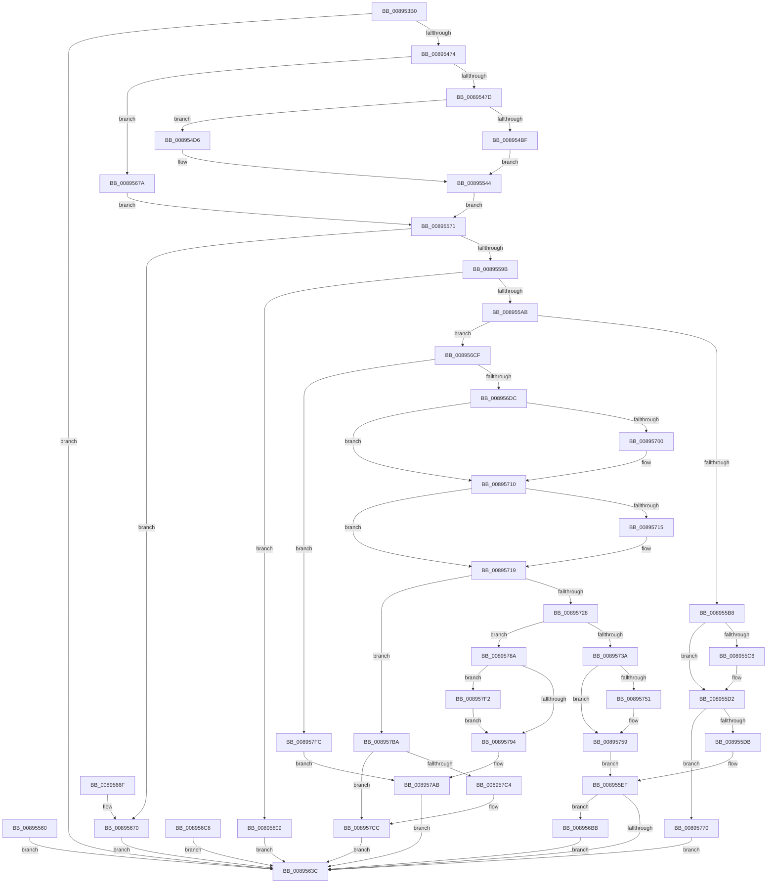

# NtAlpcOpenSenderProcess

- RVA: `0x008953B0`–`0x00895823` (길이 `1,139` bytes)
- VA: `0x00000001408953B0`
- 실행 섹션: `PAGE`
- PDB 이름 있음: `예`; PDB Function 태그: `아니요`
- unwind 정보 RVA: `0x0007E098`
- 디코드: `266`개 명령, `1,139/1,139` bytes 표시
- 미해석 바이트: `0` (있으면 어셈블리에 `.byte`로 보존)

> 이 문서는 커널 이미지의 기계어와 PDB 기호를 분석해 생성했습니다. 4번과 5번은 함수 원형과 자료형을 바이너리 사용 방식에서 추정한 C 해석이며 원본 소스 복구 결과는 아닙니다.

## 1. Dependencies

- 직접 호출 지점: **32**; 고유 호출 대상: **14**
- 직접 호출자로 확인된 함수: **0**
- RIP 상대 이미지 참조: **2**

### Outgoing calls
- `0x00895465` → [ObReferenceObjectByHandle](../86/ObReferenceObjectByHandle_function_00868DB0.md) (function, `0x00868DB0`)
- `0x008954CF` → [RtlCopyVolatileMemory](../../text/6B/RtlCopyVolatileMemory_function_006BC9D0.md) (function, `0x006BC9D0`)
- `0x008954EB` → [RtlCopyVolatileMemory](../../text/6B/RtlCopyVolatileMemory_function_006BC9D0.md) (function, `0x006BC9D0`)
- `0x00895559` → [RtlCopyVolatileMemory](../../text/6B/RtlCopyVolatileMemory_function_006BC9D0.md) (function, `0x006BC9D0`)
- `0x00895567` → [ObfDereferenceObject](../../text/2F/ObfDereferenceObject_function_002F9350.md) (function, `0x002F9350`)
- `0x0089558C` → [AlpcpLookupMessage](AlpcpLookupMessage_function_00895A40.md) (function, `0x00895A40`)
- `0x008955EA` → [ObfReferenceObjectWithTag](../../text/21/ObfReferenceObjectWithTag_function_00210710.md) (function, `0x00210710`)
- `0x008955F2` → [AlpcpUnlockMessage](AlpcpUnlockMessage_function_00897AE0.md) (function, `0x00897AE0`)
- `0x0089561C` → [PsOpenProcess](PsOpenProcess_function_00894A30.md) (function, `0x00894A30`)
- `0x0089562B` → [ObfDereferenceObjectWithTag](../../text/2F/ObfDereferenceObjectWithTag_function_002F78E0.md) (function, `0x002F78E0`)
- `0x00895633` → [ObfDereferenceObject](../../text/2F/ObfDereferenceObject_function_002F9350.md) (function, `0x002F9350`)
- `0x00895645` → [KeLeaveCriticalRegionThread](../../text/25/KeLeaveCriticalRegionThread_function_0025EFF0.md) (function, `0x0025EFF0`)
- `0x00895657` → [_security_check_cookie](../../text/6A/_security_check_cookie_function_006AC640.md) (function, `0x006AC640`)
- `0x00895673` → [ObfDereferenceObject](../../text/2F/ObfDereferenceObject_function_002F9350.md) (function, `0x002F9350`)
- `0x008956EB` → [KeAbPreAcquire](../../text/21/KeAbPreAcquire_function_00210230.md) (function, `0x00210230`)
- `0x0089570B` → [ExfAcquirePushLockSharedEx](../../text/21/ExfAcquirePushLockSharedEx_function_0021044C.md) (function, `0x0021044C`)
- `0x00895742` → [ObfReferenceObjectWithTag](../../text/21/ObfReferenceObjectWithTag_function_00210710.md) (function, `0x00210710`)
- `0x00895754` → [ExfReleasePushLockShared](../../text/26/ExfReleasePushLockShared_function_00263440.md) (function, `0x00263440`)
- `0x0089575C` → [KeAbPostRelease](../../text/2E/KeAbPostRelease_function_002E1600.md) (function, `0x002E1600`)
- `0x00895773` → [AlpcpUnlockMessage](AlpcpUnlockMessage_function_00897AE0.md) (function, `0x00897AE0`)
- `0x0089577B` → [ObfDereferenceObject](../../text/2F/ObfDereferenceObject_function_002F9350.md) (function, `0x002F9350`)
- `0x00895797` → [KeAbPostRelease](../../text/2E/KeAbPostRelease_function_002E1600.md) (function, `0x002E1600`)
- `0x008957A1` → [AlpcpUnlockMessage](AlpcpUnlockMessage_function_00897AE0.md) (function, `0x00897AE0`)
- `0x008957AB` → [ObfDereferenceObject](../../text/2F/ObfDereferenceObject_function_002F9350.md) (function, `0x002F9350`)
- `0x008957C7` → [ExfReleasePushLockShared](../../text/26/ExfReleasePushLockShared_function_00263440.md) (function, `0x00263440`)
- `0x008957CF` → [KeAbPostRelease](../../text/2E/KeAbPostRelease_function_002E1600.md) (function, `0x002E1600`)
- `0x008957D9` → [AlpcpUnlockMessage](AlpcpUnlockMessage_function_00897AE0.md) (function, `0x00897AE0`)
- `0x008957E3` → [ObfDereferenceObject](../../text/2F/ObfDereferenceObject_function_002F9350.md) (function, `0x002F9350`)
- `0x008957F5` → [ExfReleasePushLockShared](../../text/26/ExfReleasePushLockShared_function_00263440.md) (function, `0x00263440`)
- `0x008957FF` → [AlpcpUnlockMessage](AlpcpUnlockMessage_function_00897AE0.md) (function, `0x00897AE0`)
- `0x0089580C` → [AlpcpUnlockMessage](AlpcpUnlockMessage_function_00897AE0.md) (function, `0x00897AE0`)
- `0x00895814` → [ObfDereferenceObject](../../text/2F/ObfDereferenceObject_function_002F9350.md) (function, `0x002F9350`)

### Direct callers
- 이 함수 시작 RVA로 연결되는 직접 call은 확인되지 않았습니다. 간접 호출은 완전히 역산할 수 없습니다.

### Static image references
- `0x008953C5` → RVA `0x00E0A740` (`.data`; read)
- `0x0089543F` → RVA `0x00FC6C18` (`ALMOSTRO`; read)

## 2. Other-region calls and transfers

- 다른 실행 섹션으로 향하는 call: **23**
  - `0x008954CF` → [RtlCopyVolatileMemory](../../text/6B/RtlCopyVolatileMemory_function_006BC9D0.md) (`PAGE` → `.text`)
  - `0x008954EB` → [RtlCopyVolatileMemory](../../text/6B/RtlCopyVolatileMemory_function_006BC9D0.md) (`PAGE` → `.text`)
  - `0x00895559` → [RtlCopyVolatileMemory](../../text/6B/RtlCopyVolatileMemory_function_006BC9D0.md) (`PAGE` → `.text`)
  - `0x00895567` → [ObfDereferenceObject](../../text/2F/ObfDereferenceObject_function_002F9350.md) (`PAGE` → `.text`)
  - `0x008955EA` → [ObfReferenceObjectWithTag](../../text/21/ObfReferenceObjectWithTag_function_00210710.md) (`PAGE` → `.text`)
  - `0x0089562B` → [ObfDereferenceObjectWithTag](../../text/2F/ObfDereferenceObjectWithTag_function_002F78E0.md) (`PAGE` → `.text`)
  - `0x00895633` → [ObfDereferenceObject](../../text/2F/ObfDereferenceObject_function_002F9350.md) (`PAGE` → `.text`)
  - `0x00895645` → [KeLeaveCriticalRegionThread](../../text/25/KeLeaveCriticalRegionThread_function_0025EFF0.md) (`PAGE` → `.text`)
  - `0x00895657` → [_security_check_cookie](../../text/6A/_security_check_cookie_function_006AC640.md) (`PAGE` → `.text`)
  - `0x00895673` → [ObfDereferenceObject](../../text/2F/ObfDereferenceObject_function_002F9350.md) (`PAGE` → `.text`)
  - `0x008956EB` → [KeAbPreAcquire](../../text/21/KeAbPreAcquire_function_00210230.md) (`PAGE` → `.text`)
  - `0x0089570B` → [ExfAcquirePushLockSharedEx](../../text/21/ExfAcquirePushLockSharedEx_function_0021044C.md) (`PAGE` → `.text`)
  - `0x00895742` → [ObfReferenceObjectWithTag](../../text/21/ObfReferenceObjectWithTag_function_00210710.md) (`PAGE` → `.text`)
  - `0x00895754` → [ExfReleasePushLockShared](../../text/26/ExfReleasePushLockShared_function_00263440.md) (`PAGE` → `.text`)
  - `0x0089575C` → [KeAbPostRelease](../../text/2E/KeAbPostRelease_function_002E1600.md) (`PAGE` → `.text`)
  - `0x0089577B` → [ObfDereferenceObject](../../text/2F/ObfDereferenceObject_function_002F9350.md) (`PAGE` → `.text`)
  - `0x00895797` → [KeAbPostRelease](../../text/2E/KeAbPostRelease_function_002E1600.md) (`PAGE` → `.text`)
  - `0x008957AB` → [ObfDereferenceObject](../../text/2F/ObfDereferenceObject_function_002F9350.md) (`PAGE` → `.text`)
  - `0x008957C7` → [ExfReleasePushLockShared](../../text/26/ExfReleasePushLockShared_function_00263440.md) (`PAGE` → `.text`)
  - `0x008957CF` → [KeAbPostRelease](../../text/2E/KeAbPostRelease_function_002E1600.md) (`PAGE` → `.text`)
  - `0x008957E3` → [ObfDereferenceObject](../../text/2F/ObfDereferenceObject_function_002F9350.md) (`PAGE` → `.text`)
  - `0x008957F5` → [ExfReleasePushLockShared](../../text/26/ExfReleasePushLockShared_function_00263440.md) (`PAGE` → `.text`)
  - `0x00895814` → [ObfDereferenceObject](../../text/2F/ObfDereferenceObject_function_002F9350.md) (`PAGE` → `.text`)
- 별도 외부 분기/꼬리 이동을 확인하지 못했습니다.

## 3. Assembly (complete function range)

```asm
008953B0  4C 8B DC                        mov r11, rsp
008953B3  53                              push rbx
008953B4  56                              push rsi
008953B5  57                              push rdi
008953B6  41 54                           push r12
008953B8  41 55                           push r13
008953BA  41 56                           push r14
008953BC  41 57                           push r15
008953BE  48 81 EC D0 00 00 00            sub rsp, 0xd0
008953C5  48 8B 05 74 53 57 00            mov rax, qword ptr [rip + 0x575374]
008953CC  48 33 C4                        xor rax, rsp
008953CF  48 89 84 24 C0 00 00 00         mov qword ptr [rsp + 0xc0], rax
008953D7  45 8B F1                        mov r14d, r9d
008953DA  49 8B F8                        mov rdi, r8
008953DD  4C 8B D2                        mov r10, rdx
008953E0  4C 8B F9                        mov r15, rcx
008953E3  48 8B B4 24 38 01 00 00         mov rsi, qword ptr [rsp + 0x138]
008953EB  0F 57 C0                        xorps xmm0, xmm0
008953EE  33 C0                           xor eax, eax
008953F0  0F 11 44 24 40                  movups xmmword ptr [rsp + 0x40], xmm0
008953F5  0F 11 44 24 50                  movups xmmword ptr [rsp + 0x50], xmm0
008953FA  48 89 44 24 60                  mov qword ptr [rsp + 0x60], rax
008953FF  0F 11 44 24 78                  movups xmmword ptr [rsp + 0x78], xmm0
00895404  41 0F 11 43 80                  movups xmmword ptr [r11 - 0x80], xmm0
00895409  49 89 43 90                     mov qword ptr [r11 - 0x70], rax
0089540D  41 89 43 98                     mov dword ptr [r11 - 0x68], eax
00895411  45 33 ED                        xor r13d, r13d
00895414  4C 89 6C 24 70                  mov qword ptr [rsp + 0x70], r13
00895419  4C 89 6C 24 38                  mov qword ptr [rsp + 0x38], r13
0089541E  65 48 8B 04 25 88 01 00 00      mov rax, qword ptr gs:[0x188]
00895427  66 FF 88 E4 01 00 00            dec word ptr [rax + 0x1e4]
0089542E  90                              nop
0089542F  65 48 8B 04 25 88 01 00 00      mov rax, qword ptr gs:[0x188]
00895438  44 8A A0 32 02 00 00            mov r12b, byte ptr [rax + 0x232]
0089543F  4C 8B 05 D2 17 73 00            mov r8, qword ptr [rip + 0x7317d2]
00895446  4C 89 6C 24 30                  mov qword ptr [rsp + 0x30], r13
0089544B  4C 89 6C 24 28                  mov qword ptr [rsp + 0x28], r13
00895450  48 8D 44 24 30                  lea rax, [rsp + 0x30]
00895455  48 89 44 24 20                  mov qword ptr [rsp + 0x20], rax
0089545A  45 8A CC                        mov r9b, r12b
0089545D  BA 00 00 02 00                  mov edx, 0x20000
00895462  49 8B CA                        mov rcx, r10
00895465  E8 46 39 FD FF                  call 0x140868db0
0089546A  8B D8                           mov ebx, eax
0089546C  85 C0                           test eax, eax
0089546E  0F 88 C8 01 00 00               js 0x14089563c
00895474  45 84 E4                        test r12b, r12b
00895477  0F 84 FD 01 00 00               je 0x14089567a
0089547D  48 BB 00 00 FF FF FF 7F 00 00   movabs rbx, 0x7fffffff0000
00895487  48 8B CB                        mov rcx, rbx
0089548A  4C 3B FB                        cmp r15, rbx
0089548D  49 0F 42 CF                     cmovb rcx, r15
00895491  48 8B 01                        mov rax, qword ptr [rcx]
00895494  48 89 01                        mov qword ptr [rcx], rax
00895497  0F 57 C0                        xorps xmm0, xmm0
0089549A  33 C0                           xor eax, eax
0089549C  0F 11 84 24 A8 00 00 00         movups xmmword ptr [rsp + 0xa8], xmm0
008954A4  48 89 84 24 B8 00 00 00         mov qword ptr [rsp + 0xb8], rax
008954AC  41 81 E6 00 00 00 C0            and r14d, 0xc0000000
008954B3  48 8B D3                        mov rdx, rbx
008954B6  41 81 FE 00 00 00 80            cmp r14d, 0x80000000
008954BD  74 17                           je 0x1408954d6
008954BF  48 3B FB                        cmp rdi, rbx
008954C2  48 0F 42 D7                     cmovb rdx, rdi
008954C6  45 8D 45 28                     lea r8d, [r13 + 0x28]
008954CA  48 8D 4C 24 40                  lea rcx, [rsp + 0x40]
008954CF  E8 FC 74 E2 FF                  call 0x1406bc9d0
008954D4  EB 6E                           jmp 0x140895544
008954D6  48 3B FB                        cmp rdi, rbx
008954D9  48 0F 42 D7                     cmovb rdx, rdi
008954DD  41 B8 18 00 00 00               mov r8d, 0x18
008954E3  48 8D 8C 24 A8 00 00 00         lea rcx, [rsp + 0xa8]
008954EB  E8 E0 74 E2 FF                  call 0x1406bc9d0
008954F0  0F B7 84 24 A8 00 00 00         movzx eax, word ptr [rsp + 0xa8]
008954F8  66 89 44 24 40                  mov word ptr [rsp + 0x40], ax
008954FD  66 83 C0 28                     add ax, 0x28
00895501  66 89 44 24 42                  mov word ptr [rsp + 0x42], ax
00895506  8B 84 24 AC 00 00 00            mov eax, dword ptr [rsp + 0xac]
0089550D  89 44 24 44                     mov dword ptr [rsp + 0x44], eax
00895511  8B 84 24 B0 00 00 00            mov eax, dword ptr [rsp + 0xb0]
00895518  48 89 44 24 48                  mov qword ptr [rsp + 0x48], rax
0089551D  8B 84 24 B4 00 00 00            mov eax, dword ptr [rsp + 0xb4]
00895524  48 89 44 24 50                  mov qword ptr [rsp + 0x50], rax
00895529  8B 84 24 B8 00 00 00            mov eax, dword ptr [rsp + 0xb8]
00895530  89 44 24 58                     mov dword ptr [rsp + 0x58], eax
00895534  8B 8C 24 BC 00 00 00            mov ecx, dword ptr [rsp + 0xbc]
0089553B  48 89 4C 24 60                  mov qword ptr [rsp + 0x60], rcx
00895540  89 4C 24 60                     mov dword ptr [rsp + 0x60], ecx
00895544  48 3B F3                        cmp rsi, rbx
00895547  48 0F 42 DE                     cmovb rbx, rsi
0089554B  41 B8 30 00 00 00               mov r8d, 0x30
00895551  48 8B D3                        mov rdx, rbx
00895554  48 8D 4C 24 78                  lea rcx, [rsp + 0x78]
00895559  E8 72 74 E2 FF                  call 0x1406bc9d0
0089555E  EB 11                           jmp 0x140895571
00895560  8B D8                           mov ebx, eax
00895562  48 8B 4C 24 30                  mov rcx, qword ptr [rsp + 0x30]
00895567  E8 E4 3D A6 FF                  call 0x1402f9350
0089556C  E9 CB 00 00 00                  jmp 0x14089563c
00895571  48 8D 44 24 38                  lea rax, [rsp + 0x38]
00895576  48 89 44 24 20                  mov qword ptr [rsp + 0x20], rax
0089557B  44 8B 44 24 60                  mov r8d, dword ptr [rsp + 0x60]
00895580  8B 54 24 58                     mov edx, dword ptr [rsp + 0x58]
00895584  48 8B 7C 24 30                  mov rdi, qword ptr [rsp + 0x30]
00895589  48 8B CF                        mov rcx, rdi
0089558C  E8 AF 04 00 00                  call 0x140895a40
00895591  8B D8                           mov ebx, eax
00895593  85 C0                           test eax, eax
00895595  0F 88 D5 00 00 00               js 0x140895670
0089559B  48 8B 5C 24 38                  mov rbx, qword ptr [rsp + 0x38]
008955A0  8B 43 28                        mov eax, dword ptr [rbx + 0x28]
008955A3  84 C0                           test al, al
008955A5  0F 88 5E 02 00 00               js 0x140895809
008955AB  48 8B 73 20                     mov rsi, qword ptr [rbx + 0x20]
008955AF  48 85 F6                        test rsi, rsi
008955B2  0F 84 17 01 00 00               je 0x1408956cf
008955B8  48 8B 86 08 05 00 00            mov rax, qword ptr [rsi + 0x508]
008955BF  48 2B 44 24 48                  sub rax, qword ptr [rsp + 0x48]
008955C4  75 0C                           jne 0x1408955d2
008955C6  48 8B 86 10 05 00 00            mov rax, qword ptr [rsi + 0x510]
008955CD  48 2B 44 24 50                  sub rax, qword ptr [rsp + 0x50]
008955D2  48 85 C0                        test rax, rax
008955D5  0F 85 95 01 00 00               jne 0x140895770
008955DB  48 8B B6 20 02 00 00            mov rsi, qword ptr [rsi + 0x220]
008955E2  BA 41 6C 70 63                  mov edx, 0x63706c41
008955E7  48 8B CE                        mov rcx, rsi
008955EA  E8 21 B1 97 FF                  call 0x140210710
008955EF  48 8B CB                        mov rcx, rbx
008955F2  E8 E9 24 00 00                  call 0x140897ae0
008955F7  4C 89 6C 24 50                  mov qword ptr [rsp + 0x50], r13
008955FC  44 88 64 24 28                  mov byte ptr [rsp + 0x28], r12b
00895601  44 88 6C 24 20                  mov byte ptr [rsp + 0x20], r13b
00895606  4C 8D 4C 24 48                  lea r9, [rsp + 0x48]
0089560B  4C 8D 44 24 78                  lea r8, [rsp + 0x78]
00895610  8B 94 24 30 01 00 00            mov edx, dword ptr [rsp + 0x130]
00895617  48 8D 4C 24 70                  lea rcx, [rsp + 0x70]
0089561C  E8 0F F4 FF FF                  call 0x140894a30
00895621  8B D8                           mov ebx, eax
00895623  BA 41 6C 70 63                  mov edx, 0x63706c41
00895628  48 8B CE                        mov rcx, rsi
0089562B  E8 B0 22 A6 FF                  call 0x1402f78e0
00895630  48 8B CF                        mov rcx, rdi
00895633  E8 18 3D A6 FF                  call 0x1402f9350
00895638  85 DB                           test ebx, ebx
0089563A  79 7F                           jns 0x1408956bb
0089563C  65 48 8B 0C 25 88 01 00 00      mov rcx, qword ptr gs:[0x188]
00895645  E8 A6 99 9C FF                  call 0x14025eff0
0089564A  8B C3                           mov eax, ebx
0089564C  48 8B 8C 24 C0 00 00 00         mov rcx, qword ptr [rsp + 0xc0]
00895654  48 33 CC                        xor rcx, rsp
00895657  E8 E4 6F E1 FF                  call 0x1406ac640
0089565C  48 81 C4 D0 00 00 00            add rsp, 0xd0
00895663  41 5F                           pop r15
00895665  41 5E                           pop r14
00895667  41 5D                           pop r13
00895669  41 5C                           pop r12
0089566B  5F                              pop rdi
0089566C  5E                              pop rsi
0089566D  5B                              pop rbx
0089566E  C3                              ret
0089566F  CC                              int3
00895670  48 8B CF                        mov rcx, rdi
00895673  E8 D8 3C A6 FF                  call 0x1402f9350
00895678  EB C2                           jmp 0x14089563c
0089567A  0F 10 07                        movups xmm0, xmmword ptr [rdi]
0089567D  0F 11 44 24 40                  movups xmmword ptr [rsp + 0x40], xmm0
00895682  0F 10 4F 10                     movups xmm1, xmmword ptr [rdi + 0x10]
00895686  0F 11 4C 24 50                  movups xmmword ptr [rsp + 0x50], xmm1
0089568B  F2 0F 10 47 20                  movsd xmm0, qword ptr [rdi + 0x20]
00895690  F2 0F 11 44 24 60               movsd qword ptr [rsp + 0x60], xmm0
00895696  0F 10 0E                        movups xmm1, xmmword ptr [rsi]
00895699  0F 11 4C 24 78                  movups xmmword ptr [rsp + 0x78], xmm1
0089569E  0F 10 46 10                     movups xmm0, xmmword ptr [rsi + 0x10]
008956A2  0F 11 84 24 88 00 00 00         movups xmmword ptr [rsp + 0x88], xmm0
008956AA  0F 10 4E 20                     movups xmm1, xmmword ptr [rsi + 0x20]
008956AE  0F 11 8C 24 98 00 00 00         movups xmmword ptr [rsp + 0x98], xmm1
008956B6  E9 B6 FE FF FF                  jmp 0x140895571
008956BB  48 8B 44 24 70                  mov rax, qword ptr [rsp + 0x70]
008956C0  49 89 07                        mov qword ptr [r15], rax
008956C3  E9 74 FF FF FF                  jmp 0x14089563c
008956C8  8B D8                           mov ebx, eax
008956CA  E9 6D FF FF FF                  jmp 0x14089563c
008956CF  48 8B 73 18                     mov rsi, qword ptr [rbx + 0x18]
008956D3  48 85 F6                        test rsi, rsi
008956D6  0F 84 20 01 00 00               je 0x1408957fc
008956DC  48 8D 9E 60 01 00 00            lea rbx, [rsi + 0x160]
008956E3  45 33 C0                        xor r8d, r8d
008956E6  33 D2                           xor edx, edx
008956E8  48 8B CB                        mov rcx, rbx
008956EB  E8 40 AB 97 FF                  call 0x140210230
008956F0  48 8B F8                        mov rdi, rax
008956F3  33 C0                           xor eax, eax
008956F5  44 8D 70 11                     lea r14d, [rax + 0x11]
008956F9  F0 4C 0F B1 33                  lock cmpxchg qword ptr [rbx], r14
008956FE  74 10                           je 0x140895710
00895700  4C 8B CB                        mov r9, rbx
00895703  4C 8B C7                        mov r8, rdi
00895706  33 D2                           xor edx, edx
00895708  48 8B CB                        mov rcx, rbx
0089570B  E8 3C AD 97 FF                  call 0x14021044c
00895710  48 85 FF                        test rdi, rdi
00895713  74 04                           je 0x140895719
00895715  C6 47 0A 01                     mov byte ptr [rdi + 0xa], 1
00895719  8B 8E A0 01 00 00               mov ecx, dword ptr [rsi + 0x1a0]
0089571F  F6 C1 40                        test cl, 0x40
00895722  0F 85 92 00 00 00               jne 0x1408957ba
00895728  48 8B 76 18                     mov rsi, qword ptr [rsi + 0x18]
0089572C  48 8B 44 24 48                  mov rax, qword ptr [rsp + 0x48]
00895731  48 39 86 D0 01 00 00            cmp qword ptr [rsi + 0x1d0], rax
00895738  75 50                           jne 0x14089578a
0089573A  BA 41 6C 70 63                  mov edx, 0x63706c41
0089573F  48 8B CE                        mov rcx, rsi
00895742  E8 C9 AF 97 FF                  call 0x140210710
00895747  49 8B C6                        mov rax, r14
0089574A  F0 4C 0F B1 2B                  lock cmpxchg qword ptr [rbx], r13
0089574F  74 08                           je 0x140895759
00895751  48 8B CB                        mov rcx, rbx
00895754  E8 E7 DC 9C FF                  call 0x140263440
00895759  48 8B CB                        mov rcx, rbx
0089575C  E8 9F BE A4 FF                  call 0x1402e1600
00895761  48 8B 5C 24 38                  mov rbx, qword ptr [rsp + 0x38]
00895766  48 8B 7C 24 30                  mov rdi, qword ptr [rsp + 0x30]
0089576B  E9 7F FE FF FF                  jmp 0x1408955ef
00895770  48 8B CB                        mov rcx, rbx
00895773  E8 68 23 00 00                  call 0x140897ae0
00895778  48 8B CF                        mov rcx, rdi
0089577B  E8 D0 3B A6 FF                  call 0x1402f9350
00895780  BB 0B 00 00 C0                  mov ebx, 0xc000000b
00895785  E9 B2 FE FF FF                  jmp 0x14089563c
0089578A  49 8B C6                        mov rax, r14
0089578D  F0 4C 0F B1 2B                  lock cmpxchg qword ptr [rbx], r13
00895792  75 5E                           jne 0x1408957f2
00895794  48 8B CB                        mov rcx, rbx
00895797  E8 64 BE A4 FF                  call 0x1402e1600
0089579C  48 8B 4C 24 38                  mov rcx, qword ptr [rsp + 0x38]
008957A1  E8 3A 23 00 00                  call 0x140897ae0
008957A6  48 8B 4C 24 30                  mov rcx, qword ptr [rsp + 0x30]
008957AB  E8 A0 3B A6 FF                  call 0x1402f9350
008957B0  BB 22 00 00 C0                  mov ebx, 0xc0000022
008957B5  E9 82 FE FF FF                  jmp 0x14089563c
008957BA  49 8B C6                        mov rax, r14
008957BD  F0 4C 0F B1 2B                  lock cmpxchg qword ptr [rbx], r13
008957C2  74 08                           je 0x1408957cc
008957C4  48 8B CB                        mov rcx, rbx
008957C7  E8 74 DC 9C FF                  call 0x140263440
008957CC  48 8B CB                        mov rcx, rbx
008957CF  E8 2C BE A4 FF                  call 0x1402e1600
008957D4  48 8B 4C 24 38                  mov rcx, qword ptr [rsp + 0x38]
008957D9  E8 02 23 00 00                  call 0x140897ae0
008957DE  48 8B 4C 24 30                  mov rcx, qword ptr [rsp + 0x30]
008957E3  E8 68 3B A6 FF                  call 0x1402f9350
008957E8  BB 37 00 00 C0                  mov ebx, 0xc0000037
008957ED  E9 4A FE FF FF                  jmp 0x14089563c
008957F2  48 8B CB                        mov rcx, rbx
008957F5  E8 46 DC 9C FF                  call 0x140263440
008957FA  EB 98                           jmp 0x140895794
008957FC  48 8B CB                        mov rcx, rbx
008957FF  E8 DC 22 00 00                  call 0x140897ae0
00895804  48 8B CF                        mov rcx, rdi
00895807  EB A2                           jmp 0x1408957ab
00895809  48 8B CB                        mov rcx, rbx
0089580C  E8 CF 22 00 00                  call 0x140897ae0
00895811  48 8B CF                        mov rcx, rdi
00895814  E8 37 3B A6 FF                  call 0x1402f9350
00895819  BB 03 07 00 C0                  mov ebx, 0xc0000703
0089581E  E9 19 FE FF FF                  jmp 0x14089563c
```

## 4. C-style interpretation (structured pseudocode)

```c
__int64 __fastcall NtAlpcOpenSenderProcess(__int64 a1, __int64 a2, __int64 a3, int a4, unsigned int a5, __int64 a6)
{
    __int64 result;
    __int64 v_r13;
    __int64 v_r14;
    __int64 v_rbx;
    __int64 v_rsp;
    unsigned __int64 v_stack_m48;
    unsigned int v_stack_m4C;
    unsigned __int64 v_stack_m50;
    unsigned int v_stack_m54;
    unsigned int v_stack_m58;
    unsigned int v_stack_m5C;
    unsigned __int64 v_stack_m60;
    unsigned __int64 v_stack_m90;
    unsigned __int64 v_stack_m98;
    unsigned __int64 v_stack_mA8;
    unsigned int v_stack_mB0;
    unsigned __int64 v_stack_mB8;
    unsigned __int64 v_stack_mC0;
    unsigned int v_stack_mC4;
    unsigned __int16 v_stack_mC6;
    unsigned __int64 v_stack_mC8;
    unsigned __int64 v_stack_mD0;
    unsigned __int64 v_stack_mD8;
    unsigned __int64 v_stack_mE0;
    unsigned __int64 v_stack_mE8;
    unsigned __int64 v_stack_p30;
    unsigned __int64 v_stack_p38;
    unsigned __int64 v_stack_p40;
    unsigned __int64 v_stack_p48;
    unsigned __int64 v_stack_p50;
    unsigned __int64 v_stack_p60;
    unsigned __int64 v_stack_p70;
    unsigned __int64 v_stack_p78;
    unsigned __int64 v_stack_p88;
    unsigned __int64 v_stack_p98;

    v_rsp = (v_rsp) - (208);
    result = (*(unsigned __int64 *)(v_rip + 5722996)) ^ (v_rsp);
    v_stack_m48 = result;
    result = 0;
    v_stack_mC8 = v_xmm0;
    v_stack_mB8 = v_xmm0;
    v_stack_mA8 = 0;
    v_stack_m90 = v_xmm0;
    *(unsigned __int64 *)(v_rsp - 128) = v_xmm0;
    *(unsigned __int64 *)(v_rsp - 112) = 0;
    *(unsigned int *)(v_rsp - 104) = 0;
    v_r13 = 0;
    v_stack_m98 = 0;
    v_stack_mD0 = 0;
    v_stack_mD8 = 0;
    v_stack_mE0 = 0;
    v_stack_mE8 = v_stack_mD8;
    result = ObReferenceObjectByHandle(a2, (unsigned int)(0x20000ULL), *(unsigned __int64 *)(v_rip + 7542738), (unsigned __int8)(*(unsigned __int8 *)(*(unsigned __int64 *)(gs_base + (0 + 392)) + 562)));
    if (sign_flag) goto loc_0089563C;
    if ((unsigned __int8)(*(unsigned __int8 *)(*(unsigned __int64 *)(gs_base + (0 + 392)) + 562)) == 0) goto loc_0089567A;
    a1 = (unsigned int)((unsigned int)(result));
    if (a1 < ((unsigned int)((unsigned int)(result)))) { a1 = a1; }
    *(unsigned __int64 *)(a1) = *(unsigned __int64 *)(a1);
    result = 0;
    v_stack_m60 = v_xmm0;
    v_stack_m50 = 0;
    v_r14 = (unsigned int)(((unsigned int)(a4)) & (0xC0000000ULL));
    if (((unsigned int)(v_r14)) == 0x80000000ULL) goto loc_008954D6;
    a2 = (unsigned int)((unsigned int)(result));
    if (a3 < ((unsigned int)((unsigned int)(result)))) { a2 = a3; }
    result = RtlCopyVolatileMemory(v_stack_mC8, a2, v_r13 + 40, (unsigned __int8)(*(unsigned __int8 *)(*(unsigned __int64 *)(gs_base + (0 + 392)) + 562)));
    goto loc_00895544;
loc_008954D6:
    if (a3 < ((unsigned int)((unsigned int)(result)))) { a2 = a3; }
    result = RtlCopyVolatileMemory(v_stack_m60, a2, 24, (unsigned __int8)(*(unsigned __int8 *)(*(unsigned __int64 *)(gs_base + (0 + 392)) + 562)));
    v_stack_mC8 = (unsigned __int16)(v_stack_m60);
    result = (unsigned __int16)((v_stack_m60) + (40));
    v_stack_mC6 = (unsigned __int16)(result);
    v_stack_mC4 = (unsigned int)((unsigned int)(v_stack_m5C));
    v_stack_mC0 = (unsigned int)(v_stack_m58);
    v_stack_mB8 = (unsigned int)(v_stack_m54);
    v_stack_mB0 = (unsigned int)((unsigned int)(v_stack_m50));
    v_stack_mA8 = (unsigned int)(v_stack_m4C);
    v_stack_mA8 = (unsigned int)((unsigned int)(v_stack_m4C));
loc_00895544:
    v_rbx = (unsigned int)((unsigned int)(result));
    if (a6 < ((unsigned int)((unsigned int)(result)))) { v_rbx = a6; }
    result = RtlCopyVolatileMemory(v_stack_m90, v_rbx, 48, (unsigned __int8)(*(unsigned __int8 *)(*(unsigned __int64 *)(gs_base + (0 + 392)) + 562)));
    goto loc_00895571;
loc_00895571:
    v_stack_mE8 = v_stack_mD0;
    result = AlpcpLookupMessage(v_stack_mD8, (unsigned int)(v_stack_mB0), (unsigned int)(v_stack_mA8), (unsigned __int8)(*(unsigned __int8 *)(*(unsigned __int64 *)(gs_base + (0 + 392)) + 562)));
    if (sign_flag) goto loc_00895670;
    if (sign_flag) goto loc_00895809;
    if (*(unsigned __int64 *)(v_stack_mD0 + 32) == 0) goto loc_008956CF;
    result = (*(unsigned __int64 *)(*(unsigned __int64 *)(v_stack_mD0 + 32) + 1288)) - (v_stack_mC0);
    if (!(condition_is_not_equal)) {
        result = *(unsigned __int64 *)(*(unsigned __int64 *)(v_stack_mD0 + 32) + 1296);
        result = (result) - (v_stack_mB8);
    }
    if (result != 0) goto loc_00895770;
    result = ObfReferenceObjectWithTag(*(unsigned __int64 *)(*(unsigned __int64 *)(v_stack_mD0 + 32) + 544), (unsigned int)(0x63706C41ULL), (unsigned int)(v_stack_mA8), (unsigned __int8)(*(unsigned __int8 *)(*(unsigned __int64 *)(gs_base + (0 + 392)) + 562)));
loc_008955EF:
    result = AlpcpUnlockMessage(v_stack_mD0, (unsigned int)(0x63706C41ULL), (unsigned int)(v_stack_mA8), (unsigned __int8)(*(unsigned __int8 *)(*(unsigned __int64 *)(gs_base + (0 + 392)) + 562)));
    v_stack_mB8 = 0;
    v_stack_mE0 = (unsigned __int8)(*(unsigned __int8 *)(*(unsigned __int64 *)(gs_base + (0 + 392)) + 562));
    v_stack_mE8 = 0;
    result = PsOpenProcess(v_stack_m98, (unsigned int)(a5), v_stack_m90, v_stack_mC0);
    result = ObfDereferenceObjectWithTag(*(unsigned __int64 *)(*(unsigned __int64 *)(v_stack_mD0 + 32) + 544), (unsigned int)(0x63706C41ULL), v_stack_m90, v_stack_mC0);
    result = ObfDereferenceObject(v_stack_mD8, (unsigned int)(0x63706C41ULL), v_stack_m90, v_stack_mC0);
    if (!sign_flag) goto loc_008956BB;
loc_0089563C:
    result = KeLeaveCriticalRegionThread(*(unsigned __int64 *)(gs_base + (0 + 392)), (unsigned int)(0x63706C41ULL), v_stack_m90, v_stack_mC0);
    a1 = (v_stack_m48) ^ (v_rsp);
    result = _security_check_cookie(a1, (unsigned int)(0x63706C41ULL), v_stack_m90, v_stack_mC0);
    v_rsp = (v_rsp) + (208);
    return result;
loc_00895670:
    result = ObfDereferenceObject(v_stack_mD8, (unsigned int)(0x63706C41ULL), v_stack_m90, v_stack_mC0);
    goto loc_0089563C;
loc_0089567A:
    v_stack_p40 = v_xmm0;
    v_stack_p50 = v_xmm1;
    v_stack_p60 = v_xmm0;
    v_stack_p78 = v_xmm1;
    v_stack_p88 = v_xmm0;
    v_stack_p98 = v_xmm1;
    goto loc_00895571;
loc_008956BB:
    *(unsigned __int64 *)(a1) = v_stack_p70;
    goto loc_0089563C;
loc_008956CF:
    if (*(unsigned __int64 *)((unsigned int)((unsigned int)(result)) + 24) == 0) goto loc_008957FC;
    a3 = 0;
    a2 = 0;
    result = KeAbPreAcquire(*(unsigned __int64 *)((unsigned int)((unsigned int)(result)) + 24) + 352, a2, a3, v_stack_mC0);
    result = 0;
    if (!(condition_is_equal)) {
        a4 = *(unsigned __int64 *)((unsigned int)((unsigned int)(result)) + 24) + 352;
        a3 = 0;
        a2 = 0;
        a1 = *(unsigned __int64 *)((unsigned int)((unsigned int)(result)) + 24) + 352;
        result = ExfAcquirePushLockSharedEx(a1, a2, a3, a4);
    }
    if (result != 0) {
        *(unsigned __int8 *)(result + 10) = 1;
    }
    if ((((unsigned __int8)((unsigned int)(*(unsigned int *)(*(unsigned __int64 *)((unsigned int)((unsigned int)(result)) + 24) + 416)))) & (64)) != 0) goto loc_008957BA;
    if ((*(unsigned __int64 *)(*(unsigned __int64 *)(*(unsigned __int64 *)((unsigned int)((unsigned int)(result)) + 24) + 24) + 464)) != v_stack_p48) goto loc_0089578A;
    result = ObfReferenceObjectWithTag(*(unsigned __int64 *)(*(unsigned __int64 *)((unsigned int)((unsigned int)(result)) + 24) + 24), (unsigned int)(0x63706C41ULL), a3, a4);
    result = result + 17;
    if ((*(unsigned __int64 *)(*(unsigned __int64 *)(*(unsigned __int64 *)((unsigned int)((unsigned int)(result)) + 24) + 24) + 464)) != v_stack_p48) {
        a1 = *(unsigned __int64 *)((unsigned int)((unsigned int)(result)) + 24) + 352;
        result = ExfReleasePushLockShared(a1, (unsigned int)(0x63706C41ULL), a3, a4);
    }
    result = KeAbPostRelease(*(unsigned __int64 *)((unsigned int)((unsigned int)(result)) + 24) + 352, (unsigned int)(0x63706C41ULL), a3, a4);
    goto loc_008955EF;
loc_00895770:
    result = AlpcpUnlockMessage(v_stack_p38, (unsigned int)(0x63706C41ULL), a3, a4);
    result = ObfDereferenceObject(v_stack_p30, (unsigned int)(0x63706C41ULL), a3, a4);
    goto loc_0089563C;
loc_0089578A:
    if ((*(unsigned __int64 *)(*(unsigned __int64 *)(*(unsigned __int64 *)((unsigned int)((unsigned int)(result)) + 24) + 24) + 464)) != v_stack_p48) goto loc_008957F2;
loc_00895794:
    result = KeAbPostRelease((unsigned int)(0xC000000BULL), (unsigned int)(0x63706C41ULL), a3, a4);
    result = AlpcpUnlockMessage(v_stack_p38, (unsigned int)(0x63706C41ULL), a3, a4);
loc_008957AB:
    result = ObfDereferenceObject(v_stack_p30, (unsigned int)(0x63706C41ULL), a3, a4);
    goto loc_0089563C;
loc_008957BA:
    result = result + 17;
    if ((*(unsigned __int64 *)(*(unsigned __int64 *)(*(unsigned __int64 *)((unsigned int)((unsigned int)(result)) + 24) + 24) + 464)) != v_stack_p48) {
        a1 = (unsigned int)(0xC0000022ULL);
        result = ExfReleasePushLockShared(a1, (unsigned int)(0x63706C41ULL), a3, a4);
    }
    result = KeAbPostRelease((unsigned int)(0xC0000022ULL), (unsigned int)(0x63706C41ULL), a3, a4);
    result = AlpcpUnlockMessage(v_stack_p38, (unsigned int)(0x63706C41ULL), a3, a4);
    result = ObfDereferenceObject(v_stack_p30, (unsigned int)(0x63706C41ULL), a3, a4);
    goto loc_0089563C;
loc_008957F2:
    result = ExfReleasePushLockShared((unsigned int)(0xC0000037ULL), (unsigned int)(0x63706C41ULL), a3, a4);
    goto loc_00895794;
loc_008957FC:
    result = AlpcpUnlockMessage((unsigned int)(0xC0000037ULL), (unsigned int)(0x63706C41ULL), a3, a4);
    goto loc_008957AB;
loc_00895809:
    result = AlpcpUnlockMessage((unsigned int)(0xC0000037ULL), (unsigned int)(0x63706C41ULL), a3, a4);
    result = ObfDereferenceObject(v_stack_p30, (unsigned int)(0x63706C41ULL), a3, a4);
    goto loc_0089563C;
}
```

## 5. (Beta) C Style

```c
int64_t NtAlpcOpenSenderProcess(int64_t Arg1, int64_t Arg2, void *Arg3, int32_t Arg4, uint32_t Arg5, void *Arg6)
{
    uint8_t *arg3 = (uint8_t *)Arg3;
    uint8_t *arg6 = (uint8_t *)Arg6;

    int64_t result;
    int64_t local_r13;
    int64_t local_r14;
    int64_t local_rbx;
    int64_t local_rsp;
    uint64_t v_stack_m48;
    uint32_t v_stack_m4C;
    uint64_t v_stack_m50;
    uint32_t v_stack_m54;
    uint32_t v_stack_m58;
    uint32_t v_stack_m5C;
    uint64_t v_stack_m60;
    uint64_t v_stack_m90;
    uint64_t v_stack_m98;
    uint64_t v_stack_mA8;
    uint32_t v_stack_mB0;
    uint64_t v_stack_mB8;
    uint64_t v_stack_mC0;
    uint32_t v_stack_mC4;
    uint16_t v_stack_mC6;
    uint64_t v_stack_mC8;
    uint64_t v_stack_mD0;
    uint64_t v_stack_mD8;
    uint64_t v_stack_mE0;
    uint64_t v_stack_mE8;
    uint64_t v_stack_p30;
    uint64_t v_stack_p38;
    uint64_t v_stack_p40;
    uint64_t v_stack_p48;
    uint64_t v_stack_p50;
    uint64_t v_stack_p60;
    uint64_t v_stack_p70;
    uint64_t v_stack_p78;
    uint64_t v_stack_p88;
    uint64_t v_stack_p98;

    local_rsp = (local_rsp) - (208);
    result = (*(uint64_t *)(v_rip + 0x575374)) ^ (local_rsp);
    v_stack_m48 = result;
    result = 0;
    v_stack_mC8 = v_xmm0;
    v_stack_mB8 = v_xmm0;
    v_stack_mA8 = 0;
    v_stack_m90 = v_xmm0;
    *(uint64_t *)(local_rsp - 0x80) = v_xmm0;
    *(uint64_t *)(local_rsp - 0x70) = 0;
    *(uint32_t *)(local_rsp - 0x68) = 0;
    local_r13 = 0;
    v_stack_m98 = 0;
    v_stack_mD0 = 0;
    v_stack_mD8 = 0;
    v_stack_mE0 = 0;
    v_stack_mE8 = v_stack_mD8;
    result = ObReferenceObjectByHandle(Arg2, (uint32_t)(0x20000ULL), *(uint64_t *)(v_rip + 0x7317D2), (uint8_t)(*(uint8_t *)(*(uint64_t *)(gs_base + (0 + 0x188)) + 0x232)));
    if (sign_flag) goto loc_0089563C;
    if ((uint8_t)(*(uint8_t *)(*(uint64_t *)(gs_base + (0 + 0x188)) + 0x232)) == 0) goto loc_0089567A;
    Arg1 = (uint32_t)((uint32_t)(result));
    if (Arg1 < ((uint32_t)((uint32_t)(result)))) { Arg1 = Arg1; }
    *(uint64_t *)(Arg1) = *(uint64_t *)(Arg1);
    result = 0;
    v_stack_m60 = v_xmm0;
    v_stack_m50 = 0;
    local_r14 = (uint32_t)(((uint32_t)(Arg4)) & (0xC0000000ULL));
    if (((uint32_t)(local_r14)) == 0x80000000ULL) goto loc_008954D6;
    Arg2 = (uint32_t)((uint32_t)(result));
    if (Arg3 < ((uint32_t)((uint32_t)(result)))) { Arg2 = Arg3; }
    result = RtlCopyVolatileMemory(v_stack_mC8, Arg2, local_r13 + 40, (uint8_t)(*(uint8_t *)(*(uint64_t *)(gs_base + (0 + 0x188)) + 0x232)));
    goto loc_00895544;
loc_008954D6:
    if (Arg3 < ((uint32_t)((uint32_t)(result)))) { Arg2 = Arg3; }
    result = RtlCopyVolatileMemory(v_stack_m60, Arg2, 24, (uint8_t)(*(uint8_t *)(*(uint64_t *)(gs_base + (0 + 0x188)) + 0x232)));
    v_stack_mC8 = (uint16_t)(v_stack_m60);
    result = (uint16_t)((v_stack_m60) + (40));
    v_stack_mC6 = (uint16_t)(result);
    v_stack_mC4 = (uint32_t)((uint32_t)(v_stack_m5C));
    v_stack_mC0 = (uint32_t)(v_stack_m58);
    v_stack_mB8 = (uint32_t)(v_stack_m54);
    v_stack_mB0 = (uint32_t)((uint32_t)(v_stack_m50));
    v_stack_mA8 = (uint32_t)(v_stack_m4C);
    v_stack_mA8 = (uint32_t)((uint32_t)(v_stack_m4C));
loc_00895544:
    local_rbx = (uint32_t)((uint32_t)(result));
    if (Arg6 < ((uint32_t)((uint32_t)(result)))) { local_rbx = Arg6; }
    result = RtlCopyVolatileMemory(v_stack_m90, local_rbx, 48, (uint8_t)(*(uint8_t *)(*(uint64_t *)(gs_base + (0 + 0x188)) + 0x232)));
    goto loc_00895571;
loc_00895571:
    v_stack_mE8 = v_stack_mD0;
    result = AlpcpLookupMessage(v_stack_mD8, (uint32_t)(v_stack_mB0), (uint32_t)(v_stack_mA8), (uint8_t)(*(uint8_t *)(*(uint64_t *)(gs_base + (0 + 0x188)) + 0x232)));
    if (sign_flag) goto loc_00895670;
    if (sign_flag) goto loc_00895809;
    if (*(uint64_t *)(v_stack_mD0 + 0x20) == 0) goto loc_008956CF;
    result = (*(uint64_t *)(*(uint64_t *)(v_stack_mD0 + 0x20) + 0x508)) - (v_stack_mC0);
    if (!(condition_is_not_equal)) {
        result = *(uint64_t *)(*(uint64_t *)(v_stack_mD0 + 0x20) + 0x510);
        result = (result) - (v_stack_mB8);
    }
    if (result != 0) goto loc_00895770;
    result = ObfReferenceObjectWithTag(*(uint64_t *)(*(uint64_t *)(v_stack_mD0 + 0x20) + 0x220), (uint32_t)(0x63706C41ULL), (uint32_t)(v_stack_mA8), (uint8_t)(*(uint8_t *)(*(uint64_t *)(gs_base + (0 + 0x188)) + 0x232)));
loc_008955EF:
    result = AlpcpUnlockMessage(v_stack_mD0, (uint32_t)(0x63706C41ULL), (uint32_t)(v_stack_mA8), (uint8_t)(*(uint8_t *)(*(uint64_t *)(gs_base + (0 + 0x188)) + 0x232)));
    v_stack_mB8 = 0;
    v_stack_mE0 = (uint8_t)(*(uint8_t *)(*(uint64_t *)(gs_base + (0 + 0x188)) + 0x232));
    v_stack_mE8 = 0;
    result = PsOpenProcess(v_stack_m98, (uint32_t)(Arg5), v_stack_m90, v_stack_mC0);
    result = ObfDereferenceObjectWithTag(*(uint64_t *)(*(uint64_t *)(v_stack_mD0 + 0x20) + 0x220), (uint32_t)(0x63706C41ULL), v_stack_m90, v_stack_mC0);
    result = ObfDereferenceObject(v_stack_mD8, (uint32_t)(0x63706C41ULL), v_stack_m90, v_stack_mC0);
    if (!sign_flag) goto loc_008956BB;
loc_0089563C:
    result = KeLeaveCriticalRegionThread(*(uint64_t *)(gs_base + (0 + 0x188)), (uint32_t)(0x63706C41ULL), v_stack_m90, v_stack_mC0);
    Arg1 = (v_stack_m48) ^ (local_rsp);
    result = _security_check_cookie(Arg1, (uint32_t)(0x63706C41ULL), v_stack_m90, v_stack_mC0);
    local_rsp = (local_rsp) + (208);
    return result;
loc_00895670:
    result = ObfDereferenceObject(v_stack_mD8, (uint32_t)(0x63706C41ULL), v_stack_m90, v_stack_mC0);
    goto loc_0089563C;
loc_0089567A:
    v_stack_p40 = v_xmm0;
    v_stack_p50 = v_xmm1;
    v_stack_p60 = v_xmm0;
    v_stack_p78 = v_xmm1;
    v_stack_p88 = v_xmm0;
    v_stack_p98 = v_xmm1;
    goto loc_00895571;
loc_008956BB:
    *(uint64_t *)(Arg1) = v_stack_p70;
    goto loc_0089563C;
loc_008956CF:
    if (*(uint64_t *)((uint32_t)((uint32_t)(result)) + 0x18) == 0) goto loc_008957FC;
    Arg3 = 0;
    Arg2 = 0;
    result = KeAbPreAcquire(*(uint64_t *)((uint32_t)((uint32_t)(result)) + 0x18) + 352, Arg2, Arg3, v_stack_mC0);
    result = 0;
    if (!(condition_is_equal)) {
        Arg4 = *(uint64_t *)((uint32_t)((uint32_t)(result)) + 0x18) + 352;
        Arg3 = 0;
        Arg2 = 0;
        Arg1 = *(uint64_t *)((uint32_t)((uint32_t)(result)) + 0x18) + 352;
        result = ExfAcquirePushLockSharedEx(Arg1, Arg2, Arg3, Arg4);
    }
    if (result != 0) {
        *(uint8_t *)(result + 0xA) = 1;
    }
    if ((((uint8_t)((uint32_t)(*(uint32_t *)(*(uint64_t *)((uint32_t)((uint32_t)(result)) + 0x18) + 0x1A0)))) & (64)) != 0) goto loc_008957BA;
    if ((*(uint64_t *)(*(uint64_t *)(*(uint64_t *)((uint32_t)((uint32_t)(result)) + 0x18) + 0x18) + 0x1D0)) != v_stack_p48) goto loc_0089578A;
    result = ObfReferenceObjectWithTag(*(uint64_t *)(*(uint64_t *)((uint32_t)((uint32_t)(result)) + 0x18) + 0x18), (uint32_t)(0x63706C41ULL), Arg3, Arg4);
    result = result + 17;
    if ((*(uint64_t *)(*(uint64_t *)(*(uint64_t *)((uint32_t)((uint32_t)(result)) + 0x18) + 0x18) + 0x1D0)) != v_stack_p48) {
        Arg1 = *(uint64_t *)((uint32_t)((uint32_t)(result)) + 0x18) + 352;
        result = ExfReleasePushLockShared(Arg1, (uint32_t)(0x63706C41ULL), Arg3, Arg4);
    }
    result = KeAbPostRelease(*(uint64_t *)((uint32_t)((uint32_t)(result)) + 0x18) + 352, (uint32_t)(0x63706C41ULL), Arg3, Arg4);
    goto loc_008955EF;
loc_00895770:
    result = AlpcpUnlockMessage(v_stack_p38, (uint32_t)(0x63706C41ULL), Arg3, Arg4);
    result = ObfDereferenceObject(v_stack_p30, (uint32_t)(0x63706C41ULL), Arg3, Arg4);
    goto loc_0089563C;
loc_0089578A:
    if ((*(uint64_t *)(*(uint64_t *)(*(uint64_t *)((uint32_t)((uint32_t)(result)) + 0x18) + 0x18) + 0x1D0)) != v_stack_p48) goto loc_008957F2;
loc_00895794:
    result = KeAbPostRelease((uint32_t)(0xC000000BULL), (uint32_t)(0x63706C41ULL), Arg3, Arg4);
    result = AlpcpUnlockMessage(v_stack_p38, (uint32_t)(0x63706C41ULL), Arg3, Arg4);
loc_008957AB:
    result = ObfDereferenceObject(v_stack_p30, (uint32_t)(0x63706C41ULL), Arg3, Arg4);
    goto loc_0089563C;
loc_008957BA:
    result = result + 17;
    if ((*(uint64_t *)(*(uint64_t *)(*(uint64_t *)((uint32_t)((uint32_t)(result)) + 0x18) + 0x18) + 0x1D0)) != v_stack_p48) {
        Arg1 = (uint32_t)(0xC0000022ULL);
        result = ExfReleasePushLockShared(Arg1, (uint32_t)(0x63706C41ULL), Arg3, Arg4);
    }
    result = KeAbPostRelease((uint32_t)(0xC0000022ULL), (uint32_t)(0x63706C41ULL), Arg3, Arg4);
    result = AlpcpUnlockMessage(v_stack_p38, (uint32_t)(0x63706C41ULL), Arg3, Arg4);
    result = ObfDereferenceObject(v_stack_p30, (uint32_t)(0x63706C41ULL), Arg3, Arg4);
    goto loc_0089563C;
loc_008957F2:
    result = ExfReleasePushLockShared((uint32_t)(0xC0000037ULL), (uint32_t)(0x63706C41ULL), Arg3, Arg4);
    goto loc_00895794;
loc_008957FC:
    result = AlpcpUnlockMessage((uint32_t)(0xC0000037ULL), (uint32_t)(0x63706C41ULL), Arg3, Arg4);
    goto loc_008957AB;
loc_00895809:
    result = AlpcpUnlockMessage((uint32_t)(0xC0000037ULL), (uint32_t)(0x63706C41ULL), Arg3, Arg4);
    result = ObfDereferenceObject(v_stack_p30, (uint32_t)(0x63706C41ULL), Arg3, Arg4);
    goto loc_0089563C;
}
```

### 관측된 메모리 오프셋

구조체 형식이 확인되지 않은 접근은 인자 기준의 오프셋으로만 기록했습니다.

| 기준 인자 | 오프셋 표현 | 폭 (bit) | 접근 |
|---|---:|---:|---|
| `Arg3` | `+ 0x0` | `128` | `R` |
| `Arg3` | `+ 0x10` | `128` | `R` |
| `Arg3` | `+ 0x20` | `64` | `R` |
| `Arg6` | `+ 0x0` | `128` | `R` |
| `Arg6` | `+ 0x10` | `128` | `R` |
| `Arg6` | `+ 0x20` | `128` | `R` |

## 6. Execution-region graph

[열기: 2D/3D 그래프와 함수 탐색 컨트롤 패널](../../../control-panel.html?section=page&rva=0x008953B0&view=graph)

- 2D 그래프는 위에서 아래로 흐르고, 3D 그래프는 빈 공간을 드래그해 회전합니다. Shift+드래그는 이동, 휠은 확대·축소, 함수 노드 선택은 대상 보고서 이동입니다.

### Static fallback


