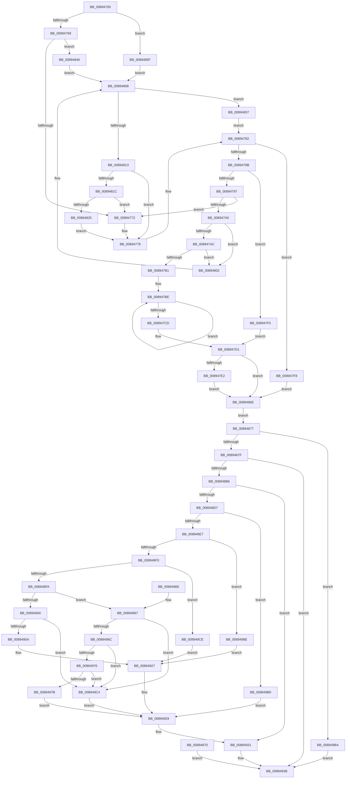

# NtAlpcQueryInformationMessage

- RVA: `0x00894700`–`0x008949F0` (길이 `752` bytes)
- VA: `0x0000000140894700`
- 실행 섹션: `PAGE`
- PDB 이름 있음: `예`; PDB Function 태그: `아니요`
- unwind 정보 RVA: `0x0007DFDC`
- 디코드: `188`개 명령, `752/752` bytes 표시
- 미해석 바이트: `0` (있으면 어셈블리에 `.byte`로 보존)

> 이 문서는 커널 이미지의 기계어와 PDB 기호를 분석해 생성했습니다. 4번과 5번은 함수 원형과 자료형을 바이너리 사용 방식에서 추정한 C 해석이며 원본 소스 복구 결과는 아닙니다.

## 1. Dependencies

- 직접 호출 지점: **10**; 고유 호출 대상: **10**
- 직접 호출자로 확인된 함수: **0**
- RIP 상대 이미지 참조: **1**

### Outgoing calls
- `0x00894772` → [ExRaiseDatatypeMisalignment](ExRaiseDatatypeMisalignment_function_00899FD0.md) (function, `0x00899FD0`)
- `0x00894802` → [ExRaiseAccessViolation](../8E/ExRaiseAccessViolation_function_008E9240.md) (function, `0x008E9240`)
- `0x008948A7` → [ObReferenceObjectByHandle](../86/ObReferenceObjectByHandle_function_00868DB0.md) (function, `0x00868DB0`)
- `0x008948CC` → [AlpcpLookupMessage](AlpcpLookupMessage_function_00895A40.md) (function, `0x00895A40`)
- `0x00894922` → [AlpcpQueryHandleInformationMessage](AlpcpQueryHandleInformationMessage_function_00893560.md) (function, `0x00893560`)
- `0x0089492C` → [AlpcpUnlockMessage](AlpcpUnlockMessage_function_00897AE0.md) (function, `0x00897AE0`)
- `0x00894936` → [ObfDereferenceObject](../../text/2F/ObfDereferenceObject_function_002F9350.md) (function, `0x002F9350`)
- `0x00894944` → [KeLeaveCriticalRegionThread](../../text/25/KeLeaveCriticalRegionThread_function_0025EFF0.md) (function, `0x0025EFF0`)
- `0x008949A6` → [AlpcpQuerySidMessage](../A2/AlpcpQuerySidMessage_function_00A20F28.md) (function, `0x00A20F28`)
- `0x008949E6` → [AlpcpQueryTokenModifiedIdMessage](../74/AlpcpQueryTokenModifiedIdMessage_function_0074C0C0.md) (function, `0x0074C0C0`)

### Direct callers
- 이 함수 시작 RVA로 연결되는 직접 call은 확인되지 않았습니다. 간접 호출은 완전히 역산할 수 없습니다.

### Static image references
- `0x0089487F` → RVA `0x00FC6C18` (`ALMOSTRO`; read)

## 2. Other-region calls and transfers

- 다른 실행 섹션으로 향하는 call: **2**
  - `0x00894936` → [ObfDereferenceObject](../../text/2F/ObfDereferenceObject_function_002F9350.md) (`PAGE` → `.text`)
  - `0x00894944` → [KeLeaveCriticalRegionThread](../../text/25/KeLeaveCriticalRegionThread_function_0025EFF0.md) (`PAGE` → `.text`)
- 별도 외부 분기/꼬리 이동을 확인하지 못했습니다.

## 3. Assembly (complete function range)

```asm
00894700  48 8B C4                        mov rax, rsp
00894703  48 89 58 08                     mov qword ptr [rax + 8], rbx
00894707  48 89 70 10                     mov qword ptr [rax + 0x10], rsi
0089470B  48 89 78 18                     mov qword ptr [rax + 0x18], rdi
0089470F  4C 89 60 20                     mov qword ptr [rax + 0x20], r12
00894713  41 56                           push r14
00894715  48 83 EC 50                     sub rsp, 0x50
00894719  4D 8B E1                        mov r12, r9
0089471C  45 8B F0                        mov r14d, r8d
0089471F  4C 8B D9                        mov r11, rcx
00894722  48 83 60 E8 00                  and qword ptr [rax - 0x18], 0
00894727  65 48 8B 04 25 88 01 00 00      mov rax, qword ptr gs:[0x188]
00894730  66 FF 88 E4 01 00 00            dec word ptr [rax + 0x1e4]
00894737  90                              nop
00894738  65 48 8B 04 25 88 01 00 00      mov rax, qword ptr gs:[0x188]
00894741  44 8A 90 32 02 00 00            mov r10b, byte ptr [rax + 0x232]
00894748  65 48 8B 04 25 88 01 00 00      mov rax, qword ptr gs:[0x188]
00894751  48 89 44 24 48                  mov qword ptr [rsp + 0x48], rax
00894756  44 8A 88 32 02 00 00            mov r9b, byte ptr [rax + 0x232]
0089475D  48 8B CA                        mov rcx, rdx
00894760  45 84 C9                        test r9b, r9b
00894763  0F 84 F6 00 00 00               je 0x14089485f
00894769  83 E1 03                        and ecx, 3
0089476C  0F 84 D4 00 00 00               je 0x140894846
00894772  E8 59 58 00 00                  call 0x140899fd0
00894777  CC                              int3
00894778  8B 72 18                        mov esi, dword ptr [rdx + 0x18]
0089477B  89 74 24 30                     mov dword ptr [rsp + 0x30], esi
0089477F  8B 42 20                        mov eax, dword ptr [rdx + 0x20]
00894782  89 44 24 34                     mov dword ptr [rsp + 0x34], eax
00894786  45 84 D2                        test r10b, r10b
00894789  74 6D                           je 0x1408947f8
0089478B  8B 84 24 80 00 00 00            mov eax, dword ptr [rsp + 0x80]
00894792  48 85 C0                        test rax, rax
00894795  74 5E                           je 0x1408947f5
00894797  49 8B D4                        mov rdx, r12
0089479A  41 F6 C4 03                     test r12b, 3
0089479E  75 D2                           jne 0x140894772
008947A0  48 8D 48 FF                     lea rcx, [rax - 1]
008947A4  49 03 CC                        add rcx, r12
008947A7  4C 3B E1                        cmp r12, rcx
008947AA  77 56                           ja 0x140894802
008947AC  49 3B C8                        cmp rcx, r8
008947AF  73 51                           jae 0x140894802
008947B1  49 C7 C1 00 F0 FF FF            mov r9, 0xfffffffffffff000
008947B8  49 23 C9                        and rcx, r9
008947BB  48 03 CB                        add rcx, rbx
008947BE  8A 02                           mov al, byte ptr [rdx]
008947C0  88 02                           mov byte ptr [rdx], al
008947C2  49 23 D1                        and rdx, r9
008947C5  48 03 D3                        add rdx, rbx
008947C8  48 3B D1                        cmp rdx, rcx
008947CB  75 F1                           jne 0x1408947be
008947CD  8B 74 24 30                     mov esi, dword ptr [rsp + 0x30]
008947D1  48 8B BC 24 88 00 00 00         mov rdi, qword ptr [rsp + 0x88]
008947D9  48 85 FF                        test rdi, rdi
008947DC  0F 84 8C 00 00 00               je 0x14089486e
008947E2  49 3B F8                        cmp rdi, r8
008947E5  4C 0F 42 C7                     cmovb r8, rdi
008947E9  41 8B 00                        mov eax, dword ptr [r8]
008947EC  41 89 00                        mov dword ptr [r8], eax
008947EF  8B 74 24 30                     mov esi, dword ptr [rsp + 0x30]
008947F3  EB 79                           jmp 0x14089486e
008947F5  90                              nop
008947F6  EB D9                           jmp 0x1408947d1
008947F8  48 8B BC 24 88 00 00 00         mov rdi, qword ptr [rsp + 0x88]
00894800  EB 6C                           jmp 0x14089486e
00894802  E8 39 4A 05 00                  call 0x1408e9240
00894807  CC                              int3
00894808  BB 00 10 00 00                  mov ebx, 0x1000
0089480D  66 85 5A 04                     test word ptr [rdx + 4], bx
00894811  75 24                           jne 0x140894837
00894813  45 84 C9                        test r9b, r9b
00894816  0F 84 5C FF FF FF               je 0x140894778
0089481C  48 85 C9                        test rcx, rcx
0089481F  0F 85 4D FF FF FF               jne 0x140894772
00894825  49 8B C0                        mov rax, r8
00894828  49 3B D0                        cmp rdx, r8
0089482B  48 0F 42 C2                     cmovb rax, rdx
0089482F  90                              nop
00894830  8A 00                           mov al, byte ptr [rax]
00894832  E9 41 FF FF FF                  jmp 0x140894778
00894837  8B 72 10                        mov esi, dword ptr [rdx + 0x10]
0089483A  89 74 24 30                     mov dword ptr [rsp + 0x30], esi
0089483E  8B 42 14                        mov eax, dword ptr [rdx + 0x14]
00894841  E9 3C FF FF FF                  jmp 0x140894782
00894846  49 B8 00 00 FF FF FF 7F 00 00   movabs r8, 0x7fffffff0000
00894850  49 8B C0                        mov rax, r8
00894853  49 3B D0                        cmp rdx, r8
00894856  48 0F 42 C2                     cmovb rax, rdx
0089485A  90                              nop
0089485B  8A 00                           mov al, byte ptr [rax]
0089485D  EB A9                           jmp 0x140894808
0089485F  83 E1 03                        and ecx, 3
00894862  49 B8 00 00 FF FF FF 7F 00 00   movabs r8, 0x7fffffff0000
0089486C  EB 9A                           jmp 0x140894808
0089486E  EB 07                           jmp 0x140894877
00894870  8B D8                           mov ebx, eax
00894872  E9 C4 00 00 00                  jmp 0x14089493b
00894877  85 F6                           test esi, esi
00894879  0F 84 3B 01 00 00               je 0x1408949ba
0089487F  4C 8B 05 92 23 73 00            mov r8, qword ptr [rip + 0x732392]
00894886  48 83 64 24 38 00               and qword ptr [rsp + 0x38], 0
0089488C  48 83 64 24 28 00               and qword ptr [rsp + 0x28], 0
00894892  48 8D 44 24 38                  lea rax, [rsp + 0x38]
00894897  48 89 44 24 20                  mov qword ptr [rsp + 0x20], rax
0089489C  45 8A CA                        mov r9b, r10b
0089489F  BA 00 00 02 00                  mov edx, 0x20000
008948A4  49 8B CB                        mov rcx, r11
008948A7  E8 04 45 FD FF                  call 0x140868db0
008948AC  8B D8                           mov ebx, eax
008948AE  85 C0                           test eax, eax
008948B0  0F 88 85 00 00 00               js 0x14089493b
008948B6  48 8D 44 24 40                  lea rax, [rsp + 0x40]
008948BB  48 89 44 24 20                  mov qword ptr [rsp + 0x20], rax
008948C0  44 8B 44 24 34                  mov r8d, dword ptr [rsp + 0x34]
008948C5  8B D6                           mov edx, esi
008948C7  48 8B 4C 24 38                  mov rcx, qword ptr [rsp + 0x38]
008948CC  E8 6F 11 00 00                  call 0x140895a40
008948D1  8B D8                           mov ebx, eax
008948D3  85 C0                           test eax, eax
008948D5  78 5A                           js 0x140894931
008948D7  48 8B 74 24 40                  mov rsi, qword ptr [rsp + 0x40]
008948DC  48 83 7E 18 00                  cmp qword ptr [rsi + 0x18], 0
008948E1  0F 84 C9 00 00 00               je 0x1408949b0
008948E7  45 85 F6                        test r14d, r14d
008948EA  0F 84 9E 00 00 00               je 0x14089498e
008948F0  41 83 EE 01                     sub r14d, 1
008948F4  0F 84 D4 00 00 00               je 0x1408949ce
008948FA  41 83 EE 01                     sub r14d, 1
008948FE  74 67                           je 0x140894967
00894900  41 83 FE 01                     cmp r14d, 1
00894904  0F 85 BA 00 00 00               jne 0x1408949c4
0089490A  48 89 7C 24 20                  mov qword ptr [rsp + 0x20], rdi
0089490F  44 8B 8C 24 80 00 00 00         mov r9d, dword ptr [rsp + 0x80]
00894917  4D 8B C4                        mov r8, r12
0089491A  48 8B D6                        mov rdx, rsi
0089491D  48 8B 4C 24 38                  mov rcx, qword ptr [rsp + 0x38]
00894922  E8 39 EC FF FF                  call 0x140893560
00894927  8B D8                           mov ebx, eax
00894929  48 8B CE                        mov rcx, rsi
0089492C  E8 AF 31 00 00                  call 0x140897ae0
00894931  48 8B 4C 24 38                  mov rcx, qword ptr [rsp + 0x38]
00894936  E8 15 4A A6 FF                  call 0x1402f9350
0089493B  65 48 8B 0C 25 88 01 00 00      mov rcx, qword ptr gs:[0x188]
00894944  E8 A7 A6 9C FF                  call 0x14025eff0
00894949  8B C3                           mov eax, ebx
0089494B  48 8B 5C 24 60                  mov rbx, qword ptr [rsp + 0x60]
00894950  48 8B 74 24 68                  mov rsi, qword ptr [rsp + 0x68]
00894955  48 8B 7C 24 70                  mov rdi, qword ptr [rsp + 0x70]
0089495A  4C 8B 64 24 78                  mov r12, qword ptr [rsp + 0x78]
0089495F  48 83 C4 50                     add rsp, 0x50
00894963  41 5E                           pop r14
00894965  C3                              ret
00894966  CC                              int3
00894967  4D 85 E4                        test r12, r12
0089496A  75 58                           jne 0x1408949c4
0089496C  44 39 A4 24 80 00 00 00         cmp dword ptr [rsp + 0x80], r12d
00894974  75 4E                           jne 0x1408949c4
00894976  48 85 FF                        test rdi, rdi
00894979  75 49                           jne 0x1408949c4
0089497B  8B 46 28                        mov eax, dword ptr [rsi + 0x28]
0089497E  24 07                           and al, 7
00894980  2C 04                           sub al, 4
00894982  F6 D8                           neg al
00894984  1B DB                           sbb ebx, ebx
00894986  81 E3 03 01 00 00               and ebx, 0x103
0089498C  EB 9B                           jmp 0x140894929
0089498E  48 89 7C 24 20                  mov qword ptr [rsp + 0x20], rdi
00894993  44 8B 8C 24 80 00 00 00         mov r9d, dword ptr [rsp + 0x80]
0089499B  4D 8B C4                        mov r8, r12
0089499E  48 8B D6                        mov rdx, rsi
008949A1  48 8B 4C 24 38                  mov rcx, qword ptr [rsp + 0x38]
008949A6  E8 7D C5 18 00                  call 0x140a20f28
008949AB  E9 77 FF FF FF                  jmp 0x140894927
008949B0  BB 03 07 00 C0                  mov ebx, 0xc0000703
008949B5  E9 6F FF FF FF                  jmp 0x140894929
008949BA  BB 0D 00 00 C0                  mov ebx, 0xc000000d
008949BF  E9 77 FF FF FF                  jmp 0x14089493b
008949C4  BB 0D 00 00 C0                  mov ebx, 0xc000000d
008949C9  E9 5B FF FF FF                  jmp 0x140894929
008949CE  48 89 7C 24 20                  mov qword ptr [rsp + 0x20], rdi
008949D3  44 8B 8C 24 80 00 00 00         mov r9d, dword ptr [rsp + 0x80]
008949DB  4D 8B C4                        mov r8, r12
008949DE  48 8B D6                        mov rdx, rsi
008949E1  48 8B 4C 24 38                  mov rcx, qword ptr [rsp + 0x38]
008949E6  E8 D5 76 EB FF                  call 0x14074c0c0
008949EB  E9 37 FF FF FF                  jmp 0x140894927
```

## 4. C-style interpretation (structured pseudocode)

```c
__int64 __fastcall NtAlpcQueryInformationMessage(__int64 a1, __int64 a2, __int64 a3, __int64 a4, unsigned int a5, __int64 a6)
{
    __int64 result;
    __int64 v_r14;
    __int64 v_rbx;
    __int64 v_rsp;
    unsigned __int64 v_stack_m10;
    unsigned __int64 v_stack_m18;
    unsigned __int64 v_stack_m20;
    unsigned int v_stack_m24;
    unsigned int v_stack_m28;
    unsigned __int64 v_stack_m30;
    unsigned __int64 v_stack_m38;
    unsigned __int64 v_stack_p10;
    unsigned __int64 v_stack_p18;
    unsigned __int64 v_stack_p20;
    unsigned __int64 v_stack_p38;
    unsigned __int64 v_stack_p8;

    *(unsigned __int64 *)(v_rsp + 8) = v_rbx;
    *(unsigned __int64 *)(v_rsp + 16) = v_rsi;
    *(unsigned __int64 *)(v_rsp + 24) = v_rdi;
    *(unsigned __int64 *)(v_rsp + 32) = v_r12;
    v_rsp = (v_rsp) - (80);
    v_stack_m10 = *(unsigned __int64 *)(gs_base + (0 + 392));
    if ((unsigned __int8)(*(unsigned __int8 *)(*(unsigned __int64 *)(gs_base + (0 + 392)) + 562)) == 0) goto loc_0089485F;
    a1 = (unsigned int)((a2) & (3));
    if (condition_is_equal) goto loc_00894846;
loc_00894772:
    result = ExRaiseDatatypeMisalignment(a1, a2, a3, *(unsigned __int8 *)(*(unsigned __int64 *)(gs_base + (0 + 392)) + 562));
loc_00894778:
    v_stack_m28 = (unsigned int)((unsigned int)(*(unsigned int *)(a2 + 24)));
loc_00894782:
    v_stack_m24 = (unsigned int)((unsigned int)(*(unsigned int *)(a2 + 32)));
    if ((unsigned __int8)(*(unsigned __int8 *)(*(unsigned __int64 *)(gs_base + (0 + 392)) + 562)) == 0) goto loc_008947F8;
    if ((unsigned int)(a5) == 0) goto loc_008947F5;
    if ((((unsigned __int8)(a4)) & (3)) != 0) goto loc_00894772;
    a1 = ((unsigned int)(a5) - 1) + (a4);
    if (a4 > a1) goto loc_00894802;
    if (a1 >= a3) goto loc_00894802;
    a1 = (a1) & (0xFFFFFFFFFFFFF000ULL);
    a1 = (a1) + (v_rbx);
loc_008947BE:
    *(unsigned __int8 *)(a4) = (unsigned __int8)(*(unsigned __int8 *)(a4));
    a2 = (a4) & (0xFFFFFFFFFFFFF000ULL);
    a2 = (a2) + (v_rbx);
    if (a2 != a1) goto loc_008947BE;
loc_008947D1:
    if (a6 == 0) goto loc_0089486E;
    if (a6 < a3) { a3 = a6; }
    *(unsigned int *)(a3) = (unsigned int)((unsigned int)(*(unsigned int *)(a3)));
    goto loc_0089486E;
loc_008947F5:
    goto loc_008947D1;
loc_008947F8:
    goto loc_0089486E;
loc_00894802:
    result = ExRaiseAccessViolation(a1, a2, a3, 0xFFFFFFFFFFFFF000ULL);
loc_00894808:
    if (((*(unsigned __int16 *)(a2 + 4)) & ((unsigned __int16)((unsigned int)(0x1000ULL)))) != 0) goto loc_00894837;
    if ((unsigned __int8)(0xFFFFFFFFFFFFF000ULL) == 0) goto loc_00894778;
    if (a1 != 0) goto loc_00894772;
    if (a2 < a3) { a3 = a2; }
    goto loc_00894778;
loc_00894837:
    v_stack_m28 = (unsigned int)((unsigned int)(*(unsigned int *)(a2 + 16)));
    goto loc_00894782;
loc_00894846:
    if (a2 < a3) { a3 = a2; }
    goto loc_00894808;
loc_0089485F:
    a1 = (unsigned int)((a1) & (3));
    goto loc_00894808;
loc_0089486E:
    goto loc_00894877;
loc_00894877:
    if ((unsigned int)((unsigned int)(*(unsigned int *)(a2 + 16))) == 0) goto loc_008949BA;
    v_stack_m38 = v_stack_m20;
    result = ObReferenceObjectByHandle(a1, (unsigned int)(0x20000ULL), *(unsigned __int64 *)(v_rip + 7545746), (unsigned __int8)(*(unsigned __int8 *)(*(unsigned __int64 *)(gs_base + (0 + 392)) + 562)));
    if (sign_flag) goto loc_0089493B;
    v_stack_m38 = v_stack_m18;
    result = AlpcpLookupMessage(v_stack_m20, (unsigned int)((unsigned int)((unsigned int)(*(unsigned int *)(a2 + 16)))), (unsigned int)(v_stack_m24), (unsigned __int8)(*(unsigned __int8 *)(*(unsigned __int64 *)(gs_base + (0 + 392)) + 562)));
    if (sign_flag) goto loc_00894931;
    if ((*(unsigned __int64 *)(v_stack_m18 + 24)) == 0) goto loc_008949B0;
    if ((unsigned int)((unsigned int)((unsigned int)(a3))) == 0) goto loc_0089498E;
    v_r14 = (unsigned int)(((unsigned int)((unsigned int)(a3))) - (1));
    if (condition_is_equal) goto loc_008949CE;
    v_r14 = (unsigned int)((v_r14) - (1));
    if (condition_is_equal) goto loc_00894967;
    if (((unsigned int)(v_r14)) != 1) goto loc_008949C4;
    v_stack_m38 = a6;
    result = AlpcpQueryHandleInformationMessage(v_stack_m20, v_stack_m18, a4, (unsigned int)(a5));
loc_00894927:
loc_00894929:
    result = AlpcpUnlockMessage(v_stack_m18, v_stack_m18, a4, (unsigned int)(a5));
loc_00894931:
    result = ObfDereferenceObject(v_stack_m20, v_stack_m18, a4, (unsigned int)(a5));
loc_0089493B:
    result = KeLeaveCriticalRegionThread(*(unsigned __int64 *)(gs_base + (0 + 392)), v_stack_m18, a4, (unsigned int)(a5));
    v_rsp = (v_rsp) + (80);
    return (unsigned int)((unsigned int)((unsigned int)((unsigned int)(result))));
loc_00894967:
    if (v_stack_p20 != 0) goto loc_008949C4;
    if (a5 != ((unsigned int)(v_stack_p20))) goto loc_008949C4;
    if (v_stack_p18 != 0) goto loc_008949C4;
    result = (unsigned __int8)(((unsigned int)(*(unsigned int *)(v_stack_p10 + 40))) & (7));
    result = (unsigned __int8)((result) - (4));
    result = (unsigned __int8)(-(result));
    v_rbx = (unsigned int)((v_stack_p8) & (259));
    goto loc_00894929;
loc_0089498E:
    v_stack_p20 = v_stack_p18;
    result = AlpcpQuerySidMessage(v_stack_p38, v_stack_p10, v_stack_p20, (unsigned int)(a5));
    goto loc_00894927;
loc_008949B0:
    goto loc_00894929;
loc_008949BA:
    goto loc_0089493B;
loc_008949C4:
    goto loc_00894929;
loc_008949CE:
    v_stack_p20 = v_stack_p18;
    result = AlpcpQueryTokenModifiedIdMessage(v_stack_p38, v_stack_p10, v_stack_p20, (unsigned int)(a5));
    goto loc_00894927;
}
```

## 5. (Beta) C Style

```c
int64_t NtAlpcQueryInformationMessage(int64_t Arg1, int64_t Arg2, int64_t Arg3, int64_t Arg4, uint32_t Arg5, int64_t Arg6)
{
    int64_t result;
    int64_t local_r14;
    int64_t local_rbx;
    int64_t local_rsp;
    uint64_t v_stack_m10;
    uint64_t v_stack_m18;
    uint64_t v_stack_m20;
    uint32_t v_stack_m24;
    uint32_t v_stack_m28;
    uint64_t v_stack_m30;
    uint64_t v_stack_m38;
    uint64_t v_stack_p10;
    uint64_t v_stack_p18;
    uint64_t v_stack_p20;
    uint64_t v_stack_p38;
    uint64_t v_stack_p8;

    *(uint64_t *)(local_rsp + 0x8) = local_rbx;
    *(uint64_t *)(local_rsp + 0x10) = local_rsi;
    *(uint64_t *)(local_rsp + 0x18) = local_rdi;
    *(uint64_t *)(local_rsp + 0x20) = local_r12;
    local_rsp = (local_rsp) - (80);
    v_stack_m10 = *(uint64_t *)(gs_base + (0 + 0x188));
    if ((uint8_t)(*(uint8_t *)(*(uint64_t *)(gs_base + (0 + 0x188)) + 0x232)) == 0) goto loc_0089485F;
    Arg1 = (uint32_t)((Arg2) & (3));
    if (condition_is_equal) goto loc_00894846;
loc_00894772:
    result = ExRaiseDatatypeMisalignment(Arg1, Arg2, Arg3, *(uint8_t *)(*(uint64_t *)(gs_base + (0 + 0x188)) + 0x232));
loc_00894778:
    v_stack_m28 = (uint32_t)((uint32_t)(*(uint32_t *)(Arg2 + 0x18)));
loc_00894782:
    v_stack_m24 = (uint32_t)((uint32_t)(*(uint32_t *)(Arg2 + 0x20)));
    if ((uint8_t)(*(uint8_t *)(*(uint64_t *)(gs_base + (0 + 0x188)) + 0x232)) == 0) goto loc_008947F8;
    if ((uint32_t)(Arg5) == 0) goto loc_008947F5;
    if ((((uint8_t)(Arg4)) & (3)) != 0) goto loc_00894772;
    Arg1 = ((uint32_t)(Arg5) - 1) + (Arg4);
    if (Arg4 > Arg1) goto loc_00894802;
    if (Arg1 >= Arg3) goto loc_00894802;
    Arg1 = (Arg1) & (0xFFFFFFFFFFFFF000ULL);
    Arg1 = (Arg1) + (local_rbx);
loc_008947BE:
    *(uint8_t *)(Arg4) = (uint8_t)(*(uint8_t *)(Arg4));
    Arg2 = (Arg4) & (0xFFFFFFFFFFFFF000ULL);
    Arg2 = (Arg2) + (local_rbx);
    if (Arg2 != Arg1) goto loc_008947BE;
loc_008947D1:
    if (Arg6 == 0) goto loc_0089486E;
    if (Arg6 < Arg3) { Arg3 = Arg6; }
    *(uint32_t *)(Arg3) = (uint32_t)((uint32_t)(*(uint32_t *)(Arg3)));
    goto loc_0089486E;
loc_008947F5:
    goto loc_008947D1;
loc_008947F8:
    goto loc_0089486E;
loc_00894802:
    result = ExRaiseAccessViolation(Arg1, Arg2, Arg3, 0xFFFFFFFFFFFFF000ULL);
loc_00894808:
    if (((*(uint16_t *)(Arg2 + 0x4)) & ((uint16_t)((uint32_t)(0x1000ULL)))) != 0) goto loc_00894837;
    if ((uint8_t)(0xFFFFFFFFFFFFF000ULL) == 0) goto loc_00894778;
    if (Arg1 != 0) goto loc_00894772;
    if (Arg2 < Arg3) { Arg3 = Arg2; }
    goto loc_00894778;
loc_00894837:
    v_stack_m28 = (uint32_t)((uint32_t)(*(uint32_t *)(Arg2 + 0x10)));
    goto loc_00894782;
loc_00894846:
    if (Arg2 < Arg3) { Arg3 = Arg2; }
    goto loc_00894808;
loc_0089485F:
    Arg1 = (uint32_t)((Arg1) & (3));
    goto loc_00894808;
loc_0089486E:
    goto loc_00894877;
loc_00894877:
    if ((uint32_t)((uint32_t)(*(uint32_t *)(Arg2 + 0x10))) == 0) goto loc_008949BA;
    v_stack_m38 = v_stack_m20;
    result = ObReferenceObjectByHandle(Arg1, (uint32_t)(0x20000ULL), *(uint64_t *)(v_rip + 0x732392), (uint8_t)(*(uint8_t *)(*(uint64_t *)(gs_base + (0 + 0x188)) + 0x232)));
    if (sign_flag) goto loc_0089493B;
    v_stack_m38 = v_stack_m18;
    result = AlpcpLookupMessage(v_stack_m20, (uint32_t)((uint32_t)((uint32_t)(*(uint32_t *)(Arg2 + 0x10)))), (uint32_t)(v_stack_m24), (uint8_t)(*(uint8_t *)(*(uint64_t *)(gs_base + (0 + 0x188)) + 0x232)));
    if (sign_flag) goto loc_00894931;
    if ((*(uint64_t *)(v_stack_m18 + 0x18)) == 0) goto loc_008949B0;
    if ((uint32_t)((uint32_t)((uint32_t)(Arg3))) == 0) goto loc_0089498E;
    local_r14 = (uint32_t)(((uint32_t)((uint32_t)(Arg3))) - (1));
    if (condition_is_equal) goto loc_008949CE;
    local_r14 = (uint32_t)((local_r14) - (1));
    if (condition_is_equal) goto loc_00894967;
    if (((uint32_t)(local_r14)) != 1) goto loc_008949C4;
    v_stack_m38 = Arg6;
    result = AlpcpQueryHandleInformationMessage(v_stack_m20, v_stack_m18, Arg4, (uint32_t)(Arg5));
loc_00894927:
loc_00894929:
    result = AlpcpUnlockMessage(v_stack_m18, v_stack_m18, Arg4, (uint32_t)(Arg5));
loc_00894931:
    result = ObfDereferenceObject(v_stack_m20, v_stack_m18, Arg4, (uint32_t)(Arg5));
loc_0089493B:
    result = KeLeaveCriticalRegionThread(*(uint64_t *)(gs_base + (0 + 0x188)), v_stack_m18, Arg4, (uint32_t)(Arg5));
    local_rsp = (local_rsp) + (80);
    return (uint32_t)((uint32_t)((uint32_t)((uint32_t)(result))));
loc_00894967:
    if (v_stack_p20 != 0) goto loc_008949C4;
    if (Arg5 != ((uint32_t)(v_stack_p20))) goto loc_008949C4;
    if (v_stack_p18 != 0) goto loc_008949C4;
    result = (uint8_t)(((uint32_t)(*(uint32_t *)(v_stack_p10 + 0x28))) & (7));
    result = (uint8_t)((result) - (4));
    result = (uint8_t)(-(result));
    local_rbx = (uint32_t)((v_stack_p8) & (259));
    goto loc_00894929;
loc_0089498E:
    v_stack_p20 = v_stack_p18;
    result = AlpcpQuerySidMessage(v_stack_p38, v_stack_p10, v_stack_p20, (uint32_t)(Arg5));
    goto loc_00894927;
loc_008949B0:
    goto loc_00894929;
loc_008949BA:
    goto loc_0089493B;
loc_008949C4:
    goto loc_00894929;
loc_008949CE:
    v_stack_p20 = v_stack_p18;
    result = AlpcpQueryTokenModifiedIdMessage(v_stack_p38, v_stack_p10, v_stack_p20, (uint32_t)(Arg5));
    goto loc_00894927;
}
```

## 6. Execution-region graph

[열기: 2D/3D 그래프와 함수 탐색 컨트롤 패널](../../../control-panel.html?section=page&rva=0x00894700&view=graph)

- 2D 그래프는 위에서 아래로 흐르고, 3D 그래프는 빈 공간을 드래그해 회전합니다. Shift+드래그는 이동, 휠은 확대·축소, 함수 노드 선택은 대상 보고서 이동입니다.

### Static fallback


