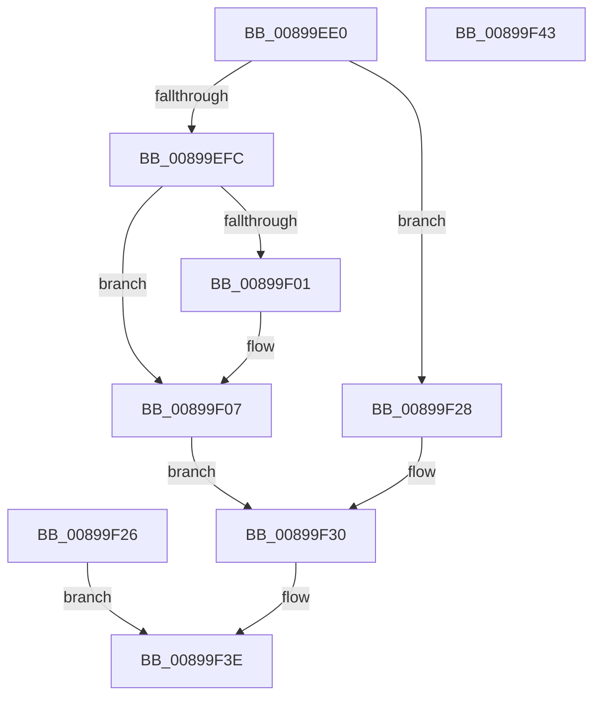

# NtDelayExecution

- RVA: `0x00899EE0`–`0x00899F44` (길이 `100` bytes)
- VA: `0x0000000140899EE0`
- 실행 섹션: `PAGE`
- PDB 이름 있음: `예`; PDB Function 태그: `아니요`
- unwind 정보 RVA: `0x0007E550`
- 디코드: `27`개 명령, `100/100` bytes 표시
- 미해석 바이트: `0` (있으면 어셈블리에 `.byte`로 보존)

> 이 문서는 커널 이미지의 기계어와 PDB 기호를 분석해 생성했습니다. 4번과 5번은 함수 원형과 자료형을 바이너리 사용 방식에서 추정한 C 해석이며 원본 소스 복구 결과는 아닙니다.

## 1. Dependencies

- 직접 호출 지점: **2**; 고유 호출 대상: **2**
- 직접 호출자로 확인된 함수: **0**
- RIP 상대 이미지 참조: **0**

### Outgoing calls
- `0x00899F01` → [ExRaiseDatatypeMisalignment](ExRaiseDatatypeMisalignment_function_00899FD0.md) (function, `0x00899FD0`)
- `0x00899F39` → [KeDelayExecutionThread](../../text/20/KeDelayExecutionThread_function_00209550.md) (function, `0x00209550`)

### Direct callers
- 이 함수 시작 RVA로 연결되는 직접 call은 확인되지 않았습니다. 간접 호출은 완전히 역산할 수 없습니다.

### Static image references
- 디코드된 RIP-relative 메모리 참조가 없습니다.

## 2. Other-region calls and transfers

- 다른 실행 섹션으로 향하는 call: **1**
  - `0x00899F39` → [KeDelayExecutionThread](../../text/20/KeDelayExecutionThread_function_00209550.md) (`PAGE` → `.text`)
- 별도 외부 분기/꼬리 이동을 확인하지 못했습니다.

## 3. Assembly (complete function range)

```asm
00899EE0  48 83 EC 28                     sub rsp, 0x28
00899EE4  44 0F B6 C9                     movzx r9d, cl
00899EE8  65 48 8B 0C 25 88 01 00 00      mov rcx, qword ptr gs:[0x188]
00899EF1  0F B6 89 32 02 00 00            movzx ecx, byte ptr [rcx + 0x232]
00899EF8  84 C9                           test cl, cl
00899EFA  74 2C                           je 0x140899f28
00899EFC  F6 C2 03                        test dl, 3
00899EFF  74 06                           je 0x140899f07
00899F01  E8 CA 00 00 00                  call 0x140899fd0
00899F06  CC                              int3
00899F07  48 B8 00 00 FF FF FF 7F 00 00   movabs rax, 0x7fffffff0000
00899F11  48 3B D0                        cmp rdx, rax
00899F14  48 0F 42 C2                     cmovb rax, rdx
00899F18  90                              nop
00899F19  0F B6 00                        movzx eax, byte ptr [rax]
00899F1C  48 8B 02                        mov rax, qword ptr [rdx]
00899F1F  48 89 44 24 40                  mov qword ptr [rsp + 0x40], rax
00899F24  EB 0A                           jmp 0x140899f30
00899F26  EB 16                           jmp 0x140899f3e
00899F28  48 8B 02                        mov rax, qword ptr [rdx]
00899F2B  48 89 44 24 40                  mov qword ptr [rsp + 0x40], rax
00899F30  4C 8D 44 24 40                  lea r8, [rsp + 0x40]
00899F35  41 0F B6 D1                     movzx edx, r9b
00899F39  E8 12 F6 96 FF                  call 0x140209550
00899F3E  48 83 C4 28                     add rsp, 0x28
00899F42  C3                              ret
00899F43  CC                              int3
```

## 4. C-style interpretation (structured pseudocode)

```c
__int64 __fastcall NtDelayExecution(unsigned __int8 a1, __int64 a2)
{
    __int64 result;
    __int64 v_rsp;
    unsigned __int64 v_stack_p18;

    v_rsp = (v_rsp) - (40);
    if ((unsigned __int8)(*(unsigned __int8 *)(*(unsigned __int64 *)(gs_base + (0 + 392)) + 562)) == 0) goto loc_00899F28;
    if ((((unsigned __int8)(a2)) & (3)) != 0) {
        result = ExRaiseDatatypeMisalignment(*(unsigned __int8 *)(*(unsigned __int64 *)(gs_base + (0 + 392)) + 562), a2, a3, a1);
    }
    if (a2 < result) { result = a2; }
    v_stack_p18 = *(unsigned __int64 *)(a2);
    goto loc_00899F30;
loc_00899F28:
    v_stack_p18 = *(unsigned __int64 *)(a2);
loc_00899F30:
    result = KeDelayExecutionThread(*(unsigned __int8 *)(*(unsigned __int64 *)(gs_base + (0 + 392)) + 562), a1, v_stack_p18, a1);
loc_00899F3E:
    v_rsp = (v_rsp) + (40);
    return result;
}
```

## 5. (Beta) C Style

```c
int64_t NtDelayExecution(uint8_t Arg1, void *Arg2)
{
    uint8_t *arg2 = (uint8_t *)Arg2;

    int64_t result;
    int64_t local_rsp;
    uint64_t v_stack_p18;

    local_rsp = (local_rsp) - (40);
    if ((uint8_t)(*(uint8_t *)(*(uint64_t *)(gs_base + (0 + 0x188)) + 0x232)) == 0) goto loc_00899F28;
    if ((((uint8_t)(Arg2)) & (3)) != 0) {
        result = ExRaiseDatatypeMisalignment(*(uint8_t *)(*(uint64_t *)(gs_base + (0 + 0x188)) + 0x232), Arg2, a3, Arg1);
    }
    if (Arg2 < result) { result = Arg2; }
    v_stack_p18 = *(uint64_t *)(arg2);
    goto loc_00899F30;
loc_00899F28:
    v_stack_p18 = *(uint64_t *)(arg2);
loc_00899F30:
    result = KeDelayExecutionThread(*(uint8_t *)(*(uint64_t *)(gs_base + (0 + 0x188)) + 0x232), Arg1, v_stack_p18, Arg1);
loc_00899F3E:
    local_rsp = (local_rsp) + (40);
    return result;
}
```

### 관측된 메모리 오프셋

구조체 형식이 확인되지 않은 접근은 인자 기준의 오프셋으로만 기록했습니다.

| 기준 인자 | 오프셋 표현 | 폭 (bit) | 접근 |
|---|---:|---:|---|
| `Arg2` | `+ 0x0` | `64` | `R` |

## 6. Execution-region graph

[열기: 2D/3D 그래프와 함수 탐색 컨트롤 패널](../../../control-panel.html?section=page&rva=0x00899EE0&view=graph)

- 2D 그래프는 위에서 아래로 흐르고, 3D 그래프는 빈 공간을 드래그해 회전합니다. Shift+드래그는 이동, 휠은 확대·축소, 함수 노드 선택은 대상 보고서 이동입니다.

### Static fallback


