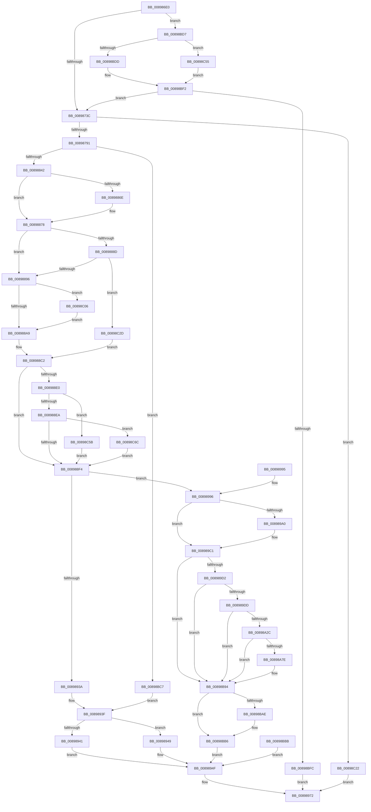

# NtMapViewOfSection

- RVA: `0x008986E0`–`0x00898C7D` (길이 `1,437` bytes)
- VA: `0x00000001408986E0`
- 실행 섹션: `PAGE`
- PDB 이름 있음: `예`; PDB Function 태그: `아니요`
- unwind 정보 RVA: `0x0007E46C`
- 디코드: `284`개 명령, `1,437/1,437` bytes 표시
- 미해석 바이트: `0` (있으면 어셈블리에 `.byte`로 보존)

> 이 문서는 커널 이미지의 기계어와 PDB 기호를 분석해 생성했습니다. 4번과 5번은 함수 원형과 자료형을 바이너리 사용 방식에서 추정한 C 해석이며 원본 소스 복구 결과는 아닙니다.

## 1. Dependencies

- 직접 호출 지점: **14**; 고유 호출 대상: **12**
- 직접 호출자로 확인된 함수: **1**
- RIP 상대 이미지 참조: **6**

### Outgoing calls
- `0x00898784` → [MiMapViewOfSectionCommon](MiMapViewOfSectionCommon_function_00898C90.md) (function, `0x00898C90`)
- `0x00898796` → [MiSectionControlArea](../../text/29/MiSectionControlArea_function_00294CB0.md) (function, `0x00294CB0`)
- `0x00898928` → [MiMapViewOfSection](MiMapViewOfSection_function_00898F10.md) (function, `0x00898F10`)
- `0x00898959` → [ObfDereferenceObjectWithTag](../../text/2F/ObfDereferenceObjectWithTag_function_002F78E0.md) (function, `0x002F78E0`)
- `0x0089896B` → [ObfDereferenceObjectWithTag](../../text/2F/ObfDereferenceObjectWithTag_function_002F78E0.md) (function, `0x002F78E0`)
- `0x0089897D` → [_security_check_cookie](../../text/6A/_security_check_cookie_function_006AC640.md) (function, `0x006AC640`)
- `0x008989BC` → [DbgkMapViewOfSection](DbgkMapViewOfSection_function_00897460.md) (function, `0x00897460`)
- `0x00898A1F` → [EtwProviderEnabled](../../text/3B/EtwProviderEnabled_function_003BA250.md) (function, `0x003BA250`)
- `0x00898A71` → [EtwEventEnabled](../../text/39/EtwEventEnabled_function_00392450.md) (function, `0x00392450`)
- `0x00898A91` → [EtwpTiFillProcessIdentity](../../text/3B/EtwpTiFillProcessIdentity_function_003B8F30.md) (function, `0x003B8F30`)
- `0x00898AB3` → [EtwpTiFillThreadIdentity](../../text/47/EtwpTiFillThreadIdentity_function_00471C1C.md) (function, `0x00471C1C`)
- `0x00898AD8` → [EtwpTiFillProcessIdentity](../../text/3B/EtwpTiFillProcessIdentity_function_003B8F30.md) (function, `0x003B8F30`)
- `0x00898B8E` → [EtwWrite](../../text/41/EtwWrite_function_0041C720.md) (function, `0x0041C720`)
- `0x00898BE0` → [RtlFindMostSignificantBit](../../text/45/RtlFindMostSignificantBit_function_00450270.md) (function, `0x00450270`)

### Direct callers
- [DifNtMapViewOfSectionWrapper](../../text/63/DifNtMapViewOfSectionWrapper_function_00637790.md) at `0x006378DF`

### Static image references
- `0x008986F3` → RVA `0x00E0A740` (`.data`; read)
- `0x00898833` → RVA `0x00FC5000` (`ALMOSTRO`; read)
- `0x00898941` → RVA `0x00E302A8` (`.data`; read/write)
- `0x00898949` → RVA `0x00E302AC` (`.data`; read/write)
- `0x00898A18` → RVA `0x00EFFA30` (`.data`; read)
- `0x00898A5C` → RVA `0x00001580` (`.rdata`; read)

## 2. Other-region calls and transfers

- 다른 실행 섹션으로 향하는 call: **11**
  - `0x00898796` → [MiSectionControlArea](../../text/29/MiSectionControlArea_function_00294CB0.md) (`PAGE` → `.text`)
  - `0x00898959` → [ObfDereferenceObjectWithTag](../../text/2F/ObfDereferenceObjectWithTag_function_002F78E0.md) (`PAGE` → `.text`)
  - `0x0089896B` → [ObfDereferenceObjectWithTag](../../text/2F/ObfDereferenceObjectWithTag_function_002F78E0.md) (`PAGE` → `.text`)
  - `0x0089897D` → [_security_check_cookie](../../text/6A/_security_check_cookie_function_006AC640.md) (`PAGE` → `.text`)
  - `0x00898A1F` → [EtwProviderEnabled](../../text/3B/EtwProviderEnabled_function_003BA250.md) (`PAGE` → `.text`)
  - `0x00898A71` → [EtwEventEnabled](../../text/39/EtwEventEnabled_function_00392450.md) (`PAGE` → `.text`)
  - `0x00898A91` → [EtwpTiFillProcessIdentity](../../text/3B/EtwpTiFillProcessIdentity_function_003B8F30.md) (`PAGE` → `.text`)
  - `0x00898AB3` → [EtwpTiFillThreadIdentity](../../text/47/EtwpTiFillThreadIdentity_function_00471C1C.md) (`PAGE` → `.text`)
  - `0x00898AD8` → [EtwpTiFillProcessIdentity](../../text/3B/EtwpTiFillProcessIdentity_function_003B8F30.md) (`PAGE` → `.text`)
  - `0x00898B8E` → [EtwWrite](../../text/41/EtwWrite_function_0041C720.md) (`PAGE` → `.text`)
  - `0x00898BE0` → [RtlFindMostSignificantBit](../../text/45/RtlFindMostSignificantBit_function_00450270.md) (`PAGE` → `.text`)
- 별도 외부 분기/꼬리 이동을 확인하지 못했습니다.

## 3. Assembly (complete function range)

```asm
008986E0  40 53                           push rbx
008986E2  56                              push rsi
008986E3  57                              push rdi
008986E4  41 54                           push r12
008986E6  41 55                           push r13
008986E8  41 56                           push r14
008986EA  41 57                           push r15
008986EC  48 81 EC 70 02 00 00            sub rsp, 0x270
008986F3  48 8B 05 46 20 57 00            mov rax, qword ptr [rip + 0x572046]
008986FA  48 33 C4                        xor rax, rsp
008986FD  48 89 84 24 60 02 00 00         mov qword ptr [rsp + 0x260], rax
00898705  49 8B D9                        mov rbx, r9
00898708  4D 8B E0                        mov r12, r8
0089870B  4C 8B FA                        mov r15, rdx
0089870E  48 8B F9                        mov rdi, rcx
00898711  4C 8B B4 24 D8 02 00 00         mov r14, qword ptr [rsp + 0x2d8]
00898719  4C 8B AC 24 E0 02 00 00         mov r13, qword ptr [rsp + 0x2e0]
00898721  0F 57 C0                        xorps xmm0, xmm0
00898724  0F 11 44 24 58                  movups xmmword ptr [rsp + 0x58], xmm0
00898729  0F 11 44 24 68                  movups xmmword ptr [rsp + 0x68], xmm0
0089872E  0F 11 44 24 78                  movups xmmword ptr [rsp + 0x78], xmm0
00898733  4D 85 C9                        test r9, r9
00898736  0F 85 9B 04 00 00               jne 0x140898bd7
0089873C  65 48 8B 04 25 88 01 00 00      mov rax, qword ptr gs:[0x188]
00898745  0F B6 80 32 02 00 00            movzx eax, byte ptr [rax + 0x232]
0089874C  88 44 24 50                     mov byte ptr [rsp + 0x50], al
00898750  48 8D 4C 24 58                  lea rcx, [rsp + 0x58]
00898755  48 89 4C 24 48                  mov qword ptr [rsp + 0x48], rcx
0089875A  88 44 24 40                     mov byte ptr [rsp + 0x40], al
0089875E  48 89 5C 24 38                  mov qword ptr [rsp + 0x38], rbx
00898763  8B B4 24 F8 02 00 00            mov esi, dword ptr [rsp + 0x2f8]
0089876A  89 74 24 30                     mov dword ptr [rsp + 0x30], esi
0089876E  4C 89 74 24 28                  mov qword ptr [rsp + 0x28], r14
00898773  4C 89 6C 24 20                  mov qword ptr [rsp + 0x20], r13
00898778  4D 8B CC                        mov r9, r12
0089877B  45 33 C0                        xor r8d, r8d
0089877E  48 8B D7                        mov rdx, rdi
00898781  49 8B CF                        mov rcx, r15
00898784  E8 07 05 00 00                  call 0x140898c90
00898789  85 C0                           test eax, eax
0089878B  0F 88 91 04 00 00               js 0x140898c22
00898791  48 8B 4C 24 78                  mov rcx, qword ptr [rsp + 0x78]
00898796  E8 15 C5 9F FF                  call 0x140294cb0
0089879B  4C 8B C0                        mov r8, rax
0089879E  0F 57 C0                        xorps xmm0, xmm0
008987A1  0F 11 84 24 B0 00 00 00         movups xmmword ptr [rsp + 0xb0], xmm0
008987A9  0F 11 84 24 C0 00 00 00         movups xmmword ptr [rsp + 0xc0], xmm0
008987B1  0F 11 84 24 D0 00 00 00         movups xmmword ptr [rsp + 0xd0], xmm0
008987B9  0F 11 84 24 E0 00 00 00         movups xmmword ptr [rsp + 0xe0], xmm0
008987C1  0F 11 84 24 F0 00 00 00         movups xmmword ptr [rsp + 0xf0], xmm0
008987C9  0F 11 84 24 00 01 00 00         movups xmmword ptr [rsp + 0x100], xmm0
008987D1  0F 11 84 24 10 01 00 00         movups xmmword ptr [rsp + 0x110], xmm0
008987D9  0F 11 84 24 20 01 00 00         movups xmmword ptr [rsp + 0x120], xmm0
008987E1  65 48 8B 0C 25 88 01 00 00      mov rcx, qword ptr gs:[0x188]
008987EA  48 8B 91 B8 00 00 00            mov rdx, qword ptr [rcx + 0xb8]
008987F1  48 89 94 24 10 01 00 00         mov qword ptr [rsp + 0x110], rdx
008987F9  48 8B 8C 24 80 00 00 00         mov rcx, qword ptr [rsp + 0x80]
00898801  48 89 8C 24 08 01 00 00         mov qword ptr [rsp + 0x108], rcx
00898809  65 48 8B 04 25 88 01 00 00      mov rax, qword ptr gs:[0x188]
00898812  0F B6 88 32 02 00 00            movzx ecx, byte ptr [rax + 0x232]
00898819  88 8C 24 E9 00 00 00            mov byte ptr [rsp + 0xe9], cl
00898820  8B BC 24 F0 02 00 00            mov edi, dword ptr [rsp + 0x2f0]
00898827  8B CF                           mov ecx, edi
00898829  83 E1 7F                        and ecx, 0x7f
0089882C  89 8C 24 E4 00 00 00            mov dword ptr [rsp + 0xe4], ecx
00898833  0F B7 05 C6 C7 72 00            movzx eax, word ptr [rip + 0x72c7c6]
0089883A  3B C8                           cmp ecx, eax
0089883C  0F 87 85 03 00 00               ja 0x140898bc7
00898842  8B C7                           mov eax, edi
00898844  83 E0 80                        and eax, 0xffffff80
00898847  89 84 24 D8 00 00 00            mov dword ptr [rsp + 0xd8], eax
0089884E  89 B4 24 DC 00 00 00            mov dword ptr [rsp + 0xdc], esi
00898855  45 33 FF                        xor r15d, r15d
00898858  44 89 BC 24 F0 00 00 00         mov dword ptr [rsp + 0xf0], r15d
00898860  8B 8C 24 EC 00 00 00            mov ecx, dword ptr [rsp + 0xec]
00898867  4C 39 7C 24 58                  cmp qword ptr [rsp + 0x58], r15
0089886C  74 0A                           je 0x140898878
0089886E  83 C9 01                        or ecx, 1
00898871  89 8C 24 EC 00 00 00            mov dword ptr [rsp + 0xec], ecx
00898878  48 8B 44 24 60                  mov rax, qword ptr [rsp + 0x60]
0089887D  48 89 84 24 C8 00 00 00         mov qword ptr [rsp + 0xc8], rax
00898885  41 8B 40 38                     mov eax, dword ptr [r8 + 0x38]
00898889  A8 20                           test al, 0x20
0089888B  75 09                           jne 0x140898896
0089888D  F6 C1 01                        test cl, 1
00898890  0F 85 97 03 00 00               jne 0x140898c2d
00898896  48 BA FF FF FE FF FF 7F 00 00   movabs rdx, 0x7ffffffeffff
008988A0  48 85 DB                        test rbx, rbx
008988A3  0F 85 5D 03 00 00               jne 0x140898c06
008988A9  48 8B 84 24 80 00 00 00         mov rax, qword ptr [rsp + 0x80]
008988B1  48 8B 88 68 03 00 00            mov rcx, qword ptr [rax + 0x368]
008988B8  48 FF C9                        dec rcx
008988BB  48 3B D1                        cmp rdx, rcx
008988BE  48 0F 46 CA                     cmovbe rcx, rdx
008988C2  48 89 8C 24 B8 00 00 00         mov qword ptr [rsp + 0xb8], rcx
008988CA  48 C7 84 24 C0 00 00 00 00 00 01 00  mov qword ptr [rsp + 0xc0], 0x10000
008988D6  41 F7 40 38 20 04 00 00         test dword ptr [r8 + 0x38], 0x420
008988DE  75 14                           jne 0x1408988f4
008988E0  0F BA E7 1D                     bt edi, 0x1d
008988E4  0F 82 71 03 00 00               jb 0x140898c5b
008988EA  0F BA E7 1E                     bt edi, 0x1e
008988EE  0F 82 78 03 00 00               jb 0x140898c6c
008988F4  44 89 7C 24 30                  mov dword ptr [rsp + 0x30], r15d
008988F9  8B 84 24 E8 02 00 00            mov eax, dword ptr [rsp + 0x2e8]
00898900  89 44 24 28                     mov dword ptr [rsp + 0x28], eax
00898904  48 8D 44 24 68                  lea rax, [rsp + 0x68]
00898909  48 89 44 24 20                  mov qword ptr [rsp + 0x20], rax
0089890E  4C 8B 8C 24 D0 02 00 00         mov r9, qword ptr [rsp + 0x2d0]
00898916  4C 8D 44 24 58                  lea r8, [rsp + 0x58]
0089891B  48 8D 94 24 B0 00 00 00         lea rdx, [rsp + 0xb0]
00898923  48 8B 4C 24 78                  mov rcx, qword ptr [rsp + 0x78]
00898928  E8 E3 05 00 00                  call 0x140898f10
0089892D  8B D8                           mov ebx, eax
0089892F  89 84 24 98 00 00 00            mov dword ptr [rsp + 0x98], eax
00898936  85 C0                           test eax, eax
00898938  79 5C                           jns 0x140898996
0089893A  4C 39 7C 24 58                  cmp qword ptr [rsp + 0x58], r15
0089893F  75 08                           jne 0x140898949
00898941  FF 05 61 79 59 00               inc dword ptr [rip + 0x597961]
00898947  EB 06                           jmp 0x14089894f
00898949  FF 05 5D 79 59 00               inc dword ptr [rip + 0x59795d]
0089894F  BA 4D 6D 56 77                  mov edx, 0x77566d4d
00898954  48 8B 4C 24 78                  mov rcx, qword ptr [rsp + 0x78]
00898959  E8 82 EF A5 FF                  call 0x1402f78e0
0089895E  BA 4D 6D 56 77                  mov edx, 0x77566d4d
00898963  48 8B 8C 24 80 00 00 00         mov rcx, qword ptr [rsp + 0x80]
0089896B  E8 70 EF A5 FF                  call 0x1402f78e0
00898970  8B C3                           mov eax, ebx
00898972  48 8B 8C 24 60 02 00 00         mov rcx, qword ptr [rsp + 0x260]
0089897A  48 33 CC                        xor rcx, rsp
0089897D  E8 BE 3C E1 FF                  call 0x1406ac640
00898982  48 81 C4 70 02 00 00            add rsp, 0x270
00898989  41 5F                           pop r15
0089898B  41 5E                           pop r14
0089898D  41 5D                           pop r13
0089898F  41 5C                           pop r12
00898991  5F                              pop rdi
00898992  5E                              pop rsi
00898993  5B                              pop rbx
00898994  C3                              ret
00898995  CC                              int3
00898996  F6 84 24 EC 00 00 00 04         test byte ptr [rsp + 0xec], 4
0089899E  74 21                           je 0x1408989c1
008989A0  44 89 7C 24 30                  mov dword ptr [rsp + 0x30], r15d
008989A5  44 89 7C 24 28                  mov dword ptr [rsp + 0x28], r15d
008989AA  4C 8B 44 24 58                  mov r8, qword ptr [rsp + 0x58]
008989AF  48 8B 54 24 78                  mov rdx, qword ptr [rsp + 0x78]
008989B4  48 8B 8C 24 80 00 00 00         mov rcx, qword ptr [rsp + 0x80]
008989BC  E8 9F EA FF FF                  call 0x140897460
008989C1  48 8B 44 24 78                  mov rax, qword ptr [rsp + 0x78]
008989C6  8B 48 38                        mov ecx, dword ptr [rax + 0x38]
008989C9  F6 C1 20                        test cl, 0x20
008989CC  0F 85 C2 01 00 00               jne 0x140898b94
008989D2  F6 44 24 70 02                  test byte ptr [rsp + 0x70], 2
008989D7  0F 84 B7 01 00 00               je 0x140898b94
008989DD  89 B4 24 90 00 00 00            mov dword ptr [rsp + 0x90], esi
008989E4  89 BC 24 88 00 00 00            mov dword ptr [rsp + 0x88], edi
008989EB  48 8B 84 24 C8 00 00 00         mov rax, qword ptr [rsp + 0xc8]
008989F3  48 89 84 24 A8 00 00 00         mov qword ptr [rsp + 0xa8], rax
008989FB  48 8B 44 24 58                  mov rax, qword ptr [rsp + 0x58]
00898A00  48 89 84 24 A0 00 00 00         mov qword ptr [rsp + 0xa0], rax
00898A08  48 8B BC 24 80 00 00 00         mov rdi, qword ptr [rsp + 0x80]
00898A10  33 D2                           xor edx, edx
00898A12  41 B8 00 0F 00 00               mov r8d, 0xf00
00898A18  48 8B 0D 11 70 66 00            mov rcx, qword ptr [rip + 0x667011]
00898A1F  E8 2C 18 B2 FF                  call 0x1403ba250
00898A24  84 C0                           test al, al
00898A26  0F 84 68 01 00 00               je 0x140898b94
00898A2C  65 48 8B 04 25 88 01 00 00      mov rax, qword ptr gs:[0x188]
00898A35  48 8B B0 B8 00 00 00            mov rsi, qword ptr [rax + 0xb8]
00898A3C  49 8B CF                        mov rcx, r15
00898A3F  B8 08 00 00 00                  mov eax, 8
00898A44  48 3B F7                        cmp rsi, rdi
00898A47  48 0F 44 C8                     cmove rcx, rax
00898A4B  B8 10 00 00 00                  mov eax, 0x10
00898A50  44 38 7C 24 50                  cmp byte ptr [rsp + 0x50], r15b
00898A55  49 0F 45 C7                     cmovne rax, r15
00898A59  48 03 C8                        add rcx, rax
00898A5C  4C 8D 3D 1D 8B 76 FF            lea r15, [rip - 0x8974e3]
00898A63  4E 8B 3C 39                     mov r15, qword ptr [rcx + r15]
00898A67  49 8B D7                        mov rdx, r15
00898A6A  48 8B 0D BF 6F 66 00            mov rcx, qword ptr [rip + 0x666fbf]
00898A71  E8 DA 99 AF FF                  call 0x140392450
00898A76  84 C0                           test al, al
00898A78  0F 84 16 01 00 00               je 0x140898b94
00898A7E  4C 8D 84 24 30 01 00 00         lea r8, [rsp + 0x130]
00898A86  48 8B D6                        mov rdx, rsi
00898A89  48 8D 8C 24 40 01 00 00         lea rcx, [rsp + 0x140]
00898A91  E8 9A 04 B2 FF                  call 0x1403b8f30
00898A96  44 8B C8                        mov r9d, eax
00898A99  65 48 8B 14 25 88 01 00 00      mov rdx, qword ptr gs:[0x188]
00898AA2  8B C8                           mov ecx, eax
00898AA4  48 C1 E1 04                     shl rcx, 4
00898AA8  48 8D 84 24 40 01 00 00         lea rax, [rsp + 0x140]
00898AB0  48 03 C8                        add rcx, rax
00898AB3  E8 64 91 BD FF                  call 0x140471c1c
00898AB8  44 03 C8                        add r9d, eax
00898ABB  41 8B C9                        mov ecx, r9d
00898ABE  48 C1 E1 04                     shl rcx, 4
00898AC2  48 8D 84 24 40 01 00 00         lea rax, [rsp + 0x140]
00898ACA  48 03 C8                        add rcx, rax
00898ACD  4C 8D 84 24 38 01 00 00         lea r8, [rsp + 0x138]
00898AD5  48 8B D7                        mov rdx, rdi
00898AD8  E8 53 04 B2 FF                  call 0x1403b8f30
00898ADD  44 03 C8                        add r9d, eax
00898AE0  41 8B C1                        mov eax, r9d
00898AE3  48 03 C0                        add rax, rax
00898AE6  48 8D 8C 24 A0 00 00 00         lea rcx, [rsp + 0xa0]
00898AEE  48 89 8C C4 40 01 00 00         mov qword ptr [rsp + rax*8 + 0x140], rcx
00898AF6  48 C7 84 C4 48 01 00 00 08 00 00 00  mov qword ptr [rsp + rax*8 + 0x148], 8
00898B02  41 FF C1                        inc r9d
00898B05  41 8B C1                        mov eax, r9d
00898B08  48 03 C0                        add rax, rax
00898B0B  48 8D 8C 24 A8 00 00 00         lea rcx, [rsp + 0xa8]
00898B13  48 89 8C C4 40 01 00 00         mov qword ptr [rsp + rax*8 + 0x140], rcx
00898B1B  48 C7 84 C4 48 01 00 00 08 00 00 00  mov qword ptr [rsp + rax*8 + 0x148], 8
00898B27  41 FF C1                        inc r9d
00898B2A  41 8B C1                        mov eax, r9d
00898B2D  48 03 C0                        add rax, rax
00898B30  48 8D 8C 24 88 00 00 00         lea rcx, [rsp + 0x88]
00898B38  48 89 8C C4 40 01 00 00         mov qword ptr [rsp + rax*8 + 0x140], rcx
00898B40  48 C7 84 C4 48 01 00 00 04 00 00 00  mov qword ptr [rsp + rax*8 + 0x148], 4
00898B4C  41 FF C1                        inc r9d
00898B4F  41 8B C1                        mov eax, r9d
00898B52  48 03 C0                        add rax, rax
00898B55  48 8D 8C 24 90 00 00 00         lea rcx, [rsp + 0x90]
00898B5D  48 89 8C C4 40 01 00 00         mov qword ptr [rsp + rax*8 + 0x140], rcx
00898B65  48 C7 84 C4 48 01 00 00 04 00 00 00  mov qword ptr [rsp + rax*8 + 0x148], 4
00898B71  41 FF C1                        inc r9d
00898B74  48 8D 84 24 40 01 00 00         lea rax, [rsp + 0x140]
00898B7C  48 89 44 24 20                  mov qword ptr [rsp + 0x20], rax
00898B81  45 33 C0                        xor r8d, r8d
00898B84  49 8B D7                        mov rdx, r15
00898B87  48 8B 0D A2 6E 66 00            mov rcx, qword ptr [rip + 0x666ea2]
00898B8E  E8 8D 3B B8 FF                  call 0x14041c720
00898B93  90                              nop
00898B94  48 8B 84 24 C8 00 00 00         mov rax, qword ptr [rsp + 0xc8]
00898B9C  49 89 45 00                     mov qword ptr [r13], rax
00898BA0  48 8B 44 24 58                  mov rax, qword ptr [rsp + 0x58]
00898BA5  49 89 04 24                     mov qword ptr [r12], rax
00898BA9  4D 85 F6                        test r14, r14
00898BAC  74 08                           je 0x140898bb6
00898BAE  48 8B 44 24 68                  mov rax, qword ptr [rsp + 0x68]
00898BB3  49 89 06                        mov qword ptr [r14], rax
00898BB6  E9 94 FD FF FF                  jmp 0x14089894f
00898BBB  8B 9C 24 98 00 00 00            mov ebx, dword ptr [rsp + 0x98]
00898BC2  E9 88 FD FF FF                  jmp 0x14089894f
00898BC7  BB 0D 00 00 C0                  mov ebx, 0xc000000d
00898BCC  48 83 7C 24 58 00               cmp qword ptr [rsp + 0x58], 0
00898BD2  E9 68 FD FF FF                  jmp 0x14089893f
00898BD7  48 83 FB 20                     cmp rbx, 0x20
00898BDB  72 78                           jb 0x140898c55
00898BDD  48 8B CB                        mov rcx, rbx
00898BE0  E8 8B 76 BB FF                  call 0x140450270
00898BE5  0F BE C8                        movsx ecx, al
00898BE8  B8 3F 00 00 00                  mov eax, 0x3f
00898BED  2B C1                           sub eax, ecx
00898BEF  48 63 D8                        movsxd rbx, eax
00898BF2  48 83 FB 35                     cmp rbx, 0x35
00898BF6  0F 86 40 FB FF FF               jbe 0x14089873c
00898BFC  B8 0D 00 00 C0                  mov eax, 0xc000000d
00898C01  E9 6C FD FF FF                  jmp 0x140898972
00898C06  48 C7 C0 FF FF FF FF            mov rax, 0xffffffffffffffff
00898C0D  48 8B CB                        mov rcx, rbx
00898C10  48 D3 E8                        shr rax, cl
00898C13  48 3B C2                        cmp rax, rdx
00898C16  48 0F 47 C2                     cmova rax, rdx
00898C1A  48 8B D0                        mov rdx, rax
00898C1D  E9 87 FC FF FF                  jmp 0x1408988a9
00898C22  FF 05 80 76 59 00               inc dword ptr [rip + 0x597680]
00898C28  E9 45 FD FF FF                  jmp 0x140898972
00898C2D  48 8B 84 24 80 00 00 00         mov rax, qword ptr [rsp + 0x80]
00898C35  48 8B 88 68 03 00 00            mov rcx, qword ptr [rax + 0x368]
00898C3C  48 FF C9                        dec rcx
00898C3F  48 BA FF FF FE FF FF 7F 00 00   movabs rdx, 0x7ffffffeffff
00898C49  48 3B CA                        cmp rcx, rdx
00898C4C  48 0F 43 CA                     cmovae rcx, rdx
00898C50  E9 6D FC FF FF                  jmp 0x1408988c2
00898C55  48 83 C3 20                     add rbx, 0x20
00898C59  EB 97                           jmp 0x140898bf2
00898C5B  48 C7 84 24 C0 00 00 00 00 00 20 00  mov qword ptr [rsp + 0xc0], 0x200000
00898C67  E9 88 FC FF FF                  jmp 0x1408988f4
00898C6C  48 C7 84 24 C0 00 00 00 00 10 00 00  mov qword ptr [rsp + 0xc0], 0x1000
00898C78  E9 77 FC FF FF                  jmp 0x1408988f4
```

## 4. C-style interpretation (structured pseudocode)

```c
__int64 __fastcall NtMapViewOfSection(__int64 a1, __int64 a2, __int64 a3, __int64 a4, __int64 a5, __int64 a6, __int64 a7, unsigned int a8, unsigned int a9, unsigned int a10)
{
    __int64 result;
    __int64 v_r15;
    __int64 v_rbx;
    __int64 v_rsp;
    unsigned __int64 v_stack_m188;
    unsigned __int64 v_stack_m198;
    unsigned __int64 v_stack_m1A0;
    unsigned __int64 v_stack_m1A8;
    unsigned __int64 v_stack_m1B8;
    unsigned int v_stack_m1BC;
    unsigned __int8 v_stack_m1BF;
    unsigned int v_stack_m1C4;
    unsigned __int64 v_stack_m1C8;
    unsigned int v_stack_m1CC;
    unsigned int v_stack_m1D0;
    unsigned __int64 v_stack_m1D8;
    unsigned __int64 v_stack_m1E0;
    unsigned __int64 v_stack_m1E8;
    unsigned __int64 v_stack_m1F0;
    unsigned __int64 v_stack_m1F8;
    unsigned int v_stack_m210;
    unsigned __int64 v_stack_m228;
    unsigned __int64 v_stack_m230;
    unsigned __int64 v_stack_m240;
    unsigned __int64 v_stack_m248;
    unsigned __int64 v_stack_m250;
    unsigned __int8 v_stack_m258;
    unsigned __int64 v_stack_m260;
    unsigned __int8 v_stack_m268;
    unsigned __int64 v_stack_m270;
    unsigned int v_stack_m278;
    unsigned __int64 v_stack_m280;
    unsigned __int64 v_stack_m288;
    unsigned __int64 v_stack_m48;
    unsigned __int64 v_stack_p130;
    unsigned __int64 v_stack_p138;
    unsigned __int64 v_stack_p140;
    unsigned __int64 v_stack_p20;
    unsigned int v_stack_p28;
    unsigned int v_stack_p30;
    unsigned __int8 v_stack_p50;
    unsigned __int64 v_stack_p58;
    unsigned __int64 v_stack_p68;
    unsigned __int8 v_stack_p70;
    unsigned __int64 v_stack_p78;
    unsigned __int64 v_stack_p80;
    unsigned int v_stack_p88;
    unsigned int v_stack_p90;
    unsigned int v_stack_p98;
    unsigned __int64 v_stack_pA0;
    unsigned __int64 v_stack_pA8;
    unsigned __int64 v_stack_pC0;
    unsigned __int64 v_stack_pC8;
    unsigned __int8 v_stack_pEC;

    v_rsp = (v_rsp) - (624);
    result = (*(unsigned __int64 *)(v_rip + 5709894)) ^ (v_rsp);
    v_stack_m48 = result;
    v_stack_m250 = v_xmm0;
    v_stack_m240 = v_xmm0;
    v_stack_m230 = v_xmm0;
    if (a4 != 0) goto loc_00898BD7;
loc_0089873C:
    v_stack_m258 = (unsigned __int8)(*(unsigned __int8 *)(*(unsigned __int64 *)(gs_base + (0 + 392)) + 562));
    v_stack_m260 = v_stack_m250;
    v_stack_m268 = (unsigned __int8)(*(unsigned __int8 *)(*(unsigned __int64 *)(gs_base + (0 + 392)) + 562));
    v_stack_m270 = a4;
    v_stack_m278 = (unsigned int)((unsigned int)(a10));
    v_stack_m280 = a6;
    v_stack_m288 = a7;
    a3 = 0;
    result = MiMapViewOfSectionCommon(a2, a1, a3, a3);
    if (sign_flag) goto loc_00898C22;
    result = MiSectionControlArea(v_stack_m230, a1, a3, a3);
    v_stack_m1F8 = v_xmm0;
    v_stack_m1E8 = v_xmm0;
    v_stack_m1D8 = v_xmm0;
    v_stack_m1C8 = v_xmm0;
    v_stack_m1B8 = v_xmm0;
    v_stack_m1A8 = v_xmm0;
    v_stack_m198 = v_xmm0;
    v_stack_m188 = v_xmm0;
    v_stack_m198 = *(unsigned __int64 *)(*(unsigned __int64 *)(gs_base + (0 + 392)) + 184);
    v_stack_m1A0 = v_stack_m228;
    v_stack_m1BF = (unsigned __int8)(*(unsigned __int8 *)(*(unsigned __int64 *)(gs_base + (0 + 392)) + 562));
    a1 = (unsigned int)(((unsigned int)((unsigned int)((unsigned int)(a9)))) & (127));
    v_stack_m1C4 = (unsigned int)(a1);
    if (((unsigned int)(a1)) > ((unsigned int)(*(unsigned __int16 *)(v_rip + 7522246)))) goto loc_00898BC7;
    result = (unsigned int)(((unsigned int)((unsigned int)((unsigned int)(a9)))) & (0xFFFFFF80ULL));
    v_stack_m1D0 = (unsigned int)(result);
    v_stack_m1CC = (unsigned int)((unsigned int)(a10));
    v_r15 = 0;
    v_stack_m1B8 = 0;
    if (v_stack_m250 != 0) {
        a1 = (unsigned int)(((unsigned int)(v_stack_m1BC)) | (1));
        v_stack_m1BC = (unsigned int)(a1);
    }
    v_stack_m1E0 = v_stack_m248;
    if ((((unsigned __int8)((unsigned int)(*(unsigned int *)(result + 56)))) & (32)) != 0) goto loc_00898896;
    if ((((unsigned __int8)(a1)) & (1)) != 0) goto loc_00898C2D;
loc_00898896:
    if (a4 != 0) goto loc_00898C06;
loc_008988A9:
    a1 = (*(unsigned __int64 *)(v_stack_m228 + 872)) - 1;
    if ((*(unsigned __int64 *)(*(unsigned __int64 *)(gs_base + (0 + 392)) + 184)) <= a1) { a1 = *(unsigned __int64 *)(*(unsigned __int64 *)(gs_base + (0 + 392)) + 184); }
loc_008988C2:
    v_stack_m1F0 = a1;
    v_stack_m1E8 = 0x10000ULL;
    if (((*(unsigned int *)(result + 56)) & (0x420ULL)) != 0) goto loc_008988F4;
    if (condition_is_below) goto loc_00898C5B;
    if (condition_is_below) goto loc_00898C6C;
loc_008988F4:
    v_stack_m278 = 0;
    v_stack_m280 = (unsigned int)((unsigned int)(a8));
    v_stack_m288 = v_stack_m240;
    result = MiMapViewOfSection(v_stack_m230, v_stack_m1F8, v_stack_m250, a5);
    v_stack_m210 = (unsigned int)(result);
    if (!sign_flag) goto loc_00898996;
loc_0089893F:
    if (v_stack_m250 != 0) goto loc_00898949;
    goto loc_0089894F;
loc_00898949:
loc_0089894F:
    result = ObfDereferenceObjectWithTag(v_stack_m230, (unsigned int)(0x77566D4DULL), v_stack_m250, a5);
    result = ObfDereferenceObjectWithTag(v_stack_m228, (unsigned int)(0x77566D4DULL), v_stack_m250, a5);
loc_00898972:
    a1 = (v_stack_m48) ^ (v_rsp);
    result = _security_check_cookie(a1, (unsigned int)(0x77566D4DULL), v_stack_m250, a5);
    v_rsp = (v_rsp) + (624);
    return result;
loc_00898996:
    if (((v_stack_pEC) & (4)) != 0) {
        v_stack_p30 = 0;
        v_stack_p28 = 0;
        a3 = v_stack_p58;
        a2 = v_stack_p78;
        a1 = v_stack_p80;
        result = DbgkMapViewOfSection(a1, a2, a3, a5);
    }
    if ((((unsigned __int8)((unsigned int)(*(unsigned int *)(v_stack_p78 + 56)))) & (32)) != 0) goto loc_00898B94;
    if (((v_stack_p70) & (2)) == 0) goto loc_00898B94;
    v_stack_p90 = (unsigned int)((unsigned int)(a10));
    v_stack_p88 = (unsigned int)((unsigned int)(a9));
    v_stack_pA8 = v_stack_pC8;
    v_stack_pA0 = v_stack_p58;
    a2 = 0;
    result = EtwProviderEnabled(*(unsigned __int64 *)(v_rip + 6713361), a2, (unsigned int)(0xF00ULL), a5);
    if ((unsigned __int8)(result) == 0) goto loc_00898B94;
    a1 = 0;
    if ((*(unsigned __int64 *)(*(unsigned __int64 *)(gs_base + (0 + 392)) + 184)) == v_stack_p80) { a1 = 8; }
    result = 16;
    if (v_stack_p50 != 0) { result = 0; }
    a1 = (a1) + (result);
    result = EtwEventEnabled(*(unsigned __int64 *)(v_rip + 6713279), *(unsigned __int64 *)(a1 + v_rip - 9008355 * 1), (unsigned int)(0xF00ULL), a5);
    if ((unsigned __int8)(result) != 0) {
        a3 = v_stack_p130;
        a2 = *(unsigned __int64 *)(*(unsigned __int64 *)(gs_base + (0 + 392)) + 184);
        a1 = v_stack_p140;
        result = EtwpTiFillProcessIdentity(a1, a2, a3, a5);
        a4 = (unsigned int)(result);
        a2 = *(unsigned __int64 *)(gs_base + (0 + 392));
        a1 = (unsigned int)(result);
        a1 = (a1) << (4);
        result = v_stack_p140;
        a1 = (a1) + (result);
        result = EtwpTiFillThreadIdentity(a1, a2, a3, a4);
        a4 = (unsigned int)((a4) + ((unsigned int)(result)));
        a1 = (unsigned int)(a4);
        a1 = (a1) << (4);
        result = v_stack_p140;
        a1 = (a1) + (result);
        a3 = v_stack_p138;
        a2 = v_stack_p80;
        result = EtwpTiFillProcessIdentity(a1, a2, a3, a4);
        a4 = (unsigned int)((a4) + ((unsigned int)(result)));
        result = (unsigned int)(a4);
        result = (result) + (result);
        a1 = v_stack_pA0;
        *(unsigned __int64 *)(v_rsp + result * 8 + 320) = a1;
        *(unsigned __int64 *)(v_rsp + result * 8 + 328) = 8;
        a4 = (unsigned int)((a4) + 1);
        result = (unsigned int)(a4);
        result = (result) + (result);
        a1 = v_stack_pA8;
        *(unsigned __int64 *)(v_rsp + result * 8 + 320) = a1;
        *(unsigned __int64 *)(v_rsp + result * 8 + 328) = 8;
        a4 = (unsigned int)((a4) + 1);
        result = (unsigned int)(a4);
        result = (result) + (result);
        a1 = v_stack_p88;
        *(unsigned __int64 *)(v_rsp + result * 8 + 320) = a1;
        *(unsigned __int64 *)(v_rsp + result * 8 + 328) = 4;
        a4 = (unsigned int)((a4) + 1);
        result = (unsigned int)(a4);
        result = (result) + (result);
        a1 = v_stack_p90;
        *(unsigned __int64 *)(v_rsp + result * 8 + 320) = a1;
        *(unsigned __int64 *)(v_rsp + result * 8 + 328) = 4;
        a4 = (unsigned int)((a4) + 1);
        result = v_stack_p140;
        v_stack_p20 = result;
        a3 = 0;
        a2 = *(unsigned __int64 *)(a1 + v_rip - 9008355 * 1);
        a1 = *(unsigned __int64 *)(v_rip + 6712994);
        result = EtwWrite(a1, a2, a3, a4);
    }
    *(unsigned __int64 *)(a7) = v_stack_pC8;
    *(unsigned __int64 *)(a3) = v_stack_p58;
    result = v_stack_p58;
    if (a6 != 0) {
        result = v_stack_p68;
        *(unsigned __int64 *)(a6) = result;
    }
    goto loc_0089894F;
loc_00898BC7:
    goto loc_0089893F;
loc_00898BD7:
    if (((unsigned int)(0xC000000DULL)) < 32) goto loc_00898C55;
    result = RtlFindMostSignificantBit((unsigned int)(0xC000000DULL), a2, a3, a4);
    result = (unsigned int)((63) - ((unsigned int)((__int8)((unsigned __int8)(result)))));
loc_00898BF2:
    if (((int)((unsigned int)(result))) <= 53) goto loc_0089873C;
    goto loc_00898972;
loc_00898C06:
    result = (-1) >> ((unsigned __int8)((int)((unsigned int)(result))));
    if (result > a2) { result = a2; }
    goto loc_008988A9;
loc_00898C22:
    goto loc_00898972;
loc_00898C2D:
    a1 = (*(unsigned __int64 *)(v_stack_p80 + 872)) - 1;
    if (a1 >= result) { a1 = result; }
    goto loc_008988C2;
loc_00898C55:
    v_rbx = ((int)((unsigned int)(result))) + (32);
    goto loc_00898BF2;
loc_00898C5B:
    v_stack_pC0 = 0x200000ULL;
    goto loc_008988F4;
loc_00898C6C:
    v_stack_pC0 = 0x1000ULL;
    goto loc_008988F4;
}
```

## 5. (Beta) C Style

```c
int64_t NtMapViewOfSection(int64_t Arg1, int64_t Arg2, void *Arg3, int64_t Arg4, int64_t Arg5, int64_t Arg6, void *Arg7, uint32_t Arg8, uint32_t Arg9, uint32_t Arg10)
{
    uint8_t *arg3 = (uint8_t *)Arg3;
    uint8_t *arg7 = (uint8_t *)Arg7;

    int64_t result;
    int64_t local_r15;
    int64_t local_rbx;
    int64_t local_rsp;
    uint64_t v_stack_m188;
    uint64_t v_stack_m198;
    uint64_t v_stack_m1A0;
    uint64_t v_stack_m1A8;
    uint64_t v_stack_m1B8;
    uint32_t v_stack_m1BC;
    uint8_t v_stack_m1BF;
    uint32_t v_stack_m1C4;
    uint64_t v_stack_m1C8;
    uint32_t v_stack_m1CC;
    uint32_t v_stack_m1D0;
    uint64_t v_stack_m1D8;
    uint64_t v_stack_m1E0;
    uint64_t v_stack_m1E8;
    uint64_t v_stack_m1F0;
    uint64_t v_stack_m1F8;
    uint32_t v_stack_m210;
    uint64_t v_stack_m228;
    uint64_t v_stack_m230;
    uint64_t v_stack_m240;
    uint64_t v_stack_m248;
    uint64_t v_stack_m250;
    uint8_t v_stack_m258;
    uint64_t v_stack_m260;
    uint8_t v_stack_m268;
    uint64_t v_stack_m270;
    uint32_t v_stack_m278;
    uint64_t v_stack_m280;
    uint64_t v_stack_m288;
    uint64_t v_stack_m48;
    uint64_t v_stack_p130;
    uint64_t v_stack_p138;
    uint64_t v_stack_p140;
    uint64_t v_stack_p20;
    uint32_t v_stack_p28;
    uint32_t v_stack_p30;
    uint8_t v_stack_p50;
    uint64_t v_stack_p58;
    uint64_t v_stack_p68;
    uint8_t v_stack_p70;
    uint64_t v_stack_p78;
    uint64_t v_stack_p80;
    uint32_t v_stack_p88;
    uint32_t v_stack_p90;
    uint32_t v_stack_p98;
    uint64_t v_stack_pA0;
    uint64_t v_stack_pA8;
    uint64_t v_stack_pC0;
    uint64_t v_stack_pC8;
    uint8_t v_stack_pEC;

    local_rsp = (local_rsp) - (624);
    result = (*(uint64_t *)(v_rip + 0x572046)) ^ (local_rsp);
    v_stack_m48 = result;
    v_stack_m250 = v_xmm0;
    v_stack_m240 = v_xmm0;
    v_stack_m230 = v_xmm0;
    if (Arg4 != 0) goto loc_00898BD7;
loc_0089873C:
    v_stack_m258 = (uint8_t)(*(uint8_t *)(*(uint64_t *)(gs_base + (0 + 0x188)) + 0x232));
    v_stack_m260 = v_stack_m250;
    v_stack_m268 = (uint8_t)(*(uint8_t *)(*(uint64_t *)(gs_base + (0 + 0x188)) + 0x232));
    v_stack_m270 = Arg4;
    v_stack_m278 = (uint32_t)((uint32_t)(Arg10));
    v_stack_m280 = Arg6;
    v_stack_m288 = Arg7;
    Arg3 = 0;
    result = MiMapViewOfSectionCommon(Arg2, Arg1, Arg3, Arg3);
    if (sign_flag) goto loc_00898C22;
    result = MiSectionControlArea(v_stack_m230, Arg1, Arg3, Arg3);
    v_stack_m1F8 = v_xmm0;
    v_stack_m1E8 = v_xmm0;
    v_stack_m1D8 = v_xmm0;
    v_stack_m1C8 = v_xmm0;
    v_stack_m1B8 = v_xmm0;
    v_stack_m1A8 = v_xmm0;
    v_stack_m198 = v_xmm0;
    v_stack_m188 = v_xmm0;
    v_stack_m198 = *(uint64_t *)(*(uint64_t *)(gs_base + (0 + 0x188)) + 0xB8);
    v_stack_m1A0 = v_stack_m228;
    v_stack_m1BF = (uint8_t)(*(uint8_t *)(*(uint64_t *)(gs_base + (0 + 0x188)) + 0x232));
    Arg1 = (uint32_t)(((uint32_t)((uint32_t)((uint32_t)(Arg9)))) & (127));
    v_stack_m1C4 = (uint32_t)(Arg1);
    if (((uint32_t)(Arg1)) > ((uint32_t)(*(uint16_t *)(v_rip + 0x72C7C6)))) goto loc_00898BC7;
    result = (uint32_t)(((uint32_t)((uint32_t)((uint32_t)(Arg9)))) & (0xFFFFFF80ULL));
    v_stack_m1D0 = (uint32_t)(result);
    v_stack_m1CC = (uint32_t)((uint32_t)(Arg10));
    local_r15 = 0;
    v_stack_m1B8 = 0;
    if (v_stack_m250 != 0) {
        Arg1 = (uint32_t)(((uint32_t)(v_stack_m1BC)) | (1));
        v_stack_m1BC = (uint32_t)(Arg1);
    }
    v_stack_m1E0 = v_stack_m248;
    if ((((uint8_t)((uint32_t)(*(uint32_t *)(result + 0x38)))) & (32)) != 0) goto loc_00898896;
    if ((((uint8_t)(Arg1)) & (1)) != 0) goto loc_00898C2D;
loc_00898896:
    if (Arg4 != 0) goto loc_00898C06;
loc_008988A9:
    Arg1 = (*(uint64_t *)(v_stack_m228 + 0x368)) - 1;
    if ((*(uint64_t *)(*(uint64_t *)(gs_base + (0 + 0x188)) + 0xB8)) <= Arg1) { Arg1 = *(uint64_t *)(*(uint64_t *)(gs_base + (0 + 0x188)) + 0xB8); }
loc_008988C2:
    v_stack_m1F0 = Arg1;
    v_stack_m1E8 = 0x10000ULL;
    if (((*(uint32_t *)(result + 0x38)) & (0x420ULL)) != 0) goto loc_008988F4;
    if (condition_is_below) goto loc_00898C5B;
    if (condition_is_below) goto loc_00898C6C;
loc_008988F4:
    v_stack_m278 = 0;
    v_stack_m280 = (uint32_t)((uint32_t)(Arg8));
    v_stack_m288 = v_stack_m240;
    result = MiMapViewOfSection(v_stack_m230, v_stack_m1F8, v_stack_m250, Arg5);
    v_stack_m210 = (uint32_t)(result);
    if (!sign_flag) goto loc_00898996;
loc_0089893F:
    if (v_stack_m250 != 0) goto loc_00898949;
    goto loc_0089894F;
loc_00898949:
loc_0089894F:
    result = ObfDereferenceObjectWithTag(v_stack_m230, (uint32_t)(0x77566D4DULL), v_stack_m250, Arg5);
    result = ObfDereferenceObjectWithTag(v_stack_m228, (uint32_t)(0x77566D4DULL), v_stack_m250, Arg5);
loc_00898972:
    Arg1 = (v_stack_m48) ^ (local_rsp);
    result = _security_check_cookie(Arg1, (uint32_t)(0x77566D4DULL), v_stack_m250, Arg5);
    local_rsp = (local_rsp) + (624);
    return result;
loc_00898996:
    if (((v_stack_pEC) & (4)) != 0) {
        v_stack_p30 = 0;
        v_stack_p28 = 0;
        Arg3 = v_stack_p58;
        Arg2 = v_stack_p78;
        Arg1 = v_stack_p80;
        result = DbgkMapViewOfSection(Arg1, Arg2, Arg3, Arg5);
    }
    if ((((uint8_t)((uint32_t)(*(uint32_t *)(v_stack_p78 + 0x38)))) & (32)) != 0) goto loc_00898B94;
    if (((v_stack_p70) & (2)) == 0) goto loc_00898B94;
    v_stack_p90 = (uint32_t)((uint32_t)(Arg10));
    v_stack_p88 = (uint32_t)((uint32_t)(Arg9));
    v_stack_pA8 = v_stack_pC8;
    v_stack_pA0 = v_stack_p58;
    Arg2 = 0;
    result = EtwProviderEnabled(*(uint64_t *)(v_rip + 0x667011), Arg2, (uint32_t)(0xF00ULL), Arg5);
    if ((uint8_t)(result) == 0) goto loc_00898B94;
    Arg1 = 0;
    if ((*(uint64_t *)(*(uint64_t *)(gs_base + (0 + 0x188)) + 0xB8)) == v_stack_p80) { Arg1 = 8; }
    result = 16;
    if (v_stack_p50 != 0) { result = 0; }
    Arg1 = (Arg1) + (result);
    result = EtwEventEnabled(*(uint64_t *)(v_rip + 0x666FBF), *(uint64_t *)(Arg1 + v_rip - 0x8974E3 * 1), (uint32_t)(0xF00ULL), Arg5);
    if ((uint8_t)(result) != 0) {
        Arg3 = v_stack_p130;
        Arg2 = *(uint64_t *)(*(uint64_t *)(gs_base + (0 + 0x188)) + 0xB8);
        Arg1 = v_stack_p140;
        result = EtwpTiFillProcessIdentity(Arg1, Arg2, Arg3, Arg5);
        Arg4 = (uint32_t)(result);
        Arg2 = *(uint64_t *)(gs_base + (0 + 0x188));
        Arg1 = (uint32_t)(result);
        Arg1 = (Arg1) << (4);
        result = v_stack_p140;
        Arg1 = (Arg1) + (result);
        result = EtwpTiFillThreadIdentity(Arg1, Arg2, Arg3, Arg4);
        Arg4 = (uint32_t)((Arg4) + ((uint32_t)(result)));
        Arg1 = (uint32_t)(Arg4);
        Arg1 = (Arg1) << (4);
        result = v_stack_p140;
        Arg1 = (Arg1) + (result);
        Arg3 = v_stack_p138;
        Arg2 = v_stack_p80;
        result = EtwpTiFillProcessIdentity(Arg1, Arg2, Arg3, Arg4);
        Arg4 = (uint32_t)((Arg4) + ((uint32_t)(result)));
        result = (uint32_t)(Arg4);
        result = (result) + (result);
        Arg1 = v_stack_pA0;
        *(uint64_t *)(local_rsp + result * 8 + 0x140) = Arg1;
        *(uint64_t *)(local_rsp + result * 8 + 0x148) = 8;
        Arg4 = (uint32_t)((Arg4) + 1);
        result = (uint32_t)(Arg4);
        result = (result) + (result);
        Arg1 = v_stack_pA8;
        *(uint64_t *)(local_rsp + result * 8 + 0x140) = Arg1;
        *(uint64_t *)(local_rsp + result * 8 + 0x148) = 8;
        Arg4 = (uint32_t)((Arg4) + 1);
        result = (uint32_t)(Arg4);
        result = (result) + (result);
        Arg1 = v_stack_p88;
        *(uint64_t *)(local_rsp + result * 8 + 0x140) = Arg1;
        *(uint64_t *)(local_rsp + result * 8 + 0x148) = 4;
        Arg4 = (uint32_t)((Arg4) + 1);
        result = (uint32_t)(Arg4);
        result = (result) + (result);
        Arg1 = v_stack_p90;
        *(uint64_t *)(local_rsp + result * 8 + 0x140) = Arg1;
        *(uint64_t *)(local_rsp + result * 8 + 0x148) = 4;
        Arg4 = (uint32_t)((Arg4) + 1);
        result = v_stack_p140;
        v_stack_p20 = result;
        Arg3 = 0;
        Arg2 = *(uint64_t *)(Arg1 + v_rip - 0x8974E3 * 1);
        Arg1 = *(uint64_t *)(v_rip + 0x666EA2);
        result = EtwWrite(Arg1, Arg2, Arg3, Arg4);
    }
    *(uint64_t *)(arg7) = v_stack_pC8;
    *(uint64_t *)(arg3) = v_stack_p58;
    result = v_stack_p58;
    if (Arg6 != 0) {
        result = v_stack_p68;
        *(uint64_t *)(Arg6) = result;
    }
    goto loc_0089894F;
loc_00898BC7:
    goto loc_0089893F;
loc_00898BD7:
    if (((uint32_t)(0xC000000DULL)) < 32) goto loc_00898C55;
    result = RtlFindMostSignificantBit((uint32_t)(0xC000000DULL), Arg2, Arg3, Arg4);
    result = (uint32_t)((63) - ((uint32_t)((int8_t)((uint8_t)(result)))));
loc_00898BF2:
    if (((int32_t)((uint32_t)(result))) <= 53) goto loc_0089873C;
    goto loc_00898972;
loc_00898C06:
    result = (-1) >> ((uint8_t)((int32_t)((uint32_t)(result))));
    if (result > Arg2) { result = Arg2; }
    goto loc_008988A9;
loc_00898C22:
    goto loc_00898972;
loc_00898C2D:
    Arg1 = (*(uint64_t *)(v_stack_p80 + 0x368)) - 1;
    if (Arg1 >= result) { Arg1 = result; }
    goto loc_008988C2;
loc_00898C55:
    local_rbx = ((int32_t)((uint32_t)(result))) + (32);
    goto loc_00898BF2;
loc_00898C5B:
    v_stack_pC0 = 0x200000ULL;
    goto loc_008988F4;
loc_00898C6C:
    v_stack_pC0 = 0x1000ULL;
    goto loc_008988F4;
}
```

### 관측된 메모리 오프셋

구조체 형식이 확인되지 않은 접근은 인자 기준의 오프셋으로만 기록했습니다.

| 기준 인자 | 오프셋 표현 | 폭 (bit) | 접근 |
|---|---:|---:|---|
| `Arg3` | `+ 0x0` | `64` | `W` |
| `Arg7` | `+ 0x0` | `64` | `W` |

## 6. Execution-region graph

[열기: 2D/3D 그래프와 함수 탐색 컨트롤 패널](../../../control-panel.html?section=page&rva=0x008986E0&view=graph)

- 2D 그래프는 위에서 아래로 흐르고, 3D 그래프는 빈 공간을 드래그해 회전합니다. Shift+드래그는 이동, 휠은 확대·축소, 함수 노드 선택은 대상 보고서 이동입니다.

### Static fallback


