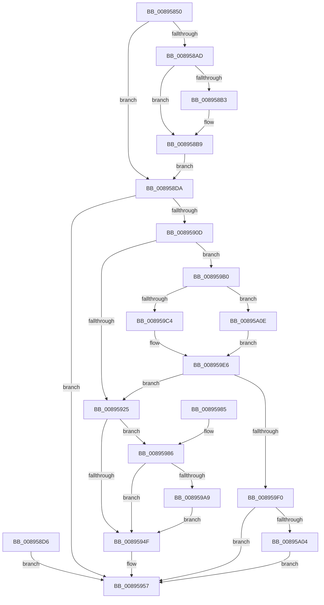

# NtReplyWaitReceivePortEx

- RVA: `0x00895850`–`0x00895A35` (길이 `485` bytes)
- VA: `0x0000000140895850`
- 실행 섹션: `PAGE`
- PDB 이름 있음: `예`; PDB Function 태그: `아니요`
- unwind 정보 RVA: `0x0007E0E0`
- 디코드: `118`개 명령, `485/485` bytes 표시
- 미해석 바이트: `0` (있으면 어셈블리에 `.byte`로 보존)

> 이 문서는 커널 이미지의 기계어와 PDB 기호를 분석해 생성했습니다. 4번과 5번은 함수 원형과 자료형을 바이너리 사용 방식에서 추정한 C 해석이며 원본 소스 복구 결과는 아닙니다.

## 1. Dependencies

- 직접 호출 지점: **11**; 고유 호출 대상: **9**
- 직접 호출자로 확인된 함수: **2**
- RIP 상대 이미지 참조: **1**

### Outgoing calls
- `0x00895882` → [memset](../../text/6C/memset_function_006C6C40.md) (function, `0x006C6C40`)
- `0x008958B3` → [ExRaiseDatatypeMisalignment](ExRaiseDatatypeMisalignment_function_00899FD0.md) (function, `0x00899FD0`)
- `0x00895902` → [ObReferenceObjectByHandle](../86/ObReferenceObjectByHandle_function_00868DB0.md) (function, `0x00868DB0`)
- `0x00895938` → [AlpcpReceiveLegacyMessage](AlpcpReceiveLegacyMessage_function_00895DE0.md) (function, `0x00895DE0`)
- `0x00895952` → [ObfDereferenceObject](../../text/2F/ObfDereferenceObject_function_002F9350.md) (function, `0x002F9350`)
- `0x00895960` → [KeLeaveCriticalRegionThread](../../text/25/KeLeaveCriticalRegionThread_function_0025EFF0.md) (function, `0x0025EFF0`)
- `0x0089599A` → [AlpcpSignal](../../text/39/AlpcpSignal_function_003955E0.md) (function, `0x003955E0`)
- `0x008959A9` → [ObfDereferenceObject](../../text/2F/ObfDereferenceObject_function_002F9350.md) (function, `0x002F9350`)
- `0x008959E1` → [AlpcpReplyLegacySynchronousRequest](../9F/AlpcpReplyLegacySynchronousRequest_function_009F5CF0.md) (function, `0x009F5CF0`)
- `0x008959F3` → [ObfDereferenceObject](../../text/2F/ObfDereferenceObject_function_002F9350.md) (function, `0x002F9350`)
- `0x00895A2E` → [AlpcpSendMessage](../88/AlpcpSendMessage_function_0088BD40.md) (function, `0x0088BD40`)

### Direct callers
- [NtListenPort](../74/NtListenPort_function_0074BE50.md) at `0x0074BE71`
- [NtReplyWaitReceivePort](NtReplyWaitReceivePort_function_00895830.md) at `0x0089583A`

### Static image references
- `0x008958DA` → RVA `0x00FC6C18` (`ALMOSTRO`; read)

## 2. Other-region calls and transfers

- 다른 실행 섹션으로 향하는 call: **6**
  - `0x00895882` → [memset](../../text/6C/memset_function_006C6C40.md) (`PAGE` → `.text`)
  - `0x00895952` → [ObfDereferenceObject](../../text/2F/ObfDereferenceObject_function_002F9350.md) (`PAGE` → `.text`)
  - `0x00895960` → [KeLeaveCriticalRegionThread](../../text/25/KeLeaveCriticalRegionThread_function_0025EFF0.md) (`PAGE` → `.text`)
  - `0x0089599A` → [AlpcpSignal](../../text/39/AlpcpSignal_function_003955E0.md) (`PAGE` → `.text`)
  - `0x008959A9` → [ObfDereferenceObject](../../text/2F/ObfDereferenceObject_function_002F9350.md) (`PAGE` → `.text`)
  - `0x008959F3` → [ObfDereferenceObject](../../text/2F/ObfDereferenceObject_function_002F9350.md) (`PAGE` → `.text`)
- 별도 외부 분기/꼬리 이동을 확인하지 못했습니다.

## 3. Assembly (complete function range)

```asm
00895850  48 8B C4                        mov rax, rsp
00895853  48 89 58 08                     mov qword ptr [rax + 8], rbx
00895857  48 89 70 10                     mov qword ptr [rax + 0x10], rsi
0089585B  48 89 78 18                     mov qword ptr [rax + 0x18], rdi
0089585F  41 54                           push r12
00895861  41 56                           push r14
00895863  41 57                           push r15
00895865  48 81 EC 80 00 00 00            sub rsp, 0x80
0089586C  49 8B F1                        mov rsi, r9
0089586F  4D 8B F0                        mov r14, r8
00895872  4C 8B E2                        mov r12, rdx
00895875  48 8B D9                        mov rbx, rcx
00895878  33 D2                           xor edx, edx
0089587A  44 8D 42 40                     lea r8d, [rdx + 0x40]
0089587E  48 8D 48 A8                     lea rcx, [rax - 0x58]
00895882  E8 B9 13 E3 FF                  call 0x1406c6c40
00895887  65 48 8B 04 25 88 01 00 00      mov rax, qword ptr gs:[0x188]
00895890  66 FF 88 E4 01 00 00            dec word ptr [rax + 0x1e4]
00895897  90                              nop
00895898  65 48 8B 04 25 88 01 00 00      mov rax, qword ptr gs:[0x188]
008958A1  44 8A B8 32 02 00 00            mov r15b, byte ptr [rax + 0x232]
008958A8  45 84 FF                        test r15b, r15b
008958AB  74 2D                           je 0x1408958da
008958AD  40 F6 C6 03                     test sil, 3
008958B1  74 06                           je 0x1408958b9
008958B3  E8 18 47 00 00                  call 0x140899fd0
008958B8  CC                              int3
008958B9  48 B9 00 00 FF FF FF 7F 00 00   movabs rcx, 0x7fffffff0000
008958C3  48 3B F1                        cmp rsi, rcx
008958C6  48 0F 42 CE                     cmovb rcx, rsi
008958CA  8A 01                           mov al, byte ptr [rcx]
008958CC  88 01                           mov byte ptr [rcx], al
008958CE  8A 41 27                        mov al, byte ptr [rcx + 0x27]
008958D1  88 41 27                        mov byte ptr [rcx + 0x27], al
008958D4  EB 04                           jmp 0x1408958da
008958D6  8B D8                           mov ebx, eax
008958D8  EB 7D                           jmp 0x140895957
008958DA  4C 8B 05 37 13 73 00            mov r8, qword ptr [rip + 0x731337]
008958E1  48 83 64 24 30 00               and qword ptr [rsp + 0x30], 0
008958E7  48 83 64 24 28 00               and qword ptr [rsp + 0x28], 0
008958ED  48 8D 44 24 30                  lea rax, [rsp + 0x30]
008958F2  48 89 44 24 20                  mov qword ptr [rsp + 0x20], rax
008958F7  45 8A CF                        mov r9b, r15b
008958FA  BA 01 00 00 00                  mov edx, 1
008958FF  48 8B CB                        mov rcx, rbx
00895902  E8 A9 34 FD FF                  call 0x140868db0
00895907  8B D8                           mov ebx, eax
00895909  85 C0                           test eax, eax
0089590B  78 4A                           js 0x140895957
0089590D  48 8B 7C 24 30                  mov rdi, qword ptr [rsp + 0x30]
00895912  48 89 7C 24 40                  mov qword ptr [rsp + 0x40], rdi
00895917  83 64 24 70 00                  and dword ptr [rsp + 0x70], 0
0089591C  4D 85 F6                        test r14, r14
0089591F  0F 85 8B 00 00 00               jne 0x1408959b0
00895925  4D 8B CC                        mov r9, r12
00895928  4C 8B 84 24 C0 00 00 00         mov r8, qword ptr [rsp + 0xc0]
00895930  48 8B D6                        mov rdx, rsi
00895933  48 8D 4C 24 40                  lea rcx, [rsp + 0x40]
00895938  E8 A3 04 00 00                  call 0x140895de0
0089593D  8B D8                           mov ebx, eax
0089593F  48 8D 44 24 70                  lea rax, [rsp + 0x70]
00895944  0F BA 30 02                     btr dword ptr [rax], 2
00895948  0F 92 C0                        setb al
0089594B  84 C0                           test al, al
0089594D  75 37                           jne 0x140895986
0089594F  48 8B CF                        mov rcx, rdi
00895952  E8 F9 39 A6 FF                  call 0x1402f9350
00895957  65 48 8B 0C 25 88 01 00 00      mov rcx, qword ptr gs:[0x188]
00895960  E8 8B 96 9C FF                  call 0x14025eff0
00895965  8B C3                           mov eax, ebx
00895967  4C 8D 9C 24 80 00 00 00         lea r11, [rsp + 0x80]
0089596F  49 8B 5B 20                     mov rbx, qword ptr [r11 + 0x20]
00895973  49 8B 73 28                     mov rsi, qword ptr [r11 + 0x28]
00895977  49 8B 7B 30                     mov rdi, qword ptr [r11 + 0x30]
0089597B  49 8B E3                        mov rsp, r11
0089597E  41 5F                           pop r15
00895980  41 5E                           pop r14
00895982  41 5C                           pop r12
00895984  C3                              ret
00895985  CC                              int3
00895986  44 8B 44 24 70                  mov r8d, dword ptr [rsp + 0x70]
0089598B  41 C1 E8 16                     shr r8d, 0x16
0089598F  41 80 E0 01                     and r8b, 1
00895993  33 D2                           xor edx, edx
00895995  48 8D 4C 24 40                  lea rcx, [rsp + 0x40]
0089599A  E8 41 FC AF FF                  call 0x1403955e0
0089599F  48 8B 4C 24 60                  mov rcx, qword ptr [rsp + 0x60]
008959A4  48 85 C9                        test rcx, rcx
008959A7  74 A6                           je 0x14089594f
008959A9  E8 A2 39 A6 FF                  call 0x1402f9350
008959AE  EB 9F                           jmp 0x14089594f
008959B0  49 8B D6                        mov rdx, r14
008959B3  48 8D 4C 24 40                  lea rcx, [rsp + 0x40]
008959B8  F7 87 A0 01 00 00 00 20 00 00   test dword ptr [rdi + 0x1a0], 0x2000
008959C2  74 4A                           je 0x140895a0e
008959C4  C7 44 24 70 04 00 00 00         mov dword ptr [rsp + 0x70], 4
008959CC  48 83 64 24 60 00               and qword ptr [rsp + 0x60], 0
008959D2  48 83 64 24 58 00               and qword ptr [rsp + 0x58], 0
008959D8  48 83 64 24 68 00               and qword ptr [rsp + 0x68], 0
008959DE  45 8A C7                        mov r8b, r15b
008959E1  E8 0A 03 16 00                  call 0x1409f5cf0
008959E6  8B D8                           mov ebx, eax
008959E8  85 C0                           test eax, eax
008959EA  0F 89 35 FF FF FF               jns 0x140895925
008959F0  48 8B CF                        mov rcx, rdi
008959F3  E8 58 39 A6 FF                  call 0x1402f9350
008959F8  81 FB 03 07 00 C0               cmp ebx, 0xc0000703
008959FE  0F 85 53 FF FF FF               jne 0x140895957
00895A04  BB 37 00 00 C0                  mov ebx, 0xc0000037
00895A09  E9 49 FF FF FF                  jmp 0x140895957
00895A0E  C7 44 24 70 05 00 01 00         mov dword ptr [rsp + 0x70], 0x10005
00895A16  48 83 64 24 60 00               and qword ptr [rsp + 0x60], 0
00895A1C  48 83 64 24 58 00               and qword ptr [rsp + 0x58], 0
00895A22  48 83 64 24 68 00               and qword ptr [rsp + 0x68], 0
00895A28  45 8A CF                        mov r9b, r15b
00895A2B  45 33 C0                        xor r8d, r8d
00895A2E  E8 0D 63 FF FF                  call 0x14088bd40
00895A33  EB B1                           jmp 0x1408959e6
```

## 4. C-style interpretation (structured pseudocode)

```c
__int64 __fastcall NtReplyWaitReceivePortEx(__int64 a1, __int64 a2, __int64 a3, __int64 a4, __int64 a5)
{
    __int64 result;
    __int64 v_rsp;
    unsigned int v_stack_m10;
    unsigned __int64 v_stack_m18;
    unsigned __int64 v_stack_m20;
    unsigned int v_stack_m28;
    unsigned __int64 v_stack_m40;
    unsigned __int64 v_stack_m58;
    unsigned __int64 v_stack_m68;
    unsigned __int64 v_stack_m70;
    unsigned __int64 v_stack_m78;

    *(unsigned __int64 *)(v_rsp + 8) = v_rbx;
    *(unsigned __int64 *)(v_rsp + 16) = v_rsi;
    *(unsigned __int64 *)(v_rsp + 24) = v_rdi;
    v_rsp = (v_rsp) - (128);
    a2 = 0;
    result = memset(v_rsp - 88, a2, a2 + 64, a4);
    if ((unsigned __int8)(*(unsigned __int8 *)(*(unsigned __int64 *)(gs_base + (0 + 392)) + 562)) == 0) goto loc_008958DA;
    result = *(unsigned __int64 *)(gs_base + (0 + 392));
    if ((((unsigned __int8)(a4)) & (3)) != 0) {
        result = ExRaiseDatatypeMisalignment(v_rsp - 88, a2, a2 + 64, a4);
    }
    a1 = v_rsp - 88;
    if (a4 < (v_rsp - 88)) { a1 = a4; }
    *(unsigned __int8 *)(a1) = (unsigned __int8)(*(unsigned __int8 *)(a1));
    *(unsigned __int8 *)(a1 + 39) = (unsigned __int8)(*(unsigned __int8 *)(a1 + 39));
    goto loc_008958DA;
loc_008958DA:
    v_stack_m78 = v_stack_m68;
    result = ObReferenceObjectByHandle(a1, 1, *(unsigned __int64 *)(v_rip + 7541559), (unsigned __int8)(*(unsigned __int8 *)(*(unsigned __int64 *)(gs_base + (0 + 392)) + 562)));
    if (sign_flag) goto loc_00895957;
    v_stack_m58 = v_stack_m68;
    if (a3 != 0) goto loc_008959B0;
loc_00895925:
    result = AlpcpReceiveLegacyMessage(v_stack_m58, a4, a5, 0);
    result = (condition_is_below) ? 1 : 0;
    if ((unsigned __int8)(result) != 0) goto loc_00895986;
loc_0089594F:
    result = ObfDereferenceObject(v_stack_m68, a4, a5, 0);
loc_00895957:
    result = KeLeaveCriticalRegionThread(*(unsigned __int64 *)(gs_base + (0 + 392)), a4, a5, 0);
    return (unsigned int)((unsigned int)((unsigned int)((unsigned int)(result))));
loc_00895986:
    a3 = (unsigned int)(((unsigned int)(v_stack_m10)) >> (22));
    a3 = (unsigned __int8)((a3) & (1));
    a2 = 0;
    result = AlpcpSignal(v_stack_m40, a2, a3, 0);
    if (v_stack_m20 == 0) goto loc_0089594F;
    result = ObfDereferenceObject(v_stack_m20, a2, a3, 0);
    goto loc_0089594F;
loc_008959B0:
    if (((*(unsigned int *)(*(unsigned __int64 *)(v_stack_m18 + 48) + 416)) & (0x2000ULL)) == 0) goto loc_00895A0E;
    v_stack_m10 = 4;
    result = AlpcpReplyLegacySynchronousRequest(v_stack_m40, a3, (unsigned __int8)(*(unsigned __int8 *)(*(unsigned __int64 *)(gs_base + (0 + 392)) + 562)), 0);
loc_008959E6:
    if (!sign_flag) goto loc_00895925;
    result = ObfDereferenceObject(*(unsigned __int64 *)(v_stack_m18 + 48), a3, (unsigned __int8)(*(unsigned __int8 *)(*(unsigned __int64 *)(gs_base + (0 + 392)) + 562)), 0);
    if (((unsigned int)((unsigned int)((unsigned int)(result)))) != 0xC0000703ULL) goto loc_00895957;
    goto loc_00895957;
loc_00895A0E:
    v_stack_m10 = 0x10005ULL;
    a3 = 0;
    result = AlpcpSendMessage(*(unsigned __int64 *)(v_stack_m18 + 48), a3, a3, (unsigned __int8)(*(unsigned __int8 *)(*(unsigned __int64 *)(gs_base + (0 + 392)) + 562)));
    goto loc_008959E6;
}
```

## 5. (Beta) C Style

```c
int64_t NtReplyWaitReceivePortEx(int64_t Arg1, int64_t Arg2, int64_t Arg3, int64_t Arg4, int64_t Arg5)
{
    int64_t result;
    int64_t local_rsp;
    uint32_t v_stack_m10;
    uint64_t v_stack_m18;
    uint64_t v_stack_m20;
    uint32_t v_stack_m28;
    uint64_t v_stack_m40;
    uint64_t v_stack_m58;
    uint64_t v_stack_m68;
    uint64_t v_stack_m70;
    uint64_t v_stack_m78;

    *(uint64_t *)(local_rsp + 0x8) = local_rbx;
    *(uint64_t *)(local_rsp + 0x10) = local_rsi;
    *(uint64_t *)(local_rsp + 0x18) = local_rdi;
    local_rsp = (local_rsp) - (128);
    Arg2 = 0;
    result = memset(local_rsp - 88, Arg2, Arg2 + 64, Arg4);
    if ((uint8_t)(*(uint8_t *)(*(uint64_t *)(gs_base + (0 + 0x188)) + 0x232)) == 0) goto loc_008958DA;
    result = *(uint64_t *)(gs_base + (0 + 0x188));
    if ((((uint8_t)(Arg4)) & (3)) != 0) {
        result = ExRaiseDatatypeMisalignment(local_rsp - 88, Arg2, Arg2 + 64, Arg4);
    }
    Arg1 = local_rsp - 88;
    if (Arg4 < (local_rsp - 88)) { Arg1 = Arg4; }
    *(uint8_t *)(Arg1) = (uint8_t)(*(uint8_t *)(Arg1));
    *(uint8_t *)(Arg1 + 0x27) = (uint8_t)(*(uint8_t *)(Arg1 + 0x27));
    goto loc_008958DA;
loc_008958DA:
    v_stack_m78 = v_stack_m68;
    result = ObReferenceObjectByHandle(Arg1, 1, *(uint64_t *)(v_rip + 0x731337), (uint8_t)(*(uint8_t *)(*(uint64_t *)(gs_base + (0 + 0x188)) + 0x232)));
    if (sign_flag) goto loc_00895957;
    v_stack_m58 = v_stack_m68;
    if (Arg3 != 0) goto loc_008959B0;
loc_00895925:
    result = AlpcpReceiveLegacyMessage(v_stack_m58, Arg4, Arg5, 0);
    result = (condition_is_below) ? 1 : 0;
    if ((uint8_t)(result) != 0) goto loc_00895986;
loc_0089594F:
    result = ObfDereferenceObject(v_stack_m68, Arg4, Arg5, 0);
loc_00895957:
    result = KeLeaveCriticalRegionThread(*(uint64_t *)(gs_base + (0 + 0x188)), Arg4, Arg5, 0);
    return (uint32_t)((uint32_t)((uint32_t)((uint32_t)(result))));
loc_00895986:
    Arg3 = (uint32_t)(((uint32_t)(v_stack_m10)) >> (22));
    Arg3 = (uint8_t)((Arg3) & (1));
    Arg2 = 0;
    result = AlpcpSignal(v_stack_m40, Arg2, Arg3, 0);
    if (v_stack_m20 == 0) goto loc_0089594F;
    result = ObfDereferenceObject(v_stack_m20, Arg2, Arg3, 0);
    goto loc_0089594F;
loc_008959B0:
    if (((*(uint32_t *)(*(uint64_t *)(v_stack_m18 + 0x30) + 0x1A0)) & (0x2000ULL)) == 0) goto loc_00895A0E;
    v_stack_m10 = 4;
    result = AlpcpReplyLegacySynchronousRequest(v_stack_m40, Arg3, (uint8_t)(*(uint8_t *)(*(uint64_t *)(gs_base + (0 + 0x188)) + 0x232)), 0);
loc_008959E6:
    if (!sign_flag) goto loc_00895925;
    result = ObfDereferenceObject(*(uint64_t *)(v_stack_m18 + 0x30), Arg3, (uint8_t)(*(uint8_t *)(*(uint64_t *)(gs_base + (0 + 0x188)) + 0x232)), 0);
    if (((uint32_t)((uint32_t)((uint32_t)(result)))) != 0xC0000703ULL) goto loc_00895957;
    goto loc_00895957;
loc_00895A0E:
    v_stack_m10 = 0x10005ULL;
    Arg3 = 0;
    result = AlpcpSendMessage(*(uint64_t *)(v_stack_m18 + 0x30), Arg3, Arg3, (uint8_t)(*(uint8_t *)(*(uint64_t *)(gs_base + (0 + 0x188)) + 0x232)));
    goto loc_008959E6;
}
```

## 6. Execution-region graph

[열기: 2D/3D 그래프와 함수 탐색 컨트롤 패널](../../../control-panel.html?section=page&rva=0x00895850&view=graph)

- 2D 그래프는 위에서 아래로 흐르고, 3D 그래프는 빈 공간을 드래그해 회전합니다. Shift+드래그는 이동, 휠은 확대·축소, 함수 노드 선택은 대상 보고서 이동입니다.

### Static fallback


