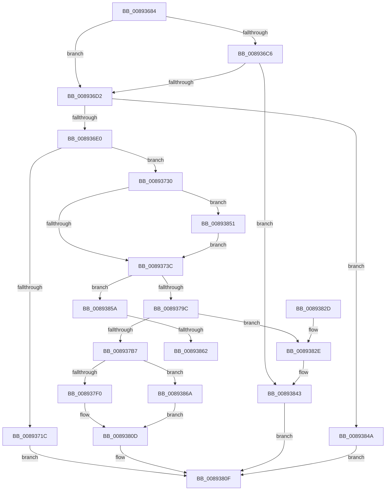

# ObCaptureObjectStateForDuplication

- RVA: `0x00893684`–`0x00893874` (길이 `496` bytes)
- VA: `0x0000000140893684`
- 실행 섹션: `PAGE`
- PDB 이름 있음: `예`; PDB Function 태그: `예`
- unwind 정보 RVA: `0x0007DEC0`
- 디코드: `133`개 명령, `496/496` bytes 표시
- 미해석 바이트: `0` (있으면 어셈블리에 `.byte`로 보존)

> 이 문서는 커널 이미지의 기계어와 PDB 기호를 분석해 생성했습니다. 4번과 5번은 함수 원형과 자료형을 바이너리 사용 방식에서 추정한 C 해석이며 원본 소스 복구 결과는 아닙니다.

## 1. Dependencies

- 직접 호출 지점: **9**; 고유 호출 대상: **6**
- 직접 호출자로 확인된 함수: **1**
- RIP 상대 이미지 참조: **2**

### Outgoing calls
- `0x008936D2` → [ObReferenceProcessHandleTable](ObReferenceProcessHandleTable_function_00893B70.md) (function, `0x00893B70`)
- `0x00893710` → [ObpReferenceProcessObjectByHandle](ObpReferenceProcessObjectByHandle_function_00893C00.md) (function, `0x00893C00`)
- `0x00893723` → [ExReleaseRundownProtection](../../text/34/ExReleaseRundownProtection_function_00349E80.md) (function, `0x00349E80`)
- `0x008937D8` → [ObpIncrementHandleCountEx](../86/ObpIncrementHandleCountEx_function_0086DA10.md) (function, `0x0086DA10`)
- `0x008937E2` → [ExReleaseRundownProtection](../../text/34/ExReleaseRundownProtection_function_00349E80.md) (function, `0x00349E80`)
- `0x00893801` → [ObfReferenceObjectWithTag](../../text/21/ObfReferenceObjectWithTag_function_00210710.md) (function, `0x00210710`)
- `0x00893831` → [ExReleaseRundownProtection](../../text/34/ExReleaseRundownProtection_function_00349E80.md) (function, `0x00349E80`)
- `0x0089383E` → [ObfDereferenceObjectWithTag](../../text/2F/ObfDereferenceObjectWithTag_function_002F78E0.md) (function, `0x002F78E0`)
- `0x0089386D` → [ObfDereferenceObjectWithTag](../../text/2F/ObfDereferenceObjectWithTag_function_002F78E0.md) (function, `0x002F78E0`)

### Direct callers
- [AlpcpCaptureHandleAttributeInternal](AlpcpCaptureHandleAttributeInternal_function_00892CDC.md) at `0x00892DDC`

### Static image references
- `0x0089377B` → RVA `0x00FC6E4C` (`ALMOSTRO`; read)
- `0x00893785` → RVA `0x00FC7800` (`ALMOSTRO`; read)

## 2. Other-region calls and transfers

- 다른 실행 섹션으로 향하는 call: **6**
  - `0x00893723` → [ExReleaseRundownProtection](../../text/34/ExReleaseRundownProtection_function_00349E80.md) (`PAGE` → `.text`)
  - `0x008937E2` → [ExReleaseRundownProtection](../../text/34/ExReleaseRundownProtection_function_00349E80.md) (`PAGE` → `.text`)
  - `0x00893801` → [ObfReferenceObjectWithTag](../../text/21/ObfReferenceObjectWithTag_function_00210710.md) (`PAGE` → `.text`)
  - `0x00893831` → [ExReleaseRundownProtection](../../text/34/ExReleaseRundownProtection_function_00349E80.md) (`PAGE` → `.text`)
  - `0x0089383E` → [ObfDereferenceObjectWithTag](../../text/2F/ObfDereferenceObjectWithTag_function_002F78E0.md) (`PAGE` → `.text`)
  - `0x0089386D` → [ObfDereferenceObjectWithTag](../../text/2F/ObfDereferenceObjectWithTag_function_002F78E0.md) (`PAGE` → `.text`)
- call이 아닌 외부 분기/꼬리 이동: **2**
  - `0x0089385C` → [sub_00B1963E](../B1/Unknown_function_00B1963E.md) (`tail-transfer`)
  - `0x00893865` → [sub_00B1963E](../B1/Unknown_function_00B1963E.md) (`tail-transfer`)

## 3. Assembly (complete function range)

```asm
00893684  48 89 5C 24 08                  mov qword ptr [rsp + 8], rbx
00893689  48 89 74 24 10                  mov qword ptr [rsp + 0x10], rsi
0089368E  48 89 7C 24 18                  mov qword ptr [rsp + 0x18], rdi
00893693  55                              push rbp
00893694  41 54                           push r12
00893696  41 55                           push r13
00893698  41 56                           push r14
0089369A  41 57                           push r15
0089369C  48 8B EC                        mov rbp, rsp
0089369F  48 83 EC 60                     sub rsp, 0x60
008936A3  45 33 E4                        xor r12d, r12d
008936A6  41 8B F1                        mov esi, r9d
008936A9  4C 89 65 E0                     mov qword ptr [rbp - 0x20], r12
008936AD  45 8B F9                        mov r15d, r9d
008936B0  4C 89 65 E8                     mov qword ptr [rbp - 0x18], r12
008936B4  41 8B D8                        mov ebx, r8d
008936B7  4C 89 65 F0                     mov qword ptr [rbp - 0x10], r12
008936BB  4C 8B EA                        mov r13, rdx
008936BE  48 8B F9                        mov rdi, rcx
008936C1  83 E6 02                        and esi, 2
008936C4  75 0C                           jne 0x1408936d2
008936C6  F7 C3 00 00 E0 0C               test ebx, 0xce00000
008936CC  0F 85 71 01 00 00               jne 0x140893843
008936D2  E8 99 04 00 00                  call 0x140893b70
008936D7  48 85 C0                        test rax, rax
008936DA  0F 84 6A 01 00 00               je 0x14089384a
008936E0  44 8A 4D 50                     mov r9b, byte ptr [rbp + 0x50]
008936E4  48 8D 4D E8                     lea rcx, [rbp - 0x18]
008936E8  48 89 4C 24 38                  mov qword ptr [rsp + 0x38], rcx
008936ED  4C 8B C0                        mov r8, rax
008936F0  48 8D 4D E0                     lea rcx, [rbp - 0x20]
008936F4  48 8B D7                        mov rdx, rdi
008936F7  48 89 4C 24 30                  mov qword ptr [rsp + 0x30], rcx
008936FC  48 8D 4D F0                     lea rcx, [rbp - 0x10]
00893700  48 89 4C 24 28                  mov qword ptr [rsp + 0x28], rcx
00893705  49 8B CD                        mov rcx, r13
00893708  C7 44 24 20 4F 62 44 75         mov dword ptr [rsp + 0x20], 0x7544624f
00893710  E8 EB 04 00 00                  call 0x140893c00
00893715  44 8B F0                        mov r14d, eax
00893718  85 C0                           test eax, eax
0089371A  79 14                           jns 0x140893730
0089371C  48 8D 8F E8 01 00 00            lea rcx, [rdi + 0x1e8]
00893723  E8 58 67 AB FF                  call 0x140349e80
00893728  41 8B C6                        mov eax, r14d
0089372B  E9 DF 00 00 00                  jmp 0x14089380f
00893730  48 8B 45 E0                     mov rax, qword ptr [rbp - 0x20]
00893734  A8 04                           test al, 4
00893736  0F 85 15 01 00 00               jne 0x140893851
0089373C  4C 8B 75 F0                     mov r14, qword ptr [rbp - 0x10]
00893740  85 F6                           test esi, esi
00893742  44 8B 45 E4                     mov r8d, dword ptr [rbp - 0x1c]
00893746  48 8B 75 58                     mov rsi, qword ptr [rbp + 0x58]
0089374A  41 0F 45 D8                     cmovne ebx, r8d
0089374E  83 E0 0C                        and eax, 0xc
00893751  44 8B E0                        mov r12d, eax
00893754  41 83 CC 08                     or r12d, 8
00893758  41 F6 C7 08                     test r15b, 8
0089375C  44 0F 44 E0                     cmove r12d, eax
00893760  48 8B 45 E8                     mov rax, qword ptr [rbp - 0x18]
00893764  48 89 46 1C                     mov qword ptr [rsi + 0x1c], rax
00893768  49 8D 46 D0                     lea rax, [r14 - 0x30]
0089376C  48 C1 E8 08                     shr rax, 8
00893770  0F B6 D0                        movzx edx, al
00893773  41 0F B6 46 E8                  movzx eax, byte ptr [r14 - 0x18]
00893778  48 33 D0                        xor rdx, rax
0089377B  0F B6 05 CA 36 73 00            movzx eax, byte ptr [rip + 0x7336ca]
00893782  48 33 D0                        xor rdx, rax
00893785  48 8D 05 74 40 73 00            lea rax, [rip + 0x734074]
0089378C  48 8B 04 D0                     mov rax, qword ptr [rax + rdx*8]
00893790  F7 C3 00 00 00 F0               test ebx, 0xf0000000
00893796  0F 85 BE 00 00 00               jne 0x14089385a
0089379C  8B 40 5C                        mov eax, dword ptr [rax + 0x5c]
0089379F  4C 8D BF E8 01 00 00            lea r15, [rdi + 0x1e8]
008937A6  0F BA E8 18                     bts eax, 0x18
008937AA  41 F7 D0                        not r8d
008937AD  23 C3                           and eax, ebx
008937AF  89 45 48                        mov dword ptr [rbp + 0x48], eax
008937B2  44 85 C0                        test eax, r8d
008937B5  75 77                           jne 0x14089382e
008937B7  48 83 64 24 30 00               and qword ptr [rsp + 0x30], 0
008937BD  48 8D 55 48                     lea rdx, [rbp + 0x48]
008937C1  8A 45 50                        mov al, byte ptr [rbp + 0x50]
008937C4  4D 8B CE                        mov r9, r14
008937C7  44 89 64 24 28                  mov dword ptr [rsp + 0x28], r12d
008937CC  4C 8B C7                        mov r8, rdi
008937CF  B9 02 00 00 00                  mov ecx, 2
008937D4  88 44 24 20                     mov byte ptr [rsp + 0x20], al
008937D8  E8 33 A2 FD FF                  call 0x14086da10
008937DD  49 8B CF                        mov rcx, r15
008937E0  8B D8                           mov ebx, eax
008937E2  E8 99 66 AB FF                  call 0x140349e80
008937E7  BA 4F 62 44 75                  mov edx, 0x7544624f
008937EC  85 DB                           test ebx, ebx
008937EE  78 7A                           js 0x14089386a
008937F0  8B 4D 48                        mov ecx, dword ptr [rbp + 0x48]
008937F3  89 4E 18                        mov dword ptr [rsi + 0x18], ecx
008937F6  48 8B CF                        mov rcx, rdi
008937F9  4C 89 6E 08                     mov qword ptr [rsi + 8], r13
008937FD  44 89 66 24                     mov dword ptr [rsi + 0x24], r12d
00893801  E8 0A CF 97 FF                  call 0x140210710
00893806  48 89 3E                        mov qword ptr [rsi], rdi
00893809  4C 89 76 10                     mov qword ptr [rsi + 0x10], r14
0089380D  8B C3                           mov eax, ebx
0089380F  4C 8D 5C 24 60                  lea r11, [rsp + 0x60]
00893814  49 8B 5B 30                     mov rbx, qword ptr [r11 + 0x30]
00893818  49 8B 73 38                     mov rsi, qword ptr [r11 + 0x38]
0089381C  49 8B 7B 40                     mov rdi, qword ptr [r11 + 0x40]
00893820  49 8B E3                        mov rsp, r11
00893823  41 5F                           pop r15
00893825  41 5E                           pop r14
00893827  41 5D                           pop r13
00893829  41 5C                           pop r12
0089382B  5D                              pop rbp
0089382C  C3                              ret
0089382D  CC                              int3
0089382E  49 8B CF                        mov rcx, r15
00893831  E8 4A 66 AB FF                  call 0x140349e80
00893836  BA 4F 62 44 75                  mov edx, 0x7544624f
0089383B  49 8B CE                        mov rcx, r14
0089383E  E8 9D 40 A6 FF                  call 0x1402f78e0
00893843  B8 22 00 00 C0                  mov eax, 0xc0000022
00893848  EB C5                           jmp 0x14089380f
0089384A  B8 0A 01 00 C0                  mov eax, 0xc000010a
0089384F  EB BE                           jmp 0x14089380f
00893851  44 89 65 E8                     mov dword ptr [rbp - 0x18], r12d
00893855  E9 E2 FE FF FF                  jmp 0x14089373c
0089385A  85 DB                           test ebx, ebx
0089385C  0F 89 DC 5D 28 00               jns 0x140b1963e
00893862  0B 58 4C                        or ebx, dword ptr [rax + 0x4c]
00893865  E9 D4 5D 28 00                  jmp 0x140b1963e
0089386A  49 8B CE                        mov rcx, r14
0089386D  E8 6E 40 A6 FF                  call 0x1402f78e0
00893872  EB 99                           jmp 0x14089380d
```

## 4. C-style interpretation (structured pseudocode)

```c
__int64 __fastcall ObCaptureObjectStateForDuplication(__int64 a1, __int64 a2, int a3, int a4, unsigned __int8 a5, __int64 a6)
{
    __int64 result;
    __int64 v_r12;
    __int64 v_rbx;
    __int64 v_rsi;
    __int64 v_rsp;
    unsigned __int64 v_stack_m28;
    unsigned __int64 v_stack_m38;
    unsigned __int64 v_stack_m40;
    unsigned int v_stack_m44;
    unsigned __int64 v_stack_m48;
    unsigned __int64 v_stack_m50;
    unsigned __int64 v_stack_m58;
    unsigned __int64 v_stack_m60;
    unsigned int v_stack_m68;
    unsigned __int64 v_stack_p10;
    unsigned __int64 v_stack_p18;
    unsigned int v_stack_p20;
    unsigned __int64 v_stack_p8;

    v_stack_p8 = v_rbx;
    v_stack_p10 = v_rsi;
    v_stack_p18 = v_rdi;
    v_rsp = (v_rsp) - (96);
    v_r12 = 0;
    v_stack_m48 = 0;
    v_stack_m40 = 0;
    v_stack_m38 = 0;
    v_rsi = (unsigned int)(((unsigned int)(a4)) & (2));
    if (condition_is_not_equal) goto loc_008936D2;
    if ((((unsigned int)((unsigned int)(a3))) & (0xCE00000ULL)) != 0) goto loc_00893843;
loc_008936D2:
    result = ObReferenceProcessHandleTable(a1, a2, a3, a4);
    if (result == 0) goto loc_0089384A;
    v_stack_m50 = v_stack_m40;
    v_stack_m58 = v_stack_m48;
    v_stack_m60 = v_stack_m38;
    v_stack_m68 = 0x7544624FULL;
    result = ObpReferenceProcessObjectByHandle(a2, a1, result, a5);
    if (!sign_flag) goto loc_00893730;
    result = ExReleaseRundownProtection(a1 + 488, a1, result, a5);
    goto loc_0089380F;
loc_00893730:
    if ((((unsigned __int8)(v_stack_m48)) & (4)) != 0) goto loc_00893851;
loc_0089373C:
    v_rbx = (unsigned int)(a3);
    if ((unsigned int)(v_rsi) != 0) { v_rbx = (unsigned int)((unsigned int)(v_stack_m44)); }
    result = (unsigned int)((v_stack_m48) & (12));
    v_r12 = (unsigned int)(((unsigned int)((unsigned int)(result))) | (8));
    if ((((unsigned __int8)((unsigned int)(a4))) & (8)) == 0) { v_r12 = (unsigned int)(result); }
    *(unsigned __int64 *)(a6 + 28) = v_stack_m40;
    result = (v_stack_m38 - 48) >> (8);
    a2 = ((unsigned __int8)(result)) ^ (*(unsigned __int8 *)(v_stack_m38 - 24));
    a2 = (a2) ^ (*(unsigned __int8 *)(v_rip + 7550666));
    if ((((unsigned int)(v_rbx)) & (0xF0000000ULL)) != 0) goto loc_0089385A;
    a3 = (unsigned int)(~((unsigned int)(v_stack_m44)));
    result = (unsigned int)(((unsigned int)(*(unsigned int *)(*(unsigned __int64 *)(v_rip + 7553140 + a2 * 8) + 92))) & ((unsigned int)(v_rbx)));
    v_stack_p20 = (unsigned int)(result);
    if ((((unsigned int)(result)) & (a3)) != 0) goto loc_0089382E;
    v_stack_m60 = (unsigned int)(v_r12);
    v_stack_m68 = a5;
    result = ObpIncrementHandleCountEx(2, v_stack_p20, a1, v_stack_m38);
    result = ExReleaseRundownProtection(a1 + 488, v_stack_p20, a1, v_stack_m38);
    if (sign_flag) goto loc_0089386A;
    *(unsigned int *)(a6 + 24) = (unsigned int)((unsigned int)(v_stack_p20));
    *(unsigned __int64 *)(a6 + 8) = a2;
    *(unsigned int *)(a6 + 36) = (unsigned int)(v_r12);
    result = ObfReferenceObjectWithTag(a1, (unsigned int)(0x7544624FULL), a1, v_stack_m38);
    *(unsigned __int64 *)(a6) = a1;
    *(unsigned __int64 *)(a6 + 16) = v_stack_m38;
loc_0089380D:
loc_0089380F:
    return (unsigned int)((unsigned int)((unsigned int)((unsigned int)(result))));
loc_0089382E:
    result = ExReleaseRundownProtection(a1 + 488, (unsigned int)(0x7544624FULL), a1, v_stack_m38);
    result = ObfDereferenceObjectWithTag(v_stack_m38, (unsigned int)(0x7544624FULL), a1, v_stack_m38);
loc_00893843:
    goto loc_0089380F;
loc_0089384A:
    goto loc_0089380F;
loc_00893851:
    v_stack_m40 = (unsigned int)(v_r12);
    goto loc_0089373C;
loc_0089385A:
    v_rbx = (unsigned int)((*(unsigned __int64 *)(v_stack_m28 + 48)) | (*(unsigned int *)((unsigned int)(0xC000010AULL) + 76)));
loc_0089386A:
    result = ObfDereferenceObjectWithTag(v_stack_m38, (unsigned int)(0x7544624FULL), a1, v_stack_m38);
    goto loc_0089380D;
}
```

## 5. (Beta) C Style

```c
int64_t ObCaptureObjectStateForDuplication(void *Arg1, int64_t Arg2, int32_t Arg3, int32_t Arg4, uint8_t Arg5, void *Arg6)
{
    uint8_t *arg1 = (uint8_t *)Arg1;
    uint8_t *arg6 = (uint8_t *)Arg6;

    int64_t result;
    int64_t local_r12;
    int64_t local_rbx;
    int64_t local_rsi;
    int64_t local_rsp;
    uint64_t v_stack_m28;
    uint64_t v_stack_m38;
    uint64_t v_stack_m40;
    uint32_t v_stack_m44;
    uint64_t v_stack_m48;
    uint64_t v_stack_m50;
    uint64_t v_stack_m58;
    uint64_t v_stack_m60;
    uint32_t v_stack_m68;
    uint64_t v_stack_p10;
    uint64_t v_stack_p18;
    uint32_t v_stack_p20;
    uint64_t v_stack_p8;

    v_stack_p8 = local_rbx;
    v_stack_p10 = local_rsi;
    v_stack_p18 = local_rdi;
    local_rsp = (local_rsp) - (96);
    local_r12 = 0;
    v_stack_m48 = 0;
    v_stack_m40 = 0;
    v_stack_m38 = 0;
    local_rsi = (uint32_t)(((uint32_t)(Arg4)) & (2));
    if (condition_is_not_equal) goto loc_008936D2;
    if ((((uint32_t)((uint32_t)(Arg3))) & (0xCE00000ULL)) != 0) goto loc_00893843;
loc_008936D2:
    result = ObReferenceProcessHandleTable(Arg1, Arg2, Arg3, Arg4);
    if (result == 0) goto loc_0089384A;
    v_stack_m50 = v_stack_m40;
    v_stack_m58 = v_stack_m48;
    v_stack_m60 = v_stack_m38;
    v_stack_m68 = 0x7544624FULL;
    result = ObpReferenceProcessObjectByHandle(Arg2, Arg1, result, Arg5);
    if (!sign_flag) goto loc_00893730;
    result = ExReleaseRundownProtection(Arg1 + 488, Arg1, result, Arg5);
    goto loc_0089380F;
loc_00893730:
    if ((((uint8_t)(v_stack_m48)) & (4)) != 0) goto loc_00893851;
loc_0089373C:
    local_rbx = (uint32_t)(Arg3);
    if ((uint32_t)(local_rsi) != 0) { local_rbx = (uint32_t)((uint32_t)(v_stack_m44)); }
    result = (uint32_t)((v_stack_m48) & (12));
    local_r12 = (uint32_t)(((uint32_t)((uint32_t)(result))) | (8));
    if ((((uint8_t)((uint32_t)(Arg4))) & (8)) == 0) { local_r12 = (uint32_t)(result); }
    *(uint64_t *)(arg6 + 0x1C) = v_stack_m40;
    result = (v_stack_m38 - 48) >> (8);
    Arg2 = ((uint8_t)(result)) ^ (*(uint8_t *)(v_stack_m38 - 0x18));
    Arg2 = (Arg2) ^ (*(uint8_t *)(v_rip + 0x7336CA));
    if ((((uint32_t)(local_rbx)) & (0xF0000000ULL)) != 0) goto loc_0089385A;
    Arg3 = (uint32_t)(~((uint32_t)(v_stack_m44)));
    result = (uint32_t)(((uint32_t)(*(uint32_t *)(*(uint64_t *)(v_rip + 0x734074 + Arg2 * 8) + 0x5C))) & ((uint32_t)(local_rbx)));
    v_stack_p20 = (uint32_t)(result);
    if ((((uint32_t)(result)) & (Arg3)) != 0) goto loc_0089382E;
    v_stack_m60 = (uint32_t)(local_r12);
    v_stack_m68 = Arg5;
    result = ObpIncrementHandleCountEx(2, v_stack_p20, Arg1, v_stack_m38);
    result = ExReleaseRundownProtection(Arg1 + 488, v_stack_p20, Arg1, v_stack_m38);
    if (sign_flag) goto loc_0089386A;
    *(uint32_t *)(arg6 + 0x18) = (uint32_t)((uint32_t)(v_stack_p20));
    *(uint64_t *)(arg6 + 0x8) = Arg2;
    *(uint32_t *)(arg6 + 0x24) = (uint32_t)(local_r12);
    result = ObfReferenceObjectWithTag(Arg1, (uint32_t)(0x7544624FULL), Arg1, v_stack_m38);
    *(void **)(arg6) = Arg1;
    *(uint64_t *)(arg6 + 0x10) = v_stack_m38;
loc_0089380D:
loc_0089380F:
    return (uint32_t)((uint32_t)((uint32_t)((uint32_t)(result))));
loc_0089382E:
    result = ExReleaseRundownProtection(Arg1 + 488, (uint32_t)(0x7544624FULL), Arg1, v_stack_m38);
    result = ObfDereferenceObjectWithTag(v_stack_m38, (uint32_t)(0x7544624FULL), Arg1, v_stack_m38);
loc_00893843:
    goto loc_0089380F;
loc_0089384A:
    goto loc_0089380F;
loc_00893851:
    v_stack_m40 = (uint32_t)(local_r12);
    goto loc_0089373C;
loc_0089385A:
    local_rbx = (uint32_t)((*(uint64_t *)(v_stack_m28 + 0x30)) | (*(uint32_t *)((uint32_t)(0xC000010AULL) + 0x4C)));
loc_0089386A:
    result = ObfDereferenceObjectWithTag(v_stack_m38, (uint32_t)(0x7544624FULL), Arg1, v_stack_m38);
    goto loc_0089380D;
}
```

### 관측된 메모리 오프셋

구조체 형식이 확인되지 않은 접근은 인자 기준의 오프셋으로만 기록했습니다.

| 기준 인자 | 오프셋 표현 | 폭 (bit) | 접근 |
|---|---:|---:|---|
| `Arg1` | `+ 0x1E8` | `64` | `R` |
| `Arg6` | `+ 0x0` | `64` | `W` |
| `Arg6` | `+ 0x8` | `64` | `W` |
| `Arg6` | `+ 0x10` | `64` | `W` |
| `Arg6` | `+ 0x18` | `32` | `W` |
| `Arg6` | `+ 0x1C` | `64` | `W` |
| `Arg6` | `+ 0x24` | `32` | `W` |

## 6. Execution-region graph

[열기: 2D/3D 그래프와 함수 탐색 컨트롤 패널](../../../control-panel.html?section=page&rva=0x00893684&view=graph)

- 2D 그래프는 위에서 아래로 흐르고, 3D 그래프는 빈 공간을 드래그해 회전합니다. Shift+드래그는 이동, 휠은 확대·축소, 함수 노드 선택은 대상 보고서 이동입니다.

### Static fallback


