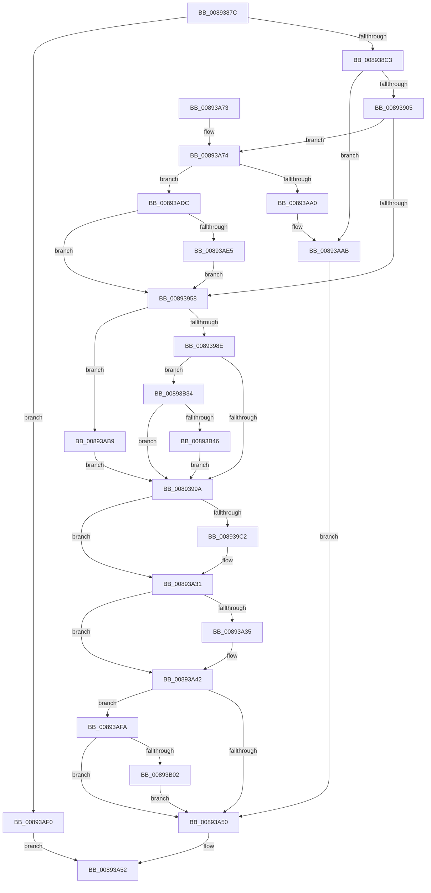

# ObCompleteObjectDuplication

- RVA: `0x0089387C`–`0x00893B5D` (길이 `737` bytes)
- VA: `0x000000014089387C`
- 실행 섹션: `PAGE`
- PDB 이름 있음: `예`; PDB Function 태그: `아니요`
- unwind 정보 RVA: `0x0007DEF0`
- 디코드: `190`개 명령, `737/737` bytes 표시
- 미해석 바이트: `0` (있으면 어셈블리에 `.byte`로 보존)

> 이 문서는 커널 이미지의 기계어와 PDB 기호를 분석해 생성했습니다. 4번과 5번은 함수 원형과 자료형을 바이너리 사용 방식에서 추정한 C 해석이며 원본 소스 복구 결과는 아닙니다.

## 1. Dependencies

- 직접 호출 지점: **15**; 고유 호출 대상: **13**
- 직접 호출자로 확인된 함수: **2**
- RIP 상대 이미지 참조: **4**

### Outgoing calls
- `0x008938B2` → [ObReferenceProcessHandleTable](ObReferenceProcessHandleTable_function_00893B70.md) (function, `0x00893B70`)
- `0x008938F6` → [ObpIncrementHandleCountEx](../86/ObpIncrementHandleCountEx_function_0086DA10.md) (function, `0x0086DA10`)
- `0x0089394B` → [ObpFilterOperation](../../text/43/ObpFilterOperation_function_00431370.md) (function, `0x00431370`)
- `0x00893961` → [ObfReferenceObjectWithTag](../../text/21/ObfReferenceObjectWithTag_function_00210710.md) (function, `0x00210710`)
- `0x0089397D` → [ExCreateHandleEx](../86/ExCreateHandleEx_function_0086ACB0.md) (function, `0x0086ACB0`)
- `0x008939B3` → [ExReleaseRundownProtection](../../text/34/ExReleaseRundownProtection_function_00349E80.md) (function, `0x00349E80`)
- `0x00893A2C` → [ObpCallPostOperationCallbacks](../9A/ObpCallPostOperationCallbacks_function_009A7BC0.md) (function, `0x009A7BC0`)
- `0x00893A95` → [ObpPreInterceptHandleDuplicate](../8C/ObpPreInterceptHandleDuplicate_function_008C69E4.md) (function, `0x008C69E4`)
- `0x00893AA6` → [ObpDecrementHandleCount](../86/ObpDecrementHandleCount_function_008632E0.md) (function, `0x008632E0`)
- `0x00893AB2` → [ExReleaseRundownProtection](../../text/34/ExReleaseRundownProtection_function_00349E80.md) (function, `0x00349E80`)
- `0x00893AC2` → [ObfDereferenceObjectWithTag](../../text/2F/ObfDereferenceObjectWithTag_function_002F78E0.md) (function, `0x002F78E0`)
- `0x00893ACD` → [ObpDecrementHandleCount](../86/ObpDecrementHandleCount_function_008632E0.md) (function, `0x008632E0`)
- `0x00893B2A` → [EtwTraceDuplicateHandle](../A5/EtwTraceDuplicateHandle_function_00A56C5C.md) (function, `0x00A56C5C`)
- `0x00893B39` → [SeAuditingWithTokenForSubcategory](../90/SeAuditingWithTokenForSubcategory_function_009047D0.md) (function, `0x009047D0`)
- `0x00893B53` → [SeAuditHandleDuplication](../AC/SeAuditHandleDuplication_function_00AC1458.md) (function, `0x00AC1458`)

### Direct callers
- [AlpcpQueryHandleInformationMessage](AlpcpQueryHandleInformationMessage_function_00893560.md) at `0x00893611`
- [AlpcpExposeHandleAttribute](../9C/AlpcpExposeHandleAttribute_function_009CAE60.md) at `0x009CAFFC`

### Static image references
- `0x008938C3` → RVA `0x00F0F5B8` (`.data`; read)
- `0x0089391F` → RVA `0x00FC6E4C` (`ALMOSTRO`; read)
- `0x00893929` → RVA `0x00FC7800` (`ALMOSTRO`; read)
- `0x00893A42` → RVA `0x00FC6B10` (`ALMOSTRO`; read)

## 2. Other-region calls and transfers

- 다른 실행 섹션으로 향하는 call: **5**
  - `0x0089394B` → [ObpFilterOperation](../../text/43/ObpFilterOperation_function_00431370.md) (`PAGE` → `.text`)
  - `0x00893961` → [ObfReferenceObjectWithTag](../../text/21/ObfReferenceObjectWithTag_function_00210710.md) (`PAGE` → `.text`)
  - `0x008939B3` → [ExReleaseRundownProtection](../../text/34/ExReleaseRundownProtection_function_00349E80.md) (`PAGE` → `.text`)
  - `0x00893AB2` → [ExReleaseRundownProtection](../../text/34/ExReleaseRundownProtection_function_00349E80.md) (`PAGE` → `.text`)
  - `0x00893AC2` → [ObfDereferenceObjectWithTag](../../text/2F/ObfDereferenceObjectWithTag_function_002F78E0.md) (`PAGE` → `.text`)
- 별도 외부 분기/꼬리 이동을 확인하지 못했습니다.

## 3. Assembly (complete function range)

```asm
0089387C  48 8B C4                        mov rax, rsp
0089387F  48 89 58 08                     mov qword ptr [rax + 8], rbx
00893883  48 89 70 10                     mov qword ptr [rax + 0x10], rsi
00893887  48 89 78 18                     mov qword ptr [rax + 0x18], rdi
0089388B  55                              push rbp
0089388C  41 54                           push r12
0089388E  41 55                           push r13
00893890  41 56                           push r14
00893892  41 57                           push r15
00893894  48 8D 68 A9                     lea rbp, [rax - 0x57]
00893898  48 81 EC 90 00 00 00            sub rsp, 0x90
0089389F  49 83 21 00                     and qword ptr [r9], 0
008938A3  48 8B D9                        mov rbx, rcx
008938A6  48 8B CA                        mov rcx, rdx
008938A9  4D 8B E9                        mov r13, r9
008938AC  41 8A F0                        mov sil, r8b
008938AF  48 8B FA                        mov rdi, rdx
008938B2  E8 B9 02 00 00                  call 0x140893b70
008938B7  4C 8B F8                        mov r15, rax
008938BA  48 85 C0                        test rax, rax
008938BD  0F 84 2D 02 00 00               je 0x140893af0
008938C3  48 3B 05 EE BC 67 00            cmp rax, qword ptr [rip + 0x67bcee]
008938CA  48 8D 55 77                     lea rdx, [rbp + 0x77]
008938CE  8B 43 18                        mov eax, dword ptr [rbx + 0x18]
008938D1  4C 8B C7                        mov r8, rdi
008938D4  4C 8B 4B 10                     mov r9, qword ptr [rbx + 0x10]
008938D8  41 0F 94 C4                     sete r12b
008938DC  48 83 64 24 30 00               and qword ptr [rsp + 0x30], 0
008938E2  B9 02 00 00 00                  mov ecx, 2
008938E7  89 45 77                        mov dword ptr [rbp + 0x77], eax
008938EA  8B 43 24                        mov eax, dword ptr [rbx + 0x24]
008938ED  89 44 24 28                     mov dword ptr [rsp + 0x28], eax
008938F1  40 88 74 24 20                  mov byte ptr [rsp + 0x20], sil
008938F6  E8 15 A1 FD FF                  call 0x14086da10
008938FB  8B F0                           mov esi, eax
008938FD  85 C0                           test eax, eax
008938FF  0F 88 A6 01 00 00               js 0x140893aab
00893905  4C 8B 53 10                     mov r10, qword ptr [rbx + 0x10]
00893909  4D 8D 72 D0                     lea r14, [r10 - 0x30]
0089390D  49 8B C6                        mov rax, r14
00893910  48 C1 E8 08                     shr rax, 8
00893914  0F B6 C8                        movzx ecx, al
00893917  41 0F B6 46 18                  movzx eax, byte ptr [r14 + 0x18]
0089391C  48 33 C8                        xor rcx, rax
0089391F  0F B6 05 26 35 73 00            movzx eax, byte ptr [rip + 0x733526]
00893926  48 33 C8                        xor rcx, rax
00893929  48 8D 05 D0 3E 73 00            lea rax, [rip + 0x733ed0]
00893930  48 8B 04 C8                     mov rax, qword ptr [rax + rcx*8]
00893934  48 8D 4D EF                     lea rcx, [rbp - 0x11]
00893938  48 89 4D F7                     mov qword ptr [rbp - 9], rcx
0089393C  48 8D 4D EF                     lea rcx, [rbp - 0x11]
00893940  48 89 4D EF                     mov qword ptr [rbp - 0x11], rcx
00893944  48 8B C8                        mov rcx, rax
00893947  48 89 45 E7                     mov qword ptr [rbp - 0x19], rax
0089394B  E8 20 DA B9 FF                  call 0x140431370
00893950  84 C0                           test al, al
00893952  0F 85 1C 01 00 00               jne 0x140893a74
00893958  48 8B 4B 10                     mov rcx, qword ptr [rbx + 0x10]
0089395C  BA 4F 62 48 6E                  mov edx, 0x6e48624f
00893961  E8 AA CD 97 FF                  call 0x140210710
00893966  44 8B 4B 24                     mov r9d, dword ptr [rbx + 0x24]
0089396A  48 8D 43 1C                     lea rax, [rbx + 0x1c]
0089396E  44 8B 45 77                     mov r8d, dword ptr [rbp + 0x77]
00893972  49 8B D6                        mov rdx, r14
00893975  49 8B CF                        mov rcx, r15
00893978  48 89 44 24 20                  mov qword ptr [rsp + 0x20], rax
0089397D  E8 2E 73 FD FF                  call 0x14086acb0
00893982  4C 8B F8                        mov r15, rax
00893985  48 85 C0                        test rax, rax
00893988  0F 84 2B 01 00 00               je 0x140893ab9
0089398E  8B 4B 24                        mov ecx, dword ptr [rbx + 0x24]
00893991  F6 C1 04                        test cl, 4
00893994  0F 85 9A 01 00 00               jne 0x140893b34
0089399A  4D 8B F7                        mov r14, r15
0089399D  48 8D 8F E8 01 00 00            lea rcx, [rdi + 0x1e8]
008939A4  49 81 CE 00 00 00 80            or r14, 0xffffffff80000000
008939AB  41 80 FC 01                     cmp r12b, 1
008939AF  4D 0F 45 F7                     cmovne r14, r15
008939B3  E8 C8 64 AB FF                  call 0x140349e80
008939B8  48 8D 45 EF                     lea rax, [rbp - 0x11]
008939BC  48 39 45 EF                     cmp qword ptr [rbp - 0x11], rax
008939C0  74 6F                           je 0x140893a31
008939C2  48 8B 53 10                     mov rdx, qword ptr [rbx + 0x10]
008939C6  48 8D 45 DF                     lea rax, [rbp - 0x21]
008939CA  48 83 65 17 00                  and qword ptr [rbp + 0x17], 0
008939CF  33 C9                           xor ecx, ecx
008939D1  83 65 23 00                     and dword ptr [rbp + 0x23], 0
008939D5  83 E1 FE                        and ecx, 0xfffffffe
008939D8  48 89 45 27                     mov qword ptr [rbp + 0x27], rax
008939DC  41 0F B6 C4                     movzx eax, r12b
008939E0  0B C8                           or ecx, eax
008939E2  48 89 55 07                     mov qword ptr [rbp + 7], rdx
008939E6  89 4D 03                        mov dword ptr [rbp + 3], ecx
008939E9  48 8D 42 D0                     lea rax, [rdx - 0x30]
008939ED  48 C1 E8 08                     shr rax, 8
008939F1  0F B6 C8                        movzx ecx, al
008939F4  0F B6 42 E8                     movzx eax, byte ptr [rdx - 0x18]
008939F8  48 8D 55 EF                     lea rdx, [rbp - 0x11]
008939FC  48 33 C8                        xor rcx, rax
008939FF  C7 45 FF 02 00 00 00            mov dword ptr [rbp - 1], 2
00893A06  0F B6 05 3F 34 73 00            movzx eax, byte ptr [rip + 0x73343f]
00893A0D  48 33 C8                        xor rcx, rax
00893A10  89 75 1F                        mov dword ptr [rbp + 0x1f], esi
00893A13  48 8D 05 E6 3D 73 00            lea rax, [rip + 0x733de6]
00893A1A  48 8B 04 C8                     mov rax, qword ptr [rax + rcx*8]
00893A1E  48 8D 4D FF                     lea rcx, [rbp - 1]
00893A22  48 89 45 0F                     mov qword ptr [rbp + 0xf], rax
00893A26  8B 45 77                        mov eax, dword ptr [rbp + 0x77]
00893A29  89 45 DF                        mov dword ptr [rbp - 0x21], eax
00893A2C  E8 8F 41 11 00                  call 0x1409a7bc0
00893A31  85 F6                           test esi, esi
00893A33  78 0D                           js 0x140893a42
00893A35  48 8B 4D 7F                     mov rcx, qword ptr [rbp + 0x7f]
00893A39  8B 45 77                        mov eax, dword ptr [rbp + 0x77]
00893A3C  4D 89 75 00                     mov qword ptr [r13], r14
00893A40  89 01                           mov dword ptr [rcx], eax
00893A42  8B 05 C8 30 73 00               mov eax, dword ptr [rip + 0x7330c8]
00893A48  A8 40                           test al, 0x40
00893A4A  0F 85 AA 00 00 00               jne 0x140893afa
00893A50  8B C6                           mov eax, esi
00893A52  4C 8D 9C 24 90 00 00 00         lea r11, [rsp + 0x90]
00893A5A  49 8B 5B 30                     mov rbx, qword ptr [r11 + 0x30]
00893A5E  49 8B 73 38                     mov rsi, qword ptr [r11 + 0x38]
00893A62  49 8B 7B 40                     mov rdi, qword ptr [r11 + 0x40]
00893A66  49 8B E3                        mov rsp, r11
00893A69  41 5F                           pop r15
00893A6B  41 5E                           pop r14
00893A6D  41 5D                           pop r13
00893A6F  41 5C                           pop r12
00893A71  5D                              pop rbp
00893A72  C3                              ret
00893A73  CC                              int3
00893A74  8B 45 77                        mov eax, dword ptr [rbp + 0x77]
00893A77  4C 8D 45 DF                     lea r8, [rbp - 0x21]
00893A7B  4C 8B 0B                        mov r9, qword ptr [rbx]
00893A7E  41 8A D4                        mov dl, r12b
00893A81  89 45 DF                        mov dword ptr [rbp - 0x21], eax
00893A84  49 8B CA                        mov rcx, r10
00893A87  48 8D 45 EF                     lea rax, [rbp - 0x11]
00893A8B  48 89 44 24 28                  mov qword ptr [rsp + 0x28], rax
00893A90  48 89 7C 24 20                  mov qword ptr [rsp + 0x20], rdi
00893A95  E8 4A 2F 03 00                  call 0x1408c69e4
00893A9A  8B F0                           mov esi, eax
00893A9C  85 C0                           test eax, eax
00893A9E  79 3C                           jns 0x140893adc
00893AA0  49 8B D6                        mov rdx, r14
00893AA3  48 8B CF                        mov rcx, rdi
00893AA6  E8 35 F8 FC FF                  call 0x1408632e0
00893AAB  48 8D 8F E8 01 00 00            lea rcx, [rdi + 0x1e8]
00893AB2  E8 C9 63 AB FF                  call 0x140349e80
00893AB7  EB 97                           jmp 0x140893a50
00893AB9  48 8B 4B 10                     mov rcx, qword ptr [rbx + 0x10]
00893ABD  BA 4F 62 48 6E                  mov edx, 0x6e48624f
00893AC2  E8 19 3E A6 FF                  call 0x1402f78e0
00893AC7  49 8B D6                        mov rdx, r14
00893ACA  48 8B CF                        mov rcx, rdi
00893ACD  E8 0E F8 FC FF                  call 0x1408632e0
00893AD2  BE 9A 00 00 C0                  mov esi, 0xc000009a
00893AD7  E9 BE FE FF FF                  jmp 0x14089399a
00893ADC  45 84 E4                        test r12b, r12b
00893ADF  0F 85 73 FE FF FF               jne 0x140893958
00893AE5  8B 45 DF                        mov eax, dword ptr [rbp - 0x21]
00893AE8  89 45 77                        mov dword ptr [rbp + 0x77], eax
00893AEB  E9 68 FE FF FF                  jmp 0x140893958
00893AF0  B8 0A 01 00 C0                  mov eax, 0xc000010a
00893AF5  E9 58 FF FF FF                  jmp 0x140893a52
00893AFA  85 F6                           test esi, esi
00893AFC  0F 88 4E FF FF FF               js 0x140893a50
00893B02  48 8B 45 E7                     mov rax, qword ptr [rbp - 0x19]
00893B06  49 8B D6                        mov rdx, r14
00893B09  4C 8B 0B                        mov r9, qword ptr [rbx]
00893B0C  4C 8B 43 10                     mov r8, qword ptr [rbx + 0x10]
00893B10  48 8B 4B 08                     mov rcx, qword ptr [rbx + 8]
00893B14  48 89 44 24 28                  mov qword ptr [rsp + 0x28], rax
00893B19  8B 87 D0 01 00 00               mov eax, dword ptr [rdi + 0x1d0]
00893B1F  45 8B 89 D0 01 00 00            mov r9d, dword ptr [r9 + 0x1d0]
00893B26  89 44 24 20                     mov dword ptr [rsp + 0x20], eax
00893B2A  E8 2D 31 1C 00                  call 0x140a56c5c
00893B2F  E9 1C FF FF FF                  jmp 0x140893a50
00893B34  33 D2                           xor edx, edx
00893B36  8D 4A 7C                        lea ecx, [rdx + 0x7c]
00893B39  E8 92 0C 07 00                  call 0x1409047d0
00893B3E  84 C0                           test al, al
00893B40  0F 84 54 FE FF FF               je 0x14089399a
00893B46  4C 8B 03                        mov r8, qword ptr [rbx]
00893B49  4C 8B CF                        mov r9, rdi
00893B4C  48 8B 4B 08                     mov rcx, qword ptr [rbx + 8]
00893B50  49 8B D7                        mov rdx, r15
00893B53  E8 00 D9 22 00                  call 0x140ac1458
00893B58  E9 3D FE FF FF                  jmp 0x14089399a
```

## 4. C-style interpretation (structured pseudocode)

```c
__int64 __fastcall ObCompleteObjectDuplication(__int64 a1, __int64 a2, unsigned __int8 a3, __int64 a4)
{
    __int64 result;
    __int64 v_r12;
    __int64 v_r14;
    __int64 v_rsp;
    unsigned __int64 v_stack_m28;
    unsigned __int64 v_stack_m68;
    unsigned __int64 v_stack_m70;
    unsigned __int64 v_stack_m88;
    unsigned int v_stack_m90;
    unsigned __int8 v_stack_m98;

    *(unsigned __int64 *)(v_rsp + 8) = v_rbx;
    *(unsigned __int64 *)(v_rsp + 16) = v_rsi;
    *(unsigned __int64 *)(v_rsp + 24) = v_rdi;
    v_rsp = (v_rsp) - (144);
    result = ObReferenceProcessHandleTable(a2, a2, a3, a4);
    if (result == 0) goto loc_00893AF0;
    v_r12 = (result == (*(unsigned __int64 *)(v_rip + 6798574))) ? 1 : 0;
    *(unsigned int *)(v_rsp - 87 + 119) = (unsigned int)((unsigned int)(*(unsigned int *)(a1 + 24)));
    v_stack_m90 = (unsigned int)((unsigned int)(*(unsigned int *)(a1 + 36)));
    v_stack_m98 = a3;
    result = ObpIncrementHandleCountEx(2, v_rsp - 87 + 119, a2, *(unsigned __int64 *)(a1 + 16));
    if (sign_flag) goto loc_00893AAB;
    result = (*(unsigned __int64 *)(a1 + 16) - 48) >> (8);
    a1 = ((unsigned __int8)(result)) ^ (*(unsigned __int8 *)(*(unsigned __int64 *)(a1 + 16) - 48 + 24));
    a1 = (a1) ^ (*(unsigned __int8 *)(v_rip + 7550246));
    *(unsigned __int64 *)(v_rsp - 87 - 9) = v_rsp - 87 - 17;
    *(unsigned __int64 *)(v_rsp - 87 - 17) = v_rsp - 87 - 17;
    *(unsigned __int64 *)(v_rsp - 87 - 25) = *(unsigned __int64 *)(v_rip + 7552720 + a1 * 8);
    result = ObpFilterOperation(*(unsigned __int64 *)(v_rip + 7552720 + a1 * 8), v_rsp - 87 + 119, a2, *(unsigned __int64 *)(a1 + 16));
    if ((unsigned __int8)(result) != 0) goto loc_00893A74;
loc_00893958:
    result = ObfReferenceObjectWithTag(*(unsigned __int64 *)(a1 + 16), (unsigned int)(0x6E48624FULL), a2, *(unsigned __int64 *)(a1 + 16));
    v_stack_m98 = a1 + 28;
    result = ExCreateHandleEx(result, *(unsigned __int64 *)(a1 + 16) - 48, (unsigned int)(*(unsigned int *)(v_rsp - 87 + 119)), (unsigned int)(*(unsigned int *)(a1 + 36)));
    if (result == 0) goto loc_00893AB9;
    if ((((unsigned __int8)((unsigned int)(*(unsigned int *)(a1 + 36)))) & (4)) != 0) goto loc_00893B34;
loc_0089399A:
    v_r14 = (result) | (0xFFFFFFFF80000000ULL);
    if (((unsigned __int8)(v_r12)) != 1) { v_r14 = result; }
    result = ExReleaseRundownProtection(a2 + 488, *(unsigned __int64 *)(a1 + 16) - 48, (unsigned int)(*(unsigned int *)(v_rsp - 87 + 119)), (unsigned int)(*(unsigned int *)(a1 + 36)));
    result = v_rsp - 87 - 17;
    if ((*(unsigned __int64 *)(v_rsp - 87 - 17)) != (v_rsp - 87 - 17)) {
        a2 = *(unsigned __int64 *)(a1 + 16);
        result = v_rsp - 87 - 33;
        a1 = 0;
        a1 = (unsigned int)((a1) & (0xFFFFFFFEULL));
        *(unsigned __int64 *)(v_rsp - 87 + 39) = result;
        result = (unsigned __int8)(v_r12);
        a1 = (unsigned int)((a1) | ((unsigned int)(result)));
        *(unsigned __int64 *)(v_rsp - 87 + 7) = a2;
        *(unsigned int *)(v_rsp - 87 + 3) = (unsigned int)(a1);
        result = a2 - 48;
        result = (result) >> (8);
        a1 = (unsigned __int8)(result);
        result = *(unsigned __int8 *)(a2 - 24);
        a2 = v_rsp - 87 - 17;
        a1 = (a1) ^ (result);
        *(unsigned int *)(v_rsp - 87 - 1) = 2;
        result = *(unsigned __int8 *)(v_rip + 7550015);
        a1 = (a1) ^ (result);
        *(unsigned int *)(v_rsp - 87 + 31) = (unsigned int)((unsigned int)((unsigned int)(result)));
        result = v_rip + 7552486;
        result = *(unsigned __int64 *)(result + a1 * 8);
        a1 = v_rsp - 87 - 1;
        *(unsigned __int64 *)(v_rsp - 87 + 15) = result;
        result = *(unsigned int *)(v_rsp - 87 + 119);
        *(unsigned int *)(v_rsp - 87 - 33) = (unsigned int)(result);
        result = ObpCallPostOperationCallbacks(a1, a2, (unsigned int)(*(unsigned int *)(v_rsp - 87 + 119)), (unsigned int)(*(unsigned int *)(a1 + 36)));
    }
    if (!(sign_flag)) {
        a1 = *(unsigned __int64 *)(v_rsp - 87 + 127);
        result = *(unsigned int *)(v_rsp - 87 + 119);
        *(unsigned __int64 *)(a4) = v_r14;
        *(unsigned int *)(a1) = (unsigned int)(result);
    }
    if ((((unsigned __int8)((unsigned int)(*(unsigned int *)(v_rip + 7549128)))) & (64)) != 0) goto loc_00893AFA;
loc_00893A50:
loc_00893A52:
    return (unsigned int)((unsigned int)((unsigned int)((unsigned int)(result))));
loc_00893A74:
    *(unsigned int *)(v_rsp - 87 - 33) = (unsigned int)((unsigned int)(*(unsigned int *)(v_rsp - 87 + 119)));
    v_stack_m68 = v_rsp - 87 - 17;
    v_stack_m70 = *(unsigned __int64 *)(v_stack_m28 + 64);
    result = ObpPreInterceptHandleDuplicate(*(unsigned __int64 *)(a1 + 16), (unsigned __int8)(v_r12), v_rsp - 87 - 33, *(unsigned __int64 *)(*(unsigned __int64 *)(v_stack_m28 + 48)));
    if (!sign_flag) goto loc_00893ADC;
    result = ObpDecrementHandleCount(*(unsigned __int64 *)(v_stack_m28 + 64), v_r14, v_rsp - 87 - 33, *(unsigned __int64 *)(*(unsigned __int64 *)(v_stack_m28 + 48)));
loc_00893AAB:
    result = ExReleaseRundownProtection(*(unsigned __int64 *)(v_stack_m28 + 64) + 488, v_r14, v_rsp - 87 - 33, *(unsigned __int64 *)(*(unsigned __int64 *)(v_stack_m28 + 48)));
    goto loc_00893A50;
loc_00893AB9:
    result = ObfDereferenceObjectWithTag(*(unsigned __int64 *)(*(unsigned __int64 *)(v_stack_m28 + 48) + 16), (unsigned int)(0x6E48624FULL), v_rsp - 87 - 33, *(unsigned __int64 *)(*(unsigned __int64 *)(v_stack_m28 + 48)));
    result = ObpDecrementHandleCount(*(unsigned __int64 *)(v_stack_m28 + 64), v_r14, v_rsp - 87 - 33, *(unsigned __int64 *)(*(unsigned __int64 *)(v_stack_m28 + 48)));
    goto loc_0089399A;
loc_00893ADC:
    if ((unsigned __int8)(v_r12) != 0) goto loc_00893958;
    *(unsigned int *)(v_rsp - 87 + 119) = (unsigned int)((unsigned int)(*(unsigned int *)(v_rsp - 87 - 33)));
    goto loc_00893958;
loc_00893AF0:
    goto loc_00893A52;
loc_00893AFA:
    if (sign_flag) goto loc_00893A50;
    v_stack_m68 = *(unsigned __int64 *)(v_rsp - 87 - 25);
    v_stack_m70 = (unsigned int)((unsigned int)(*(unsigned int *)(*(unsigned __int64 *)(v_stack_m28 + 64) + 464)));
    result = EtwTraceDuplicateHandle(*(unsigned __int64 *)(*(unsigned __int64 *)(v_stack_m28 + 48) + 8), v_r14, *(unsigned __int64 *)(*(unsigned __int64 *)(v_stack_m28 + 48) + 16), (unsigned int)(*(unsigned int *)(*(unsigned __int64 *)(*(unsigned __int64 *)(v_stack_m28 + 48)) + 464)));
    goto loc_00893A50;
loc_00893B34:
    a2 = 0;
    result = SeAuditingWithTokenForSubcategory(a2 + 124, a2, *(unsigned __int64 *)(*(unsigned __int64 *)(v_stack_m28 + 48) + 16), (unsigned int)(*(unsigned int *)(*(unsigned __int64 *)(*(unsigned __int64 *)(v_stack_m28 + 48)) + 464)));
    if ((unsigned __int8)(result) == 0) goto loc_0089399A;
    result = SeAuditHandleDuplication(*(unsigned __int64 *)(*(unsigned __int64 *)(v_stack_m28 + 48) + 8), result, *(unsigned __int64 *)(*(unsigned __int64 *)(v_stack_m28 + 48)), *(unsigned __int64 *)(v_stack_m28 + 64));
    goto loc_0089399A;
}
```

## 5. (Beta) C Style

```c
int64_t ObCompleteObjectDuplication(void *Arg1, void *Arg2, uint8_t Arg3, void *Arg4)
{
    uint8_t *arg1 = (uint8_t *)Arg1;
    uint8_t *arg2 = (uint8_t *)Arg2;
    uint8_t *arg4 = (uint8_t *)Arg4;

    int64_t result;
    int64_t local_r12;
    int64_t local_r14;
    int64_t local_rsp;
    uint64_t v_stack_m28;
    uint64_t v_stack_m68;
    uint64_t v_stack_m70;
    uint64_t v_stack_m88;
    uint32_t v_stack_m90;
    uint8_t v_stack_m98;

    *(uint64_t *)(local_rsp + 0x8) = local_rbx;
    *(uint64_t *)(local_rsp + 0x10) = local_rsi;
    *(uint64_t *)(local_rsp + 0x18) = local_rdi;
    local_rsp = (local_rsp) - (144);
    result = ObReferenceProcessHandleTable(Arg2, Arg2, Arg3, Arg4);
    if (result == 0) goto loc_00893AF0;
    local_r12 = (result == (*(uint64_t *)(v_rip + 0x67BCEE))) ? 1 : 0;
    *(uint32_t *)(local_rsp - 0x57 + 0x77) = (uint32_t)((uint32_t)(*(uint32_t *)(arg1 + 0x18)));
    v_stack_m90 = (uint32_t)((uint32_t)(*(uint32_t *)(arg1 + 0x24)));
    v_stack_m98 = Arg3;
    result = ObpIncrementHandleCountEx(2, local_rsp - 87 + 119, Arg2, *(uint64_t *)(arg1 + 0x10));
    if (sign_flag) goto loc_00893AAB;
    result = (*(uint64_t *)(arg1 + 0x10) - 48) >> (8);
    Arg1 = ((uint8_t)(result)) ^ (*(uint8_t *)(*(uint64_t *)(arg1 + 0x10) - 0x30 + 0x18));
    Arg1 = (Arg1) ^ (*(uint8_t *)(v_rip + 0x733526));
    *(uint64_t *)(local_rsp - 0x57 - 0x9) = local_rsp - 87 - 17;
    *(uint64_t *)(local_rsp - 0x57 - 0x11) = local_rsp - 87 - 17;
    *(uint64_t *)(local_rsp - 0x57 - 0x19) = *(uint64_t *)(v_rip + 0x733ED0 + arg1 * 8);
    result = ObpFilterOperation(*(uint64_t *)(v_rip + 0x733ED0 + arg1 * 8), local_rsp - 87 + 119, Arg2, *(uint64_t *)(arg1 + 0x10));
    if ((uint8_t)(result) != 0) goto loc_00893A74;
loc_00893958:
    result = ObfReferenceObjectWithTag(*(uint64_t *)(arg1 + 0x10), (uint32_t)(0x6E48624FULL), Arg2, *(uint64_t *)(arg1 + 0x10));
    v_stack_m98 = Arg1 + 28;
    result = ExCreateHandleEx(result, *(uint64_t *)(arg1 + 0x10) - 48, (uint32_t)(*(uint32_t *)(local_rsp - 0x57 + 0x77)), (uint32_t)(*(uint32_t *)(arg1 + 0x24)));
    if (result == 0) goto loc_00893AB9;
    if ((((uint8_t)((uint32_t)(*(uint32_t *)(arg1 + 0x24)))) & (4)) != 0) goto loc_00893B34;
loc_0089399A:
    local_r14 = (result) | (0xFFFFFFFF80000000ULL);
    if (((uint8_t)(local_r12)) != 1) { local_r14 = result; }
    result = ExReleaseRundownProtection(Arg2 + 488, *(uint64_t *)(arg1 + 0x10) - 48, (uint32_t)(*(uint32_t *)(local_rsp - 0x57 + 0x77)), (uint32_t)(*(uint32_t *)(arg1 + 0x24)));
    result = local_rsp - 87 - 17;
    if ((*(uint64_t *)(local_rsp - 0x57 - 0x11)) != (local_rsp - 87 - 17)) {
        Arg2 = *(uint64_t *)(arg1 + 0x10);
        result = local_rsp - 87 - 33;
        Arg1 = 0;
        Arg1 = (uint32_t)((Arg1) & (0xFFFFFFFEULL));
        *(uint64_t *)(local_rsp - 0x57 + 0x27) = result;
        result = (uint8_t)(local_r12);
        Arg1 = (uint32_t)((Arg1) | ((uint32_t)(result)));
        *(void **)(local_rsp - 0x57 + 0x7) = Arg2;
        *(uint32_t *)(local_rsp - 0x57 + 0x3) = (uint32_t)(Arg1);
        result = Arg2 - 48;
        result = (result) >> (8);
        Arg1 = (uint8_t)(result);
        result = *(uint8_t *)(arg2 - 0x18);
        Arg2 = local_rsp - 87 - 17;
        Arg1 = (Arg1) ^ (result);
        *(uint32_t *)(local_rsp - 0x57 - 0x1) = 2;
        result = *(uint8_t *)(v_rip + 0x73343F);
        Arg1 = (Arg1) ^ (result);
        *(uint32_t *)(local_rsp - 0x57 + 0x1F) = (uint32_t)((uint32_t)((uint32_t)(result)));
        result = v_rip + 7552486;
        result = *(uint64_t *)(result + arg1 * 8);
        Arg1 = local_rsp - 87 - 1;
        *(uint64_t *)(local_rsp - 0x57 + 0xF) = result;
        result = *(uint32_t *)(local_rsp - 0x57 + 0x77);
        *(uint32_t *)(local_rsp - 0x57 - 0x21) = (uint32_t)(result);
        result = ObpCallPostOperationCallbacks(Arg1, Arg2, (uint32_t)(*(uint32_t *)(local_rsp - 0x57 + 0x77)), (uint32_t)(*(uint32_t *)(arg1 + 0x24)));
    }
    if (!(sign_flag)) {
        Arg1 = *(uint64_t *)(local_rsp - 0x57 + 0x7F);
        result = *(uint32_t *)(local_rsp - 0x57 + 0x77);
        *(uint64_t *)(arg4) = local_r14;
        *(uint32_t *)(arg1) = (uint32_t)(result);
    }
    if ((((uint8_t)((uint32_t)(*(uint32_t *)(v_rip + 0x7330C8)))) & (64)) != 0) goto loc_00893AFA;
loc_00893A50:
loc_00893A52:
    return (uint32_t)((uint32_t)((uint32_t)((uint32_t)(result))));
loc_00893A74:
    *(uint32_t *)(local_rsp - 0x57 - 0x21) = (uint32_t)((uint32_t)(*(uint32_t *)(local_rsp - 0x57 + 0x77)));
    v_stack_m68 = local_rsp - 87 - 17;
    v_stack_m70 = *(uint64_t *)(v_stack_m28 + 0x40);
    result = ObpPreInterceptHandleDuplicate(*(uint64_t *)(arg1 + 0x10), (uint8_t)(local_r12), local_rsp - 87 - 33, *(uint64_t *)(*(uint64_t *)(v_stack_m28 + 0x30)));
    if (!sign_flag) goto loc_00893ADC;
    result = ObpDecrementHandleCount(*(uint64_t *)(v_stack_m28 + 0x40), local_r14, local_rsp - 87 - 33, *(uint64_t *)(*(uint64_t *)(v_stack_m28 + 0x30)));
loc_00893AAB:
    result = ExReleaseRundownProtection(*(uint64_t *)(v_stack_m28 + 0x40) + 488, local_r14, local_rsp - 87 - 33, *(uint64_t *)(*(uint64_t *)(v_stack_m28 + 0x30)));
    goto loc_00893A50;
loc_00893AB9:
    result = ObfDereferenceObjectWithTag(*(uint64_t *)(*(uint64_t *)(v_stack_m28 + 0x30) + 0x10), (uint32_t)(0x6E48624FULL), local_rsp - 87 - 33, *(uint64_t *)(*(uint64_t *)(v_stack_m28 + 0x30)));
    result = ObpDecrementHandleCount(*(uint64_t *)(v_stack_m28 + 0x40), local_r14, local_rsp - 87 - 33, *(uint64_t *)(*(uint64_t *)(v_stack_m28 + 0x30)));
    goto loc_0089399A;
loc_00893ADC:
    if ((uint8_t)(local_r12) != 0) goto loc_00893958;
    *(uint32_t *)(local_rsp - 0x57 + 0x77) = (uint32_t)((uint32_t)(*(uint32_t *)(local_rsp - 0x57 - 0x21)));
    goto loc_00893958;
loc_00893AF0:
    goto loc_00893A52;
loc_00893AFA:
    if (sign_flag) goto loc_00893A50;
    v_stack_m68 = *(uint64_t *)(local_rsp - 0x57 - 0x19);
    v_stack_m70 = (uint32_t)((uint32_t)(*(uint32_t *)(*(uint64_t *)(v_stack_m28 + 0x40) + 0x1D0)));
    result = EtwTraceDuplicateHandle(*(uint64_t *)(*(uint64_t *)(v_stack_m28 + 0x30) + 0x8), local_r14, *(uint64_t *)(*(uint64_t *)(v_stack_m28 + 0x30) + 0x10), (uint32_t)(*(uint32_t *)(*(uint64_t *)(*(uint64_t *)(v_stack_m28 + 0x30)) + 0x1D0)));
    goto loc_00893A50;
loc_00893B34:
    Arg2 = 0;
    result = SeAuditingWithTokenForSubcategory(Arg2 + 124, Arg2, *(uint64_t *)(*(uint64_t *)(v_stack_m28 + 0x30) + 0x10), (uint32_t)(*(uint32_t *)(*(uint64_t *)(*(uint64_t *)(v_stack_m28 + 0x30)) + 0x1D0)));
    if ((uint8_t)(result) == 0) goto loc_0089399A;
    result = SeAuditHandleDuplication(*(uint64_t *)(*(uint64_t *)(v_stack_m28 + 0x30) + 0x8), result, *(uint64_t *)(*(uint64_t *)(v_stack_m28 + 0x30)), *(uint64_t *)(v_stack_m28 + 0x40));
    goto loc_0089399A;
}
```

### 관측된 메모리 오프셋

구조체 형식이 확인되지 않은 접근은 인자 기준의 오프셋으로만 기록했습니다.

| 기준 인자 | 오프셋 표현 | 폭 (bit) | 접근 |
|---|---:|---:|---|
| `Arg1` | `+ 0x0` | `64` | `R` |
| `Arg1` | `+ 0x8` | `64` | `R` |
| `Arg1` | `+ 0x10` | `64` | `R` |
| `Arg1` | `+ 0x18` | `32` | `R` |
| `Arg1` | `+ 0x1C` | `64` | `R` |
| `Arg1` | `+ 0x24` | `32` | `R` |
| `Arg2` | `+ 0x1D0` | `32` | `R` |
| `Arg2` | `+ 0x1E8` | `64` | `R` |
| `Arg4` | `+ 0x0` | `64` | `R/W` |
| `Arg4` | `+ 0x0` | `64` | `W` |

## 6. Execution-region graph

[열기: 2D/3D 그래프와 함수 탐색 컨트롤 패널](../../../control-panel.html?section=page&rva=0x0089387C&view=graph)

- 2D 그래프는 위에서 아래로 흐르고, 3D 그래프는 빈 공간을 드래그해 회전합니다. Shift+드래그는 이동, 휠은 확대·축소, 함수 노드 선택은 대상 보고서 이동입니다.

### Static fallback


