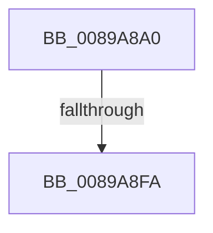

# ObOpenObjectByNameEx

- RVA: `0x0089A8A0`–`0x0089A903` (길이 `99` bytes)
- VA: `0x000000014089A8A0`
- 실행 섹션: `PAGE`
- PDB 이름 있음: `예`; PDB Function 태그: `아니요`
- unwind 정보 RVA: `0x0007E6B4`
- 디코드: `29`개 명령, `99/99` bytes 표시
- 미해석 바이트: `0` (있으면 어셈블리에 `.byte`로 보존)

> 이 문서는 커널 이미지의 기계어와 PDB 기호를 분석해 생성했습니다. 4번과 5번은 함수 원형과 자료형을 바이너리 사용 방식에서 추정한 C 해석이며 원본 소스 복구 결과는 아닙니다.

## 1. Dependencies

- 직접 호출 지점: **0**; 고유 호출 대상: **0**
- 직접 호출자로 확인된 함수: **22**
- RIP 상대 이미지 참조: **0**

### Outgoing calls
- 직접 디코드된 call 명령이 없습니다.

### Direct callers
- [IoRevokeHandlesForProcess](../../text/59/IoRevokeHandlesForProcess_function_005981A8.md) at `0x00598294`
- [CmCreateKey](../87/CmCreateKey_function_00875020.md) at `0x008753F5`
- [CmOpenKey](../87/CmOpenKey_function_00876350.md) at `0x00876594`
- [CmpLinkHiveToMaster](../87/CmpLinkHiveToMaster_function_00877D6C.md) at `0x00877F04`
- [ObOpenObjectByName](ObOpenObjectByName_function_00899F50.md) at `0x00899FA7`
- [NtQueryFullAttributesFile](../8A/NtQueryFullAttributesFile_function_008A0D10.md) at `0x008A0ED4`
- [NtQueryAttributesFile](../8A/NtQueryAttributesFile_function_008A0FA0.md) at `0x008A115A`
- [IopCreateFile](../8A/IopCreateFile_function_008AB298.md) at `0x008AB769`
- [IoQueryInformationByName](../8A/IoQueryInformationByName_function_008AE840.md) at `0x008AEA60`
- [NtOpenJobObject](../91/NtOpenJobObject_function_00917350.md) at `0x009173D9`
- [IopLoadDriver](../99/IopLoadDriver_function_00997B54.md) at `0x00997DFC`
- [IopReferenceDriverObjectByName](../99/IopReferenceDriverObjectByName_function_0099C178.md) at `0x0099C1F1`
- [NtOpenSymbolicLinkObject](../9E/NtOpenSymbolicLinkObject_function_009E7A60.md) at `0x009E7AEC`
- [NtOpenDirectoryObject](../9F/NtOpenDirectoryObject_function_009F4360.md) at `0x009F43E4`
- [NtOpenEvent](../9F/NtOpenEvent_function_009FF270.md) at `0x009FF2F4`
- [NtOpenSection](../9F/NtOpenSection_function_009FF390.md) at `0x009FF414`
- [NtOpenMutant](../A1/NtOpenMutant_function_00A16920.md) at `0x00A169A4`
- [NtOpenSemaphore](../A2/NtOpenSemaphore_function_00A23AB0.md) at `0x00A23B34`
- [NtOpenSession](../A6/NtOpenSession_function_00A6F790.md) at `0x00A6F814`
- [ExCreateCallback](../A7/ExCreateCallback_function_00A7B9D0.md) at `0x00A7BA67`
- [NtDeleteFile](../A9/NtDeleteFile_function_00A97B20.md) at `0x00A97C2A`
- [IopFastQueryNetworkAttributes](../AB/IopFastQueryNetworkAttributes_function_00ABDDD0.md) at `0x00ABDED8`

### Static image references
- 디코드된 RIP-relative 메모리 참조가 없습니다.

## 2. Other-region calls and transfers

- 다른 실행 섹션으로 향하는 call: **0**
- call이 아닌 외부 분기/꼬리 이동: **2**
  - `0x0089A8F4` → [sub_0089AECC](Unknown_function_0089AECC.md) (`tail-transfer`)
  - `0x0089A8FD` → [sub_0089AECC](Unknown_function_0089AECC.md) (`tail-transfer`)

## 3. Assembly (complete function range)

```asm
0089A8A0  4C 8B DC                        mov r11, rsp
0089A8A3  55                              push rbp
0089A8A4  41 54                           push r12
0089A8A6  41 55                           push r13
0089A8A8  41 56                           push r14
0089A8AA  41 57                           push r15
0089A8AC  49 8D 6B C1                     lea rbp, [r11 - 0x3f]
0089A8B0  48 81 EC 00 01 00 00            sub rsp, 0x100
0089A8B7  0F 57 C0                        xorps xmm0, xmm0
0089A8BA  33 C0                           xor eax, eax
0089A8BC  4C 8B F1                        mov r14, rcx
0089A8BF  48 89 45 07                     mov qword ptr [rbp + 7], rax
0089A8C3  48 8B 45 7F                     mov rax, qword ptr [rbp + 0x7f]
0089A8C7  33 C9                           xor ecx, ecx
0089A8C9  48 89 4D 87                     mov qword ptr [rbp - 0x79], rcx
0089A8CD  4D 8B F9                        mov r15, r9
0089A8D0  89 4D 47                        mov dword ptr [rbp + 0x47], ecx
0089A8D3  45 0F B6 E0                     movzx r12d, r8b
0089A8D7  48 89 4D 97                     mov qword ptr [rbp - 0x69], rcx
0089A8DB  4C 8B EA                        mov r13, rdx
0089A8DE  48 89 08                        mov qword ptr [rax], rcx
0089A8E1  0F 11 45 9F                     movups xmmword ptr [rbp - 0x61], xmm0
0089A8E5  0F 11 45 D7                     movups xmmword ptr [rbp - 0x29], xmm0
0089A8E9  0F 11 45 E7                     movups xmmword ptr [rbp - 0x19], xmm0
0089A8ED  0F 11 45 F7                     movups xmmword ptr [rbp - 9], xmm0
0089A8F1  4D 85 F6                        test r14, r14
0089A8F4  0F 84 D2 05 00 00               je 0x14089aecc
0089A8FA  48 85 D2                        test rdx, rdx
0089A8FD  0F 84 C9 05 00 00               je 0x14089aecc
```

## 4. C-style interpretation (structured pseudocode)

```c
__int64 __fastcall ObOpenObjectByNameEx(__int64 a1, __int64 a2, unsigned __int8 a3, __int64 a4)
{
    __int64 result;
    __int64 v_rsp;

    v_rsp = (v_rsp) - (256);
    result = 0;
    *(unsigned __int64 *)(v_rsp - 63 + 7) = 0;
    a1 = 0;
    *(unsigned __int64 *)(v_rsp - 63 - 121) = 0;
    *(unsigned int *)(v_rsp - 63 + 71) = 0;
    *(unsigned __int64 *)(v_rsp - 63 - 105) = 0;
    *(unsigned __int64 *)(*(unsigned __int64 *)(v_rsp - 63 + 127)) = 0;
    *(unsigned __int64 *)(v_rsp - 63 - 97) = v_xmm0;
    *(unsigned __int64 *)(v_rsp - 63 - 41) = v_xmm0;
    *(unsigned __int64 *)(v_rsp - 63 - 25) = v_xmm0;
    *(unsigned __int64 *)(v_rsp - 63 - 9) = v_xmm0;
}
```

## 5. (Beta) C Style

```c
int64_t ObOpenObjectByNameEx(int64_t Arg1, int64_t Arg2, uint8_t Arg3, int64_t Arg4)
{
    int64_t result;
    int64_t local_rsp;

    local_rsp = (local_rsp) - (256);
    result = 0;
    *(uint64_t *)(local_rsp - 0x3F + 0x7) = 0;
    Arg1 = 0;
    *(uint64_t *)(local_rsp - 0x3F - 0x79) = 0;
    *(uint32_t *)(local_rsp - 0x3F + 0x47) = 0;
    *(uint64_t *)(local_rsp - 0x3F - 0x69) = 0;
    *(uint64_t *)(*(uint64_t *)(local_rsp - 0x3F + 0x7F)) = 0;
    *(uint64_t *)(local_rsp - 0x3F - 0x61) = v_xmm0;
    *(uint64_t *)(local_rsp - 0x3F - 0x29) = v_xmm0;
    *(uint64_t *)(local_rsp - 0x3F - 0x19) = v_xmm0;
    *(uint64_t *)(local_rsp - 0x3F - 0x9) = v_xmm0;
}
```

## 6. Execution-region graph

[열기: 2D/3D 그래프와 함수 탐색 컨트롤 패널](../../../control-panel.html?section=page&rva=0x0089A8A0&view=graph)

- 2D 그래프는 위에서 아래로 흐르고, 3D 그래프는 빈 공간을 드래그해 회전합니다. Shift+드래그는 이동, 휠은 확대·축소, 함수 노드 선택은 대상 보고서 이동입니다.

### Static fallback


