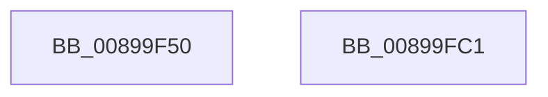

# ObOpenObjectByName

- RVA: `0x00899F50`–`0x00899FC2` (길이 `114` bytes)
- VA: `0x0000000140899F50`
- 실행 섹션: `PAGE`
- PDB 이름 있음: `예`; PDB Function 태그: `아니요`
- unwind 정보 RVA: `0x0007D3C0`
- 디코드: `29`개 명령, `114/114` bytes 표시
- 미해석 바이트: `0` (있으면 어셈블리에 `.byte`로 보존)

> 이 문서는 커널 이미지의 기계어와 PDB 기호를 분석해 생성했습니다. 4번과 5번은 함수 원형과 자료형을 바이너리 사용 방식에서 추정한 C 해석이며 원본 소스 복구 결과는 아닙니다.

## 1. Dependencies

- 직접 호출 지점: **2**; 고유 호출 대상: **2**
- 직접 호출자로 확인된 함수: **12**
- RIP 상대 이미지 참조: **0**

### Outgoing calls
- `0x00899F71` → [PsGetCurrentSilo](../../text/40/PsGetCurrentSilo_function_004094A0.md) (function, `0x004094A0`)
- `0x00899FA7` → [ObOpenObjectByNameEx](ObOpenObjectByNameEx_function_0089A8A0.md) (function, `0x0089A8A0`)

### Direct callers
- [NtOpenIoCompletion](../71/NtOpenIoCompletion_function_0071E560.md) at `0x0071E5CE`
- [NtOpenCpuPartition](../78/NtOpenCpuPartition_function_00783270.md) at `0x007832DE`
- [NtOpenPartition](../78/NtOpenPartition_function_00787DF0.md) at `0x00787E67`
- [NtOpenKeyedEvent](../7D/NtOpenKeyedEvent_function_007D4E00.md) at `0x007D4E6F`
- [CmpCreatePredefined](../7D/CmpCreatePredefined_function_007DA0CC.md) at `0x007DA1A4`
- [NtOpenRegistryTransaction](../7D/NtOpenRegistryTransaction_function_007DFE40.md) at `0x007DFEFF`
- [CmpDoReOpenTransKey](../7F/CmpDoReOpenTransKey_function_007F78E8.md) at `0x007F79F4`
- [CmpDoReOpenTransKey](../7F/CmpDoReOpenTransKey_function_007F78E8.md) at `0x007F7B97`
- [NtOpenEvent](../9F/NtOpenEvent_function_009FF270.md) at `0x009FF366`
- [NtOpenMutant](../A1/NtOpenMutant_function_00A16920.md) at `0x00A16A16`
- [NtOpenTimer](../A9/NtOpenTimer_function_00A91000.md) at `0x00A9106E`
- [IopUnloadDriver](../AB/IopUnloadDriver_function_00ABF868.md) at `0x00ABFA9C`
- [CmInitSystem1](../../init/C5/CmInitSystem1_function_00C559CC.md) at `0x00C55F7E`

### Static image references
- 디코드된 RIP-relative 메모리 참조가 없습니다.

## 2. Other-region calls and transfers

- 다른 실행 섹션으로 향하는 call: **1**
  - `0x00899F71` → [PsGetCurrentSilo](../../text/40/PsGetCurrentSilo_function_004094A0.md) (`PAGE` → `.text`)
- 별도 외부 분기/꼬리 이동을 확인하지 못했습니다.

## 3. Assembly (complete function range)

```asm
00899F50  48 89 5C 24 08                  mov qword ptr [rsp + 8], rbx
00899F55  48 89 6C 24 10                  mov qword ptr [rsp + 0x10], rbp
00899F5A  48 89 74 24 18                  mov qword ptr [rsp + 0x18], rsi
00899F5F  57                              push rdi
00899F60  48 83 EC 40                     sub rsp, 0x40
00899F64  49 8B D9                        mov rbx, r9
00899F67  41 0F B6 F8                     movzx edi, r8b
00899F6B  48 8B F2                        mov rsi, rdx
00899F6E  48 8B E9                        mov rbp, rcx
00899F71  E8 2A F5 B6 FF                  call 0x1404094a0
00899F76  4C 8B 94 24 80 00 00 00         mov r10, qword ptr [rsp + 0x80]
00899F7E  4C 8B CB                        mov r9, rbx
00899F81  4C 89 54 24 38                  mov qword ptr [rsp + 0x38], r10
00899F86  44 0F B6 C7                     movzx r8d, dil
00899F8A  48 89 44 24 30                  mov qword ptr [rsp + 0x30], rax
00899F8F  48 8B D6                        mov rdx, rsi
00899F92  48 8B 44 24 78                  mov rax, qword ptr [rsp + 0x78]
00899F97  48 8B CD                        mov rcx, rbp
00899F9A  48 89 44 24 28                  mov qword ptr [rsp + 0x28], rax
00899F9F  8B 44 24 70                     mov eax, dword ptr [rsp + 0x70]
00899FA3  89 44 24 20                     mov dword ptr [rsp + 0x20], eax
00899FA7  E8 F4 08 00 00                  call 0x14089a8a0
00899FAC  48 8B 5C 24 50                  mov rbx, qword ptr [rsp + 0x50]
00899FB1  48 8B 6C 24 58                  mov rbp, qword ptr [rsp + 0x58]
00899FB6  48 8B 74 24 60                  mov rsi, qword ptr [rsp + 0x60]
00899FBB  48 83 C4 40                     add rsp, 0x40
00899FBF  5F                              pop rdi
00899FC0  C3                              ret
00899FC1  CC                              int3
```

## 4. C-style interpretation (structured pseudocode)

```c
__int64 __fastcall ObOpenObjectByName(__int64 a1, __int64 a2, unsigned __int8 a3, __int64 a4, unsigned int a5, __int64 a6, __int64 a7)
{
    __int64 result;
    __int64 v_rsp;
    unsigned __int64 v_stack_m10;
    unsigned __int64 v_stack_m18;
    unsigned __int64 v_stack_m20;
    unsigned int v_stack_m28;
    unsigned __int64 v_stack_p10;
    unsigned __int64 v_stack_p18;
    unsigned __int64 v_stack_p8;

    v_stack_p8 = v_rbx;
    v_stack_p10 = v_rbp;
    v_stack_p18 = v_rsi;
    v_rsp = (v_rsp) - (64);
    result = PsGetCurrentSilo(a1, a2, a3, a4);
    v_stack_m10 = a7;
    v_stack_m18 = result;
    v_stack_m20 = a6;
    v_stack_m28 = (unsigned int)((unsigned int)(a5));
    result = ObOpenObjectByNameEx(a1, a2, a3, a4);
    v_rsp = (v_rsp) + (64);
    return result;
}
```

## 5. (Beta) C Style

```c
int64_t ObOpenObjectByName(int64_t Arg1, int64_t Arg2, uint8_t Arg3, int64_t Arg4, uint32_t Arg5, int64_t Arg6, int64_t Arg7)
{
    int64_t result;
    int64_t local_rsp;
    uint64_t v_stack_m10;
    uint64_t v_stack_m18;
    uint64_t v_stack_m20;
    uint32_t v_stack_m28;
    uint64_t v_stack_p10;
    uint64_t v_stack_p18;
    uint64_t v_stack_p8;

    v_stack_p8 = local_rbx;
    v_stack_p10 = local_rbp;
    v_stack_p18 = local_rsi;
    local_rsp = (local_rsp) - (64);
    result = PsGetCurrentSilo(Arg1, Arg2, Arg3, Arg4);
    v_stack_m10 = Arg7;
    v_stack_m18 = result;
    v_stack_m20 = Arg6;
    v_stack_m28 = (uint32_t)((uint32_t)(Arg5));
    result = ObOpenObjectByNameEx(Arg1, Arg2, Arg3, Arg4);
    local_rsp = (local_rsp) + (64);
    return result;
}
```

## 6. Execution-region graph

[열기: 2D/3D 그래프와 함수 탐색 컨트롤 패널](../../../control-panel.html?section=page&rva=0x00899F50&view=graph)

- 2D 그래프는 위에서 아래로 흐르고, 3D 그래프는 빈 공간을 드래그해 회전합니다. Shift+드래그는 이동, 휠은 확대·축소, 함수 노드 선택은 대상 보고서 이동입니다.

### Static fallback


