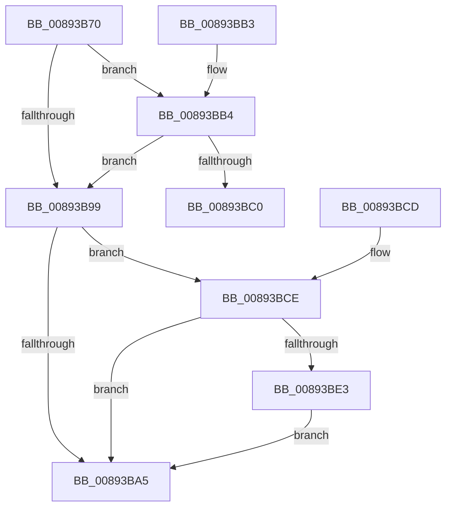

# ObReferenceProcessHandleTable

- RVA: `0x00893B70`–`0x00893BED` (길이 `125` bytes)
- VA: `0x0000000140893B70`
- 실행 섹션: `PAGE`
- PDB 이름 있음: `예`; PDB Function 태그: `아니요`
- unwind 정보 RVA: `0x0007DF14`
- 디코드: `39`개 명령, `125/125` bytes 표시
- 미해석 바이트: `0` (있으면 어셈블리에 `.byte`로 보존)

> 이 문서는 커널 이미지의 기계어와 PDB 기호를 분석해 생성했습니다. 4번과 5번은 함수 원형과 자료형을 바이너리 사용 방식에서 추정한 C 해석이며 원본 소스 복구 결과는 아닙니다.

## 1. Dependencies

- 직접 호출 지점: **2**; 고유 호출 대상: **2**
- 직접 호출자로 확인된 함수: **18**
- RIP 상대 이미지 참조: **0**

### Outgoing calls
- `0x00893BB7` → [ExfAcquireRundownProtection](../../text/34/ExfAcquireRundownProtection_function_0034C050.md) (function, `0x0034C050`)
- `0x00893BE6` → [ExfReleaseRundownProtection](../../text/34/ExfReleaseRundownProtection_function_00349EB0.md) (function, `0x00349EB0`)

### Direct callers
- [IoRevokeHandlesForProcess](../../text/59/IoRevokeHandlesForProcess_function_005981A8.md) at `0x005981EC`
- [PsSetProcessHandleTracingInformation](../78/PsSetProcessHandleTracingInformation_function_00781BB8.md) at `0x00781BCD`
- [EtwpObjectHandleRundown](../7C/EtwpObjectHandleRundown_function_007C047C.md) at `0x007C0491`
- [ObpCloseHandle](../86/ObpCloseHandle_function_008685B0.md) at `0x00868751`
- [NtClose](../86/NtClose_function_00868870.md) at `0x00868A2E`
- [ObWaitForMultipleObjects](../86/ObWaitForMultipleObjects_function_00868DF0.md) at `0x00869454`
- [ObCaptureObjectStateForDuplication](ObCaptureObjectStateForDuplication_function_00893684.md) at `0x008936D2`
- [ObCompleteObjectDuplication](ObCompleteObjectDuplication_function_0089387C.md) at `0x008938B2`
- [PspRundownSingleProcess](../90/PspRundownSingleProcess_function_00906D50.md) at `0x00907096`
- [IopQueryProcessIdsUsingFile](../91/IopQueryProcessIdsUsingFile_function_0091D7A0.md) at `0x0091D806`
- [ObFindHandleForObject](../91/ObFindHandleForObject_function_0091DA70.md) at `0x0091DA97`
- [ObInitProcess](../94/ObInitProcess_function_0094C62C.md) at `0x0094C6D6`
- [NtQueryInformationProcess](../9A/NtQueryInformationProcess_function_009AA250.md) at `0x009AABF5`
- [NtQueryInformationProcess](../9A/NtQueryInformationProcess_function_009AA250.md) at `0x009AC288`
- [NtQueryInformationProcess](../9A/NtQueryInformationProcess_function_009AA250.md) at `0x009AC36C`
- [NtQueryInformationProcess](../9A/NtQueryInformationProcess_function_009AA250.md) at `0x009AC582`
- [NtQueryInformationProcess](../9A/NtQueryInformationProcess_function_009AA250.md) at `0x009ADF23`
- [NtQueryInformationProcess](../9A/NtQueryInformationProcess_function_009AA250.md) at `0x009AE0A2`
- [ObSetHandleAttributes](../A0/ObSetHandleAttributes_function_00A03730.md) at `0x00A0392F`
- [ObQueryObjectAuditingByHandle](../A2/ObQueryObjectAuditingByHandle_function_00A22A20.md) at `0x00A22B34`
- [PspApplyMitigationOptions](../A6/PspApplyMitigationOptions_function_00A699AC.md) at `0x00A6A3EA`
- [PnpHandleEnumerateHandlesAgainstDeviceObject](../A9/PnpHandleEnumerateHandlesAgainstDeviceObject_function_00A9D7A8.md) at `0x00A9D7E9`
- [NtSetInformationProcess](../AE/NtSetInformationProcess_function_00AE5370.md) at `0x00AE7B1E`
- [NtSetInformationProcess](../AE/NtSetInformationProcess_function_00AE5370.md) at `0x00AE8AA9`
- [NtSetInformationProcess](../AE/NtSetInformationProcess_function_00AE5370.md) at `0x00AE9179`

### Static image references
- 디코드된 RIP-relative 메모리 참조가 없습니다.

## 2. Other-region calls and transfers

- 다른 실행 섹션으로 향하는 call: **2**
  - `0x00893BB7` → [ExfAcquireRundownProtection](../../text/34/ExfAcquireRundownProtection_function_0034C050.md) (`PAGE` → `.text`)
  - `0x00893BE6` → [ExfReleaseRundownProtection](../../text/34/ExfReleaseRundownProtection_function_00349EB0.md) (`PAGE` → `.text`)
- 별도 외부 분기/꼬리 이동을 확인하지 못했습니다.

## 3. Assembly (complete function range)

```asm
00893B70  48 89 5C 24 10                  mov qword ptr [rsp + 0x10], rbx
00893B75  57                              push rdi
00893B76  48 83 EC 20                     sub rsp, 0x20
00893B7A  48 8B F9                        mov rdi, rcx
00893B7D  48 8D 99 E8 01 00 00            lea rbx, [rcx + 0x1e8]
00893B84  0F 0D 0B                        prefetchw byte ptr [rbx]
00893B87  48 8B 03                        mov rax, qword ptr [rbx]
00893B8A  48 83 E0 FE                     and rax, 0xfffffffffffffffe
00893B8E  48 8D 50 02                     lea rdx, [rax + 2]
00893B92  F0 48 0F B1 13                  lock cmpxchg qword ptr [rbx], rdx
00893B97  75 1B                           jne 0x140893bb4
00893B99  48 8B BF 00 03 00 00            mov rdi, qword ptr [rdi + 0x300]
00893BA0  48 85 FF                        test rdi, rdi
00893BA3  74 29                           je 0x140893bce
00893BA5  48 8B C7                        mov rax, rdi
00893BA8  48 8B 5C 24 38                  mov rbx, qword ptr [rsp + 0x38]
00893BAD  48 83 C4 20                     add rsp, 0x20
00893BB1  5F                              pop rdi
00893BB2  C3                              ret
00893BB3  CC                              int3
00893BB4  48 8B CB                        mov rcx, rbx
00893BB7  E8 94 84 AB FF                  call 0x14034c050
00893BBC  84 C0                           test al, al
00893BBE  75 D9                           jne 0x140893b99
00893BC0  48 8B 5C 24 38                  mov rbx, qword ptr [rsp + 0x38]
00893BC5  33 C0                           xor eax, eax
00893BC7  48 83 C4 20                     add rsp, 0x20
00893BCB  5F                              pop rdi
00893BCC  C3                              ret
00893BCD  CC                              int3
00893BCE  0F 0D 0B                        prefetchw byte ptr [rbx]
00893BD1  48 8B 03                        mov rax, qword ptr [rbx]
00893BD4  48 83 E0 FE                     and rax, 0xfffffffffffffffe
00893BD8  48 8D 48 FE                     lea rcx, [rax - 2]
00893BDC  F0 48 0F B1 0B                  lock cmpxchg qword ptr [rbx], rcx
00893BE1  74 C2                           je 0x140893ba5
00893BE3  48 8B CB                        mov rcx, rbx
00893BE6  E8 C5 62 AB FF                  call 0x140349eb0
00893BEB  EB B8                           jmp 0x140893ba5
```

## 4. C-style interpretation (structured pseudocode)

```c
__int64 __fastcall ObReferenceProcessHandleTable(__int64 a1)
{
    __int64 result;
    __int64 v_rsp;
    unsigned __int64 v_stack_p10;
    unsigned __int64 v_stack_p38;

    v_stack_p10 = v_rbx;
    v_rsp = (v_rsp) - (32);
    result = (*(unsigned __int64 *)(a1 + 488)) & (-2);
    if (condition_is_not_equal) goto loc_00893BB4;
loc_00893B99:
    if (*(unsigned __int64 *)(a1 + 768) == 0) goto loc_00893BCE;
loc_00893BA5:
    v_rsp = (v_rsp) + (32);
    return *(unsigned __int64 *)(a1 + 768);
loc_00893BB4:
    result = ExfAcquireRundownProtection(v_stack_p10, result + 2, a3, a4);
    if ((unsigned __int8)(result) != 0) goto loc_00893B99;
    result = 0;
    v_rsp = (v_rsp) + (32);
    return result;
loc_00893BCE:
    result = (*(unsigned __int64 *)(v_stack_p38)) & (-2);
    if (condition_is_equal) goto loc_00893BA5;
    result = ExfReleaseRundownProtection(v_stack_p38, result + 2, a3, a4);
    goto loc_00893BA5;
}
```

## 5. (Beta) C Style

```c
int64_t ObReferenceProcessHandleTable(void *Arg1)
{
    uint8_t *arg1 = (uint8_t *)Arg1;

    int64_t result;
    int64_t local_rsp;
    uint64_t v_stack_p10;
    uint64_t v_stack_p38;

    v_stack_p10 = local_rbx;
    local_rsp = (local_rsp) - (32);
    result = (*(uint64_t *)(arg1 + 0x1E8)) & (-2);
    if (condition_is_not_equal) goto loc_00893BB4;
loc_00893B99:
    if (*(uint64_t *)(arg1 + 0x300) == 0) goto loc_00893BCE;
loc_00893BA5:
    local_rsp = (local_rsp) + (32);
    return *(uint64_t *)(arg1 + 0x300);
loc_00893BB4:
    result = ExfAcquireRundownProtection(v_stack_p10, result + 2, a3, a4);
    if ((uint8_t)(result) != 0) goto loc_00893B99;
    result = 0;
    local_rsp = (local_rsp) + (32);
    return result;
loc_00893BCE:
    result = (*(uint64_t *)(v_stack_p38)) & (-2);
    if (condition_is_equal) goto loc_00893BA5;
    result = ExfReleaseRundownProtection(v_stack_p38, result + 2, a3, a4);
    goto loc_00893BA5;
}
```

### 관측된 메모리 오프셋

구조체 형식이 확인되지 않은 접근은 인자 기준의 오프셋으로만 기록했습니다.

| 기준 인자 | 오프셋 표현 | 폭 (bit) | 접근 |
|---|---:|---:|---|
| `Arg1` | `+ 0x0` | `8` | `R` |
| `Arg1` | `+ 0x0` | `64` | `R` |
| `Arg1` | `+ 0x1E8` | `64` | `R` |
| `Arg1` | `+ 0x300` | `64` | `R` |

## 6. Execution-region graph

[열기: 2D/3D 그래프와 함수 탐색 컨트롤 패널](../../../control-panel.html?section=page&rva=0x00893B70&view=graph)

- 2D 그래프는 위에서 아래로 흐르고, 3D 그래프는 빈 공간을 드래그해 회전합니다. Shift+드래그는 이동, 휠은 확대·축소, 함수 노드 선택은 대상 보고서 이동입니다.

### Static fallback


