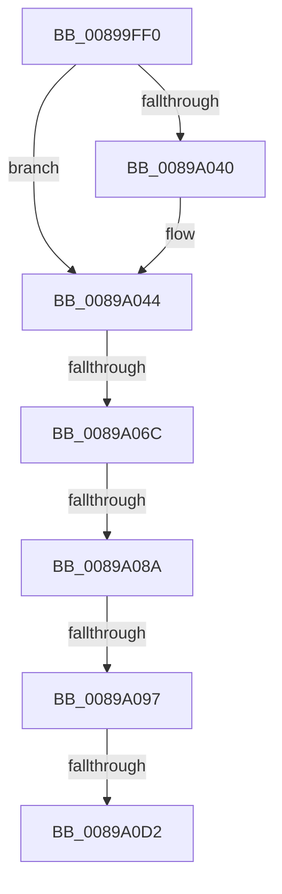

# ObpAllocateObject

- RVA: `0x00899FF0`–`0x0089A0DA` (길이 `234` bytes)
- VA: `0x0000000140899FF0`
- 실행 섹션: `PAGE`
- PDB 이름 있음: `예`; PDB Function 태그: `아니요`
- unwind 정보 RVA: `0x0007E57C`
- 디코드: `59`개 명령, `234/234` bytes 표시
- 미해석 바이트: `0` (있으면 어셈블리에 `.byte`로 보존)

> 이 문서는 커널 이미지의 기계어와 PDB 기호를 분석해 생성했습니다. 4번과 5번은 함수 원형과 자료형을 바이너리 사용 방식에서 추정한 C 해석이며 원본 소스 복구 결과는 아닙니다.

## 1. Dependencies

- 직접 호출 지점: **1**; 고유 호출 대상: **1**
- 직접 호출자로 확인된 함수: **10**
- RIP 상대 이미지 참조: **2**

### Outgoing calls
- `0x0089A02C` → [SeAuditHeaderRequired](../../text/41/SeAuditHeaderRequired_function_0041DEB0.md) (function, `0x0041DEB0`)

### Direct callers
- [ObCreateObject](../87/ObCreateObject_function_00872CB0.md) at `0x00872DF1`
- [IopAllocRealFileObject](IopAllocRealFileObject_function_00899720.md) at `0x0089988A`
- [ObCreateObjectEx](ObCreateObjectEx_function_0089B1E0.md) at `0x0089B328`
- [NtCreateEvent](../8B/NtCreateEvent_function_008B9140.md) at `0x008B92B7`
- [sub_008C2328](../8C/Unknown_function_008C2328.md) at `0x008C2670`
- [NtCreateSemaphore](../8C/NtCreateSemaphore_function_008C38D0.md) at `0x008C3A4C`
- [sub_008C3C89](../8C/Unknown_function_008C3C89.md) at `0x008C3DA4`
- [NtCreateMutant](../8C/NtCreateMutant_function_008C43D0.md) at `0x008C451E`
- [NtCreateWaitCompletionPacket](../8C/NtCreateWaitCompletionPacket_function_008C4700.md) at `0x008C4850`
- [ObCreateObjectTypeEx](../AB/ObCreateObjectTypeEx_function_00AB46D0.md) at `0x00AB4956`

### Static image references
- `0x0089A053` → RVA `0x00FC6AB0` (`ALMOSTRO`; read)
- `0x0089A07D` → RVA `0x00FC6B70` (`ALMOSTRO`; read)

## 2. Other-region calls and transfers

- 다른 실행 섹션으로 향하는 call: **1**
  - `0x0089A02C` → [SeAuditHeaderRequired](../../text/41/SeAuditHeaderRequired_function_0041DEB0.md) (`PAGE` → `.text`)
- call이 아닌 외부 분기/꼬리 이동: **4**
  - `0x0089A066` → [sub_0089A354](Unknown_function_0089A354.md) (`tail-transfer`)
  - `0x0089A084` → [sub_0089A354](Unknown_function_0089A354.md) (`tail-transfer`)
  - `0x0089A091` → [sub_0089A354](Unknown_function_0089A354.md) (`tail-transfer`)
  - `0x0089A0CC` → [sub_0089A354 + 0xD](Unknown_function_0089A354.md) (`tail-transfer`)

## 3. Assembly (complete function range)

```asm
00899FF0  4C 89 4C 24 20                  mov qword ptr [rsp + 0x20], r9
00899FF5  88 54 24 10                     mov byte ptr [rsp + 0x10], dl
00899FF9  53                              push rbx
00899FFA  55                              push rbp
00899FFB  56                              push rsi
00899FFC  57                              push rdi
00899FFD  41 56                           push r14
00899FFF  41 57                           push r15
0089A001  48 83 EC 48                     sub rsp, 0x48
0089A005  8B 31                           mov esi, dword ptr [rcx]
0089A007  49 8B D8                        mov rbx, r8
0089A00A  83 E6 20                        and esi, 0x20
0089A00D  4C 8B F9                        mov r15, rcx
0089A010  8B C6                           mov eax, esi
0089A012  48 8B CB                        mov rcx, rbx
0089A015  F7 D8                           neg eax
0089A017  4D 8B F1                        mov r14, r9
0089A01A  8B C6                           mov eax, esi
0089A01C  45 1B D2                        sbb r10d, r10d
0089A01F  41 83 E2 10                     and r10d, 0x10
0089A023  F7 D8                           neg eax
0089A025  45 1A C0                        sbb r8b, r8b
0089A028  41 80 E0 10                     and r8b, 0x10
0089A02C  E8 7F 3E B8 FF                  call 0x14041deb0
0089A031  88 84 24 80 00 00 00            mov byte ptr [rsp + 0x80], al
0089A038  44 0F B6 D8                     movzx r11d, al
0089A03C  84 C0                           test al, al
0089A03E  74 04                           je 0x14089a044
0089A040  41 80 C8 20                     or r8b, 0x20
0089A044  65 48 8B 0C 25 88 01 00 00      mov rcx, qword ptr gs:[0x188]
0089A04D  41 B9 20 00 00 00               mov r9d, 0x20
0089A053  48 8B 05 56 CA 72 00            mov rax, qword ptr [rip + 0x72ca56]
0089A05A  44 89 4C 24 24                  mov dword ptr [rsp + 0x24], r9d
0089A05F  48 39 81 B8 00 00 00            cmp qword ptr [rcx + 0xb8], rax
0089A066  0F 84 E8 02 00 00               je 0x14089a354
0089A06C  65 48 8B 0C 25 88 01 00 00      mov rcx, qword ptr gs:[0x188]
0089A075  48 83 3D 33 CA 72 00 00         cmp qword ptr [rip + 0x72ca33], 0
0089A07D  48 8B 05 EC CA 72 00            mov rax, qword ptr [rip + 0x72caec]
0089A084  0F 84 CA 02 00 00               je 0x14089a354
0089A08A  48 39 81 B8 00 00 00            cmp qword ptr [rcx + 0xb8], rax
0089A091  0F 84 BD 02 00 00               je 0x14089a354
0089A097  44 89 4C 24 20                  mov dword ptr [rsp + 0x20], r9d
0089A09C  41 80 C8 08                     or r8b, 8
0089A0A0  0F B6 6B 42                     movzx ebp, byte ptr [rbx + 0x42]
0089A0A4  41 0F B6 C0                     movzx eax, r8b
0089A0A8  0C 04                           or al, 4
0089A0AA  40 0F B6 FD                     movzx edi, bpl
0089A0AE  0F B6 C8                        movzx ecx, al
0089A0B1  40 80 E7 10                     and dil, 0x10
0089A0B5  41 0F B6 C0                     movzx eax, r8b
0089A0B9  0F 44 C8                        cmove ecx, eax
0089A0BC  40 0F B6 C7                     movzx eax, dil
0089A0C0  F6 D8                           neg al
0089A0C2  1B D2                           sbb edx, edx
0089A0C4  83 E2 10                        and edx, 0x10
0089A0C7  66 41 83 3E 00                  cmp word ptr [r14], 0
0089A0CC  0F 85 8F 02 00 00               jne 0x14089a361
0089A0D2  45 33 C9                        xor r9d, r9d
0089A0D5  44 89 4C 24 24                  mov dword ptr [rsp + 0x24], r9d
```

## 4. C-style interpretation (structured pseudocode)

```c
__int64 __fastcall ObpAllocateObject(__int64 a1, int a2, __int64 a3, __int64 a4)
{
    __int64 result;
    __int64 v_r10;
    __int64 v_rdi;
    __int64 v_rsi;
    __int64 v_rsp;
    unsigned int v_stack_m54;
    unsigned int v_stack_m58;
    unsigned __int8 v_stack_p10;
    unsigned __int64 v_stack_p20;
    unsigned __int8 v_stack_p8;

    v_stack_p20 = a4;
    v_stack_p10 = (unsigned __int8)(a2);
    v_rsp = (v_rsp) - (72);
    v_rsi = (unsigned int)(((unsigned int)(*(unsigned int *)(a1))) & (32));
    result = (unsigned int)(-((unsigned int)((unsigned int)(v_rsi))));
    v_r10 = (unsigned int)((v_r10) & (16));
    result = (unsigned int)(-((unsigned int)((unsigned int)(v_rsi))));
    a3 = (unsigned __int8)((a3) & (16));
    result = SeAuditHeaderRequired(a3, a2, a3, a4);
    v_stack_p8 = (unsigned __int8)(result);
    if ((unsigned __int8)(result) != 0) {
        a3 = (unsigned __int8)((a3) | (32));
    }
    v_stack_m54 = 32;
    v_stack_m58 = 32;
    a3 = (unsigned __int8)((a3) | (8));
    result = (unsigned __int8)(((unsigned __int8)(a3)) | (4));
    v_rdi = (unsigned __int8)(((unsigned __int8)(*(unsigned __int8 *)(a3 + 66))) & (16));
    a1 = (unsigned __int8)(result);
    if (condition_is_equal) { a1 = (unsigned int)((unsigned __int8)(a3)); }
    result = (unsigned __int8)(-((unsigned __int8)(v_rdi)));
    a2 = (unsigned int)((a2) & (16));
    a4 = 0;
    v_stack_m54 = 0;
    return result;
}
```

## 5. (Beta) C Style

```c
int64_t ObpAllocateObject(void *Arg1, int32_t Arg2, void *Arg3, void *Arg4)
{
    uint8_t *arg1 = (uint8_t *)Arg1;
    uint8_t *arg3 = (uint8_t *)Arg3;
    uint8_t *arg4 = (uint8_t *)Arg4;

    int64_t result;
    int64_t local_r10;
    int64_t local_rdi;
    int64_t local_rsi;
    int64_t local_rsp;
    uint32_t v_stack_m54;
    uint32_t v_stack_m58;
    uint8_t v_stack_p10;
    uint64_t v_stack_p20;
    uint8_t v_stack_p8;

    v_stack_p20 = Arg4;
    v_stack_p10 = (uint8_t)(Arg2);
    local_rsp = (local_rsp) - (72);
    local_rsi = (uint32_t)(((uint32_t)(*(uint32_t *)(arg1))) & (32));
    result = (uint32_t)(-((uint32_t)((uint32_t)(local_rsi))));
    local_r10 = (uint32_t)((local_r10) & (16));
    result = (uint32_t)(-((uint32_t)((uint32_t)(local_rsi))));
    Arg3 = (uint8_t)((Arg3) & (16));
    result = SeAuditHeaderRequired(Arg3, Arg2, Arg3, Arg4);
    v_stack_p8 = (uint8_t)(result);
    if ((uint8_t)(result) != 0) {
        Arg3 = (uint8_t)((Arg3) | (32));
    }
    v_stack_m54 = 32;
    v_stack_m58 = 32;
    Arg3 = (uint8_t)((Arg3) | (8));
    result = (uint8_t)(((uint8_t)(Arg3)) | (4));
    local_rdi = (uint8_t)(((uint8_t)(*(uint8_t *)(arg3 + 0x42))) & (16));
    Arg1 = (uint8_t)(result);
    if (condition_is_equal) { Arg1 = (uint32_t)((uint8_t)(Arg3)); }
    result = (uint8_t)(-((uint8_t)(local_rdi)));
    Arg2 = (uint32_t)((Arg2) & (16));
    Arg4 = 0;
    v_stack_m54 = 0;
    return result;
}
```

### 관측된 메모리 오프셋

구조체 형식이 확인되지 않은 접근은 인자 기준의 오프셋으로만 기록했습니다.

| 기준 인자 | 오프셋 표현 | 폭 (bit) | 접근 |
|---|---:|---:|---|
| `Arg1` | `+ 0x0` | `32` | `R` |
| `Arg3` | `+ 0x42` | `8` | `R` |
| `Arg4` | `+ 0x0` | `16` | `R` |

## 6. Execution-region graph

[열기: 2D/3D 그래프와 함수 탐색 컨트롤 패널](../../../control-panel.html?section=page&rva=0x00899FF0&view=graph)

- 2D 그래프는 위에서 아래로 흐르고, 3D 그래프는 빈 공간을 드래그해 회전합니다. Shift+드래그는 이동, 휠은 확대·축소, 함수 노드 선택은 대상 보고서 이동입니다.

### Static fallback


