# ObpCaptureObjectCreateInformation

- RVA: `0x0089B930`–`0x0089BC2E` (길이 `766` bytes)
- VA: `0x000000014089B930`
- 실행 섹션: `PAGE`
- PDB 이름 있음: `예`; PDB Function 태그: `아니요`
- unwind 정보 RVA: `0x0007E76C`
- 디코드: `204`개 명령, `766/766` bytes 표시
- 미해석 바이트: `0` (있으면 어셈블리에 `.byte`로 보존)

> 이 문서는 커널 이미지의 기계어와 PDB 기호를 분석해 생성했습니다. 4번과 5번은 함수 원형과 자료형을 바이너리 사용 방식에서 추정한 C 해석이며 원본 소스 복구 결과는 아닙니다.

## 1. Dependencies

- 직접 호출 지점: **4**; 고유 호출 대상: **4**
- 직접 호출자로 확인된 함수: **11**
- RIP 상대 이미지 참조: **0**

### Outgoing calls
- `0x0089BA84` → [ExRaiseDatatypeMisalignment](ExRaiseDatatypeMisalignment_function_00899FD0.md) (function, `0x00899FD0`)
- `0x0089BAF7` → [ObpCaptureObjectName](ObpCaptureObjectName_function_0089BC40.md) (function, `0x0089BC40`)
- `0x0089BB68` → [ExFreePoolWithTag](../../poolcode/B8/ExFreePoolWithTag_function_00B82870.md) (function, `0x00B82870`)
- `0x0089BB90` → [SeCaptureSecurityDescriptor](../92/SeCaptureSecurityDescriptor_function_00929F40.md) (function, `0x00929F40`)

### Direct callers
- [ObCreateObject](../87/ObCreateObject_function_00872CB0.md) at `0x00872D8A`
- [IopAllocRealFileObject](IopAllocRealFileObject_function_00899720.md) at `0x0089982E`
- [sub_0089A903](Unknown_function_0089A903.md) at `0x0089A99E`
- [ObCreateObjectEx](ObCreateObjectEx_function_0089B1E0.md) at `0x0089B2BE`
- [NtCreateEvent](../8B/NtCreateEvent_function_008B9140.md) at `0x008B925B`
- [ObReferenceObjectByNameEx](../8B/ObReferenceObjectByNameEx_function_008BD524.md) at `0x008BD615`
- [sub_008C2328](../8C/Unknown_function_008C2328.md) at `0x008C261C`
- [NtCreateSemaphore](../8C/NtCreateSemaphore_function_008C38D0.md) at `0x008C39F4`
- [sub_008C3C89](../8C/Unknown_function_008C3C89.md) at `0x008C3D47`
- [NtCreateMutant](../8C/NtCreateMutant_function_008C43D0.md) at `0x008C44C7`
- [NtCreateWaitCompletionPacket](../8C/NtCreateWaitCompletionPacket_function_008C4700.md) at `0x008C47F9`

### Static image references
- 디코드된 RIP-relative 메모리 참조가 없습니다.

## 2. Other-region calls and transfers

- 다른 실행 섹션으로 향하는 call: **1**
  - `0x0089BB68` → [ExFreePoolWithTag](../../poolcode/B8/ExFreePoolWithTag_function_00B82870.md) (`PAGE` → `POOLCODE`)
- 별도 외부 분기/꼬리 이동을 확인하지 못했습니다.

## 3. Assembly (complete function range)

```asm
0089B930  48 89 5C 24 08                  mov qword ptr [rsp + 8], rbx
0089B935  48 89 74 24 10                  mov qword ptr [rsp + 0x10], rsi
0089B93A  57                              push rdi
0089B93B  41 54                           push r12
0089B93D  41 55                           push r13
0089B93F  41 56                           push r14
0089B941  41 57                           push r15
0089B943  48 81 EC 80 00 00 00            sub rsp, 0x80
0089B94A  49 8B F1                        mov rsi, r9
0089B94D  0F B6 F9                        movzx edi, cl
0089B950  0F 57 C0                        xorps xmm0, xmm0
0089B953  41 0F 11 01                     movups xmmword ptr [r9], xmm0
0089B957  0F 57 C9                        xorps xmm1, xmm1
0089B95A  48 8B 9C 24 D0 00 00 00         mov rbx, qword ptr [rsp + 0xd0]
0089B962  0F 11 0B                        movups xmmword ptr [rbx], xmm1
0089B965  0F 11 4B 10                     movups xmmword ptr [rbx + 0x10], xmm1
0089B969  0F 11 4B 20                     movups xmmword ptr [rbx + 0x20], xmm1
0089B96D  0F 11 4B 30                     movups xmmword ptr [rbx + 0x30], xmm1
0089B971  4D 85 C0                        test r8, r8
0089B974  0F 84 89 01 00 00               je 0x14089bb03
0089B97A  4C 8D 6B 10                     lea r13, [rbx + 0x10]
0089B97E  4C 89 6C 24 60                  mov qword ptr [rsp + 0x60], r13
0089B983  41 88 4D 00                     mov byte ptr [r13], cl
0089B987  84 C9                           test cl, cl
0089B989  0F 85 CB 00 00 00               jne 0x14089ba5a
0089B98F  49 B9 00 00 FF FF FF 7F 00 00   movabs r9, 0x7fffffff0000
0089B999  41 83 38 30                     cmp dword ptr [r8], 0x30
0089B99D  0F 85 A7 00 00 00               jne 0x14089ba4a
0089B9A3  49 8B 40 08                     mov rax, qword ptr [r8 + 8]
0089B9A7  48 89 43 08                     mov qword ptr [rbx + 8], rax
0089B9AB  41 8B 40 18                     mov eax, dword ptr [r8 + 0x18]
0089B9AF  89 44 24 38                     mov dword ptr [rsp + 0x38], eax
0089B9B3  90                              nop
0089B9B4  84 D2                           test dl, dl
0089B9B6  74 08                           je 0x14089b9c0
0089B9B8  0F BA F0 09                     btr eax, 9
0089B9BC  89 44 24 38                     mov dword ptr [rsp + 0x38], eax
0089B9C0  A9 0D E0 FE FF                  test eax, 0xfffee00d
0089B9C5  0F 85 BF 00 00 00               jne 0x14089ba8a
0089B9CB  89 03                           mov dword ptr [rbx], eax
0089B9CD  4D 8B 78 10                     mov r15, qword ptr [r8 + 0x10]
0089B9D1  4C 89 7C 24 48                  mov qword ptr [rsp + 0x48], r15
0089B9D6  49 8B 48 20                     mov rcx, qword ptr [r8 + 0x20]
0089B9DA  48 89 4C 24 50                  mov qword ptr [rsp + 0x50], rcx
0089B9DF  4D 8B 70 28                     mov r14, qword ptr [r8 + 0x28]
0089B9E3  4C 89 74 24 40                  mov qword ptr [rsp + 0x40], r14
0089B9E8  90                              nop
0089B9E9  4D 85 F6                        test r14, r14
0089B9EC  0F 84 C5 00 00 00               je 0x14089bab7
0089B9F2  40 84 FF                        test dil, dil
0089B9F5  74 40                           je 0x14089ba37
0089B9F7  65 48 8B 04 25 88 01 00 00      mov rax, qword ptr gs:[0x188]
0089BA00  48 89 44 24 70                  mov qword ptr [rsp + 0x70], rax
0089BA05  0F B6 80 32 02 00 00            movzx eax, byte ptr [rax + 0x232]
0089BA0C  88 44 24 31                     mov byte ptr [rsp + 0x31], al
0089BA10  84 C0                           test al, al
0089BA12  74 14                           je 0x14089ba28
0089BA14  48 8B 44 24 40                  mov rax, qword ptr [rsp + 0x40]
0089BA19  A8 03                           test al, 3
0089BA1B  75 67                           jne 0x14089ba84
0089BA1D  49 3B C1                        cmp rax, r9
0089BA20  49 0F 43 C1                     cmovae rax, r9
0089BA24  90                              nop
0089BA25  0F B6 00                        movzx eax, byte ptr [rax]
0089BA28  4C 8B 74 24 40                  mov r14, qword ptr [rsp + 0x40]
0089BA2D  48 8B 4C 24 50                  mov rcx, qword ptr [rsp + 0x50]
0089BA32  4C 8B 7C 24 48                  mov r15, qword ptr [rsp + 0x48]
0089BA37  F2 41 0F 10 06                  movsd xmm0, qword ptr [r14]
0089BA3C  F2 0F 11 43 30                  movsd qword ptr [rbx + 0x30], xmm0
0089BA41  41 8B 46 08                     mov eax, dword ptr [r14 + 8]
0089BA45  89 43 38                        mov dword ptr [rbx + 0x38], eax
0089BA48  EB 6D                           jmp 0x14089bab7
0089BA4A  41 BC 0D 00 00 C0               mov r12d, 0xc000000d
0089BA50  44 89 64 24 34                  mov dword ptr [rsp + 0x34], r12d
0089BA55  E9 FC 00 00 00                  jmp 0x14089bb56
0089BA5A  65 48 8B 04 25 88 01 00 00      mov rax, qword ptr gs:[0x188]
0089BA63  48 89 44 24 68                  mov qword ptr [rsp + 0x68], rax
0089BA68  0F B6 80 32 02 00 00            movzx eax, byte ptr [rax + 0x232]
0089BA6F  88 84 24 C0 00 00 00            mov byte ptr [rsp + 0xc0], al
0089BA76  84 C0                           test al, al
0089BA78  0F 84 11 FF FF FF               je 0x14089b98f
0089BA7E  41 F6 C0 07                     test r8b, 7
0089BA82  74 16                           je 0x14089ba9a
0089BA84  E8 47 E5 FF FF                  call 0x140899fd0
0089BA89  CC                              int3
0089BA8A  41 BC 0D 00 00 C0               mov r12d, 0xc000000d
0089BA90  44 89 64 24 34                  mov dword ptr [rsp + 0x34], r12d
0089BA95  E9 BC 00 00 00                  jmp 0x14089bb56
0089BA9A  49 B9 00 00 FF FF FF 7F 00 00   movabs r9, 0x7fffffff0000
0089BAA4  49 8B C1                        mov rax, r9
0089BAA7  4D 3B C1                        cmp r8, r9
0089BAAA  49 0F 42 C0                     cmovb rax, r8
0089BAAE  90                              nop
0089BAAF  0F B6 00                        movzx eax, byte ptr [rax]
0089BAB2  E9 E2 FE FF FF                  jmp 0x14089b999
0089BAB7  EB 19                           jmp 0x14089bad2
0089BAB9  44 8B E0                        mov r12d, eax
0089BABC  89 44 24 34                     mov dword ptr [rsp + 0x34], eax
0089BAC0  48 8B 9C 24 D0 00 00 00         mov rbx, qword ptr [rsp + 0xd0]
0089BAC8  4C 8B 6C 24 60                  mov r13, qword ptr [rsp + 0x60]
0089BACD  E9 84 00 00 00                  jmp 0x14089bb56
0089BAD2  48 85 C9                        test rcx, rcx
0089BAD5  0F 85 9F 00 00 00               jne 0x14089bb7a
0089BADB  4D 85 F6                        test r14, r14
0089BADE  75 52                           jne 0x14089bb32
0089BAE0  4D 85 FF                        test r15, r15
0089BAE3  74 3E                           je 0x14089bb23
0089BAE5  44 8B 8C 24 D8 00 00 00         mov r9d, dword ptr [rsp + 0xd8]
0089BAED  4C 8B C6                        mov r8, rsi
0089BAF0  49 8B D7                        mov rdx, r15
0089BAF3  40 0F B6 CF                     movzx ecx, dil
0089BAF7  E8 44 01 00 00                  call 0x14089bc40
0089BAFC  44 8B E0                        mov r12d, eax
0089BAFF  85 C0                           test eax, eax
0089BB01  78 53                           js 0x14089bb56
0089BB03  33 C0                           xor eax, eax
0089BB05  4C 8D 9C 24 80 00 00 00         lea r11, [rsp + 0x80]
0089BB0D  49 8B 5B 30                     mov rbx, qword ptr [r11 + 0x30]
0089BB11  49 8B 73 38                     mov rsi, qword ptr [r11 + 0x38]
0089BB15  49 8B E3                        mov rsp, r11
0089BB18  41 5F                           pop r15
0089BB1A  41 5E                           pop r14
0089BB1C  41 5D                           pop r13
0089BB1E  41 5C                           pop r12
0089BB20  5F                              pop rdi
0089BB21  C3                              ret
0089BB22  CC                              int3
0089BB23  48 83 7B 08 00                  cmp qword ptr [rbx + 8], 0
0089BB28  74 D9                           je 0x14089bb03
0089BB2A  41 BC 33 00 00 C0               mov r12d, 0xc0000033
0089BB30  EB 24                           jmp 0x14089bb56
0089BB32  48 8D 43 30                     lea rax, [rbx + 0x30]
0089BB36  C7 00 0C 00 00 00               mov dword ptr [rax], 0xc
0089BB3C  48 89 43 28                     mov qword ptr [rbx + 0x28], rax
0089BB40  80 78 08 02                     cmp byte ptr [rax + 8], 2
0089BB44  0F 83 D3 00 00 00               jae 0x14089bc1d
0089BB4A  83 78 04 03                     cmp dword ptr [rax + 4], 3
0089BB4E  76 90                           jbe 0x14089bae0
0089BB50  41 BC A5 00 00 C0               mov r12d, 0xc00000a5
0089BB56  48 8B 4B 20                     mov rcx, qword ptr [rbx + 0x20]
0089BB5A  48 85 C9                        test rcx, rcx
0089BB5D  74 16                           je 0x14089bb75
0089BB5F  41 80 7D 00 01                  cmp byte ptr [r13], 1
0089BB64  77 07                           ja 0x14089bb6d
0089BB66  33 D2                           xor edx, edx
0089BB68  E8 03 6D 2E 00                  call 0x140b82870
0089BB6D  48 C7 43 20 00 00 00 00         mov qword ptr [rbx + 0x20], 0
0089BB75  41 8B C4                        mov eax, r12d
0089BB78  EB 8B                           jmp 0x14089bb05
0089BB7A  48 8D 43 20                     lea rax, [rbx + 0x20]
0089BB7E  48 89 44 24 20                  mov qword ptr [rsp + 0x20], rax
0089BB83  41 B1 01                        mov r9b, 1
0089BB86  41 B8 01 00 00 00               mov r8d, 1
0089BB8C  40 0F B6 D7                     movzx edx, dil
0089BB90  E8 AB E3 08 00                  call 0x140929f40
0089BB95  44 8B E0                        mov r12d, eax
0089BB98  85 C0                           test eax, eax
0089BB9A  78 61                           js 0x14089bbfd
0089BB9C  48 8B 43 20                     mov rax, qword ptr [rbx + 0x20]
0089BBA0  33 C9                           xor ecx, ecx
0089BBA2  80 38 01                        cmp byte ptr [rax], 1
0089BBA5  75 4E                           jne 0x14089bbf5
0089BBA7  0F B7 50 02                     movzx edx, word ptr [rax + 2]
0089BBAB  66 85 D2                        test dx, dx
0089BBAE  79 63                           jns 0x14089bc13
0089BBB0  44 8B 40 08                     mov r8d, dword ptr [rax + 8]
0089BBB4  45 85 C0                        test r8d, r8d
0089BBB7  74 51                           je 0x14089bc0a
0089BBB9  4C 03 C0                        add r8, rax
0089BBBC  F6 C2 04                        test dl, 4
0089BBBF  74 4E                           je 0x14089bc0f
0089BBC1  66 85 D2                        test dx, dx
0089BBC4  79 62                           jns 0x14089bc28
0089BBC6  8B 50 10                        mov edx, dword ptr [rax + 0x10]
0089BBC9  85 D2                           test edx, edx
0089BBCB  74 4C                           je 0x14089bc19
0089BBCD  48 03 D0                        add rdx, rax
0089BBD0  4D 85 C0                        test r8, r8
0089BBD3  74 0F                           je 0x14089bbe4
0089BBD5  41 0F B6 40 01                  movzx eax, byte ptr [r8 + 1]
0089BBDA  8D 0C 85 0B 00 00 00            lea ecx, [rax*4 + 0xb]
0089BBE1  83 E1 FC                        and ecx, 0xfffffffc
0089BBE4  48 85 D2                        test rdx, rdx
0089BBE7  74 0C                           je 0x14089bbf5
0089BBE9  0F B7 42 02                     movzx eax, word ptr [rdx + 2]
0089BBED  83 C0 03                        add eax, 3
0089BBF0  83 E0 FC                        and eax, 0xfffffffc
0089BBF3  03 C8                           add ecx, eax
0089BBF5  89 4B 1C                        mov dword ptr [rbx + 0x1c], ecx
0089BBF8  E9 DE FE FF FF                  jmp 0x14089badb
0089BBFD  48 C7 43 20 00 00 00 00         mov qword ptr [rbx + 0x20], 0
0089BC05  E9 4C FF FF FF                  jmp 0x14089bb56
0089BC0A  45 33 C0                        xor r8d, r8d
0089BC0D  EB AD                           jmp 0x14089bbbc
0089BC0F  33 D2                           xor edx, edx
0089BC11  EB BD                           jmp 0x14089bbd0
0089BC13  4C 8B 40 10                     mov r8, qword ptr [rax + 0x10]
0089BC17  EB A3                           jmp 0x14089bbbc
0089BC19  33 D2                           xor edx, edx
0089BC1B  EB B3                           jmp 0x14089bbd0
0089BC1D  41 BC 0D 00 00 C0               mov r12d, 0xc000000d
0089BC23  E9 2E FF FF FF                  jmp 0x14089bb56
0089BC28  48 8B 50 20                     mov rdx, qword ptr [rax + 0x20]
0089BC2C  EB A2                           jmp 0x14089bbd0
```

## 4. C-style interpretation (structured pseudocode)

```c
__int64 __fastcall ObpCaptureObjectCreateInformation(unsigned __int8 a1, unsigned __int8 a2, __int64 a3, __int64 a4, __int64 a5, unsigned int a6)
{
    __int64 result;
    __int64 v_rsp;
    unsigned __int64 v_stack_m28;
    unsigned __int64 v_stack_m38;
    unsigned __int64 v_stack_m40;
    unsigned __int64 v_stack_m48;
    unsigned __int64 v_stack_m58;
    unsigned __int64 v_stack_m60;
    unsigned __int64 v_stack_m68;
    unsigned int v_stack_m70;
    unsigned int v_stack_m74;
    unsigned __int8 v_stack_m77;
    unsigned __int64 v_stack_p10;
    unsigned __int8 v_stack_p18;
    unsigned __int64 v_stack_p28;
    unsigned __int64 v_stack_p8;

    v_stack_p8 = v_rbx;
    v_stack_p10 = v_rsi;
    v_rsp = (v_rsp) - (128);
    *(unsigned __int64 *)(a4) = v_xmm0;
    *(unsigned __int64 *)(a5) = v_xmm1;
    *(unsigned __int64 *)(a5 + 16) = v_xmm1;
    *(unsigned __int64 *)(a5 + 32) = v_xmm1;
    *(unsigned __int64 *)(a5 + 48) = v_xmm1;
    if (a3 == 0) goto loc_0089BB03;
    v_stack_m48 = a5 + 16;
    *(unsigned __int8 *)(a5 + 16) = a1;
    if (a1 != 0) goto loc_0089BA5A;
loc_0089B98F:
loc_0089B999:
    if ((*(unsigned int *)(a3)) != 48) goto loc_0089BA4A;
    *(unsigned __int64 *)(a5 + 8) = *(unsigned __int64 *)(a3 + 8);
    v_stack_m70 = (unsigned int)((unsigned int)(*(unsigned int *)(a3 + 24)));
    if (a2 != 0) {
        v_stack_m70 = (unsigned int)((unsigned int)(*(unsigned int *)(a3 + 24)));
    }
    if ((((unsigned int)((unsigned int)(*(unsigned int *)(a3 + 24)))) & (0xFFFEE00DULL)) != 0) goto loc_0089BA8A;
    *(unsigned int *)(a5) = (unsigned int)((unsigned int)(*(unsigned int *)(a3 + 24)));
    v_stack_m60 = *(unsigned __int64 *)(a3 + 16);
    v_stack_m58 = *(unsigned __int64 *)(a3 + 32);
    v_stack_m68 = *(unsigned __int64 *)(a3 + 40);
    if (*(unsigned __int64 *)(a3 + 40) == 0) goto loc_0089BAB7;
    if (a1 == 0) goto loc_0089BA37;
    v_stack_m38 = *(unsigned __int64 *)(gs_base + (0 + 392));
    v_stack_m77 = (unsigned __int8)(*(unsigned __int8 *)(*(unsigned __int64 *)(gs_base + (0 + 392)) + 562));
    if ((unsigned __int8)(*(unsigned __int8 *)(*(unsigned __int64 *)(gs_base + (0 + 392)) + 562)) == 0) goto loc_0089BA28;
    if ((((unsigned __int8)(v_stack_m68)) & (3)) != 0) goto loc_0089BA84;
    result = v_stack_m68;
    if (v_stack_m68 >= a4) { result = a4; }
loc_0089BA28:
loc_0089BA37:
    *(unsigned __int64 *)(a5 + 48) = v_xmm0;
    *(unsigned int *)(a5 + 56) = (unsigned int)((unsigned int)(*(unsigned int *)(v_stack_m68 + 8)));
    goto loc_0089BAB7;
loc_0089BA4A:
    v_stack_m74 = (unsigned int)((unsigned int)(0xC000000DULL));
    goto loc_0089BB56;
loc_0089BA5A:
    v_stack_m40 = *(unsigned __int64 *)(gs_base + (0 + 392));
    v_stack_p18 = (unsigned __int8)(*(unsigned __int8 *)(*(unsigned __int64 *)(gs_base + (0 + 392)) + 562));
    if ((unsigned __int8)(*(unsigned __int8 *)(*(unsigned __int64 *)(gs_base + (0 + 392)) + 562)) == 0) goto loc_0089B98F;
    if ((((unsigned __int8)(a3)) & (7)) == 0) goto loc_0089BA9A;
loc_0089BA84:
    result = ExRaiseDatatypeMisalignment(v_stack_m58, a2, a3, a4);
loc_0089BA8A:
    v_stack_m74 = (unsigned int)((unsigned int)(0xC000000DULL));
    goto loc_0089BB56;
loc_0089BA9A:
    if (a3 < a4) { a4 = a3; }
    goto loc_0089B999;
loc_0089BAB7:
    goto loc_0089BAD2;
loc_0089BAD2:
    if (v_stack_m58 != 0) goto loc_0089BB7A;
loc_0089BADB:
    if (v_stack_m68 != 0) goto loc_0089BB32;
loc_0089BAE0:
    if (v_stack_m60 == 0) goto loc_0089BB23;
    result = ObpCaptureObjectName(a1, v_stack_m60, a4, (unsigned int)(a6));
    if (sign_flag) goto loc_0089BB56;
loc_0089BB03:
    result = 0;
loc_0089BB05:
    return result;
loc_0089BB23:
    if ((*(unsigned __int64 *)(*(unsigned __int64 *)(v_stack_m28 + 48) + 8)) == 0) goto loc_0089BB03;
    goto loc_0089BB56;
loc_0089BB32:
    *(unsigned int *)(*(unsigned __int64 *)(v_stack_m28 + 48) + 48) = 12;
    *(unsigned __int64 *)(*(unsigned __int64 *)(v_stack_m28 + 48) + 40) = *(unsigned __int64 *)(v_stack_m28 + 48) + 48;
    if ((*(unsigned __int8 *)(*(unsigned __int64 *)(v_stack_m28 + 48) + 48 + 8)) >= 2) goto loc_0089BC1D;
    if ((*(unsigned int *)(*(unsigned __int64 *)(v_stack_m28 + 48) + 48 + 4)) <= 3) goto loc_0089BAE0;
loc_0089BB56:
    if (*(unsigned __int64 *)(*(unsigned __int64 *)(v_stack_m28 + 48) + 32) == 0) goto loc_0089BB75;
    result = *(unsigned __int64 *)(v_stack_m28 + 48) + 48;
    if ((*(unsigned __int8 *)(a5 + 16)) <= 1) {
        a2 = 0;
        result = ExFreePoolWithTag(*(unsigned __int64 *)(*(unsigned __int64 *)(v_stack_m28 + 48) + 32), a2, a4, (unsigned int)(a6));
    }
    *(unsigned __int64 *)(*(unsigned __int64 *)(v_stack_m28 + 48) + 32) = 0;
loc_0089BB75:
    goto loc_0089BB05;
loc_0089BB7A:
    v_stack_m60 = *(unsigned __int64 *)(v_stack_m28 + 48) + 32;
    result = SeCaptureSecurityDescriptor(*(unsigned __int64 *)(*(unsigned __int64 *)(v_stack_m28 + 48) + 32), a1, 1, 1);
    if (sign_flag) goto loc_0089BBFD;
    a1 = 0;
    if ((*(unsigned __int8 *)(*(unsigned __int64 *)(*(unsigned __int64 *)(v_stack_m28 + 48) + 32))) != 1) goto loc_0089BBF5;
    if (!sign_flag) goto loc_0089BC13;
    if ((unsigned int)((unsigned int)(*(unsigned int *)(*(unsigned __int64 *)(*(unsigned __int64 *)(v_stack_m28 + 48) + 32) + 8))) == 0) goto loc_0089BC0A;
    a3 = ((unsigned int)(*(unsigned int *)(*(unsigned __int64 *)(*(unsigned __int64 *)(v_stack_m28 + 48) + 32) + 8))) + (*(unsigned __int64 *)(*(unsigned __int64 *)(v_stack_m28 + 48) + 32));
loc_0089BBBC:
    if ((((unsigned __int8)(*(unsigned __int16 *)(*(unsigned __int64 *)(*(unsigned __int64 *)(v_stack_m28 + 48) + 32) + 2))) & (4)) == 0) goto loc_0089BC0F;
    if (!sign_flag) goto loc_0089BC28;
    if ((unsigned int)((unsigned int)(*(unsigned int *)(*(unsigned __int64 *)(*(unsigned __int64 *)(v_stack_m28 + 48) + 32) + 16))) == 0) goto loc_0089BC19;
    a2 = ((unsigned int)(*(unsigned int *)(*(unsigned __int64 *)(*(unsigned __int64 *)(v_stack_m28 + 48) + 32) + 16))) + (*(unsigned __int64 *)(*(unsigned __int64 *)(v_stack_m28 + 48) + 32));
loc_0089BBD0:
    result = *(unsigned __int64 *)(*(unsigned __int64 *)(v_stack_m28 + 48) + 32);
    if (a3 != 0) {
        result = *(unsigned __int8 *)(a3 + 1);
        a1 = result * 4 + 11;
        a1 = (unsigned int)((a1) & (0xFFFFFFFCULL));
    }
    if (a2 != 0) {
        result = *(unsigned __int16 *)(a2 + 2);
        result = (unsigned int)((result) + (3));
        result = (unsigned int)((result) & (0xFFFFFFFCULL));
        a1 = (unsigned int)((a1) + ((unsigned int)(result)));
    }
    *(unsigned int *)(*(unsigned __int64 *)(v_stack_m28 + 48) + 28) = a1;
    goto loc_0089BADB;
loc_0089BBFD:
    *(unsigned __int64 *)(*(unsigned __int64 *)(v_stack_m28 + 48) + 32) = 0;
    goto loc_0089BB56;
loc_0089BC0A:
    a3 = 0;
    goto loc_0089BBBC;
loc_0089BC0F:
    a2 = 0;
    goto loc_0089BBD0;
loc_0089BC13:
    goto loc_0089BBBC;
loc_0089BC19:
    a2 = 0;
    goto loc_0089BBD0;
loc_0089BC1D:
    goto loc_0089BB56;
loc_0089BC28:
    goto loc_0089BBD0;
}
```

## 5. (Beta) C Style

```c
int64_t ObpCaptureObjectCreateInformation(uint8_t Arg1, uint8_t Arg2, int64_t Arg3, void *Arg4, void *Arg5, uint32_t Arg6)
{
    uint8_t *arg4 = (uint8_t *)Arg4;
    uint8_t *arg5 = (uint8_t *)Arg5;

    int64_t result;
    int64_t local_rsp;
    uint64_t v_stack_m28;
    uint64_t v_stack_m38;
    uint64_t v_stack_m40;
    uint64_t v_stack_m48;
    uint64_t v_stack_m58;
    uint64_t v_stack_m60;
    uint64_t v_stack_m68;
    uint32_t v_stack_m70;
    uint32_t v_stack_m74;
    uint8_t v_stack_m77;
    uint64_t v_stack_p10;
    uint8_t v_stack_p18;
    uint64_t v_stack_p28;
    uint64_t v_stack_p8;

    v_stack_p8 = local_rbx;
    v_stack_p10 = local_rsi;
    local_rsp = (local_rsp) - (128);
    *(uint64_t *)(arg4) = v_xmm0;
    *(uint64_t *)(arg5) = v_xmm1;
    *(uint64_t *)(arg5 + 0x10) = v_xmm1;
    *(uint64_t *)(arg5 + 0x20) = v_xmm1;
    *(uint64_t *)(arg5 + 0x30) = v_xmm1;
    if (Arg3 == 0) goto loc_0089BB03;
    v_stack_m48 = Arg5 + 16;
    *(uint8_t *)(arg5 + 0x10) = Arg1;
    if (Arg1 != 0) goto loc_0089BA5A;
loc_0089B98F:
loc_0089B999:
    if ((*(uint32_t *)(Arg3)) != 48) goto loc_0089BA4A;
    *(uint64_t *)(arg5 + 0x8) = *(uint64_t *)(Arg3 + 0x8);
    v_stack_m70 = (uint32_t)((uint32_t)(*(uint32_t *)(Arg3 + 0x18)));
    if (Arg2 != 0) {
        v_stack_m70 = (uint32_t)((uint32_t)(*(uint32_t *)(Arg3 + 0x18)));
    }
    if ((((uint32_t)((uint32_t)(*(uint32_t *)(Arg3 + 0x18)))) & (0xFFFEE00DULL)) != 0) goto loc_0089BA8A;
    *(uint32_t *)(arg5) = (uint32_t)((uint32_t)(*(uint32_t *)(Arg3 + 0x18)));
    v_stack_m60 = *(uint64_t *)(Arg3 + 0x10);
    v_stack_m58 = *(uint64_t *)(Arg3 + 0x20);
    v_stack_m68 = *(uint64_t *)(Arg3 + 0x28);
    if (*(uint64_t *)(Arg3 + 0x28) == 0) goto loc_0089BAB7;
    if (Arg1 == 0) goto loc_0089BA37;
    v_stack_m38 = *(uint64_t *)(gs_base + (0 + 0x188));
    v_stack_m77 = (uint8_t)(*(uint8_t *)(*(uint64_t *)(gs_base + (0 + 0x188)) + 0x232));
    if ((uint8_t)(*(uint8_t *)(*(uint64_t *)(gs_base + (0 + 0x188)) + 0x232)) == 0) goto loc_0089BA28;
    if ((((uint8_t)(v_stack_m68)) & (3)) != 0) goto loc_0089BA84;
    result = v_stack_m68;
    if (v_stack_m68 >= Arg4) { result = Arg4; }
loc_0089BA28:
loc_0089BA37:
    *(uint64_t *)(arg5 + 0x30) = v_xmm0;
    *(uint32_t *)(arg5 + 0x38) = (uint32_t)((uint32_t)(*(uint32_t *)(v_stack_m68 + 0x8)));
    goto loc_0089BAB7;
loc_0089BA4A:
    v_stack_m74 = (uint32_t)((uint32_t)(0xC000000DULL));
    goto loc_0089BB56;
loc_0089BA5A:
    v_stack_m40 = *(uint64_t *)(gs_base + (0 + 0x188));
    v_stack_p18 = (uint8_t)(*(uint8_t *)(*(uint64_t *)(gs_base + (0 + 0x188)) + 0x232));
    if ((uint8_t)(*(uint8_t *)(*(uint64_t *)(gs_base + (0 + 0x188)) + 0x232)) == 0) goto loc_0089B98F;
    if ((((uint8_t)(Arg3)) & (7)) == 0) goto loc_0089BA9A;
loc_0089BA84:
    result = ExRaiseDatatypeMisalignment(v_stack_m58, Arg2, Arg3, Arg4);
loc_0089BA8A:
    v_stack_m74 = (uint32_t)((uint32_t)(0xC000000DULL));
    goto loc_0089BB56;
loc_0089BA9A:
    if (Arg3 < Arg4) { Arg4 = Arg3; }
    goto loc_0089B999;
loc_0089BAB7:
    goto loc_0089BAD2;
loc_0089BAD2:
    if (v_stack_m58 != 0) goto loc_0089BB7A;
loc_0089BADB:
    if (v_stack_m68 != 0) goto loc_0089BB32;
loc_0089BAE0:
    if (v_stack_m60 == 0) goto loc_0089BB23;
    result = ObpCaptureObjectName(Arg1, v_stack_m60, Arg4, (uint32_t)(Arg6));
    if (sign_flag) goto loc_0089BB56;
loc_0089BB03:
    result = 0;
loc_0089BB05:
    return result;
loc_0089BB23:
    if ((*(uint64_t *)(*(uint64_t *)(v_stack_m28 + 0x30) + 0x8)) == 0) goto loc_0089BB03;
    goto loc_0089BB56;
loc_0089BB32:
    *(uint32_t *)(*(uint64_t *)(v_stack_m28 + 0x30) + 0x30) = 12;
    *(uint64_t *)(*(uint64_t *)(v_stack_m28 + 0x30) + 0x28) = *(uint64_t *)(v_stack_m28 + 0x30) + 48;
    if ((*(uint8_t *)(*(uint64_t *)(v_stack_m28 + 0x30) + 0x30 + 0x8)) >= 2) goto loc_0089BC1D;
    if ((*(uint32_t *)(*(uint64_t *)(v_stack_m28 + 0x30) + 0x30 + 0x4)) <= 3) goto loc_0089BAE0;
loc_0089BB56:
    if (*(uint64_t *)(*(uint64_t *)(v_stack_m28 + 0x30) + 0x20) == 0) goto loc_0089BB75;
    result = *(uint64_t *)(v_stack_m28 + 0x30) + 48;
    if ((*(uint8_t *)(arg5 + 0x10)) <= 1) {
        Arg2 = 0;
        result = ExFreePoolWithTag(*(uint64_t *)(*(uint64_t *)(v_stack_m28 + 0x30) + 0x20), Arg2, Arg4, (uint32_t)(Arg6));
    }
    *(uint64_t *)(*(uint64_t *)(v_stack_m28 + 0x30) + 0x20) = 0;
loc_0089BB75:
    goto loc_0089BB05;
loc_0089BB7A:
    v_stack_m60 = *(uint64_t *)(v_stack_m28 + 0x30) + 32;
    result = SeCaptureSecurityDescriptor(*(uint64_t *)(*(uint64_t *)(v_stack_m28 + 0x30) + 0x20), Arg1, 1, 1);
    if (sign_flag) goto loc_0089BBFD;
    Arg1 = 0;
    if ((*(uint8_t *)(*(uint64_t *)(*(uint64_t *)(v_stack_m28 + 0x30) + 0x20))) != 1) goto loc_0089BBF5;
    if (!sign_flag) goto loc_0089BC13;
    if ((uint32_t)((uint32_t)(*(uint32_t *)(*(uint64_t *)(*(uint64_t *)(v_stack_m28 + 0x30) + 0x20) + 0x8))) == 0) goto loc_0089BC0A;
    Arg3 = ((uint32_t)(*(uint32_t *)(*(uint64_t *)(*(uint64_t *)(v_stack_m28 + 0x30) + 0x20) + 0x8))) + (*(uint64_t *)(*(uint64_t *)(v_stack_m28 + 0x30) + 0x20));
loc_0089BBBC:
    if ((((uint8_t)(*(uint16_t *)(*(uint64_t *)(*(uint64_t *)(v_stack_m28 + 0x30) + 0x20) + 0x2))) & (4)) == 0) goto loc_0089BC0F;
    if (!sign_flag) goto loc_0089BC28;
    if ((uint32_t)((uint32_t)(*(uint32_t *)(*(uint64_t *)(*(uint64_t *)(v_stack_m28 + 0x30) + 0x20) + 0x10))) == 0) goto loc_0089BC19;
    Arg2 = ((uint32_t)(*(uint32_t *)(*(uint64_t *)(*(uint64_t *)(v_stack_m28 + 0x30) + 0x20) + 0x10))) + (*(uint64_t *)(*(uint64_t *)(v_stack_m28 + 0x30) + 0x20));
loc_0089BBD0:
    result = *(uint64_t *)(*(uint64_t *)(v_stack_m28 + 0x30) + 0x20);
    if (Arg3 != 0) {
        result = *(uint8_t *)(Arg3 + 0x1);
        Arg1 = result * 4 + 11;
        Arg1 = (uint32_t)((Arg1) & (0xFFFFFFFCULL));
    }
    if (Arg2 != 0) {
        result = *(uint16_t *)(Arg2 + 0x2);
        result = (uint32_t)((result) + (3));
        result = (uint32_t)((result) & (0xFFFFFFFCULL));
        Arg1 = (uint32_t)((Arg1) + ((uint32_t)(result)));
    }
    *(uint32_t *)(*(uint64_t *)(v_stack_m28 + 0x30) + 0x1C) = Arg1;
    goto loc_0089BADB;
loc_0089BBFD:
    *(uint64_t *)(*(uint64_t *)(v_stack_m28 + 0x30) + 0x20) = 0;
    goto loc_0089BB56;
loc_0089BC0A:
    Arg3 = 0;
    goto loc_0089BBBC;
loc_0089BC0F:
    Arg2 = 0;
    goto loc_0089BBD0;
loc_0089BC13:
    goto loc_0089BBBC;
loc_0089BC19:
    Arg2 = 0;
    goto loc_0089BBD0;
loc_0089BC1D:
    goto loc_0089BB56;
loc_0089BC28:
    goto loc_0089BBD0;
}
```

### 관측된 메모리 오프셋

구조체 형식이 확인되지 않은 접근은 인자 기준의 오프셋으로만 기록했습니다.

| 기준 인자 | 오프셋 표현 | 폭 (bit) | 접근 |
|---|---:|---:|---|
| `Arg4` | `+ 0x0` | `128` | `R` |
| `Arg5` | `+ 0x0` | `8` | `R` |
| `Arg5` | `+ 0x0` | `8` | `W` |
| `Arg5` | `+ 0x0` | `32` | `W` |
| `Arg5` | `+ 0x0` | `128` | `R` |
| `Arg5` | `+ 0x4` | `32` | `R` |
| `Arg5` | `+ 0x8` | `8` | `R` |
| `Arg5` | `+ 0x8` | `64` | `R` |
| `Arg5` | `+ 0x8` | `64` | `W` |
| `Arg5` | `+ 0x10` | `64` | `R` |
| `Arg5` | `+ 0x10` | `128` | `R` |
| `Arg5` | `+ 0x1C` | `32` | `W` |
| `Arg5` | `+ 0x20` | `64` | `R` |
| `Arg5` | `+ 0x20` | `64` | `W` |
| `Arg5` | `+ 0x20` | `128` | `R` |
| `Arg5` | `+ 0x28` | `64` | `W` |
| `Arg5` | `+ 0x30` | `64` | `R` |
| `Arg5` | `+ 0x30` | `64` | `W` |
| `Arg5` | `+ 0x30` | `128` | `R` |
| `Arg5` | `+ 0x38` | `32` | `W` |

## 6. Execution-region graph

[열기: 2D/3D 그래프와 함수 탐색 컨트롤 패널](../../../control-panel.html?section=page&rva=0x0089B930&view=graph)

- 2D 그래프는 위에서 아래로 흐르고, 3D 그래프는 빈 공간을 드래그해 회전합니다. Shift+드래그는 이동, 휠은 확대·축소, 함수 노드 선택은 대상 보고서 이동입니다.

### Static fallback

```mermaid
flowchart TD
  bb_0089B930[BB_0089B930]
  bb_0089B97A[BB_0089B97A]
  bb_0089B98F[BB_0089B98F]
  bb_0089B999[BB_0089B999]
  bb_0089B9A3[BB_0089B9A3]
  bb_0089B9B8[BB_0089B9B8]
  bb_0089B9C0[BB_0089B9C0]
  bb_0089B9CB[BB_0089B9CB]
  bb_0089B9F2[BB_0089B9F2]
  bb_0089B9F7[BB_0089B9F7]
  bb_0089BA14[BB_0089BA14]
  bb_0089BA1D[BB_0089BA1D]
  bb_0089BA28[BB_0089BA28]
  bb_0089BA37[BB_0089BA37]
  bb_0089BA4A[BB_0089BA4A]
  bb_0089BA5A[BB_0089BA5A]
  bb_0089BA7E[BB_0089BA7E]
  bb_0089BA84[BB_0089BA84]
  bb_0089BA8A[BB_0089BA8A]
  bb_0089BA9A[BB_0089BA9A]
  bb_0089BAB7[BB_0089BAB7]
  bb_0089BAB9[BB_0089BAB9]
  bb_0089BAD2[BB_0089BAD2]
  bb_0089BADB[BB_0089BADB]
  bb_0089BAE0[BB_0089BAE0]
  bb_0089BAE5[BB_0089BAE5]
  bb_0089BB03[BB_0089BB03]
  bb_0089BB05[BB_0089BB05]
  bb_0089BB22[BB_0089BB22]
  bb_0089BB23[BB_0089BB23]
  bb_0089BB2A[BB_0089BB2A]
  bb_0089BB32[BB_0089BB32]
  bb_0089BB4A[BB_0089BB4A]
  bb_0089BB50[BB_0089BB50]
  bb_0089BB56[BB_0089BB56]
  bb_0089BB5F[BB_0089BB5F]
  bb_0089BB66[BB_0089BB66]
  bb_0089BB6D[BB_0089BB6D]
  bb_0089BB75[BB_0089BB75]
  bb_0089BB7A[BB_0089BB7A]
  bb_0089BB9C[BB_0089BB9C]
  bb_0089BBA7[BB_0089BBA7]
  bb_0089BBB0[BB_0089BBB0]
  bb_0089BBB9[BB_0089BBB9]
  bb_0089BBBC[BB_0089BBBC]
  bb_0089BBC1[BB_0089BBC1]
  bb_0089BBC6[BB_0089BBC6]
  bb_0089BBCD[BB_0089BBCD]
  bb_0089BBD0[BB_0089BBD0]
  bb_0089BBD5[BB_0089BBD5]
  bb_0089BBE4[BB_0089BBE4]
  bb_0089BBE9[BB_0089BBE9]
  bb_0089BBF5[BB_0089BBF5]
  bb_0089BBFD[BB_0089BBFD]
  bb_0089BC0A[BB_0089BC0A]
  bb_0089BC0F[BB_0089BC0F]
  bb_0089BC13[BB_0089BC13]
  bb_0089BC19[BB_0089BC19]
  bb_0089BC1D[BB_0089BC1D]
  bb_0089BC28[BB_0089BC28]
  bb_0089B930 -->|branch| bb_0089BB03
  bb_0089B930 -->|fallthrough| bb_0089B97A
  bb_0089B97A -->|branch| bb_0089BA5A
  bb_0089B97A -->|fallthrough| bb_0089B98F
  bb_0089B98F -->|flow| bb_0089B999
  bb_0089B999 -->|branch| bb_0089BA4A
  bb_0089B999 -->|fallthrough| bb_0089B9A3
  bb_0089B9A3 -->|branch| bb_0089B9C0
  bb_0089B9A3 -->|fallthrough| bb_0089B9B8
  bb_0089B9B8 -->|flow| bb_0089B9C0
  bb_0089B9C0 -->|branch| bb_0089BA8A
  bb_0089B9C0 -->|fallthrough| bb_0089B9CB
  bb_0089B9CB -->|branch| bb_0089BAB7
  bb_0089B9CB -->|fallthrough| bb_0089B9F2
  bb_0089B9F2 -->|branch| bb_0089BA37
  bb_0089B9F2 -->|fallthrough| bb_0089B9F7
  bb_0089B9F7 -->|branch| bb_0089BA28
  bb_0089B9F7 -->|fallthrough| bb_0089BA14
  bb_0089BA14 -->|branch| bb_0089BA84
  bb_0089BA14 -->|fallthrough| bb_0089BA1D
  bb_0089BA1D -->|flow| bb_0089BA28
  bb_0089BA28 -->|flow| bb_0089BA37
  bb_0089BA37 -->|branch| bb_0089BAB7
  bb_0089BA4A -->|branch| bb_0089BB56
  bb_0089BA5A -->|branch| bb_0089B98F
  bb_0089BA5A -->|fallthrough| bb_0089BA7E
  bb_0089BA7E -->|branch| bb_0089BA9A
  bb_0089BA7E -->|fallthrough| bb_0089BA84
  bb_0089BA84 -->|flow| bb_0089BA8A
  bb_0089BA8A -->|branch| bb_0089BB56
  bb_0089BA9A -->|branch| bb_0089B999
  bb_0089BAB7 -->|branch| bb_0089BAD2
  bb_0089BAB9 -->|branch| bb_0089BB56
  bb_0089BAD2 -->|branch| bb_0089BB7A
  bb_0089BAD2 -->|fallthrough| bb_0089BADB
  bb_0089BADB -->|branch| bb_0089BB32
  bb_0089BADB -->|fallthrough| bb_0089BAE0
  bb_0089BAE0 -->|branch| bb_0089BB23
  bb_0089BAE0 -->|fallthrough| bb_0089BAE5
  bb_0089BAE5 -->|branch| bb_0089BB56
  bb_0089BAE5 -->|fallthrough| bb_0089BB03
  bb_0089BB03 -->|flow| bb_0089BB05
  bb_0089BB22 -->|flow| bb_0089BB23
  bb_0089BB23 -->|branch| bb_0089BB03
  bb_0089BB23 -->|fallthrough| bb_0089BB2A
  bb_0089BB2A -->|branch| bb_0089BB56
  bb_0089BB32 -->|branch| bb_0089BC1D
  bb_0089BB32 -->|fallthrough| bb_0089BB4A
  bb_0089BB4A -->|branch| bb_0089BAE0
  bb_0089BB4A -->|fallthrough| bb_0089BB50
  bb_0089BB50 -->|flow| bb_0089BB56
  bb_0089BB56 -->|branch| bb_0089BB75
  bb_0089BB56 -->|fallthrough| bb_0089BB5F
  bb_0089BB5F -->|branch| bb_0089BB6D
  bb_0089BB5F -->|fallthrough| bb_0089BB66
  bb_0089BB66 -->|flow| bb_0089BB6D
  bb_0089BB6D -->|flow| bb_0089BB75
  bb_0089BB75 -->|branch| bb_0089BB05
  bb_0089BB7A -->|branch| bb_0089BBFD
  bb_0089BB7A -->|fallthrough| bb_0089BB9C
  bb_0089BB9C -->|branch| bb_0089BBF5
  bb_0089BB9C -->|fallthrough| bb_0089BBA7
  bb_0089BBA7 -->|branch| bb_0089BC13
  bb_0089BBA7 -->|fallthrough| bb_0089BBB0
  bb_0089BBB0 -->|branch| bb_0089BC0A
  bb_0089BBB0 -->|fallthrough| bb_0089BBB9
  bb_0089BBB9 -->|flow| bb_0089BBBC
  bb_0089BBBC -->|branch| bb_0089BC0F
  bb_0089BBBC -->|fallthrough| bb_0089BBC1
  bb_0089BBC1 -->|branch| bb_0089BC28
  bb_0089BBC1 -->|fallthrough| bb_0089BBC6
  bb_0089BBC6 -->|branch| bb_0089BC19
  bb_0089BBC6 -->|fallthrough| bb_0089BBCD
  bb_0089BBCD -->|flow| bb_0089BBD0
  bb_0089BBD0 -->|branch| bb_0089BBE4
  bb_0089BBD0 -->|fallthrough| bb_0089BBD5
  bb_0089BBD5 -->|flow| bb_0089BBE4
  bb_0089BBE4 -->|branch| bb_0089BBF5
  bb_0089BBE4 -->|fallthrough| bb_0089BBE9
  bb_0089BBE9 -->|flow| bb_0089BBF5
  bb_0089BBF5 -->|branch| bb_0089BADB
  bb_0089BBFD -->|branch| bb_0089BB56
  bb_0089BC0A -->|branch| bb_0089BBBC
  bb_0089BC0F -->|branch| bb_0089BBD0
  bb_0089BC13 -->|branch| bb_0089BBBC
  bb_0089BC19 -->|branch| bb_0089BBD0
  bb_0089BC1D -->|branch| bb_0089BB56
  bb_0089BC28 -->|branch| bb_0089BBD0
```


