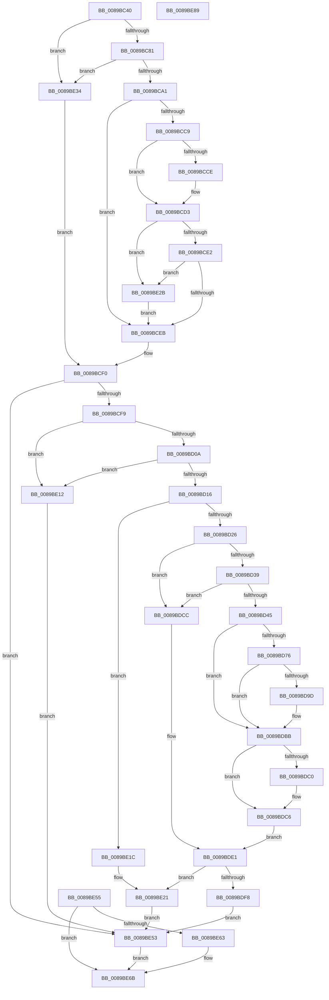

# ObpCaptureObjectName

- RVA: `0x0089BC40`–`0x0089BE8A` (길이 `586` bytes)
- VA: `0x000000014089BC40`
- 실행 섹션: `PAGE`
- PDB 이름 있음: `예`; PDB Function 태그: `아니요`
- unwind 정보 RVA: `0x0007E7AC`
- 디코드: `157`개 명령, `586/586` bytes 표시
- 미해석 바이트: `0` (있으면 어셈블리에 `.byte`로 보존)

> 이 문서는 커널 이미지의 기계어와 PDB 기호를 분석해 생성했습니다. 4번과 5번은 함수 원형과 자료형을 바이너리 사용 방식에서 추정한 C 해석이며 원본 소스 복구 결과는 아닙니다.

## 1. Dependencies

- 직접 호출 지점: **7**; 고유 호출 대상: **6**
- 직접 호출자로 확인된 함수: **2**
- RIP 상대 이미지 참조: **0**

### Outgoing calls
- `0x0089BCCE` → [ExRaiseDatatypeMisalignment](ExRaiseDatatypeMisalignment_function_00899FD0.md) (function, `0x00899FD0`)
- `0x0089BD69` → [ExpInterlockedPopEntrySList](../../text/6B/ExpInterlockedPopEntrySList_function_006BA570.md) (function, `0x006BA570`)
- `0x0089BD90` → [ExpInterlockedPopEntrySList](../../text/6B/ExpInterlockedPopEntrySList_function_006BA570.md) (function, `0x006BA570`)
- `0x0089BDB3` → [guard_dispatch_icall](../../text/6B/guard_dispatch_icall_function_006BAAD0.md) (function, `0x006BAAD0`)
- `0x0089BDD9` → [ExAllocatePool2](../../poolcode/B8/ExAllocatePool2_function_00B820F0.md) (function, `0x00B820F0`)
- `0x0089BE03` → [memcpy](../../text/6C/memcpy_function_006C6840.md) (function, `0x006C6840`)
- `0x0089BE65` → [ExFreePoolWithTag](../../poolcode/B8/ExFreePoolWithTag_function_00B82870.md) (function, `0x00B82870`)

### Direct callers
- [ObpCaptureObjectCreateInformation](ObpCaptureObjectCreateInformation_function_0089B930.md) at `0x0089BAF7`
- [ObReferenceObjectByName](../8C/ObReferenceObjectByName_function_008C4A00.md) at `0x008C4ABF`

### Static image references
- 디코드된 RIP-relative 메모리 참조가 없습니다.

## 2. Other-region calls and transfers

- 다른 실행 섹션으로 향하는 call: **6**
  - `0x0089BD69` → [ExpInterlockedPopEntrySList](../../text/6B/ExpInterlockedPopEntrySList_function_006BA570.md) (`PAGE` → `.text`)
  - `0x0089BD90` → [ExpInterlockedPopEntrySList](../../text/6B/ExpInterlockedPopEntrySList_function_006BA570.md) (`PAGE` → `.text`)
  - `0x0089BDB3` → [guard_dispatch_icall](../../text/6B/guard_dispatch_icall_function_006BAAD0.md) (`PAGE` → `.text`)
  - `0x0089BDD9` → [ExAllocatePool2](../../poolcode/B8/ExAllocatePool2_function_00B820F0.md) (`PAGE` → `POOLCODE`)
  - `0x0089BE03` → [memcpy](../../text/6C/memcpy_function_006C6840.md) (`PAGE` → `.text`)
  - `0x0089BE65` → [ExFreePoolWithTag](../../poolcode/B8/ExFreePoolWithTag_function_00B82870.md) (`PAGE` → `POOLCODE`)
- 별도 외부 분기/꼬리 이동을 확인하지 못했습니다.

## 3. Assembly (complete function range)

```asm
0089BC40  4C 8B DC                        mov r11, rsp
0089BC43  49 89 5B 08                     mov qword ptr [r11 + 8], rbx
0089BC47  49 89 73 10                     mov qword ptr [r11 + 0x10], rsi
0089BC4B  57                              push rdi
0089BC4C  41 54                           push r12
0089BC4E  41 55                           push r13
0089BC50  41 56                           push r14
0089BC52  41 57                           push r15
0089BC54  48 83 EC 60                     sub rsp, 0x60
0089BC58  4D 8B F8                        mov r15, r8
0089BC5B  0F 57 C0                        xorps xmm0, xmm0
0089BC5E  0F 11 44 24 48                  movups xmmword ptr [rsp + 0x48], xmm0
0089BC63  45 33 E4                        xor r12d, r12d
0089BC66  45 89 63 A4                     mov dword ptr [r11 - 0x5c], r12d
0089BC6A  4D 89 60 08                     mov qword ptr [r8 + 8], r12
0089BC6E  45 89 20                        mov dword ptr [r8], r12d
0089BC71  45 89 63 9C                     mov dword ptr [r11 - 0x64], r12d
0089BC75  4D 89 63 A8                     mov qword ptr [r11 - 0x58], r12
0089BC79  84 C9                           test cl, cl
0089BC7B  0F 84 B3 01 00 00               je 0x14089be34
0089BC81  65 48 8B 04 25 88 01 00 00      mov rax, qword ptr gs:[0x188]
0089BC8A  49 89 43 B8                     mov qword ptr [r11 - 0x48], rax
0089BC8E  0F B6 80 32 02 00 00            movzx eax, byte ptr [rax + 0x232]
0089BC95  41 88 43 18                     mov byte ptr [r11 + 0x18], al
0089BC99  84 C0                           test al, al
0089BC9B  0F 84 93 01 00 00               je 0x14089be34
0089BCA1  49 B8 00 00 FF FF FF 7F 00 00   movabs r8, 0x7fffffff0000
0089BCAB  49 8B C0                        mov rax, r8
0089BCAE  49 3B D0                        cmp rdx, r8
0089BCB1  48 0F 42 C2                     cmovb rax, rdx
0089BCB5  90                              nop
0089BCB6  8B 10                           mov edx, dword ptr [rax]
0089BCB8  89 54 24 48                     mov dword ptr [rsp + 0x48], edx
0089BCBC  48 8B 48 08                     mov rcx, qword ptr [rax + 8]
0089BCC0  49 89 4B C8                     mov qword ptr [r11 - 0x38], rcx
0089BCC4  66 85 D2                        test dx, dx
0089BCC7  74 22                           je 0x14089bceb
0089BCC9  F6 C1 01                        test cl, 1
0089BCCC  74 05                           je 0x14089bcd3
0089BCCE  E8 FD E2 FF FF                  call 0x140899fd0
0089BCD3  0F B7 D2                        movzx edx, dx
0089BCD6  48 03 D1                        add rdx, rcx
0089BCD9  49 3B D0                        cmp rdx, r8
0089BCDC  0F 87 49 01 00 00               ja 0x14089be2b
0089BCE2  48 3B D1                        cmp rdx, rcx
0089BCE5  0F 82 40 01 00 00               jb 0x14089be2b
0089BCEB  0F B7 4C 24 48                  movzx ecx, word ptr [rsp + 0x48]
0089BCF0  66 85 C9                        test cx, cx
0089BCF3  0F 84 5A 01 00 00               je 0x14089be53
0089BCF9  0F B7 F9                        movzx edi, cx
0089BCFC  89 7C 24 2C                     mov dword ptr [rsp + 0x2c], edi
0089BD00  40 F6 C7 01                     test dil, 1
0089BD04  0F 85 08 01 00 00               jne 0x14089be12
0089BD0A  81 FF FE FF 00 00               cmp edi, 0xfffe
0089BD10  0F 84 FC 00 00 00               je 0x14089be12
0089BD16  44 89 64 24 28                  mov dword ptr [rsp + 0x28], r12d
0089BD1B  8D 47 02                        lea eax, [rdi + 2]
0089BD1E  3B C7                           cmp eax, edi
0089BD20  0F 82 F6 00 00 00               jb 0x14089be1c
0089BD26  44 8B F7                        mov r14d, edi
0089BD29  8D 77 02                        lea esi, [rdi + 2]
0089BD2C  89 74 24 28                     mov dword ptr [rsp + 0x28], esi
0089BD30  45 85 C9                        test r9d, r9d
0089BD33  0F 84 93 00 00 00               je 0x14089bdcc
0089BD39  81 FE F8 00 00 00               cmp esi, 0xf8
0089BD3F  0F 87 87 00 00 00               ja 0x14089bdcc
0089BD45  BE F8 00 00 00                  mov esi, 0xf8
0089BD4A  89 74 24 28                     mov dword ptr [rsp + 0x28], esi
0089BD4E  65 4C 8B 2C 25 20 00 00 00      mov r13, qword ptr gs:[0x20]
0089BD57  49 8B BD 50 08 00 00            mov rdi, qword ptr [r13 + 0x850]
0089BD5E  8B 47 14                        mov eax, dword ptr [rdi + 0x14]
0089BD61  FF C0                           inc eax
0089BD63  89 47 14                        mov dword ptr [rdi + 0x14], eax
0089BD66  48 8B CF                        mov rcx, rdi
0089BD69  E8 02 E8 E1 FF                  call 0x1406ba570
0089BD6E  48 8B D8                        mov rbx, rax
0089BD71  48 85 C0                        test rax, rax
0089BD74  75 45                           jne 0x14089bdbb
0089BD76  8B 47 18                        mov eax, dword ptr [rdi + 0x18]
0089BD79  FF C0                           inc eax
0089BD7B  89 47 18                        mov dword ptr [rdi + 0x18], eax
0089BD7E  49 8B BD 58 08 00 00            mov rdi, qword ptr [r13 + 0x858]
0089BD85  8B 47 14                        mov eax, dword ptr [rdi + 0x14]
0089BD88  FF C0                           inc eax
0089BD8A  89 47 14                        mov dword ptr [rdi + 0x14], eax
0089BD8D  48 8B CF                        mov rcx, rdi
0089BD90  E8 DB E7 E1 FF                  call 0x1406ba570
0089BD95  48 8B D8                        mov rbx, rax
0089BD98  48 85 C0                        test rax, rax
0089BD9B  75 1E                           jne 0x14089bdbb
0089BD9D  8B 47 18                        mov eax, dword ptr [rdi + 0x18]
0089BDA0  FF C0                           inc eax
0089BDA2  89 47 18                        mov dword ptr [rdi + 0x18], eax
0089BDA5  8B 57 2C                        mov edx, dword ptr [rdi + 0x2c]
0089BDA8  48 8B 47 30                     mov rax, qword ptr [rdi + 0x30]
0089BDAC  44 8B 47 28                     mov r8d, dword ptr [rdi + 0x28]
0089BDB0  8B 4F 24                        mov ecx, dword ptr [rdi + 0x24]
0089BDB3  E8 18 ED E1 FF                  call 0x1406baad0
0089BDB8  48 8B D8                        mov rbx, rax
0089BDBB  48 85 DB                        test rbx, rbx
0089BDBE  74 06                           je 0x14089bdc6
0089BDC0  41 8B 45 24                     mov eax, dword ptr [r13 + 0x24]
0089BDC4  89 03                           mov dword ptr [rbx], eax
0089BDC6  8B 7C 24 2C                     mov edi, dword ptr [rsp + 0x2c]
0089BDCA  EB 15                           jmp 0x14089bde1
0089BDCC  8B D6                           mov edx, esi
0089BDCE  B9 00 01 00 00                  mov ecx, 0x100
0089BDD3  41 B8 4F 62 4E 6D               mov r8d, 0x6d4e624f
0089BDD9  E8 12 63 2E 00                  call 0x140b820f0
0089BDDE  48 8B D8                        mov rbx, rax
0089BDE1  66 41 89 3F                     mov word ptr [r15], di
0089BDE5  66 41 89 77 02                  mov word ptr [r15 + 2], si
0089BDEA  49 89 5F 08                     mov qword ptr [r15 + 8], rbx
0089BDEE  48 89 5C 24 30                  mov qword ptr [rsp + 0x30], rbx
0089BDF3  48 85 DB                        test rbx, rbx
0089BDF6  74 29                           je 0x14089be21
0089BDF8  4D 8B C6                        mov r8, r14
0089BDFB  48 8B 54 24 50                  mov rdx, qword ptr [rsp + 0x50]
0089BE00  48 8B CB                        mov rcx, rbx
0089BE03  E8 38 AA E2 FF                  call 0x1406c6840
0089BE08  49 D1 EE                        shr r14, 1
0089BE0B  66 46 89 24 73                  mov word ptr [rbx + r14*2], r12w
0089BE10  EB 41                           jmp 0x14089be53
0089BE12  C7 44 24 24 33 00 00 C0         mov dword ptr [rsp + 0x24], 0xc0000033
0089BE1A  EB 37                           jmp 0x14089be53
0089BE1C  4C 89 64 24 30                  mov qword ptr [rsp + 0x30], r12
0089BE21  C7 44 24 24 9A 00 00 C0         mov dword ptr [rsp + 0x24], 0xc000009a
0089BE29  EB 28                           jmp 0x14089be53
0089BE2B  41 0F B6 00                     movzx eax, byte ptr [r8]
0089BE2F  E9 B7 FE FF FF                  jmp 0x14089bceb
0089BE34  48 8B 42 08                     mov rax, qword ptr [rdx + 8]
0089BE38  48 89 44 24 50                  mov qword ptr [rsp + 0x50], rax
0089BE3D  0F B7 0A                        movzx ecx, word ptr [rdx]
0089BE40  66 89 4C 24 48                  mov word ptr [rsp + 0x48], cx
0089BE45  0F B7 42 02                     movzx eax, word ptr [rdx + 2]
0089BE49  66 89 44 24 4A                  mov word ptr [rsp + 0x4a], ax
0089BE4E  E9 9D FE FF FF                  jmp 0x14089bcf0
0089BE53  EB 16                           jmp 0x14089be6b
0089BE55  89 44 24 24                     mov dword ptr [rsp + 0x24], eax
0089BE59  48 8B 4C 24 30                  mov rcx, qword ptr [rsp + 0x30]
0089BE5E  48 85 C9                        test rcx, rcx
0089BE61  74 08                           je 0x14089be6b
0089BE63  33 D2                           xor edx, edx
0089BE65  E8 06 6A 2E 00                  call 0x140b82870
0089BE6A  90                              nop
0089BE6B  8B 44 24 24                     mov eax, dword ptr [rsp + 0x24]
0089BE6F  4C 8D 5C 24 60                  lea r11, [rsp + 0x60]
0089BE74  49 8B 5B 30                     mov rbx, qword ptr [r11 + 0x30]
0089BE78  49 8B 73 38                     mov rsi, qword ptr [r11 + 0x38]
0089BE7C  49 8B E3                        mov rsp, r11
0089BE7F  41 5F                           pop r15
0089BE81  41 5E                           pop r14
0089BE83  41 5D                           pop r13
0089BE85  41 5C                           pop r12
0089BE87  5F                              pop rdi
0089BE88  C3                              ret
0089BE89  CC                              int3
```

## 4. C-style interpretation (structured pseudocode)

```c
__int64 __fastcall ObpCaptureObjectName(unsigned __int8 a1, __int64 a2, __int64 a3, int a4)
{
    __int64 result;
    __int64 v_r12;
    __int64 v_r14;
    __int64 v_rbx;
    __int64 v_rsp;
    unsigned __int64 v_stack_m28;
    unsigned __int64 v_stack_m38;
    unsigned __int16 v_stack_m3E;
    unsigned __int64 v_stack_m40;
    unsigned __int64 v_stack_m58;
    unsigned int v_stack_m5C;
    unsigned int v_stack_m60;
    unsigned int v_stack_m64;

    *(unsigned __int64 *)(v_rsp + 8) = v_rbx;
    *(unsigned __int64 *)(v_rsp + 16) = v_rsi;
    v_rsp = (v_rsp) - (96);
    v_stack_m40 = v_xmm0;
    v_r12 = 0;
    *(unsigned int *)(v_rsp - 92) = 0;
    *(unsigned __int64 *)(a3 + 8) = 0;
    *(unsigned int *)(a3) = 0;
    *(unsigned int *)(v_rsp - 100) = 0;
    *(unsigned __int64 *)(v_rsp - 88) = 0;
    if (a1 == 0) goto loc_0089BE34;
    *(unsigned __int64 *)(v_rsp - 72) = *(unsigned __int64 *)(gs_base + (0 + 392));
    *(unsigned __int8 *)(v_rsp + 24) = (unsigned __int8)(*(unsigned __int8 *)(*(unsigned __int64 *)(gs_base + (0 + 392)) + 562));
    if ((unsigned __int8)(*(unsigned __int8 *)(*(unsigned __int64 *)(gs_base + (0 + 392)) + 562)) == 0) goto loc_0089BE34;
    if (a2 < a3) { a3 = a2; }
    v_stack_m40 = (unsigned int)((unsigned int)(*(unsigned int *)(a3)));
    *(unsigned __int64 *)(v_rsp - 56) = *(unsigned __int64 *)(a3 + 8);
    if ((unsigned __int16)((unsigned int)(*(unsigned int *)(a3))) == 0) goto loc_0089BCEB;
    result = a3;
    if ((((unsigned __int8)(*(unsigned __int64 *)(a3 + 8))) & (1)) != 0) {
        result = ExRaiseDatatypeMisalignment(*(unsigned __int64 *)(a3 + 8), (unsigned int)(*(unsigned int *)(a3)), a3, a4);
    }
    a2 = ((unsigned __int16)((unsigned int)(*(unsigned int *)(a3)))) + (*(unsigned __int64 *)(a3 + 8));
    if (a2 > a3) goto loc_0089BE2B;
    if (a2 < (*(unsigned __int64 *)(a3 + 8))) goto loc_0089BE2B;
loc_0089BCEB:
loc_0089BCF0:
    if ((unsigned __int16)(v_stack_m40) == 0) goto loc_0089BE53;
    v_stack_m5C = (unsigned int)((unsigned __int16)(v_stack_m40));
    if ((((unsigned __int8)((unsigned __int16)(v_stack_m40))) & (1)) != 0) goto loc_0089BE12;
    if (((unsigned int)((unsigned __int16)(v_stack_m40))) == 0xFFFEULL) goto loc_0089BE12;
    v_stack_m60 = 0;
    if (((unsigned int)((unsigned __int16)(v_stack_m40) + 2)) < ((unsigned int)((unsigned __int16)(v_stack_m40)))) goto loc_0089BE1C;
    v_stack_m60 = (unsigned int)((unsigned __int16)(v_stack_m40) + 2);
    if (a4 == 0) goto loc_0089BDCC;
    if (((unsigned int)((unsigned __int16)(v_stack_m40) + 2)) > 248) goto loc_0089BDCC;
    v_stack_m60 = 248;
    result = (unsigned int)(((unsigned int)(*(unsigned int *)(*(unsigned __int64 *)(*(unsigned __int64 *)(gs_base + (0 + 32)) + 2128) + 20))) + 1);
    *(unsigned int *)(*(unsigned __int64 *)(*(unsigned __int64 *)(gs_base + (0 + 32)) + 2128) + 20) = (unsigned int)(result);
    result = ExpInterlockedPopEntrySList(*(unsigned __int64 *)(*(unsigned __int64 *)(gs_base + (0 + 32)) + 2128), a2, a3, a4);
    if (result != 0) goto loc_0089BDBB;
    result = (unsigned int)(((unsigned int)(*(unsigned int *)(*(unsigned __int64 *)(*(unsigned __int64 *)(gs_base + (0 + 32)) + 2128) + 24))) + 1);
    *(unsigned int *)(*(unsigned __int64 *)(*(unsigned __int64 *)(gs_base + (0 + 32)) + 2128) + 24) = (unsigned int)(result);
    result = (unsigned int)(((unsigned int)(*(unsigned int *)(*(unsigned __int64 *)(*(unsigned __int64 *)(gs_base + (0 + 32)) + 2136) + 20))) + 1);
    *(unsigned int *)(*(unsigned __int64 *)(*(unsigned __int64 *)(gs_base + (0 + 32)) + 2136) + 20) = (unsigned int)(result);
    result = ExpInterlockedPopEntrySList(*(unsigned __int64 *)(*(unsigned __int64 *)(gs_base + (0 + 32)) + 2136), a2, a3, a4);
    v_rbx = result;
    if (result == 0) {
        result = *(unsigned int *)(*(unsigned __int64 *)(*(unsigned __int64 *)(gs_base + (0 + 32)) + 2136) + 24);
        result = (unsigned int)((result) + 1);
        *(unsigned int *)(*(unsigned __int64 *)(*(unsigned __int64 *)(gs_base + (0 + 32)) + 2136) + 24) = (unsigned int)(result);
        a2 = *(unsigned int *)(*(unsigned __int64 *)(*(unsigned __int64 *)(gs_base + (0 + 32)) + 2136) + 44);
        result = *(unsigned __int64 *)(*(unsigned __int64 *)(*(unsigned __int64 *)(gs_base + (0 + 32)) + 2136) + 48);
        a3 = *(unsigned int *)(*(unsigned __int64 *)(*(unsigned __int64 *)(gs_base + (0 + 32)) + 2136) + 40);
        a1 = *(unsigned int *)(*(unsigned __int64 *)(*(unsigned __int64 *)(gs_base + (0 + 32)) + 2136) + 36);
        result = guard_dispatch_icall(a1, a2, a3, a4);
        v_rbx = result;
    }
    if (v_rbx != 0) {
        result = *(unsigned int *)(*(unsigned __int64 *)(gs_base + (0 + 32)) + 36);
        *(unsigned int *)(v_rbx) = (unsigned int)(result);
    }
    goto loc_0089BDE1;
loc_0089BDCC:
    result = ExAllocatePool2(256, 248, (unsigned int)(0x6D4E624FULL), a4);
loc_0089BDE1:
    *(unsigned __int16 *)(a3) = (unsigned __int16)((unsigned int)(v_stack_m5C));
    *(unsigned __int16 *)(a3 + 2) = 248;
    *(unsigned __int64 *)(a3 + 8) = result;
    v_stack_m58 = result;
    if (result == 0) goto loc_0089BE21;
    result = memcpy(result, v_stack_m38, (unsigned int)((unsigned int)((unsigned __int16)(v_stack_m40))), a4);
    v_r14 = ((unsigned int)((unsigned int)((unsigned __int16)(v_stack_m40)))) >> (1);
    *(unsigned __int16 *)(result + v_r14 * 2) = 0;
    goto loc_0089BE53;
loc_0089BE12:
    v_stack_m64 = 0xC0000033ULL;
    goto loc_0089BE53;
loc_0089BE1C:
    v_stack_m58 = 0;
loc_0089BE21:
    v_stack_m64 = 0xC000009AULL;
    goto loc_0089BE53;
loc_0089BE2B:
    goto loc_0089BCEB;
loc_0089BE34:
    v_stack_m38 = *(unsigned __int64 *)(v_stack_m38 + 8);
    v_stack_m40 = (unsigned __int16)(*(unsigned __int16 *)(v_stack_m38));
    v_stack_m3E = (unsigned __int16)(*(unsigned __int16 *)(v_stack_m38 + 2));
    goto loc_0089BCF0;
loc_0089BE53:
    goto loc_0089BE6B;
loc_0089BE6B:
    return (unsigned int)(v_stack_m64);
}
```

## 5. (Beta) C Style

```c
int64_t ObpCaptureObjectName(uint8_t Arg1, void *Arg2, void *Arg3, int32_t Arg4)
{
    uint8_t *arg2 = (uint8_t *)Arg2;
    uint8_t *arg3 = (uint8_t *)Arg3;

    int64_t result;
    int64_t local_r12;
    int64_t local_r14;
    int64_t local_rbx;
    int64_t local_rsp;
    uint64_t v_stack_m28;
    uint64_t v_stack_m38;
    uint16_t v_stack_m3E;
    uint64_t v_stack_m40;
    uint64_t v_stack_m58;
    uint32_t v_stack_m5C;
    uint32_t v_stack_m60;
    uint32_t v_stack_m64;

    *(uint64_t *)(local_rsp + 0x8) = local_rbx;
    *(uint64_t *)(local_rsp + 0x10) = local_rsi;
    local_rsp = (local_rsp) - (96);
    v_stack_m40 = v_xmm0;
    local_r12 = 0;
    *(uint32_t *)(local_rsp - 0x5C) = 0;
    *(uint64_t *)(arg3 + 0x8) = 0;
    *(uint32_t *)(arg3) = 0;
    *(uint32_t *)(local_rsp - 0x64) = 0;
    *(uint64_t *)(local_rsp - 0x58) = 0;
    if (Arg1 == 0) goto loc_0089BE34;
    *(uint64_t *)(local_rsp - 0x48) = *(uint64_t *)(gs_base + (0 + 0x188));
    *(uint8_t *)(local_rsp + 0x18) = (uint8_t)(*(uint8_t *)(*(uint64_t *)(gs_base + (0 + 0x188)) + 0x232));
    if ((uint8_t)(*(uint8_t *)(*(uint64_t *)(gs_base + (0 + 0x188)) + 0x232)) == 0) goto loc_0089BE34;
    if (Arg2 < Arg3) { Arg3 = Arg2; }
    v_stack_m40 = (uint32_t)((uint32_t)(*(uint32_t *)(arg3)));
    *(uint64_t *)(local_rsp - 0x38) = *(uint64_t *)(arg3 + 0x8);
    if ((uint16_t)((uint32_t)(*(uint32_t *)(arg3))) == 0) goto loc_0089BCEB;
    result = Arg3;
    if ((((uint8_t)(*(uint64_t *)(arg3 + 0x8))) & (1)) != 0) {
        result = ExRaiseDatatypeMisalignment(*(uint64_t *)(arg3 + 0x8), (uint32_t)(*(uint32_t *)(arg3)), Arg3, Arg4);
    }
    Arg2 = ((uint16_t)((uint32_t)(*(uint32_t *)(arg3)))) + (*(uint64_t *)(arg3 + 0x8));
    if (Arg2 > Arg3) goto loc_0089BE2B;
    if (Arg2 < (*(uint64_t *)(arg3 + 0x8))) goto loc_0089BE2B;
loc_0089BCEB:
loc_0089BCF0:
    if ((uint16_t)(v_stack_m40) == 0) goto loc_0089BE53;
    v_stack_m5C = (uint32_t)((uint16_t)(v_stack_m40));
    if ((((uint8_t)((uint16_t)(v_stack_m40))) & (1)) != 0) goto loc_0089BE12;
    if (((uint32_t)((uint16_t)(v_stack_m40))) == 0xFFFEULL) goto loc_0089BE12;
    v_stack_m60 = 0;
    if (((uint32_t)((uint16_t)(v_stack_m40) + 2)) < ((uint32_t)((uint16_t)(v_stack_m40)))) goto loc_0089BE1C;
    v_stack_m60 = (uint32_t)((uint16_t)(v_stack_m40) + 2);
    if (Arg4 == 0) goto loc_0089BDCC;
    if (((uint32_t)((uint16_t)(v_stack_m40) + 2)) > 248) goto loc_0089BDCC;
    v_stack_m60 = 248;
    result = (uint32_t)(((uint32_t)(*(uint32_t *)(*(uint64_t *)(*(uint64_t *)(gs_base + (0 + 0x20)) + 0x850) + 0x14))) + 1);
    *(uint32_t *)(*(uint64_t *)(*(uint64_t *)(gs_base + (0 + 0x20)) + 0x850) + 0x14) = (uint32_t)(result);
    result = ExpInterlockedPopEntrySList(*(uint64_t *)(*(uint64_t *)(gs_base + (0 + 0x20)) + 0x850), Arg2, Arg3, Arg4);
    if (result != 0) goto loc_0089BDBB;
    result = (uint32_t)(((uint32_t)(*(uint32_t *)(*(uint64_t *)(*(uint64_t *)(gs_base + (0 + 0x20)) + 0x850) + 0x18))) + 1);
    *(uint32_t *)(*(uint64_t *)(*(uint64_t *)(gs_base + (0 + 0x20)) + 0x850) + 0x18) = (uint32_t)(result);
    result = (uint32_t)(((uint32_t)(*(uint32_t *)(*(uint64_t *)(*(uint64_t *)(gs_base + (0 + 0x20)) + 0x858) + 0x14))) + 1);
    *(uint32_t *)(*(uint64_t *)(*(uint64_t *)(gs_base + (0 + 0x20)) + 0x858) + 0x14) = (uint32_t)(result);
    result = ExpInterlockedPopEntrySList(*(uint64_t *)(*(uint64_t *)(gs_base + (0 + 0x20)) + 0x858), Arg2, Arg3, Arg4);
    local_rbx = result;
    if (result == 0) {
        result = *(uint32_t *)(*(uint64_t *)(*(uint64_t *)(gs_base + (0 + 0x20)) + 0x858) + 0x18);
        result = (uint32_t)((result) + 1);
        *(uint32_t *)(*(uint64_t *)(*(uint64_t *)(gs_base + (0 + 0x20)) + 0x858) + 0x18) = (uint32_t)(result);
        Arg2 = *(uint32_t *)(*(uint64_t *)(*(uint64_t *)(gs_base + (0 + 0x20)) + 0x858) + 0x2C);
        result = *(uint64_t *)(*(uint64_t *)(*(uint64_t *)(gs_base + (0 + 0x20)) + 0x858) + 0x30);
        Arg3 = *(uint32_t *)(*(uint64_t *)(*(uint64_t *)(gs_base + (0 + 0x20)) + 0x858) + 0x28);
        Arg1 = *(uint32_t *)(*(uint64_t *)(*(uint64_t *)(gs_base + (0 + 0x20)) + 0x858) + 0x24);
        result = guard_dispatch_icall(Arg1, Arg2, Arg3, Arg4);
        local_rbx = result;
    }
    if (local_rbx != 0) {
        result = *(uint32_t *)(*(uint64_t *)(gs_base + (0 + 0x20)) + 0x24);
        *(uint32_t *)(local_rbx) = (uint32_t)(result);
    }
    goto loc_0089BDE1;
loc_0089BDCC:
    result = ExAllocatePool2(256, 248, (uint32_t)(0x6D4E624FULL), Arg4);
loc_0089BDE1:
    *(uint16_t *)(arg3) = (uint16_t)((uint32_t)(v_stack_m5C));
    *(uint16_t *)(arg3 + 0x2) = 248;
    *(uint64_t *)(arg3 + 0x8) = result;
    v_stack_m58 = result;
    if (result == 0) goto loc_0089BE21;
    result = memcpy(result, v_stack_m38, (uint32_t)((uint32_t)((uint16_t)(v_stack_m40))), Arg4);
    local_r14 = ((uint32_t)((uint32_t)((uint16_t)(v_stack_m40)))) >> (1);
    *(uint16_t *)(result + local_r14 * 2) = 0;
    goto loc_0089BE53;
loc_0089BE12:
    v_stack_m64 = 0xC0000033ULL;
    goto loc_0089BE53;
loc_0089BE1C:
    v_stack_m58 = 0;
loc_0089BE21:
    v_stack_m64 = 0xC000009AULL;
    goto loc_0089BE53;
loc_0089BE2B:
    goto loc_0089BCEB;
loc_0089BE34:
    v_stack_m38 = *(uint64_t *)(v_stack_m38 + 0x8);
    v_stack_m40 = (uint16_t)(*(uint16_t *)(v_stack_m38));
    v_stack_m3E = (uint16_t)(*(uint16_t *)(v_stack_m38 + 0x2));
    goto loc_0089BCF0;
loc_0089BE53:
    goto loc_0089BE6B;
loc_0089BE6B:
    return (uint32_t)(v_stack_m64);
}
```

### 관측된 메모리 오프셋

구조체 형식이 확인되지 않은 접근은 인자 기준의 오프셋으로만 기록했습니다.

| 기준 인자 | 오프셋 표현 | 폭 (bit) | 접근 |
|---|---:|---:|---|
| `Arg2` | `+ 0x0` | `16` | `R` |
| `Arg2` | `+ 0x2` | `16` | `R` |
| `Arg2` | `+ 0x8` | `64` | `R` |
| `Arg3` | `+ 0x0` | `16` | `W` |
| `Arg3` | `+ 0x0` | `32` | `W` |
| `Arg3` | `+ 0x2` | `16` | `W` |
| `Arg3` | `+ 0x8` | `64` | `W` |

## 6. Execution-region graph

[열기: 2D/3D 그래프와 함수 탐색 컨트롤 패널](../../../control-panel.html?section=page&rva=0x0089BC40&view=graph)

- 2D 그래프는 위에서 아래로 흐르고, 3D 그래프는 빈 공간을 드래그해 회전합니다. Shift+드래그는 이동, 휠은 확대·축소, 함수 노드 선택은 대상 보고서 이동입니다.

### Static fallback


