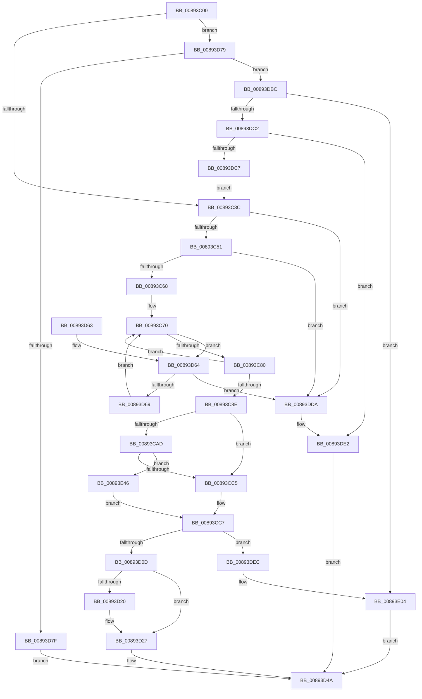

# ObpReferenceProcessObjectByHandle

- RVA: `0x00893C00`–`0x00893E4E` (길이 `590` bytes)
- VA: `0x0000000140893C00`
- 실행 섹션: `PAGE`
- PDB 이름 있음: `예`; PDB Function 태그: `아니요`
- unwind 정보 RVA: `0x0007DF28`
- 디코드: `148`개 명령, `590/590` bytes 표시
- 미해석 바이트: `0` (있으면 어셈블리에 `.byte`로 보존)

> 이 문서는 커널 이미지의 기계어와 PDB 기호를 분석해 생성했습니다. 4번과 5번은 함수 원형과 자료형을 바이너리 사용 방식에서 추정한 C 해석이며 원본 소스 복구 결과는 아닙니다.

## 1. Dependencies

- 직접 호출 지점: **13**; 고유 호출 대상: **9**
- 직접 호출자로 확인된 함수: **1**
- RIP 상대 이미지 참조: **1**

### Outgoing calls
- `0x00893C57` → [ExpLookupHandleTableEntry](../86/ExpLookupHandleTableEntry_function_00869DB0.md) (function, `0x00869DB0`)
- `0x00893C91` → [ExGetHandlePointer](../../text/43/ExGetHandlePointer_function_00430C90.md) (function, `0x00430C90`)
- `0x00893CB3` → [ExpGetHandleExtraInfo](../86/ExpGetHandleExtraInfo_function_0086B454.md) (function, `0x0086B454`)
- `0x00893D22` → [ExfUnblockPushLock](../../text/2A/ExfUnblockPushLock_function_002A3FE0.md) (function, `0x002A3FE0`)
- `0x00893D2A` → [KeLeaveCriticalRegionThread](../../text/25/KeLeaveCriticalRegionThread_function_0025EFF0.md) (function, `0x0025EFF0`)
- `0x00893D3C` → [ObpTraceObjectReferenceIfActive](../../text/21/ObpTraceObjectReferenceIfActive_function_00210780.md) (function, `0x00210780`)
- `0x00893D6F` → [ExpBlockOnLockedHandleEntry](../86/ExpBlockOnLockedHandleEntry_function_00868838.md) (function, `0x00868838`)
- `0x00893DA7` → [ObpTraceObjectReferenceIfActive](../../text/21/ObpTraceObjectReferenceIfActive_function_00210780.md) (function, `0x00210780`)
- `0x00893DB0` → [ObpIncrPointerCount](../../text/43/ObpIncrPointerCount_function_00430BB0.md) (function, `0x00430BB0`)
- `0x00893DDD` → [KeLeaveCriticalRegionThread](../../text/25/KeLeaveCriticalRegionThread_function_0025EFF0.md) (function, `0x0025EFF0`)
- `0x00893DFE` → [KeBugCheckEx](../../text/4F/KeBugCheckEx_function_004FD660.md) (function, `0x004FD660`)
- `0x00893E2E` → [ObpTraceObjectReferenceIfActive](../../text/21/ObpTraceObjectReferenceIfActive_function_00210780.md) (function, `0x00210780`)
- `0x00893E37` → [ObpIncrPointerCount](../../text/43/ObpIncrPointerCount_function_00430BB0.md) (function, `0x00430BB0`)

### Direct callers
- [ObCaptureObjectStateForDuplication](ObCaptureObjectStateForDuplication_function_00893684.md) at `0x00893710`

### Static image references
- `0x00893DC7` → RVA `0x00F0F5B8` (`.data`; read)

## 2. Other-region calls and transfers

- 다른 실행 섹션으로 향하는 call: **10**
  - `0x00893C91` → [ExGetHandlePointer](../../text/43/ExGetHandlePointer_function_00430C90.md) (`PAGE` → `.text`)
  - `0x00893D22` → [ExfUnblockPushLock](../../text/2A/ExfUnblockPushLock_function_002A3FE0.md) (`PAGE` → `.text`)
  - `0x00893D2A` → [KeLeaveCriticalRegionThread](../../text/25/KeLeaveCriticalRegionThread_function_0025EFF0.md) (`PAGE` → `.text`)
  - `0x00893D3C` → [ObpTraceObjectReferenceIfActive](../../text/21/ObpTraceObjectReferenceIfActive_function_00210780.md) (`PAGE` → `.text`)
  - `0x00893DA7` → [ObpTraceObjectReferenceIfActive](../../text/21/ObpTraceObjectReferenceIfActive_function_00210780.md) (`PAGE` → `.text`)
  - `0x00893DB0` → [ObpIncrPointerCount](../../text/43/ObpIncrPointerCount_function_00430BB0.md) (`PAGE` → `.text`)
  - `0x00893DDD` → [KeLeaveCriticalRegionThread](../../text/25/KeLeaveCriticalRegionThread_function_0025EFF0.md) (`PAGE` → `.text`)
  - `0x00893DFE` → [KeBugCheckEx](../../text/4F/KeBugCheckEx_function_004FD660.md) (`PAGE` → `.text`)
  - `0x00893E2E` → [ObpTraceObjectReferenceIfActive](../../text/21/ObpTraceObjectReferenceIfActive_function_00210780.md) (`PAGE` → `.text`)
  - `0x00893E37` → [ObpIncrPointerCount](../../text/43/ObpIncrPointerCount_function_00430BB0.md) (`PAGE` → `.text`)
- 별도 외부 분기/꼬리 이동을 확인하지 못했습니다.

## 3. Assembly (complete function range)

```asm
00893C00  48 89 5C 24 08                  mov qword ptr [rsp + 8], rbx
00893C05  48 89 6C 24 10                  mov qword ptr [rsp + 0x10], rbp
00893C0A  48 89 74 24 18                  mov qword ptr [rsp + 0x18], rsi
00893C0F  57                              push rdi
00893C10  41 56                           push r14
00893C12  41 57                           push r15
00893C14  48 83 EC 30                     sub rsp, 0x30
00893C18  4C 8B 7C 24 78                  mov r15, qword ptr [rsp + 0x78]
00893C1D  48 8B F1                        mov rsi, rcx
00893C20  65 4C 8B 34 25 88 01 00 00      mov r14, qword ptr gs:[0x188]
00893C29  33 C9                           xor ecx, ecx
00893C2B  49 8B E8                        mov rbp, r8
00893C2E  48 8B FA                        mov rdi, rdx
00893C31  49 89 0F                        mov qword ptr [r15], rcx
00893C34  85 F6                           test esi, esi
00893C36  0F 88 3D 01 00 00               js 0x140893d79
00893C3C  66 41 FF 8E E4 01 00 00         dec word ptr [r14 + 0x1e4]
00893C44  90                              nop
00893C45  F7 C6 FC 03 00 00               test esi, 0x3fc
00893C4B  0F 84 89 01 00 00               je 0x140893dda
00893C51  48 8B D6                        mov rdx, rsi
00893C54  48 8B CD                        mov rcx, rbp
00893C57  E8 54 61 FD FF                  call 0x140869db0
00893C5C  48 8B D8                        mov rbx, rax
00893C5F  48 85 C0                        test rax, rax
00893C62  0F 84 72 01 00 00               je 0x140893dda
00893C68  0F 1F 84 00 00 00 00 00         nop dword ptr [rax + rax]
00893C70  0F 0D 0B                        prefetchw byte ptr [rbx]
00893C73  4C 8B 03                        mov r8, qword ptr [rbx]
00893C76  41 F6 C0 01                     test r8b, 1
00893C7A  0F 84 E4 00 00 00               je 0x140893d64
00893C80  49 8D 48 FF                     lea rcx, [r8 - 1]
00893C84  49 8B C0                        mov rax, r8
00893C87  F0 48 0F B1 0B                  lock cmpxchg qword ptr [rbx], rcx
00893C8C  75 E2                           jne 0x140893c70
00893C8E  48 8B CB                        mov rcx, rbx
00893C91  E8 FA CF B9 FF                  call 0x140430c90
00893C96  44 8B 43 08                     mov r8d, dword ptr [rbx + 8]
00893C9A  48 8B F8                        mov rdi, rax
00893C9D  45 8B D0                        mov r10d, r8d
00893CA0  41 81 E2 FF FF FF 01            and r10d, 0x1ffffff
00893CA7  83 7D 04 00                     cmp dword ptr [rbp + 4], 0
00893CAB  74 18                           je 0x140893cc5
00893CAD  48 8B D6                        mov rdx, rsi
00893CB0  48 8B CD                        mov rcx, rbp
00893CB3  E8 9C 77 FD FF                  call 0x14086b454
00893CB8  44 8B 43 08                     mov r8d, dword ptr [rbx + 8]
00893CBC  48 85 C0                        test rax, rax
00893CBF  0F 85 81 01 00 00               jne 0x140893e46
00893CC5  33 C9                           xor ecx, ecx
00893CC7  48 8B 84 24 88 00 00 00         mov rax, qword ptr [rsp + 0x88]
00893CCF  48 8B 94 24 80 00 00 00         mov rdx, qword ptr [rsp + 0x80]
00893CD7  48 89 08                        mov qword ptr [rax], rcx
00893CDA  8B 0B                           mov ecx, dword ptr [rbx]
00893CDC  48 C1 F9 11                     sar rcx, 0x11
00893CE0  83 E1 07                        and ecx, 7
00893CE3  44 89 52 04                     mov dword ptr [rdx + 4], r10d
00893CE7  8B C1                           mov eax, ecx
00893CE9  83 C8 08                        or eax, 8
00893CEC  41 0F BA E0 19                  bt r8d, 0x19
00893CF1  0F 43 C1                        cmovae eax, ecx
00893CF4  89 02                           mov dword ptr [rdx], eax
00893CF6  B8 01 00 00 00                  mov eax, 1
00893CFB  F0 48 0F C1 07                  lock xadd qword ptr [rdi], rax
00893D00  48 FF C0                        inc rax
00893D03  48 83 F8 01                     cmp rax, 1
00893D07  0F 8E DF 00 00 00               jle 0x140893dec
00893D0D  F0 48 FF 03                     lock inc qword ptr [rbx]
00893D11  48 8D 4D 30                     lea rcx, [rbp + 0x30]
00893D15  F0 83 0C 24 00                  lock or dword ptr [rsp], 0
00893D1A  48 83 39 00                     cmp qword ptr [rcx], 0
00893D1E  74 07                           je 0x140893d27
00893D20  33 D2                           xor edx, edx
00893D22  E8 B9 02 A1 FF                  call 0x1402a3fe0
00893D27  49 8B CE                        mov rcx, r14
00893D2A  E8 C1 B2 9C FF                  call 0x14025eff0
00893D2F  44 8B 44 24 70                  mov r8d, dword ptr [rsp + 0x70]
00893D34  BA 01 00 00 00                  mov edx, 1
00893D39  48 8B CF                        mov rcx, rdi
00893D3C  E8 3F CA 97 FF                  call 0x140210780
00893D41  48 8D 47 30                     lea rax, [rdi + 0x30]
00893D45  49 89 07                        mov qword ptr [r15], rax
00893D48  33 C0                           xor eax, eax
00893D4A  48 8B 5C 24 50                  mov rbx, qword ptr [rsp + 0x50]
00893D4F  48 8B 6C 24 58                  mov rbp, qword ptr [rsp + 0x58]
00893D54  48 8B 74 24 60                  mov rsi, qword ptr [rsp + 0x60]
00893D59  48 83 C4 30                     add rsp, 0x30
00893D5D  41 5F                           pop r15
00893D5F  41 5E                           pop r14
00893D61  5F                              pop rdi
00893D62  C3                              ret
00893D63  CC                              int3
00893D64  4D 85 C0                        test r8, r8
00893D67  74 71                           je 0x140893dda
00893D69  48 8B D3                        mov rdx, rbx
00893D6C  48 8B CD                        mov rcx, rbp
00893D6F  E8 C4 4A FD FF                  call 0x140868838
00893D74  E9 F7 FE FF FF                  jmp 0x140893c70
00893D79  48 83 FE FF                     cmp rsi, -1
00893D7D  75 3D                           jne 0x140893dbc
00893D7F  48 8B 84 24 80 00 00 00         mov rax, qword ptr [rsp + 0x80]
00893D87  8D 56 02                        lea edx, [rsi + 2]
00893D8A  44 8B 44 24 70                  mov r8d, dword ptr [rsp + 0x70]
00893D8F  89 08                           mov dword ptr [rax], ecx
00893D91  C7 40 04 FF FF 1F 00            mov dword ptr [rax + 4], 0x1fffff
00893D98  48 8B 84 24 88 00 00 00         mov rax, qword ptr [rsp + 0x88]
00893DA0  48 89 08                        mov qword ptr [rax], rcx
00893DA3  48 8D 4F D0                     lea rcx, [rdi - 0x30]
00893DA7  E8 D4 C9 97 FF                  call 0x140210780
00893DAC  48 8D 4F D0                     lea rcx, [rdi - 0x30]
00893DB0  E8 FB CD B9 FF                  call 0x140430bb0
00893DB5  33 C0                           xor eax, eax
00893DB7  49 89 3F                        mov qword ptr [r15], rdi
00893DBA  EB 8E                           jmp 0x140893d4a
00893DBC  48 83 FE FE                     cmp rsi, -2
00893DC0  74 42                           je 0x140893e04
00893DC2  45 84 C9                        test r9b, r9b
00893DC5  75 1B                           jne 0x140893de2
00893DC7  48 8B 2D EA B7 67 00            mov rbp, qword ptr [rip + 0x67b7ea]
00893DCE  48 81 F6 00 00 00 80            xor rsi, 0xffffffff80000000
00893DD5  E9 62 FE FF FF                  jmp 0x140893c3c
00893DDA  49 8B CE                        mov rcx, r14
00893DDD  E8 0E B2 9C FF                  call 0x14025eff0
00893DE2  B8 08 00 00 C0                  mov eax, 0xc0000008
00893DE7  E9 5E FF FF FF                  jmp 0x140893d4a
00893DEC  33 D2                           xor edx, edx
00893DEE  48 89 44 24 20                  mov qword ptr [rsp + 0x20], rax
00893DF3  4C 8D 47 30                     lea r8, [rdi + 0x30]
00893DF7  8D 4A 18                        lea ecx, [rdx + 0x18]
00893DFA  44 8D 4A 10                     lea r9d, [rdx + 0x10]
00893DFE  E8 5D 98 C6 FF                  call 0x1404fd660
00893E03  CC                              int3
00893E04  48 8B 84 24 80 00 00 00         mov rax, qword ptr [rsp + 0x80]
00893E0C  BA 01 00 00 00                  mov edx, 1
00893E11  44 8B 44 24 70                  mov r8d, dword ptr [rsp + 0x70]
00893E16  89 08                           mov dword ptr [rax], ecx
00893E18  C7 40 04 FF FF 1F 00            mov dword ptr [rax + 4], 0x1fffff
00893E1F  48 8B 84 24 88 00 00 00         mov rax, qword ptr [rsp + 0x88]
00893E27  48 89 08                        mov qword ptr [rax], rcx
00893E2A  49 8D 4E D0                     lea rcx, [r14 - 0x30]
00893E2E  E8 4D C9 97 FF                  call 0x140210780
00893E33  49 8D 4E D0                     lea rcx, [r14 - 0x30]
00893E37  E8 74 CD B9 FF                  call 0x140430bb0
00893E3C  33 C0                           xor eax, eax
00893E3E  4D 89 37                        mov qword ptr [r15], r14
00893E41  E9 04 FF FF FF                  jmp 0x140893d4a
00893E46  48 8B 08                        mov rcx, qword ptr [rax]
00893E49  E9 79 FE FF FF                  jmp 0x140893cc7
```

## 4. C-style interpretation (structured pseudocode)

```c
__int64 __fastcall ObpReferenceProcessObjectByHandle(__int64 a1, __int64 a2, __int64 a3, unsigned __int8 a4, unsigned int a5, __int64 a6, __int64 a7, __int64 a8)
{
    __int64 result;
    __int64 v_r10;
    __int64 v_rsi;
    __int64 v_rsp;
    unsigned int v_stack_m48;
    unsigned __int64 v_stack_p10;
    unsigned __int64 v_stack_p18;
    unsigned __int64 v_stack_p20;
    unsigned __int64 v_stack_p8;

    v_stack_p8 = v_rbx;
    v_stack_p10 = v_rbp;
    v_stack_p18 = v_rsi;
    v_rsp = (v_rsp) - (48);
    a1 = 0;
    *(unsigned __int64 *)(a6) = 0;
    if (sign_flag) goto loc_00893D79;
loc_00893C3C:
    if (((0) & (0x3FCULL)) == 0) goto loc_00893DDA;
    result = ExpLookupHandleTableEntry(a3, 0, a3, a4);
    if (result == 0) goto loc_00893DDA;
loc_00893C70:
    if ((((unsigned __int8)(*(unsigned __int64 *)(result))) & (1)) == 0) goto loc_00893D64;
    if ((((unsigned __int8)(*(unsigned __int64 *)(result))) & (1)) != 0) goto loc_00893C70;
    result = ExGetHandlePointer(result, 0, *(unsigned __int64 *)(result), a4);
    v_r10 = (unsigned int)(((unsigned int)((unsigned int)((unsigned int)(*(unsigned int *)(result + 8))))) & (0x1FFFFFFULL));
    if ((*(unsigned int *)(a3 + 4)) == 0) goto loc_00893CC5;
    result = ExpGetHandleExtraInfo(a3, 0, (unsigned int)(*(unsigned int *)(result + 8)), a4);
    if (result != 0) goto loc_00893E46;
loc_00893CC5:
    a1 = 0;
loc_00893CC7:
    *(unsigned __int64 *)(a8) = 0;
    a1 = ((unsigned int)(*(unsigned int *)(result))) >> (17);
    a1 = (unsigned int)((a1) & (7));
    *(unsigned int *)(a7 + 4) = (unsigned int)(v_r10);
    result = (unsigned int)(((unsigned int)((unsigned int)(a1))) | (8));
    if (condition_is_above_or_equal) { result = (unsigned int)(a1); }
    *(unsigned int *)(a7) = (unsigned int)(result);
    result = (1) + 1;
    if (result <= 1) goto loc_00893DEC;
    if ((*(unsigned __int64 *)(a3 + 48)) != 0) {
        a2 = 0;
        result = ExfUnblockPushLock(a3 + 48, a2, (unsigned int)(*(unsigned int *)(result + 8)), a4);
    }
    result = KeLeaveCriticalRegionThread(*(unsigned __int64 *)(gs_base + (0 + 392)), a2, (unsigned int)(*(unsigned int *)(result + 8)), a4);
    result = ObpTraceObjectReferenceIfActive(result, 1, (unsigned int)(a5), a4);
    *(unsigned __int64 *)(a6) = result + 48;
    result = 0;
loc_00893D4A:
    v_rsp = (v_rsp) + (48);
    return result;
loc_00893D64:
    if ((unsigned int)(a5) == 0) goto loc_00893DDA;
    result = ExpBlockOnLockedHandleEntry(v_stack_p10, v_stack_p8, (unsigned int)(a5), a4);
    goto loc_00893C70;
loc_00893D79:
    if (v_stack_p18 != -1) goto loc_00893DBC;
    *(unsigned int *)(a7) = (unsigned int)(v_stack_p10);
    *(unsigned int *)(a7 + 4) = 0x1FFFFFULL;
    *(unsigned __int64 *)(a8) = v_stack_p10;
    result = ObpTraceObjectReferenceIfActive(result - 48, v_stack_p18 + 2, (unsigned int)(a5), a4);
    result = ObpIncrPointerCount(result - 48, v_stack_p18 + 2, (unsigned int)(a5), a4);
    result = 0;
    *(unsigned __int64 *)(a6) = 0;
    goto loc_00893D4A;
loc_00893DBC:
    if (v_stack_p18 == -2) goto loc_00893E04;
    if (a4 != 0) goto loc_00893DE2;
    v_rsi = (v_stack_p18) ^ (0xFFFFFFFF80000000ULL);
    goto loc_00893C3C;
loc_00893DDA:
    result = KeLeaveCriticalRegionThread(*(unsigned __int64 *)(gs_base + (0 + 392)), v_stack_p18 + 2, (unsigned int)(a5), a4);
loc_00893DE2:
    goto loc_00893D4A;
loc_00893DEC:
    a2 = 0;
    v_stack_p20 = (unsigned int)(0xC0000008ULL);
    result = KeBugCheckEx(a2 + 24, a2, result + 48, a2 + 16);
loc_00893E04:
    *(unsigned int *)(a7) = (unsigned int)(a2 + 24);
    *(unsigned int *)(a7 + 4) = 0x1FFFFFULL;
    *(unsigned __int64 *)(a8) = a2 + 24;
    result = ObpTraceObjectReferenceIfActive(*(unsigned __int64 *)(gs_base + (0 + 392)) - 48, 1, (unsigned int)(a5), a2 + 16);
    result = ObpIncrPointerCount(*(unsigned __int64 *)(gs_base + (0 + 392)) - 48, 1, (unsigned int)(a5), a2 + 16);
    result = 0;
    *(unsigned __int64 *)(a6) = *(unsigned __int64 *)(gs_base + (0 + 392));
    goto loc_00893D4A;
loc_00893E46:
    goto loc_00893CC7;
}
```

## 5. (Beta) C Style

```c
int64_t ObpReferenceProcessObjectByHandle(int64_t Arg1, void *Arg2, int64_t Arg3, uint8_t Arg4, uint32_t Arg5, void *Arg6, void *Arg7, void *Arg8)
{
    uint8_t *arg2 = (uint8_t *)Arg2;
    uint8_t *arg6 = (uint8_t *)Arg6;
    uint8_t *arg7 = (uint8_t *)Arg7;
    uint8_t *arg8 = (uint8_t *)Arg8;

    int64_t result;
    int64_t local_r10;
    int64_t local_rsi;
    int64_t local_rsp;
    uint32_t v_stack_m48;
    uint64_t v_stack_p10;
    uint64_t v_stack_p18;
    uint64_t v_stack_p20;
    uint64_t v_stack_p8;

    v_stack_p8 = local_rbx;
    v_stack_p10 = local_rbp;
    v_stack_p18 = local_rsi;
    local_rsp = (local_rsp) - (48);
    Arg1 = 0;
    *(uint64_t *)(arg6) = 0;
    if (sign_flag) goto loc_00893D79;
loc_00893C3C:
    if (((0) & (0x3FCULL)) == 0) goto loc_00893DDA;
    result = ExpLookupHandleTableEntry(Arg3, 0, Arg3, Arg4);
    if (result == 0) goto loc_00893DDA;
loc_00893C70:
    if ((((uint8_t)(*(uint64_t *)(result))) & (1)) == 0) goto loc_00893D64;
    if ((((uint8_t)(*(uint64_t *)(result))) & (1)) != 0) goto loc_00893C70;
    result = ExGetHandlePointer(result, 0, *(uint64_t *)(result), Arg4);
    local_r10 = (uint32_t)(((uint32_t)((uint32_t)((uint32_t)(*(uint32_t *)(result + 0x8))))) & (0x1FFFFFFULL));
    if ((*(uint32_t *)(Arg3 + 0x4)) == 0) goto loc_00893CC5;
    result = ExpGetHandleExtraInfo(Arg3, 0, (uint32_t)(*(uint32_t *)(result + 0x8)), Arg4);
    if (result != 0) goto loc_00893E46;
loc_00893CC5:
    Arg1 = 0;
loc_00893CC7:
    *(uint64_t *)(arg8) = 0;
    Arg1 = ((uint32_t)(*(uint32_t *)(result))) >> (17);
    Arg1 = (uint32_t)((Arg1) & (7));
    *(uint32_t *)(arg7 + 0x4) = (uint32_t)(local_r10);
    result = (uint32_t)(((uint32_t)((uint32_t)(Arg1))) | (8));
    if (condition_is_above_or_equal) { result = (uint32_t)(Arg1); }
    *(uint32_t *)(arg7) = (uint32_t)(result);
    result = (1) + 1;
    if (result <= 1) goto loc_00893DEC;
    if ((*(uint64_t *)(Arg3 + 0x30)) != 0) {
        Arg2 = 0;
        result = ExfUnblockPushLock(Arg3 + 48, Arg2, (uint32_t)(*(uint32_t *)(result + 0x8)), Arg4);
    }
    result = KeLeaveCriticalRegionThread(*(uint64_t *)(gs_base + (0 + 0x188)), Arg2, (uint32_t)(*(uint32_t *)(result + 0x8)), Arg4);
    result = ObpTraceObjectReferenceIfActive(result, 1, (uint32_t)(Arg5), Arg4);
    *(uint64_t *)(arg6) = result + 48;
    result = 0;
loc_00893D4A:
    local_rsp = (local_rsp) + (48);
    return result;
loc_00893D64:
    if ((uint32_t)(Arg5) == 0) goto loc_00893DDA;
    result = ExpBlockOnLockedHandleEntry(v_stack_p10, v_stack_p8, (uint32_t)(Arg5), Arg4);
    goto loc_00893C70;
loc_00893D79:
    if (v_stack_p18 != -1) goto loc_00893DBC;
    *(uint32_t *)(arg7) = (uint32_t)(v_stack_p10);
    *(uint32_t *)(arg7 + 0x4) = 0x1FFFFFULL;
    *(uint64_t *)(arg8) = v_stack_p10;
    result = ObpTraceObjectReferenceIfActive(result - 48, v_stack_p18 + 2, (uint32_t)(Arg5), Arg4);
    result = ObpIncrPointerCount(result - 48, v_stack_p18 + 2, (uint32_t)(Arg5), Arg4);
    result = 0;
    *(uint64_t *)(arg6) = 0;
    goto loc_00893D4A;
loc_00893DBC:
    if (v_stack_p18 == -2) goto loc_00893E04;
    if (Arg4 != 0) goto loc_00893DE2;
    local_rsi = (v_stack_p18) ^ (0xFFFFFFFF80000000ULL);
    goto loc_00893C3C;
loc_00893DDA:
    result = KeLeaveCriticalRegionThread(*(uint64_t *)(gs_base + (0 + 0x188)), v_stack_p18 + 2, (uint32_t)(Arg5), Arg4);
loc_00893DE2:
    goto loc_00893D4A;
loc_00893DEC:
    Arg2 = 0;
    v_stack_p20 = (uint32_t)(0xC0000008ULL);
    result = KeBugCheckEx(Arg2 + 24, Arg2, result + 48, Arg2 + 16);
loc_00893E04:
    *(uint32_t *)(arg7) = (uint32_t)(Arg2 + 24);
    *(uint32_t *)(arg7 + 0x4) = 0x1FFFFFULL;
    *(void **)(arg8) = Arg2 + 24;
    result = ObpTraceObjectReferenceIfActive(*(uint64_t *)(gs_base + (0 + 0x188)) - 48, 1, (uint32_t)(Arg5), Arg2 + 16);
    result = ObpIncrPointerCount(*(uint64_t *)(gs_base + (0 + 0x188)) - 48, 1, (uint32_t)(Arg5), Arg2 + 16);
    result = 0;
    *(uint64_t *)(arg6) = *(uint64_t *)(gs_base + (0 + 0x188));
    goto loc_00893D4A;
loc_00893E46:
    goto loc_00893CC7;
}
```

### 관측된 메모리 오프셋

구조체 형식이 확인되지 않은 접근은 인자 기준의 오프셋으로만 기록했습니다.

| 기준 인자 | 오프셋 표현 | 폭 (bit) | 접근 |
|---|---:|---:|---|
| `Arg2` | `- 0x30` | `64` | `R` |
| `Arg6` | `+ 0x0` | `64` | `W` |
| `Arg7` | `+ 0x0` | `32` | `W` |
| `Arg7` | `+ 0x4` | `32` | `W` |
| `Arg8` | `+ 0x0` | `64` | `W` |

## 6. Execution-region graph

[열기: 2D/3D 그래프와 함수 탐색 컨트롤 패널](../../../control-panel.html?section=page&rva=0x00893C00&view=graph)

- 2D 그래프는 위에서 아래로 흐르고, 3D 그래프는 빈 공간을 드래그해 회전합니다. Shift+드래그는 이동, 휠은 확대·축소, 함수 노드 선택은 대상 보고서 이동입니다.

### Static fallback


