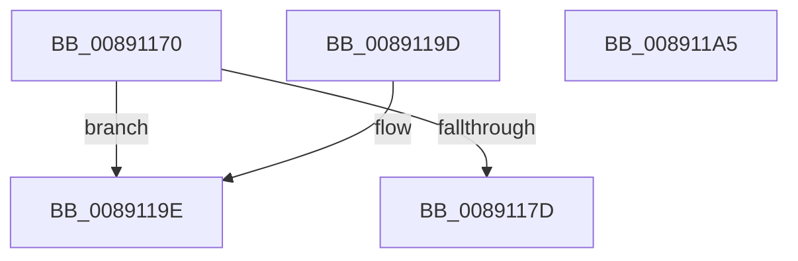

# PsChargeProcessPagedPoolQuota

- RVA: `0x00891170`–`0x008911A6` (길이 `54` bytes)
- VA: `0x0000000140891170`
- 실행 섹션: `PAGE`
- PDB 이름 있음: `예`; PDB Function 태그: `아니요`
- unwind 정보 RVA: `0x00072520`
- 디코드: `16`개 명령, `54/54` bytes 표시
- 미해석 바이트: `0` (있으면 어셈블리에 `.byte`로 보존)

> 이 문서는 커널 이미지의 기계어와 PDB 기호를 분석해 생성했습니다. 4번과 5번은 함수 원형과 자료형을 바이너리 사용 방식에서 추정한 C 해석이며 원본 소스 복구 결과는 아닙니다.

## 1. Dependencies

- 직접 호출 지점: **1**; 고유 호출 대상: **1**
- 직접 호출자로 확인된 함수: **6**
- RIP 상대 이미지 참조: **1**

### Outgoing calls
- `0x00891193` → [PspChargeQuota](../../text/39/PspChargeQuota_function_00390330.md) (function, `0x00390330`)

### Direct callers
- [MiInsertVadCharges](../88/MiInsertVadCharges_function_00886AA8.md) at `0x00886BFB`
- [AlpcpCreateSecurityContext](AlpcpCreateSecurityContext_function_00890D94.md) at `0x00890E62`
- [AlpcpCreateReserve](AlpcpCreateReserve_function_00892318.md) at `0x008923C8`
- [AlpcpChargePagedPoolQuota](../92/AlpcpChargePagedPoolQuota_function_00922EA4.md) at `0x00922EDA`
- [ExpAllocateHandleTable](../94/ExpAllocateHandleTable_function_0094C8F0.md) at `0x0094C93F`
- [ExpAllocateTablePagedPoolNoZero](../94/ExpAllocateTablePagedPoolNoZero_function_0094CA48.md) at `0x0094CA80`

### Static image references
- `0x00891174` → RVA `0x00FC6AB0` (`ALMOSTRO`; read)

## 2. Other-region calls and transfers

- 다른 실행 섹션으로 향하는 call: **1**
  - `0x00891193` → [PspChargeQuota](../../text/39/PspChargeQuota_function_00390330.md) (`PAGE` → `.text`)
- 별도 외부 분기/꼬리 이동을 확인하지 못했습니다.

## 3. Assembly (complete function range)

```asm
00891170  48 83 EC 28                     sub rsp, 0x28
00891174  48 3B 0D 35 59 73 00            cmp rcx, qword ptr [rip + 0x735935]
0089117B  74 21                           je 0x14089119e
0089117D  48 8B 81 F8 02 00 00            mov rax, qword ptr [rcx + 0x2f8]
00891184  4C 8B CA                        mov r9, rdx
00891187  48 8B D1                        mov rdx, rcx
0089118A  41 B8 01 00 00 00               mov r8d, 1
00891190  48 8B C8                        mov rcx, rax
00891193  E8 98 F1 AF FF                  call 0x140390330
00891198  48 83 C4 28                     add rsp, 0x28
0089119C  C3                              ret
0089119D  CC                              int3
0089119E  33 C0                           xor eax, eax
008911A0  48 83 C4 28                     add rsp, 0x28
008911A4  C3                              ret
008911A5  CC                              int3
```

## 4. C-style interpretation (structured pseudocode)

```c
__int64 __fastcall PsChargeProcessPagedPoolQuota(__int64 a1, __int64 a2)
{
    __int64 result;
    __int64 v_rsp;

    v_rsp = (v_rsp) - (40);
    if (a1 == (*(unsigned __int64 *)(v_rip + 7559477))) goto loc_0089119E;
    result = PspChargeQuota(*(unsigned __int64 *)(a1 + 760), a1, 1, a2);
    v_rsp = (v_rsp) + (40);
    return result;
loc_0089119E:
    result = 0;
    v_rsp = (v_rsp) + (40);
    return result;
}
```

## 5. (Beta) C Style

```c
int64_t PsChargeProcessPagedPoolQuota(int64_t Arg1, int64_t Arg2)
{
    int64_t result;
    int64_t local_rsp;

    local_rsp = (local_rsp) - (40);
    if (Arg1 == (*(uint64_t *)(v_rip + 0x735935))) goto loc_0089119E;
    result = PspChargeQuota(*(uint64_t *)(Arg1 + 0x2F8), Arg1, 1, Arg2);
    local_rsp = (local_rsp) + (40);
    return result;
loc_0089119E:
    result = 0;
    local_rsp = (local_rsp) + (40);
    return result;
}
```

## 6. Execution-region graph

[열기: 2D/3D 그래프와 함수 탐색 컨트롤 패널](../../../control-panel.html?section=page&rva=0x00891170&view=graph)

- 2D 그래프는 위에서 아래로 흐르고, 3D 그래프는 빈 공간을 드래그해 회전합니다. Shift+드래그는 이동, 휠은 확대·축소, 함수 노드 선택은 대상 보고서 이동입니다.

### Static fallback


