# PsOpenProcess

- RVA: `0x00894A30`–`0x008950AE` (길이 `1,662` bytes)
- VA: `0x0000000140894A30`
- 실행 섹션: `PAGE`
- PDB 이름 있음: `예`; PDB Function 태그: `아니요`
- unwind 정보 RVA: `0x0007E010`
- 디코드: `347`개 명령, `1,662/1,662` bytes 표시
- 미해석 바이트: `0` (있으면 어셈블리에 `.byte`로 보존)

> 이 문서는 커널 이미지의 기계어와 PDB 기호를 분석해 생성했습니다. 4번과 5번은 함수 원형과 자료형을 바이너리 사용 방식에서 추정한 C 해석이며 원본 소스 복구 결과는 아닙니다.

## 1. Dependencies

- 직접 호출 지점: **23**; 고유 호출 대상: **16**
- 직접 호출자로 확인된 함수: **2**
- RIP 상대 이미지 참조: **14**

### Outgoing calls
- `0x00894A7C` → [memset](../../text/6C/memset_function_006C6C40.md) (function, `0x006C6C40`)
- `0x00894A91` → [memset](../../text/6C/memset_function_006C6C40.md) (function, `0x006C6C40`)
- `0x00894BF1` → [PsLookupThreadByThreadId](../86/PsLookupThreadByThreadId_function_00868300.md) (function, `0x00868300`)
- `0x00894C19` → [ObfDereferenceObject](../../text/2F/ObfDereferenceObject_function_002F9350.md) (function, `0x002F9350`)
- `0x00894C37` → [ObfReferenceObjectWithTag](../../text/21/ObfReferenceObjectWithTag_function_00210710.md) (function, `0x00210710`)
- `0x00894C44` → [ObfDereferenceObject](../../text/2F/ObfDereferenceObject_function_002F9350.md) (function, `0x002F9350`)
- `0x00894C58` → [PsLookupProcessByProcessId](../8A/PsLookupProcessByProcessId_function_008A2AA0.md) (function, `0x008A2AA0`)
- `0x00894C97` → [SeCreateAccessState](../8C/SeCreateAccessState_function_008C6AC0.md) (function, `0x008C6AC0`)
- `0x00894CD0` → [Feature_OutsideInProtection__private_IsEnabledDeviceUsageNoInline](../../text/5C/Feature_OutsideInProtection__private_IsEnabledDeviceUsageNoInline_function_005CD968.md) (function, `0x005CD968`)
- `0x00894CE3` → [SeSinglePrivilegeCheck](../87/SeSinglePrivilegeCheck_function_00871E20.md) (function, `0x00871E20`)
- `0x00894CEF` → [PspIsTamperProtectedProcess](../../text/5E/PspIsTamperProtectedProcess_function_005E36D4.md) (function, `0x005E36D4`)
- `0x00894CFA` → [SeSinglePrivilegeCheck](../87/SeSinglePrivilegeCheck_function_00871E20.md) (function, `0x00871E20`)
- `0x00894D5A` → [ObOpenObjectByPointer](../8B/ObOpenObjectByPointer_function_008B7420.md) (function, `0x008B7420`)
- `0x00894D8F` → [SeDeleteAccessState](../8C/SeDeleteAccessState_function_008C5F70.md) (function, `0x008C5F70`)
- `0x00894DB7` → [SeCreateAccessState](../8C/SeCreateAccessState_function_008C6AC0.md) (function, `0x008C6AC0`)
- `0x00894E1C` → [PsGetProcessId](../../text/43/PsGetProcessId_function_0043D910.md) (function, `0x0043D910`)
- `0x00894F9B` → [EtwWriteTransfer](../../text/41/EtwWriteTransfer_function_0041C830.md) (function, `0x0041C830`)
- `0x00895056` → [EtwWrite](../../text/41/EtwWrite_function_0041C720.md) (function, `0x0041C720`)
- `0x0089506A` → [SeDeleteAccessState](../8C/SeDeleteAccessState_function_008C5F70.md) (function, `0x008C5F70`)
- `0x00895077` → [ObfDereferenceObject](../../text/2F/ObfDereferenceObject_function_002F9350.md) (function, `0x002F9350`)
- `0x00895089` → [_security_check_cookie](../../text/6A/_security_check_cookie_function_006AC640.md) (function, `0x006AC640`)
- `0x008950A2` → [ExRaiseDatatypeMisalignment](ExRaiseDatatypeMisalignment_function_00899FD0.md) (function, `0x00899FD0`)
- `0x008950A7` → [ExRaiseDatatypeMisalignment](ExRaiseDatatypeMisalignment_function_00899FD0.md) (function, `0x00899FD0`)

### Direct callers
- [NtOpenProcess](NtOpenProcess_function_00894A00.md) at `0x00894A1E`
- [NtAlpcOpenSenderProcess](NtAlpcOpenSenderProcess_function_008953B0.md) at `0x0089561C`

### Static image references
- `0x00894A46` → RVA `0x00E0A740` (`.data`; read)
- `0x00894C79` → RVA `0x00FC6A98` (`ALMOSTRO`; read)
- `0x00894CD8` → RVA `0x00FD9A80` (`PAGEDATA`; read)
- `0x00894DD8` → RVA `0x00E08640` (`.data`; read)
- `0x00894DEF` → RVA `0x00E08650` (`.data`; read)
- `0x00894DF8` → RVA `0x00E08658` (`.data`; read)
- `0x00894EFE` → RVA `0x00052A85` (`.rdata`; read)
- `0x00894F14` → RVA `0x00E08648` (`.data`; read)
- `0x00894F38` → RVA `0x00052A8F` (`.rdata`; read)
- `0x00894F59` → RVA `0x0005BCFD` (`.rdata`; read)
- `0x00894F60` → RVA `0x00043590` (`.rdata`; read)
- `0x00894F94` → RVA `0x00E08660` (`.data`; read)
- `0x00895048` → RVA `0x000149C0` (`.rdata`; read)
- `0x0089504F` → RVA `0x00EFFA38` (`.data`; read)

## 2. Other-region calls and transfers

- 다른 실행 섹션으로 향하는 call: **12**
  - `0x00894A7C` → [memset](../../text/6C/memset_function_006C6C40.md) (`PAGE` → `.text`)
  - `0x00894A91` → [memset](../../text/6C/memset_function_006C6C40.md) (`PAGE` → `.text`)
  - `0x00894C19` → [ObfDereferenceObject](../../text/2F/ObfDereferenceObject_function_002F9350.md) (`PAGE` → `.text`)
  - `0x00894C37` → [ObfReferenceObjectWithTag](../../text/21/ObfReferenceObjectWithTag_function_00210710.md) (`PAGE` → `.text`)
  - `0x00894C44` → [ObfDereferenceObject](../../text/2F/ObfDereferenceObject_function_002F9350.md) (`PAGE` → `.text`)
  - `0x00894CD0` → [Feature_OutsideInProtection__private_IsEnabledDeviceUsageNoInline](../../text/5C/Feature_OutsideInProtection__private_IsEnabledDeviceUsageNoInline_function_005CD968.md) (`PAGE` → `.text`)
  - `0x00894CEF` → [PspIsTamperProtectedProcess](../../text/5E/PspIsTamperProtectedProcess_function_005E36D4.md) (`PAGE` → `.text`)
  - `0x00894E1C` → [PsGetProcessId](../../text/43/PsGetProcessId_function_0043D910.md) (`PAGE` → `.text`)
  - `0x00894F9B` → [EtwWriteTransfer](../../text/41/EtwWriteTransfer_function_0041C830.md) (`PAGE` → `.text`)
  - `0x00895056` → [EtwWrite](../../text/41/EtwWrite_function_0041C720.md) (`PAGE` → `.text`)
  - `0x00895077` → [ObfDereferenceObject](../../text/2F/ObfDereferenceObject_function_002F9350.md) (`PAGE` → `.text`)
  - `0x00895089` → [_security_check_cookie](../../text/6A/_security_check_cookie_function_006AC640.md) (`PAGE` → `.text`)
- 별도 외부 분기/꼬리 이동을 확인하지 못했습니다.

## 3. Assembly (complete function range)

```asm
00894A30  89 54 24 10                     mov dword ptr [rsp + 0x10], edx
00894A34  53                              push rbx
00894A35  56                              push rsi
00894A36  57                              push rdi
00894A37  41 54                           push r12
00894A39  41 55                           push r13
00894A3B  41 56                           push r14
00894A3D  41 57                           push r15
00894A3F  48 81 EC 00 03 00 00            sub rsp, 0x300
00894A46  48 8B 05 F3 5C 57 00            mov rax, qword ptr [rip + 0x575cf3]
00894A4D  48 33 C4                        xor rax, rsp
00894A50  48 89 84 24 F0 02 00 00         mov qword ptr [rsp + 0x2f0], rax
00894A58  49 8B D9                        mov rbx, r9
00894A5B  4D 8B F8                        mov r15, r8
00894A5E  44 8B E2                        mov r12d, edx
00894A61  4C 8B F1                        mov r14, rcx
00894A64  48 89 8C 24 A0 00 00 00         mov qword ptr [rsp + 0xa0], rcx
00894A6C  33 D2                           xor edx, edx
00894A6E  41 B8 A0 00 00 00               mov r8d, 0xa0
00894A74  48 8D 8C 24 C0 00 00 00         lea rcx, [rsp + 0xc0]
00894A7C  E8 BF 21 E3 FF                  call 0x1406c6c40
00894A81  33 D2                           xor edx, edx
00894A83  41 B8 E0 00 00 00               mov r8d, 0xe0
00894A89  48 8D 8C 24 60 01 00 00         lea rcx, [rsp + 0x160]
00894A91  E8 AA 21 E3 FF                  call 0x1406c6c40
00894A96  0F 57 C0                        xorps xmm0, xmm0
00894A99  0F 11 84 24 88 00 00 00         movups xmmword ptr [rsp + 0x88], xmm0
00894AA1  33 F6                           xor esi, esi
00894AA3  48 89 B4 24 80 00 00 00         mov qword ptr [rsp + 0x80], rsi
00894AAB  8B C6                           mov eax, esi
00894AAD  89 44 24 44                     mov dword ptr [rsp + 0x44], eax
00894AB1  89 44 24 54                     mov dword ptr [rsp + 0x54], eax
00894AB5  8B FE                           mov edi, esi
00894AB7  48 89 74 24 48                  mov qword ptr [rsp + 0x48], rsi
00894ABC  C7 44 24 70 FF FF FF FF         mov dword ptr [rsp + 0x70], 0xffffffff
00894AC4  40 38 B4 24 60 03 00 00         cmp byte ptr [rsp + 0x360], sil
00894ACC  0F 84 AF 00 00 00               je 0x140894b81
00894AD2  48 BA 00 00 FF FF FF 7F 00 00   movabs rdx, 0x7fffffff0000
00894ADC  48 8B CA                        mov rcx, rdx
00894ADF  4C 3B F2                        cmp r14, rdx
00894AE2  49 0F 42 CE                     cmovb rcx, r14
00894AE6  48 8B 01                        mov rax, qword ptr [rcx]
00894AE9  48 89 01                        mov qword ptr [rcx], rax
00894AEC  41 F6 C7 03                     test r15b, 3
00894AF0  0F 85 AC 05 00 00               jne 0x1408950a2
00894AF6  48 8B C2                        mov rax, rdx
00894AF9  4C 3B FA                        cmp r15, rdx
00894AFC  49 0F 42 C7                     cmovb rax, r15
00894B00  90                              nop
00894B01  0F B6 00                        movzx eax, byte ptr [rax]
00894B04  49 83 7F 10 00                  cmp qword ptr [r15 + 0x10], 0
00894B09  0F 95 C1                        setne cl
00894B0C  88 4C 24 41                     mov byte ptr [rsp + 0x41], cl
00894B10  45 8B 77 18                     mov r14d, dword ptr [r15 + 0x18]
00894B14  B8 F2 1D 00 00                  mov eax, 0x1df2
00894B19  44 23 F0                        and r14d, eax
00894B1C  44 89 74 24 50                  mov dword ptr [rsp + 0x50], r14d
00894B21  48 85 DB                        test rbx, rbx
00894B24  74 31                           je 0x140894b57
00894B26  F6 C3 03                        test bl, 3
00894B29  0F 85 78 05 00 00               jne 0x1408950a7
00894B2F  48 3B DA                        cmp rbx, rdx
00894B32  48 0F 42 D3                     cmovb rdx, rbx
00894B36  90                              nop
00894B37  0F B6 02                        movzx eax, byte ptr [rdx]
00894B3A  0F 10 03                        movups xmm0, xmmword ptr [rbx]
00894B3D  0F 11 84 24 88 00 00 00         movups xmmword ptr [rsp + 0x88], xmm0
00894B45  B0 01                           mov al, 1
00894B47  88 44 24 40                     mov byte ptr [rsp + 0x40], al
00894B4B  44 8B 74 24 50                  mov r14d, dword ptr [rsp + 0x50]
00894B50  0F B6 4C 24 41                  movzx ecx, byte ptr [rsp + 0x41]
00894B55  EB 06                           jmp 0x140894b5d
00894B57  32 C0                           xor al, al
00894B59  88 44 24 40                     mov byte ptr [rsp + 0x40], al
00894B5D  44 0F B6 AC 24 68 03 00 00      movzx r13d, byte ptr [rsp + 0x368]
00894B66  48 8B 7C 24 48                  mov rdi, qword ptr [rsp + 0x48]
00894B6B  EB 5D                           jmp 0x140894bca
00894B6D  8B D8                           mov ebx, eax
00894B6F  8B 44 24 54                     mov eax, dword ptr [rsp + 0x54]
00894B73  89 44 24 44                     mov dword ptr [rsp + 0x44], eax
00894B77  48 8B 7C 24 48                  mov rdi, qword ptr [rsp + 0x48]
00894B7C  E9 4F 04 00 00                  jmp 0x140894fd0
00894B81  49 39 47 10                     cmp qword ptr [r15 + 0x10], rax
00894B85  0F 95 C1                        setne cl
00894B88  B8 F2 1D 00 00                  mov eax, 0x1df2
00894B8D  41 BE F2 1F 01 00               mov r14d, 0x11ff2
00894B93  44 0F B6 AC 24 68 03 00 00      movzx r13d, byte ptr [rsp + 0x368]
00894B9C  45 84 ED                        test r13b, r13b
00894B9F  44 0F 45 F0                     cmovne r14d, eax
00894BA3  45 23 77 18                     and r14d, dword ptr [r15 + 0x18]
00894BA7  88 4C 24 41                     mov byte ptr [rsp + 0x41], cl
00894BAB  44 89 74 24 50                  mov dword ptr [rsp + 0x50], r14d
00894BB0  48 85 DB                        test rbx, rbx
00894BB3  74 0F                           je 0x140894bc4
00894BB5  0F 10 03                        movups xmm0, xmmword ptr [rbx]
00894BB8  0F 11 84 24 88 00 00 00         movups xmmword ptr [rsp + 0x88], xmm0
00894BC0  B0 01                           mov al, 1
00894BC2  EB 02                           jmp 0x140894bc6
00894BC4  32 C0                           xor al, al
00894BC6  88 44 24 40                     mov byte ptr [rsp + 0x40], al
00894BCA  84 C9                           test cl, cl
00894BCC  0F 85 F9 03 00 00               jne 0x140894fcb
00894BD2  84 C0                           test al, al
00894BD4  0F 84 F1 03 00 00               je 0x140894fcb
00894BDA  48 8B 8C 24 90 00 00 00         mov rcx, qword ptr [rsp + 0x90]
00894BE2  48 85 C9                        test rcx, rcx
00894BE5  74 64                           je 0x140894c4b
00894BE7  48 89 74 24 78                  mov qword ptr [rsp + 0x78], rsi
00894BEC  48 8D 54 24 78                  lea rdx, [rsp + 0x78]
00894BF1  E8 0A 37 FD FF                  call 0x140868300
00894BF6  8B D8                           mov ebx, eax
00894BF8  85 C0                           test eax, eax
00894BFA  0F 88 D0 03 00 00               js 0x140894fd0
00894C00  48 8B 5C 24 78                  mov rbx, qword ptr [rsp + 0x78]
00894C05  48 8B 84 24 88 00 00 00         mov rax, qword ptr [rsp + 0x88]
00894C0D  48 39 83 08 05 00 00            cmp qword ptr [rbx + 0x508], rax
00894C14  74 12                           je 0x140894c28
00894C16  48 8B CB                        mov rcx, rbx
00894C19  E8 32 47 A6 FF                  call 0x1402f9350
00894C1E  BB 0B 00 00 C0                  mov ebx, 0xc000000b
00894C23  E9 A8 03 00 00                  jmp 0x140894fd0
00894C28  48 8B BB 20 02 00 00            mov rdi, qword ptr [rbx + 0x220]
00894C2F  BA 44 66 6C 74                  mov edx, 0x746c6644
00894C34  48 8B CF                        mov rcx, rdi
00894C37  E8 D4 BA 97 FF                  call 0x140210710
00894C3C  48 89 7C 24 48                  mov qword ptr [rsp + 0x48], rdi
00894C41  48 8B CB                        mov rcx, rbx
00894C44  E8 07 47 A6 FF                  call 0x1402f9350
00894C49  EB 21                           jmp 0x140894c6c
00894C4B  48 8D 54 24 48                  lea rdx, [rsp + 0x48]
00894C50  48 8B 8C 24 88 00 00 00         mov rcx, qword ptr [rsp + 0x88]
00894C58  E8 43 DE 00 00                  call 0x1408a2aa0
00894C5D  8B D8                           mov ebx, eax
00894C5F  48 8B 7C 24 48                  mov rdi, qword ptr [rsp + 0x48]
00894C64  85 C0                           test eax, eax
00894C66  0F 88 64 03 00 00               js 0x140894fd0
00894C6C  8B 87 D0 01 00 00               mov eax, dword ptr [rdi + 0x1d0]
00894C72  89 44 24 70                     mov dword ptr [rsp + 0x70], eax
00894C76  44 8B FE                        mov r15d, esi
00894C79  4C 8B 0D 18 1E 73 00            mov r9, qword ptr [rip + 0x731e18]
00894C80  49 83 C1 4C                     add r9, 0x4c
00894C84  45 8B C4                        mov r8d, r12d
00894C87  48 8D 94 24 60 01 00 00         lea rdx, [rsp + 0x160]
00894C8F  48 8D 8C 24 C0 00 00 00         lea rcx, [rsp + 0xc0]
00894C97  E8 24 1E 03 00                  call 0x1408c6ac0
00894C9C  8B D8                           mov ebx, eax
00894C9E  85 C0                           test eax, eax
00894CA0  0F 88 20 01 00 00               js 0x140894dc6
00894CA6  B8 01 00 00 00                  mov eax, 1
00894CAB  89 44 24 44                     mov dword ptr [rsp + 0x44], eax
00894CAF  89 44 24 54                     mov dword ptr [rsp + 0x54], eax
00894CB3  45 8B E6                        mov r12d, r14d
00894CB6  41 81 E4 00 04 00 00            and r12d, 0x400
00894CBD  0F 1F 00                        nop dword ptr [rax]
00894CC0  45 85 E4                        test r12d, r12d
00894CC3  74 07                           je 0x140894ccc
00894CC5  45 85 FF                        test r15d, r15d
00894CC8  B3 01                           mov bl, 1
00894CCA  74 04                           je 0x140894cd0
00894CCC  41 0F B6 DD                     movzx ebx, r13b
00894CD0  E8 93 8C D3 FF                  call 0x1405cd968
00894CD5  0F B6 D3                        movzx edx, bl
00894CD8  48 8B 0D A1 4D 74 00            mov rcx, qword ptr [rip + 0x744da1]
00894CDF  85 C0                           test eax, eax
00894CE1  74 17                           je 0x140894cfa
00894CE3  E8 38 D1 FD FF                  call 0x140871e20
00894CE8  84 C0                           test al, al
00894CEA  74 3F                           je 0x140894d2b
00894CEC  48 8B CF                        mov rcx, rdi
00894CEF  E8 E0 E9 D4 FF                  call 0x1405e36d4
00894CF4  84 C0                           test al, al
00894CF6  75 33                           jne 0x140894d2b
00894CF8  EB 09                           jmp 0x140894d03
00894CFA  E8 21 D1 FD FF                  call 0x140871e20
00894CFF  84 C0                           test al, al
00894D01  74 28                           je 0x140894d2b
00894D03  8B 84 24 D0 00 00 00            mov eax, dword ptr [rsp + 0xd0]
00894D0A  0F BA E0 19                     bt eax, 0x19
00894D0E  73 0D                           jae 0x140894d1d
00894D10  81 8C 24 D4 00 00 00 FF FF 1F 00  or dword ptr [rsp + 0xd4], 0x1fffff
00894D1B  EB 07                           jmp 0x140894d24
00894D1D  09 84 24 D4 00 00 00            or dword ptr [rsp + 0xd4], eax
00894D24  89 B4 24 D0 00 00 00            mov dword ptr [rsp + 0xd0], esi
00894D2B  48 8D 84 24 80 00 00 00         lea rax, [rsp + 0x80]
00894D33  48 89 44 24 30                  mov qword ptr [rsp + 0x30], rax
00894D38  44 88 6C 24 28                  mov byte ptr [rsp + 0x28], r13b
00894D3D  48 8B 05 54 1D 73 00            mov rax, qword ptr [rip + 0x731d54]
00894D44  48 89 44 24 20                  mov qword ptr [rsp + 0x20], rax
00894D49  45 33 C9                        xor r9d, r9d
00894D4C  4C 8D 84 24 C0 00 00 00         lea r8, [rsp + 0xc0]
00894D54  41 8B D6                        mov edx, r14d
00894D57  48 8B CF                        mov rcx, rdi
00894D5A  E8 C1 26 02 00                  call 0x1408b7420
00894D5F  8B D8                           mov ebx, eax
00894D61  85 C0                           test eax, eax
00894D63  79 6A                           jns 0x140894dcf
00894D65  45 85 E4                        test r12d, r12d
00894D68  0F 84 62 02 00 00               je 0x140894fd0
00894D6E  3D 22 00 00 C0                  cmp eax, 0xc0000022
00894D73  0F 85 57 02 00 00               jne 0x140894fd0
00894D79  45 85 FF                        test r15d, r15d
00894D7C  0F 85 4E 02 00 00               jne 0x140894fd0
00894D82  44 8B 7C 24 44                  mov r15d, dword ptr [rsp + 0x44]
00894D87  48 8D 8C 24 C0 00 00 00         lea rcx, [rsp + 0xc0]
00894D8F  E8 DC 11 03 00                  call 0x1408c5f70
00894D94  4C 8B 0D FD 1C 73 00            mov r9, qword ptr [rip + 0x731cfd]
00894D9B  49 83 C1 4C                     add r9, 0x4c
00894D9F  44 8B 84 24 48 03 00 00         mov r8d, dword ptr [rsp + 0x348]
00894DA7  48 8D 94 24 60 01 00 00         lea rdx, [rsp + 0x160]
00894DAF  48 8D 8C 24 C0 00 00 00         lea rcx, [rsp + 0xc0]
00894DB7  E8 04 1D 03 00                  call 0x1408c6ac0
00894DBC  8B D8                           mov ebx, eax
00894DBE  85 C0                           test eax, eax
00894DC0  0F 89 FA FE FF FF               jns 0x140894cc0
00894DC6  89 74 24 44                     mov dword ptr [rsp + 0x44], esi
00894DCA  E9 01 02 00 00                  jmp 0x140894fd0
00894DCF  45 85 FF                        test r15d, r15d
00894DD2  0F 84 CD 01 00 00               je 0x140894fa5
00894DD8  83 3D 61 38 57 00 05            cmp dword ptr [rip + 0x573861], 5
00894DDF  0F 86 C0 01 00 00               jbe 0x140894fa5
00894DE5  49 BF 00 00 00 00 00 40 00 00   movabs r15, 0x400000000000
00894DEF  4C 85 3D 5A 38 57 00            test qword ptr [rip + 0x57385a], r15
00894DF6  74 17                           je 0x140894e0f
00894DF8  48 8B 05 59 38 57 00            mov rax, qword ptr [rip + 0x573859]
00894DFF  49 23 C7                        and rax, r15
00894E02  48 3B 05 4F 38 57 00            cmp rax, qword ptr [rip + 0x57384f]
00894E09  75 04                           jne 0x140894e0f
00894E0B  B0 01                           mov al, 1
00894E0D  EB 02                           jmp 0x140894e11
00894E0F  32 C0                           xor al, al
00894E11  84 C0                           test al, al
00894E13  0F 84 8C 01 00 00               je 0x140894fa5
00894E19  48 8B CF                        mov rcx, rdi
00894E1C  E8 EF 8A BA FF                  call 0x14043d910
00894E21  89 44 24 74                     mov dword ptr [rsp + 0x74], eax
00894E25  48 8D 44 24 74                  lea rax, [rsp + 0x74]
00894E2A  48 89 84 24 90 02 00 00         mov qword ptr [rsp + 0x290], rax
00894E32  48 C7 84 24 98 02 00 00 04 00 00 00  mov qword ptr [rsp + 0x298], 4
00894E3E  8B 84 24 48 03 00 00            mov eax, dword ptr [rsp + 0x348]
00894E45  89 44 24 58                     mov dword ptr [rsp + 0x58], eax
00894E49  48 8D 44 24 58                  lea rax, [rsp + 0x58]
00894E4E  48 89 84 24 A0 02 00 00         mov qword ptr [rsp + 0x2a0], rax
00894E56  48 C7 84 24 A8 02 00 00 04 00 00 00  mov qword ptr [rsp + 0x2a8], 4
00894E62  44 89 74 24 60                  mov dword ptr [rsp + 0x60], r14d
00894E67  48 8D 44 24 60                  lea rax, [rsp + 0x60]
00894E6C  48 89 84 24 B0 02 00 00         mov qword ptr [rsp + 0x2b0], rax
00894E74  48 C7 84 24 B8 02 00 00 04 00 00 00  mov qword ptr [rsp + 0x2b8], 4
00894E80  0F B6 84 24 60 03 00 00         movzx eax, byte ptr [rsp + 0x360]
00894E88  88 44 24 42                     mov byte ptr [rsp + 0x42], al
00894E8C  48 8D 44 24 42                  lea rax, [rsp + 0x42]
00894E91  48 89 84 24 C0 02 00 00         mov qword ptr [rsp + 0x2c0], rax
00894E99  8B 4C 24 44                     mov ecx, dword ptr [rsp + 0x44]
00894E9D  89 8C 24 C8 02 00 00            mov dword ptr [rsp + 0x2c8], ecx
00894EA4  89 B4 24 CC 02 00 00            mov dword ptr [rsp + 0x2cc], esi
00894EAB  44 88 6C 24 43                  mov byte ptr [rsp + 0x43], r13b
00894EB0  48 8D 44 24 43                  lea rax, [rsp + 0x43]
00894EB5  48 89 84 24 D0 02 00 00         mov qword ptr [rsp + 0x2d0], rax
00894EBD  89 8C 24 D8 02 00 00            mov dword ptr [rsp + 0x2d8], ecx
00894EC4  89 B4 24 DC 02 00 00            mov dword ptr [rsp + 0x2dc], esi
00894ECB  48 C7 84 24 98 00 00 00 00 00 00 01  mov qword ptr [rsp + 0x98], 0x1000000
00894ED7  48 8D 84 24 98 00 00 00         lea rax, [rsp + 0x98]
00894EDF  48 89 84 24 E0 02 00 00         mov qword ptr [rsp + 0x2e0], rax
00894EE7  48 C7 84 24 E8 02 00 00 08 00 00 00  mov qword ptr [rsp + 0x2e8], 8
00894EF3  C7 84 24 A8 00 00 00 00 00 00 0B  mov dword ptr [rsp + 0xa8], 0xb000000
00894EFE  0F B7 05 80 DB 7B FF            movzx eax, word ptr [rip - 0x842480]
00894F05  89 84 24 AC 00 00 00            mov dword ptr [rsp + 0xac], eax
00894F0C  4C 89 BC 24 B0 00 00 00         mov qword ptr [rsp + 0xb0], r15
00894F14  48 8B 05 2D 37 57 00            mov rax, qword ptr [rip + 0x57372d]
00894F1B  48 89 84 24 70 02 00 00         mov qword ptr [rsp + 0x270], rax
00894F23  0F B7 00                        movzx eax, word ptr [rax]
00894F26  89 84 24 78 02 00 00            mov dword ptr [rsp + 0x278], eax
00894F2D  C7 84 24 7C 02 00 00 02 00 00 00  mov dword ptr [rsp + 0x27c], 2
00894F38  48 8D 05 50 DB 7B FF            lea rax, [rip - 0x8424b0]
00894F3F  48 89 84 24 80 02 00 00         mov qword ptr [rsp + 0x280], rax
00894F47  C7 84 24 88 02 00 00 83 00 00 00  mov dword ptr [rsp + 0x288], 0x83
00894F52  89 8C 24 8C 02 00 00            mov dword ptr [rsp + 0x28c], ecx
00894F59  48 8D 05 9D 6D 7C FF            lea rax, [rip - 0x839263]
00894F60  48 8D 0D 29 E6 7A FF            lea rcx, [rip - 0x8519d7]
00894F67  2B C1                           sub eax, ecx
00894F69  89 44 24 68                     mov dword ptr [rsp + 0x68], eax
00894F6D  8B 44 24 68                     mov eax, dword ptr [rsp + 0x68]
00894F71  48 8D 84 24 70 02 00 00         lea rax, [rsp + 0x270]
00894F79  48 89 44 24 28                  mov qword ptr [rsp + 0x28], rax
00894F7E  C7 44 24 20 08 00 00 00         mov dword ptr [rsp + 0x20], 8
00894F86  45 33 C9                        xor r9d, r9d
00894F89  45 33 C0                        xor r8d, r8d
00894F8C  48 8D 94 24 A8 00 00 00         lea rdx, [rsp + 0xa8]
00894F94  48 8B 0D C5 36 57 00            mov rcx, qword ptr [rip + 0x5736c5]
00894F9B  E8 90 78 B8 FF                  call 0x14041c830
00894FA0  48 8B 7C 24 48                  mov rdi, qword ptr [rsp + 0x48]
00894FA5  48 8B 84 24 80 00 00 00         mov rax, qword ptr [rsp + 0x80]
00894FAD  48 8B 8C 24 A0 00 00 00         mov rcx, qword ptr [rsp + 0xa0]
00894FB5  48 89 01                        mov qword ptr [rcx], rax
00894FB8  EB 16                           jmp 0x140894fd0
00894FBA  8B D8                           mov ebx, eax
00894FBC  8B 44 24 54                     mov eax, dword ptr [rsp + 0x54]
00894FC0  89 44 24 44                     mov dword ptr [rsp + 0x44], eax
00894FC4  48 8B 7C 24 48                  mov rdi, qword ptr [rsp + 0x48]
00894FC9  EB 05                           jmp 0x140894fd0
00894FCB  BB 30 00 00 C0                  mov ebx, 0xc0000030
00894FD0  89 5C 24 58                     mov dword ptr [rsp + 0x58], ebx
00894FD4  8B 84 24 48 03 00 00            mov eax, dword ptr [rsp + 0x348]
00894FDB  89 44 24 60                     mov dword ptr [rsp + 0x60], eax
00894FDF  8B 44 24 70                     mov eax, dword ptr [rsp + 0x70]
00894FE3  89 44 24 68                     mov dword ptr [rsp + 0x68], eax
00894FE7  48 8D 44 24 68                  lea rax, [rsp + 0x68]
00894FEC  48 89 84 24 40 02 00 00         mov qword ptr [rsp + 0x240], rax
00894FF4  48 C7 84 24 48 02 00 00 04 00 00 00  mov qword ptr [rsp + 0x248], 4
00895000  48 8D 44 24 60                  lea rax, [rsp + 0x60]
00895005  48 89 84 24 50 02 00 00         mov qword ptr [rsp + 0x250], rax
0089500D  48 C7 84 24 58 02 00 00 04 00 00 00  mov qword ptr [rsp + 0x258], 4
00895019  48 8D 44 24 58                  lea rax, [rsp + 0x58]
0089501E  48 89 84 24 60 02 00 00         mov qword ptr [rsp + 0x260], rax
00895026  48 C7 84 24 68 02 00 00 04 00 00 00  mov qword ptr [rsp + 0x268], 4
00895032  48 8D 84 24 40 02 00 00         lea rax, [rsp + 0x240]
0089503A  48 89 44 24 20                  mov qword ptr [rsp + 0x20], rax
0089503F  41 B9 03 00 00 00               mov r9d, 3
00895045  45 33 C0                        xor r8d, r8d
00895048  48 8D 15 71 F9 77 FF            lea rdx, [rip - 0x88068f]
0089504F  48 8B 0D E2 A9 66 00            mov rcx, qword ptr [rip + 0x66a9e2]
00895056  E8 C5 76 B8 FF                  call 0x14041c720
0089505B  83 7C 24 44 00                  cmp dword ptr [rsp + 0x44], 0
00895060  74 0D                           je 0x14089506f
00895062  48 8D 8C 24 C0 00 00 00         lea rcx, [rsp + 0xc0]
0089506A  E8 01 0F 03 00                  call 0x1408c5f70
0089506F  48 85 FF                        test rdi, rdi
00895072  74 08                           je 0x14089507c
00895074  48 8B CF                        mov rcx, rdi
00895077  E8 D4 42 A6 FF                  call 0x1402f9350
0089507C  8B C3                           mov eax, ebx
0089507E  48 8B 8C 24 F0 02 00 00         mov rcx, qword ptr [rsp + 0x2f0]
00895086  48 33 CC                        xor rcx, rsp
00895089  E8 B2 75 E1 FF                  call 0x1406ac640
0089508E  48 81 C4 00 03 00 00            add rsp, 0x300
00895095  41 5F                           pop r15
00895097  41 5E                           pop r14
00895099  41 5D                           pop r13
0089509B  41 5C                           pop r12
0089509D  5F                              pop rdi
0089509E  5E                              pop rsi
0089509F  5B                              pop rbx
008950A0  C3                              ret
008950A1  CC                              int3
008950A2  E8 29 4F 00 00                  call 0x140899fd0
008950A7  E8 24 4F 00 00                  call 0x140899fd0
008950AC  90                              nop
008950AD  CC                              int3
```

## 4. C-style interpretation (structured pseudocode)

```c
__int64 __fastcall PsOpenProcess(__int64 a1, int a2, __int64 a3, __int64 a4, unsigned __int8 a5, unsigned __int8 a6)
{
    __int64 result;
    __int64 v_r12;
    __int64 v_r14;
    __int64 v_rbx;
    __int64 v_rdi;
    __int64 v_rsi;
    __int64 v_rsp;
    unsigned __int64 v_stack_m1D8;
    unsigned int v_stack_m264;
    unsigned int v_stack_m268;
    unsigned __int64 v_stack_m278;
    unsigned __int64 v_stack_m288;
    unsigned int v_stack_m28C;
    unsigned int v_stack_m290;
    unsigned __int64 v_stack_m298;
    unsigned __int64 v_stack_m2A0;
    unsigned __int64 v_stack_m2A8;
    unsigned __int64 v_stack_m2B0;
    unsigned __int64 v_stack_m2B8;
    unsigned __int64 v_stack_m2C0;
    unsigned int v_stack_m2C4;
    unsigned int v_stack_m2C8;
    unsigned int v_stack_m2D0;
    unsigned int v_stack_m2D8;
    unsigned int v_stack_m2E0;
    unsigned int v_stack_m2E4;
    unsigned int v_stack_m2E8;
    unsigned __int64 v_stack_m2F0;
    unsigned int v_stack_m2F4;
    unsigned __int8 v_stack_m2F5;
    unsigned __int8 v_stack_m2F6;
    unsigned __int8 v_stack_m2F7;
    unsigned __int8 v_stack_m2F8;
    unsigned __int64 v_stack_m308;
    unsigned __int8 v_stack_m310;
    unsigned __int64 v_stack_m318;
    unsigned __int64 v_stack_m48;
    unsigned __int64 v_stack_m50;
    unsigned __int64 v_stack_m58;
    unsigned int v_stack_m5C;
    unsigned int v_stack_m60;
    unsigned __int64 v_stack_m68;
    unsigned int v_stack_m6C;
    unsigned int v_stack_m70;
    unsigned __int64 v_stack_m78;
    unsigned __int64 v_stack_m80;
    unsigned __int64 v_stack_m88;
    unsigned __int64 v_stack_m90;
    unsigned __int64 v_stack_m98;
    unsigned __int64 v_stack_mA0;
    unsigned __int64 v_stack_mA8;
    unsigned int v_stack_mAC;
    unsigned int v_stack_mB0;
    unsigned __int64 v_stack_mB8;
    unsigned int v_stack_mBC;
    unsigned int v_stack_mC0;
    unsigned __int64 v_stack_mC8;
    unsigned __int64 v_stack_mD0;
    unsigned __int64 v_stack_mD8;
    unsigned __int64 v_stack_mE0;
    unsigned __int64 v_stack_mE8;
    unsigned __int64 v_stack_mF0;
    unsigned __int64 v_stack_mF8;
    unsigned int v_stack_p10;

    v_stack_p10 = a2;
    v_rsp = (v_rsp) - (768);
    result = (*(unsigned __int64 *)(v_rip + 5725427)) ^ (v_rsp);
    v_stack_m48 = result;
    v_stack_m298 = a1;
    a2 = 0;
    result = memset(v_stack_m278, a2, 160, a4);
    a2 = 0;
    result = memset(v_stack_m1D8, a2, 224, a4);
    v_stack_m2B0 = v_xmm0;
    v_rsi = 0;
    v_stack_m2B8 = 0;
    v_stack_m2F4 = 0;
    v_stack_m2E4 = 0;
    v_stack_m2F0 = 0;
    v_stack_m2C8 = 0xFFFFFFFFULL;
    if (a5 == 0) goto loc_00894B81;
    a1 = 0;
    if (a1 < 0) { a1 = a1; }
    *(unsigned __int64 *)(a1) = *(unsigned __int64 *)(a1);
    if ((((unsigned __int8)(a3)) & (3)) != 0) goto loc_008950A2;
    result = 0;
    if (a3 < 0) { result = a3; }
    a1 = ((*(unsigned __int64 *)(a3 + 16)) != 0) ? 1 : 0;
    v_stack_m2F7 = (unsigned __int8)(a1);
    v_r14 = (unsigned int)(((unsigned int)(*(unsigned int *)(a3 + 24))) & ((unsigned int)((unsigned int)(0x1DF2ULL))));
    v_stack_m2E8 = (unsigned int)(v_r14);
    if (a4 == 0) goto loc_00894B57;
    if ((((unsigned __int8)(a4)) & (3)) != 0) goto loc_008950A7;
    if (a4 < 0) { a2 = a4; }
    v_stack_m2B0 = v_xmm0;
    v_stack_m2F8 = 1;
    goto loc_00894B5D;
loc_00894B57:
    result = 0;
    v_stack_m2F8 = 0;
loc_00894B5D:
    goto loc_00894BCA;
loc_00894B81:
    a1 = ((*(unsigned __int64 *)(a3 + 16)) != 0) ? 1 : 0;
    v_r14 = (unsigned int)(0x11FF2ULL);
    if (a6 != 0) { v_r14 = (unsigned int)((unsigned int)(0x1DF2ULL)); }
    v_r14 = (unsigned int)((v_r14) & (*(unsigned int *)(a3 + 24)));
    v_stack_m2F7 = (unsigned __int8)(a1);
    v_stack_m2E8 = (unsigned int)(v_r14);
    if (a4 == 0) goto loc_00894BC4;
    v_stack_m2B0 = v_xmm0;
    goto loc_00894BC6;
loc_00894BC4:
    result = 0;
loc_00894BC6:
    v_stack_m2F8 = 0;
loc_00894BCA:
    if ((unsigned __int8)(a1) != 0) goto loc_00894FCB;
    if (0 == 0) goto loc_00894FCB;
    if (v_stack_m2A8 == 0) goto loc_00894C4B;
    v_stack_m2C0 = 0;
    result = PsLookupThreadByThreadId(v_stack_m2A8, v_stack_m2C0, 224, a4);
    if (sign_flag) goto loc_00894FD0;
    if ((*(unsigned __int64 *)(v_stack_m2C0 + 1288)) == v_stack_m2B0) goto loc_00894C28;
    result = ObfDereferenceObject(v_stack_m2C0, v_stack_m2C0, 224, a4);
    goto loc_00894FD0;
loc_00894C28:
    result = ObfReferenceObjectWithTag(*(unsigned __int64 *)((unsigned int)(0xC000000BULL) + 544), (unsigned int)(0x746C6644ULL), 224, a4);
    v_stack_m2F0 = *(unsigned __int64 *)((unsigned int)(0xC000000BULL) + 544);
    result = ObfDereferenceObject((unsigned int)(0xC000000BULL), (unsigned int)(0x746C6644ULL), 224, a4);
    goto loc_00894C6C;
loc_00894C4B:
    result = PsLookupProcessByProcessId(v_stack_m2B0, v_stack_m2F0, 224, a4);
    if (sign_flag) goto loc_00894FD0;
loc_00894C6C:
    v_stack_m2C8 = (unsigned int)((unsigned int)(*(unsigned int *)(v_stack_m2F0 + 464)));
    a4 = (*(unsigned __int64 *)(v_rip + 7544344)) + (76);
    result = SeCreateAccessState(v_stack_m278, v_stack_m1D8, (unsigned int)((unsigned int)((unsigned int)(a2))), a4);
    if (sign_flag) goto loc_00894DC6;
    v_stack_m2F4 = 1;
    v_stack_m2E4 = 1;
    v_r12 = (unsigned int)(((unsigned int)((unsigned int)(v_r14))) & (0x400ULL));
loc_00894CC0:
    if ((unsigned int)(v_r12) == 0) goto loc_00894CCC;
    v_rbx = 1;
    if (0 != 0) {
        v_rbx = a6;
    }
    result = Feature_OutsideInProtection__private_IsEnabledDeviceUsageNoInline(v_stack_m278, v_stack_m1D8, (unsigned int)((unsigned int)((unsigned int)(a2))), a4);
    if ((unsigned int)(result) == 0) goto loc_00894CFA;
    result = SeSinglePrivilegeCheck(*(unsigned __int64 *)(v_rip + 7622049), (unsigned __int8)(v_rbx), (unsigned int)((unsigned int)((unsigned int)(a2))), a4);
    if ((unsigned __int8)(result) == 0) goto loc_00894D2B;
    result = PspIsTamperProtectedProcess(v_stack_m2F0, (unsigned __int8)(v_rbx), (unsigned int)((unsigned int)((unsigned int)(a2))), a4);
    if ((unsigned __int8)(result) != 0) goto loc_00894D2B;
    goto loc_00894D03;
loc_00894CFA:
    result = SeSinglePrivilegeCheck(v_stack_m2F0, (unsigned __int8)(v_rbx), (unsigned int)((unsigned int)((unsigned int)(a2))), a4);
    if ((unsigned __int8)(result) == 0) goto loc_00894D2B;
loc_00894D03:
    if (condition_is_above_or_equal) goto loc_00894D1D;
    goto loc_00894D24;
loc_00894D1D:
loc_00894D24:
    v_stack_m268 = 0;
loc_00894D2B:
    v_stack_m308 = v_stack_m2B8;
    v_stack_m310 = a6;
    v_stack_m318 = *(unsigned __int64 *)(v_rip + 7544148);
    a4 = 0;
    result = ObOpenObjectByPointer(v_stack_m2F0, (unsigned int)((unsigned int)(v_r14)), v_stack_m278, a4);
    if (!sign_flag) goto loc_00894DCF;
    if ((unsigned int)(v_r12) == 0) goto loc_00894FD0;
    if (((unsigned int)(result)) != 0xC0000022ULL) goto loc_00894FD0;
    if (0 != 0) goto loc_00894FD0;
    result = SeDeleteAccessState(v_stack_m278, (unsigned int)((unsigned int)(v_r14)), v_stack_m278, a4);
    a4 = (*(unsigned __int64 *)(v_rip + 7544061)) + (76);
    result = SeCreateAccessState(v_stack_m278, v_stack_m1D8, (unsigned int)(v_stack_p10), a4);
    if (!sign_flag) goto loc_00894CC0;
loc_00894DC6:
    v_stack_m2F4 = 0;
    goto loc_00894FD0;
loc_00894DCF:
    if ((unsigned int)((unsigned int)(v_stack_m2F4)) == 0) goto loc_00894FA5;
    if ((*(unsigned int *)(v_rip + 5716065)) <= 5) goto loc_00894FA5;
    if (((*(unsigned __int64 *)(v_rip + 5716058)) & ((unsigned int)(v_stack_m2F4))) == 0) goto loc_00894E0F;
    result = (*(unsigned __int64 *)(v_rip + 5716057)) & ((unsigned int)(v_stack_m2F4));
    if (result != (*(unsigned __int64 *)(v_rip + 5716047))) goto loc_00894E0F;
    goto loc_00894E11;
loc_00894E0F:
    result = 0;
loc_00894E11:
    v_rdi = v_stack_m2F0;
    if (0 != 0) {
        a1 = v_stack_m2F0;
        result = PsGetProcessId(a1, v_stack_m1D8, (unsigned int)(v_stack_p10), a4);
        v_stack_m2C4 = (unsigned int)(result);
        result = v_stack_m2C4;
        v_stack_mA8 = result;
        v_stack_mA0 = 4;
        result = v_stack_p10;
        v_stack_m2E0 = (unsigned int)(result);
        result = v_stack_m2E0;
        v_stack_m98 = result;
        v_stack_m90 = 4;
        v_stack_m2D8 = (unsigned int)(v_r14);
        result = v_stack_m2D8;
        v_stack_m88 = result;
        v_stack_m80 = 4;
        result = a5;
        v_stack_m2F6 = (unsigned __int8)(result);
        result = v_stack_m2F6;
        v_stack_m78 = result;
        a1 = v_stack_m2F4;
        v_stack_m70 = (unsigned int)(a1);
        v_stack_m6C = 0;
        v_stack_m2F5 = a6;
        result = v_stack_m2F5;
        v_stack_m68 = result;
        v_stack_m60 = (unsigned int)(a1);
        v_stack_m5C = 0;
        v_stack_m2A0 = 0x1000000ULL;
        result = v_stack_m2A0;
        v_stack_m58 = result;
        v_stack_m50 = 8;
        v_stack_m290 = 0xB000000ULL;
        result = *(unsigned __int16 *)(v_rip - 8660096);
        v_stack_m28C = (unsigned int)(result);
        v_stack_m288 = (unsigned int)(v_stack_m2F4);
        result = *(unsigned __int64 *)(v_rip + 5715757);
        v_stack_mC8 = result;
        result = *(unsigned __int16 *)(result);
        v_stack_mC0 = (unsigned int)(result);
        v_stack_mBC = 2;
        result = v_rip - 8660144;
        v_stack_mB8 = result;
        v_stack_mB0 = 131;
        v_stack_mAC = (unsigned int)(a1);
        result = v_rip - 8622691;
        a1 = v_rip - 8722903;
        result = (unsigned int)((result) - ((unsigned int)(a1)));
        v_stack_m2D0 = (unsigned int)(result);
        result = v_stack_m2D0;
        result = v_stack_mC8;
        v_stack_m310 = result;
        v_stack_m318 = 8;
        a4 = 0;
        a3 = 0;
        a2 = v_stack_m290;
        a1 = *(unsigned __int64 *)(v_rip + 5715653);
        result = EtwWriteTransfer(a1, a2, a3, a4);
        v_rdi = v_stack_m2F0;
    }
    *(unsigned __int64 *)(v_stack_m298) = v_stack_m2B8;
    goto loc_00894FD0;
loc_00894FCB:
loc_00894FD0:
    v_stack_m2E0 = (unsigned int)((unsigned int)(0xC0000030ULL));
    v_stack_m2D8 = (unsigned int)((unsigned int)(v_stack_p10));
    v_stack_m2D0 = (unsigned int)((unsigned int)(v_stack_m2C8));
    v_stack_mF8 = v_stack_m2D0;
    v_stack_mF0 = 4;
    v_stack_mE8 = v_stack_m2D8;
    v_stack_mE0 = 4;
    v_stack_mD8 = v_stack_m2E0;
    v_stack_mD0 = 4;
    v_stack_m318 = v_stack_mF8;
    a3 = 0;
    result = EtwWrite(*(unsigned __int64 *)(v_rip + 6728162), v_rip - 8914575, a3, 3);
    if (v_stack_m2F4 != 0) {
        a1 = v_stack_m278;
        result = SeDeleteAccessState(a1, v_rip - 8914575, a3, 3);
    }
    if (v_rdi != 0) {
        a1 = v_rdi;
        result = ObfDereferenceObject(a1, v_rip - 8914575, a3, 3);
    }
    a1 = (v_stack_m48) ^ (v_rsp);
    result = _security_check_cookie(a1, v_rip - 8914575, a3, 3);
    v_rsp = (v_rsp) + (768);
    return result;
loc_008950A2:
    result = ExRaiseDatatypeMisalignment(a1, v_rip - 8914575, a3, 3);
loc_008950A7:
    result = ExRaiseDatatypeMisalignment(a1, v_rip - 8914575, a3, 3);
    return result;
}
```

## 5. (Beta) C Style

```c
int64_t PsOpenProcess(int64_t Arg1, int32_t Arg2, void *Arg3, int64_t Arg4, uint8_t Arg5, uint8_t Arg6)
{
    uint8_t *arg3 = (uint8_t *)Arg3;

    int64_t result;
    int64_t local_r12;
    int64_t local_r14;
    int64_t local_rbx;
    int64_t local_rdi;
    int64_t local_rsi;
    int64_t local_rsp;
    uint64_t v_stack_m1D8;
    uint32_t v_stack_m264;
    uint32_t v_stack_m268;
    uint64_t v_stack_m278;
    uint64_t v_stack_m288;
    uint32_t v_stack_m28C;
    uint32_t v_stack_m290;
    uint64_t v_stack_m298;
    uint64_t v_stack_m2A0;
    uint64_t v_stack_m2A8;
    uint64_t v_stack_m2B0;
    uint64_t v_stack_m2B8;
    uint64_t v_stack_m2C0;
    uint32_t v_stack_m2C4;
    uint32_t v_stack_m2C8;
    uint32_t v_stack_m2D0;
    uint32_t v_stack_m2D8;
    uint32_t v_stack_m2E0;
    uint32_t v_stack_m2E4;
    uint32_t v_stack_m2E8;
    uint64_t v_stack_m2F0;
    uint32_t v_stack_m2F4;
    uint8_t v_stack_m2F5;
    uint8_t v_stack_m2F6;
    uint8_t v_stack_m2F7;
    uint8_t v_stack_m2F8;
    uint64_t v_stack_m308;
    uint8_t v_stack_m310;
    uint64_t v_stack_m318;
    uint64_t v_stack_m48;
    uint64_t v_stack_m50;
    uint64_t v_stack_m58;
    uint32_t v_stack_m5C;
    uint32_t v_stack_m60;
    uint64_t v_stack_m68;
    uint32_t v_stack_m6C;
    uint32_t v_stack_m70;
    uint64_t v_stack_m78;
    uint64_t v_stack_m80;
    uint64_t v_stack_m88;
    uint64_t v_stack_m90;
    uint64_t v_stack_m98;
    uint64_t v_stack_mA0;
    uint64_t v_stack_mA8;
    uint32_t v_stack_mAC;
    uint32_t v_stack_mB0;
    uint64_t v_stack_mB8;
    uint32_t v_stack_mBC;
    uint32_t v_stack_mC0;
    uint64_t v_stack_mC8;
    uint64_t v_stack_mD0;
    uint64_t v_stack_mD8;
    uint64_t v_stack_mE0;
    uint64_t v_stack_mE8;
    uint64_t v_stack_mF0;
    uint64_t v_stack_mF8;
    uint32_t v_stack_p10;

    v_stack_p10 = Arg2;
    local_rsp = (local_rsp) - (768);
    result = (*(uint64_t *)(v_rip + 0x575CF3)) ^ (local_rsp);
    v_stack_m48 = result;
    v_stack_m298 = Arg1;
    Arg2 = 0;
    result = memset(v_stack_m278, Arg2, 160, Arg4);
    Arg2 = 0;
    result = memset(v_stack_m1D8, Arg2, 224, Arg4);
    v_stack_m2B0 = v_xmm0;
    local_rsi = 0;
    v_stack_m2B8 = 0;
    v_stack_m2F4 = 0;
    v_stack_m2E4 = 0;
    v_stack_m2F0 = 0;
    v_stack_m2C8 = 0xFFFFFFFFULL;
    if (Arg5 == 0) goto loc_00894B81;
    Arg1 = 0;
    if (Arg1 < 0) { Arg1 = Arg1; }
    *(uint64_t *)(Arg1) = *(uint64_t *)(Arg1);
    if ((((uint8_t)(Arg3)) & (3)) != 0) goto loc_008950A2;
    result = 0;
    if (Arg3 < 0) { result = Arg3; }
    Arg1 = ((*(uint64_t *)(arg3 + 0x10)) != 0) ? 1 : 0;
    v_stack_m2F7 = (uint8_t)(Arg1);
    local_r14 = (uint32_t)(((uint32_t)(*(uint32_t *)(arg3 + 0x18))) & ((uint32_t)((uint32_t)(0x1DF2ULL))));
    v_stack_m2E8 = (uint32_t)(local_r14);
    if (Arg4 == 0) goto loc_00894B57;
    if ((((uint8_t)(Arg4)) & (3)) != 0) goto loc_008950A7;
    if (Arg4 < 0) { Arg2 = Arg4; }
    v_stack_m2B0 = v_xmm0;
    v_stack_m2F8 = 1;
    goto loc_00894B5D;
loc_00894B57:
    result = 0;
    v_stack_m2F8 = 0;
loc_00894B5D:
    goto loc_00894BCA;
loc_00894B81:
    Arg1 = ((*(uint64_t *)(arg3 + 0x10)) != 0) ? 1 : 0;
    local_r14 = (uint32_t)(0x11FF2ULL);
    if (Arg6 != 0) { local_r14 = (uint32_t)((uint32_t)(0x1DF2ULL)); }
    local_r14 = (uint32_t)((local_r14) & (*(uint32_t *)(arg3 + 0x18)));
    v_stack_m2F7 = (uint8_t)(Arg1);
    v_stack_m2E8 = (uint32_t)(local_r14);
    if (Arg4 == 0) goto loc_00894BC4;
    v_stack_m2B0 = v_xmm0;
    goto loc_00894BC6;
loc_00894BC4:
    result = 0;
loc_00894BC6:
    v_stack_m2F8 = 0;
loc_00894BCA:
    if ((uint8_t)(Arg1) != 0) goto loc_00894FCB;
    if (0 == 0) goto loc_00894FCB;
    if (v_stack_m2A8 == 0) goto loc_00894C4B;
    v_stack_m2C0 = 0;
    result = PsLookupThreadByThreadId(v_stack_m2A8, v_stack_m2C0, 224, Arg4);
    if (sign_flag) goto loc_00894FD0;
    if ((*(uint64_t *)(v_stack_m2C0 + 0x508)) == v_stack_m2B0) goto loc_00894C28;
    result = ObfDereferenceObject(v_stack_m2C0, v_stack_m2C0, 224, Arg4);
    goto loc_00894FD0;
loc_00894C28:
    result = ObfReferenceObjectWithTag(*(uint64_t *)((uint32_t)(0xC000000BULL) + 0x220), (uint32_t)(0x746C6644ULL), 224, Arg4);
    v_stack_m2F0 = *(uint64_t *)((uint32_t)(0xC000000BULL) + 0x220);
    result = ObfDereferenceObject((uint32_t)(0xC000000BULL), (uint32_t)(0x746C6644ULL), 224, Arg4);
    goto loc_00894C6C;
loc_00894C4B:
    result = PsLookupProcessByProcessId(v_stack_m2B0, v_stack_m2F0, 224, Arg4);
    if (sign_flag) goto loc_00894FD0;
loc_00894C6C:
    v_stack_m2C8 = (uint32_t)((uint32_t)(*(uint32_t *)(v_stack_m2F0 + 0x1D0)));
    Arg4 = (*(uint64_t *)(v_rip + 0x731E18)) + (76);
    result = SeCreateAccessState(v_stack_m278, v_stack_m1D8, (uint32_t)((uint32_t)((uint32_t)(Arg2))), Arg4);
    if (sign_flag) goto loc_00894DC6;
    v_stack_m2F4 = 1;
    v_stack_m2E4 = 1;
    local_r12 = (uint32_t)(((uint32_t)((uint32_t)(local_r14))) & (0x400ULL));
loc_00894CC0:
    if ((uint32_t)(local_r12) == 0) goto loc_00894CCC;
    local_rbx = 1;
    if (0 != 0) {
        local_rbx = Arg6;
    }
    result = Feature_OutsideInProtection__private_IsEnabledDeviceUsageNoInline(v_stack_m278, v_stack_m1D8, (uint32_t)((uint32_t)((uint32_t)(Arg2))), Arg4);
    if ((uint32_t)(result) == 0) goto loc_00894CFA;
    result = SeSinglePrivilegeCheck(*(uint64_t *)(v_rip + 0x744DA1), (uint8_t)(local_rbx), (uint32_t)((uint32_t)((uint32_t)(Arg2))), Arg4);
    if ((uint8_t)(result) == 0) goto loc_00894D2B;
    result = PspIsTamperProtectedProcess(v_stack_m2F0, (uint8_t)(local_rbx), (uint32_t)((uint32_t)((uint32_t)(Arg2))), Arg4);
    if ((uint8_t)(result) != 0) goto loc_00894D2B;
    goto loc_00894D03;
loc_00894CFA:
    result = SeSinglePrivilegeCheck(v_stack_m2F0, (uint8_t)(local_rbx), (uint32_t)((uint32_t)((uint32_t)(Arg2))), Arg4);
    if ((uint8_t)(result) == 0) goto loc_00894D2B;
loc_00894D03:
    if (condition_is_above_or_equal) goto loc_00894D1D;
    goto loc_00894D24;
loc_00894D1D:
loc_00894D24:
    v_stack_m268 = 0;
loc_00894D2B:
    v_stack_m308 = v_stack_m2B8;
    v_stack_m310 = Arg6;
    v_stack_m318 = *(uint64_t *)(v_rip + 0x731D54);
    Arg4 = 0;
    result = ObOpenObjectByPointer(v_stack_m2F0, (uint32_t)((uint32_t)(local_r14)), v_stack_m278, Arg4);
    if (!sign_flag) goto loc_00894DCF;
    if ((uint32_t)(local_r12) == 0) goto loc_00894FD0;
    if (((uint32_t)(result)) != 0xC0000022ULL) goto loc_00894FD0;
    if (0 != 0) goto loc_00894FD0;
    result = SeDeleteAccessState(v_stack_m278, (uint32_t)((uint32_t)(local_r14)), v_stack_m278, Arg4);
    Arg4 = (*(uint64_t *)(v_rip + 0x731CFD)) + (76);
    result = SeCreateAccessState(v_stack_m278, v_stack_m1D8, (uint32_t)(v_stack_p10), Arg4);
    if (!sign_flag) goto loc_00894CC0;
loc_00894DC6:
    v_stack_m2F4 = 0;
    goto loc_00894FD0;
loc_00894DCF:
    if ((uint32_t)((uint32_t)(v_stack_m2F4)) == 0) goto loc_00894FA5;
    if ((*(uint32_t *)(v_rip + 0x573861)) <= 5) goto loc_00894FA5;
    if (((*(uint64_t *)(v_rip + 0x57385A)) & ((uint32_t)(v_stack_m2F4))) == 0) goto loc_00894E0F;
    result = (*(uint64_t *)(v_rip + 0x573859)) & ((uint32_t)(v_stack_m2F4));
    if (result != (*(uint64_t *)(v_rip + 0x57384F))) goto loc_00894E0F;
    goto loc_00894E11;
loc_00894E0F:
    result = 0;
loc_00894E11:
    local_rdi = v_stack_m2F0;
    if (0 != 0) {
        Arg1 = v_stack_m2F0;
        result = PsGetProcessId(Arg1, v_stack_m1D8, (uint32_t)(v_stack_p10), Arg4);
        v_stack_m2C4 = (uint32_t)(result);
        result = v_stack_m2C4;
        v_stack_mA8 = result;
        v_stack_mA0 = 4;
        result = v_stack_p10;
        v_stack_m2E0 = (uint32_t)(result);
        result = v_stack_m2E0;
        v_stack_m98 = result;
        v_stack_m90 = 4;
        v_stack_m2D8 = (uint32_t)(local_r14);
        result = v_stack_m2D8;
        v_stack_m88 = result;
        v_stack_m80 = 4;
        result = Arg5;
        v_stack_m2F6 = (uint8_t)(result);
        result = v_stack_m2F6;
        v_stack_m78 = result;
        Arg1 = v_stack_m2F4;
        v_stack_m70 = (uint32_t)(Arg1);
        v_stack_m6C = 0;
        v_stack_m2F5 = Arg6;
        result = v_stack_m2F5;
        v_stack_m68 = result;
        v_stack_m60 = (uint32_t)(Arg1);
        v_stack_m5C = 0;
        v_stack_m2A0 = 0x1000000ULL;
        result = v_stack_m2A0;
        v_stack_m58 = result;
        v_stack_m50 = 8;
        v_stack_m290 = 0xB000000ULL;
        result = *(uint16_t *)(v_rip - 0x842480);
        v_stack_m28C = (uint32_t)(result);
        v_stack_m288 = (uint32_t)(v_stack_m2F4);
        result = *(uint64_t *)(v_rip + 0x57372D);
        v_stack_mC8 = result;
        result = *(uint16_t *)(result);
        v_stack_mC0 = (uint32_t)(result);
        v_stack_mBC = 2;
        result = v_rip - 8660144;
        v_stack_mB8 = result;
        v_stack_mB0 = 131;
        v_stack_mAC = (uint32_t)(Arg1);
        result = v_rip - 8622691;
        Arg1 = v_rip - 8722903;
        result = (uint32_t)((result) - ((uint32_t)(Arg1)));
        v_stack_m2D0 = (uint32_t)(result);
        result = v_stack_m2D0;
        result = v_stack_mC8;
        v_stack_m310 = result;
        v_stack_m318 = 8;
        Arg4 = 0;
        Arg3 = 0;
        Arg2 = v_stack_m290;
        Arg1 = *(uint64_t *)(v_rip + 0x5736C5);
        result = EtwWriteTransfer(Arg1, Arg2, Arg3, Arg4);
        local_rdi = v_stack_m2F0;
    }
    *(uint64_t *)(v_stack_m298) = v_stack_m2B8;
    goto loc_00894FD0;
loc_00894FCB:
loc_00894FD0:
    v_stack_m2E0 = (uint32_t)((uint32_t)(0xC0000030ULL));
    v_stack_m2D8 = (uint32_t)((uint32_t)(v_stack_p10));
    v_stack_m2D0 = (uint32_t)((uint32_t)(v_stack_m2C8));
    v_stack_mF8 = v_stack_m2D0;
    v_stack_mF0 = 4;
    v_stack_mE8 = v_stack_m2D8;
    v_stack_mE0 = 4;
    v_stack_mD8 = v_stack_m2E0;
    v_stack_mD0 = 4;
    v_stack_m318 = v_stack_mF8;
    Arg3 = 0;
    result = EtwWrite(*(uint64_t *)(v_rip + 0x66A9E2), v_rip - 8914575, Arg3, 3);
    if (v_stack_m2F4 != 0) {
        Arg1 = v_stack_m278;
        result = SeDeleteAccessState(Arg1, v_rip - 8914575, Arg3, 3);
    }
    if (local_rdi != 0) {
        Arg1 = local_rdi;
        result = ObfDereferenceObject(Arg1, v_rip - 8914575, Arg3, 3);
    }
    Arg1 = (v_stack_m48) ^ (local_rsp);
    result = _security_check_cookie(Arg1, v_rip - 8914575, Arg3, 3);
    local_rsp = (local_rsp) + (768);
    return result;
loc_008950A2:
    result = ExRaiseDatatypeMisalignment(Arg1, v_rip - 8914575, Arg3, 3);
loc_008950A7:
    result = ExRaiseDatatypeMisalignment(Arg1, v_rip - 8914575, Arg3, 3);
    return result;
}
```

### 관측된 메모리 오프셋

구조체 형식이 확인되지 않은 접근은 인자 기준의 오프셋으로만 기록했습니다.

| 기준 인자 | 오프셋 표현 | 폭 (bit) | 접근 |
|---|---:|---:|---|
| `Arg3` | `+ 0x10` | `64` | `R` |
| `Arg3` | `+ 0x18` | `32` | `R` |

## 6. Execution-region graph

[열기: 2D/3D 그래프와 함수 탐색 컨트롤 패널](../../../control-panel.html?section=page&rva=0x00894A30&view=graph)

- 2D 그래프는 위에서 아래로 흐르고, 3D 그래프는 빈 공간을 드래그해 회전합니다. Shift+드래그는 이동, 휠은 확대·축소, 함수 노드 선택은 대상 보고서 이동입니다.

### Static fallback

```mermaid
flowchart TD
  bb_00894A30[BB_00894A30]
  bb_00894AD2[BB_00894AD2]
  bb_00894AF6[BB_00894AF6]
  bb_00894B26[BB_00894B26]
  bb_00894B2F[BB_00894B2F]
  bb_00894B57[BB_00894B57]
  bb_00894B5D[BB_00894B5D]
  bb_00894B6D[BB_00894B6D]
  bb_00894B81[BB_00894B81]
  bb_00894BB5[BB_00894BB5]
  bb_00894BC4[BB_00894BC4]
  bb_00894BC6[BB_00894BC6]
  bb_00894BCA[BB_00894BCA]
  bb_00894BD2[BB_00894BD2]
  bb_00894BDA[BB_00894BDA]
  bb_00894BE7[BB_00894BE7]
  bb_00894C00[BB_00894C00]
  bb_00894C16[BB_00894C16]
  bb_00894C28[BB_00894C28]
  bb_00894C4B[BB_00894C4B]
  bb_00894C6C[BB_00894C6C]
  bb_00894CA6[BB_00894CA6]
  bb_00894CC0[BB_00894CC0]
  bb_00894CC5[BB_00894CC5]
  bb_00894CCC[BB_00894CCC]
  bb_00894CD0[BB_00894CD0]
  bb_00894CE3[BB_00894CE3]
  bb_00894CEC[BB_00894CEC]
  bb_00894CF8[BB_00894CF8]
  bb_00894CFA[BB_00894CFA]
  bb_00894D03[BB_00894D03]
  bb_00894D10[BB_00894D10]
  bb_00894D1D[BB_00894D1D]
  bb_00894D24[BB_00894D24]
  bb_00894D2B[BB_00894D2B]
  bb_00894D65[BB_00894D65]
  bb_00894D6E[BB_00894D6E]
  bb_00894D79[BB_00894D79]
  bb_00894D82[BB_00894D82]
  bb_00894DC6[BB_00894DC6]
  bb_00894DCF[BB_00894DCF]
  bb_00894DD8[BB_00894DD8]
  bb_00894DE5[BB_00894DE5]
  bb_00894DF8[BB_00894DF8]
  bb_00894E0B[BB_00894E0B]
  bb_00894E0F[BB_00894E0F]
  bb_00894E11[BB_00894E11]
  bb_00894E19[BB_00894E19]
  bb_00894FA5[BB_00894FA5]
  bb_00894FBA[BB_00894FBA]
  bb_00894FCB[BB_00894FCB]
  bb_00894FD0[BB_00894FD0]
  bb_00895062[BB_00895062]
  bb_0089506F[BB_0089506F]
  bb_00895074[BB_00895074]
  bb_0089507C[BB_0089507C]
  bb_008950A1[BB_008950A1]
  bb_008950A2[BB_008950A2]
  bb_008950A7[BB_008950A7]
  bb_00894A30 -->|branch| bb_00894B81
  bb_00894A30 -->|fallthrough| bb_00894AD2
  bb_00894AD2 -->|branch| bb_008950A2
  bb_00894AD2 -->|fallthrough| bb_00894AF6
  bb_00894AF6 -->|branch| bb_00894B57
  bb_00894AF6 -->|fallthrough| bb_00894B26
  bb_00894B26 -->|branch| bb_008950A7
  bb_00894B26 -->|fallthrough| bb_00894B2F
  bb_00894B2F -->|branch| bb_00894B5D
  bb_00894B57 -->|flow| bb_00894B5D
  bb_00894B5D -->|branch| bb_00894BCA
  bb_00894B6D -->|branch| bb_00894FD0
  bb_00894B81 -->|branch| bb_00894BC4
  bb_00894B81 -->|fallthrough| bb_00894BB5
  bb_00894BB5 -->|branch| bb_00894BC6
  bb_00894BC4 -->|flow| bb_00894BC6
  bb_00894BC6 -->|flow| bb_00894BCA
  bb_00894BCA -->|branch| bb_00894FCB
  bb_00894BCA -->|fallthrough| bb_00894BD2
  bb_00894BD2 -->|branch| bb_00894FCB
  bb_00894BD2 -->|fallthrough| bb_00894BDA
  bb_00894BDA -->|branch| bb_00894C4B
  bb_00894BDA -->|fallthrough| bb_00894BE7
  bb_00894BE7 -->|branch| bb_00894FD0
  bb_00894BE7 -->|fallthrough| bb_00894C00
  bb_00894C00 -->|branch| bb_00894C28
  bb_00894C00 -->|fallthrough| bb_00894C16
  bb_00894C16 -->|branch| bb_00894FD0
  bb_00894C28 -->|branch| bb_00894C6C
  bb_00894C4B -->|branch| bb_00894FD0
  bb_00894C4B -->|fallthrough| bb_00894C6C
  bb_00894C6C -->|branch| bb_00894DC6
  bb_00894C6C -->|fallthrough| bb_00894CA6
  bb_00894CA6 -->|flow| bb_00894CC0
  bb_00894CC0 -->|branch| bb_00894CCC
  bb_00894CC0 -->|fallthrough| bb_00894CC5
  bb_00894CC5 -->|branch| bb_00894CD0
  bb_00894CC5 -->|fallthrough| bb_00894CCC
  bb_00894CCC -->|flow| bb_00894CD0
  bb_00894CD0 -->|branch| bb_00894CFA
  bb_00894CD0 -->|fallthrough| bb_00894CE3
  bb_00894CE3 -->|branch| bb_00894D2B
  bb_00894CE3 -->|fallthrough| bb_00894CEC
  bb_00894CEC -->|branch| bb_00894D2B
  bb_00894CEC -->|fallthrough| bb_00894CF8
  bb_00894CF8 -->|branch| bb_00894D03
  bb_00894CFA -->|branch| bb_00894D2B
  bb_00894CFA -->|fallthrough| bb_00894D03
  bb_00894D03 -->|branch| bb_00894D1D
  bb_00894D03 -->|fallthrough| bb_00894D10
  bb_00894D10 -->|branch| bb_00894D24
  bb_00894D1D -->|flow| bb_00894D24
  bb_00894D24 -->|flow| bb_00894D2B
  bb_00894D2B -->|branch| bb_00894DCF
  bb_00894D2B -->|fallthrough| bb_00894D65
  bb_00894D65 -->|branch| bb_00894FD0
  bb_00894D65 -->|fallthrough| bb_00894D6E
  bb_00894D6E -->|branch| bb_00894FD0
  bb_00894D6E -->|fallthrough| bb_00894D79
  bb_00894D79 -->|branch| bb_00894FD0
  bb_00894D79 -->|fallthrough| bb_00894D82
  bb_00894D82 -->|branch| bb_00894CC0
  bb_00894D82 -->|fallthrough| bb_00894DC6
  bb_00894DC6 -->|branch| bb_00894FD0
  bb_00894DCF -->|branch| bb_00894FA5
  bb_00894DCF -->|fallthrough| bb_00894DD8
  bb_00894DD8 -->|branch| bb_00894FA5
  bb_00894DD8 -->|fallthrough| bb_00894DE5
  bb_00894DE5 -->|branch| bb_00894E0F
  bb_00894DE5 -->|fallthrough| bb_00894DF8
  bb_00894DF8 -->|branch| bb_00894E0F
  bb_00894DF8 -->|fallthrough| bb_00894E0B
  bb_00894E0B -->|branch| bb_00894E11
  bb_00894E0F -->|flow| bb_00894E11
  bb_00894E11 -->|branch| bb_00894FA5
  bb_00894E11 -->|fallthrough| bb_00894E19
  bb_00894E19 -->|flow| bb_00894FA5
  bb_00894FA5 -->|branch| bb_00894FD0
  bb_00894FBA -->|branch| bb_00894FD0
  bb_00894FCB -->|flow| bb_00894FD0
  bb_00894FD0 -->|branch| bb_0089506F
  bb_00894FD0 -->|fallthrough| bb_00895062
  bb_00895062 -->|flow| bb_0089506F
  bb_0089506F -->|branch| bb_0089507C
  bb_0089506F -->|fallthrough| bb_00895074
  bb_00895074 -->|flow| bb_0089507C
  bb_008950A1 -->|flow| bb_008950A2
  bb_008950A2 -->|flow| bb_008950A7
```


