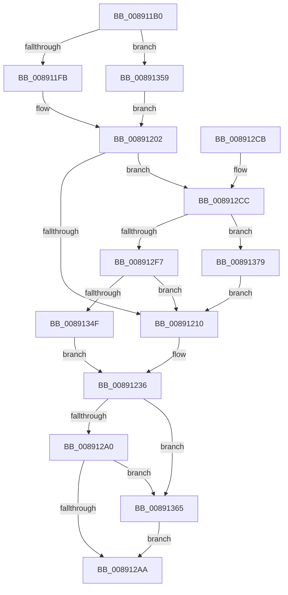

# SeCreateClientSecurity

- RVA: `0x008911B0`–`0x00891389` (길이 `473` bytes)
- VA: `0x00000001408911B0`
- 실행 섹션: `PAGE`
- PDB 이름 있음: `예`; PDB Function 태그: `아니요`
- unwind 정보 RVA: `0x0007D830`
- 디코드: `105`개 명령, `473/473` bytes 표시
- 미해석 바이트: `0` (있으면 어셈블리에 `.byte`로 보존)

> 이 문서는 커널 이미지의 기계어와 PDB 기호를 분석해 생성했습니다. 4번과 5번은 함수 원형과 자료형을 바이너리 사용 방식에서 추정한 C 해석이며 원본 소스 복구 결과는 아닙니다.

## 1. Dependencies

- 직접 호출 지점: **8**; 고유 호출 대상: **7**
- 직접 호출자로 확인된 함수: **6**
- RIP 상대 이미지 참조: **0**

### Outgoing calls
- `0x00891218` → [PsReferencePrimaryTokenWithTag](../../text/20/PsReferencePrimaryTokenWithTag_function_0020FF80.md) (function, `0x0020FF80`)
- `0x0089124F` → [SepReconcileTrustSidWithProcessProtection](../../text/3E/SepReconcileTrustSidWithProcessProtection_function_003EDE50.md) (function, `0x003EDE50`)
- `0x00891291` → [SepCreateClientSecurityEx](SepCreateClientSecurityEx_function_00891C90.md) (function, `0x00891C90`)
- `0x008912E4` → [PspLockThreadSecurityShared](../../text/3C/PspLockThreadSecurityShared_function_003C4720.md) (function, `0x003C4720`)
- `0x0089130A` → [ObfReferenceObjectWithTag](../../text/21/ObfReferenceObjectWithTag_function_00210710.md) (function, `0x00210710`)
- `0x00891341` → [PspUnlockThreadSecurityShared](../../text/3C/PspUnlockThreadSecurityShared_function_003C2E40.md) (function, `0x003C2E40`)
- `0x0089136D` → [ObfDereferenceObjectWithTag](../../text/2F/ObfDereferenceObjectWithTag_function_002F78E0.md) (function, `0x002F78E0`)
- `0x0089137F` → [PspUnlockThreadSecurityShared](../../text/3C/PspUnlockThreadSecurityShared_function_003C2E40.md) (function, `0x003C2E40`)

### Direct callers
- [sub_00896999](Unknown_function_00896999.md) at `0x00896A58`
- [NtImpersonateThread](../8C/NtImpersonateThread_function_008CD230.md) at `0x008CD344`
- [AlpcpCreateClientPort](../92/AlpcpCreateClientPort_function_009270AC.md) at `0x0092751D`
- [EtwpStartLogger](../A9/EtwpStartLogger_function_00A99D80.md) at `0x00A9A9E3`
- [EtwpUpdateTrace](../AB/EtwpUpdateTrace_function_00ABCC7C.md) at `0x00ABCE35`
- [EtwpFixBootLoggers](../../init/C4/EtwpFixBootLoggers_function_00C4F09C.md) at `0x00C4F164`

### Static image references
- 디코드된 RIP-relative 메모리 참조가 없습니다.

## 2. Other-region calls and transfers

- 다른 실행 섹션으로 향하는 call: **7**
  - `0x00891218` → [PsReferencePrimaryTokenWithTag](../../text/20/PsReferencePrimaryTokenWithTag_function_0020FF80.md) (`PAGE` → `.text`)
  - `0x0089124F` → [SepReconcileTrustSidWithProcessProtection](../../text/3E/SepReconcileTrustSidWithProcessProtection_function_003EDE50.md) (`PAGE` → `.text`)
  - `0x008912E4` → [PspLockThreadSecurityShared](../../text/3C/PspLockThreadSecurityShared_function_003C4720.md) (`PAGE` → `.text`)
  - `0x0089130A` → [ObfReferenceObjectWithTag](../../text/21/ObfReferenceObjectWithTag_function_00210710.md) (`PAGE` → `.text`)
  - `0x00891341` → [PspUnlockThreadSecurityShared](../../text/3C/PspUnlockThreadSecurityShared_function_003C2E40.md) (`PAGE` → `.text`)
  - `0x0089136D` → [ObfDereferenceObjectWithTag](../../text/2F/ObfDereferenceObjectWithTag_function_002F78E0.md) (`PAGE` → `.text`)
  - `0x0089137F` → [PspUnlockThreadSecurityShared](../../text/3C/PspUnlockThreadSecurityShared_function_003C2E40.md) (`PAGE` → `.text`)
- 별도 외부 분기/꼬리 이동을 확인하지 못했습니다.

## 3. Assembly (complete function range)

```asm
008911B0  48 89 5C 24 10                  mov qword ptr [rsp + 0x10], rbx
008911B5  48 89 6C 24 18                  mov qword ptr [rsp + 0x18], rbp
008911BA  48 89 74 24 20                  mov qword ptr [rsp + 0x20], rsi
008911BF  57                              push rdi
008911C0  41 54                           push r12
008911C2  41 55                           push r13
008911C4  41 56                           push r14
008911C6  41 57                           push r15
008911C8  48 81 EC 80 00 00 00            sub rsp, 0x80
008911CF  65 48 8B 2C 25 88 01 00 00      mov rbp, qword ptr gs:[0x188]
008911D8  45 33 FF                        xor r15d, r15d
008911DB  44 88 7C 24 60                  mov byte ptr [rsp + 0x60], r15b
008911E0  4D 8B E1                        mov r12, r9
008911E3  4C 89 7C 24 68                  mov qword ptr [rsp + 0x68], r15
008911E8  45 0F B6 E8                     movzx r13d, r8b
008911EC  48 8B FA                        mov rdi, rdx
008911EF  48 8B D9                        mov rbx, rcx
008911F2  48 3B CD                        cmp rcx, rbp
008911F5  0F 85 5E 01 00 00               jne 0x140891359
008911FB  48 8B AD B8 00 00 00            mov rbp, qword ptr [rbp + 0xb8]
00891202  8B 81 A0 05 00 00               mov eax, dword ptr [rcx + 0x5a0]
00891208  A8 08                           test al, 8
0089120A  0F 85 BC 00 00 00               jne 0x1408912cc
00891210  BA 53 65 43 63                  mov edx, 0x63436553
00891215  48 8B CD                        mov rcx, rbp
00891218  E8 63 ED 97 FF                  call 0x14020ff80
0089121D  0F B6 8D FA 05 00 00            movzx ecx, byte ptr [rbp + 0x5fa]
00891224  48 8B F0                        mov rsi, rax
00891227  88 8C 24 B0 00 00 00            mov byte ptr [rsp + 0xb0], cl
0089122E  BB 01 00 00 00                  mov ebx, 1
00891233  45 32 F6                        xor r14b, r14b
00891236  48 8B 8E 50 04 00 00            mov rcx, qword ptr [rsi + 0x450]
0089123D  4C 8D 4C 24 68                  lea r9, [rsp + 0x68]
00891242  4C 8D 44 24 60                  lea r8, [rsp + 0x60]
00891247  48 8D 94 24 B0 00 00 00         lea rdx, [rsp + 0xb0]
0089124F  E8 FC CB B5 FF                  call 0x1403ede50
00891254  48 8B 4C 24 68                  mov rcx, qword ptr [rsp + 0x68]
00891259  44 8B CB                        mov r9d, ebx
0089125C  0F B6 44 24 60                  movzx eax, byte ptr [rsp + 0x60]
00891261  45 0F B6 C5                     movzx r8d, r13b
00891265  4C 89 64 24 50                  mov qword ptr [rsp + 0x50], r12
0089126A  48 8B D7                        mov rdx, rdi
0089126D  48 89 4C 24 48                  mov qword ptr [rsp + 0x48], rcx
00891272  48 8B CE                        mov rcx, rsi
00891275  88 44 24 40                     mov byte ptr [rsp + 0x40], al
00891279  48 C7 44 24 38 00 00 00 00      mov qword ptr [rsp + 0x38], 0
00891282  C6 44 24 30 00                  mov byte ptr [rsp + 0x30], 0
00891287  44 89 7C 24 28                  mov dword ptr [rsp + 0x28], r15d
0089128C  44 88 74 24 20                  mov byte ptr [rsp + 0x20], r14b
00891291  E8 FA 09 00 00                  call 0x140891c90
00891296  8B D8                           mov ebx, eax
00891298  85 C0                           test eax, eax
0089129A  0F 88 C5 00 00 00               js 0x140891365
008912A0  80 7F 08 00                     cmp byte ptr [rdi + 8], 0
008912A4  0F 84 BB 00 00 00               je 0x140891365
008912AA  4C 8D 9C 24 80 00 00 00         lea r11, [rsp + 0x80]
008912B2  49 8B 5B 38                     mov rbx, qword ptr [r11 + 0x38]
008912B6  49 8B 6B 40                     mov rbp, qword ptr [r11 + 0x40]
008912BA  49 8B 73 48                     mov rsi, qword ptr [r11 + 0x48]
008912BE  49 8B E3                        mov rsp, r11
008912C1  41 5F                           pop r15
008912C3  41 5E                           pop r14
008912C5  41 5D                           pop r13
008912C7  41 5C                           pop r12
008912C9  5F                              pop rdi
008912CA  C3                              ret
008912CB  CC                              int3
008912CC  65 48 8B 34 25 88 01 00 00      mov rsi, qword ptr gs:[0x188]
008912D5  4C 8B B1 20 02 00 00            mov r14, qword ptr [rcx + 0x220]
008912DC  48 8B D6                        mov rdx, rsi
008912DF  48 89 74 24 70                  mov qword ptr [rsp + 0x70], rsi
008912E4  E8 37 34 B3 FF                  call 0x1403c4720
008912E9  8B 83 A0 05 00 00               mov eax, dword ptr [rbx + 0x5a0]
008912EF  A8 08                           test al, 8
008912F1  0F 84 82 00 00 00               je 0x140891379
008912F7  48 8B B3 38 05 00 00            mov rsi, qword ptr [rbx + 0x538]
008912FE  BA 53 65 43 63                  mov edx, 0x63436553
00891303  48 83 E6 F8                     and rsi, 0xfffffffffffffff8
00891307  48 8B CE                        mov rcx, rsi
0089130A  E8 01 F4 97 FF                  call 0x140210710
0089130F  41 0F B6 86 FA 05 00 00         movzx eax, byte ptr [r14 + 0x5fa]
00891317  48 8B CB                        mov rcx, rbx
0089131A  44 0F B6 B3 38 05 00 00         movzx r14d, byte ptr [rbx + 0x538]
00891322  44 8B BB 38 05 00 00            mov r15d, dword ptr [rbx + 0x538]
00891329  48 8B 54 24 70                  mov rdx, qword ptr [rsp + 0x70]
0089132E  41 83 E7 03                     and r15d, 3
00891332  41 C0 EE 02                     shr r14b, 2
00891336  41 80 E6 01                     and r14b, 1
0089133A  88 84 24 B0 00 00 00            mov byte ptr [rsp + 0xb0], al
00891341  E8 FA 1A B3 FF                  call 0x1403c2e40
00891346  48 85 F6                        test rsi, rsi
00891349  0F 84 C1 FE FF FF               je 0x140891210
0089134F  BB 02 00 00 00                  mov ebx, 2
00891354  E9 DD FE FF FF                  jmp 0x140891236
00891359  48 8B A9 20 02 00 00            mov rbp, qword ptr [rcx + 0x220]
00891360  E9 9D FE FF FF                  jmp 0x140891202
00891365  BA 53 65 43 63                  mov edx, 0x63436553
0089136A  48 8B CE                        mov rcx, rsi
0089136D  E8 6E 65 A6 FF                  call 0x1402f78e0
00891372  8B C3                           mov eax, ebx
00891374  E9 31 FF FF FF                  jmp 0x1408912aa
00891379  48 8B D6                        mov rdx, rsi
0089137C  48 8B CB                        mov rcx, rbx
0089137F  E8 BC 1A B3 FF                  call 0x1403c2e40
00891384  E9 87 FE FF FF                  jmp 0x140891210
```

## 4. C-style interpretation (structured pseudocode)

```c
__int64 __fastcall SeCreateClientSecurity(__int64 a1, __int64 a2, unsigned __int8 a3, __int64 a4)
{
    __int64 result;
    __int64 v_r14;
    __int64 v_r15;
    __int64 v_rsi;
    __int64 v_rsp;
    unsigned __int64 v_stack_m10;
    unsigned __int64 v_stack_m28;
    unsigned __int64 v_stack_m40;
    unsigned __int8 v_stack_m48;
    unsigned __int64 v_stack_m58;
    unsigned __int64 v_stack_m60;
    unsigned __int8 v_stack_m68;
    unsigned __int64 v_stack_m70;
    unsigned __int8 v_stack_m78;
    unsigned int v_stack_m80;
    unsigned __int8 v_stack_m88;
    unsigned __int64 v_stack_p10;
    unsigned __int64 v_stack_p18;
    unsigned __int64 v_stack_p20;
    unsigned __int8 v_stack_p30;
    unsigned __int8 v_stack_p8;

    v_stack_p10 = v_rbx;
    v_stack_p18 = v_rbp;
    v_stack_p20 = v_rsi;
    v_rsp = (v_rsp) - (128);
    v_r15 = 0;
    v_stack_m48 = 0;
    v_stack_m40 = 0;
    if (a1 != (*(unsigned __int64 *)(gs_base + (0 + 392)))) goto loc_00891359;
loc_00891202:
    if ((((unsigned __int8)((unsigned int)(*(unsigned int *)(a1 + 1440)))) & (8)) != 0) goto loc_008912CC;
loc_00891210:
    result = PsReferencePrimaryTokenWithTag(*(unsigned __int64 *)(*(unsigned __int64 *)(gs_base + (0 + 392)) + 184), (unsigned int)(0x63436553ULL), a3, a4);
    v_stack_p8 = (unsigned __int8)(*(unsigned __int8 *)(*(unsigned __int64 *)(*(unsigned __int64 *)(gs_base + (0 + 392)) + 184) + 1530));
    v_r14 = 0;
loc_00891236:
    result = SepReconcileTrustSidWithProcessProtection(*(unsigned __int64 *)(result + 1104), v_stack_p8, v_stack_m48, v_stack_m40);
    v_stack_m58 = a4;
    v_stack_m60 = v_stack_m40;
    v_stack_m68 = (unsigned __int8)(v_stack_m48);
    v_stack_m70 = 0;
    v_stack_m78 = 0;
    v_stack_m80 = 0;
    v_stack_m88 = 0;
    result = SepCreateClientSecurityEx(result, a2, a3, 1);
    if (sign_flag) goto loc_00891365;
    if ((*(unsigned __int8 *)(a2 + 8)) == 0) goto loc_00891365;
loc_008912AA:
    return result;
loc_008912CC:
    v_stack_m10 = *(unsigned __int64 *)(gs_base + (0 + 392));
    result = PspLockThreadSecurityShared(result, *(unsigned __int64 *)(gs_base + (0 + 392)), a3, 1);
    if ((((unsigned __int8)((unsigned int)(*(unsigned int *)(*(unsigned __int64 *)(v_stack_m28 + 56) + 1440)))) & (8)) == 0) goto loc_00891379;
    v_rsi = (*(unsigned __int64 *)(*(unsigned __int64 *)(v_stack_m28 + 56) + 1336)) & (-8);
    result = ObfReferenceObjectWithTag(v_rsi, (unsigned int)(0x63436553ULL), a3, 1);
    v_r15 = (unsigned int)(((unsigned int)(*(unsigned int *)(*(unsigned __int64 *)(v_stack_m28 + 56) + 1336))) & (3));
    v_r14 = (unsigned __int8)((*(unsigned __int8 *)(*(unsigned __int64 *)(v_stack_m28 + 56) + 1336)) >> (2));
    v_r14 = (unsigned __int8)((v_r14) & (1));
    v_stack_p30 = (unsigned __int8)(*(unsigned __int8 *)(*(unsigned __int64 *)(result + 544) + 1530));
    result = PspUnlockThreadSecurityShared(*(unsigned __int64 *)(v_stack_m28 + 56), v_stack_m10, a3, 1);
    if (v_rsi == 0) goto loc_00891210;
    goto loc_00891236;
loc_00891359:
    goto loc_00891202;
loc_00891365:
    result = ObfDereferenceObjectWithTag(v_rsi, (unsigned int)(0x63436553ULL), a3, 1);
    goto loc_008912AA;
loc_00891379:
    result = PspUnlockThreadSecurityShared(2, v_rsi, a3, 1);
    goto loc_00891210;
}
```

## 5. (Beta) C Style

```c
int64_t SeCreateClientSecurity(void *Arg1, void *Arg2, uint8_t Arg3, int64_t Arg4)
{
    uint8_t *arg1 = (uint8_t *)Arg1;
    uint8_t *arg2 = (uint8_t *)Arg2;

    int64_t result;
    int64_t local_r14;
    int64_t local_r15;
    int64_t local_rsi;
    int64_t local_rsp;
    uint64_t v_stack_m10;
    uint64_t v_stack_m28;
    uint64_t v_stack_m40;
    uint8_t v_stack_m48;
    uint64_t v_stack_m58;
    uint64_t v_stack_m60;
    uint8_t v_stack_m68;
    uint64_t v_stack_m70;
    uint8_t v_stack_m78;
    uint32_t v_stack_m80;
    uint8_t v_stack_m88;
    uint64_t v_stack_p10;
    uint64_t v_stack_p18;
    uint64_t v_stack_p20;
    uint8_t v_stack_p30;
    uint8_t v_stack_p8;

    v_stack_p10 = local_rbx;
    v_stack_p18 = local_rbp;
    v_stack_p20 = local_rsi;
    local_rsp = (local_rsp) - (128);
    local_r15 = 0;
    v_stack_m48 = 0;
    v_stack_m40 = 0;
    if (Arg1 != (*(uint64_t *)(gs_base + (0 + 0x188)))) goto loc_00891359;
loc_00891202:
    if ((((uint8_t)((uint32_t)(*(uint32_t *)(arg1 + 0x5A0)))) & (8)) != 0) goto loc_008912CC;
loc_00891210:
    result = PsReferencePrimaryTokenWithTag(*(uint64_t *)(*(uint64_t *)(gs_base + (0 + 0x188)) + 0xB8), (uint32_t)(0x63436553ULL), Arg3, Arg4);
    v_stack_p8 = (uint8_t)(*(uint8_t *)(*(uint64_t *)(*(uint64_t *)(gs_base + (0 + 0x188)) + 0xB8) + 0x5FA));
    local_r14 = 0;
loc_00891236:
    result = SepReconcileTrustSidWithProcessProtection(*(uint64_t *)(result + 0x450), v_stack_p8, v_stack_m48, v_stack_m40);
    v_stack_m58 = Arg4;
    v_stack_m60 = v_stack_m40;
    v_stack_m68 = (uint8_t)(v_stack_m48);
    v_stack_m70 = 0;
    v_stack_m78 = 0;
    v_stack_m80 = 0;
    v_stack_m88 = 0;
    result = SepCreateClientSecurityEx(result, Arg2, Arg3, 1);
    if (sign_flag) goto loc_00891365;
    if ((*(uint8_t *)(arg2 + 0x8)) == 0) goto loc_00891365;
loc_008912AA:
    return result;
loc_008912CC:
    v_stack_m10 = *(uint64_t *)(gs_base + (0 + 0x188));
    result = PspLockThreadSecurityShared(result, *(uint64_t *)(gs_base + (0 + 0x188)), Arg3, 1);
    if ((((uint8_t)((uint32_t)(*(uint32_t *)(*(uint64_t *)(v_stack_m28 + 0x38) + 0x5A0)))) & (8)) == 0) goto loc_00891379;
    local_rsi = (*(uint64_t *)(*(uint64_t *)(v_stack_m28 + 0x38) + 0x538)) & (-8);
    result = ObfReferenceObjectWithTag(local_rsi, (uint32_t)(0x63436553ULL), Arg3, 1);
    local_r15 = (uint32_t)(((uint32_t)(*(uint32_t *)(*(uint64_t *)(v_stack_m28 + 0x38) + 0x538))) & (3));
    local_r14 = (uint8_t)((*(uint8_t *)(*(uint64_t *)(v_stack_m28 + 0x38) + 0x538)) >> (2));
    local_r14 = (uint8_t)((local_r14) & (1));
    v_stack_p30 = (uint8_t)(*(uint8_t *)(*(uint64_t *)(result + 0x220) + 0x5FA));
    result = PspUnlockThreadSecurityShared(*(uint64_t *)(v_stack_m28 + 0x38), v_stack_m10, Arg3, 1);
    if (local_rsi == 0) goto loc_00891210;
    goto loc_00891236;
loc_00891359:
    goto loc_00891202;
loc_00891365:
    result = ObfDereferenceObjectWithTag(local_rsi, (uint32_t)(0x63436553ULL), Arg3, 1);
    goto loc_008912AA;
loc_00891379:
    result = PspUnlockThreadSecurityShared(2, local_rsi, Arg3, 1);
    goto loc_00891210;
}
```

### 관측된 메모리 오프셋

구조체 형식이 확인되지 않은 접근은 인자 기준의 오프셋으로만 기록했습니다.

| 기준 인자 | 오프셋 표현 | 폭 (bit) | 접근 |
|---|---:|---:|---|
| `Arg1` | `+ 0x538` | `8` | `R` |
| `Arg1` | `+ 0x538` | `32` | `R` |
| `Arg1` | `+ 0x538` | `64` | `R` |
| `Arg1` | `+ 0x5A0` | `32` | `R` |
| `Arg2` | `+ 0x8` | `8` | `R` |

## 6. Execution-region graph

[열기: 2D/3D 그래프와 함수 탐색 컨트롤 패널](../../../control-panel.html?section=page&rva=0x008911B0&view=graph)

- 2D 그래프는 위에서 아래로 흐르고, 3D 그래프는 빈 공간을 드래그해 회전합니다. Shift+드래그는 이동, 휠은 확대·축소, 함수 노드 선택은 대상 보고서 이동입니다.

### Static fallback


