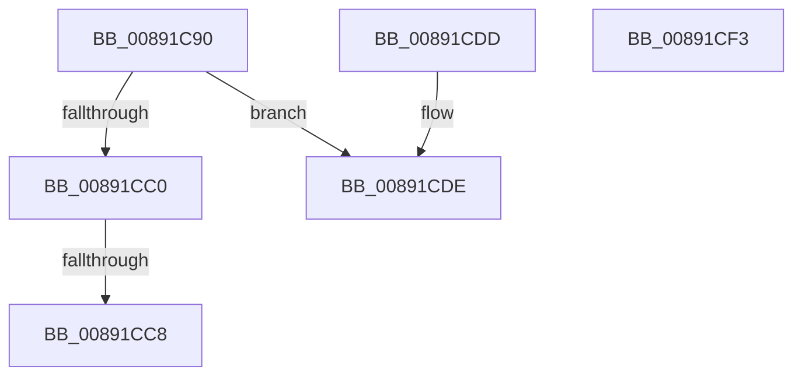

# SepCreateClientSecurityEx

- RVA: `0x00891C90`–`0x00891CF4` (길이 `100` bytes)
- VA: `0x0000000140891C90`
- 실행 섹션: `PAGE`
- PDB 이름 있음: `예`; PDB Function 태그: `예`
- unwind 정보 RVA: `0x0007DA64`
- 디코드: `37`개 명령, `100/100` bytes 표시
- 미해석 바이트: `0` (있으면 어셈블리에 `.byte`로 보존)

> 이 문서는 커널 이미지의 기계어와 PDB 기호를 분석해 생성했습니다. 4번과 5번은 함수 원형과 자료형을 바이너리 사용 방식에서 추정한 C 해석이며 원본 소스 복구 결과는 아닙니다.

## 1. Dependencies

- 직접 호출 지점: **0**; 고유 호출 대상: **0**
- 직접 호출자로 확인된 함수: **7**
- RIP 상대 이미지 참조: **0**

### Outgoing calls
- 직접 디코드된 call 명령이 없습니다.

### Direct callers
- [SeCreateClientSecurityFromSubjectContextEx](../../text/60/SeCreateClientSecurityFromSubjectContextEx_function_00609440.md) at `0x00609505`
- [AlpcpCreateSecurityContext](AlpcpCreateSecurityContext_function_00890D94.md) at `0x00890F29`
- [SeCreateClientSecurity](SeCreateClientSecurity_function_008911B0.md) at `0x00891291`
- [AlpcpExposeTokenAttribute](AlpcpExposeTokenAttribute_function_00891390.md) at `0x0089152B`
- [sub_00891777](Unknown_function_00891777.md) at `0x0089184D`
- [sub_00891A05](Unknown_function_00891A05.md) at `0x00891ACD`
- [SeCreateClientSecurityFromSubjectContext](../A4/SeCreateClientSecurityFromSubjectContext_function_00A4D360.md) at `0x00A4D3EA`

### Static image references
- 디코드된 RIP-relative 메모리 참조가 없습니다.

## 2. Other-region calls and transfers

- 다른 실행 섹션으로 향하는 call: **0**
- call이 아닌 외부 분기/꼬리 이동: **1**
  - `0x00891CC6` → [sub_00891CF4](Unknown_function_00891CF4.md) (`tail-transfer`)

## 3. Assembly (complete function range)

```asm
00891C90  40 55                           push rbp
00891C92  56                              push rsi
00891C93  41 55                           push r13
00891C95  41 56                           push r14
00891C97  41 57                           push r15
00891C99  48 8B EC                        mov rbp, rsp
00891C9C  48 81 EC 80 00 00 00            sub rsp, 0x80
00891CA3  45 33 ED                        xor r13d, r13d
00891CA6  48 8B F2                        mov rsi, rdx
00891CA9  32 D2                           xor dl, dl
00891CAB  4C 89 6D C0                     mov qword ptr [rbp - 0x40], r13
00891CAF  45 0F B6 F0                     movzx r14d, r8b
00891CB3  4C 89 6D 38                     mov qword ptr [rbp + 0x38], r13
00891CB7  4C 8B F9                        mov r15, rcx
00891CBA  80 7E 08 02                     cmp byte ptr [rsi + 8], 2
00891CBE  73 1E                           jae 0x140891cde
00891CC0  8B 46 04                        mov eax, dword ptr [rsi + 4]
00891CC3  83 F8 03                        cmp eax, 3
00891CC6  76 2C                           jbe 0x140891cf4
00891CC8  B8 A5 00 00 C0                  mov eax, 0xc00000a5
00891CCD  48 81 C4 80 00 00 00            add rsp, 0x80
00891CD4  41 5F                           pop r15
00891CD6  41 5E                           pop r14
00891CD8  41 5D                           pop r13
00891CDA  5E                              pop rsi
00891CDB  5D                              pop rbp
00891CDC  C3                              ret
00891CDD  CC                              int3
00891CDE  B8 0D 00 00 C0                  mov eax, 0xc000000d
00891CE3  48 81 C4 80 00 00 00            add rsp, 0x80
00891CEA  41 5F                           pop r15
00891CEC  41 5E                           pop r14
00891CEE  41 5D                           pop r13
00891CF0  5E                              pop rsi
00891CF1  5D                              pop rbp
00891CF2  C3                              ret
00891CF3  CC                              int3
```

## 4. C-style interpretation (structured pseudocode)

```c
__int64 __fastcall SepCreateClientSecurityEx(__int64 a1, __int64 a2, unsigned __int8 a3)
{
    __int64 v_r13;
    __int64 v_rsp;
    unsigned __int64 v_stack_m68;
    unsigned __int64 v_stack_p10;

    v_rsp = (v_rsp) - (128);
    v_r13 = 0;
    a2 = 0;
    v_stack_m68 = 0;
    v_stack_p10 = 0;
    if ((*(unsigned __int8 *)(a2 + 8)) >= 2) goto loc_00891CDE;
    v_rsp = (v_rsp) + (128);
    return (unsigned int)(0xC00000A5ULL);
loc_00891CDE:
    v_rsp = (v_rsp) + (128);
    return (unsigned int)(0xC000000DULL);
}
```

## 5. (Beta) C Style

```c
int64_t SepCreateClientSecurityEx(int64_t Arg1, void *Arg2, uint8_t Arg3)
{
    uint8_t *arg2 = (uint8_t *)Arg2;

    int64_t local_r13;
    int64_t local_rsp;
    uint64_t v_stack_m68;
    uint64_t v_stack_p10;

    local_rsp = (local_rsp) - (128);
    local_r13 = 0;
    Arg2 = 0;
    v_stack_m68 = 0;
    v_stack_p10 = 0;
    if ((*(uint8_t *)(arg2 + 0x8)) >= 2) goto loc_00891CDE;
    local_rsp = (local_rsp) + (128);
    return (uint32_t)(0xC00000A5ULL);
loc_00891CDE:
    local_rsp = (local_rsp) + (128);
    return (uint32_t)(0xC000000DULL);
}
```

### 관측된 메모리 오프셋

구조체 형식이 확인되지 않은 접근은 인자 기준의 오프셋으로만 기록했습니다.

| 기준 인자 | 오프셋 표현 | 폭 (bit) | 접근 |
|---|---:|---:|---|
| `Arg2` | `+ 0x4` | `32` | `R` |
| `Arg2` | `+ 0x8` | `8` | `R` |

## 6. Execution-region graph

[열기: 2D/3D 그래프와 함수 탐색 컨트롤 패널](../../../control-panel.html?section=page&rva=0x00891C90&view=graph)

- 2D 그래프는 위에서 아래로 흐르고, 3D 그래프는 빈 공간을 드래그해 회전합니다. Shift+드래그는 이동, 휠은 확대·축소, 함수 노드 선택은 대상 보고서 이동입니다.

### Static fallback


