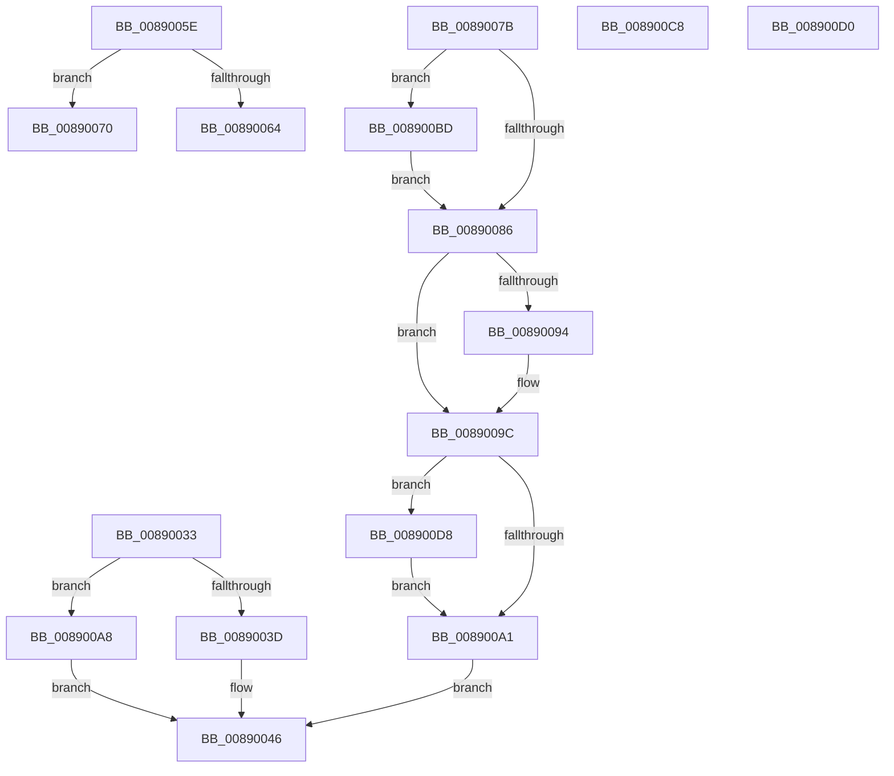

# sub_00890033

- RVA: `0x00890033`–`0x008900E2` (길이 `175` bytes)
- VA: `0x0000000140890033`
- 실행 섹션: `PAGE`
- PDB 이름 있음: `아니요`; PDB Function 태그: `아니요`
- unwind 정보 RVA: `0x0007D684`
- 디코드: `53`개 명령, `175/175` bytes 표시
- 미해석 바이트: `0` (있으면 어셈블리에 `.byte`로 보존)

> 이 문서는 커널 이미지의 기계어와 PDB 기호를 분석해 생성했습니다. 4번과 5번은 함수 원형과 자료형을 바이너리 사용 방식에서 추정한 C 해석이며 원본 소스 복구 결과는 아닙니다.

## 1. Dependencies

- 직접 호출 지점: **5**; 고유 호출 대상: **4**
- 직접 호출자로 확인된 함수: **0**
- RIP 상대 이미지 참조: **0**

### Outgoing calls
- `0x0089008A` → [KeAbPostRelease](../../text/2E/KeAbPostRelease_function_002E1600.md) (function, `0x002E1600`)
- `0x00890097` → [ObfDereferenceObject](../../text/2F/ObfDereferenceObject_function_002F9350.md) (function, `0x002F9350`)
- `0x008900B1` → [AlpcpUnlockAndDereferenceTargetPortsAndCommunicationInfo](../88/AlpcpUnlockAndDereferenceTargetPortsAndCommunicationInfo_function_0088FE2C.md) (function, `0x0088FE2C`)
- `0x008900C1` → [ExfReleasePushLockShared](../../text/26/ExfReleasePushLockShared_function_00263440.md) (function, `0x00263440`)
- `0x008900DB` → [ObfDereferenceObject](../../text/2F/ObfDereferenceObject_function_002F9350.md) (function, `0x002F9350`)

### Direct callers
- 이 함수 시작 RVA로 연결되는 직접 call은 확인되지 않았습니다. 간접 호출은 완전히 역산할 수 없습니다.

### Static image references
- 디코드된 RIP-relative 메모리 참조가 없습니다.

## 2. Other-region calls and transfers

- 다른 실행 섹션으로 향하는 call: **4**
  - `0x0089008A` → [KeAbPostRelease](../../text/2E/KeAbPostRelease_function_002E1600.md) (`PAGE` → `.text`)
  - `0x00890097` → [ObfDereferenceObject](../../text/2F/ObfDereferenceObject_function_002F9350.md) (`PAGE` → `.text`)
  - `0x008900C1` → [ExfReleasePushLockShared](../../text/26/ExfReleasePushLockShared_function_00263440.md) (`PAGE` → `.text`)
  - `0x008900DB` → [ObfDereferenceObject](../../text/2F/ObfDereferenceObject_function_002F9350.md) (`PAGE` → `.text`)
- call이 아닌 외부 분기/꼬리 이동: **4**
  - `0x0089006B` → [AlpcpReferenceAndLockTargetPortsAndCommunicationInfo + 0x78](../88/AlpcpReferenceAndLockTargetPortsAndCommunicationInfo_function_0088FEE0.md) (`tail-transfer`)
  - `0x00890076` → [AlpcpReferenceAndLockTargetPortsAndCommunicationInfo + 0x78](../88/AlpcpReferenceAndLockTargetPortsAndCommunicationInfo_function_0088FEE0.md) (`tail-transfer`)
  - `0x008900CB` → [AlpcpReferenceAndLockTargetPortsAndCommunicationInfo + 0x8F](../88/AlpcpReferenceAndLockTargetPortsAndCommunicationInfo_function_0088FEE0.md) (`tail-transfer`)
  - `0x008900D3` → [AlpcpReferenceAndLockTargetPortsAndCommunicationInfo + 0xA4](../88/AlpcpReferenceAndLockTargetPortsAndCommunicationInfo_function_0088FEE0.md) (`tail-transfer`)

## 3. Assembly (complete function range)

```asm
00890033  8B 87 A0 01 00 00               mov eax, dword ptr [rdi + 0x1a0]
00890039  A8 20                           test al, 0x20
0089003B  75 6B                           jne 0x1408900a8
0089003D  49 89 1C 24                     mov qword ptr [r12], rbx
00890041  33 C0                           xor eax, eax
00890043  49 89 3F                        mov qword ptr [r15], rdi
00890046  48 8B 5C 24 60                  mov rbx, qword ptr [rsp + 0x60]
0089004B  48 8B 74 24 68                  mov rsi, qword ptr [rsp + 0x68]
00890050  48 83 C4 20                     add rsp, 0x20
00890054  41 5F                           pop r15
00890056  41 5E                           pop r14
00890058  41 5D                           pop r13
0089005A  41 5C                           pop r12
0089005C  5F                              pop rdi
0089005D  C3                              ret
0089005E  CC                              int3
0089005F  83 FE 01                        cmp esi, 1
00890062  74 0C                           je 0x140890070
00890064  49 8B 5E 10                     mov rbx, qword ptr [r14 + 0x10]
00890068  48 8B FB                        mov rdi, rbx
0089006B  E9 E8 FE FF FF                  jmp 0x14088ff58
00890070  49 8B 1E                        mov rbx, qword ptr [r14]
00890073  48 8B FB                        mov rdi, rbx
00890076  E9 DD FE FF FF                  jmp 0x14088ff58
0089007B  49 8B C5                        mov rax, r13
0089007E  F0 49 0F B1 76 F0               lock cmpxchg qword ptr [r14 - 0x10], rsi
00890084  75 37                           jne 0x1408900bd
00890086  49 8D 4E F0                     lea rcx, [r14 - 0x10]
0089008A  E8 71 15 A5 FF                  call 0x1402e1600
0089008F  48 85 DB                        test rbx, rbx
00890092  74 08                           je 0x14089009c
00890094  48 8B CB                        mov rcx, rbx
00890097  E8 B4 92 A6 FF                  call 0x1402f9350
0089009C  48 85 FF                        test rdi, rdi
0089009F  75 37                           jne 0x1408900d8
008900A1  B8 37 00 00 C0                  mov eax, 0xc0000037
008900A6  EB 9E                           jmp 0x140890046
008900A8  4C 8B C7                        mov r8, rdi
008900AB  48 8B D3                        mov rdx, rbx
008900AE  49 8B CE                        mov rcx, r14
008900B1  E8 76 FD FF FF                  call 0x14088fe2c
008900B6  B8 37 00 00 C0                  mov eax, 0xc0000037
008900BB  EB 89                           jmp 0x140890046
008900BD  49 8D 4E F0                     lea rcx, [r14 - 0x10]
008900C1  E8 7A 33 9D FF                  call 0x140263440
008900C6  EB BE                           jmp 0x140890086
008900C8  48 8B DE                        mov rbx, rsi
008900CB  E9 9F FE FF FF                  jmp 0x14088ff6f
008900D0  48 8B FE                        mov rdi, rsi
008900D3  E9 AC FE FF FF                  jmp 0x14088ff84
008900D8  48 8B CF                        mov rcx, rdi
008900DB  E8 70 92 A6 FF                  call 0x1402f9350
008900E0  EB BF                           jmp 0x1408900a1
```

## 4. C-style interpretation (structured pseudocode)

```c
__int64 __fastcall sub_00890033(__int64 a1, __int64 a2, __int64 a3, __int64 a4, __int64 a5, __int64 a6, __int64 a7, __int64 a8, __int64 a9, __int64 a10, __int64 a11, __int64 a12, __int64 a13)
{
    __int64 result;
    __int64 v_rsp;

    if ((((unsigned __int8)((unsigned int)(*(unsigned int *)(v_rdi + 416)))) & (32)) != 0) goto loc_008900A8;
    *(unsigned __int64 *)(v_r12) = v_rbx;
    result = 0;
    *(unsigned __int64 *)(v_r15) = v_rdi;
loc_00890046:
    v_rsp = (v_rsp) + (32);
    return result;
loc_008900A8:
    result = AlpcpUnlockAndDereferenceTargetPortsAndCommunicationInfo(v_r14, a12, v_rdi, a4);
    goto loc_00890046;
}
```

## 5. (Beta) C Style

```c
int64_t sub_00890033(int64_t Arg1, int64_t Arg2, int64_t Arg3, int64_t Arg4, uint64_t Arg5, uint64_t Arg6, uint64_t Arg7, uint64_t Arg8, uint64_t Arg9, uint64_t Arg10, uint64_t Arg11, int64_t Arg12, int64_t Arg13)
{
    int64_t result;
    int64_t local_rsp;

    if ((((uint8_t)((uint32_t)(*(uint32_t *)(local_rdi + 0x1A0)))) & (32)) != 0) goto loc_008900A8;
    *(uint64_t *)(local_r12) = local_rbx;
    result = 0;
    *(uint64_t *)(local_r15) = local_rdi;
loc_00890046:
    local_rsp = (local_rsp) + (32);
    return result;
loc_008900A8:
    result = AlpcpUnlockAndDereferenceTargetPortsAndCommunicationInfo(local_r14, Arg12, local_rdi, Arg4);
    goto loc_00890046;
}
```

## 6. Execution-region graph

[열기: 2D/3D 그래프와 함수 탐색 컨트롤 패널](../../../control-panel.html?section=page&rva=0x00890033&view=graph)

- 2D 그래프는 위에서 아래로 흐르고, 3D 그래프는 빈 공간을 드래그해 회전합니다. Shift+드래그는 이동, 휠은 확대·축소, 함수 노드 선택은 대상 보고서 이동입니다.

### Static fallback


