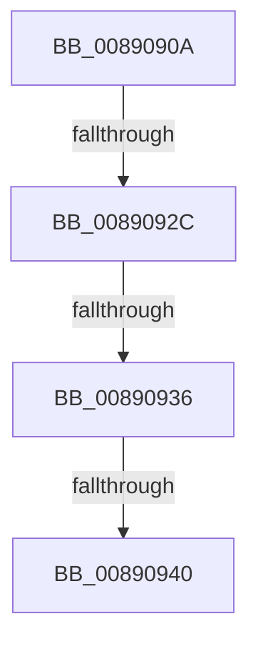

# sub_0089090A

- RVA: `0x0089090A`–`0x00890964` (길이 `90` bytes)
- VA: `0x000000014089090A`
- 실행 섹션: `PAGE`
- PDB 이름 있음: `아니요`; PDB Function 태그: `아니요`
- unwind 정보 RVA: `0x0007D74C`
- 디코드: `25`개 명령, `90/90` bytes 표시
- 미해석 바이트: `0` (있으면 어셈블리에 `.byte`로 보존)

> 이 문서는 커널 이미지의 기계어와 PDB 기호를 분석해 생성했습니다. 4번과 5번은 함수 원형과 자료형을 바이너리 사용 방식에서 추정한 C 해석이며 원본 소스 복구 결과는 아닙니다.

## 1. Dependencies

- 직접 호출 지점: **2**; 고유 호출 대상: **2**
- 직접 호출자로 확인된 함수: **0**
- RIP 상대 이미지 참조: **0**

### Outgoing calls
- `0x0089090D` → [ExfReleasePushLockShared](../../text/26/ExfReleasePushLockShared_function_00263440.md) (function, `0x00263440`)
- `0x00890915` → [KeAbPostRelease](../../text/2E/KeAbPostRelease_function_002E1600.md) (function, `0x002E1600`)

### Direct callers
- 이 함수 시작 RVA로 연결되는 직접 call은 확인되지 않았습니다. 간접 호출은 완전히 역산할 수 없습니다.

### Static image references
- 디코드된 RIP-relative 메모리 참조가 없습니다.

## 2. Other-region calls and transfers

- 다른 실행 섹션으로 향하는 call: **2**
  - `0x0089090D` → [ExfReleasePushLockShared](../../text/26/ExfReleasePushLockShared_function_00263440.md) (`PAGE` → `.text`)
  - `0x00890915` → [KeAbPostRelease](../../text/2E/KeAbPostRelease_function_002E1600.md) (`PAGE` → `.text`)
- call이 아닌 외부 분기/꼬리 이동: **3**
  - `0x00890926` → [sub_008909EC + 0xEA](Unknown_function_008909EC.md) (`tail-transfer`)
  - `0x00890930` → [sub_008909EC + 0x117](Unknown_function_008909EC.md) (`tail-transfer`)
  - `0x0089093A` → [sub_008909EC + 0x12E](Unknown_function_008909EC.md) (`tail-transfer`)

## 3. Assembly (complete function range)

```asm
0089090A  48 8B CD                        mov rcx, rbp
0089090D  E8 2E 2B 9D FF                  call 0x140263440
00890912  48 8B CD                        mov rcx, rbp
00890915  E8 E6 0C A5 FF                  call 0x1402e1600
0089091A  49 8B DC                        mov rbx, r12
0089091D  48 8B D3                        mov rdx, rbx
00890920  48 8B C3                        mov rax, rbx
00890923  48 85 D2                        test rdx, rdx
00890926  0F 84 AA 01 00 00               je 0x140890ad6
0089092C  4C 3B 70 18                     cmp r14, qword ptr [rax + 0x18]
00890930  0F 85 CD 01 00 00               jne 0x140890b03
00890936  0F BA E7 10                     bt edi, 0x10
0089093A  0F 82 DA 01 00 00               jb 0x140890b1a
00890940  48 8B 84 24 90 00 00 00         mov rax, qword ptr [rsp + 0x90]
00890948  48 89 58 20                     mov qword ptr [rax + 0x20], rbx
0089094C  33 C0                           xor eax, eax
0089094E  48 8B 6C 24 70                  mov rbp, qword ptr [rsp + 0x70]
00890953  4C 8B 6C 24 78                  mov r13, qword ptr [rsp + 0x78]
00890958  48 83 C4 40                     add rsp, 0x40
0089095C  41 5E                           pop r14
0089095E  41 5C                           pop r12
00890960  5F                              pop rdi
00890961  5E                              pop rsi
00890962  5B                              pop rbx
00890963  C3                              ret
```

## 4. C-style interpretation (structured pseudocode)

```c
__int64 __fastcall sub_0089090A(__int64 a1, __int64 a2, __int64 a3, __int64 a4, __int64 a5, __int64 a6, __int64 a7, __int64 a8, __int64 a9, __int64 a10, __int64 a11, __int64 a12, __int64 a13, __int64 a14, __int64 a15, __int64 a16, __int64 a17, __int64 a18)
{
    __int64 result;
    __int64 v_rsp;

    result = ExfReleasePushLockShared(v_rbp, a2, a3, a4);
    result = KeAbPostRelease(v_rbp, a2, a3, a4);
    *(unsigned __int64 *)(a18 + 32) = v_r12;
    result = 0;
    v_rsp = (v_rsp) + (64);
    return result;
}
```

## 5. (Beta) C Style

```c
int64_t sub_0089090A(int64_t Arg1, int64_t Arg2, int64_t Arg3, int64_t Arg4, uint64_t Arg5, uint64_t Arg6, uint64_t Arg7, uint64_t Arg8, uint64_t Arg9, uint64_t Arg10, uint64_t Arg11, uint64_t Arg12, uint64_t Arg13, int64_t Arg14, int64_t Arg15, uint64_t Arg16, uint64_t Arg17, void *Arg18)
{
    uint8_t *arg18 = (uint8_t *)Arg18;

    int64_t result;
    int64_t local_rsp;

    result = ExfReleasePushLockShared(local_rbp, Arg2, Arg3, Arg4);
    result = KeAbPostRelease(local_rbp, Arg2, Arg3, Arg4);
    *(uint64_t *)(arg18 + 0x20) = local_r12;
    result = 0;
    local_rsp = (local_rsp) + (64);
    return result;
}
```

### 관측된 메모리 오프셋

구조체 형식이 확인되지 않은 접근은 인자 기준의 오프셋으로만 기록했습니다.

| 기준 인자 | 오프셋 표현 | 폭 (bit) | 접근 |
|---|---:|---:|---|
| `Arg18` | `+ 0x20` | `64` | `W` |

## 6. Execution-region graph

[열기: 2D/3D 그래프와 함수 탐색 컨트롤 패널](../../../control-panel.html?section=page&rva=0x0089090A&view=graph)

- 2D 그래프는 위에서 아래로 흐르고, 3D 그래프는 빈 공간을 드래그해 회전합니다. Shift+드래그는 이동, 휠은 확대·축소, 함수 노드 선택은 대상 보고서 이동입니다.

### Static fallback


