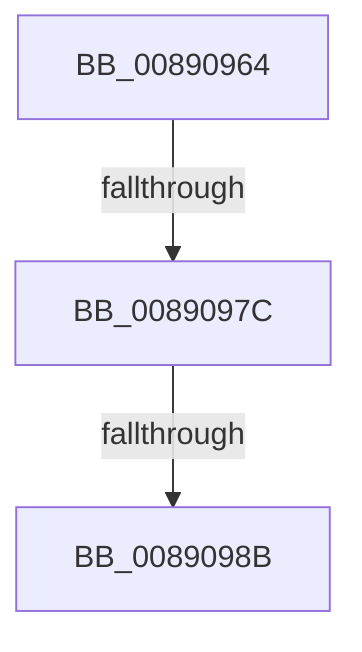

# sub_00890964

- RVA: `0x00890964`–`0x00890994` (길이 `48` bytes)
- VA: `0x0000000140890964`
- 실행 섹션: `PAGE`
- PDB 이름 있음: `아니요`; PDB Function 태그: `아니요`
- unwind 정보 RVA: `0x0007D768`
- 디코드: `14`개 명령, `48/48` bytes 표시
- 미해석 바이트: `0` (있으면 어셈블리에 `.byte`로 보존)

> 이 문서는 커널 이미지의 기계어와 PDB 기호를 분석해 생성했습니다. 4번과 5번은 함수 원형과 자료형을 바이너리 사용 방식에서 추정한 C 해석이며 원본 소스 복구 결과는 아닙니다.

## 1. Dependencies

- 직접 호출 지점: **0**; 고유 호출 대상: **0**
- 직접 호출자로 확인된 함수: **0**
- RIP 상대 이미지 참조: **0**

### Outgoing calls
- 직접 디코드된 call 명령이 없습니다.

### Direct callers
- 이 함수 시작 RVA로 연결되는 직접 call은 확인되지 않았습니다. 간접 호출은 완전히 역산할 수 없습니다.

### Static image references
- 디코드된 RIP-relative 메모리 참조가 없습니다.

## 2. Other-region calls and transfers

- 다른 실행 섹션으로 향하는 call: **0**
- call이 아닌 외부 분기/꼬리 이동: **3**
  - `0x00890976` → [sub_008909EC + 0x95](Unknown_function_008909EC.md) (`tail-transfer`)
  - `0x00890989` → [sub_0089090A + 0x19](Unknown_function_0089090A.md) (`tail-transfer`)
  - `0x00890992` → [sub_0089090A + 0x10](Unknown_function_0089090A.md) (`tail-transfer`)

## 3. Assembly (complete function range)

```asm
00890964  CC                              int3
00890965  4C 8B 06                        mov r8, qword ptr [rsi]
00890968  48 89 6C 24 70                  mov qword ptr [rsp + 0x70], rbp
0089096D  4C 89 6C 24 78                  mov qword ptr [rsp + 0x78], r13
00890972  49 83 F8 FE                     cmp r8, -2
00890976  0F 84 05 01 00 00               je 0x140890a81
0089097C  48 8B 49 10                     mov rcx, qword ptr [rcx + 0x10]
00890980  49 8B D4                        mov rdx, r12
00890983  49 8B C4                        mov rax, r12
00890986  48 85 C9                        test rcx, rcx
00890989  74 98                           je 0x140890923
0089098B  48 8D 59 28                     lea rbx, [rcx + 0x28]
0089098F  48 85 DB                        test rbx, rbx
00890992  74 86                           je 0x14089091a
```

## 4. C-style interpretation (structured pseudocode)

```c
__int64 __fastcall sub_00890964(__int64 a1)
{
    unsigned __int64 v_stack_p70;
    unsigned __int64 v_stack_p78;

    v_stack_p70 = v_rbp;
    v_stack_p78 = v_r13;
}
```

## 5. (Beta) C Style

```c
int64_t sub_00890964(void *Arg1)
{
    uint8_t *arg1 = (uint8_t *)Arg1;

    uint64_t v_stack_p70;
    uint64_t v_stack_p78;

    v_stack_p70 = local_rbp;
    v_stack_p78 = local_r13;
}
```

### 관측된 메모리 오프셋

구조체 형식이 확인되지 않은 접근은 인자 기준의 오프셋으로만 기록했습니다.

| 기준 인자 | 오프셋 표현 | 폭 (bit) | 접근 |
|---|---:|---:|---|
| `Arg1` | `+ 0x10` | `64` | `R` |

## 6. Execution-region graph

[열기: 2D/3D 그래프와 함수 탐색 컨트롤 패널](../../../control-panel.html?section=page&rva=0x00890964&view=graph)

- 2D 그래프는 위에서 아래로 흐르고, 3D 그래프는 빈 공간을 드래그해 회전합니다. Shift+드래그는 이동, 휠은 확대·축소, 함수 노드 선택은 대상 보고서 이동입니다.

### Static fallback


