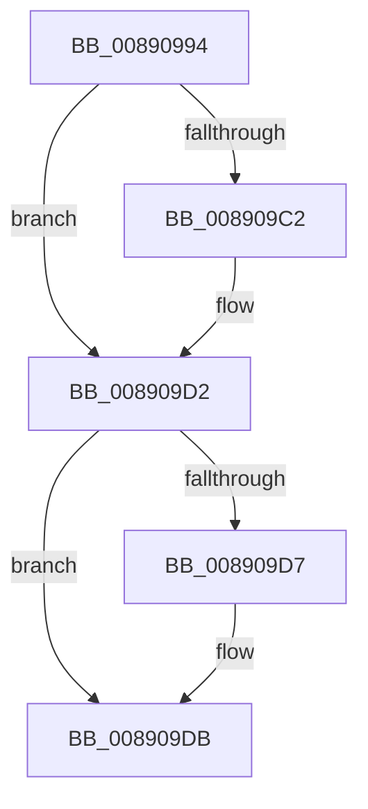

# sub_00890994

- RVA: `0x00890994`–`0x008909EC` (길이 `88` bytes)
- VA: `0x0000000140890994`
- 실행 섹션: `PAGE`
- PDB 이름 있음: `아니요`; PDB Function 태그: `아니요`
- unwind 정보 RVA: `0x0007D780`
- 디코드: `23`개 명령, `88/88` bytes 표시
- 미해석 바이트: `0` (있으면 어셈블리에 `.byte`로 보존)

> 이 문서는 커널 이미지의 기계어와 PDB 기호를 분석해 생성했습니다. 4번과 5번은 함수 원형과 자료형을 바이너리 사용 방식에서 추정한 C 해석이며 원본 소스 복구 결과는 아닙니다.

## 1. Dependencies

- 직접 호출 지점: **2**; 고유 호출 대상: **2**
- 직접 호출자로 확인된 함수: **0**
- RIP 상대 이미지 참조: **0**

### Outgoing calls
- `0x008909AA` → [KeAbPreAcquire](../../text/21/KeAbPreAcquire_function_00210230.md) (function, `0x00210230`)
- `0x008909CD` → [ExfAcquirePushLockSharedEx](../../text/21/ExfAcquirePushLockSharedEx_function_0021044C.md) (function, `0x0021044C`)

### Direct callers
- 이 함수 시작 RVA로 연결되는 직접 call은 확인되지 않았습니다. 간접 호출은 완전히 역산할 수 없습니다.

### Static image references
- 디코드된 RIP-relative 메모리 참조가 없습니다.

## 2. Other-region calls and transfers

- 다른 실행 섹션으로 향하는 call: **2**
  - `0x008909AA` → [KeAbPreAcquire](../../text/21/KeAbPreAcquire_function_00210230.md) (`PAGE` → `.text`)
  - `0x008909CD` → [ExfAcquirePushLockSharedEx](../../text/21/ExfAcquirePushLockSharedEx_function_0021044C.md) (`PAGE` → `.text`)
- call이 아닌 외부 분기/꼬리 이동: **1**
  - `0x008909EA` → [sub_008909EC + 0x12](Unknown_function_008909EC.md) (`tail-transfer`)

## 3. Assembly (complete function range)

```asm
00890994  4C 89 BC 24 80 00 00 00         mov qword ptr [rsp + 0x80], r15
0089099C  48 8D 6B 08                     lea rbp, [rbx + 8]
008909A0  4D 8D 78 F0                     lea r15, [r8 - 0x10]
008909A4  48 8B CD                        mov rcx, rbp
008909A7  45 33 C0                        xor r8d, r8d
008909AA  E8 81 F8 97 FF                  call 0x140210230
008909AF  48 8B F0                        mov rsi, rax
008909B2  41 BD 11 00 00 00               mov r13d, 0x11
008909B8  33 C0                           xor eax, eax
008909BA  F0 4C 0F B1 6D 00               lock cmpxchg qword ptr [rbp], r13
008909C0  74 10                           je 0x1408909d2
008909C2  4C 8B CD                        mov r9, rbp
008909C5  4C 8B C6                        mov r8, rsi
008909C8  33 D2                           xor edx, edx
008909CA  48 8B CD                        mov rcx, rbp
008909CD  E8 7A FA 97 FF                  call 0x14021044c
008909D2  48 85 F6                        test rsi, rsi
008909D5  74 04                           je 0x1408909db
008909D7  C6 46 0A 01                     mov byte ptr [rsi + 0xa], 1
008909DB  41 8B CF                        mov ecx, r15d
008909DE  4C 8B BC 24 80 00 00 00         mov r15, qword ptr [rsp + 0x80]
008909E6  48 3B 4B 10                     cmp rcx, qword ptr [rbx + 0x10]
008909EA  73 12                           jae 0x1408909fe
```

## 4. C-style interpretation (structured pseudocode)

```c
__int64 __fastcall sub_00890994(__int64 a1, int a2, __int64 a3, __int64 a4, __int64 a5, __int64 a6, __int64 a7, __int64 a8, __int64 a9, __int64 a10, __int64 a11, __int64 a12, __int64 a13, __int64 a14, __int64 a15, __int64 a16)
{
    __int64 result;
    unsigned __int64 v_stack_p80;

    v_stack_p80 = v_r15;
    a3 = 0;
    result = KeAbPreAcquire(v_rbx + 8, a2, a3, a4);
    result = 0;
    if (!(condition_is_equal)) {
        a4 = v_rbx + 8;
        a3 = 0;
        a2 = 0;
        a1 = v_rbx + 8;
        result = ExfAcquirePushLockSharedEx(a1, a2, a3, a4);
    }
    if (result != 0) {
        *(unsigned __int8 *)(result + 10) = 1;
    }
}
```

## 5. (Beta) C Style

```c
int64_t sub_00890994(int64_t Arg1, int32_t Arg2, void *Arg3, int64_t Arg4, uint64_t Arg5, uint64_t Arg6, uint64_t Arg7, uint64_t Arg8, uint64_t Arg9, uint64_t Arg10, uint64_t Arg11, uint64_t Arg12, uint64_t Arg13, uint64_t Arg14, uint64_t Arg15, int64_t Arg16)
{
    uint8_t *arg3 = (uint8_t *)Arg3;

    int64_t result;
    uint64_t v_stack_p80;

    v_stack_p80 = local_r15;
    Arg3 = 0;
    result = KeAbPreAcquire(local_rbx + 8, Arg2, Arg3, Arg4);
    result = 0;
    if (!(condition_is_equal)) {
        Arg4 = local_rbx + 8;
        Arg3 = 0;
        Arg2 = 0;
        Arg1 = local_rbx + 8;
        result = ExfAcquirePushLockSharedEx(Arg1, Arg2, Arg3, Arg4);
    }
    if (result != 0) {
        *(uint8_t *)(result + 0xA) = 1;
    }
}
```

### 관측된 메모리 오프셋

구조체 형식이 확인되지 않은 접근은 인자 기준의 오프셋으로만 기록했습니다.

| 기준 인자 | 오프셋 표현 | 폭 (bit) | 접근 |
|---|---:|---:|---|
| `Arg3` | `- 0x10` | `64` | `R` |

## 6. Execution-region graph

[열기: 2D/3D 그래프와 함수 탐색 컨트롤 패널](../../../control-panel.html?section=page&rva=0x00890994&view=graph)

- 2D 그래프는 위에서 아래로 흐르고, 3D 그래프는 빈 공간을 드래그해 회전합니다. Shift+드래그는 이동, 휠은 확대·축소, 함수 노드 선택은 대상 보고서 이동입니다.

### Static fallback


